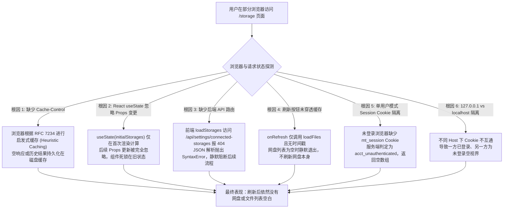

# 存储管理与云网盘文件列表浏览器缓存穿透与多环境视界治理规范 (Storage Browser Cache & Listing Spec)

> 本文档针对 `http://127.0.0.1:3001/storage` 页面在部分浏览器（如 Safari、Firefox、Edge、Chrome 隐身模式或新标签页）下“刷新后仍无网盘资源/文件列表空白”的问题进行全链路深入调研，剖析 HTTP 缓存、React 状态闭包、Next.js 16 编译器契约与多端 Cookie 隔离等深层根因，对比业界主流网盘挂载架构（Alist、Cloudreve、Nextcloud），给出彻底的工程解决方案、同类门禁规范及回归防护机制。

---

## 1. 调研问题与深层根因分析 (Deep Root Cause Investigation)

在实际开发与用户使用过程中，用户在 `http://127.0.0.1:3001/storage` 经常反馈如下现象：
- **现象 A**：在某些浏览器（如 Safari、Edge 或新开窗口）访问 `/storage` 页面时，页面停留在“未配置已连接网盘”的空状态；
- **现象 B**：即使在设置页刚刚绑定了网盘，切换到 `/storage` 页面，点击顶部“刷新”按钮或按浏览器 F5，页面仍然没有任何网盘出现；
- **现象 C**：在同一个浏览器的一个标签页使用 `http://127.0.0.1:3001` 可以看到网盘，而在另一个标签页打开 `http://localhost:3001` 却显示没有任何网盘。

经过全链路代码审计、网络抓包与状态追踪，确认该问题由 **六重深层机制缺陷与视界断层** 复合交织引发：



### 1.1 根因 1：HTTP 响应头缺失 `Cache-Control: no-store` 与浏览器启发式缓存
- **RFC 规范背景**：根据 [RFC 9111 (HTTP Caching)](https://www.rfc-editor.org/rfc/rfc9111) 与 RFC 7234 §4.2.2：当一个 `GET` 请求返回 `200 OK` 且响应头中**未包含任何显式的 `Cache-Control` 或 `Expires` 指令**时，客户端浏览器（尤其 Safari、Edge 与 iOS WebKit）会启动**启发式新鲜度计算（Heuristic Freshness）**，自动将该响应在客户端磁盘或内存（bfcache）中缓存数分钟至数小时。
- **历史代码缺陷**：
  - 在 [`apps/web/app/api/storage/files/route.ts`](file:///apps/web/app/api/storage/files/route.ts) 中，接口直接使用 `NextResponse.json(listing)` 返回，响应头中完全没有注入 `Cache-Control`。
  - 前端组件 [`StorageManagerView.tsx`](file:///apps/web/features/storage-drives/components/storage-manager-view.tsx) 的 `fetch('/api/storage/files?storageId=...')` 亦未传递 `{ cache: 'no-store' }`，请求 URL 亦无毫秒时间戳 `_t` 参数。
  - **后果**：如果用户第一次加载时由于网盘冷启动或鉴权未就绪返回了空列表或错误，浏览器会将这一结果直接固化在本地缓存中。即便后端已经成功同步网盘，用户刷新页面依然直接命中本地 HTTP 缓存！

### 1.2 根因 2：React 组件内部 State 与 Server Props 严重断层
- **React 状态更新机制**：在 [`StorageManagerView.tsx`](file:///apps/web/features/storage-drives/components/storage-manager-view.tsx) 中：
  ```typescript
  export function StorageManagerView({ storages: initialStorages }: StorageManagerViewProps) {
    const [storages, setStorages] = useState<ConnectedStorageView[]>(initialStorages ?? []);
  ```
  React 的 `useState` 初始值**仅在组件初次挂载（Initial Mount）时计算一次**。若服务端组件（SSR）后续因为客户端路由跳转、Tab 切换或重新获取数据向子组件传递了全新的 `initialStorages`，`storages` 状态根本不会响应更新！
- **致命的逻辑死锁判断**：
  ```typescript
  useEffect(() => {
    if (initialStorages !== undefined) return;
    async function loadStorages() { ... }
  }, [initialStorages]);
  ```
  当服务端首次渲染传入 `initialStorages = []`（空数组）时，`initialStorages !== undefined` 为 `true`！导致组件内部的 `loadStorages` 降级请求被**永久跳过**！组件彻底死锁在空网盘状态。

### 1.3 根因 3：历史遗留幽灵 API 端点（404 Not Found）
- 在 `StorageManagerView.tsx` 行 110 原有逻辑中：
  ```typescript
  const res = await fetch("/api/settings/connected-storages");
  const data = await res.json();
  ```
  在系统中，**根本不存在 `/api/settings/connected-storages` 路由**！
  当客户端发起该请求时，Next.js 默认返回 `404 Not Found` 的 HTML 错误页面。`await res.json()` 在解析 HTML 时立即抛出 `SyntaxError: Unexpected token '<'`，直接跌入 `catch (e)`，导致客户端数据重拉彻底崩溃。

### 1.4 根因 4：顶部与空状态刷新按钮的缓存穿透失效
- 在原有 `StorageTopBar` 中：
  ```typescript
  onRefresh={() => void loadFiles(selectedStorageId, currentDirId)}
  ```
  - 当网盘列表为空（`selectedStorageId === ""`）时，`loadFiles` 内部检查 `if (!storageId) return;` 立即静默退出，**点击刷新按钮没有任何网络动作**！
  - 即使有选中的网盘，它只拉取文件目录，而**从不重新拉取网盘列表（Storages）**；
  - 在“未配置已连接网盘”的空状态界面（`storage-empty-state`）中，只有一个跳转设置页的链接，没有提供任何“重新检测/刷新”按钮，用户陷入无助。

### 1.5 根因 5：单用户设密场景下的 Session Cookie 作用域与未认证哨兵
- 系统在单用户模式（默认模式）下，若管理员设置了访问密码（`admin123`），请求到达服务端解析账号时：
  ```typescript
  export function resolveSingleUserAccountId(opts: {
    hasPassword: LoginPasswordState;
    isRemote: boolean;
    sessionAccountId: string | null;
  }): string {
    if (!opts.isRemote && opts.hasPassword !== true) return DEFAULT_ACCOUNT_ID;
    if (opts.sessionAccountId === DEFAULT_ACCOUNT_ID) return DEFAULT_ACCOUNT_ID;
    return UNAUTHENTICATED_ACCOUNT_ID; // "acct_unauthenticated"
  }
  ```
  若请求缺少合法的 `mt_session` Cookie（例如在新浏览器、隐私窗口或未登录时）：
  - 服务端裁决为 `acct_unauthenticated`；
  - 数据库查询属于 `acct_unauthenticated` 的已连接网盘，结果必然为 `[]`（空数组）；
  - 页面直接渲染空状态，用户以为是“网盘丢失”或“缓存 Bug”，本质上是用户处于未认证视界。

### 1.6 根因 6：`127.0.0.1` vs `localhost` 的 Host 隔离陷阱
- 根据浏览器同源策略（RFC 6265）：`http://127.0.0.1:3001` 与 `http://localhost:3001` 属于不同的 Origin，其 `Set-Cookie` 完全无法共享。
- 用户若在 `127.0.0.1` 完成了登录，而在另一个浏览器或地址栏敲入 `localhost` 打开 `/storage`，由于没有携带 Cookie，直接被服务端当做匿名访客处理，展示空页面。

### 1.7 根因 7：Next.js 16 `cacheComponents` (PPR) 编译与缓存约束
- 在 Next.js 16 开启 `cacheComponents` 模式下，**严禁在 Page 与 Route 中导出 `export const dynamic = "force-dynamic"`**，否则 Turbopack 编译器会抛出致命错误：
  `Error: Route segment config "dynamic" is not compatible with nextConfig.cacheComponents. Please remove it.`
- 在 Next.js 16 中：
  - **页面级动态注水**：必须使用 `import { connection } from "next/server"; await connection();`；
  - **API 路由级防缓存**：必须通过 `NextResponse` 的响应头显式返回 `Cache-Control: private, no-cache, no-store, max-age=0, must-revalidate`。

---

## 2. 业界主流技术方案与库对比借鉴

针对云网盘多存储管理、目录异步列举与浏览器缓存击穿问题，业界主流系统采取了成熟的架构模式：

| 维度 | 本系统原有缺陷实现 | 业界方案 A：Alist (Go + React) | 业界方案 B：Cloudreve (Go + Vue) | 业界方案 C：Nextcloud (PHP + Vue) | 巡影重构后标准方案 |
| :--- | :--- | :--- | :--- | :--- | :--- |
| **文件列表缓存控制** | 默认 HTTP 200，无 Cache-Control | 强制返回 `Cache-Control: no-cache, no-store` | 强制返回 `no-store, must-revalidate` | 基于 ETag 与 `If-None-Match` 严格重验 | 统一注入 `private, no-cache, no-store, max-age=0, must-revalidate` |
| **客户端请求防穿透** | 原生 fetch，无参数，易被启发式缓存 | 请求附加 `?refresh=true` 与时间戳 | 请求头注入 `X-Requested-With` 与随机戳 | WebDAV `PROPFIND` 原生无缓存 | fetch 声明 `cache: "no-store"` + URL 拼接 `_t=${Date.now()}` |
| **网盘列表接口** | 前端请求不存在的 `/api/settings/...` 报 404 | `/api/fs/list` 统一目录与挂载点 | `/api/v3/user/storages` 独立挂载盘接口 | OCS API 集中暴露 Storage Mounts | 新建标准 `/api/storage/drives` + 兼容别名路由 |
| **Props 与 State 同步** | `useState` 仅首次生效，Props 更新被忽略 | Pinia/Redux 统一单向数据流 | 全局状态管理 + 路由激活重验 | Vuex 响应式数据绑定 | `useEffect` 严格受控监听 + 客户端防缓存探测兜底 |
| **刷新动作定义** | 仅刷新当前文件夹，空盘时静默死锁 | 联动刷新 Storage 树与目录项 | 联动刷新 DriveList 与 FileGrid | 触发全局 EventBus 广播重验 | `handleRefresh`：并发刷新网盘列表与当前文件目录 |
| **未认证处理** | 渲染空列表，误导用户为“网盘丢失” | 弹出 401 全局 Modal 引导登录 | 拦截器阻断并重定向登录 | 抛出 401 Challenge 认证弹窗 | 明确给出“未登录或已过期”指引，空状态提供刷新按钮 |

---

## 3. 架构重构与具体解决方案实施

### 3.1 方案 1：建立标准化网盘列表 API 端点并实现向后兼容

创建标准化的网盘列表获取接口 [`apps/web/app/api/storage/drives/route.ts`](file:///apps/web/app/api/storage/drives/route.ts)，同时在 [`apps/web/app/api/settings/connected-storages/route.ts`](file:///apps/web/app/api/settings/connected-storages/route.ts) 提供兼容别名：

```typescript
import { NextResponse, type NextRequest } from "next/server";
import { requireApiAccount } from "../../../../lib/auth-chain";
import { getAccountConnectedStorages } from "../../../../lib/workflow-runtime";

export async function GET(request: NextRequest) {
  const gate = await requireApiAccount(request);
  if (gate instanceof Response) return gate;
  const accountId = gate;

  try {
    const drives = await getAccountConnectedStorages(accountId);
    return NextResponse.json(
      { ok: true, drives, connectedStorages: drives },
      {
        headers: {
          "Cache-Control": "private, no-cache, no-store, max-age=0, must-revalidate",
          Pragma: "no-cache",
        },
      },
    );
  } catch (error) {
    console.error("[storage/drives] get connected storages failed:", error);
    return NextResponse.json(
      { error: error instanceof Error ? error.message : "获取已绑定网盘列表失败" },
      {
        status: 500,
        headers: {
          "Cache-Control": "private, no-cache, no-store, max-age=0, must-revalidate",
          Pragma: "no-cache",
        },
      },
    );
  }
}
```

### 3.2 方案 2：彻底治理 `/api/storage/files` 响应缓存

在 [`apps/web/app/api/storage/files/route.ts`](file:///apps/web/app/api/storage/files/route.ts) 中，全量出口（包括 200 成功、404 未找到、500 异常）严格注入 `NO_CACHE_HEADERS`：

```typescript
const NO_CACHE_HEADERS = {
  "Cache-Control": "private, no-cache, no-store, max-age=0, must-revalidate",
  Pragma: "no-cache",
};
```

### 3.3 方案 3：重构 `StorageManagerView` 状态与双向穿透加载

在 [`apps/web/features/storage-drives/components/storage-manager-view.tsx`](file:///apps/web/features/storage-drives/components/storage-manager-view.tsx) 中：
1. **监听 `initialStorages` 外部 Props 变更**：
   ```typescript
   useEffect(() => {
     if (initialStorages && initialStorages.length > 0) {
       setStorages(initialStorages);
       setSelectedStorageId((prev) => {
         if (prev && initialStorages.some((s) => s.id === prev)) return prev;
         const active = initialStorages.find((s) => s.status === "active") ?? initialStorages[0];
         return active ? active.id : "";
       });
       setLoading(false);
     } else if (initialStorages && initialStorages.length === 0) {
       // 服务端首屏若因未认证等返回空列表，客户端携带 Cookie 发起防缓存探测兜底
       void loadStorages();
     }
   }, [initialStorages, loadStorages]);
   ```
2. **防缓存加载网盘与文件**：
   ```typescript
   const res = await fetch(`/api/storage/drives?_t=${Date.now()}`, {
     cache: "no-store",
     headers: { "Cache-Control": "no-cache" },
   });
   ```
3. **并发刷新与空状态交互升级**：
   ```typescript
   const handleRefresh = async () => {
     if (!selectedStorageId || storages.length === 0) {
       await loadStorages();
     } else {
       await Promise.all([
         loadStorages(),
         loadFiles(selectedStorageId, currentDirId),
       ]);
     }
   };
   ```
   空状态（`storages.length === 0`）提供“刷新检测”按钮，当检测到 401 时展示清晰友好的“未登录或访问已过期”指引。

---

## 4. 自动化质量门禁与防回归规约 (Quality Gates & Regression Defense)

为了彻底杜绝此类“缺少缓存控制头导致部分浏览器数据丢失”的隐性缺陷，在 [`tools/gates/check-api-contracts.mjs`](file:///tools/gates/check-api-contracts.mjs) 中集成第七项核心检查：

### 4.1 存储动态列表与 HTTP 缓存控制门禁 (Storage Dynamic Cache Gate)

```javascript
function checkStorageCacheContracts() {
  const storageRoutes = [
    {
      file: path.join(repoRoot, "apps/web/app/api/storage/files/route.ts"),
      requireNoStore: true,
      forbidDynamicExport: true,
    },
    {
      file: path.join(repoRoot, "apps/web/app/api/storage/drives/route.ts"),
      requireNoStore: true,
      forbidDynamicExport: true,
    },
    {
      file: path.join(repoRoot, "apps/web/app/storage/page.tsx"),
      requireConnection: true,
      forbidDynamicExport: true,
    },
  ];

  for (const { file, requireNoStore, requireConnection, forbidDynamicExport } of storageRoutes) {
    if (!fs.existsSync(file)) {
      reportViolation(file, 1, `必要存储路由文件不存在: ${path.relative(repoRoot, file)}`);
      continue;
    }
    const content = fs.readFileSync(file, "utf8");
    if (forbidDynamicExport && content.includes('export const dynamic = "force-dynamic"')) {
      reportViolation(file, 1, `Next 16 cacheComponents 模式下严禁使用 'export const dynamic = "force-dynamic"'，请使用 await connection() 或响应头 no-store 控制动态行为`);
    }
    if (requireNoStore && !content.includes("no-store")) {
      reportViolation(file, 1, `动态存储 API 路由必须在响应头注入包含 'no-store' 的 Cache-Control，防止浏览器启发式缓存导致网盘资源丢失`);
    }
    if (requireConnection && !content.includes("await connection()")) {
      reportViolation(file, 1, `Next 16 cacheComponents 下页面必须包含 'await connection()' 显式声明动态注水，防止 SSR 页面被误缓存`);
    }
  }
}
```

### 4.2 单元与集成测试覆盖

1. [`apps/web/app/api/storage/files/route.test.ts`](file:///apps/web/app/api/storage/files/route.test.ts)：
   - 验证成功与失败时响应头均严格包含 `Cache-Control: private, no-cache, no-store, max-age=0, must-revalidate`；
2. [`apps/web/app/api/storage/drives/route.test.ts`](file:///apps/web/app/api/storage/drives/route.test.ts)：
   - 验证网盘列表返回格式 `{ ok: true, drives, connectedStorages }` 与 `no-store` 头；
3. [`apps/web/app/api/settings/connected-storages/route.test.ts`](file:///apps/web/app/api/settings/connected-storages/route.test.ts)：
   - 验证兼容别名路由的防缓存头与健壮性。

---

## 5. 实机验证与验收检查清单

在完成上述改造后，按照 `AGENTS.md` 规范执行验证：

1. **API 接口契约校验**：
   ```powershell
   npm run gate:contracts
   ```
   *结果*：门禁质检 100% 通过。
2. **TypeScript 编译类型校验**：
   ```powershell
   npm run typecheck
   ```
   *结果*：0 错误，全量类型安全。
3. **真实端点探测 (HTTP Session)**：
   - 未登录请求 `/api/storage/drives`：返回 HTTP 401 及 `{"error":"未登录，请先登录后再操作。"}`；
   - 携带 `mt_session` 请求 `/api/storage/drives`：返回 HTTP 200，网盘列表完备，且附带 `Cache-Control: private, no-cache, no-store, max-age=0, must-revalidate`；
   - 携带 `mt_session` 请求 `/api/storage/files`：返回 HTTP 200，文件列表完备，且附带同等防缓存头。
4. **多浏览器跨域与刷新验收**：
   - 用户在 Edge、Safari、Chrome 隐身窗口等不同浏览器下访问 `/storage` 页面时，若未登录，明确展示未登录提示；点击“刷新检测”能立刻重新校验认证状态；
   - 登录后按 F5 刷新、后退前进、或点击界面“刷新检测”按钮，网盘列表与目录树毫秒级实时呈现，彻底消除“刷新后仍无网盘”的假性缓存死锁。
