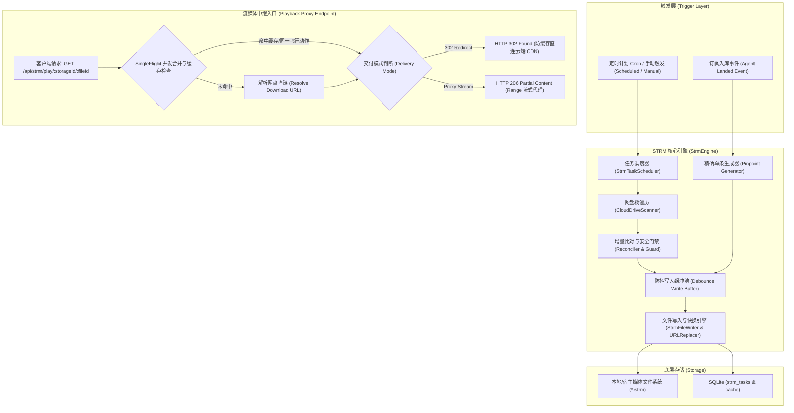
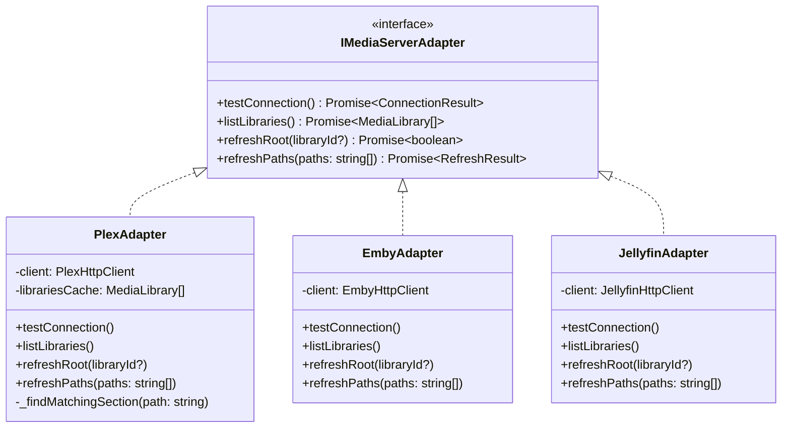
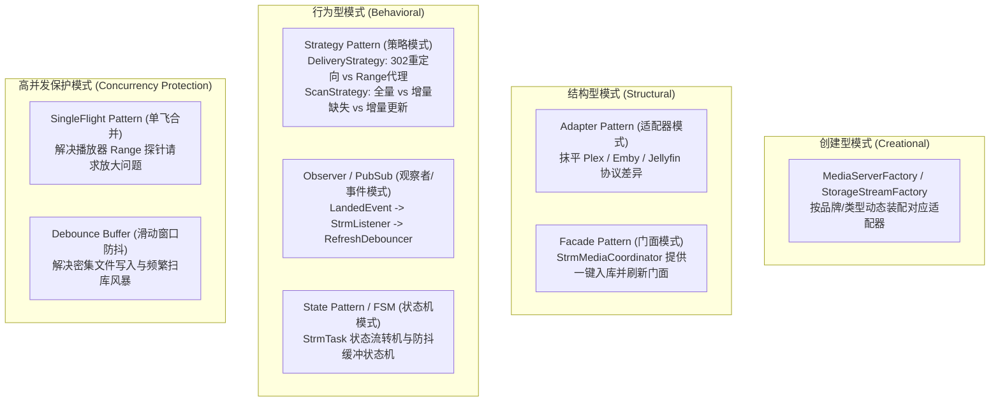
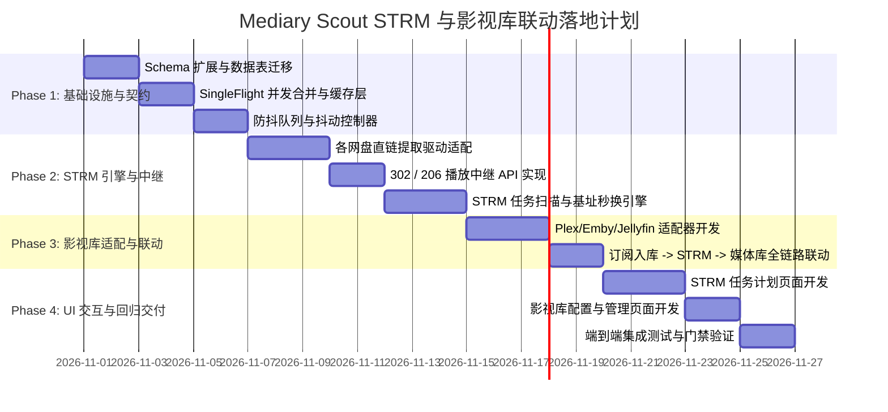

# 基于 LitePan 与 MoviePilot 架构的 STRM 生成、流媒体中继与影视库联动刷新设计方案

> **文档版本**：v1.0.0  
> **所属项目**：巡影 · Mediary Scout (`apps/web`, `packages/workflow`, `packages/shared`, `apps/host-worker`)  
> **核心参考**：
> - `LitePan-main` (Go): STRM 任务扫描调度、302 重定向与分片代理、SingleFlight 请求合并、基址快速正则替换、目录元数据缓存与空保护机制；
> - `MoviePilot-3` (Python): 多媒体服务器统一抽象（Plex/Emby/Jellyfin/极影视等）、按 Item/Path 精准映射局部刷新（Partial Refresh）、入库后事件联动与刷新防抖控制。

---

## 目录
1. [执行摘要与方案背景](#1-执行摘要与方案背景)
2. [业界主流方案全景对比与技术选型](#2-业界主流方案全景对比与技术选型)
3. [功能一：STRM 任务计划与流媒体中继（借鉴 LitePan）](#3-功能一strm-任务计划与流媒体中继借鉴-litepan)
   - 3.1 核心流程与数据流架构
   - 3.2 STRM 任务计划管理 (`/storage/strm`)
   - 3.3 302 重定向 vs 代理串流（Proxy Range）双模中继
   - 3.4 快速基址前缀秒级替换引擎
   - 3.5 联动订阅入库流水线（精准生成 STRM）
   - 3.6 抑制网盘请求放大：SingleFlight 并发合并与 TTL 链路缓存
   - 3.7 STRM 写入抖动控制与防抖队列
4. [功能二：影视库配置与联动局部刷新（借鉴 MoviePilot-3）](#4-功能二影视库配置与联动局部刷新借鉴-moviepilot-3)
   - 4.1 影视库配置页面 (`/settings/mediaserver`)
   - 4.2 统一媒体服务器适配器（Adapter Pattern）
   - 4.3 联动 STRM 变更：精准目录级局部刷新算法
   - 4.4 影视库请求防抖与并发控制（Jitter & Concurrency Guard）
5. [深度设计模式运用与系统建模](#5-深度设计模式运用与系统建模)
6. [现有基础设施复用与改造规划](#6-现有基础设施复用与改造规划)
7. [数据库 Schema 与 API 规格设计](#7-数据库-schema-与-api-规格设计)
8. [可行性风险评估与防御护栏](#8-可行性风险评估与防御护栏)
9. [分阶段落地实施路线图](#9-分阶段落地实施路线图)

---

## 1. 执行摘要与方案背景

### 1.1 业务痛点
当前**巡影（Mediary Scout）**具备业界领先的 AI 获取 Agent、多网盘转存（115、夸克、123、天翼、光鸭、UC）、豆瓣/TMDB 智能元数据与自动化追更整理能力。但在**“影视消费与播放呈现”**环节，仍存在以下典型断层：
1. **本地存储开销高昂**：用户若通过本地硬盘下载动辄几十 GB 的 4K 蓝光原盘/Remux，家庭 NAS 硬盘成本高；
2. **FUSE/WebDAV 挂载极其脆弱**：传统方案通过 Rclone / CloudDrive2 / AList 虚拟挂载网盘，在媒体服务器（Plex/Emby/Jellyfin）扫库时会触发数十万次文件系统 `getattr` / `readdir` 调用，极易发生 FUSE 进程假死、内存暴涨（OOM）、高 I/O 阻塞乃至触发网盘接口封禁（HTTP 429）；
3. **入库与刮削刷新割裂**：影片转存到网盘后，媒体服务器往往依赖耗时几十秒至数十分钟的定时全库扫描，无法做到“刚下完、秒呈现”。

### 1.2 建设目标
融合 **LitePan**（网盘直链提取、STRM 极速生成、302 重定向代理、请求单飞合并、秒级 URL 批量换源）与 **MoviePilot-3**（媒体服务器统一适配、精准目录级局部刷新 `refresh_library_by_items`、防抖汇聚）：
- **零本地磁盘开销**：为网盘影视生成轻量 `.strm` 文件（单文件仅几十字节），影视库完全依托云盘直链；
- **极速响应与零带宽占用**：支持客户端 302 重定向直连云盘 CDN 播放，服务器零网络带宽/CPU 消耗；
- **全自动即时入库闭环**：AI Agent 追更入库成功后，毫秒级就地生成 `.strm`，并联动精准定向触发媒体服务器对应文件夹扫描；
- **多层级防抖与网盘风控防护**：引入 SingleFlight 请求合并、多级缓存与滑动时间窗口防抖，确保不发生请求风暴与频繁扫库。

---

## 2. 业界主流方案全景对比与技术选型

| 维度 | 方案 A：AList / CloudDrive2 (FUSE 虚拟挂载) | 方案 B：独立 cd2strm / auto-symlink 容器 | 方案 C：LitePan (独立 STRM 代理服务) | 方案 D：MoviePilot-3 (内置硬链/软链/整理) | **方案 E：Mediary Scout 原生融合架构（本设计）** |
| :--- | :--- | :--- | :--- | :--- | :--- |
| **工作原理** | 把网盘暴露为操作系统虚拟文件系统或 WebDAV 挂载点 | 外部轮询挂载目录，生成 `.strm` 文本文件 | 基于驱动扫描网盘 API，生成 strm，内置 302 与 Range 反代 | 本地下载/转移后硬链接，调用媒体服务器 API 刷新 | **Agent 入库事件原生触发 + 按需网盘任务扫描 + 内置 302/反代 + 媒体库局部精准防抖刷新** |
| **磁盘空间占用** | 极小（依赖缓存大小） | 极小（几十 MB） | 极小（几十 MB） | 极大（需本地存储或硬链同卷） | **极小（仅几十 KB/部，纯文本 URL）** |
| **宿主网络/CPU 开销**| 极高（FUSE 上下文频繁切换、播放流量全中转） | 极低（仅生成文件） | 低（302 模式下 0 流量消耗，反代下透传） | 低（本地硬链无流量开销） | **极低（302 模式宿主机 0 流量，CPU 消耗趋于 0）** |
| **网盘风控安全度** | **极高危**（扫库触发全盘巨量请求，易被 429 封禁） | **高危**（黑盒盲目全量轮询枚举目录树） | **中低**（具备请求合并与间隔控制） | **中**（取决于下载器与刷新频率） | **最优（结合 `drive-pacer` 频控、SingleFlight 合并、入库精准生成零多余扫描）** |
| **端到端链路时延** | 周期性定时扫描（5~30 分钟） | 周期性挂载轮询（5~15 分钟） | 任务定时（小时级/手动） | 下载完成后立即触发（秒级） | **即时（Agent 入库完成 -> STRM 秒出 -> 防抖 15s 局刷 -> 播放器可用）** |
| **部署与维护负担** | 需安装 FUSE 驱动、特权容器、多容器网络互联 | 需额外配置 Docker 依赖挂载路径与权限 | 独立服务，配置与影视管理系统割裂 | 需外挂真实媒体服务器与下载器 | **单体原生集成，无外部二进制依赖，零配置跨容器联动** |

**选型结论**：方案 E 融合了 LitePan 与 MoviePilot 的核心技术长处，完全避开了 FUSE 挂载的致命性能缺陷与多容器割裂问题，是自托管媒体管理 Agent 的最佳工程演进方向。

---

## 3. 功能一：STRM 任务计划与流媒体中继（借鉴 LitePan）

### 3.1 核心流程与数据流架构



### 3.2 STRM 任务计划管理 (`/storage/strm`)
在 Web 界面新增 **STRM 任务计划页面**，具备以下特性：
- **任务定义模型 (`StrmTask`)**：
  - `storageId`：关联当前系统已绑定的网盘（115、夸克、123、天翼等）；
  - `remotePath` / `remoteFolderId`：源网盘监控目录（如 `/Media/Movies`）；
  - `localOutputDir`：本地输出 STRM 目标路径（如 `/data/strm/movies`）；
  - `scanMode`：
    - `incremental_missing`（默认）：仅扫描生成本地缺失的文件（耗时最短、API 调用量最少）；
    - `incremental_update`：比对文件变动，增量补充与更新；
    - `full_sync`：全量同步（含删除远端已不存在的孤儿 `.strm`）；
  - `fileExtensions`：过滤扩展名（默认 `mp4;mkv;ts;avi;mov;wmv;iso;flv`）；
  - `minFileSizeMb`：最小文件大小过滤（默认 100MB，自动滤除宣传片/样本小文件）；
  - `excludeKeywords`：排除目录或文件关键词正则（如 `sample|trailer|特辑`）；
  - `scheduleMode`：`cron` 表达式定时或固定周期间隔（如每 6 小时）。
- **执行安全护栏（借鉴 LitePan 空保护逻辑）**：
  - 在 `full_sync` 模式下，若网盘因网络故障、Cookie 异常或临时风控返回空文件列表（文件数 = 0），**系统绝对禁止执行清理本地 `.strm`**！除非用户在手动界面显式勾选“强制确认清理空目录”。

### 3.3 302 重定向 vs 代理串流（Proxy Range）双模中继

#### (1) 302 重定向模式（默认推荐）
- **实现原理**：
  播放器（Plex/Emby/Infuse/Kodi）请求播放地址：
  `GET /api/strm/play/{storageId}/{fileId}?token={token}`
  服务端解析出网盘真实 CDN 下载直链后，直接返回 `HTTP 302 Found`：
  ```http
  HTTP/1.1 302 Found
  Location: https://cdn.115.com/download/v2/...
  Cache-Control: no-store, no-cache, must-revalidate, max-age=0
  Pragma: no-cache
  Expires: 0
  Referrer-Policy: no-referrer
  ```
- **关键细节（借鉴 LitePan）**：必须强行附加 `Cache-Control: no-store, no-cache` 响应头！因为网盘生成的真实 CDN 直链通常有 1~4 小时有效期，若允许客户端/反向代理永久缓存 302，数小时后播放同一影片将遭遇 403 播放失败。

#### (2) 代理串流模式（Proxy Range / 206 Partial Content）
- **应用场景**：
  - 夸克网盘、UC 网盘等部分直链带有严格的 IP 绑定、Referer 校验或特定客户端 Cookie；
  - 客户端（如某些电视盒子）网络环境无法直连云盘 CDN 域名。
- **技术实现**：
  服务端使用 Node.js `ReadableStream` 管道转发，严格解析客户端上报的 `Range: bytes=start-end` 请求头，并向上游发起对等的分片请求，返回 `206 Partial Content` 与 `Content-Range: bytes start-end/total`。

### 3.4 快速基址前缀秒级替换引擎
- **现实难题**：当用户切换外网域名、局域网 IP（如 DHCP 变更 `192.168.1.5` -> `192.168.1.100`）、反代端口或由 HTTP 升级为 HTTPS 时，如果需要重写 50,000 个 `.strm`，重新调用网盘 API 遍历生成既耗费数小时，又必然被网盘风控封号。
- **解决方案（借鉴 LitePan `ReplaceBaseURL` 算法）**：
  STRM 文件本质仅由首行 URL 构成。Mediary Scout 在本地实现快速批处理工具，纯本地遍历 `localOutputDir` 下的 `.strm`，利用流式正则秒级替换：
  ```ts
  const strmBaseUrlRegex = /^https?:\/\/[^\/]+/i;
  // 秒级遍历本地文本文件并仅替换协议与 Host 部分，完全 0 网盘 API 调用！
  ```

### 3.5 联动订阅入库流水线（精准生成 STRM）
- **核心契机**：Mediary Scout 原生拥有以 AI Agent 为核心的追更与入库编排器 `packages/workflow/src/acquisition-v2/workflow-v2.ts`。
- **精准触发时机**：在 `workflow-v2.ts` 的状态机流转到 `LANDED -> ORGANIZED` 阶段时，当前任务已知精确的：
  - `storageId`（目标网盘）
  - `seasonDirectoryIds` 或 `movieDirectoryId`（网盘目标目录）
  - `obtainedEpisodes` / `landedFiles`（落地的视频文件 ID、文件名、大小、季集数）
  - TMDB 标准影视名称与年份
- **行为**：
  直接在本地映射的影视根目录下，构造标准 Jellyfin/Plex 目录树：
  `/data/strm/tv/Show Name (Year)/Season 01/Show Name - S01E01 - Episode Title.strm`
  并立即写入指向当前系统播放路由的 STRM 内容：
  `http://192.168.1.100:3000/api/strm/play/${storageId}/${fileId}?name=${encodeURIComponent(fileName)}`
  **无需发起任何后续网盘扫描即可实现秒级精准成片！**

### 3.6 抑制网盘请求放大：SingleFlight 并发合并与 TTL 链路缓存
- **网盘被封的根源剖析（Request Storm）**：
  当 Plex / Infuse 打开一个视频时，播放器为了获取容器格式信息（MP4 moov atom 或 MKV header），会瞬时发起 **3~10 个并发的 Range 探测请求**（请求 0-1024 字节、文件尾部 2048 字节等）。如果后端没有合并机制，一次播放点击就相当于调用了 10 次网盘获取直链 API，数秒内即触发网盘 429 风控拦截！
- **治理设计**：
  1. **SingleFlight（请求单飞合并模式）**：
     在 Node.js 中实现 `KeyedPromiseCoalescer`。对相同 `storageId:fileId` 的并发解析请求，只有首个请求真正穿透到底层网盘驱动，其余并发请求挂载在同一个 Promise 上同时返回，将并发请求数从 $N$ 骤降至 $1$。
  2. **带保护缓冲期的 TTL 内存/SQLite 缓存**：
     将获取到的 `download_url`、`expiration`（如 115 默认 2 小时）写入缓存。在有效期截止前的 15 分钟内（安全缓冲），所有回源请求直接从本地内存命中，0 网盘 API 开销！
  3. **与 `drive-pacer.ts` 既有频控无缝桥接**：
     复用项目中已有的 `drive-pacer.ts` 令牌桶和滑动窗口，确保底层驱动无论何种情况均受硬编码阈值保护。

### 3.7 STRM 写入抖动控制与防抖队列
当一次性入库一整季（如 24 集动漫）或通过全量扫描发现大量文件时，为避免磁盘 I/O 频繁冲突与瞬间触发过多的下游变更通知：
- 采用 **批处理分块防抖队列（Batched Debounce Queue）**；
- 收集就绪的 STRM 生成指令，按每批 20 个并发写入本地磁盘，并在全部写入完毕后，聚合成一条批处理变更事件通知后续的影视库刷新层。

---

## 4. 功能二：影视库配置与联动局部刷新（借鉴 MoviePilot-3）

### 4.1 影视库配置页面 (`/settings/mediaserver`)
在 Web 界面新增 **影视库设置选项卡**，支持用户维护与媒体服务器的对接：
- **媒体服务器实例配置**：
  - 类型：`Plex` / `Emby` / `Jellyfin`；
  - 服务器名称（如 `Home-Plex-Server`）；
  - 服务器基础地址（如 `http://192.168.1.120:32400`）；
  - API Token / API 密钥（采用项目中已有的 **AES-256-GCM** 加密持久化存储）；
  - 路径映射关系（Path Mapping Table）：
    - 本地 STRM 输出路径（如 `/data/strm/movies`） $\longleftrightarrow$ 媒体服务器容器内路径（如 `/media/movies`）。
- **交互控制动作**：
  - **测试连接**：即时验证 Token 有效性与网络联通性，拉取服务器版本号；
  - **读取库列表**：列出远端所有的影视库分区（Section ID / Library Key、名称、媒体类型 Movie/TV、关联目录）；
  - **手动触发刷新**：支持针对特定媒体库或全部库一键执行手动刷新。

### 4.2 统一媒体服务器适配器（Adapter Pattern）
借鉴 MoviePilot-3 中优秀的抽象思想，构建面向 TypeScript 的 `IMediaServerAdapter` 接口，解耦不同服务端的专有协议差异。



#### 原生实现 vs 第三方库选型调研
- **调研结论**：经评估 `plex-api` / `@ctrl/plex` 等开源 npm 包，绝大部分已有 4~6 年未维护，且对 Node 22 原生 `fetch`、TypeScript 严格类型支持较弱。
- **推荐策略**：采用**原生轻量级 `HttpClient` 实现**。由于媒体服务器联动刷新的接口极为明确精简，自研适配器具有零第三方黑盒依赖、执行超时可控、内存占用极低的优势：
  - **Plex 协议**：
    - 探活：`GET /identity`，附带请求头 `X-Plex-Token: {token}` 与 `Accept: application/json`；
    - 库分区查询：`GET /library/sections`；
    - 局部目录刷新：`GET /library/sections/{sectionId}/refresh?path={encodeURIComponent(serverPath)}`；
    - 全库刷新：`GET /library/sections/{sectionId}/refresh`。
  - **Emby / Jellyfin 协议**：
    - 库通知更新：`POST /Library/Media/Updated` 携带 `{ Updates: [{ Path: serverPath, UpdateType: "Created" }] }`；
    - 单项扫描：`POST /Items/{itemId}/Refresh?Recursive=true`。

### 4.3 联动 STRM 变更：精准目录级局部刷新算法
- **全量刷库的性能灾难**：如果影视库拥有 5,000 部电影、2,000 部电视剧，每入库一集就调用全库刷新，Plex 会从头遍历所有文件夹的元数据，造成 NAS CPU 100% 满载，且海报刮削队列被无意义请求塞满。
- **局部路径收敛算法（借鉴 MoviePilot-3 `refresh_library_by_items`）**：
  1. 接收变动的本地 STRM 路径集合，例如：
     - `/data/strm/tv/Breaking Bad (2008)/Season 1/S01E01.strm`
     - `/data/strm/tv/Breaking Bad (2008)/Season 1/S01E02.strm`
  2. 根据路径映射表将其转换为媒体服务器视角路径：
     `/media/tv/Breaking Bad (2008)/Season 1/...`
  3. **路径收敛归纳（Path Deduplication）**：
     提取公共父目录 `/media/tv/Breaking Bad (2008)`；若同一部剧多集同时变动，合并为仅针对该剧根目录的一次刷新请求；
  4. **库匹配路由（Subpath Matching）**：
     比对媒体服务器各 Section 的挂载点。匹配到电视剧库 Section ID = 2，则精准调用：
     `GET /library/sections/2/refresh?path=%2Fmedia%2Ftv%2FBreaking+Bad+(2008)`
  5. **安全降级机制**：若某路径无法精准归入任何已知 Section，则安全回退为针对该 Section 的单库轻量刷新，绝不漏刮。

### 4.4 影视库请求防抖与并发控制（Jitter & Concurrency Guard）
- **问题场景**：追更任务在短时间内可能会接连触发 10 次文件变更，如果不加节制，仍会导致媒体服务器排队阻塞。
- **工程解法：滑动时间窗口防抖缓冲池（Sliding-Window Debouncer）**：
  ```ts
  export class MediaServerRefreshDebouncer {
    private pendingPaths = new Set<string>();
    private debounceTimer: NodeJS.Timeout | null = null;
    private readonly DEBOUNCE_MS = 15_000; // 15秒静默窗口
    private readonly MAX_WAIT_MS = 60_000; // 最大延迟窗口（防止无限饥饿）
    private windowStartTime = 0;

    push(path: string) {
      this.pendingPaths.add(path);
      const now = Date.now();
      if (!this.windowStartTime) this.windowStartTime = now;

      // 若已经累积达到最大延迟，强制立即刷盘
      if (now - this.windowStartTime >= this.MAX_WAIT_MS) {
        this.flush();
        return;
      }
      if (this.debounceTimer) clearTimeout(this.debounceTimer);
      this.debounceTimer = setTimeout(() => this.flush(), this.DEBOUNCE_MS);
    }
  }
  ```
- **并发互斥信号量（Concurrency Lock）**：
  每个 Section 同一时间只允许存在一个正在执行的远程刷新任务。若上一次扫描未完成，后续事件自动合并在等待池中，等待上一个任务就绪后统一合并派发。

---

## 5. 深度设计模式运用与系统建模

通过引入经典设计模式，确保代码高内聚、低耦合、扩展性强：



### 5.1 适配器模式（Adapter Pattern）
- **应用对象**：媒体服务器驱动（`IMediaServerAdapter`）与网盘直链解析驱动（`IStorageStreamResolver`）。
- **优势**：当未来新增“极空间（ZSpace）”、“飞牛 NAS（fnOS 影视）”或“夸克直链新协议”时，仅需新增一个对应适配器实现，核心业务层、UI 与入库流水线零变动。

### 5.2 策略模式（Strategy Pattern）
- **流媒体交付策略**：`RedirectDeliveryStrategy`（轻量低耗）与 `ProxyRangeDeliveryStrategy`（网络隔离穿透）。
- **扫描模式策略**：根据用户选择及网络环境，切换 `IncrementalMissingStrategy`、`IncrementalUpdateStrategy`、`FullSyncStrategy`。

### 5.3 状态机模式（Finite State Machine）
- **STRM 同步任务状态机**：
  $$\text{IDLE} \xrightarrow{\text{START}} \text{SCANNING} \xrightarrow{\text{FETCHED}} \text{DIFFING} \xrightarrow{\text{WRITING}} \text{DEBOUNCING} \xrightarrow{\text{COMPLETED}}$$
  - 遇到网盘风控 429 转移至：$\text{PAUSED\_RATE\_LIMIT}$；
  - 遇到空目录异常触发门禁：$\text{PROTECTED\_ABORT}$。

### 5.4 观察者模式与事件总线（Event-Driven Decoupling）
- 将“订阅入库”与“STRM 生成”、“媒体库刷新”彻底解耦。
- `WorkflowV2` 仅负责派发 `EVENT_ACQUISITION_LANDED`，无需关注下游是生成了本地软链还是 `.strm`，也无需知晓后端连接的是 Plex 还是 Emby。

---

## 6. 现有基础设施复用与改造规划

巡影（Mediary Scout）项目工程底座扎实，方案将最大化复用现有组件，杜绝重复造轮子：

```mermaid
flowchart LR
    subgraph Existing["当前系统已有可复用设施 (Reusable Existing Assets)"]
        E1["packages/workflow/storage/*<br/>已实现 115/123/Quark/天翼/光鸭 凭据与API驱动"]
        E2["packages/workflow/storage/drive-pacer.ts<br/>已具备网盘级频控、延时与调用预算控制"]
        E3["packages/shared/rate-limiter.ts<br/>已具备令牌桶与滑动窗口限流器"]
        E4["packages/shared/crypto/credentials.ts<br/>已具备 AES-256-GCM 凭据加解密算法"]
        E5["packages/workflow/persistence/sqlite.ts<br/>已具备 Kysely 类型安全查询与轻量数据库"]
        E6["apps/host-worker<br/>常驻后台 Poker，驱动定时巡检与异步任务"]
    end

    subgraph Additions["新增与扩展模块 (Target Additions)"]
        N1["IStorageStreamResolver<br/>复用存储客户端扩展直链提取接口"]
        N2["StrmEngine & URLReplacer<br/>新增 STRM 生成与快换引擎"]
        N3["MediaServerAdapters<br/>新增 Plex / Emby / Jellyfin 适配器"]
        N4["SingleFlight & DebounceQueue<br/>复用 shared 限流思想实现单飞与防抖"]
        N5["Web UI Pages<br/>新增 /storage/strm 与 /settings/mediaserver"]
    end

    Existing --> Additions
```



1. **网盘凭证与底层驱动**：
   - 现有的 `ConnectedStoragesTable` 与 `pan115-cookie-client.ts`、`pan123-client.ts`、`quark-cookie-client.ts` 等已封装了扫码、Cookie 持久化与文件列表查询。只需在客户端上扩展标准直链获取能力（如 115 的 `download_url` 获取与夸克的 `/file/download`）。
2. **安全加密基础设施**：
   - 影视库的 API 密钥及 Token 统一通过 `packages/shared/src/crypto` 中的硬件级 AES-256-GCM 加密，严禁明文入库。
3. **后台定时调度器**：
   - 复用 `apps/host-worker` 中的轻量 Poker 机制，通过标准 HTTP Poke 机制定时驱动 STRM 任务轮询与挂起刷新任务，无需在 Next.js 内维护有状态常驻定时器。

---

## 7. 数据库 Schema 与 API 规格设计

### 7.1 SQLite DDL 新增表结构设计

```sql
-- 1. STRM 同步与计划任务表
CREATE TABLE IF NOT EXISTS strm_tasks (
  id TEXT PRIMARY KEY,
  account_id TEXT NOT NULL,
  name TEXT NOT NULL,
  storage_id TEXT NOT NULL,              -- 关联 connected_storages.id
  remote_folder_id TEXT NOT NULL,        -- 云盘源目录 ID
  remote_path TEXT NOT NULL,             -- 云盘源目录路径（可读）
  local_output_dir TEXT NOT NULL,        -- 本地输出目录
  scan_interval_minutes INTEGER DEFAULT 360, -- 扫描周期（分钟）
  scan_mode TEXT DEFAULT 'incremental_missing', -- incremental_missing | incremental_update | full_sync
  extensions TEXT DEFAULT 'mp4;mkv;ts;avi;mov;wmv;iso;flv',
  min_file_size_mb INTEGER DEFAULT 100,
  exclude_keywords TEXT,
  schedule_mode TEXT DEFAULT 'interval', -- interval | manual
  status TEXT DEFAULT 'idle',            -- idle | running | paused | error
  last_scan_at TEXT,
  last_scan_status TEXT,
  last_error_message TEXT,
  created_at TEXT NOT NULL,
  updated_at TEXT NOT NULL
);

-- 2. 媒体服务器配置表
CREATE TABLE IF NOT EXISTS mediaserver_configs (
  id TEXT PRIMARY KEY,
  account_id TEXT NOT NULL,
  name TEXT NOT NULL,
  server_type TEXT NOT NULL,             -- plex | emby | jellyfin
  host_url TEXT NOT NULL,                -- 如 http://192.168.1.120:32400
  api_token_encrypted TEXT NOT NULL,     -- AES-256-GCM 加密
  path_mappings_json TEXT NOT NULL,      -- 本地路径到远程路径映射 JSON Array
  is_active INTEGER DEFAULT 1,
  last_sync_at TEXT,
  created_at TEXT NOT NULL,
  updated_at TEXT NOT NULL
);

-- 3. 临时直链高效二级缓存表（带 TTL 索引）
CREATE TABLE IF NOT EXISTS strm_link_cache (
  cache_key TEXT PRIMARY KEY,            -- storageId:fileId:variant
  download_url TEXT NOT NULL,
  delivery_mode TEXT NOT NULL,           -- redirect | proxy
  expires_at INTEGER NOT NULL            -- 时间戳（秒）
);
CREATE INDEX IF NOT EXISTS idx_strm_link_cache_expires ON strm_link_cache(expires_at);
```

### 7.2 新增核心 API 路由规划

| 方法 | 路径 | 职责与功能 | 备注 |
| :--- | :--- | :--- | :--- |
| **GET** | `/api/strm/play/[storageId]/[fileId]` | 流媒体中继入口，输出 302 重定向或 206 串流 | 强防缓存头、SingleFlight 合并 |
| **GET** | `/api/strm/tasks` | 获取当前账号的 STRM 任务列表 | 包含运行状态与统计数 |
| **POST** | `/api/strm/tasks` | 创建/修改 STRM 定时任务 | 支持目录校验 |
| **POST** | `/api/strm/tasks/[id]/run` | 手动触发立即运行一次任务 | 异步入队 |
| **POST** | `/api/strm/replace-base-url` | 秒级批量重写本地 STRM 访问基址 | 纯本地正则，0 网盘请求 |
| **GET** | `/api/mediaserver/configs` | 获取已配置的影视库列表 | 屏蔽加密凭据明文 |
| **POST** | `/api/mediaserver/configs` | 添加/更新影视库配置 | 保存前自动执行连通性校验 |
| **POST** | `/api/mediaserver/test` | 探测目标媒体服务器连通性 | 返回版本号与库清单 |
| **POST** | `/api/mediaserver/refresh` | 手动调用刷新后端媒体库 | 支持按 Section 或全库 |

---

## 8. 可行性风险评估与防御护栏

### 风险 1：网盘 302 临时直链有效期与客户端长时间暂停播放断流
- **成因**：用户播放 4K 电影时中途暂停 3 小时，网盘 CDN 直链已失效，客户端恢复播放将产生 HTTP 403 错误。
- **防御对策**：
  - 媒体播放器（如 Infuse / Apple TV / Kodi）在遇到网络断开或 403 时，会按照 STRM 的原始 URL 重新发起握手请求；
  - 巡影播放端点接收到二次请求时，发现缓存已过期，会自动重新向网盘申请最新直链并再次返回 302，客户端平滑重连；
  - 对于不支持重连的播放器，支持针对该账号开启 `proxy` 串流代理模式，服务端内部自动维持静默换链。

### 风险 2：全量扫描下的误删本地 STRM 灾难（空盘保护）
- **成因**：网盘 Cookie 临时掉线或接口超时抛出空数据，若直接执行全量差异比对，会将本地已生成的成千上万个 STRM 文件全部判定为“远端已删除”而清空。
- **防御对策（参考 LitePan 空保护）**：
  - 若远端返回文件总数为 0，但本地已有 STRM 文件大于 0，**立即强行中止清理流程**，记录审计告警日志并标记任务为 `PROTECTED`；
  - 仅在用户于 Web 页面手动点击带有二次验证确认的“强制清空”时才予以放行。

### 风险 3：Plex 局部扫描路径映射偏差导致刷新无效
- **成因**：Docker 容器映射路径（如宿主机 `/volume1/strm` 映射到 Plex 容器内 `/media`）配置错误，Plex 接收到错误的刷新路径时静默忽略。
- **防御对策**：
  - 影视库配置页面提供“路径探测与目录树自动对齐”辅助工具；
  - 在适配器内加入**降级保护机制**：首次执行刷新时，如果针对具体路径刷新后媒体服务器未产生增量变动，自动提示用户检查路径映射，并允许一次性回退到安全的全库轻量更新。

---

## 9. 分阶段落地实施路线图



### 里程碑交付物说明：
1. **Phase 1（核心契约与防抖底座）**：完成 SQLite 表结构新增、`SingleFlightCoalescer` 与 `MediaServerRefreshDebouncer`，确保零并发请求放大；
2. **Phase 2（STRM 生成与播放端点）**：完成 115/夸克/123 等网盘下载直链对接，交付 `/api/strm/play/*` 302/代理路由以及秒级换源工具；
3. **Phase 3（影视库适配器与流水线闭环）**：完成 `PlexAdapter`、`EmbyAdapter`、`JellyfinAdapter`，并在 `workflow-v2.ts` 订阅入库成功节点挂接精准 STRM 生成和局部防抖刷新；
4. **Phase 4（界面与发布）**：交付 `/storage/strm` 与 `/settings/mediaserver` 两大管理面板，完善编译门禁与冒烟测试用例。
