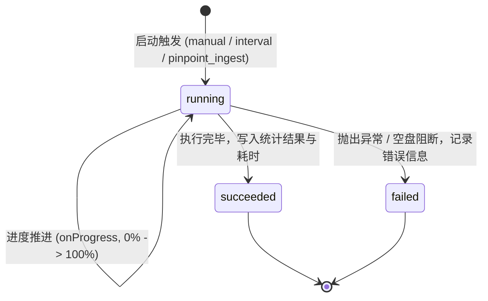

# RFC: STRM 任务与影视库刷新执行记录、实时进度追踪及订阅入库全流程联动

## 1. 背景与目标

在前期完成的 STRM 核心引擎与媒体服务器适配器基础上，针对用户的进一步生产化需求：
1. **执行记录与实时进度**：为 STRM 生成扫描和媒体服务器刷新增加持久化历史执行记录（Execution Records），并支持任务运行中的毫秒级/步进式实时进度（Progress）追踪；
2. **订阅入库全流程闭环联动**：在订阅下载工作流（TV/电影/动漫入库）成功落库（`status === "succeeded"`）后，若用户配置了对应网盘的 STRM 任务及媒体服务器，自动触发精准 `.strm` 生成与媒体服务器局部防抖刷新，实现**「从资源检索 ➔ 离线秒传 ➔ 整理落库 ➔ STRM 生成 ➔ 媒体库更新」**全自动闭环。

---

## 2. 业界主流方案对比与借鉴

| 系统 / 方案 | STRM 生成机制 | 执行记录与进度反馈 | 媒体库刷新联动 | 抖动控制与防风控机制 |
| :--- | :--- | :--- | :--- | :--- |
| **MoviePilot-3** | 依赖外部转移脚本或插件 | 任务调度历史列表 + 运行日志抽屉 | 核心事件总线（TransferEvent ➔ Plex/Emby Plugin） | 静态 Sleep 或 3~5s 简单防抖 |
| **LitePan** | 目录定时全量/增量遍历 | 仅记录最近一次状态与错误日志 | 无内置媒体服务器刷新能力 | 无防抖队列，易对媒体服务器造成扫描风暴 |
| **Autoscan / Plex Auto Scan** | 不生成 STRM | 记录 Docker 容器扫描历史 | Webhook 接收文件路径 ➔ 局部扫描 | 采用滑动窗口防抖，针对同一季目录合并刷新 |
| **Mediary Scout (本方案)** | **增量补缺 / 增量更新 / 全量同步 + 订阅精准入库** | **独立持久化执行记录表 + Monotonic 步进式进度汇报 + 耗时统计** | **原生适配器 (Plex/Emby/Jellyfin) + 路径映射转换** | **SingleFlight 播放请求合并 + Sliding Window & MaxWait 饥饿保护防抖** |

---

## 3. 设计模式与架构抽象

### 3.1 状态机模式 (Run State Machine)
STRM 扫描任务与媒体库刷新执行记录采用严格的状态转移生命周期：


### 3.2 观察者与进度汇流模式 (Progress Reporter / Sink Pattern)
借鉴系统现有 `makeProgressSink` 的设计理念：
- `StrmScanner.runScan` 注入 `onProgress?: (progress: StrmScanProgress) => void`；
- 进度对象结构化：
  ```ts
  export interface StrmScanProgress {
    percent: number;       // 0 ~ 100
    phase: "listing" | "filtering" | "comparing" | "writing" | "cleanup" | "done";
    message: string;       // 清晰的中文实时步骤说明
    scanned: number;
    generated: number;
    updated: number;
    removed: number;
    totalHint?: number;
  }
  ```
- **节流保护 (Throttled Reporter)**：在遍历大规模目录（如上万文件）时，内置 300ms 最小写入间隔节流阀，严禁无节制写库导致 SQLite 锁争用。

### 3.3 适配器与路径策略模式 (Adapter & Path Strategy)
- `MediaServerAdapter` 统一各家 API 差异：
  - Plex: `GET /library/sections/{id}/refresh?path=...`
  - Emby / Jellyfin: `POST /Library/Media/Updated`
- `PathMappingStrategy`：通过最长前缀匹配实现本地文件系统到容器挂载点的一致性映射。

---

## 4. 数据库持久化模型设计 (DDL & Schema)

### 4.1 STRM 执行记录表 (`strm_execution_records`)
```sql
CREATE TABLE IF NOT EXISTS strm_execution_records (
  id TEXT PRIMARY KEY,
  task_id TEXT NOT NULL,
  task_name TEXT NOT NULL,
  account_id TEXT NOT NULL,
  trigger_source TEXT NOT NULL, -- 'manual' | 'interval' | 'pinpoint_ingest'
  status TEXT NOT NULL,         -- 'running' | 'succeeded' | 'failed'
  scanned_count INTEGER DEFAULT 0,
  generated_count INTEGER DEFAULT 0,
  updated_count INTEGER DEFAULT 0,
  removed_count INTEGER DEFAULT 0,
  current_progress_percent INTEGER DEFAULT 0,
  current_step_message TEXT,
  error_message TEXT,
  started_at TEXT NOT NULL,
  finished_at TEXT,
  duration_ms INTEGER
);
CREATE INDEX IF NOT EXISTS idx_strm_records_task
  ON strm_execution_records (task_id, started_at);
CREATE INDEX IF NOT EXISTS idx_strm_records_account
  ON strm_execution_records (account_id, started_at);
```

### 4.2 媒体服务器刷新执行记录表 (`mediaserver_refresh_records`)
```sql
CREATE TABLE IF NOT EXISTS mediaserver_refresh_records (
  id TEXT PRIMARY KEY,
  config_id TEXT NOT NULL,
  server_name TEXT NOT NULL,
  server_type TEXT NOT NULL,    -- 'plex' | 'emby' | 'jellyfin'
  account_id TEXT NOT NULL,
  trigger_source TEXT NOT NULL, -- 'manual' | 'strm_sync' | 'debounced_queue' | 'pinpoint_ingest'
  target_path TEXT,
  status TEXT NOT NULL,         -- 'running' | 'succeeded' | 'failed'
  sections_refreshed TEXT,      -- JSON array
  refreshed_count INTEGER DEFAULT 0,
  current_progress_percent INTEGER DEFAULT 0,
  current_step_message TEXT,
  error_message TEXT,
  started_at TEXT NOT NULL,
  finished_at TEXT,
  duration_ms INTEGER
);
CREATE INDEX IF NOT EXISTS idx_ms_records_config
  ON mediaserver_refresh_records (config_id, started_at);
CREATE INDEX IF NOT EXISTS idx_ms_records_account
  ON mediaserver_refresh_records (account_id, started_at);
```

---

## 5. 订阅入库工作流联动实现方案

### 5.1 联动触发点
在 `packages/workflow/src/execution/worker.ts`：
- 当电影获取（`runMovieAcquisitionV2AndPersist`）或剧集获取（`runSeriesInitializationV2AndPersist`, `runType2InitializationV2AndPersist`, `runType3MonitoringV2AndPersist`）运行成功，且确有新资源入库（`result.workflowStatus === "succeeded"`）；
- 提取本次新入库影片的元数据（文件名、文件大小、远端路径、存储盘 ID）；
- 异步投递至 `postIngestStrmAndMediaServerSync`：
  1. 检索与当前网盘 `connectedStorageId` 绑定的处于启用状态的 `StrmTask`；
  2. 若存在：精准生成对应 `.strm` 文件，并记录 `pinpoint_ingest` 类型的执行记录；
  3. 若配置了媒体服务器：将生成的路径推送至 `MediaServerCoordinator.notifyFilesChanged` 进行滑动窗口防抖，批处理局部刷新并记录刷新日志。

### 5.2 容灾与故障隔离
- **非阻塞（Fire-and-forget with error isolation）**：STRM 生成与影视库刷新在后台异步执行，即便 Plex 服务器不可达或网络中断，绝不上抛异常，严禁影响已成功的核心订阅入库事务。

---

## 6. 执行计划与实施步骤

1. **底层持久层升级**：
   - 在 `db-schema.ts` 补充 `strm_execution_records` 与 `mediaserver_refresh_records`；
   - 在 `sqlite.ts` 与 `repository.ts` 实现增删改查方法，支持按 Task/Config 分页查询历史记录及最新运行状态。
2. **STRM Scanner 进度汇报器增强**：
   - 为 `StrmScanner.runScan` 增加 `onProgress` 支持；
   - 集成执行记录创建与进度写回。
3. **MediaServerCoordinator 执行追踪增强**：
   - 在手动刷新与防抖队列执行时，自动落盘刷新记录与进度。
4. **订阅入库工作流（worker.ts）挂载联动**：
   - 在 worker 完成订阅任务后，自动调用精准入库 STRM 与影视库刷新联动。
5. **API 与 UI 全面升级**：
   - 增加 `/api/strm/records` 与 `/api/mediaserver/records` 查询接口；
   - 前端增加任务执行历史与实时进度显示抽屉/弹窗。
6. **自动化回归与验收测试**。
