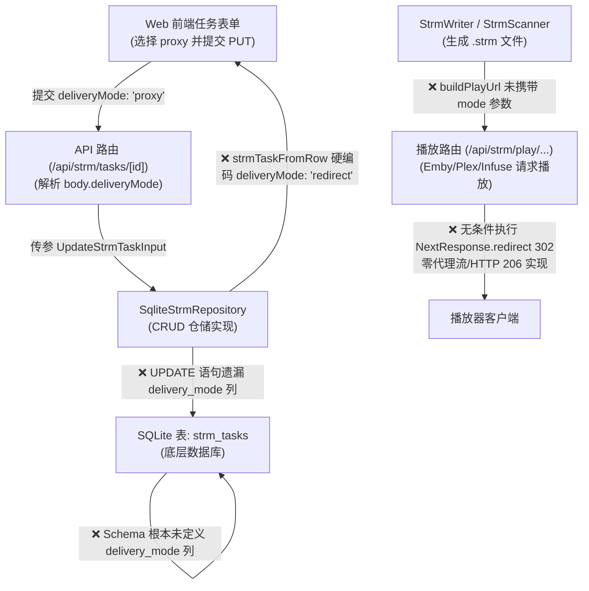

# STRM 任务串流访问方式（302 重定向 vs 服务端代理）失效根因调研、业界方案对比与全链路治理规范

## 1. 背景与问题描述

在「巡影 · Mediary Scout」系统的 STRM 任务管理模块中，用户可在创建或编辑 STRM 同步任务时选择**「串流访问方式 (deliveryMode)」**：
- **302 重定向（redirect）**：客户端直接重定向到网盘 CDN 真实下载链接，服务端 0 带宽与 0 CPU；
- **服务端代理（proxy）**：服务端作为流媒体中继代理，支持 HTTP 206 Partial Content 分片与 Range 串流，适用于网盘存在防盗链/IP 绑定（如 Quark/UC/Baidu）或客户端（如老旧电视盒子/内网环境）无法直连网盘 CDN 的场景。

然而，在实际运行中用户反馈：**“串流访问方式无论如何修改都无效，始终只能保持 302 重定向”**。即使在 Web 编辑弹窗中选择了“服务端代理”，保存后刷新页面仍被重置为“302 重定向”，且播放器请求 STRM 播放地址时，服务器始终只返回 HTTP 302 重定向，导致代理模式完全不可用。

---

## 2. 深入调研：问题根因与链路失效剖析

经全链路代码审计与跟踪，该问题并非单一环节遗漏，而是由**持久化断层、播放路由断层、文件生成断层以及测试与门禁盲区**共同构成的“系统性失效链条”：



### 2.1 根因一：SQLite 数据库 Schema 缺失与动态迁移遗漏
- 在 `packages/workflow/src/persistence/sqlite/sqlite-schema.ts` 中，`strm_tasks` 表的建表语句完全**没有定义 `delivery_mode` 列**：
  ```sql
  CREATE TABLE IF NOT EXISTS strm_tasks (
    id text PRIMARY KEY,
    account_id text NOT NULL,
    name text NOT NULL,
    storage_id text NOT NULL,
    ...
    schedule_mode text DEFAULT 'interval',
    status text DEFAULT 'idle',
    -- ❌ 缺少 delivery_mode text DEFAULT 'redirect'
    last_scan_at text,
    ...
  );
  ```
- 缺乏像 `upgradeSubscriptionPolicyShape` 那样的动态列迁移检查（`upgradeStrmTasksShape`），导致任何已初始化的 SQLite 数据库都不会自动补齐该列。

### 2.2 根因二：SQLite 仓储层（SqliteStrmRepository）持久化与映射断层
- **读取硬编码**：在 `packages/workflow/src/persistence/sqlite/sqlite-strm.ts` 的 `strmTaskFromRow` 中：
  ```typescript
  function strmTaskFromRow(row: StrmTaskRow): StrmTask {
    return {
      ...
      deliveryMode: "redirect", // ❌ 无论数据库存什么，强行硬编码写死为 redirect
      ...
    };
  }
  ```
- **写入抛弃**：`createStrmTask` 的 `INSERT INTO strm_tasks` 与 `updateStrmTask` 的 `UPDATE strm_tasks` 均未包含 `delivery_mode` 字段。
- **后果**：前端即使正确发送了 `{ deliveryMode: "proxy" }`，仓储层直接将该参数在 SQL 层丢弃；在下一次 `listStrmTasks` 或 `getStrmTask` 时，读取出的 `deliveryMode` 必定恢复为 `"redirect"`。

### 2.3 根因三：播放中继路由 `/api/strm/play` 逻辑断层与零代理实现
在 `apps/web/app/api/strm/play/[storageId]/[fileId]/route.ts` 中：
1. **零代理分支**：无论是命中 `strm_link_cache` 还是经由 `SingleFlight` 解析新链接，代码末尾均**无条件返回 `NextResponse.redirect(..., { status: 302 })`**！代码中完全没有编写代理流、HTTP 206 Partial Content、分片管道或对等请求的代码。
2. **零模式识别**：播放路由未读取请求 Query 参数（如 `?mode=proxy`），亦未关联任务查找对应网盘的 `deliveryMode` 配置。

### 2.4 根因四：STRM 文件生成器未透出模式参数
在 `packages/workflow/src/strm/strm-writer.ts` 中，`buildPlayPath` 与 `buildPlayUrl` 仅拼接了 `storageId`、`fileId` 与 `name`，并未将任务的 `deliveryMode` 编码进 `.strm` 文件 URL 中，导致下游播放器请求中继入口时无法知悉该文件的预期传输模式。

### 2.5 根因五：虚假测试与形式主义门禁的反向误导
1. **单元测试假象**：`packages/workflow/src/persistence/repository.ts`（内存版仓储）支持内存字段保存，部分轻量测试使用了内存仓储，掩盖了真实 `better-sqlite3` 仓储的字段缺失。在真实 SQLite 测试中，也仅校验了 `status` 与 `scanIntervalMinutes`，从未断言过 `deliveryMode`。
2. **反向误导的门禁**：在 `tools/gates/check-strm-generation.mjs` 中存在一条检查：
   ```javascript
   if (!content.includes('deliveryMode: "redirect"')) {
     reportViolation(sqliteStrmPath, 1, "strmTaskFromRow 缺少 deliveryMode 默认值对齐！");
   }
   ```
   该检查机械地要求源码中必须出现 `deliveryMode: "redirect"` 字符串，导致开发人员为了“满足门禁”而在 `strmTaskFromRow` 中直接写死该字符串，造成了形式主义门禁反向诱发缺陷的典型反模式！

---

## 3. 现有库调研、评估与选型

针对流媒体服务端代理（HTTP 206 Partial Content / Range 中继），我们对现有库与底层能力进行了全面调研：

| 方案 / 库 | 特点与优势 | 缺点与局限 | 选型结论 |
| :--- | :--- | :--- | :--- |
| **`http-proxy` / `http-proxy-middleware`** | Node.js 经典 HTTP 代理中间件，支持流转发与头篡改 | 基于老旧 Node.js `http.IncomingMessage` / `http.ServerResponse` 设计，不支持 Next.js App Router 的 Web Standard `Request` / `Response`，需额外兼容层，体积重且多年无重大维护 | ❌ 不推荐 |
| **`range-parser`** | Express 官方维护的标准 HTTP Range 头部解析库 | 仅负责字符串解析（如 `bytes=0-1024` $\rightarrow$ `[{ start: 0, end: 1024 }]`），并不负责实际数据流的中继与上游交互 | 🟡 可参考，但对简单分片直接透传或原生正则即可胜任 |
| **Web Standard `fetch` + `ReadableStream` (Node.js 22 内置)** | 1. 原生零依赖，直接与 Next.js App Router 深度融合；<br/>2. `fetch(url, { headers })` 向上游网盘发起对等 Range 请求；<br/>3. `upstreamResponse.body` 为原生 `ReadableStream`，直接构造 `new Response(body, { status: upstream.status, headers })`；<br/>4. 享受 Node 22 原生 Backpressure（背压）控制与零内存缓冲传输；<br/>5. 自动跟随网盘上游重定向（`redirect: "follow"`）。 | 需要严格构造下游响应头（`Content-Range`、`Content-Length`、`Accept-Ranges: bytes` 等） | **✅ 强烈推荐（业界与现代架构首选）** |

---

## 4. 业界主流方案对比与参考

### 4.1 AList 架构模式
- **302 重定向**：直接响应 302 Found，并在 Response Headers 中强制增加 `Cache-Control: no-cache, no-store, must-revalidate`，避免播放器或反代缓存具备时效性的 CDN 直链。
- **本地代理（Local Proxy / Stream Relay）**：
  - 当驱动被配置为“本地代理”或开启“Web 代理”时，AList 后端作为客户端与网盘之间的中继。
  - 核心处理：客户端携带 `Range: bytes=X-Y`，AList 对等向上游发起带对应 `Range` 和网盘专用防盗链 Headers（`User-Agent`、`Referer`、`Cookie`）的 HTTP 请求，将上游返回的 `206 Partial Content` 流式回传给客户端。

### 4.2 CloudDrive2 (CD2)
- 通过虚拟文件系统提供流式访问，当播放器发起随机 Seek（定位）时，CD2 驱动拦截文件偏移读取，向上游按需拉取分块，并在本地缓存小尺寸滑动窗口数据。

### 4.3 MoviePilot / LitePan / Emby+XiaoYa
- 在 STRM 文件中将中继路由结构化，播放请求到达服务器后，依据存储源的直链特性决定返回 302 还是 206。对于夸克、天翼等对客户端 IP 强绑定的直链，默认或强制走代理中继模式；对于 115 等开放 CDN 直连的，优先 302 以节省宿主机带宽。

---

## 5. 当前系统既有基础设施与复用确认

本项目已有完善的流媒体与存储基础设施，完全可以复用，无需引入任何外部重量级依赖：

1. **`SingleFlight` 并发合并器 (`packages/workflow/src/strm/single-flight.ts`)**：
   - 现已完美工作，用于拦截播放器（如 Infuse / Plex）并发发起的 3~10 个探测 Range 请求，将其收敛为单次直链解析，防止击穿网盘 API。
2. **`strm_link_cache` 缓存表与仓储方法**：
   - 数据库中已建有 `strm_link_cache (cache_key, download_url, delivery_mode, headers_json, expires_at)` 表。
   - 复用该表的 `delivery_mode` 与 `headers_json`，用于透传上游所需的防盗链请求头。
3. **`StorageStreamResolver` (`packages/workflow/src/storage/stream-resolver.ts`)**：
   - 统一抽象了网盘流媒体直链解析，定义了 `ResolvedStream { url, deliveryMode, headers, expirationSeconds }`。
4. **SQLite PRAGMA 与增量升级机制**：
   - 复用 `sqlite-schema.ts` 的 PRAGMA 表结构动态探针模式（`upgradeStrmTasksShape`），平滑迁移既有生产库。
5. **自动化质量门禁 (`tools/gates/`)**：
   - 复用现有的 `gate:strm`（`tools/gates/check-strm-generation.mjs`），将其由“死板字符串检查”升级为“深层持久化与路由代理真实守卫”。

---

## 6. 全链路具体解决方案设计

### 6.1 数据库层：列补齐与自动无感迁移
1. 在 `SQLITE_SCHEMA` 的 `CREATE TABLE IF NOT EXISTS strm_tasks` 中补充：
   ```sql
   delivery_mode text DEFAULT 'redirect',
   ```
2. 在 `packages/workflow/src/persistence/sqlite/sqlite-schema.ts` 中实现：
   ```typescript
   export function upgradeStrmTasksShape(db: Database.Database): void {
     const cols = db.pragma("table_info(strm_tasks)") as Array<{ name: string }>;
     if (cols.length === 0) return;
     if (!cols.some((c) => c.name === "delivery_mode")) {
       db.exec("ALTER TABLE strm_tasks ADD COLUMN delivery_mode text DEFAULT 'redirect'");
     }
   }
   ```
3. 在 `packages/workflow/src/persistence/sqlite.ts` 实例化阶段调用 `this.upgradeStrmTasksShape()`。

### 6.2 仓储层：补全 CRUD 与映射
在 `packages/workflow/src/persistence/sqlite/sqlite-strm.ts` 中：
- `StrmTaskRow` 声明 `delivery_mode?: string | null`；
- `strmTaskFromRow` 映射 `deliveryMode: (row.delivery_mode as StrmDeliveryMode) || "redirect"`；
- `createStrmTask` 在 `INSERT INTO strm_tasks` 中写入 `task.deliveryMode ?? "redirect"`；
- `updateStrmTask` 在 `UPDATE strm_tasks` 中写入 `updated.deliveryMode ?? "redirect"`。

### 6.3 STRM 生成与基址：参数透传与向前兼容
1. 在 `packages/workflow/src/strm/strm-writer.ts` 中：
   - `buildPlayPath(storageId, fileId, fileName, deliveryMode)`：若 `deliveryMode === "proxy"`，则追加 query 参数 `mode=proxy`；
   - `buildPlayUrl` 对应透传 `deliveryMode`；
2. 在 `strm-scanner.ts` 与 `pinpoint-ingest-sync.ts` 中生成 STRM 时传入 `task.deliveryMode`。

### 6.4 播放路由：双模中继控制器（302 vs HTTP 206 Proxy）
在 `apps/web/app/api/strm/play/[storageId]/[fileId]/route.ts` 中：
1. **决策层**：
   - 优先检查 query 参数 `mode`（`proxy` 或 `redirect`）；
   - 若未携带，则从缓存或当前账号下的 STRM 任务列表反查对应 `storageId` 的 `deliveryMode`；
   - 兜底为 `redirect`。
2. **重定向模式（redirect）**：
   - 返回 302 Found，附带反缓存头 `Cache-Control: no-store, no-cache, must-revalidate, max-age=0`。
3. **代理模式（proxy）**：
   - 解析客户端请求的 `Range` 头；
   - 向上游直链发起对等 `fetch(upstreamUrl, { method: isHead ? "HEAD" : "GET", headers, redirect: "follow" })`；
   - 严格转发上游响应头：`Content-Range`、`Content-Length`、`Content-Type`、`Accept-Ranges: bytes`；
   - 零内存缓冲，直接将 `upstreamResp.body` 管道流式返回给客户端；
   - 支持 `HEAD` 请求以便播放器在播放前探知视频时长与体积。

### 6.5 质量门禁与回归防护（Guardrails）
升级 `tools/gates/check-strm-generation.mjs`：
- 废弃原先脆弱的 `content.includes('deliveryMode: "redirect"')`；
- 检查 `strm_tasks` 表建表语句与 `upgradeStrmTasksShape` 迁移函数是否存在 `delivery_mode`；
- 检查 `sqlite-strm.ts` 中 `INSERT` 与 `UPDATE` 语句是否真正包含 `delivery_mode`；
- 检查 `/api/strm/play` 路由是否包含针对 `proxy` 模式的流式管道与 Range 转发处理；
- 补充测试用例，覆盖 SQLite 持久化校验与代理播放中继验证。
