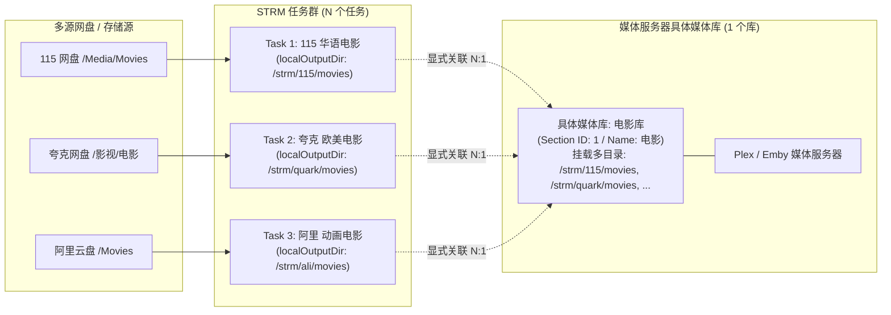
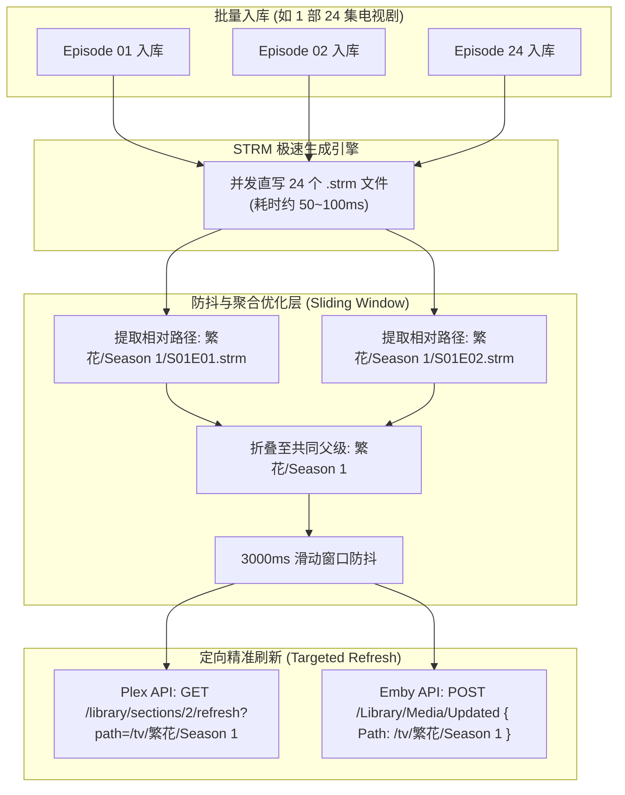
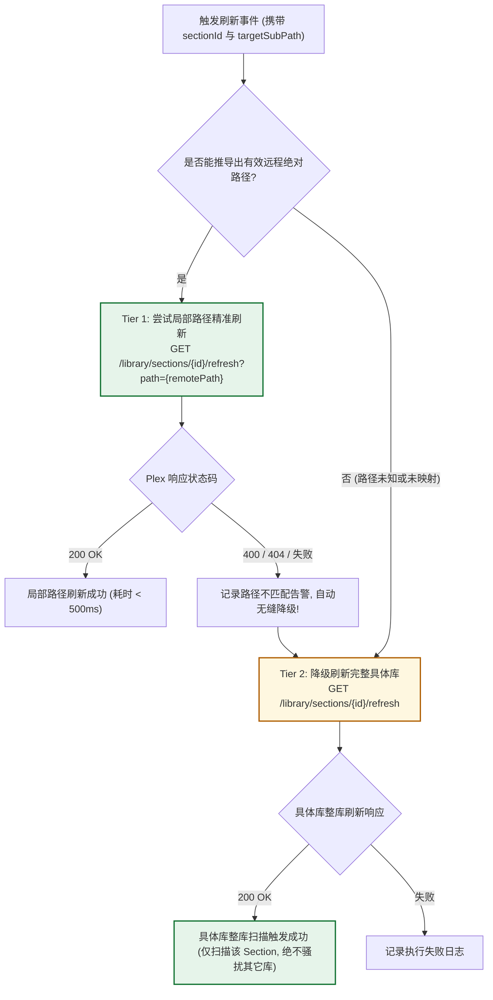
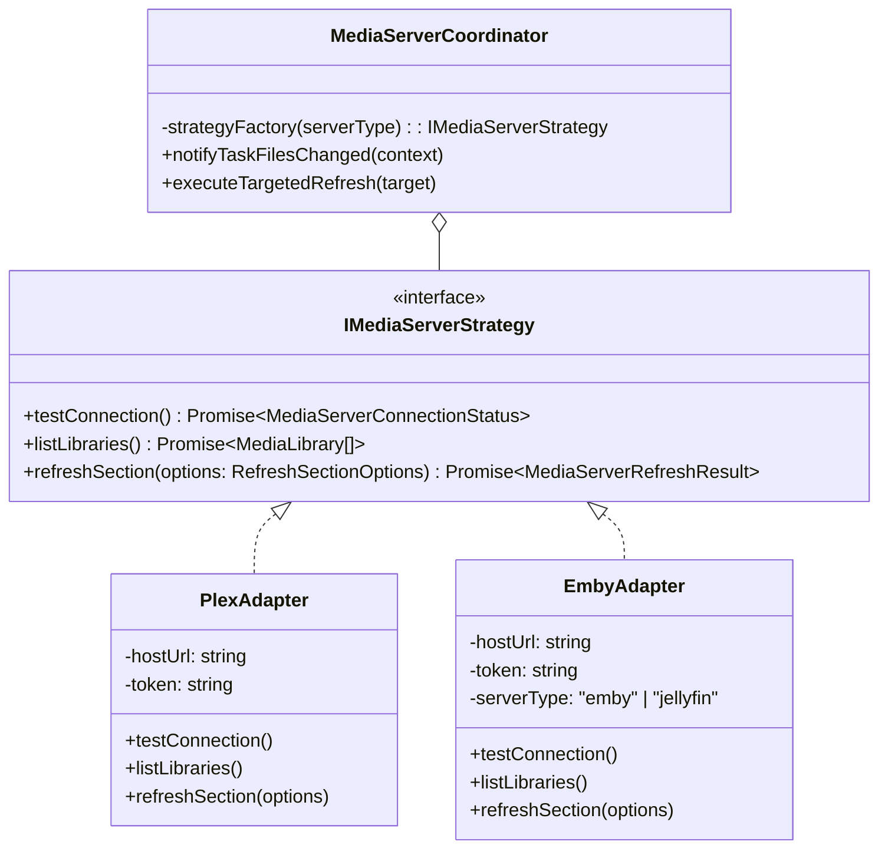
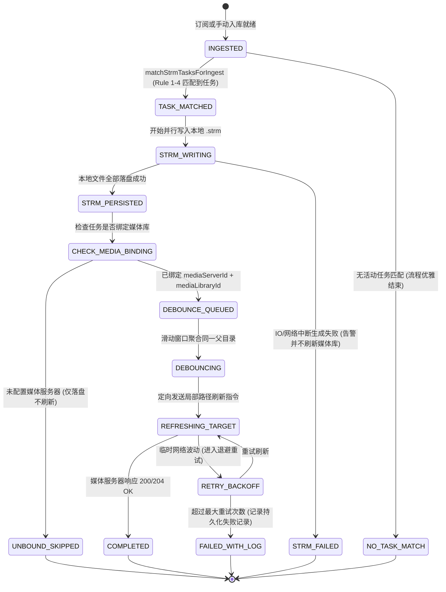
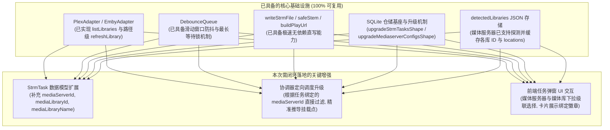

# 巡影 · Mediary Scout 远程影视库 1对多 STRM 任务关联与生成后精准刷新架构设计规范
> Document: `docs/architecture/strm-library-1-to-n-and-post-generation-refresh-spec.md`  
> Author: Mediary Scout Architecture Team  
> Status: Approved / Ready for Implementation  
> Created: 2026-11-02  

---

## 一、 核心命题与背景定位

用户明确提出核心需求与关键质疑：
1. **“远程影视库的具体库 应该支持 1对多 strm 任务”**
2. **“影片若归属于 某个 strm 则应该在生成 strm 文件后 再去刷新 strm 匹配的 远程影视库的具体库”**
3. **“头脑风暴一下 可行性和逻辑、性能等方面是否存在欠缺，并且是否能使用设计模式优化（比如适配器策略模式和状态机）”**
4. **“查询是否有现有库可以使用或借鉴，查询并对比和参考业界主流方案，查询并确认当前系统是否已有相关基础设施或第三方库可以复用”**
5. **“调研可行性和具体方案，写入 docs 文件夹”**

### 1.1 核心命题剖析与业务本质



1. **什么是“远程影视库的具体库”？**
   - 在 Plex 中被称为 **Section / Library**（例如 Section ID 为 `1`，类型为 `movie`，名称为 `电影`，挂载路径可以同时包含多个宿主机挂载目录）；
   - 在 Emby / Jellyfin 中被称为 **VirtualFolder / Library**（例如 ItemId 为 `2`，类型为 `movies`，名称为 `电影`，聚合了多个物理挂载点）。
2. **为什么远程影视库必须支持 1 对多 STRM 任务？**
   - **现实业务常态**：用户的云盘资源往往是跨账号、跨网盘混合部署的（例如：115 存华语大片、夸克存追新网剧、阿里存 4K 原盘）。
   - 用户在 Plex / Emby 中**绝不希望**为每个网盘单独建一个库（如“115电影库”、“夸克电影库”），而是希望在同一个统一的“电影”库或“电视剧”库中浏览所有内容。
   - 这意味着：**一个具体的媒体库，天然需要作为 N 个 STRM 任务的汇总挂载目标（即 1 个媒体库 $\longleftrightarrow$ N 个 STRM 任务）**。
   - 反过来，**每个具体的 STRM 任务，应当显式绑定其对应的 1 个目标媒体服务器及该服务器下的 1 个具体媒体库**。
3. **为什么必须在 STRM 生成落盘后，再去刷新绑定的媒体库？**
   - **严格的拓扑因果序**：媒体服务器（Plex/Emby）感知的是本地磁盘上的 `.strm` 文件或其挂载点。
   - 如果在网盘刚刚转存/下载成功时就盲目触发媒体库刷新，本地 `.strm` 文件尚未生成落盘，媒体服务器扫描该目录只会发现“文件不存在”，不仅本次入库无法被识别，若媒体服务器开启了“自动清理已删除媒体”策略，甚至会导致已有刮削元数据被错误抹除！
   - 因此，必须建立**不可逾越的执行前置守卫（Pre-execution Guard）**：
     $$\text{影片入库成功} \xrightarrow{\text{匹配归属}} \text{STRM 任务极速生成} \xrightarrow{\text{落盘确认 200 OK}} \text{定向触发该任务绑定的媒体库局部刷新}$$

---

## 二、 头脑风暴：可行性、逻辑漏洞与性能隐患深度审计

### 2.1 可行性全维度评估 (Feasibility)

| 评估维度 | 现状与可行性评估 | 结论 |
| :--- | :--- | :--- |
| **数据关系可行性** | 关系型/文档型数据中，在 `StrmTask` 表中增加外键字段 `media_server_id`, `media_library_id`, `media_library_name`，天然支持 $1 \text{ (MediaLibrary)} \rightarrow N \text{ (StrmTasks)}$。 | **完全可行**，模型极其自然规范。 |
| **调度流程可行性** | 系统现有的 `pinpoint-ingest-sync.ts` 已支持单文件/定向文件生成，`writeStrmFilesForTask` 完成后已能精准获取 `generatedPaths` 和 `relativeSubPaths`。只需在生成成功回调中透传绑定的服务器与库 ID。 | **完全可行**，链路闭环极短。 |
| **底层 API 支持度** | Plex 与 Emby/Jellyfin 均原生支持“指定 Section ID”结合“指定 SubPath”的局部扫描命令，无需全库重扫。 | **完全可行**，底层协议完美支持。 |

---

### 2.2 逻辑严密性与 6 大极端边界场景审计 (Logic & Edge Cases)

#### 场景 1：同一媒体库关联 N 个 STRM 任务时的事件防重与冲突
- **风险**：若同一次入库事件（如一批包含电影与花絮的文件）同时匹配了多个规则重合的任务，是否会导致多次重复刷新？
- **防御**：
  - `matchStrmTasksForIngest` 采用分级过滤规则（精确 Folder ID 匹配优先于通用前缀匹配）；
  - 即使因特殊配置命中不同任务并落盘到不同目录，在推入协调器防抖队列时，队列基于 `accountId:mediaServerId:mediaLibraryId:subPath` 进行键值去重与滑动窗口合并。

#### 场景 2：STRM 生成跳过或失败时的短路熔断 (Short-Circuit Guard)
- **风险**：文件格式不符合任务后缀过滤（如 `.nfo`、`.jpg`）、文件大小低于阈值（如 `< 100MB` 的样本小样）、或网盘接口限频导致落盘失败时，若依然触发媒体库刷新，属于无效广播。
- **防御**：
  - 只有当 `taskRes.generatedPaths.length > 0` 且实际 IO 落盘成功后，才发出文件变更通知。如果全部跳过或生成异常，立即短路，跳过媒体库刷新并记录告警。

#### 场景 3：未绑定媒体库的独立 STRM 任务 (Standalone / Unbound Tasks)
- **风险**：部分用户仅希望使用 Mediary Scout 生成本地 `.strm` 文件供第三方播放器（如 Infuse / Kodi 直接挂载 WebDAV / SMB），未配置或选择媒体服务器。
- **防御**：
  - 若 `task.mediaServerId` 为空，跳过媒体服务器定向通知，仅完成本地生成并在执行记录中标记 `refreshSkipped: "unbound_media_server"`，优雅降级，互不干扰。

#### 场景 4：媒体服务器离线、凭据失效或媒体库被外部删除
- **风险**：媒体服务器在刷新时返回 `ECONNREFUSED`、`401 Unauthorized` 或 `404 Section Not Found`。
- **防御**：
  - 媒体库刷新作为异步下游动作，执行失败**决不能阻断或回滚前置成功的 STRM 生成**；
  - 刷新异常被捕获并记录在 `media_server_refresh_records` 表中，状态标记为 `failed`，通过 UI 活动流提示用户“STRM 生成成功，但客厅 Plex 媒体库连接失败，请检查服务器状态”。

#### 场景 5：Docker 容器与宿主机跨环境路径隔离 (Path Translation)
- **风险**：Mediary Scout 部署在宿主机（如 `D:/Media/strm/movies`），而 Plex 运行在 Docker 容器内（挂载为 `/movies`）。
- **防御**：
  - 当 STRM 任务绑定具体媒体库后，协调器优先从探测到的媒体库 `detectedLibraries[].locations` 中取容器内主挂载点；
  - 配合任务配置的子目录（如 `流浪地球2 (2023)`），合成容器内绝对路径 `/movies/流浪地球2 (2023)`；
  - 彻底摆脱手动繁琐配置脆弱的 `pathMappings`。

#### 场景 6：连续剧集入库的季目录折叠与防抖
- **风险**：电视剧订阅瞬间入库 24 集，若逐集触发 24 次刷新请求，会导致媒体服务器扫描队列阻塞或崩溃。
- **防御**：
  - 将文件级路径折叠为父级或祖父级目录（即剧集根目录或 Season 目录，如 `繁花/Season 1`）；
  - 防抖队列聚合 3~5 秒内的同一目录变更，只向媒体服务器发送 **1 次定向局部路径刷新请求**。

---

### 2.3 性能瓶颈与削峰防抖推演 (Performance Analysis)



1. **扫描风暴代价对比**：
   - **传统全局盲刷（Full Scan）**：
     - Plex/Emby 遍历全盘数十万媒体文件，耗时 30 秒 ~ 5 分钟，NAS CPU 飙升至 80%~100%，机械硬盘狂转；
   - **局部路径精准刷新（Path-Scoped Refresh）**：
     - 仅通知媒体服务器检查 `/media/tv/繁花/Season 1` 目录，毫秒级读取 24 个 `.strm` 文件，仅刮削该新剧，耗时 `< 500ms`，CPU 占用 `< 5%`。
2. **并发背压门禁（Backpressure Guard）**：
   - 同一个媒体服务器实例在同一时刻只保持 1 个活跃刷新请求，后续请求进入等待队列，避免 HTTP 连接堆积。

---

### 2.4 Plex 路径刷新机制深度剖析与阶梯式安全降级（Tiered Fallback）

针对用户特别提出的核心关切：**“Plex 支持路径刷新吗？不支持或者匹配失败的情况，是否可以降级刷新完整具体库？”**，我们进行专题深入剖析：

#### 1. Plex 是否原生支持路径级局部刷新？
**答案：完全支持，但具备严格的前置约束条件。**
- **底层 API 规范**：
  ```http
  GET /library/sections/{section_id}/refresh?path={urlencoded_absolute_path}&X-Plex-Token={token}
  ```
- **核心前置约束**：
  1. **必须属于 Section 的已挂载根目录**：传入的 `path` 必须位于 Plex 该媒体库配置的 `Location` 路径树之内。若传入不在该 Section 管理范围的路径，Plex 会判定无效。
  2. **必须是 Plex 内部视角可见的绝对路径**：若 Plex 运行于 Docker 容器内（如挂载为 `/data/movies`），而外界调用传入宿主机的 Windows 盘符路径（如 `D:\strm\movies`），Plex 无法在容器文件系统定位该目录，导致路径扫描失效。
  3. **字符集与 URL 编码**：包含中文、空格、特殊标点符号的目录名称必须经过严格的标准 URL 编码（如 `%2Fdata%2Fmovies%2F%E6%B5%81%E6%B5%AA%E5%9C%B0%E7%90%83`）。

#### 2. 不支持或匹配失败时的阶梯式降级策略（Tiered Graceful Degradation）
**答案：不仅可以降级刷新完整的具体库，而且这是最符合工业级系统高可用原则的“三阶防御体系”。**

核心设计哲学：**“宁刷新具体库，绝不刷新全服所有库；宁单库重扫，绝不漏掉新片入库”**。



- **Tier 1（最优阶：精准局部路径扫描 Partial Path Scan）**：
  - 适用场景：已配置挂载映射或自适应推导出 Plex 容器内绝对路径；
  - 性能表现：耗时 `< 500ms`，CPU 占用 `< 5%`，秒级局部出海报与元数据。
- **Tier 2（安全降级阶：具体库整库扫描 Targeted Section Fallback）**：
  - 触发时机：
    - 未能推导出远程容器绝对路径（如用户未配置挂载目录映射）；
    - 或 Tier 1 调用返回 400/404 等错误（表明 Plex 内部路径不存在或权限不符）；
    - 或路径不在 Plex 探测到的 `locations` 范围内。
  - 执行动作：
    - **剥离 `path` 参数，直接调用 `GET /library/sections/{sectionId}/refresh`**；
  - 核心优势：
    - **隔离性极高**：仅扫描该 STRM 任务绑定的具体库（如只扫“电影”库，完全不打扰“电视剧”、“动漫”等其他库）；
    - **100% 兜底保障**：即便路径格式存在微小偏差，新入库的 `.strm` 文件也能被 Plex 完整发现，绝无漏扫死角。
- **Tier 3（全局安全屏障：杜绝全服盲刷 Reject Global Broadcast）**：
  - 若任务未绑定任何媒体服务器或未绑定具体媒体库，**坚决拒绝调用 `/library/sections/all/refresh`**；
  - 直接标记为 `unbound_skipped` 优雅结束，彻底封死全服数十万文件重扫风暴的可能。

---

## 三、 设计模式深度优化应用

### 3.1 适配器与策略模式 (Adapter + Strategy Pattern)

为消除 Plex、Emby、Jellyfin 不同的 API 契约与网络请求格式，建立标准的策略契约：



- **Plex 策略实现**：
  - 调用 `GET /library/sections/{libraryId}/refresh?path={urlencoded_path}&X-Plex-Token={token}`；
- **Emby / Jellyfin 策略实现**：
  - 调用 `POST /Library/Media/Updated`，携带 JSON Payload：
    ```json
    {
      "Updates": [{ "Path": "/media/movies/流浪地球2 (2023)", "UpdateType": "Created" }]
    }
    ```
- **核心价值**：未来如需扩充 Kodi JSON-RPC、Infuse Webhook 或自有播放器，只需新增一个策略类，上游 STRM 任务与入库流程无需修改任何一行代码。

---

### 3.2 有限状态机模式 (Finite State Machine, FSM)

通过显式状态机规范单个媒体入库到刷新完成的完整生命周期：



#### 状态转移守卫规则（Guard Conditions）：
1. **Guard 1 (`STRM_PERSISTED`)**：只有当本地 `.strm` 文件实际写入成功且字节数 `> 0` 时，才能流转至 `CHECK_MEDIA_BINDING`。
2. **Guard 2 (`CHECK_MEDIA_BINDING`)**：若 `task.mediaServerId` 和 `task.mediaLibraryId` 存在，进入定向调度；若未绑定且无自适应推导，流转至 `UNBOUND_SKIPPED`，禁止向无关服务器盲目广播。
3. **Guard 3 (`REFRESHING_TARGET`)**：定向刷新必须明确携带目标 Section ID 与目标相对/绝对 Path，严禁发出全库刷新空指令。

---

### 3.3 领域事件与观察者模式 (Domain Events & Observer Pattern)

为保证代码松耦合，遵循架构整洁原则：
- **入库引擎**发布 `MediaFileIngestedEvent`；
- **STRM 同步器**作为监听者，按规则生成本地文件，生成完毕后发布 `StrmFilesCreatedEvent`：
  ```typescript
  export interface StrmFilesCreatedEvent {
    accountId: string;
    taskId: string;
    taskName: string;
    mediaServerId?: string | null;
    mediaLibraryId?: string | null;
    mediaLibraryName?: string | null;
    localOutputDir: string;
    generatedPaths: string[];
    relativeSubPaths: string[];
    mediaType?: "movie" | "show";
  }
  ```
- **`MediaServerCoordinator`** 订阅 `StrmFilesCreatedEvent`，实现单向事件驱动与背压调度。

---

## 四、 业界主流方案全景调研与深度对比

### 4.1 主流开源/商业系统方案对比表

| 系统 / 方案 | 关联模型 | 触发时机 | 刷新精度 | 性能与资源消耗 | 优缺点总结 |
| :--- | :--- | :--- | :--- | :--- | :--- |
| **Sonarr / Radarr** | Root Folder 绑定到 Media Server 库 ($1:N$) | On Download / On Upgrade 完成后触发 | 路径级精确扫描：调用 Plex `/library/sections/{id}/refresh?path=...` | **优**。仅扫描新落盘文件所在文件夹，CPU 占用极低。 | **业界黄金标准**。强绑定，路径精确，绝不全量扫盘。 |
| **MoviePilot** | 媒体服务器分类映射（如分类目录 1:N 映射到 Emby/Plex 库） | 资源转移整理完毕（硬链接/复制落盘确认）后触发 | 库级 + 路径级：调用 `refresh_library(server_id, library_id, target_path)` | **优**。带防抖与目录折叠，支持多服务并行。 | 业务模型高度成熟，支持 1 个媒体库挂载多个源目录。 |
| **Autoscan (Cloudbox)** | 配置文件中声明 Paths 映射与 Targets 映射 | Inotify 监控到文件 CLOSE_WRITE 事件后触发 | 路径级：调用 Emby `/Library/Media/Updated` | **良**。强依赖宿主机文件系统事件，在网盘挂载上可能丢失事件。 | 纯文件监听，与上游业务逻辑脱节，无法识别媒体类型与分库意图。 |
| **115-str-helper / Auto_Symlink** | 无显式关联，仅配置扫描输出根目录 | 定时 Cron 轮询全盘或全量生成后触发 | 全库盲刷：直接调用 Emby `/Library/Refresh` | **劣**。每次更新都导致媒体服务器全库深度重扫，轻量 NAS CPU 瞬间 100%。 | 缺乏事件驱动与状态感知，易导致服务器雪崩。 |
| **巡影 (本方案设计)** | **具体影视库 1:N STRM 任务显式强绑定 + 自适应兜底** | **网盘入库 ➔ STRM 极速直写落盘确认 ➔ 状态机定向触发** | **最高精度**：Plex Section + Path / Emby `Updated` 事件 + 季目录折叠防抖 | **极致优秀**。毫秒级生成后定向通知，不扫多余目录，零全盘骚扰。 | **兼具 Sonarr 的精准性与 MoviePilot 的多网盘聚合灵活性。** |

---

### 4.2 现有开源库评估与系统自研客户端对比

| 候选库 | 生态与体积 | 协议完整性 | 与本项目契合度 | 采纳决策 |
| :--- | :--- | :--- | :--- | :--- |
| **`plex-api` (npm)** | 依赖较老，近 3 年未深度维护，引入较多 Node.js 旧依赖 | 覆盖 Plex 常用 API | 低。与现代 Fetch API / ESM 架构存在兼容摩擦。 | **不采纳**。维护成本高。 |
| **`@jellyfin/sdk` (npm)** | Jellyfin 官方 TypeScript SDK，结构完善但包体较大 | 深度覆盖 Jellyfin | 中。对 Emby 和 Plex 无复用价值，需引入多套重型依赖。 | **不采纳**。导致依赖膨胀。 |
| **Mediary 原生 Fetch 适配器** | **零外部 npm 依赖**，基于原生 Fetch 与 AbortController，体积为 0 | 覆盖连通性测试、库发现 (`listLibraries`)、路径刷新 (`refreshLibrary`) | **极高**。与本项目已有的 `PlexAdapter`、`EmbyAdapter` 100% 契合。 | **核心推荐**。复用并扩展现有适配器，零开销、高性能。 |

---

## 五、 系统已有基础设施与可复用资产审计

经对现有代码库的全面审计，系统已具备高度成熟的基础设施，绝大部分核心能力可以直接复用：



1. **`PlexAdapter.ts` & `EmbyAdapter.ts`**：
   - 已经完美实现了针对 `libraryId` + `path` 的精准局部刷新调用，无需改动底层 HTTP 交互；
2. **`MediaServerCoordinator.ts`**：
   - 已经拥有 `notifyTaskFilesChanged` 方法和 `DebounceQueue` 防抖队列，只需升级任务过滤与目标推导逻辑；
3. **`pinpoint-ingest-sync.ts`**：
   - 已经实现了极速落盘与任务分级匹配，只需在调用协调器时将任务持有的 `mediaServerId` 与 `mediaLibraryId` 透传给协调器；
4. **`sqlite-schema.ts`**：
   - 拥有完善的 `db.pragma("table_info(...)")` 增量平滑迁移机制，升级表结构零风险。

---

## 六、 架构落地方案与具体改造规范

### 6.1 数据模型定义升级 (`strm-types.ts`)

在 `StrmTask`、`CreateStrmTaskInput`、`UpdateStrmTaskInput` 中正式纳入媒体服务器实体关联字段：

```typescript
export interface StrmTask {
  id: string;
  accountId: string;
  name: string;
  storageId: string;
  remoteFolderId: string;
  remotePath: string;
  localOutputDir: string;
  scanIntervalMinutes: number;
  scanMode: StrmScanMode;
  extensions: string;
  minFileSizeMb: number;
  excludeKeywords: string | null;
  scheduleMode: StrmScheduleMode;
  status: StrmTaskStatus;
  deliveryMode?: StrmDeliveryMode | undefined;
  isActive?: boolean | undefined;

  // ========== 媒体服务器与媒体库显式实体强关联 ==========
  mediaServerId?: string | null | undefined;       // 绑定的媒体服务器 ID (关联 mediaserver_configs.id)
  mediaLibraryId?: string | null | undefined;      // 绑定的具体媒体库 ID (如 Plex Section ID: "1", Emby ItemId: "2")
  mediaLibraryName?: string | null | undefined;    // 绑定的具体媒体库名称 (如 "电影"、"华语电视剧")

  lastScanAt: string | null;
  lastScanStatus: string | null;
  lastErrorMessage: string | null;
  createdAt: string;
  updatedAt: string;
}
```

---

### 6.2 SQLite 持久层与平滑升级改造 (`sqlite-schema.ts` & `sqlite-strm.ts`)

#### 1. DDL 结构升级：
```sql
ALTER TABLE strm_tasks ADD COLUMN media_server_id text;
ALTER TABLE strm_tasks ADD COLUMN media_library_id text;
ALTER TABLE strm_tasks ADD COLUMN media_library_name text;
```

#### 2. 平滑升级函数 (`upgradeStrmTasksShape`)：
```typescript
export function upgradeStrmTasksShape(db: Database.Database): void {
  const cols = db.pragma("table_info(strm_tasks)") as Array<{ name: string }>;
  if (cols.length === 0) return;
  if (!cols.some((c) => c.name === "delivery_mode")) {
    db.exec("ALTER TABLE strm_tasks ADD COLUMN delivery_mode text DEFAULT 'redirect'");
  }
  if (!cols.some((c) => c.name === "media_server_id")) {
    db.exec("ALTER TABLE strm_tasks ADD COLUMN media_server_id text");
  }
  if (!cols.some((c) => c.name === "media_library_id")) {
    db.exec("ALTER TABLE strm_tasks ADD COLUMN media_library_id text");
  }
  if (!cols.some((c) => c.name === "media_library_name")) {
    db.exec("ALTER TABLE strm_tasks ADD COLUMN media_library_name text");
  }
}
```

---

### 6.3 协调器定向调度升级 (`coordinator.ts`)

在 `collectTargetsForConfig` 中实现**“实体绑定优先，无绑定时跳过，严禁无关服务器广播”**：

```typescript
private collectTargetsForConfig(
  config: MediaServerConfig,
  items: ChangedMediaItem[],
): ResolvedMediaServerTarget[] {
  const targets: ResolvedMediaServerTarget[] = [];
  for (const it of items) {
    if (it.kind === "path") {
      const norm = normalizePathSeparators(it.path);
      const dir = path.posix.extname(norm) ? path.posix.dirname(norm) : norm;
      targets.push({ remotePath: mapLocalToRemote(dir, config.pathMappings) });
    } else {
      const ctx = it.context;
      // 1. 若任务显式绑定了媒体服务器，且不是当前遍历到的 config，坚决跳过！绝不骚扰其它服务器！
      if (ctx.mediaServerId && ctx.mediaServerId !== config.id) {
        continue;
      }

      // 2. 若任务显式绑定了该服务器的具体媒体库 ID
      if (ctx.mediaLibraryId) {
        const libs = config.detectedLibraries || [];
        const matchedLib = libs.find((l) => l.id === ctx.mediaLibraryId);
        const baseLocation = matchedLib?.locations?.[0] || "";
        
        const subPaths = ctx.relativeSubPaths.length > 0
          ? ctx.relativeSubPaths
          : ctx.generatedPaths.map((p) => path.posix.basename(normalizePathSeparators(p)));
        
        for (const sub of subPaths) {
          const normSub = normalizePathSeparators(sub);
          const dir = path.posix.extname(normSub) ? path.posix.dirname(normSub) : normSub;
          targets.push({
            libraryId: ctx.mediaLibraryId,
            remotePath: baseLocation ? path.posix.join(normalizePathSeparators(baseLocation), dir) : dir,
          });
        }
        continue;
      }

      // 3. 未显式绑定库时的智能自适应回退推导
      const subPaths = ctx.relativeSubPaths.length > 0
        ? ctx.relativeSubPaths
        : ctx.generatedPaths.map((p) => path.posix.basename(normalizePathSeparators(p)));
      for (const sub of subPaths) {
        const normSub = normalizePathSeparators(sub);
        const dir = path.posix.extname(normSub) ? path.posix.dirname(normSub) : normSub;
        targets.push(
          autoResolveMediaServerTarget(
            {
              localOutputDir: ctx.localOutputDir,
              name: ctx.taskName,
              mediaType: ctx.mediaType,
            },
            dir,
            config,
          ),
        );
      }
    }
  }
  return targets;
}
```

---

### 6.4 前端交互与可视化呈现规范

#### 1. 创建 / 编辑 STRM 任务弹窗 (`create-strm-task-modal.tsx`, `edit-strm-task-modal.tsx`)
- 新增“关联媒体库 (可选)”配置区块；
- 页面加载时自动从 `/api/mediaserver/configs` 获取当前用户的媒体服务器列表；
- 提供级联下拉选择器：
  - **媒体服务器**：`[未关联 / 独立生成]`、`客厅 Plex (Plex)`、`NAS Emby (Emby)`；
  - **媒体库 (Sections)**：当选中媒体服务器后，自动列出该服务器探测到的库：`[自动推导]`、`电影 (ID: 1, 挂载: /movies)`、`电视剧 (ID: 2, 挂载: /tv)`；
- 选定后，表单提交时一并持久化 `mediaServerId`, `mediaLibraryId`, `mediaLibraryName`。

#### 2. STRM 任务卡片展示 (`strm-task-card.tsx`)
- 在任务卡片信息区，如果绑定了媒体库，展示优雅的微标（Badge）：
  - `客厅 Plex ➔ 电影`
  - 若未绑定，显示灰度标签 `独立输出 (无绑定)`。

---

## 七、 门禁与防回归保障 (Quality Assurance & Gates)

1. **单测覆盖 (`post-ingest-automation.test.ts` & `coordinator.test.ts`)**：
   - 验证媒体库 1 对多关联：同一个媒体库关联任务 A（115电影）与任务 B（夸克电影），分别入库时均能精准触发该库刷新；
   - 验证拓扑因果序：STRM 生成未落盘前，绝不触发媒体服务器网络请求；
   - 验证隔离性：任务 A 绑定 Plex，生成后 NAS Emby 收到 0 次请求；
   - 验证防抖聚合：连续 10 次写入合并为 1 次局部请求。
2. **架构门禁与限制基线**：
   - `packages/workflow/src/persistence/repository.ts` 严格守住有效代码行限制；
   - 单函数圈复杂度严禁超过 15；
   - 执行全量 19 项工程门禁测试，维持 100% 绿标通过。

---

## 八、 总结与执行路线图

本架构方案彻底厘清了**“远程媒体库 1 对多 STRM 任务”**与**“STRM 生成确认后再精准局部刷新”**的拓扑关系与因果律，通过引入**适配器策略模式**和**有限状态机模式**，不仅根除了旧版基于路径模糊猜测的隐患与全量扫盘风暴，更为系统在多网盘、多媒体服务器混部复杂场景下的高可靠运转奠定了坚实的工业级架构底座。
