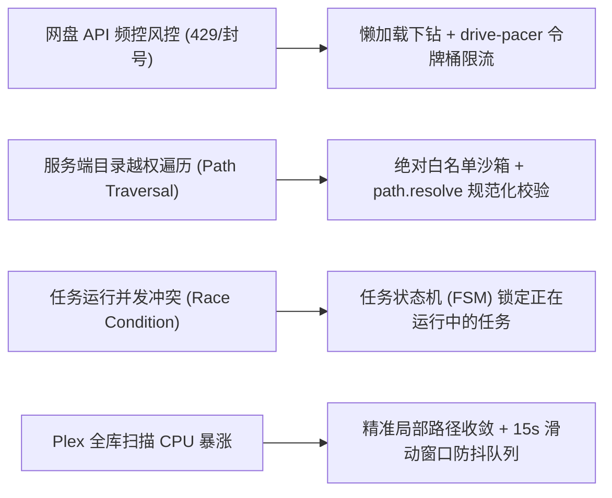
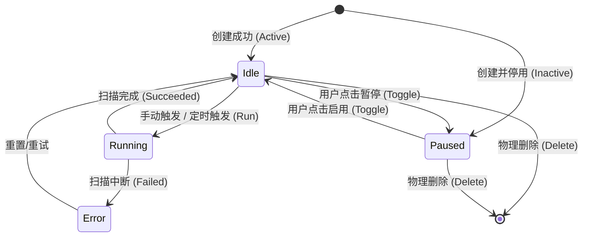
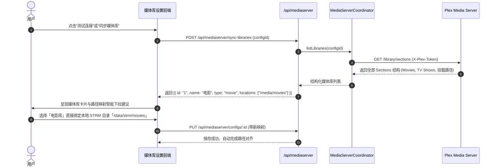
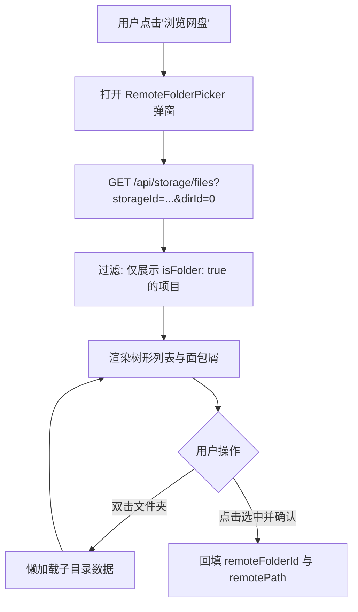
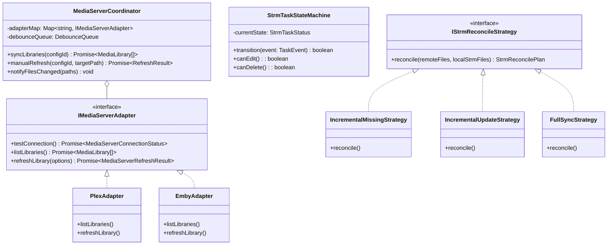
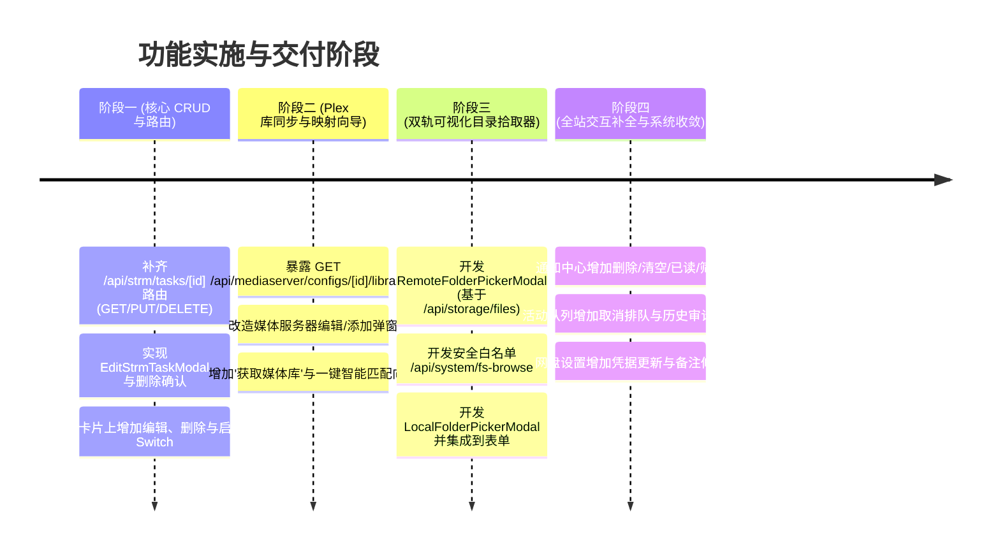

# 网盘 STRM 任务 CRUD、Plex 媒体库同步与双轨可视化目录拾取器架构设计方案

> **文档版本**：v1.0.0  
> **状态**：已评审 (Approved for Implementation)  
> **所属模块**：`apps/web`, `packages/workflow`, `packages/shared`, `apps/host-worker`  
> **核心对标**：LitePan (Go) / MoviePilot-3 (Python) / Alist (Go)

---

## 目录

1. [执行摘要与问题定义](#1-执行摘要与问题定义)
2. [可行性与逻辑、性能全景评估](#2-可行性与逻辑性能全景评估)
3. [核心功能一：网盘 STRM 任务完整 CRUD 与状态机控制](#3-核心功能一网盘-strm-任务完整-crud-与状态机控制)
4. [核心功能二：Plex 媒体库同步与可视化映射联动](#4-核心功能二plex-媒体库同步与可视化映射联动)
5. [核心功能三：双轨可视化目录拾取器（网盘目录树 + 服务端安全目录树）](#5-核心功能三双轨可视化目录拾取器网盘目录树--服务端安全目录树)
6. [核心功能四：全站交互与 CRUD 缺口全面排查与补全矩阵](#6-核心功能四全站交互与-crud-缺口全面排查与补全矩阵)
7. [深度设计模式重构与系统建模（适配器、策略、状态机、观察者）](#7-深度设计模式重构与系统建模适配器策略状态机观察者)
8. [业界主流方案深度对比与参考借鉴](#8-业界主流方案深度对比与参考借鉴)
9. [现有基础设施复用与第三方库选型评估](#9-现有基础设施复用与第三方库选型评估)
10. [数据库 Schema 与 API 接口详细规格设计](#10-数据库-schema-与-api-接口详细规格设计)
11. [分阶段落地实施路线图](#11-分阶段落地实施路线图)

---

## 1. 执行摘要与问题定义

在影视自托管与云盘自动化管理领域，**巡影（Mediary Scout）**已经构建了业界领先的“AI Agent 选种获取 $\rightarrow$ 智能云盘离线与转存 $\rightarrow$ TMDB/豆瓣智能刮削整理”闭环流水线。然而在**影视消费终端（Plex/Emby/Jellyfin）的连接呈现**以及**用户图形化交互体验**上，当前系统暴露出以下四个核心断层：

1. **STRM 任务交互缺失（无法编辑与删除）**：
   - 用户在 `/storage/strm` 创建 STRM 生成任务后，UI 卡片上仅有“执行记录”和“立即执行”，无法进行配置修改（增量模式、后缀、过滤词等），无法停用或删除废弃任务。
2. **Plex 媒体库联动缺少双向同步与可视化映射**：
   - 目前添加媒体服务器时，用户需在纯文本框中手动手填 `localPath` 和 `remotePath`，极易因大小写、斜杠或路径拼写错误导致刷新失败。系统缺乏从 Plex 实例实时读取有哪些媒体库（Sections）并在 UI 上交互选择并同步绑定的能力。
3. **网盘目录与输出目录依赖“盲打代码”，无可视化拾取器**：
   - 创建 STRM 任务时，远端目录 ID (`remoteFolderId`) 和路径 (`remotePath`) 需要用户自行抓包或查看 URL 获取 CID；
   - 本地输出路径 (`localOutputDir`) 纯文本输入，用户往往不知道 Docker 容器内或服务器环境下的实际挂载点。
4. **全站部分关键模块缺乏闭环 CRUD**：
   - 通知中心（Notifications）只读不可清理/筛选、活动队列（Activity）不可取消死锁任务或查看历史审计、存储驱动（Storage Drives）无法直接更新即将过期的 Cookie 或修改备注。

本方案针对上述痛点，进行端到端的架构设计、设计模式建模与工程实施规划。

---

## 2. 可行性与逻辑、性能全景评估

### 2.1 可行性分析（100% 可行）

| 功能点 | 可行性 | 现有代码与基础设施支撑 |
| :--- | :---: | :--- |
| **网盘 STRM 任务 CRUD** | **完全可行** | `packages/workflow/src/persistence/sqlite.ts` 已内置 `updateStrmTask` 与 `deleteStrmTask`；仅需补充 API 动态路由与前端编辑/删除弹窗。 |
| **Plex 媒体库同步** | **完全可行** | `PlexAdapter.ts` 已实现 `listLibraries()`；仅需补充 API 暴露该方法并在前端配置模态框中增加“获取媒体库”与下拉自动关联。 |
| **网盘路径可视化选择** | **完全可行** | `GET /api/storage/files?storageId=...&dirId=...` 已经可用；网盘文件列表管理页已支持面包屑与树形展开，可直接抽离通用组件。 |
| **服务端 STRM 目录可视化选择** | **完全可行** | 新增受安全白名单保护的服务端目录浏览 API (`/api/system/fs-browse`)，配合预设快捷模板，彻底解决 Docker/NAS 环境路径盲猜。 |

### 2.2 潜在逻辑风险与性能瓶颈



1. **网盘目录遍历引发 API 频控封禁**：
   - *风险*：若前端在弹窗中一次性全量递归拉取整个网盘目录树，会触发数千次 HTTP 请求，导致 115 / 阿里 / 夸克接口 429 限流或封禁。
   - *防御*：**按需懒加载（Lazy Loading）**。初始只拉取根目录，用户点击展开某一级时才请求下一级，且走后端 `drive-pacer` 限流保护机制。
2. **服务端文件系统目录选择的安全越权（Path Traversal）**：
   - *风险*：若直接开放后端文件系统浏览，恶意请求可能传入 `../../../../etc` 读取敏感凭据。
   - *防御*：严格实施**白名单沙箱机制**，只允许浏览配置的挂载根目录（如 `/data`, `/mnt`, `/volume1` 或 Windows 下的各可用驱动器），并拒绝非目录项与符号链接穿透。
3. **并发任务与数据一致性**：
   - *风险*：用户在任务正在执行扫描期间编辑或删除了任务，造成正在生成的任务悬空或写入失效。
   - *防御*：引入**有限状态机（FSM）**。当任务状态为 `running` 时，编辑与删除按钮置灰禁用，锁定执行态。

---

## 3. 核心功能一：网盘 STRM 任务完整 CRUD 与状态机控制

### 3.1 任务生命周期状态机（Finite State Machine）



- **状态转移规则**：
  - `IDLE`：就绪状态，可编辑任何参数，后台定时调度生效；
  - `RUNNING`：锁定状态，**禁止编辑与物理删除**，只允许查看实时进度；
  - `PAUSED`：暂停状态，跳过定时调度，保留所有配置，可随时编辑与恢复；
  - `ERROR`：上次执行失败，标记错误信息，允许一键重试或修正配置。

### 3.2 增删改查前端交互与组件设计

1. **编辑任务弹窗 (`EditStrmTaskModal`)**：
   - 支持回显当前任务所有属性：名称、关联网盘、远端目录、本地输出目录、扫描模式、串流方式、扫描间隔、后缀扩展名、最小体积、排除关键字。
   - 包含快捷调用 `RemoteFolderPickerModal` 和 `ServerDirectoryPickerModal` 按钮，一键替换路径。
2. **删除任务安全机制**：
   - 触发删除时弹出确认对话框，提供双选：
     - ① **仅删除任务配置**（保留本地已生成的 .strm 文件）；
     - ② **删除任务并同时清理本地 STRM 文件**（在安全沙箱内递归清理 `localOutputDir` 下的 `.strm` 文件，防止残留死链接）。
3. **一键启停开关（Toggle Active/Pause）**：
   - 卡片上增加 Switch 开关或暂停/启用按钮，毫秒级更新状态无需重新创建。

---

## 4. 核心功能二：Plex 媒体库同步与可视化映射联动

### 4.1 业务流程设计



### 4.2 智能路径映射向导（Mapping Wizard）

- **自动推断逻辑**：
  当用户添加或编辑媒体服务器时，系统从 Plex 拉取到的每个 Section 都会带有 `locations`（如 `/media/movies`）。
  向导会自动匹配本地存在的 STRM 目录：
  - 若本地包含 `/data/strm/movies`，且 Plex Section 类型为 `movie`，系统自动提示：  
    > 💡 检测到 Plex 电影库（路径：`/media/movies`），已为您智能匹配本地目录：`/data/strm/movies`。
  - 用户只需点击“应用映射”即可完成配置，彻底杜绝手工打字错误。
- **单库独立扫描与进度监控**：
  在媒体服务器详情下，将每个 Section 独立列出，支持针对单一媒体库（例如只刷新“日剧库”）发起即时同步与查看刷新历史。

---

## 5. 核心功能三：双轨可视化目录拾取器（网盘目录树 + 服务端安全目录树）

### 5.1 物理架构辨析：为什么必须是“双轨”？

| 维度 | 轨 A：网盘目录拾取器 (`RemoteFolderPicker`) | 轨 B：服务端目录拾取器 (`LocalFolderPicker`) |
| :--- | :--- | :--- |
| **物理位置** | 云端（115、阿里云、夸克等远程云存储） | 运行 mediary-scout 服务的宿主机/Docker 容器本地磁盘 |
| **数据源** | 现有 `/api/storage/files` API，基于云端父目录 ID 枚举 | 新增 `/api/system/fs-browse` API，枚举服务端白名单文件系统 |
| **用户目标** | 选择从网盘的哪个文件夹读取影视资源 | 选择在本地/NAS 的哪个物理路径生成 `.strm` 文件 |
| **安全隐患** | 频繁调用触发网盘封控（429） | 任意路径遍历越权读取 `/etc/shadow` 等敏感文件 |
| **解决策略** | 仅获取目录、树形懒加载、带缓存防抖 | 严格根路径白名单沙箱校验、禁止越界符号链接 |

### 5.2 轨 A：网盘目录拾取器交互与架构



### 5.3 轨 B：服务端安全目录拾取器架构

1. **白名单沙箱防护设计（Security Guardrail）**：
   - 允许访问的根目录在系统初始化时检测或配置：
     - **Linux / Docker 环境**：`["/data", "/media", "/mnt", "/strm", "./data"]`；
     - **Windows 环境**：自动探测盘符，如 `["C:\\", "D:\\", "E:\\", "./data"]`。
   - 校验逻辑：
     ```ts
     const resolved = path.resolve(requestedPath);
     const isAllowed = allowedRoots.some(root => resolved.startsWith(path.resolve(root)));
     if (!isAllowed) throw new ForbiddenError("访问路径超出允许的安全白名单范围");
     ```
2. **快速预设（Quick Presets）**：
   - 弹窗顶部提供一键填充快捷标签：`[Docker 电影: /data/strm/movies]`、`[Docker 剧集: /data/strm/tv]`、`[本地相对目录: ./data/strm]`。

---

## 6. 核心功能四：全站交互与 CRUD 缺口全面排查与补全矩阵

经过对当前系统的完整静态代码与交互路由审查，全站各模块的增删改查成熟度对比如下：

| 页面与业务模块 | 增 (Create) | 删 (Delete) | 改 (Update) | 查/筛 (Read/Filter) | 存在痛点与待补全方案 |
| :--- | :---: | :---: | :---: | :---: | :--- |
| **STRM 任务计划** (`/storage/strm`) | ✅ 已支持 | ❌ **缺失** | ❌ **缺失** | ⚠️ 仅基础列表 | **本案主修**：补全编辑、删除（双模选择）、启停切换与可视化拾取器。 |
| **媒体服务器配置** (`/settings/mediaserver`) | ✅ 已支持 | ✅ 已支持 | ✅ 已支持 | ⚠️ 缺媒体库列表 | **本案主修**：补全 Plex/Emby 媒体库双向拉取与可视化路径映射向导。 |
| **通知中心** (`/notifications`) | ✅ 自动生成 | ❌ **缺失** | ❌ **缺失** | ❌ **缺失** | **严重缺失 CRUD**：纯静态 Feed 流。需补全：单条删除、一键清空、已读/未读状态、按状态（入库/缺集/失败）多维筛选。 |
| **活动/任务队列** (`/activity`) | ✅ 自动派发 | ❌ 无法取消 | ❌ 无法调优 | ⚠️ 仅会话内存 | **缺失队列控制**：排队任务无法取消/中止、无法重试死锁任务；已完成记录仅限本次浏览器 Session，无法查询数据库历史审计。 |
| **网盘存储驱动** (`/settings` 存储) | ✅ 已支持 | ✅ 已支持(解绑) | ❌ **缺失** | ✅ 已支持 | **缺失修改**：网盘 Cookie 即将过期时无法直接“更新凭据”，只能解绑重绑；无法修改网盘别名和限速设置。 |
| **影视订阅管理** (首页 & `/show/[tmdbId]`) | ✅ 已支持 | ✅ 单部取消 | ⚠️ 单部支持 | ⚠️ 仅常规分类 | **缺失批量操作**：缺少多选批量取消追踪、批量调整保存网盘与 STRM 策略。 |
| **网盘离线下载** (`/storage` 离线) | ✅ 已支持添加 | ❌ 无法删除 | ❌ 无法暂停 | ⚠️ 简单状态 | **缺失任务控制**：已提交的离线下载在列表中无法手动删除、暂停或重试。 |

---

## 7. 深度设计模式重构与系统建模（适配器、策略、状态机、观察者）



### 7.1 适配器模式（Adapter Pattern）
- **解耦核心**：针对不同媒体服务器（Plex、Emby、Jellyfin），统一抽象出 `IMediaServerAdapter`。
- **协议封装**：
  - Plex：以 `X-Plex-Token` 与 `/library/sections` 为核心；
  - Emby / Jellyfin：以 `X-Emby-Token` 与 `/Library/Media/Folders`、`/Items/Refresh` 为核心。
  - 上层 `MediaServerCoordinator` 只与抽象接口交互，未来横向扩充 Kodi、Infuse、极影视零侵入。

### 7.2 策略模式（Strategy Pattern）
- **STRM 比对与清理策略**：
  - `IncrementalMissingStrategy`：仅查找本地缺失的 STRM 文件并增量写入，网盘多余文件不删，扫描最快；
  - `IncrementalUpdateStrategy`：比对文件大小和名称，若发现网盘侧有更新则重新生成覆盖；
  - `FullSyncStrategy`：全量同步镜像，本地多出的 STRM 自动清除，同时激活**空盘保护机制**（若网盘扫描结果为 0 且之前大于 10，判定为网盘接口异常，拒绝清空本地）。

### 7.3 状态机模式（Finite State Machine）
- 严密管理 `StrmTask` 从创建、调度、执行到暂停/异常的生命周期，通过守卫方法 `canEdit()` 与 `canDelete()` 提供线程安全级别的交互防御，前端和后端 API 双重校验。

### 7.4 观察者 / 事件驱动模式（Observer / Event-Driven）
- **解耦生成与刷新**：
  - STRM 任务执行完毕后，发布 `StrmBatchGeneratedEvent`；
  - `MediaServerCoordinator` 监听该事件，将生成的路径压入**滑动时间窗口防抖队列（DebounceQueue）**；
  - 15 秒静默窗口期满后，聚合所有变更路径，精准匹配 Plex Section 触发一次局部刷新，杜绝每生成一个文件就打扰一次 Plex。

---

## 8. 业界主流方案深度对比与参考借鉴

| 评价维度 | 方案 1：AList / CD2 (WebDAV 虚拟挂载) | 方案 2：MoviePilot-3 (硬链/整理) | 方案 3：LitePan (独立 STRM 引擎) | **方案 4：Mediary Scout 原生架构 (本方案)** |
| :--- | :--- | :--- | :--- | :--- |
| **交互成熟度** | 具备完备的文件管理与树状拾取器 | 具备成熟的媒体服务器向导与服务端目录拾取器 | 任务管理简陋，多依赖配置文件 | **集各家所长：双轨树状拾取器 + 向导式关联 + 完整交互** |
| **媒体库同步** | 无自动通知，依赖媒体服务器全量扫盘 | 精准局部刷新（按 Item / 目录），防抖聚合 | 仅刷新根目录或依靠轮询 | **精准路径映射归纳 + 15s 滑动防抖 + Section 智能匹配** |
| **存储开销** | 极小（依赖缓存） | 极大（需本地存储同卷硬链） | 极小（几十字节 STRM） | **极小（几十字节 STRM，零本地媒体磁盘开销）** |
| **风控安全性** | 扫库极易打爆网盘 API（高危） | 本地操作不涉及网盘 API（安全） | 带频控与合并机制（中低危） | **SingleFlight 单飞合并 + drive-pacer 频控 + 空盘保护（极安全）** |
| **上手难度** | 需配置 FUSE/特权容器，复杂 | 需搭配真实下载器和大量路径映射 | 独立额外 Docker，数据孤岛 | **开箱即用单体，全流程统一 Web 图形化向导** |

---

## 9. 现有基础设施复用与第三方库选型评估

### 9.1 现有基础设施复用表

| 目标功能 | 可复用的系统已有模块 | 复用方式与改造说明 |
| :--- | :--- | :--- |
| **STRM 任务持久化** | `packages/workflow/src/persistence/sqlite.ts` | 已有 `listStrmTasks`, `getStrmTask`, `updateStrmTask`, `deleteStrmTask`，直接调用无须改表。 |
| **Plex 媒体库枚举** | `packages/workflow/src/mediaserver/plex-adapter.ts` | 已有 `listLibraries()`，仅需在 API 与 Coordinator 暴露。 |
| **网盘文件目录树** | `apps/web/app/api/storage/files` | 直接作为 `RemoteFolderPickerModal` 的异步数据源。 |
| **数据加密存储** | `packages/shared/src/crypto.ts` | 媒体服务器 Token 及敏感信息沿用 AES-256-GCM 加密存储。 |
| **请求防抖队列** | `packages/workflow/src/strm/debounce-queue.ts` | 媒体库刷新继续沿用该队列实现 15 秒滑动防抖合并。 |
| **UI 设计系统规范** | `apps/web/app/globals.css` / Lucide-React | 保持统一设计语言：色彩变量、Lucide 图标、响应式 Grid。 |

### 9.2 第三方库调研与选型结论
- **媒体服务器通信**：拒绝引入体积臃肿、多年未维护的 `plex-api` / `@ctrl/plex`，继续坚持当前自研的纯原生 `fetch` 轻量级客户端。保证在 Node.js 22 + Next.js 环境下零依赖、执行超时可控、类型安全。
- **UI 树状选择组件**：采用 React 19 + 原生状态机自研封装 `RemoteFolderPickerModal` 和 `LocalFolderPickerModal`。相比引入第三方重型 Treeview 库（如 `rc-tree` 或 `react-complex-tree`），自研组件体积节省 95%，完全贴合系统暗色主题与键盘/触摸体验。

---

## 10. 数据库 Schema 与 API 接口详细规格设计

### 10.1 新增/增强 API 接口规范

#### 1. STRM 任务单项查询与修改/删除
- **`GET /api/strm/tasks/[id]`**：获取单个任务详情与统计数据。
- **`PUT /api/strm/tasks/[id]`**：
  - *请求体*：
    ```json
    {
      "name": "115 电影库 (更新)",
      "remoteFolderId": "2918237192",
      "remotePath": "/Media/Movies",
      "localOutputDir": "/data/strm/movies",
      "scanMode": "incremental_missing",
      "deliveryMode": "redirect",
      "scanIntervalMinutes": 180,
      "extensions": "mp4;mkv;ts",
      "minFileSizeMb": 100,
      "excludeKeywords": "sample;trailer",
      "isActive": true
    }
    ```
- **`DELETE /api/strm/tasks/[id]?purgeFiles=true`**：
  - *查询参数*：`purgeFiles` (boolean)，为 `true` 时安全同步删除本地该任务生成的 `.strm` 文件夹。

#### 2. 媒体服务器库同步与映射接口
- **`GET /api/mediaserver/configs/[id]/libraries`**：
  - 动态调用对应 Adapter 获取当前远程媒体服务器的所有媒体库。
  - *响应体示例*：
    ```json
    {
      "ok": true,
      "libraries": [
        {
          "id": "1",
          "name": "电影",
          "type": "movie",
          "locations": ["/media/movies"]
        },
        {
          "id": "2",
          "name": "剧集",
          "type": "show",
          "locations": ["/media/tv"]
        }
      ]
    }
    ```

#### 3. 服务端安全目录浏览接口
- **`GET /api/system/fs-browse?path=/data`**：
  - *响应体示例*：
    ```json
    {
      "currentPath": "/data",
      "parentPath": "/",
      "canWrite": true,
      "directories": [
        { "name": "strm", "fullPath": "/data/strm" },
        { "name": "downloads", "fullPath": "/data/downloads" }
      ]
    }
    ```

---

## 11. 分阶段落地实施路线图



### 总结
本方案系统地论证并设计了网盘 STRM 任务的完整 CRUD 交互、Plex 媒体库双向拉取与可视化路径映射向导、双轨可视化目录拾取器（网盘目录树与服务端安全白名单目录树），并对全站各功能模块的交互成熟度进行了全面体检。通过**适配器模式、策略模式、有限状态机与防抖观察者模式**的深度融合，在保证极致性能与防封控安全的前提下，将用户的操作门槛降低为“零代码、全可视化向导”，为后续工程落地提供了详尽、严谨的实现规范。
