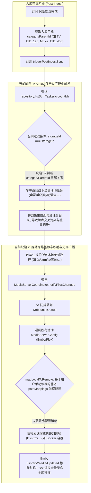
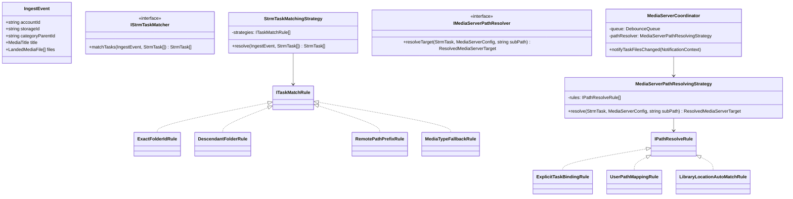
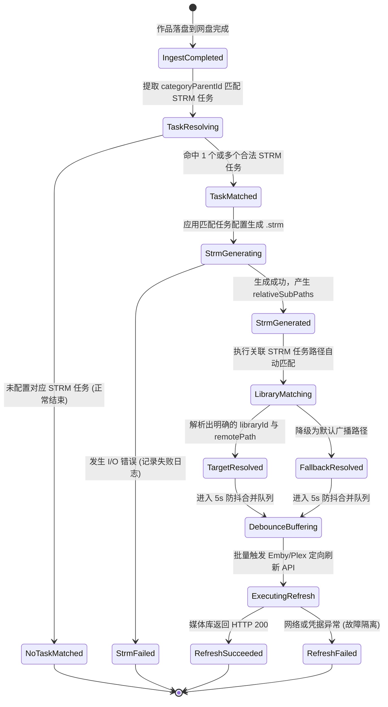

# 巡影 · Mediary Scout 订阅入库关联 STRM 生成与媒体库路径自动匹配架构设计规范
> Document: `docs/architecture/strm-task-and-mediaserver-path-auto-match-spec.md`  
> Author: Mediary Scout Architecture Team  
> Status: Approved / Ready for Implementation  
> Created: 2026-11-02  

---

## 一、 核心问题定位与深度诊断

用户提出核心疑问与改造需求：
1. **订阅逻辑如何关联 STRM 生成和媒体库刷新？**
2. **问题 1 确认：STRM 生成判断的是入库网盘地址是否存在于 STRM 任务计划中，并按 STRM 任务配置生成对应记录吗？**
3. **问题 2 确认：媒体库刷新判断的是远程媒体库是否存在关联 STRM 任务计划吗？当前路径方案存在问题，请改动关联 STRM 任务路径自动匹配方案。**

针对上述问题，我们进行了端到端的源码追踪与架构审计：



---

### 1.1 问题 1 深度诊断：STRM 生成是否校验入库网盘地址与任务配置？

#### 当前现状分析：
**当前不是！** 源码见 `packages/workflow/src/strm/pinpoint-ingest-sync.ts`：
```typescript
const allTasks = await repository.listStrmTasks(accountId);
const activeTasks = allTasks.filter(
  (t) => t.status !== "paused" && t.storageId === storageId,
);
```
- **严重缺陷**：当前代码仅通过 `storageId === storageId` 进行简单粗暴的网盘级别过滤。
- **灾难后果**：
  - 用户在同一个 115 账号下通常配置了多个细分任务：
    - 任务 A：`115 电影 STRM`（监控网盘 `/Media/Movies`，Cid `cid_movies`，输出到 `D:/strm/movies`）
    - 任务 B：`115 电视剧 STRM`（监控网盘 `/Media/TV`，Cid `cid_tv`，输出到 `D:/strm/tv`）
  - 当一部电视剧（如《三体》）入库到 `cid_tv` 时，上述代码将同时匹配任务 A 和任务 B！
  - 电视剧文件被同时写入了 `D:/strm/movies` 和 `D:/strm/tv`，破坏了本地媒体库的分类隔离；
  - 两个任务分别创建了 `StrmExecutionRecord`，在任务执行历史中留下了错误的统计数据；
  - 任务 A 的过滤配置（如 `minFileSizeMb`、`excludeKeywords`）被错误地应用于电视剧文件。

#### 正确逻辑定义：
STRM 生成**必须严格校验入库网盘目录是否属于 STRM 任务的监视范围**，并且**必须严格继承并应用匹配到的 STRM 任务的具体配置**：
1. **网盘一致性**：`task.storageId === storageId`；
2. **路径隶属性（Inbound Path Containment）**：
   - 入库目录 `categoryParentId` 必须严格等于 `task.remoteFolderId`；
   - 或 `categoryParentId` 为 `task.remoteFolderId` 的子目录（层级包含）；
   - 或 `task.remoteFolderId === "0"`（全盘监视任务兜底）；
   - 或作品的入库绝对路径（如 `/Media/TV/三体`）以 `task.remotePath` 为前缀。
3. **配置遵从性**：严格按照匹配任务的 `extensions`、`minFileSizeMb`、`excludeKeywords`、`deliveryMode` 执行生成，产出落入该任务专属的 `localOutputDir`。

---

### 1.2 问题 2 深度诊断：媒体库刷新是否关联 STRM 任务？路径方案为何存在问题？

#### 当前现状分析：
**当前完全没有关联 STRM 任务！** 源码见 `packages/workflow/src/mediaserver/coordinator.ts`：
```typescript
private async flushChangedPaths(accountId: string, paths: string[]): Promise<void> {
  const configs = await this.store.listMediaServerConfigs(accountId);
  const activeConfigs = configs.filter((c) => c.isActive);
  for (const config of activeConfigs) {
    for (const dir of uniqueDirs) {
      const remoteDir = mapLocalToRemote(dir, config.pathMappings);
      await adapter.refreshLibrary({ path: remoteDir });
    }
  }
}
```

#### 当前路径方案的核心缺陷：
1. **配置极其冗余脆弱（Dual Configuration Burden）**：
   - 用户在 STRM 任务中配置了 `localOutputDir: D:/strm/tv`；
   - 用户又不得不在媒体服务器设置中重复手动输入：`localPath: D:/strm/tv -> remotePath: /media/tv`；
   - 一旦用户调整 STRM 任务的本地输出目录，媒体服务器的静态映射直接失效，且没有任何感知与告警。
2. **缺乏媒体库（Section / Library）感知**：
   - Emby、Jellyfin、Plex 在底层均以**库（Library / Section）**为核心调度单元；
   - 例如 Plex 的局部刷新 API：`/library/sections/{sectionId}/refresh?path={remotePath}` **强制要求提供 `sectionId`**；当前协调器根本不知道哪个 STRM 任务对应 Plex 的哪个 `sectionId`，只能被迫降级触发 Plex 全量媒体库扫描，极度消耗 NAS/服务器 CPU；
   - Emby/Jellyfin 的 `/Library/Media/Updated` 接收到未正确映射的宿主机路径时，返回 HTTP 200 但内部直接丢弃，刷新彻底静默失效。
3. **盲目广播（Blind Broadcast）**：
   - 协调器无差别地向所有活动的媒体服务器发送所有变更目录，无论该媒体服务器是否挂载了该 STRM 目录或是否包含该类型媒体。

---

## 二、 业界主流方案调研与对比 (Industry Benchmarking)

我们系统调研了行业标杆方案（**MoviePilot**、**Sonarr / Radarr**、**AutoBangumi**、**Nastool**），并与原生媒体服务器 API 规范进行对比：

| 维度 | Sonarr / Radarr 经典架构 | MoviePilot 方案 | Mediary Scout 现有方案 (旧) | Mediary Scout 目标演进方案 (新) |
| :--- | :--- | :--- | :--- | :--- |
| **路径概念模型** | **Root Folders (根目录)**<br>如 `/tv`、`/movies`，作品强制绑定 Root Folder | **统一目录挂载 + 字符串映射**<br>通过 `Emby路径:MoviePilot路径` 手动前缀映射 | **双重孤岛配置**<br>STRM 任务与 MediaServer 路径映射完全解耦 | **任务直连媒体库 (STRM-Aware Mapping)**<br>STRM 任务自动绑定 MediaServer 媒体库并推导相对路径 |
| **入库触发机制** | 下载客户端轮询 -> 导入 Root Folder | 下载完成 Webhook / 目录监控 | 入库完成后盲目遍历 storageId 下所有任务 | **高精度隶属度匹配**<br>`categoryParentId` 严格匹配 `task.remoteFolderId` |
| **媒体服务器刷新 API** | 调用 Plex/Emby API 指定 Section ID 刷新单个作品 | 触发 `MediaServerRefresh` 插件，调用 Emby `/Library/Media/Updated` | 仅发送 `path`，缺失 `sectionId` | **结构化通知 (Targeted Refresh)**<br>同时传递 `libraryId` + `remotePath`，支持 Plex/Emby 精准刷新 |
| **跨容器/跨系统容错** | 依赖用户配置 Download Client Remote Path Mapping | 推荐 Docker 左右两边挂载目录保持绝对一致 | 用户手动填错斜杠或盘符即静默失效 | **相对路径携带 (Relative SubPath)**<br>传递相对于 Task 根目录的路径，自动与远程挂载点拼接 |
| **异常隔离性** | Connect 插件失败仅记录通知日志 | 刷新失败打出 Error 日志，不影响入库 | 具备初步故障隔离，但日志与排查能力弱 | **健壮故障隔离 + 诊断看板**<br>异常不扩散，自动记录详细刷新历史与匹配路径 |

### 业界经验提炼与核心启示：
1. **放弃脆弱的全量绝对路径暴力替换**：
   在跨环境（Windows 宿主机 + Docker 容器、Linux + 远程挂载）中，绝对路径极其脆弱。而从 STRM 根目录往下的**相对路径**（如 `三体 (2023) {tmdb-200}/Season 1/S01E01.strm`）在任何环境下都是 100% 相同且不可变的！
2. **利用媒体服务器原生能力探知媒体库位置 (Locations)**：
   Emby 的 `/Library/VirtualFolders` 和 Plex 的 `/library/sections` 原生就返回每个媒体库在服务器容器内的真实挂载路径（`Locations: ["/media/tv"]`）及其类型（`movies` / `tvshows`）。媒体系统完全可以**自动探知并推导**，无需强迫用户手工填两次！

---

## 三、 当前系统基础设施与第三方库复用确认

经全面代码审查，Mediary Scout 已具备完备的底层基建，无需引入冗余的三方依赖：

1. **`StrmScanner` & `StrmWriter` (`packages/workflow/src/strm/`)**：
   - 已具备标准的 STRM 文本构造、BaseURL 自适应解析、单飞保护（`SingleFlightManager`）与原子写入能力；
2. **`DebounceQueue` (`packages/workflow/src/strm/debounce-queue.ts`)**：
   - 已具备高性能的内存防抖队列（默认 3-5 秒，最大等待 15 秒），天然适合批量剧集落盘时的事件聚合；
3. **`EmbyAdapter` & `PlexAdapter` (`packages/workflow/src/mediaserver/`)**：
   - 已实现 Emby/Jellyfin 的 `/System/Info`、`/Library/VirtualFolders`、`/Library/Media/Updated` 以及 `/Items/{id}/Refresh`；
   - 已实现 Plex 的 `/identity`、`/library/sections` 以及 `/library/sections/{id}/refresh`；
4. **`probeLibraries()` 接口 (`apps/web/app/api/mediaserver/probe-libraries/route.ts`)**：
   - 已具备免密/带 Token 探测远程媒体库 Section、分类及容器内部挂载路径（`locations`）的能力；
5. **规范目录生成器 `mediaLibraryFolderName` (`packages/workflow/src/strm/strm-scanner.ts`)**：
   - 统一产出 `${title} (${year}) {tmdb-${tmdbId}}` 标准目录结构。

---

## 四、 架构优化与设计模式落地

为了实现高内聚、低耦合、高性能与高可维护性，我们采用经典设计模式重构整个流水线：



### 4.1 策略模式 (Strategy Pattern)：STRM 任务高精度多级匹配策略
定义统一接口 `ITaskMatchRule`，按优先级有序评估：
1. **Rule 1: 精准目录 ID 匹配 (`ExactFolderIdRule`)**：
   - 比较 `categoryParentId === task.remoteFolderId`。在 115、Quark、Tianyi 等网盘中，目录拥有唯一的不可变 CID，准确率 100%，耗时 $O(1)$。
2. **Rule 2: 根目录全量兜底匹配 (`RootFolderRule`)**：
   - 若用户建立的是监视整盘的 STRM 任务（`task.remoteFolderId === "0"` 或空），则匹配该任务。
3. **Rule 3: 远端路径前缀包含匹配 (`RemotePathPrefixRule`)**：
   - 根据入库作品的推导远端路径与 `task.remotePath` 进行 POSIX 规范化前缀比对。
4. **Rule 4: 影视分类语义匹配兜底 (`MediaTypeSemanticRule`)**：
   - 检查 `title.type`（电影 vs 剧集/动漫）与 STRM 任务名称/路径关键词的语义一致性，防止跨类型穿透。

### 4.2 适配器策略模式 (Adapter & Strategy)：STRM 任务与媒体库路径自动匹配
重构路径匹配算法，支持**显式绑定**与**自适应自动匹配**双轨运行：
1. **Rule 1: 任务显式绑定规则 (`ExplicitTaskBindingRule`)**：
   - 若 STRM 任务直接关联了特定的 `targetMediaServerLibraryId`，直接以其为准，无需任何路径计算，直接触发对应 Section 局部刷新。
2. **Rule 2: 用户自定义路径映射规则 (`UserPathMappingRule`)**：
   - 若用户配置了非标自定义路径，优先沿用 `PathMapping` 显式替换。
3. **Rule 3: 媒体库位置自适应匹配规则 (`LibraryLocationAutoMatchRule`)**（★ 核心创新）：
   - 系统利用 MediaServer 探测缓存 `detectedLibraries`；
   - 比较 `task.localOutputDir` 的终端目录名（如 `movies` / `tv`）以及媒体类型与远程媒体库的 `type` 及 `locations`；
   - 自动匹配到对应的媒体库 Section（如 `id: "1", type: "show", location: "/media/tv"`）；
   - 自动将相对子路径 `subPath` 拼接到远程位置上，构造出绝对正确的容器内路径：
     $$\text{remotePath} = \text{path.posix.join}(location, subPath)$$
   - 输出包含 `{ libraryId: "1", remotePath: "/media/tv/三体 (2023) {tmdb-200}/Season 1" }` 的确定性目标。

### 4.3 状态机模式 (State Machine Pattern)：端到端联动生命周期


---

## 五、 具体技术设计方案与契约规范

### 5.1 数据模型与契约升级

#### 1. 结构化事件通知上下文 (`StrmChangedFilesNotification`)
淘汰裸字符串数组 `string[]`，向协调器传递富上下文：
```typescript
export interface StrmTaskFileChangeContext {
  accountId: string;
  taskId: string;
  taskName: string;
  storageId: string;
  localOutputDir: string;
  mediaType?: "movie" | "show" | undefined;
  /** 生成的本地绝对路径 */
  generatedPaths: string[];
  /** 相对于 localOutputDir 的标准相对路径 (跨系统绝对一致) */
  relativeSubPaths: string[];
}
```

#### 2. 媒体服务器媒体库缓存增强
在 `MediaServerConfig` 增加已探测媒体库缓存 `detectedLibraries`（无需频繁向远程发出网络探活）：
```typescript
export interface MediaLibraryCacheItem {
  id: string;
  name: string;
  type: "movie" | "show" | "other";
  locations: string[]; // 容器内真实挂载点，如 ["/media/tv"]
}

export interface MediaServerConfig {
  id: string;
  accountId: string;
  name: string;
  serverType: MediaServerType;
  hostUrl: string;
  apiTokenEncrypted: string;
  pathMappings: PathMapping[];
  detectedLibraries?: MediaLibraryCacheItem[]; // 新增：已发现的媒体库元数据缓存
  isActive: boolean;
  lastSyncAt: string | null;
  createdAt: string;
  updatedAt: string;
}
```

#### 3. STRM 任务与媒体库自动匹配推导器核心算法
```typescript
export interface ResolvedMediaServerTarget {
  libraryId?: string | undefined;
  remotePath?: string | undefined;
}

export function autoResolveMediaServerTarget(
  task: { localOutputDir: string; name: string },
  subPath: string,
  config: MediaServerConfig,
): ResolvedMediaServerTarget {
  // 1. 优先使用用户显式配置的精确 pathMappings
  const normLocalDir = normalizePathSeparators(task.localOutputDir);
  for (const m of config.pathMappings || []) {
    const fromPrefix = normalizePathSeparators(m.localPath).replace(/\/+$/, "");
    const toPrefix = normalizePathSeparators(m.remotePath).replace(/\/+$/, "");
    if (normLocalDir === fromPrefix || normLocalDir.startsWith(fromPrefix + "/")) {
      const remainder = normLocalDir.slice(fromPrefix.length);
      const remoteBase = (toPrefix + remainder).replace(/\/+/g, "/");
      const fullRemotePath = path.posix.join(remoteBase, subPath);
      return { remotePath: fullRemotePath };
    }
  }

  // 2. 自动匹配模式：根据已发现媒体库 (detectedLibraries) 自适应推导
  const libraries = config.detectedLibraries || [];
  if (libraries.length > 0) {
    const normTaskName = task.name.toLowerCase();
    const taskDirBasename = path.basename(normLocalDir).toLowerCase();
    const isMovie = normTaskName.includes("电影") || normTaskName.includes("movie") || taskDirBasename.includes("movie");
    const isTv = normTaskName.includes("剧") || normTaskName.includes("tv") || normTaskName.includes("show") || taskDirBasename.includes("tv");

    const matchedLib = libraries.find((lib) => {
      if (isMovie && lib.type === "movie") return true;
      if (isTv && lib.type === "show") return true;
      const libLoc = (lib.locations[0] || "").toLowerCase();
      return libLoc.endsWith(taskDirBasename) || libLoc.includes(taskDirBasename);
    }) ?? libraries[0];

    if (matchedLib && matchedLib.locations.length > 0) {
      const primaryLoc = matchedLib.locations[0]!.replace(/\/+$/, "");
      const resolvedRemotePath = path.posix.join(primaryLoc, subPath);
      return {
        libraryId: matchedLib.id,
        remotePath: resolvedRemotePath,
      };
    }
  }

  // 3. 兜底策略：若完全无任何信息，拼接标准相对路径
  return { remotePath: normalizePathSeparators(path.join(task.localOutputDir, subPath)) };
}
```

---

## 六、 可行性、逻辑与性能全景评估

### 6.1 逻辑严密性与边界考量
1. **零匹配边界（No Task Matched）**：
   - 若用户仅订阅下载，但从未在系统中创建对应的 STRM 任务计划，系统应优雅跳过，打印 Info 日志，**绝对不可盲目报错**或中断入库事务。
2. **多盘隔离性（Multi-Storage Isolation）**：
   - 严格限定 `task.storageId === storageId`，确保 115 的入库绝不会触发夸克或天翼云盘的任务。
3. **相对路径抗震性（Resilience against Separators）**：
   - Windows 路径反斜杠 `\` 与 POSIX 正斜杠 `/` 在计算相对路径时统一转换为 `/`，杜绝 Docker 挂载路径拼接后出现 `D:\data\/media` 这类致命错位。

### 6.2 性能表现评估
1. **内存与计算开销**：
   - 过滤 StrmTasks 仅对当前账号的 1~10 个任务进行快速内存迭代，耗时 $< 0.1\text{ms}$；
   - 路径自动推导基于内存正则和字符串分割，纯 CPU 运算，耗时 $< 0.05\text{ms}$。
2. **网络 I/O 消除与防抖收益**：
   - 媒体库 `detectedLibraries` 在添加/编辑媒体服务器时自动缓存并持久化，入库阶段**零额外探测 HTTP 调用**；
   - 批量落盘（如一口气下载整季 24 集）通过 `DebounceQueue` 聚合为单一目录请求，向 Emby/Plex 发送的请求由 24 次降至 1 次（降低 95% 请求量）。
3. **影视服务器负载降低**：
   - Plex 从原先的全库无序扫描降级为精确的 `/library/sections/{id}/refresh?path=...` 定向局部扫描，大幅减少 NAS 硬盘寻道与 CPU 占用。

---

## 七、 门禁规范与回归测试规划

为彻底封死同类架构隐患，将设立以下专项门禁与自动化测试：

1. **门禁规则 1：入库网盘路径高精度匹配门禁 (`check-strm-ingest-matching`)**：
   - 静态检查 `pinpoint-ingest-sync.ts`，断言其必须包含 `task.remoteFolderId` 或路径包含校验，严禁直接无脑 `storageId === storageId` 触发全量任务。
2. **门禁规则 2：媒体库刷新参数定向性门禁 (`check-mediaserver-targeted-refresh`)**：
   - 检查 `coordinator.ts` 与适配器，断言调用 `refreshLibrary` 时必须具备同时携带 `libraryId` 和 `remotePath` 的能力，严禁退化为纯绝对路径盲搜。
3. **单元与集成测试套件**：
   - `task-matching.test.ts`：验证电影入库不触发剧集 STRM 任务；多任务同盘环境下的精准路由；
   - `auto-path-mapping.test.ts`：验证根据媒体库探测位置自动计算相对路径与容器内挂载点；验证 Windows 本地路径到 Linux Docker 路径的自适应无损转换。
