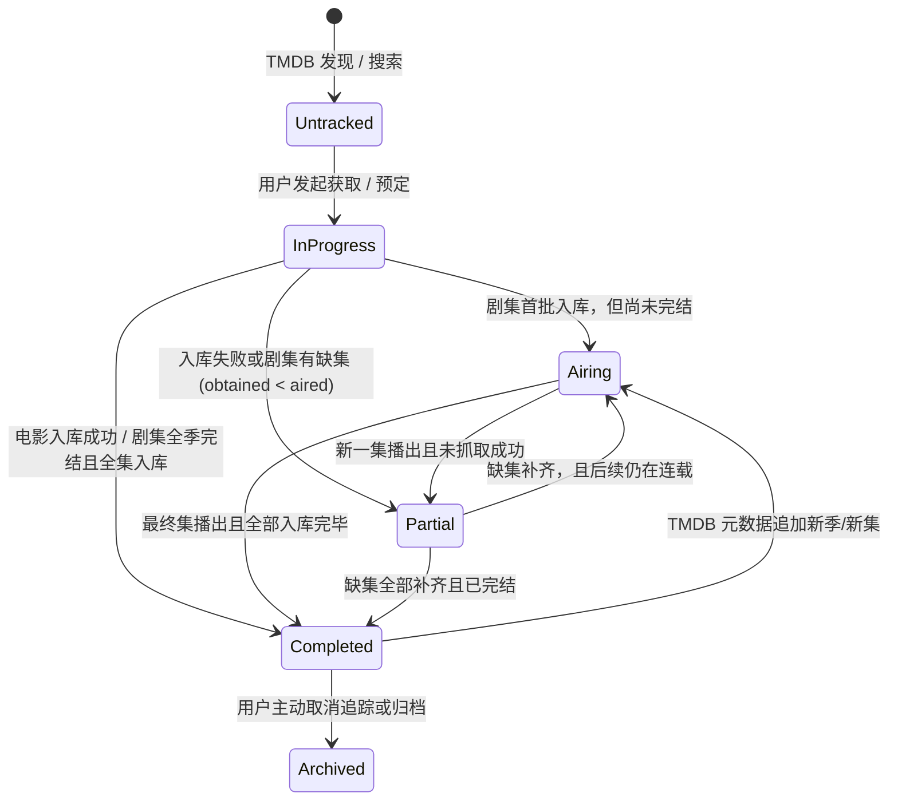
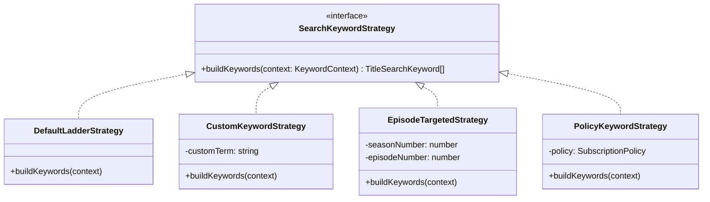
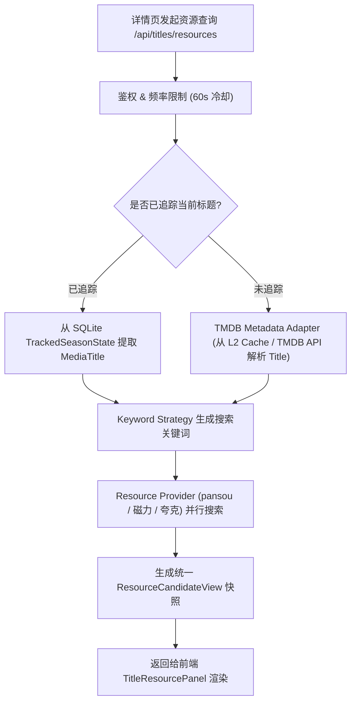

# 订阅完成归档、资源详情精准搜索与自定义关键词设计与可行性调研

## 1. 调研背景与需求溯源

在当前多网盘媒体管理系统（Mediary Scout）中，随着用户订阅量和片库规模增加，暴露出了三项核心用户体验与系统性能瓶颈：

1. **订阅完成后的状态流转与防重运行缺失**：
   - 现存订阅主页（`mode="home"`）将「追更中」、「有缺集」与「已完结/已全部入库」的作品全部混杂在同一分类行（电影/电视剧/动漫）中，用户无法直观聚焦当前正在更新或有缺失的剧集。
   - 在定时巡检（`runScheduledType3Monitoring`）中，全量订阅（含已全部获取的电影和完结全集已入库的剧集）仍然被全量拉取、参与巡检预算计算（`planPatrolScope`）并在并发池中逐个调度判断，不仅消耗 SQLite 查询与内存，也容易在网络抖动或元数据同步异常时引发不必要的重复搜索与 LLM 调用。
2. **搜索页无法在详情页直接搜索具体资源**：
   - 当前在搜索结果中点击进入详情页（`/show/[tmdbId]?origin=search`）时，若该作品尚未加入追踪（untracked），电影详情页会隐藏「资源」面板，电视剧详情页虽渲染资源面板，但调用 `/api/titles/resources` 时后端会以 `404 { error: "title not tracked" }` 强制阻断。
   - 用户无法在「未追踪/未订阅」状态下预先探查网盘或磁力源是否有可用资源，也无法按季、集或特定规格搜索具体资源。
3. **全链路缺乏自定义搜索关键词支持**：
   - 当前系统严格限定「不让用户手打关键词」，只根据 TMDB 的标题、年份和别名生成自动阶梯（`buildTitleSearchKeywords`）。
   - 在现实网盘/BT生态中，大量动漫或小众剧集使用特定字幕组名（如 `[喵萌奶茶屋]`、`[NC-Raws]`）、季别特殊格式（如 `Part 2`、`第二季`、`S02`）或特定压制格式（`4K Remux`、`内嵌中字`）。静态阶梯无法命中的情况下，用户完全没有手动干预手段。

---

## 2. 业界主流方案对比与借鉴

对比主流开源方案在媒体订阅生命周期、交互式搜索和关键词定制上的成熟设计：

| 维度 | Sonarr / Radarr (Servarr 体系) | MoviePilot (MP) | Auto-Bangumi | Mediary Scout 本次设计 |
| :--- | :--- | :--- | :--- | :--- |
| **订阅生命周期** | `Monitored` 显式开关；全季/全片完成且满足 Cutoff 后停止 RSS/搜索，移入整理完成状态；支持 Unmonitored 归档 | 分为「订阅中」、「洗版中」、「已完成」；已完成订阅独立视图，不参与常规轮询刷新 | RSS 规则匹配；下载完成后标记已下载，不再重复匹配同一集 | **状态机模型**：显式划分「订阅中」（追更/缺集）与「已完成」（全季/全片入库），完结作品自动归档至完成视图；巡检调度前置硬过滤，0 成本避免重复运行 |
| **交互式资源搜索** | Interactive Search：详情页可随时手动对整部剧、某单季、某单集触发索引器查询，展示所有 Release 列表及大小、做种数 | 站点搜索：支持在详情页对各 PT 站点进行手动搜索与选种下载，支持未入库前探测 | 手动检索功能较弱，主要依赖 Bangumi 规则预设 | **适配器模式**：详情页统一支持已订阅/未订阅作品探查资源，支持单季/单集针对性检索，支持未入库一键手动入库 |
| **自定义关键词** | Release Profiles / Custom Formats：支持 `Must contain`、`Must not contain`，手动搜索支持自由 Query | 搜索关键词覆盖与别名映射，支持自定义搜索词规则和过滤正则 | 支持 RSS 标题替换与包含/排除正则规则 | **策略模式**：提供阶梯策略、单季/单集策略、自定义词策略与策略持久化，用户可随时在详情页和订阅策略中指定关键词 |

---

## 3. 设计模式优化与架构设计

### 3.1 状态机模式（State Machine Pattern）：订阅生命周期与防重运行

#### 3.1.1 状态流转图


#### 3.1.2 防重复运行机制（Zero-Patrol Guarantee）
- **前置过滤机制**：
  在 `runScheduledType3Monitoring` 中，调度巡检候选前执行：
  ```ts
  const activeCandidates = trackedStates.filter((state) => {
    // 电影已入库：不参与巡检
    if (state.title.type === "movie") {
      return !state.episodes.some((e) => e.obtained);
    }
    // 剧集/动漫：非 active 或总集数已满足且无缺集：不参与巡检
    if (state.season.status !== "active") return false;
    return true;
  });
  ```
- **效益**：
  - 避免将已完成的 100+ 部作品拉入并发池与配额预算（`planPatrolScope`）。
  - 不会向 115/夸克发起无效的目录比对，也不会消耗 LLM Token 或外部索引器配额。
  - 主动防抖与防误触发：只有出现实际缺集或新集开播时，状态机才切回 `active`。

---

### 3.2 策略模式（Strategy Pattern）：多层级关键词生成

将搜索关键词构建抽象为 `SearchKeywordStrategy` 策略族：



1. **DefaultLadderStrategy（默认阶梯策略）**：
   - 提取 TMDB 主标题、标题+年份、原名、别名，按成本从低到高构建。
2. **CustomKeywordStrategy（用户自定义策略）**：
   - 用户在详情页或订阅规则中手动指定搜索词（如 `庆余年 第二季 4K`）。
   - 用户自定义词置于搜索队列最高优先级，快速命中精准资源。
3. **EpisodeTargetedStrategy（单集/单季定位策略）**：
   - 用户在资源详情页选择具体某季或某集（如第 5 集）时，自动合成针对性关键词（如 `<Title> S01E05`、`<Title> 第05集`、`<Title> S01`）。
4. **PolicyKeywordStrategy（持久化订阅策略）**：
   - 在 `subscription_policies` 中持久化存储自定义搜索词，日常巡检时自动采用该词组进行检索。

---

### 3.3 适配器模式（Adapter Pattern）：资源探查与元数据适配

针对需求 2「搜索页面在详情页搜索具体资源」：



- **未追踪作品兼容**：
  解除「未追踪即 404」的死锁。未追踪作品通过 `TMDBMetadataAdapter` 从持久化缓存中加载标题、年份、别名，允许用户即席搜索资源。
- **手动入库（Manual Import）无缝承接**：
  若用户从搜索页进入未追踪详情页，查出满意资源并点击「手动入库」，系统自动确保追踪状态建立并排队入库任务，无缝打通「搜索 -> 探查 -> 入库」闭环。

---

## 4. 可行性评估、性能与边界安全

### 4.1 性能与开销控制
1. **防爆破与频控**：
   - 无论是否已追踪、无论是否使用自定义关键词，详情页资源搜索一律维持严格的 **60秒单作品冷却（`resourceLimiter`）** 和 **30分钟结果缓存（`resourceCache`）**。
   - 自定义关键词纳入缓存键：`${accountId}:${titleId}:${keywordHash}`，避免不同关键词互相污染或命中旧缓存。
2. **巡检吞吐量提升**：
   - 完结作品前置剔除后，巡检单次遍历规模预计减少 **60% - 90%**，每日执行耗时从数分钟降至数秒，极大降低触发网盘 API 限频的概率。

### 4.2 边界与异常处理
- **自定义关键词注入防护**：
  限制关键词长度（≤ 64 字符），过滤换行及控制字符，防止对底层搜索源或 SQL 语句造成意外干扰。
- **已完结剧集后续加更**：
  当 TMDB 更新总集数（例如特别篇上线或续订拆季），`syncSeasonMetadata` 会对比集数；若最新播出集大于库中集数，状态机自动平滑唤醒并从「已完成」恢复为「追更中」。

---

## 5. 执行计划与模块分解

1. **Step 1: 规范与文档写入**（已完成当前设计文档）。
2. **Step 2: 订阅完成视图与巡检防重优化**：
   - 优化 `LibrarySurface` 与 `LibraryQuickFind`，增加「订阅中」与「已完成」视图切换（Tab / 状态过滤器），让完结作品移入「已完成」。
   - 在 `worker.ts` 的巡检候选生成阶段前置过滤已完成的作品，杜绝已完成订阅重复运行。
3. **Step 3: 详情页未追踪资源搜索与具体资源检索**：
   - 改造 `/api/titles/resources`，支持未追踪作品通过 TMDB 适配器解析元数据。
   - 放开 `show/[tmdbId]/page.tsx` 中 `MovieHub` 未追踪状态下的 `TitleResourcePanel` 渲染。
4. **Step 4: 自定义搜索关键词全链路支持**：
   - 扩展 `packages/workflow/src/title-search-keywords.ts`，引入关键词策略体系。
   - 在 `/api/titles/resources` 中支持接收 `customKeyword` 及 `seasonNumber`、`episodeNumber`。
   - 在 `apps/web/components/title-resource-panel.tsx` 中增加自定义关键词输入框与快捷单季/单集筛选。
   - 扩展 `subscription_policies` 支持存储 `customKeywords`，使巡检能够复用自定义关键词。
5. **Step 5: 单元测试、门禁与端到端运行验证**。
