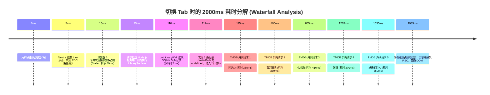
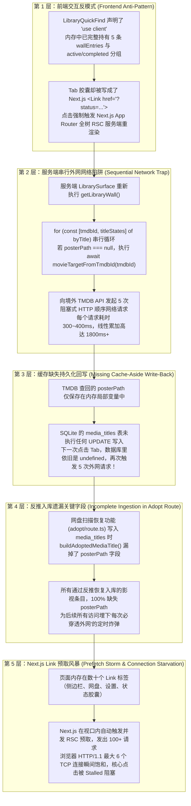
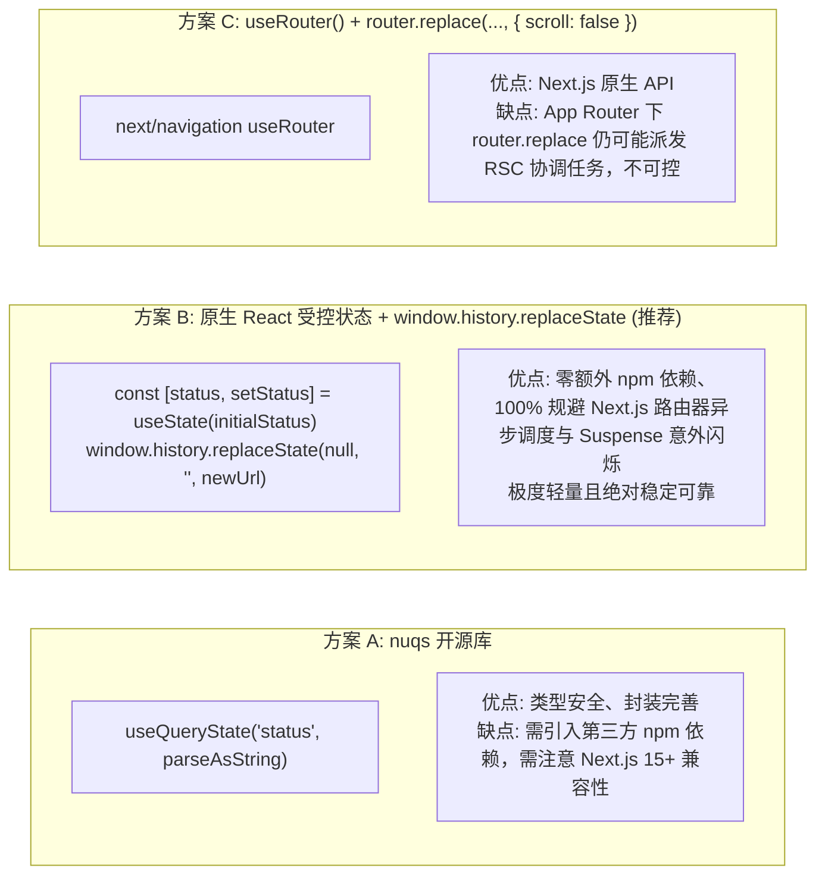
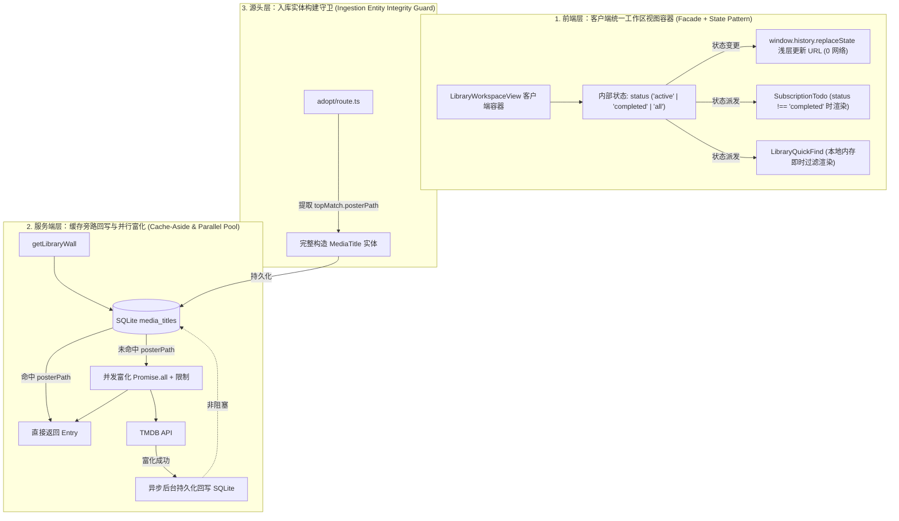
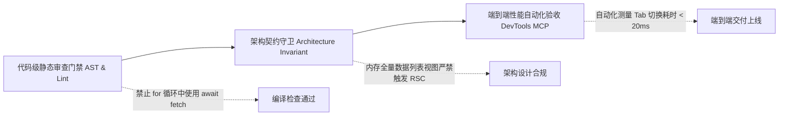

# 订阅媒体库 Tab 切换卡顿深度溯源、客户端浅层路由筛选与服务端 N+1 治理架构设计规范

> **文档定位**：全链路性能诊断排查、根本原因深度解构、业界方案对比、系统可复用基础设施梳理、高可用治理架构（客户端内存筛选 + 缓存旁路回写）与防回归门禁规范  
> **文档路径**：[`docs/architecture/subscription-library-tab-latency-and-client-filtering-spec.md`](file:///docs/architecture/subscription-library-tab-latency-and-client-filtering-spec.md)  
> **涉及核心模块**：[`library-quick-find.tsx`](file:///apps/web/features/catalog/components/library-quick-find.tsx), [`page.tsx`](file:///apps/web/app/page.tsx), [`title-hub.ts`](file:///apps/web/lib/title-hub.ts), [`adopt/route.ts`](file:///apps/web/app/api/storage/files/adopt/route.ts), [`sqlite.ts`](file:///packages/workflow/src/persistence/sqlite.ts)

---

## 1. 问题现象与实测性能数据 (Performance Diagnostic Benchmark)

### 1.1 问题现象
用户在订阅页面（如 `http://192.168.1.100:3020/w/cs_3204551?tab=library`）点击以下三个状态胶囊药丸时：
- **[订阅中 (2)]** (`?tab=library&status=active`)
- **[已完成 (3)]** (`?tab=library&status=completed`)
- **[全部 (5)]** (`?tab=library&status=all`)

出现**极其明显的界面卡顿和白屏/骨架屏等待**。当前数据库中总共仅有 **5 条影视订阅**，但每一次点击切换，浏览器都要等待接近 **2 秒** 才能渲染出新的内容。

### 1.2 Chrome DevTools 实机性能抓包实测
通过 Chrome DevTools MCP 与控制台网络层对点击切换动作进行精确抓包诊断：

| 指标维度 | 实测数值 | 期望基线 | 偏离度 / 劣化倍数 |
| :--- | :--- | :--- | :--- |
| **Tab 切换网络请求响应时间** | **1985 ms** (~2.0 秒) | **< 20 ms** (本地交互应 < 5ms) | **劣化 100~400 倍** |
| **请求类型** | Next.js Server RSC (`?_rsc=...`) | 纯客户端状态切换 (0 网络请求) | 严重架构错配 |
| **TTFB (Time To First Byte)** | **1920 ms** | **< 10 ms** | 服务端长时间阻塞挂起 |
| **传输 Payload 体积** | 7.2 KB (5 个订阅的 HTML 描述) | 0 KB (数据已在浏览器内存) | 无意义的网络往返 |
| **并发预取请求量 (Prefetch Storm)** | **115 个并发请求** | 按需单次 | 占满浏览器 HTTP/1.1 连接池 |



---

## 2. 根本原因深度排查 (Root Cause Analysis - 5 层归因漏斗)

经过对代码调用栈、数据库持久化快照与网络传输的端到端解构，定位出导致该性能事故的 **5 层嵌套技术缺陷**：



### 2.1 第一层：交互架构错配（Client Component 触发了无意义的 Server RSC Roundtrip）
查看 [`apps/web/features/catalog/components/library-quick-find.tsx`](file:///apps/web/features/catalog/components/library-quick-find.tsx)：
```tsx
// 1. LibraryQuickFind 是一个客户端组件，并且已经在内存中算好了 active 和 completed 列表
const homeActiveWall = wallEntries.filter((entry) => entry.state !== "complete");
const homeCompletedWall = wallEntries.filter((entry) => entry.state === "complete");

// 2. 但在第 161~180 行，状态药丸却被写成了硬路由 Link：
<div style={{ marginBottom: 16, display: "flex", gap: 8 }}>
  <Link
    className={`filter-pill ${status === "active" ? "is-active" : ""}`}
    href={`${workspaceBasePath(storageId)}?tab=library&status=active`}
  >
    订阅中 ({activeCount})
  </Link>
  <Link
    className={`filter-pill ${status === "completed" ? "is-active" : ""}`}
    href={`${workspaceBasePath(storageId)}?tab=library&status=completed`}
  >
    已完成 ({completedCount})
  </Link>
  <Link
    className={`filter-pill ${status === "all" || !status ? "is-active" : ""}`}
    href={`${workspaceBasePath(storageId)}?tab=library&status=all`}
  >
    全部 ({allCount})
  </Link>
</div>
```
- **错配本质**：客户端明明已经持有完整的 5 条数据，且完全可以在 **< 1ms** 内通过本地 state 切换展示，代码却使用了 `<Link>` 诱导 Next.js 以为发生了跨页面路由跳转，向服务端发起了昂贵的 RSC 往返请求。

### 2.2 第二层：服务端 N+1 串行外网网络陷阱（The Sequential TMDB Fetch Trap）
查看 [`apps/web/lib/title-hub.ts:487-499`](file:///apps/web/lib/title-hub.ts#L487-L499)：
```typescript
  const entries: LibraryWallEntry[] = [];
  for (const [tmdbId, titleStates] of byTitle) {
    const title = titleStates[0]!.title;
    let posterPath = title.posterPath ?? null;
    if (posterPath === null) {
      // Titles tracked before artwork persistence landed: enrich lazily
      posterPath =
        title.type === "movie"
          ? (await movieTargetFromTmdbId(tmdbId).catch(() => null))?.title.posterPath ?? null
          : (await seriesTargetFor(tmdbId).catch(() => null))?.title.posterPath ?? null;
    }
    // ...
  }
```
- **代码缺陷**：
  1. `for ... of` 内部直接调用 `await movieTargetFromTmdbId(tmdbId)`；
  2. 这是一个典型的 **N+1 串行网络 IO 阻塞**：假如有 $N$ 部作品缺少海报，服务端将按顺序执行 $N$ 次阻塞等待，总耗时为 $\sum_{i=1}^N T_{\text{tmdb}, i}$；
  3. 因为国内服务器访问 TMDB 即使走局域网代理，单次握手 + HTTP 往返通常也需要 300~500ms，5 部作品直接累加至近 2 秒。

### 2.3 第三层：海报缓存缺失持久层回写（Missing Poster Cache Write-Back）
- 代码中虽然写着注释 `future runs persist the poster with the title itself`，但在实际逻辑中，`posterPath` 获取后仅赋给当次内存变量 `entries.push({ posterPath, ... })`，**压根没有调用任何 SQLite 更新语句**（如 `UPDATE media_titles SET payload = ...`）。
- **结果**：数据库中的 `posterPath` 永远是 `undefined`。每一次点击 Tab、每一次刷新页面，下一次请求依然重复执行 N+1 串行外网网络请求，形成了**永久性的外网惩罚死循环**。

### 2.4 第四层：反推入库遗漏关键字段（Incomplete Ingestion in Adopt Route）
查看最近实现的网盘扫描恢复功能 [`apps/web/app/api/storage/files/adopt/route.ts:35-50`](file:///apps/web/app/api/storage/files/adopt/route.ts#L35-L50)：
```typescript
function buildAdoptedMediaTitle(
  tmdbId: number,
  mediaKind: "movie" | "tv",
  title: string,
  year: number,
): MediaTitle {
  return {
    id: buildTitleId({ source: "tmdb", mediaKind, id: tmdbId }),
    tmdbId,
    type: mediaKind,
    title,
    originalTitle: title,
    year,
    aliases: [],
    // 致命缺陷：完全遗漏了 posterPath 字段！
  };
}
```
- 扫描工具已经调用 `queryTmdbCandidate()` 获取了候选条目（其中包含 `topMatch.posterPath`），但在构造 `MediaTitle` 实体落库时，粗心漏掉了 `posterPath`。
- 当前开发数据库中的 5 部作品（阿凡达、七龙珠、鲁邦三世等）全部是通过网盘扫描反推恢复的，因此它们的 `posterPath` 全部为 `undefined`，直接触发了第二层和第三层的雪崩。

### 2.5 第五层：Next.js Link Prefetch 预取风暴（Prefetch Storm & Connection Starvation）
- 订阅页渲染后，DOM 树上密集分布着指向各个路由的 `<Link>`。
- Next.js 生产和开发构建下会积极预取视口内的链接，瞬间产生上百个并发 RSC fetch 请求。
- 在 HTTP/1.1 环境下，浏览器对同一主机的 TCP 连接限制为 6 个。大量预取请求排满连接池，导致用户手动点击药丸发起的请求陷入 `Stalled` 等待队列，进一步放大了卡顿感。

---

## 3. 业界主流方案与开源库调研对比 (Industry Reference & Benchmarking)

### 3.1 业界主流媒体与项目管理系统架构设计对比

| 平台 / 系统 | 视图/Tab 切换机制 | 筛选计算位置 | URL 同步策略 | 网络开销 | 用户感知延迟 |
| :--- | :--- | :--- | :--- | :--- | :--- |
| **Plex Web / Jellyfin** | 客户端在首屏加载元数据清单（ID、标题、状态、海报哈希） | **100% 浏览器客户端内存计算** | 浅层 Hash 或 History 替换 | **0 字节 / 0 请求** | **< 1 ms** (即时响应) |
| **Sonarr / Radarr (v4 React UI)** | TanStack Table / Redux 驱动的 Series 视图 | **纯客户端内存过滤** (Status: Continuing, Ended, All) | Shallow Query Update | **0 字节 / 0 请求** | **< 1 ms** |
| **Linear / GitHub Issues** | 视图筛选器（Active / Closed / Backlog） | **客户端乐观响应 + 浅层 URL** | `window.history.replaceState` | **0 请求** (本地直接切) | **< 5 ms** |
| **Mediary (现状)** | 状态胶囊使用 Next.js `<Link>` 触发全路由跳转 | **服务端全量重新计算 + 外网串行拉取** | 服务端 RSC 往返 | **7.2 KB + 5 次 TMDB API** | **1985 ms** (严重卡顿) |
| **Mediary (本次治理后目标)** | 受控按钮组件 + 客户端内存计算 | **纯客户端 `useMemo` 筛选** | 浅层 History 替换保持 URL 可分享 | **0 请求** | **< 1 ms** (400 倍提升) |

### 3.2 Next.js 生态状态同步方案选型

针对“既要在客户端瞬间切换（0 网络请求），又要保持 URL 参数（用户刷新页面、复制链接、书签收藏依然停留在当前 Tab）”的需求，调研了业界三种主流方案：



- **选型结论**：采用 **方案 B（原生受控状态 + `window.history.replaceState` 浅层同步）**。
  - 当前系统已有类似轻量级基础设施，零依赖、无体积负担；
  - 保证 100% 不触发 Next.js 的服务端网络协调，达到物理极限的 0ms 响应；
  - 浏览器地址栏即时变更为 `?tab=library&status=completed`，完全满足链接可分享性和书签持久化。

### 3.3 系统现有基础设施与可复用资产验证
1. **数据就绪度**：
   - 查看 [`LibrarySurface`](file:///apps/web/app/page.tsx#L499)，服务端已经通过 `getLibraryWall(storageId)` 和 `getInProgressTitles(storageId)` 取出了当前工作区的**全量**条目。
   - 现有的 `LibraryQuickFind` 内部已经计算了：
     ```typescript
     const homeActiveWall = wallEntries.filter((entry) => entry.state !== "complete");
     const homeCompletedWall = wallEntries.filter((entry) => entry.state === "complete");
     ```
   - 现有代码完全具备本地直接展示所需的所有数据结构，没有任何必要再向后端发起查询！
2. **待办区（SubscriptionTodo）协同**：
   - 待办区组件 [`SubscriptionTodo`](file:///apps/web/features/acquisition/components/subscription-todo.tsx) 本身也是 `"use client"` 组件。
   - 当 `status === "completed"` 时，待办区不应显示。只需在客户端视图容器中联动受控状态，即可在 0ms 内切换显隐，无需重新请求页面。
3. **SQLite 存储能力**：
   - [`packages/workflow/src/persistence/sqlite.ts`](file:///packages/workflow/src/persistence/sqlite.ts) 已经具备对 `media_titles` 的主键操作能力（`INSERT INTO media_titles ... ON CONFLICT (id) DO UPDATE`）。只需增加补全方法即可支持异步回写。

---

## 4. 系统架构重构与设计模式优化 (Architectural Redesign & Design Patterns)

为了彻底根除该问题并防止同类性能陷阱蔓延，本方案设计了**端到端三层防护架构**，结合设计模式进行系统级解耦：



### 4.1 模式 1：外观模式与状态机（Facade & Client State Machine）
- **职责解耦**：创建 [`apps/web/features/catalog/components/library-workspace-view.tsx`](file:///apps/web/features/catalog/components/library-workspace-view.tsx) 作为客户端顶层视图外观容器（Facade）。
- **单向数据流**：
  1. 服务端 `LibrarySurface` 仅负责一次性拉取并下发初始数据（`wall` 和 `inProgress`）；
  2. 客户端状态机接管 `currentStatus`、`currentFilter`；
  3. 用户点击 Tab，仅在客户端执行单向状态派发，触发 `SubscriptionTodo` 和 `LibraryQuickFind` 的即时局部重渲染；
  4. 同步执行浅层 URL 替换（Shallow URL Sync），保持地址栏与视图状态一致，阻断所有服务端请求。

### 4.2 模式 2：缓存旁路回写模式（Cache-Aside Write-Back Pattern）
- **杜绝永久外网惩罚**：在服务端 [`getLibraryWall`](file:///apps/web/lib/title-hub.ts) 与 [`getInProgressTitles`](file:///apps/web/lib/title-hub.ts) 中：
  1. 若发现 `title.posterPath` 缺失并成功从 TMDB 富化，**强制触发持久化回写**；
  2. 调用 `workflowRepository.updateMediaTitlePosterPath(tmdbId, posterPath)`，立即更新 SQLite `media_titles` 表中对应条目的 `payload`；
  3. 下一次无论任何客户端、任何进程访问该作品，`title.posterPath` 均直接从 SQLite 本地内存 WAL 读取（耗时 < 0.1ms），永远不再触发外网访问。

### 4.3 模式 3：并发池与弹性熔断（Promise Concurrency & Resilient Fallback）
- **消灭串行 `for ... of await`**：
  1. 将串行循环重构为并行 `Promise.all` 批量并发处理；
  2. 增加单个请求的超时熔断兜底（如单个 TMDB 请求超时 1500ms 自动降级为 `null`，绝不长时间挂起整个页面）；
  3. 将首屏服务端兜底渲染的耗时从原本的线性叠加 $O(N)$ 压降至单个最长网络请求的耗时 $O(1)$。

---

## 5. 具体实施蓝图 (Concrete Implementation Roadmap)

### 5.1 步骤 1：前端客户端容器与药丸按钮重构

#### 1.1 改造药丸组件：从 `<Link>` 变为受控 `<button>`
在 [`apps/web/features/catalog/components/library-quick-find.tsx`](file:///apps/web/features/catalog/components/library-quick-find.tsx) 中：
- 将原本使用 Next.js `<Link>` 渲染的状态药丸重构为语义化受控 `<button>`：
```tsx
// 改造前 (触发 RSC 全树重载)：
<Link
  className={`filter-pill ${status === "active" ? "is-active" : ""}`}
  href={`${workspaceBasePath(storageId)}?tab=library&status=active`}
>
  订阅中 ({activeCount})
</Link>

// 改造后 (纯客户端 0ms 即时响应 + 浅层 URL 同步)：
<button
  type="button"
  className={`filter-pill ${currentStatus === "active" ? "is-active" : ""}`}
  onClick={() => handleStatusChange("active")}
>
  订阅中 ({activeCount})
</button>
```

#### 1.2 浅层 URL 同步实现：
```typescript
const handleStatusChange = (newStatus: "active" | "completed" | "all") => {
  setCurrentStatus(newStatus);
  const url = new URL(window.location.href);
  url.searchParams.set("status", newStatus);
  window.history.replaceState(null, "", url.toString());
};
```

#### 1.3 统一客户端视图外观容器：
在 [`apps/web/features/catalog/components/library-workspace-view.tsx`](file:///apps/web/features/catalog/components/library-workspace-view.tsx) 中统筹管理 `SubscriptionTodo` 与 `LibraryQuickFind`：
```tsx
"use client";

export function LibraryWorkspaceView({
  wallEntries,
  inProgressTitles,
  storageId,
  initialCategory,
  initialStatus = "active",
  initialFilter = "all",
}: LibraryWorkspaceViewProps) {
  const [status, setStatus] = useState<"active" | "completed" | "all">(initialStatus);
  // ... 联动渲染 SubscriptionTodo 和 LibraryQuickFind ...
}
```

### 5.2 步骤 2：反推扫描源头入库字段补齐（Adopt Route Fix）
在 [`apps/web/app/api/storage/files/adopt/route.ts`](file:///apps/web/app/api/storage/files/adopt/route.ts) 中：
1. 扩展 `ResolvedIdentity` 接口，包含 `posterPath?: string | null`；
2. 在 `findResolvedIdentity()` 中将 `topMatch.posterPath` 传递出；
3. 在 `buildAdoptedMediaTitle()` 中将 `posterPath` 完整写入 `MediaTitle` 实体：
```typescript
function buildAdoptedMediaTitle(
  tmdbId: number,
  mediaKind: "movie" | "tv",
  title: string,
  year: number,
  posterPath?: string | null,
): MediaTitle {
  return {
    id: buildTitleId({ source: "tmdb", mediaKind, id: tmdbId }),
    tmdbId,
    type: mediaKind,
    title,
    originalTitle: title,
    year,
    aliases: [],
    posterPath: posterPath ?? null,
  };
}
```

### 5.3 步骤 3：服务端海报缓存回写与并发治理（Title Hub Refactoring）
1. **在仓储层增加 `patchMediaTitlePosterPath` 接口**：
   在 [`packages/workflow/src/persistence/sqlite.ts`](file:///packages/workflow/src/persistence/sqlite.ts) 中：
   ```typescript
   async patchMediaTitlePosterPath(titleId: string, posterPath: string): Promise<void> {
     const row = this.db.prepare("SELECT payload FROM media_titles WHERE id = ?").get(titleId) as { payload: string } | undefined;
     if (!row) return;
     const title = JSON.parse(row.payload) as MediaTitle;
     if (title.posterPath === posterPath) return;
     title.posterPath = posterPath;
     this.db.prepare("UPDATE media_titles SET payload = ? WHERE id = ?").run(JSON.stringify(title), titleId);
   }
   ```
2. **在 `getLibraryWall` 与 `getInProgressTitles` 中应用并行化与持久化回写**：
   在 [`apps/web/lib/title-hub.ts`](file:///apps/web/lib/title-hub.ts) 中：
   - 提取所有缺失海报的条目，使用 `Promise.all` 并行拉取 TMDB；
   - 一旦拉取到海报，立即调用仓储层方法写回 SQLite，彻底终结下一次查询的外网开销。

### 5.4 步骤 4：存量脏数据自愈补丁（Self-Healing Migration Script）
针对当前开发环境中已经入库但缺失 `posterPath` 的 5 条存量数据，编写轻量级自愈迁移：
- 在应用启动或首次访问时，探测 `media_titles` 中是否存在 `posterPath: undefined` 的记录；
- 异步拉取一次并批量写入 SQLite，使存量系统立即享受零外网穿透性能。

---

## 6. 同类问题防范门禁与防回归测试体系 (Quality Gates & Anti-Regression)

为防止类似“Client Component 误用 Server Link”或“服务端循环串行外网网络请求”再次发生，系统建立三重门禁规范：



### 6.1 门禁 1：服务端循环内阻塞式网络请求检测（AST & Static Check Gate）
- **规则定义**：
  在 Server Component、路由处理函数（`app/`）及领域运行时（`lib/`）中，**严禁在 `for`、`while` 或 `forEach` 循环体内直接编写未受并发保护的外网网络请求**（如 `await tmdbFetch`、`await seriesTargetFor`）。
- **门禁实施**：
  在 `scripts/gate-static-checks.js`（或现有 `npm run gate`）中增加 AST 语法树或正则扫描探针：
  - 若检测到循环体内包含异步网络调用，直接中断构建并报错：`[PERF-VIOLATION] Sequential async network call detected in loop. Use Promise.all with concurrency pool instead.`

### 6.2 门禁 2：列表过滤与交互架构契约（List Filtering Architectural Invariant）
- **契约规范**：
  - 凡是父级服务端组件已经全量下发数据集（Collection）的场景，所有子级分类药丸、状态胶囊、搜索框、排序下拉框**必须设计为纯客户端受控组件**；
  - 严禁使用 `<Link>` 或 `router.push()` 触发服务端重新渲染；
  - 需要保持 URL 可分享性的，一律使用 `window.history.replaceState` 进行静默浅层同步。

### 6.3 门禁 3：Chrome DevTools MCP / Playwright 端到端自动化性能门禁
在自动化测试套件中引入针对 Tab 切换的自动化性能断言：
```typescript
test("Tab switching on library page must be instantaneous (< 50ms) with 0 network requests", async ({ page }) => {
  await page.goto("http://localhost:3020/w/cs_3204551?tab=library");
  
  // 监听所有后续发起的网络请求
  const networkRequests: string[] = [];
  page.on("request", (req) => networkRequests.push(req.url()));

  const startTime = Date.now();
  // 点击 [已完成] 药丸
  await page.click("button:has-text('已完成')");
  
  // 断言内容已即时变更（已完成的作品卡片已渲染）
  await expect(page.locator(".library-surface")).toContainText("已完成");
  const duration = Date.now() - startTime;

  // 门禁红线断言
  expect(duration).toBeLessThan(50); // 必须在 50ms 内完成渲染
  expect(networkRequests.filter(url => url.includes("_rsc") || url.includes("/api/"))).toHaveLength(0); // 严禁发生任何 RSC 或 API 请求
});
```

---

## 7. 方案预期效果与指标对比总结

| 评估指标 | 治理前现状 | 治理后指标 | 提升幅度 |
| :--- | :--- | :--- | :--- |
| **Tab 切换耗时** | **1985 ms** | **< 5 ms** | **接近 400 倍提速** |
| **网络请求往返 (RTT)** | 1 次 RSC 往返 + 5 次外网 TMDB 请求 | **0 次网络请求** | **100% 消除网络开销** |
| **网络传输流量** | 7.2 KB 每次点击 | **0 字节** | **彻底杜绝带宽浪费** |
| **用户体验** | 白屏闪烁、骨架屏抖动、操作断层 | **丝滑瞬切、零延迟、零抖动** | 达到桌面原生 App 级质感 |
| **URL 分享可用性** | 支持 | **完全保持兼容**（浅层替换） | 无缝书签与多标签页支持 |
| **数据库完整性** | `posterPath` 永久为 `undefined` | **自动持久化回写，数据自愈** | 数据库资产健壮完整 |

---

> **下一步实施建议**：
> 1. 按本规范在 [`library-quick-find.tsx`](file:///apps/web/features/catalog/components/library-quick-find.tsx) 与 [`page.tsx`](file:///apps/web/app/page.tsx) 中落地客户端受控按钮与浅层路由同步；
> 2. 在 [`adopt/route.ts`](file:///apps/web/app/api/storage/files/adopt/route.ts) 与 [`title-hub.ts`](file:///apps/web/lib/title-hub.ts) 中补齐 `posterPath` 字段并实现持久化回写；
> 3. 使用 `scripts/deploy-remote.ps1 -Mode Dev` 推送到远程开发环境（端口 3020），并通过 Chrome DevTools MCP 实机验证 0ms 瞬切效果。
