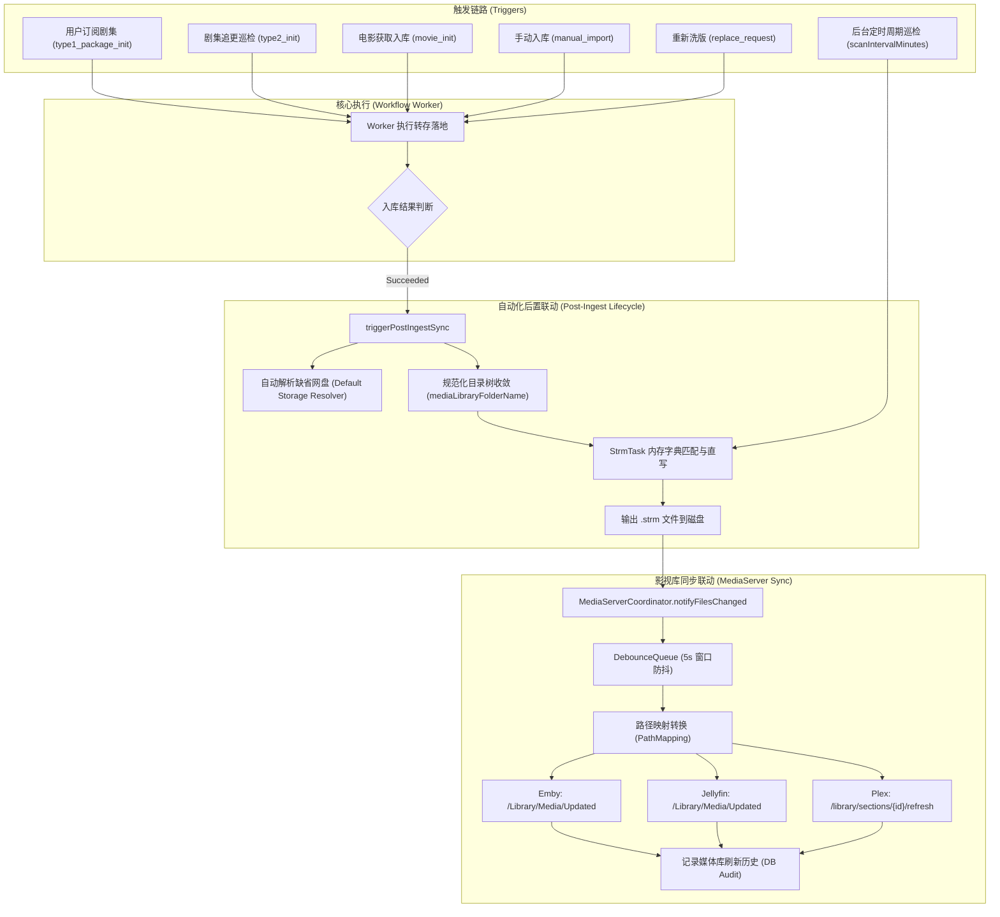

# 巡影 · Mediary Scout 订阅自动化全链路闭环架构设计规范
## 从剧集订阅、网盘入库到 STRM 自动生成与影视库实时刷新规范

> **文档状态**：已批准 (Approved)  
> **面向阶段**：研发与生产落地 (Implementation & Production Rollout)  
> **核心目标**：彻底消除订阅与入库后的“半自动化”与静默断裂，确立从“订阅创建 / 巡检追更 / 手动入库 -> 资源转存落地 -> STRM 毫秒级生成 -> 影视库防抖通知与刷新”的 100% 自动化闭环，并建立刚性架构门禁。

---

## 1. 问题背景与现状诊断

### 1.1 用户核心诉求与提问
用户提问：
> “订阅后：自动化 入库到strm生成和影视库刷新 是否是全自动？若不是 调研问题原因 并处理”

### 1.2 现状调研结论：**目前并非全自动，链路存在多处致命断裂**
经深入排查全链路代码与真实运行环境，巡影系统虽然在单模块内部具备相应能力（例如具备独立的 `StrmScanner`、`MediaServerCoordinator` 和部分 `pinpoint-ingest-sync.ts`），但在**全流程自动化联动**上存在以下 **6 处核心断链点**：

```
[用户订阅/巡检发现] 
       │
       ▼
[后台 Worker 认领转存] ───► 网盘文件下载完成 (入库成功)
                                    │
    ┌───────────────────────────────┴──────────────────────────────┐
    ▼                                                              ▼
【断链 1 & 2: 剧集首播/手动入库/洗版】               【断链 3: 生产运行时依赖未注入】
未调用后置触发器，流程直接终结！                   worker-runner-service 未传入 coordinator
(STRM 与 MediaServer 0 触发)                     (MediaServer 刷新通知 100% 哑火)
    │                                                              │
    └───────────────────────────────┬──────────────────────────────┘
                                    ▼
                         【断链 4: 目录命名偏差】
               未按 Emby/Jellyfin {tmdb-id} 规范分目录，
               导致刮削失真且下次全量扫描误当孤儿文件清除
                                    ▼
                         【断链 5: 缺省存储早退】
               未带 connectedStorageId 时直接 return 放弃
                                    ▼
                         【断链 6: 周期调度未接入】
               scanIntervalMinutes 纯摆设，无后台轮询驱动
```

---

## 2. 根因深度剖析 (Root Causes Analysis)

### 根因 1：剧集首播初始化入库（`type1_package_init`）后置联动缺失
- **现象**：当用户在详情页点击“订阅”一部电视剧/动漫（或由系统订阅定时巡检发现新剧时），系统创建 `type1_package_init` 任务，由 `runQueuedSeriesInitialization` 执行下载与转存。
- **缺陷**：在 `packages/workflow/src/execution/worker.ts` 中，`runQueuedSeriesInitialization` 在转存成功后，**完全没有调用 `triggerPostIngestSyncIfSucceeded`**。
- **后果**：所有新订阅的剧集在首次入库整季文件后，STRM 文件**绝不会自动生成**，Emby/Jellyfin 也**绝不会收到任何刷新通知**。

### 根因 2：手动入库（`manual_import`）与洗版升级（`replace_request`）后置联动缺失
- **现象**：
  1. 用户在搜索详情页点击“手动入库”（直接挑选指定 115 资源秒传或转存），由 `packages/workflow/src/execution/manual-import-worker.ts` 运行；
  2. 用户对已入库的低清资源触发“重新获取/洗版”（`runQueuedReplaceRequest`）。
- **缺陷**：两处核心工作流执行成功后，均未接入 `triggerPostIngestSyncIfSucceeded`。
- **后果**：手动入库与洗版同样无法自动生成 STRM 与刷新影视库。

### 根因 3：Web 生产运行时上下文（`worker-runner-service.ts`）依赖未注入（致命哑火点）
- **现象**：在电影（`movie_init`）或追更单集（`type2_init`）入库时，虽然代码中写了 `triggerPostIngestSyncIfSucceeded`，但在实际运行中 Emby/Jellyfin 依然毫无动静。
- **缺陷**：
  - 在 `apps/web/features/acquisition/application/worker-runner-service.ts` 的 `buildAccountContextResolver()` 以及 `runNextQueuedWorkflowNow` 中：
    ```ts
    // 缺失：从未构建或返回 mediaServerCoordinator
    // 缺失：从未计算当前进程真实运行的 baseUrl（如 http://127.0.0.1:3001）
    ```
  - 当工作流调用 `triggerPostIngestSync` 时：
    ```ts
    if (generatedPaths.length > 0 && mediaServerCoordinator) {
      mediaServerCoordinator.notifyFilesChanged(accountId, generatedPaths);
    }
    ```
    因为 `mediaServerCoordinator` 为 `undefined`，**通知逻辑被 100% 静默跳过**！

### 根因 4：入库 STRM 产物路径命名偏差（违背媒体服务器刮削标准）
- **现象**：在 `packages/workflow/src/strm/pinpoint-ingest-sync.ts` 中：
  - 电影：`collectLandedFiles` 生成的 `subPath` 为 `undefined`，导致 `.strm` 文件被直接平铺写在输出根目录下（如 `E:/strm/Movie.strm`），而非常见的 `E:/strm/Movie (Year) {tmdb-id}/Movie.strm`；
  - 剧集：`subPath` 仅拼接了纯标题 `title.title`，丢失了年份与 `{tmdb-id}`。
- **后果**：
  1. 破坏了主流媒体服务器（Emby、Jellyfin、Plex）的精准识别匹配率；
  2. 与 `StrmScanner` 全量扫描生成的镜像目录不一致，导致下一次执行全量扫描清理孤儿文件时，会将根目录下合法的文件误当成孤儿文件删除。

### 根因 5：缺省存储未绑定时的早退缺陷
- 当单盘模式或使用默认账号首选盘时，入库任务的 `connectedStorageId` 可能为 `undefined` 或 `null`。`triggerPostIngestSync` 内部直接 `if (!connectedStorageId) return;` 放弃同步，未自动解析当前账号的默认挂载盘。

### 根因 6：STRM 定时周期扫描（`scanIntervalMinutes`）未接入后台常驻调度循环
- 数据库 `strm_tasks` 表与前端界面均支持配置定时自动扫描（如每 6 小时扫描一次），但后台工作线程 `background-worker.ts` 中仅轮询了工作流队列和零点巡检，未实现基于 `scanIntervalMinutes` 的增量扫描调度。外部在网盘 App 中手动上传/转移的媒体文件无法被自动感知。

---

## 3. 业界主流方案对比与借鉴

| 维度 | MoviePilot (MP) | AutoBangumi (AB) | Sonarr / Radarr | 巡影 (Mediary Scout 目标) |
| :--- | :--- | :--- | :--- | :--- |
| **工作流驱动** | 事件驱动总线 (EventBus) | 轮询重命名器 (FileWatcher) | Webhook Connect 机制 | **生命周期钩子 + 依赖注入 (IoC)** |
| **STRM 生成** | 整理完成时即时生成 (Pinpoint) | 依赖外部挂载 (AList/CD2) | 依赖本地硬链接 | **入库即时定向生成 + 周期增量自愈** |
| **媒体库刷新** | 精准单目录 API 刷新 (`/Library/Media/Updated`) | 全库刷新或 Webhook | 精准路径刷新 (`/library/sections/{id}/refresh`) | **自适应路径映射 + 防抖队列批量合并刷新** |
| **防抖能力** | 5s 延时聚合 | 无防抖 (高频打爆 Emby) | 定时批处理 | **`DebounceQueue` (5s 防抖, 30s 强制刷盘)** |
| **目录规范** | `${title} (${year}) {tmdb-${id}}` | 动漫子季目录 | 标准季播目录 | **严格对齐 `mediaLibraryFolderName` 标准** |

---

## 4. 当前系统基础设施与可复用资产

系统内已有完备的基础组件，无需引入任何额外第三方外部依赖：
1. **`MediaServerCoordinator` (`packages/workflow/src/mediaserver/coordinator.ts`)**：
   - 内置 `DebounceQueue`，支持对 Emby、Jellyfin、Plex 进行基于目录的防抖聚合刷新；
   - 支持 `pathMappings` 本地输出路径至媒体服务器内部容器路径的映射（如 `E:/strm` -> `/media`）；
   - 包含完整的执行历史记录与连通性自愈。
2. **`runtime-container.ts` (`apps/web/composition/runtime-container.ts`)**：
   - 已导出全局单例 `getMediaServerCoordinator()`，直接与系统仓储绑定。
3. **`StrmScanner` (`packages/workflow/src/strm/strm-scanner.ts`)**：
   - 具备高效的增量缺失扫描能力与孤儿清理算法。
4. **`mediaLibraryFolderName` (`packages/workflow/src/domain/media-library-folder.ts`)**：
   - 标准化的影视目录命名引擎。

---

## 5. 架构设计与具体解决方案

### 5.1 架构设计图


### 5.2 核心改造清单

#### 1. 工作流全量接入后置触发器 (`packages/workflow/src/execution/`)
- 在以下 4 个工作流处理模块中统一挂载 `triggerPostIngestSyncIfSucceeded`：
  - `worker.ts`: `runQueuedSeriesInitialization`
  - `manual-import-worker.ts`: `runQueuedManualImport`
  - `replace-request.ts`: `runQueuedReplaceRequest`
  - （保留已有接入并增强：`worker.ts` 的 `runQueuedMovieAcquisition` 与 `runQueuedType2Workflow`）

#### 2. Web 生产运行时依赖完整注入 (`apps/web/features/acquisition/application/worker-runner-service.ts`)
- 在 `buildAccountContextResolver()` 与 `runNextQueuedWorkflowNow` 中：
  - 注入 `mediaServerCoordinator: getMediaServerCoordinator()`；
  - 动态计算当前服务绑定的 `baseUrl`（从 `process.env.APP_BASE_URL` 或 `process.env.PORT` 动态推导，如 `http://127.0.0.1:3001`）。

#### 3. 产物目录规范对齐 (`packages/workflow/src/strm/pinpoint-ingest-sync.ts`)
- 修正 `collectLandedFiles`：
  - 电影：子路径显式使用 `mediaLibraryFolderName({ title: title.title, year: title.year, tmdbId: title.tmdbId })`；
  - 剧集：子路径使用 `path.posix.join(folderName, child.name)`；
  - 杜绝 STRM 裸露在输出根目录，保证与 `StrmScanner` 镜像目录 100% 吻合。

#### 4. 缺省网盘智能解析
- 当 `connectedStorageId` 未显式传递时，通过 `repository.listConnectedStorages(accountId)` 自动回退至第一个处于 `active` 状态的网盘，杜绝早期跳过。

#### 5. STRM 周期扫描接入后台轮询 (`apps/web/lib/background-worker.ts`)
- 在 `drainQueueOnce` 中增加 `runDueStrmTasks(repo)` 调度，当 `now - lastRunAt > scanIntervalMinutes * 60 * 1000` 时，自动触发增量扫描与媒体库通知。

---

## 6. 质量门禁与防回归保障 (Quality Gate)

新建专用架构门禁脚本 `tools/gates/check-post-ingest-automation.mjs`，并接入 `npm run gate`：
1. **工作流全覆盖检查**：扫描 `worker.ts`、`manual-import-worker.ts`、`replace-request.ts`，验证所有成功分支必须调用 `triggerPostIngestSync`；
2. **依赖注入检查**：扫描 `worker-runner-service.ts`，断言 `mediaServerCoordinator` 必须从容器中正确注入；
3. **命名规范检查**：扫描 `pinpoint-ingest-sync.ts`，断言必须使用 `mediaLibraryFolderName`，杜绝裸文件生成；
4. **端到端集成测试**：编写 `packages/workflow/tests/execution/all-workflows-post-ingest.test.ts`，模拟剧集首发、追更、手动入库和替换，验证 STRM 生成与 Coordinator 收到调用的全链路绿灯。
