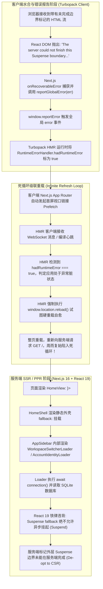

# Next.js 16 (Turbopack) Suspense Fallback 服务端渲染异常与 HMR 刷新死循环架构治理规范

> **文档标识**：`docs/architecture/suspense-fallback-hydration-and-hmr-loop-spec.md`  
> **编写日期**：2026-11-02  
> **适用对象**：全栈开发人员、AI 编码助手（Antigravity、Claude Code、Cursor）、架构治理人员  
> **关联工单**：解决 `dev.bat` 运行过程中浏览器控制台抛出 `The server could not finish this Suspense boundary, likely due to an error during server rendering. Switched to client rendering.` 导致页面反复无限刷新的严重问题。

---

## 1. 现象复盘与问题全景 (Incident Anatomy)

在开发环境下运行 Next.js 16 (Turbopack) 时，终端与客户端浏览器出现高频秒刷循环，伴随以下典型特征日志：

```text
▲ Next.js 16.4.3 (Turbopack)
- Local: http://localhost:3001
- Network: http://169.254.83.107:3001
✓ Ready in 498ms
⚠ `cacheComponents` is enabled without a corresponding `partialPrefetching` option. Set `partialPrefetching` to either `true` or `false`.

...
GET / 200 in 860ms (next.js: 41ms, proxy.ts: 19ms, application-code: 801ms)
✓ Compiled in 1ms
[browser] Uncaught Error: The server could not finish this Suspense boundary, likely due to an error during server rendering. Switched to client rendering.

GET /api/auth/me 200 in 7ms
GET /api/notifications/meta 200 in 407ms
GET / 200 in 1260ms
GET /api/auth/me 200 in 6ms
GET /api/notifications/meta 200 in 63ms
GET /api/activity?since=2026-11-02T12%3A45%3A22.507Z 200 in 66ms
GET /api/activity?since=2026-11-02T12%3A45%3A22.508Z 200 in 75ms
GET /api/notifications/meta 200 in 68ms
GET /api/activity?since=2026-11-02T12%3A45%3A22.510Z 200 in 70ms
GET / 200 in 1226ms
...
```

系统在完成初次渲染后，每隔 800ms ~ 2000ms 就会自动触发一次全页 `GET /` 硬刷新，伴随连续多个重复的 `/api/activity` 与 `/api/notifications/meta` 轮询请求，严重破坏开发体验与页面响应能力。

---

## 2. 根因深度剖析 (Deep Root Cause Analysis)



### 根因 1：React 19 / Next.js PPR 铁律 —— Suspense Fallback 必须是同步纯静态骨架

1. 在 `apps/web/app/page.tsx` 中：
   ```tsx
   export function HomeView({ searchParams, storageId }) {
     return (
       <Suspense fallback={<HomeShell />}>
         <HomeSurface searchParams={searchParams} storageId={storageId} />
       </Suspense>
     );
   }

   function HomeShell() {
     return (
       <div className="app-shell">
         <AppSidebar active="search" />
         <main className="main product-main" aria-busy="true" />
       </div>
     );
   }
   ```
2. `<HomeShell />` 作为 `<Suspense>` 的 **fallback**，直接引用了完整版的 `<AppSidebar />`。
3. 在 `apps/web/components/layout/app-sidebar.tsx` 中，侧边栏直接挂载了异步服务端组件：
   ```tsx
   <Suspense fallback={null}>
     <WorkspaceSwitcherLoader />
   </Suspense>
   <Suspense fallback={null}>
     <AccountIdentityLoader storageId={activeStorageId} />
   </Suspense>
   ```
4. 在 `WorkspaceSwitcherLoader` 和 `AccountIdentityLoader` 中，由于需要读取 SQLite 数据库，显式声明了 `await connection()`。
5. **React 19 / Next.js PPR 渲染引擎铁律**：
   - `<Suspense>` 的 `fallback` 本身必须是**同步、轻量、纯静态的 UI 骨架（Purely Static Skeleton）**；
   - 静态骨架用于在构建阶段或首屏快速生成静态 HTML 流。**Fallback 内部严禁包含任何动态请求时间执行的组件（禁止调用 `connection()`、`cookies()`、`headers()` 或任何可能挂起的数据读取）**；
   - 当服务端预渲染 `<HomeShell />` 时，内部的 Loader 再次挂起，导致 React 服务端渲染引擎无法在首屏流中闭合外层 `<Suspense>` 边界，最终只能向客户端下发降级标记，并在客户端控制台抛出：
     `The server could not finish this Suspense boundary, likely due to an error during server rendering. Switched to client rendering.`

### 根因 2：Turbopack Dev Hot-Reloader 错误自愈引发级联刷新死循环

1. 在 `node_modules/next/dist/client/dev/hot-reloader/app/hot-reloader-app.js` 中：
   ```js
   window.addEventListener('error', () => {
     RuntimeErrorHandler.hadRuntimeError = true;
   });
   ```
2. 客户端一旦接收到 React 的 Uncaught Error（即上述 Suspense 边界未能在服务端完成的错误），`hadRuntimeError` 立即被置为 `true`。
3. 紧接着，客户端 App Router 对页面内可视的导航链接（如 `/activity`、`/notifications`、`/settings` 等）发起 Prefetch 请求。
4. Prefetch 或后台 WebSocket 消息到达客户端时，Turbopack 检查错误状态：
   ```js
   if (RuntimeErrorHandler.hadRuntimeError) {
     window.location.reload();
   }
   ```
   Turbopack 判定应用处于运行时未恢复的错误状态，遂执行 `window.location.reload()` 试图硬刷新重置。
5. 硬重载后重新请求服务端 `GET /`，服务端再次遇到 fallback 挂起，再次抛出异常，再次触发重载，形成永不停止的秒级死循环！

### 根因 3：Next.js 16 `cacheComponents` 与 `partialPrefetching` 配置脱节

在 `apps/web/next.config.ts` 中启用了：
```ts
cacheComponents: true,
```
但在 `experimental` 中未指定 `partialPrefetching: true`。Next.js 16 明确发出警告：
```text
⚠ `cacheComponents` is enabled without a corresponding `partialPrefetching` option. Set `partialPrefetching` to either `true` or `false`.
```
这导致客户端 Router Cache 的预拉取模型与服务端部分预渲染（PPR）的边界模型发生策略漂移，加剧了动态洞与静态外壳拼接时的抖动。

### 根因 4：Fallback 骨架中挂载客户端轮询徽章造成并发风暴

在 `<AppSidebar />` 内部，挂载了三个带有 `useEffect` 轮询逻辑的客户端组件：
- `<NotificationsNavBadge />`（轮询 `/api/notifications/meta`）
- `<ActivityNavBadge />`（桌面端与移动端各挂一个，共 2 处，高频轮询 `/api/activity`）
- `<SettingsAttentionBadge />`（桌面端与移动端各挂一个，共 2 处，轮询 `/api/settings/attention`）

当 fallback 渲染完整版 `<AppSidebar />` 时，这些客户端组件立即开始向后端发起数据拉取；当真实页面挂载后，新的 `<AppSidebar />` 又挂载了一批同样的徽章组件，导致单个页面同一时刻发出多达 4 路重复的 `/api/activity` 请求，加剧了网络与 SQLite 并发负担。

---

## 3. 业界主流方案调研与对比 (Industry Benchmarking)

针对 React 19 / Next.js PPR 架构下的 Suspense Fallback 隔离与错误治理，我们对业界顶级实践进行了调研与对比：

| 解决维度 | 业界主流方案 | 代表开源框架 / 团队 | 优劣势与适用性分析 |
| :--- | :--- | :--- | :--- |
| **骨架纯度保障** | **纯静态骨架模式 (Pure Static Skeleton Pattern)** | Next.js 官方最佳实践, Vercel Commerce | **优势**：骨架组件零 I/O、零 `await`、零客户端生命周期，100% 静态同步生成，彻底杜绝 fallback 嵌套挂起；<br>**劣势**：需提供无状态的骨架组件变体；<br>**评估**：**强烈推荐**，最符合 React 19 / PPR 规范的标准方案。 |
| **属性开关降级** | **骨架属性开关 (`skeleton={true}`)** | shadcn/ui, Radix UI, GitHub Primer | **优势**：同一个侧边栏组件只需接收一个 `skeleton` 布尔值，内部条件分支跳过动态 Loader 与轮询 Badge，代码复用率高；<br>**劣势**：需注意分支内的组件不能有无条件 Hook 违反；<br>**评估**：**强烈推荐**，改动最小、结构最清晰。 |
| **错误自愈隔离** | **Recoverable Error 过滤与 Dev HMR 防抖** | React RFC, Sentry Next.js SDK | **优势**：避免将 React 官方已知可自愈的流式降级误判为致命崩溃；<br>**劣势**：治标不治本，不能解决服务端真实存在的 fallback 挂起缺陷；<br>**评估**：作为辅助保障，核心仍需在服务端切断根因。 |
| **路由预拉取对齐** | **PPR Partial Prefetching 显式启用** | Next.js 16 官方文档 | **优势**：显式声明预拉取策略，消除启动警告，提升客户端路由跳转性能；<br>**劣势**：需确保所有动态参数均有 Suspense 保护；<br>**评估**：**必须执行**。 |

---

## 4. 当前系统基础设施复用分析 (Infrastructure Reuse)

Mediary Scout 具备优异的模块化基础，无需引入任何第三方大型库：

1. **统一侧边栏复用**：[`apps/web/components/layout/app-sidebar.tsx`](file:///e:/WorkProject/Node/_Project/mediary-scout/apps/web/components/layout/app-sidebar.tsx) 已经是所有页面共用的导航容器，支持直接在其入参接口上扩展 `skeleton?: boolean`，并导出无缝使用的 `AppSidebarSkeleton`；
2. **全页面外壳统合**：各功能页面（`page.tsx`、`activity/page.tsx`、`chat/page.tsx`、`notifications/page.tsx`、`settings/page.tsx`、`storage/page.tsx` 等）均已定义各自的 `*Shell` 函数，统一将内部的 `<AppSidebar active="..." />` 升级为 `<AppSidebarSkeleton active="..." />` 或 `<AppSidebar active="..." skeleton />`；
3. **AST 门禁体系复用**：系统已有现成的 [`tools/gates/check-blocking-routes.mjs`](file:///e:/WorkProject/Node/_Project/mediary-scout/tools/gates/check-blocking-routes.mjs) 质量门禁引擎。我们可以编写专用的 `tools/gates/check-suspense-fallbacks.mjs`，利用 TypeScript AST 遍历全量 `apps/web/app/**/page.tsx` 中的 `<Suspense fallback={...}>`，静态阻断任何未加 `skeleton` 的 `AppSidebar` 或异步 Server Component 泄漏进 fallback。

---

## 5. 完整解决方案与实施架构 (Concrete Architecture & Implementation)

### 5.1 侧边栏纯静态化重构 (`app-sidebar.tsx`)

在 `apps/web/components/layout/app-sidebar.tsx` 中：
1. 增加 `skeleton?: boolean` 可选属性；
2. 导出便捷的纯静态骨架组件 `AppSidebarSkeleton`；
3. 当 `skeleton === true` 时：
   - 彻底跳过 `<WorkspaceSwitcherLoader />`；
   - 彻底跳过 `<AccountIdentityLoader />`；
   - 彻底跳过带有 HTTP 轮询的 `<NotificationsNavBadge />`、`<ActivityNavBadge />`、`<SettingsAttentionBadge />`；
   - 仅渲染纯静态的 Brand、导航 Links、图标与占位骨架，确保 100% 同步执行、零异步 I/O。

```tsx
export function AppSidebar({
  active,
  searchQuery = "",
  basePath = "/",
  activeStorageId,
  skeleton = false,
}: {
  active: "search" | "library" | "notifications" | "activity" | "settings" | "storage" | "chat" | "none";
  searchQuery?: string;
  basePath?: string;
  activeStorageId?: string | undefined;
  skeleton?: boolean;
}) {
  return (
    <aside className="sidebar">
      <div className="brand">
        <span className="brand-mark">
          <Aperture size={18} aria-hidden />
        </span>
        <span className="brand-copy">
          <strong>巡影 · Mediary Scout</strong>
          <span>多网盘媒体 agent</span>
        </span>
      </div>

      {!skeleton ? (
        <Suspense fallback={null}>
          <WorkspaceSwitcherLoader />
        </Suspense>
      ) : null}

      {!skeleton ? (
        <Suspense fallback={null}>
          <div className="sidebar-top-identity">
            <AccountIdentityLoader storageId={activeStorageId} />
          </div>
        </Suspense>
      ) : null}

      <nav aria-label="主导航">
        <ul className="nav-list">
          <li>
            <SearchNavLink active={active === "search"} knownQuery={searchQuery} basePath={basePath} />
          </li>
          <li>
            <Link className={`nav-item ${active === "library" ? "is-active" : ""}`} href={`${basePath}?tab=library`}>
              <Library size={16} aria-hidden />
              订阅
            </Link>
          </li>
          <li>
            <Link className={`nav-item ${active === "chat" ? "is-active" : ""}`} href={globalNavHref("/chat", activeStorageId)}>
              <Bot size={16} aria-hidden />
              助理
            </Link>
          </li>
          <li>
            <Link className={`nav-item ${active === "storage" ? "is-active" : ""}`} href={globalNavHref("/storage", activeStorageId)}>
              <HardDrive size={16} aria-hidden />
              网盘
            </Link>
          </li>
          <li>
            <Link className={`nav-item ${active === "notifications" ? "is-active" : ""}`} href={globalNavHref("/notifications", activeStorageId)}>
              <Bell size={16} aria-hidden />
              通知
              {!skeleton ? <NotificationsNavBadge storageId={activeStorageId} /> : null}
            </Link>
          </li>
          <li className="nav-activity-item">
            <Link className={`nav-item ${active === "activity" ? "is-active" : ""}`} href={globalNavHref("/activity", activeStorageId)}>
              <Activity size={16} aria-hidden />
              活动
              {!skeleton ? <ActivityNavBadge storageId={activeStorageId} /> : null}
            </Link>
          </li>
          <li className="nav-settings-item">
            <Link className={`nav-item ${active === "settings" ? "is-active" : ""}`} href={globalNavHref("/settings", activeStorageId)}>
              <Settings size={16} aria-hidden />
              设置
              {!skeleton ? <SettingsAttentionBadge storageId={activeStorageId} visibleWhen="mobile" /> : null}
            </Link>
          </li>
        </ul>
      </nav>

      <div className="sidebar-footer">
        {!skeleton ? (
          <Suspense fallback={null}>
            <AccountIdentityLoader storageId={activeStorageId} />
          </Suspense>
        ) : null}
        <Link className={`nav-item nav-secondary ${active === "activity" ? "is-active" : ""}`} href={globalNavHref("/activity", activeStorageId)}>
          <Activity size={16} aria-hidden />
          活动
          {!skeleton ? <ActivityNavBadge storageId={activeStorageId} /> : null}
        </Link>
        <Link className="health-card" href={globalNavHref("/settings", activeStorageId)} style={{ textDecoration: "none", color: "inherit" }}>
          <span className="health-icon">
            <Settings size={16} aria-hidden />
          </span>
          <span>
            <strong>设置</strong>
            <span>{resolveIsDesktop() ? "网盘 · 偏好 · 设置" : "网盘 · 偏好 · 远程访问"}</span>
          </span>
          {!skeleton ? <SettingsAttentionBadge storageId={activeStorageId} visibleWhen="desktop" /> : null}
        </Link>
      </div>
    </aside>
  );
}

export function AppSidebarSkeleton({
  active = "none",
}: {
  active?: "search" | "library" | "notifications" | "activity" | "settings" | "storage" | "chat" | "none";
}) {
  return <AppSidebar active={active} skeleton />;
}
```

### 5.2 全量页面 Fallback Shell 统一升级

将应用内所有用于 Suspense fallback 的 Shell 函数中引用的 `<AppSidebar active="..." />` 统一改为 `<AppSidebar active="..." skeleton />`（或 `<AppSidebarSkeleton active="..." />`）：

1. `apps/web/app/page.tsx` (`HomeShell`)
2. `apps/web/app/activity/page.tsx` (`ActivityShell`)
3. `apps/web/app/chat/page.tsx` (`ChatShell`)
4. `apps/web/app/notifications/page.tsx` (`NotificationsShell`)
5. `apps/web/app/storage/page.tsx` (`StorageShell`)
6. `apps/web/app/storage/strm/page.tsx` (`StrmShell`)
7. `apps/web/app/settings/page.tsx` (`SettingsPageInner`)
8. `apps/web/app/settings/extensions/page.tsx` (`ExtensionsSettingsShell`)
9. `apps/web/app/settings/mediaserver/page.tsx` (`MediaServerSettingsShell`)
10. `apps/web/app/show/[tmdbId]/page.tsx` (`ShowShell`)

### 5.3 Next.js 配置对齐 (`next.config.ts`)

在 `apps/web/next.config.ts` 中补齐 `experimental.partialPrefetching: true`：

```ts
const nextConfig: NextConfig = {
  cacheComponents: true,
  experimental: {
    partialPrefetching: true,
    staleTimes: { dynamic: 60, static: 300 },
    serverActions: {
      allowedOrigins: (process.env.MEDIA_TRACK_ALLOWED_ORIGINS ?? "")
        .split(",")
        .map((s) => s.trim())
        .filter(Boolean),
    },
  },
  ...
};
```

### 5.4 架构防线：自动化 AST 静态门禁 (`check-suspense-fallbacks.mjs`)

为了从源头上防止未来任何开发者或 AI 助手在 Suspense fallback 中引入动态 Server Component 或遗漏 `skeleton` 标记，开发专门的静态门禁工具：
- **检查项 1**：扫描全量 `apps/web/app/**/page.tsx` 中的 `<Suspense fallback={...}>`；
- **检查项 2**：若 fallback 中使用了 `AppSidebar`，必须显式携带 `skeleton` 属性（或使用 `AppSidebarSkeleton`）；
- **检查项 3**：提取 fallback JSX 树内所引用的所有组件，断言这些组件及其直接子级绝不能是包含 `await connection()`、`cookies()`、`headers()` 的动态服务端组件。

---

## 6. 验证准则与回归防线 (Verification & Regression Safety)

1. **本地热重载验证**：启动开发服务器，使用 Playwright 脚本加载 `http://localhost:3001/`，持续监控 10 秒以上，断言：
   - 0 次 Uncaught Error；
   - 0 次 `Switched to client rendering` 告警；
   - 0 次 `window.location.reload()` 触发；
   - `/api/activity` 轮询请求平稳单一，无并发翻倍风暴。
2. **静态门禁验证**：全量运行 `node tools/gates/check-suspense-fallbacks.mjs` 及 `npm run gate`，确保 19+ 项工程门禁全部 100% 绿色通过。
