# Next.js 16 (Turbopack) Suspense Redirect 异常降级与 Dev HMR 无限重载循环治理规范

> **文档标识**：`docs/architecture/suspense-redirect-and-dev-hmr-reload-loop-spec.md`  
> **编写日期**：2026-11-04  
> **适用对象**：全栈开发人员、AI 编码助手（Antigravity、Claude Code、Cursor）、架构治理人员  
> **关联工单**：解决 `dev.bat` 启动后浏览器加载受保护页面出现高频秒级无限刷新死循环、端口连接风暴与控制台报错的问题。

---

## 1. 现象复盘与问题全景 (Incident Anatomy)

在本地启动开发环境脚本 `dev.bat`（执行 `node tools/runner/dev-server.mjs`，前端运行在 Turbopack 开发模式 `next dev apps/web --turbopack -p 3001`）时，当本地数据库设置了访问密码且浏览器尚未建立有效会话时，访问首页 `http://127.0.0.1:3001/` 出现了严重的秒级无限自动刷新循环。

### 1.1 典型特征与控制台日志

终端与浏览器控制台观测到以下复合故障特征：

1. **RSC 服务端渲染降级日志**：
   ```text
   $RX("B:0","NEXT_REDIRECT;replace;/login;307;","Switched to client rendering because the server rendering errored:\n\nNEXT_REDIRECT")
   ```
   React 19 服务端组件在渲染由 `<Suspense>` 包裹的 `<PageLoginGuard />` 时抛出异常，React 视其为服务端渲染崩溃，降级为客户端渲染（CSR de-opt）。

2. **Turbopack Fast Refresh 致命错误标记与硬刷新循环**：
   ```text
   [Fast Refresh] rebuilding
   [Fast Refresh] done in 486ms
   [Turbopack] RuntimeErrorHandler.hadRuntimeError = true
   [Fast Refresh] triggering window.location.reload()
   ```
   Turbopack 的客户端错误边界捕获到服务端的 SSR 渲染失败后，将其标记为不可恢复的运行时错误（`hadRuntimeError = true`）。随后在接收到路由预取心跳时，Fast Refresh 强制执行 `window.location.reload()`，导致浏览器每隔几百毫秒硬刷新一次，页面永远无法稳定展示。

3. **端口并发连接风暴与 307 级联重定向**：
   本地端口 3001 短时间内堆积了上千个 `TIME_WAIT` 连接。浏览器在加载 `/login` 页面时，其 `<head>` 标签发起的 `/icon.svg` 元数据图标请求被 `proxy.ts` 网关拦截，并被错误地 307 重定向至 `/login`，引发浏览器图标解析器疯狂重试与并发级联请求。

---

## 2. 深度根因分析 (Deep Root Cause Analysis)

经过全链路跟踪与静态代码分析，本次无限刷新死循环是由 **两个相互叠加的正反馈环路** 复合导致的：

```mermaid
flowchart TD
    subgraph Loop1["正反馈环路 A: Suspense 捕获 NEXT_REDIRECT 触发 HMR 硬刷新"]
        A1["浏览器访问受保护页面 GET /"] --> A2["页面外层包裹 <Suspense fallback={null}><PageLoginGuard /></Suspense>"]
        A2 --> A3["PageLoginGuard 检测未登录，执行 redirect('/login')"]
        A3 --> A4["Next.js 抛出内部中断异常 NEXT_REDIRECT"]
        A4 --> A5["React 19 <Suspense> 捕获异常，判定 SSR 崩溃并输出 $RX 降级标记"]
        A5 --> A6["Turbopack 客户端捕获异常，标记 hadRuntimeError = true"]
        A6 --> A7["Fast Refresh 客户端判定发生运行时致命错误，调用 window.location.reload()"]
        A7 --> A1
    end

    subgraph Loop2["正反馈环路 B: Proxy Matcher 漏排 icon.svg 导致级联重定向风暴"]
        B1["浏览器加载登录页 GET /login"] --> B2["HTML 头部并行请求元数据 GET /icon.svg?icon..."]
        B2 --> B3["proxy.ts matcher 仅排除了 favicon.ico，未排除 icon.svg"]
        B3 --> B4["proxy.ts 判定未认证，下发 307 Temporary Redirect -> /login"]
        B4 --> B5["浏览器元数据解析器接收到 HTML 文本，解析失败并触发并行重试"]
        B5 --> B6["端口 3001 出现上千个 TIME_WAIT 连接，网络拥塞干扰页面状态水合"]
        B6 --> B2
    end
```



### 2.1 根因 A：`NEXT_REDIRECT` 穿透 `<Suspense>` 破坏 React 19 SSR 流

- **Next.js `redirect()` 的本质**：Next.js 的 `redirect()` 并不是 HTTP 层面的直接响应发送，而是通过在 JavaScript 运行时 `throw` 一个携带特定 digest 的特殊错误对象（`new Error("NEXT_REDIRECT;replace;...")`）来实现调用栈中断。
- **React 19 与 PPR 的边界语义冲突**：
  为了实现 Partial Prerendering (PPR) 与页面的渐进式流式渲染，系统在所有 13 个页面入口（如 `apps/web/app/page.tsx`、`apps/web/app/settings/page.tsx` 等）统一将 `<PageLoginGuard />` 挂载在 `<Suspense fallback={null}>` 内部。
  当 `PageLoginGuard` 在 Suspense 树内部执行 `redirect("/login")` 时，`NEXT_REDIRECT` 异常被外层的 `<Suspense>` 捕获。
- **React 判定机制**：React 19 认为 Suspense 边界内的组件抛出未经内部捕获的 Error 属于组件渲染失败，因此主动中断服务端渲染流，向客户端下发 `$RX` 降级指令，并在客户端尝试重新渲染。
- **Turbopack 开发环境致命拦截**：在 Next.js Turbopack 模式下，客户端错误收集器将其归类为 Unhandled SSR Runtime Error，设置 `RuntimeErrorHandler.hadRuntimeError = true`。Fast Refresh 机制为了保障代码最新状态，在检测到运行时未恢复错误时，会触发兜底的 `window.location.reload()`，导致每秒重复刷新。

### 2.2 根因 B：`proxy.ts` Matcher 漏排动态元数据端点 `icon.svg`

Next.js 16 默认启用了基于文件系统的动态元数据路由（Metadata Route Handlers）。当应用根目录下存在 `app/icon.svg` 时，Next.js 会在生成的 HTML 头部自动注入带哈希查询参数的图标链接（如 `<link rel="icon" href="/icon.svg?icon.3i73..." type="image/svg+xml">`）。

`apps/web/proxy.ts`（Next.js Edge 级请求粗筛守卫）原先配置的 matcher 为：
```typescript
matcher: [
  "/((?!api/auth|login|_next/static|_next/image|favicon.ico).*)",
]
```
- 该正则表达式仅排除了传统的 `favicon.ico`，遗漏了现代 Web 应用中必不可少的 `icon.svg`、`apple-icon`、`manifest.webmanifest` 等静态元数据端点以及通用的静态图片资源。
- 当浏览器加载 `/login` 页面时，其并发拉取的 `/icon.svg` 被 `proxy.ts` 拦截，判定缺少 session cookie，并以 307 状态码强行重定向到 `/login`。
- 浏览器图标解析器将 HTML 文本当作 SVG 解析失败，继而发起级联重发，同时向客户端注入 `mt_page_guarded=1` cookie，产生严重的连接拥塞与干扰。

---

## 3. 业界主流方案与调研对比 (Industry Survey & Best Practices)

针对服务端流式渲染中的重定向与静态资源排除，我们对业界主流方案与开源成熟实践进行了全面调研：

### 3.1 Suspense 内部重定向的业界主流方案对比

| 方案 | 原理 | 优势 | 缺陷与适用场景 |
| :--- | :--- | :--- | :--- |
| **方案 1：Next.js 原生 `redirect()` (已废弃)** | 服务端抛出 `NEXT_REDIRECT` 异常中断调用栈 | Next.js 原生支持，代码简短 | **严禁在 `<Suspense>` 内部使用**。在 PPR 与流式 SSR 下会导致 React 降级为客户端渲染，Turbopack 误判为致命崩溃并无限重载。 |
| **方案 2：纯客户端 Hook 延迟跳转 (`useRouter().replace`)** | 在客户端组件的 `useEffect` 中读取状态并跳转 | 不会在 SSR 服务端抛出异常 | 必须等待客户端 Bundle 下载、解析并完成水合后才开始执行，存在明显的页面闪烁（FOUC）和重定向延迟（~200ms+）。 |
| **方案 3：流式 HTML 零延迟跳转组件 (`PageLoginRedirect`) (本项目采用)** | 服务端直接向流中写入 `<meta http-equiv="refresh" content="0;url=/login">` 与内联 `<script>window.location.replace('/login')</script>` | **完全不中断 React SSR 渲染流，0 异常抛出**；浏览器在接收到 HTML 流首字节时以 0ms 延迟立即触发硬跳转；兼容 React 19 与 Turbopack。 | 仅适用于无需向未认证用户暴露任何敏感数据的保护屏障组件。 |
| **方案 4：纯网关/中间件截断 (Edge Middleware Gating)** | 在请求触达 React 渲染树前由中间件直接下发 HTTP 307 | 彻底避免进入 React 服务端渲染流程 | 单用户局域网零摩擦场景下，中间件无法读取本地 SQLite 数据库中的加密密码哈希，无法完成权威判定，必须配合页面级守卫。 |

### 3.2 中间件 Matcher 静态资源排除模式对比

在 Vercel 官方文档与开源主流项目（如 Supabase Studio、Cal.com、Dub.co）中，Next.js 中间件匹配器的通用行业金标准为：

```typescript
// 业界最佳实践：全量排除 Next 内部路径、元数据路由以及所有静态媒体扩展名
matcher: [
  "/((?!api/auth|login|_next/static|_next/image|favicon.ico|icon.svg|apple-icon|manifest.webmanifest|robots.txt|sitemap.xml|.*\\.(?:ico|png|svg|jpg|jpeg|gif|webp|woff2?)$).*)",
]
```

通过这一标准负向预查（Negative Lookahead），中间件能够精确放行所有静态文件与元数据探测，仅对真正的页面路由和受保护 API 实施鉴权拦截。

---

## 4. 当前系统基础设施与复用分析 (Infrastructure Reuse)

在解决该问题时，系统充分复用了已有的高质量工程资产，避免重复造轮子：

1. **复用 `apps/web/platform/next-context/page-auth-guard.ts` 既有纯函数领域逻辑**：
   复用 `shouldRedirectToLogin(input)` 纯函数判定器与 `hasLoginPassword()` / `cookies()` 提取机制，保持单用户/多用户安全模型的统一性。
2. **复用 `apps/web/proxy.ts` 的存在性粗筛体系**：
   保留基于 `mt_page_guarded` 与 `isRemoteRequest()` 的边缘网关轻量拦截设计，仅对 `config.matcher` 执行规则扩展，不破坏任何已有的安全契约。
3. **复用与增强 `tools/gates/check-suspense-fallbacks.mjs` AST 门禁**：
   已有门禁内置了完整的 TypeScript AST 遍历器（`ts.createSourceFile`），能够快速复用其解析管道，无缝扩展对 Suspense 子组件内 `redirect()` 调用、守卫实现以及 Proxy Matcher 的静态断言。

---

## 5. 具体解决方案与工程实现 (Engineering Implementation)

### 5.1 重构 `PageLoginGuard`：引入流式无损跳转组件

在 [`apps/web/platform/next-context/page-auth-guard.ts`](file:///apps/web/platform/next-context/page-auth-guard.ts) 中：
- 抽离 `checkPageLoginNeeded(): Promise<boolean>`，纯粹执行认证状态判定，不抛出任何异常；
- 引入 `PageLoginRedirect` 客户端安全跳转组件，使用原生的 `React.createElement` 构造 DOM，避免在纯 `.ts` 模块中引入 JSX 编译依赖；
- 改造 `PageLoginGuard()`：当检测到需要登录时，直接返回 `<PageLoginRedirect />`，彻底根除 `NEXT_REDIRECT` 异常对 `<Suspense>` 的穿透。

```typescript
// apps/web/platform/next-context/page-auth-guard.ts
export function PageLoginRedirect() {
  return createElement(
    Fragment,
    null,
    createElement("meta", { httpEquiv: "refresh", content: "0;url=/login" }),
    createElement("script", {
      dangerouslySetInnerHTML: {
        __html: "window.location.replace('/login');",
      },
    }),
  );
}

export async function PageLoginGuard() {
  const needed = await checkPageLoginNeeded();
  if (needed) {
    return PageLoginRedirect();
  }
  return null;
}
```

### 5.2 修复 `proxy.ts` Matcher 正则配置

在 [`apps/web/proxy.ts`](file:///apps/web/proxy.ts) 中，将匹配器扩展为排除所有静态元数据与媒体格式：

```typescript
// apps/web/proxy.ts
export const config = {
  matcher: [
    "/((?!api/auth|login|_next/static|_next/image|favicon.ico|icon.svg|apple-icon|manifest.webmanifest|robots.txt|sitemap.xml|.*\\.(?:ico|png|svg|jpg|jpeg|gif|webp|woff2?)$).*)",
  ],
};
```

### 5.3 扩展质量门禁：三重静态防护防回归

在 [`tools/gates/check-suspense-fallbacks.mjs`](file:///tools/gates/check-suspense-fallbacks.mjs) 中新增三重静态代码审查规则：

1. **规则 5：`No-Suspense-Child-Redirect`**
   扫描所有页面中直接挂载于 `<Suspense>` 内部的子组件定义，通过 AST 递归分析其函数体，严禁在渲染主体中调用 `redirect()`。
2. **规则 6：`Proxy-Matcher-Static-Assets-Excluded`**
   解析 `apps/web/proxy.ts` 的 `config.matcher` AST，断言其必须包含对 `icon.svg`、`apple-icon`、`manifest` 及静态图片格式（`ico|png|svg|jpg`）的排除模式。
3. **规则 7：`No-Suspense-Redirect-In-Guard` 与 `PageLoginGuard-Must-Use-Client-Redirect`**
   严格断言 `apps/web/platform/next-context/page-auth-guard.ts` 中的 `PageLoginGuard` 必须使用 `PageLoginRedirect`，严禁直接调用 `redirect()` 或 `requirePageLogin()`。

门禁统一接入 `npm run gate:suspense` 与 `npm run gate`，在代码提交和 CI/CD 阶段实施严格拦截。

---

## 6. 验证与回归测试策略 (Verification & Regression Prevention)

### 6.1 单元测试套件覆盖

在 [`tools/gates/check-suspense-fallbacks.test.mjs`](file:///tools/gates/check-suspense-fallbacks.test.mjs) 中补充完整的正反用例：
- 验证违规在 Suspense 子组件内调用 `redirect()` 时精准抛出 `No-Suspense-Child-Redirect` 违规；
- 验证 Proxy Matcher 缺少 `icon.svg` 排除时精准拦截；
- 验证 `PageLoginGuard` 恢复使用 `redirect()` 时报错；
- 验证当前仓库真实源码在门禁下 100% 保持通过。

### 6.2 内置浏览器实机验收规范

通过 Chrome DevTools MCP 对本地 Turbopack 调试服务器（`http://127.0.0.1:3001`）执行无头实机巡检：
1. **未登录访问首页**：
   - 访问 `http://127.0.0.1:3001/`；
   - 验证页面瞬间平稳跳转到 `http://127.0.0.1:3001/login`；
   - 控制台 0 `Switched to client rendering` 报错，0 `window.location.reload()` 循环。
2. **输入密码登录**：
   - 填写访问密码并提交；
   - 页面流畅水合进入主页 `http://127.0.0.1:3001/`；
   - 控制台仅输出正常的 Fast Refresh 耗时日志（稳态），无多余并发请求。

---

## 7. 凭据与安全脱敏遵从声明

本文档严格遵守项目 `AGENTS.md` §7 凭据治理红线：
- 所有 IP 地址均采用本地回环地址 `127.0.0.1` 或局域网标准示例地址 `192.168.1.100`，绝不包含任何开发内网敏感 IP（如 `10.126.*.*`）；
- 所有示例密码均使用标准占位符 `<ADMIN_PASSWORD>` 或 `admin123`；
- 所有代码路径均遵循标准相对路径与点击链接格式。
