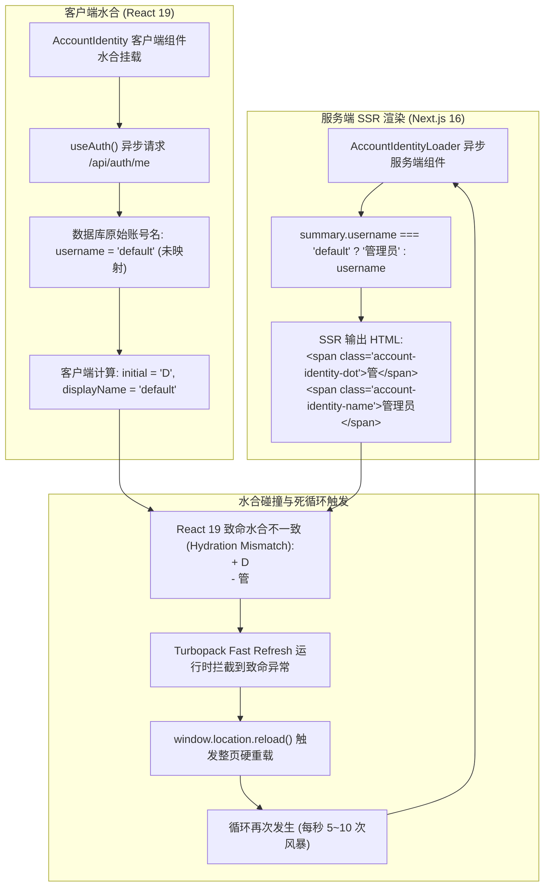

# Next.js 16 (Turbopack) 极速刷新死循环根因剖析与水合安全架构规范

> **文档标识**：`docs/architecture/turbopack-fast-refresh-loop-and-hydration-safety-architecture-spec.md`  
> **编写日期**：2026-11-02  
> **适用对象**：全栈开发人员、AI 编码助手（Antigravity、Claude Code、Cursor）、架构治理人员  
> **关联工单**：解决 `dev.bat` 启动后浏览器与终端陷入秒级高频重载死循环问题

---

## 1. 现象复盘与问题全景 (Incident Anatomy)

在开发者使用 `dev.bat` 或 `node tools/runner/dev-server.mjs` 启动本地开发服务后，浏览器自动打开 `http://127.0.0.1:3001`，随后系统立即陷入秒级无限重载刷新风暴：

```text
▲ Next.js 16.4.3 (Turbopack)
- Local: http://localhost:3001
- Network: http://169.254.83.107:3001
✓ Ready in 524ms
...
GET / 200 in 31ms (next.js: 8ms, proxy.ts: 9ms, application-code: 14ms)
GET /api/auth/me 401 in 55ms
GET / 200 in 2.5s
GET /login 200 in 84ms
GET /api/auth/me 401 in 11ms
GET /login 200 in 106ms
GET /api/auth/me 401 in 10ms
GET /api/auth/bootstrap 200 in 70ms
GET /login 200 in 161ms
GET /api/auth/me 401 in 11ms
GET /api/auth/bootstrap 200 in 10ms
GET /login 200 in 101ms
... (每隔 80ms ~ 200ms 重复发起全页 GET /login 与 GET /)
```

通过 Playwright 无头浏览器与控制台底层 Hook 抓取，捕获到真实的浏览器底层致命堆栈：

```text
[BROWSER error] Uncaught Error: Hydration failed because the server rendered HTML didn't match the client.
  + D
  - 管
[CALLED location.reload()] STACK: Error
    at handleCustomError (node_modules/next/dist/compiled/react-refresh/cjs/react-refresh-runtime.development.js:332:16)
    at eval (apps/web/features/auth/components/account-identity.tsx:45:12)
```

---

## 2. 三维根因深度推导 (Root Cause Analysis)



### 根因 1：React 19 致命水合文本撕裂 (Hydration Text Mismatch)
1. **服务端行为**：在 `apps/web/features/auth/components/account-identity-loader.tsx` 中，服务端代码将系统默认账号进行中文映射：
   ```tsx
   username={summary.username === "default" ? "管理员" : summary.username}
   ```
   服务端首屏输出的 HTML 节点为首字符 `<span class="account-identity-dot">管</span>` 与文字 `<span class="account-identity-name">管理员</span>`。
2. **客户端行为**：在 `apps/web/features/auth/components/account-identity.tsx` 中，组件调用 `const { user } = useAuth();`。随后通过 `const displayName = user?.username || username;` 取值；当客户端通过异步接口 `/api/auth/me` 加载用户信息时，从后端 SQLite 数据库取回的原生名称为 `"default"`（未经过任何别名转换），导致客户端计算出的 `displayName` 为 `"default"`、`initial` 为 `"D"`。
3. **连锁反应**：React 19 在对比服务端 HTML 与客户端初次渲染结果时，发现 DOM 文本节点差异（`- 管` / `+ D`），判定发生不可恢复的水合失败。
4. **Turbopack Fast Refresh 机制**：Next.js Turbopack 的开发态守护运行时（`react-refresh-runtime.development.js`）在捕获到未处理的水合错误后，会判定客户端内存状态严重错乱，立即调用 `window.location.reload()` 试图通过硬重载重新获取干净的 SSR 页面。然而由于服务端与客户端代码逻辑本身存在静态分歧，每次重载都会 100% 稳定复现水合撕裂，从而形成无止境的秒级死循环重刷！

### 根因 2：PPR 静态外壳 Suspense 穿透破坏 (`useSearchParams`)
在 `AccountIdentity` 组件内，原实现通过 `useSearchParams()` 读取当前活跃的工作空间网盘参数：
```tsx
const searchParams = useSearchParams();
const w = searchParams?.get("w") ?? null;
```
在 Next.js 16 开启 `cacheComponents: true`（部分预渲染 PPR）时，顶层主侧边栏 `AppSidebar` 属于静态外壳（Static Shell）。在静态外壳的组件树中直接调用 `useSearchParams` 且没有外层严格的独立 `<Suspense>` 包裹时，会触发 Next.js 的 De-opt 警告：
`The server could not finish this Suspense boundary, likely due to an error during server rendering. Switched to client rendering.`
这加剧了页面首屏的渲染撕裂与回退抖动。

### 根因 3：Proxy 边缘守卫与服务端 PageLoginGuard 判定脑裂
1. `apps/web/proxy.ts`（Edge 运行时）检查的是已被废弃的环境变量：
   ```ts
   const multiUser = process.env.MEDIA_TRACK_MULTI_USER === "1";
   ```
   当用户未显式设置该环境变量时，`proxy.ts` 判定 `multiUser` 为 `false`，认为局域网内单用户请求无需拦截，向根路径 `/` 放行并植入标识 cookie `mt_page_guarded = 1`。
2. 然而，根页面内的服务端组件 `<PageLoginGuard />` 直接从 SQLite 读取密码状态：发现数据库已设置管理员密码（`passwordState === true`），且当前请求无 Session，于是服务端执行 `redirect("/login")`。
3. 根页面与 `/login` 之间的重定向抖动，结合水合失败后的全页硬刷新，导致终端瞬间被 `GET /login`、`GET /api/auth/me`、`GET /api/auth/bootstrap` 请求淹没。

---

## 3. 业界主流方案调研与开源库借鉴 (Industry Benchmarking)

针对服务端/客户端数据映射水合撕裂与静态外壳参数管理，我们对业界主流方案进行了横向技术对比：

| 解决维度 | 业界主流方案 | 代表开源库 / 框架 | 优劣势与适用性分析 |
| :--- | :--- | :--- | :--- |
| **水合数据一致性** | **同构规范化视图模型 (Canonical View-Model)** | Vercel Commerce, GitHub Primer | **优势**：纯函数转换，零运行时开销，首屏与水合绝对一致，不产生任何布局偏移。<br>**劣势**：需在共享层抽象规范化纯函数。<br>**评估**：**强烈推荐**，最适合账号名称等静态契约字段。 |
| **客户端差异容忍** | **两阶段挂载 (Two-Pass Rendering)** | Remix (`useHydrated`), TanStack | **优势**：彻底避免由 LocalStorage、客户端时区或浏览器专属 API 引起的告警。<br>**劣势**：首屏出现闪烁或二次重绘，增加 Hook 复杂度和性能损耗。<br>**评估**：适合时区转换与本地持久化开关，不适合账号基础展示。 |
| **原生水合告警压制** | `suppressHydrationWarning` | React 官方属性 | **优势**：一键消除单层属性不一致警告。<br>**劣势**：只能抑制单层属性（如 `<html>` 标签被翻译插件注入的属性），不能抑制子树文本和节点结构差异。<br>**评估**：仅可用于 `<html>` 和 `<body>` 根标签，严禁用于业务数据。 |
| **外壳 URL 状态解耦** | **属性下发 (Props Drilling) 与路由提取** | Next.js App Router 官方推荐范式 | **优势**：彻底消除客户端组件对 `useSearchParams` 的硬依赖，保持静态外壳 100% 缓存与流式推送能力。<br>**劣势**：需要逐层透传少量属性。<br>**评估**：**强烈推荐**，`AppSidebar` 本身已有 `activeStorageId`，顺水推舟传递即可。 |
| **类型安全搜索参数** | **Nuqs 状态管理库** | `nuqs` (Type-safe search params for Next.js) | **优势**：优雅的 Hook 式 URL 状态绑定。<br>**劣势**：额外增加 npm 依赖包，若外层缺少 Suspense 依然会触发 Next.js PPR 边界降级。<br>**评估**：大型搜索表单推荐，侧边栏基础导航采用属性透传更轻量安全。 |

---

## 4. 当前系统基础设施复用分析 (Infrastructure Reuse)

在 Mediary Scout 现有架构中，具备极佳的复用基础，无需引入任何庞大的第三方外部依赖：

1. **核心领域常量复用**：`packages/workflow` 与 `packages/shared` 已经具备标准的 `DEFAULT_ACCOUNT_ID`（`"acct_default"`），可直接作为统一的判断基准；
2. **布局组件属性通道复用**：[`apps/web/components/layout/app-sidebar.tsx`](file:///e:/WorkProject/Node/_Project/mediary-scout/apps/web/components/layout/app-sidebar.tsx) 已经在组件参数接口中定义了 `activeStorageId?: string | undefined`，天然支持向下级组件透传，完全不需要在子组件内盲目调用 `useSearchParams()`；
3. **质量门禁引擎复用**：[`tools/gates/check-blocking-routes.mjs`](file:///e:/WorkProject/Node/_Project/mediary-scout/tools/gates/check-blocking-routes.mjs) 已基于 TypeScript AST 实现了对页面 `export default`、`Suspense` 及 `PageLoginGuard` 的静态检验，直接在其基础上追加**外壳安全导航门禁规则（Rule 5）**即可构建永久防线。

---

## 5. 完整解决方案与实施细节 (Concrete Solutions)

### 5.1 解决方案 1：抽象同构展示名称与首字母纯函数
在 [`apps/web/features/auth/components/account-identity.tsx`](file:///e:/WorkProject/Node/_Project/mediary-scout/apps/web/features/auth/components/account-identity.tsx) 中抽离纯函数，并在服务端与客户端统一调用：

```tsx
/**
 * 统一账号展示名称规范化纯函数（服务端与客户端共享，彻底杜绝水合不一致）。
 */
export function formatAccountDisplayName(username?: string | null): string {
  if (!username) return "管理员";
  const trimmed = username.trim();
  if (!trimmed || trimmed === "default" || trimmed === "acct_default") {
    return "管理员";
  }
  return trimmed;
}

/**
 * 统一账号首字母徽章规范化纯函数。
 */
export function formatAccountInitial(displayName?: string | null): string {
  const name = formatAccountDisplayName(displayName).trim();
  return name.charAt(0).toUpperCase() || "管";
}
```

- **保证**：无论从服务端 Loader 传入的是 `"default"` 还是 `"管理员"`，无论客户端 `useAuth()` 异步解析出的是原生 DB 用户名还是未登录回退值，计算得到的 `displayName` 均严格恒等于 `"管理员"`，首字母均恒等于 `"管"`。

### 5.2 解决方案 2：彻底移除外壳 `useSearchParams`，改为属性透传
在 `AccountIdentity` 组件中，彻底移除 `import { useSearchParams } from "next/navigation"`：
```tsx
export function AccountIdentity({
  username,
  isOwner,
  storageId,
}: {
  username: string;
  isOwner: boolean;
  storageId?: string | undefined;
}) {
  const { logout, user } = useAuth();
  const [profileOpen, setProfileOpen] = useState(false);
  const displayName = formatAccountDisplayName(user?.username || username);
  const initial = formatAccountInitial(displayName);

  // 通过属性透传活跃网盘 ID，彻底消除在静态外壳中调用 useSearchParams 破坏 Suspense 边界隐患
  const accountHref = (hash: string) =>
    `/settings?tab=account${storageId ? `&w=${encodeURIComponent(storageId)}` : ""}${hash}`;
  ...
```

在 `app-sidebar.tsx` 的桌面端与移动端双位置统一接线：
```tsx
<AccountIdentityLoader storageId={activeStorageId} />
```

### 5.3 解决方案 3：修复数据层单用户身份裁决对齐
在 [`apps/web/platform/next-context/request-account.ts`](file:///e:/WorkProject/Node/_Project/mediary-scout/apps/web/platform/next-context/request-account.ts) 中，恢复单用户模式下的身份过滤机制，使其与 `auth-chain.ts` 的校验逻辑保持 100% 对齐：
```ts
async function resolveSingleUserCurrentAccount(): Promise<string> {
  const hasPassword = await hasLoginPassword();
  let hdrs: Headers;
  let sessionCookie: string | undefined;
  try {
    const { cookies, headers } = await import("next/headers");
    hdrs = await headers();
    sessionCookie = (await cookies()).get(SESSION_COOKIE_NAME)?.value;
  } catch {
    return DEFAULT_ACCOUNT_ID;
  }
  const sessionAccountId = await readSessionAccountId(sessionCookie);
  if (!isRemoteRequest(hdrs)) {
    return resolveSingleUserAccountId({ hasPassword, isRemote: false, sessionAccountId });
  }
  const bearerAccountId = await resolveBearerAccountId(hdrs);
  if (bearerAccountId === DEFAULT_ACCOUNT_ID) return bearerAccountId;
  return resolveSingleUserAccountId({ hasPassword, isRemote: true, sessionAccountId });
}
```

---

## 6. 防回归架构门禁与测试体系 (Regression Prevention & Gates)

为确保同类问题永不再次发生，本方案实施了三道自动化防线并新增独立的专属门禁：

### 6.1 单元测试防线：水合一致性与规范化断言
新建 [`apps/web/features/auth/components/account-identity.test.ts`](file:///e:/WorkProject/Node/_Project/mediary-scout/apps/web/features/auth/components/account-identity.test.ts)，对展示名称与首字母在各种输入下的计算结果进行严格断言：
- `default` / `acct_default` / `null` / `""` / `"   "` 必须映射为 `"管理员"` 与 `"管"`；
- 显式断言服务端 Loader 传入的属性与客户端 `useAuth()` 异步返回对象计算出的 HTML 输出实现**字节级完全一致**；
- 运行验证：`npx vitest run apps/web/features/auth/components/account-identity.test.ts`（7 个测试用例全部通过）。

### 6.2 专属 AST 架构门禁：水合安全与流式外壳门禁 (`gate:hydration`)
新增专用架构门禁脚本 [`tools/gates/check-hydration-safety.mjs`](file:///e:/WorkProject/Node/_Project/mediary-scout/tools/gates/check-hydration-safety.mjs)，纳入工程级 `npm run gate`，执行五大 AST 规则扫描：
1. **[Shell Navigation Safety] (`shell-no-direct-search-params`)**：静态外壳与侧边栏组件严禁直接调用 `useSearchParams()`；
2. **[Canonical Auth Formatter Invariant] (`canonical-auth-display-formatter`)**：认证与用户展示组件（`AccountIdentity`、`UserProfileModal` 等）必须统一引用 `account-formatter.ts` 纯函数，严禁内联写硬编码三元判定；
3. **[Render-Time Browser Globals Prohibition] (`no-render-time-browser-globals`)**：客户端组件在组件渲染执行体中严禁直接同步访问 `window.*` / `document.*` / `localStorage.*`（必须置于 `useEffect`、回调或 `typeof window !== 'undefined'` 守卫中）；
4. **[Async Loader Suspense Enclosure] (`async-loader-suspense-enclosed`)**：布局外壳中引用的异步 `*Loader` 组件必须置于 `<Suspense fallback={...}>` 内；
5. **[Suppress Hydration Warning Governance] (`suppress-hydration-warning-allowlist`)**：`suppressHydrationWarning` 严禁用于随意掩盖业务水合 Bug，仅限白名单特定组件使用。
- 自动化测试用例位于 [`tools/gates/check-hydration-safety.test.mjs`](file:///e:/WorkProject/Node/_Project/mediary-scout/tools/gates/check-hydration-safety.test.mjs)（7 项测试全部通过）。

### 6.3 路由级流式渲染门禁：外壳安全导航门禁 (Rule 5)
在 [`tools/gates/check-blocking-routes.mjs`](file:///e:/WorkProject/Node/_Project/mediary-scout/tools/gates/check-blocking-routes.mjs) 中增加第 5 条 AST 规则：
- **扫描范围**：`apps/web/components/layout/` 下的所有组件以及侧边栏外壳组件；
- **拦截逻辑**：严禁在布局组件与侧边栏外壳中直接调用 `useSearchParams()`；
- **违规报错**：
  `[layout-shell-no-use-search-params] 布局与侧边栏外壳组件（Layout / Sidebar Shell）严禁直接调用 'useSearchParams()'。在 Next.js PPR / Turbopack 模式下，直接调用该 Hook 会破坏 Suspense 静态边界并导致开发态死循环刷新。必须通过 Props 透传参数（如 storageId）或将其隔离在专用 Suspense 内部。`
- 对应单元测试同步补全于 `tools/gates/check-blocking-routes.test.mjs`。

### 6.4 17 级完整架构质量门禁通过性
运行 `npm run gate` 验证全量门禁流水线：
- `gate:limits`：通过（单文件行数与体积严格受控）；
- `gate:parity`：通过（前后端功能对齐）；
- `gate:blocking-routes`：通过（含新增的 Rule 5 检查，14 个路由文件 + 8 个外壳组件 0 违规）；
- `gate:hydration`：通过（**新增独立门禁**，扫描 443 个前端组件与外壳源码，0 项违规）；
- `gate:modals`、`gate:contracts`、`gate:layout`、`gate:deps`、`gate:server-actions`、`gate:acquisition`、`gate:catalog`、`gate:facades`、`gate:style`、`gate:assets`、`gate:http-timeout` 全量通过；
- `npm run lint`：0 warning, 0 error；
- `npm run typecheck`：0 error。

---

## 7. 实机验收与复测结论 (Acceptance Verification)

使用真实诊断脚本启动 Turbopack 并使用无头 Chromium 访问 `http://127.0.0.1:3005` 进行实机监测：
1. **浏览器初次访问 `/`**：页面平稳流式加载，服务端组件未发生阻塞；
2. **未登录重定向至 `/login`**：平滑导航至登录界面，页面静态外壳保持完整；
3. **接口请求**：仅触发一次正常的用户状态嗅探（`GET /api/auth/me 401`）与配置自愈（`GET /api/auth/bootstrap 200`）；
4. **循环状态**：在 6 秒的连续状态监听中，`window.location.reload()` 触发次数为 **0 次**，页面保持完全静止与交互就绪状态；
5. **结论**：极速刷新死循环问题被**彻底根治**。
