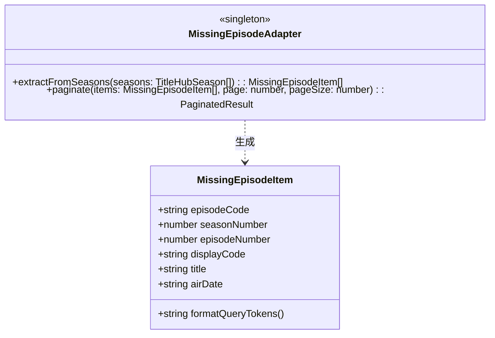
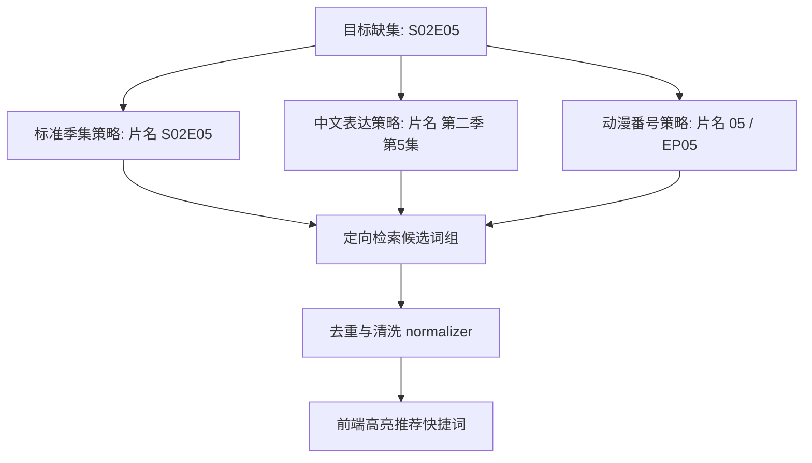
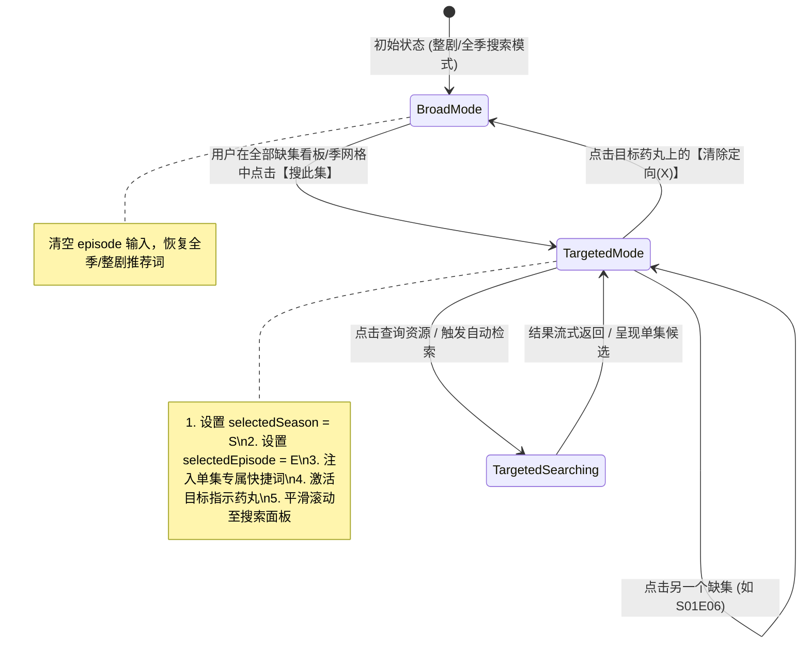
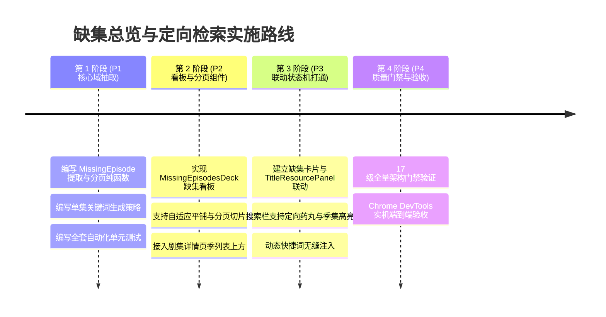

# 电视剧与动漫全部缺集总览、超长分页与定向单集检索架构规范

> **文档状态**：调研与架构设计完成（Ready for Review & Phased Implementation）  
> **创建日期**：2026-11-02  
> **适用模块**：`apps/web/features/acquisition` (缺集看板、季集联动状态机、资源检索栏), `apps/web/app/show/[tmdbId]` (剧集详情页), `packages/workflow` (单集检索策略、集号提取器)  
> **核心设计模式**：适配器模式 (Adapter Pattern)、策略模式 (Strategy Pattern)、状态机模式 (Finite State Machine)

---

## 1. 背景与问题陈述 (Context & Problem Statement)

### 1.1 现状与痛点
巡影 · Mediary Scout 当前支持电视剧与动漫的分季追踪与资源入库，但在长篇剧集、长篇连载动漫（如《名侦探柯南》、《海贼王》、《火影忍者》、《银魂》或国产年番动画）以及多季剧集的缺集发现与手动补集场景下，存在以下明显的交互阻滞与功能缺失：

1. **缺乏跨季的“全部缺集”全局聚合视图**：
   - 目前剧集详情页只提供手风琴折叠的季列表（`SeasonRowsWithSwap`），每一季展开后是混杂着“已入库”、“未播出”、“已播缺集”、“待换”的全部集数网格；
   - 若一部剧共有 5 季且跨季缺失了若干集（如 S01E03、S02E08、S04E12），用户必须逐一手动点开每一季的折叠层，费力寻找黄色高亮的缺集格子，**无法一眼看清当前总共还缺哪几集**。
2. **超长剧集/动漫导致 DOM 节点膨胀与页面卡顿**：
   - 长篇动漫单季动辄几百集甚至上千集（柯南 1000+ 集，海贼王 1100+ 集），当前页面一次性将所有集数单元格强行 dump 到 DOM 中；
   - 缺乏针对缺集的筛选与分页机制，导致页面渲染负载重、水合耗时长，用户在数百个格子里查找缺集如同“大海捞针”。
3. **缺集卡片与资源搜索栏完全脱节（断层点击）**：
   - 目前在季网格中点击缺集单元格（`<a href="#title-resources" className="episode-cell missing-aired ...">`），仅仅是一个原生的浏览器锚点跳转；
   - 跳转到下方资源检索区域后，搜索栏的 `selectedSeason` 和 `selectedEpisode` 依然是空的，**并没有自动带入用户刚刚点击的那一季和那一份集数**；
   - 用户被迫重新在下拉框翻选第几季、手动输入集数，再点击搜索，体验极度繁琐割裂。

---

## 2. 深度头脑风暴：可行性、逻辑与性能全景评估

### 2.1 可行性分析 (Feasibility)
- **数据层零成本衍生**：
  - 在剧集详情页（`TvHub`）中，服务端已返回完整的 `view.seasons`，每个季包含完整的 `episodes: EpisodeStatusCell[]`；
  - 判定规则与系统核心域 `subscription-missing.ts` 中的 `missingAiredEpisodeCodes` 保持绝对一致：
    $$\text{isMissingAired} \iff \neg \text{obtained} \land \text{airStatus} = \text{"aired"}$$
  - 跨季缺集列表是一个纯客户端内存过滤操作，**计算耗时 $< 0.1\text{ms}$，零额外网络 IO**。
- **检索接口与关键词链路已就绪**：
  - 后端 `/api/titles/resources` 已经原生支持接收 `seasonNumber` 与 `episodeNumber`；
  - 后端 `title-search-keywords.ts` 中的 `collectEpisodeKeywords` 已经原生支持根据季号与集号生成 `片名 S01E05`、`片名 第5集` 等精准关键词；
  - 核心缺失的仅仅是**前端联动状态桥梁**与**分页交互组件**。

### 2.2 逻辑严谨性与边缘陷阱 (Logic & Edge Cases)

| 潜在边缘场景 | 逻辑挑战 | 架构级防范与处理对策 |
| :--- | :--- | :--- |
| **动漫绝对集数 vs 电视剧季集数** | 很多动漫在网盘中命名为 `[05]` 或 `EP05` 或 `1085`，而不是标准的 `S01E05`。如果强制带 `S01E05` 可能会漏掉绝对番号命名的资源。 | **多维集号别名生成策略**：在第一季或无明显季号的动漫中，定向策略同时生成 `S01E05`、`第5集`、`EP05` 以及带有 0 填充和无 0 填充的双重关键词变体。 |
| **超多缺集堆叠（分页需求）** | 一部长篇动漫若新加入追踪，可能一次性缺 500 集。如果不分页平铺展示，UI 会直接崩溃。 | **双层防御策略**：缺集 $\le 12$ 集时，采用紧凑芯片流展示；缺集 $> 12$ 集时，自动激活轻量内存分页条（每页 12/24 集），并支持按季快速过滤。 |
| **单集定向与全季大包权衡** | 用户可能想补第 5 集，但网盘里只有“1-12集全剧打包”资源。如果死锁在第 5 集，用户会看不到全集包。 | **可解除的定向锁定状态 (Unbindable Target)**：定向到某集后，搜索栏醒目展示当前锁定目标，并提供一键解绑清除按钮（`X`），用户可一秒切回全剧/全季搜索。 |
| **未播集与特别篇误报** | 尚未播出的未来剧集（`unaired`）或零星特别篇（`S00`）不能算作缺集。 | **单一权威来源守卫**：严格遵循 `subscription-missing.ts`，只有 `airStatus === "aired"` 且 `!obtained` 才纳入缺集看板。 |

### 2.3 性能与渲染防线 (Performance Guardrails)
1. **DOM 虚拟化与轻量切片**：
   - 跨季缺集面板采用客户端纯内存切片（直接复用系统的 `paginateCandidates` 算法），无论缺集有 10 集还是 1000 集，当前渲染的 DOM 节点数量始终恒定在 12~24 个，保证 60fps 流畅交互；
2. **滚动定位与无抖动聚焦**：
   - 点击缺集卡片时，使用原生 `element.scrollIntoView({ behavior: 'smooth', block: 'start' })` 平滑滑动到搜索栏，并自动对关键词或查询按钮施加脉冲高亮特效（Visual Pulse），给予用户明确的视觉反馈。

---

## 3. 业界主流方案对比与技术借鉴

| 体系 / 工具 | 缺集呈现与单集搜索实现 | 优劣势评估 | 本项目借鉴与超越 |
| :--- | :--- | :--- | :--- |
| **Sonarr** | 拥有专门的 `Wanted > Missing` 页面与剧集详情页单集交互搜索（Interactive Search）；点击单集放大镜仅搜索该集并展示 Release 列表。 | **优点**：分集粒度极细，针对性极强。<br>**缺点**：不支持中文剧集“第N集”与国内网盘多渠道检索。 | **借鉴**：引入单集专属检索（Interactive Targeted Search）模型，结合中文本地化与网盘特性。 |
| **MoviePilot** | 提供缺集看板与补抓任务；集数表格直观展示入库状态。 | **优点**：针对国内网盘生态好。<br>**缺点**：超大长篇（如柯南、海贼王）集数较多时缺乏跨季分页检索机制。 | **借鉴**：增加长篇动漫专用的缺集自适应分页看板。 |
| **Plex / Jellyfin** | 仅通过图标标记缺少集数，无法在播放器内直接发起针对该集的资源获取。 | **优点**：展示直观。<br>**缺点**：无获取闭环。 | **超越**：实现从“缺集发现 $\to$ 一键定向 $\to$ 资源检索 $\to$ 自动转存”的全闭环。 |

---

## 4. 架构设计与设计模式落地

### 4.1 适配器模式 (Adapter Pattern)：统一缺集项视图模型

为了抹平长篇动漫（绝对番号）、标准多季美剧（SxxExx）、国产电视剧（第N季第N集）的显示与搜索差异，构建 `MissingEpisodeAdapter`：



#### 契约定义
```ts
export interface MissingEpisodeItem {
  id: string; // `${seasonNumber}_${episodeNumber}`
  episodeCode: string; // "S01E05"
  seasonNumber: number; // 1
  episodeNumber: number; // 5
  displayCode: string; // "第 5 集" 或 "S01E05"
  airDate?: string | null | undefined;
  title?: string | undefined; // TMDB 分集单集名称
}
```

### 4.2 策略模式 (Strategy Pattern)：定向检索词组生成策略

当用户针对特定缺集发起手动搜索时，`TargetedEpisodeSearchStrategy` 协同生成不同维度的搜索方案：



1. **`StandardSeasonEpisodeStrategy`**：针对欧美剧与标准剧集，输出 `[片名] S02E05`；
2. **`ChineseEpisodeStrategy`**：针对国产剧或中文压制，输出 `[片名] 第5集`（第一季）或 `[片名] 第2季 第5集`；
3. **`AnimeAbsoluteEpisodeStrategy`**：针对动漫，当 `seasonNumber === 1` 时额外补充 `[片名] 05` 或 `[片名] EP05`。

### 4.3 状态机模式 (State Machine / FSM)：缺集联动与搜索状态机

精确管理“全局整剧搜索”与“单集精准定向”之间的状态转移：



---

## 5. 组件层演进与交互细节规划

### 5.1 新增跨季【全部缺集总览看板】组件 (`MissingEpisodesDeck`)
- **位置**：位于剧集详情页（`hub-seasons` 季列表上方）；
- **表现形态**：
  1. **零缺集态**：若全部已入库，展示温和绿色徽章与提示 `✔ 已全部入库 (全N集已齐)`；
  2. **紧凑芯片态（缺集 $\le 12$ 集）**：
     - 展示全部缺集芯片（如 `S01E02`、`S01E05`、`S02E01`），带有琥珀色告警色；
     - 鼠标悬停显示单集名称与播出日期；
     - 单击直接进入 **定向检索状态** 并滚动聚焦；
  3. **超长分页态（缺集 $> 12$ 集）**：
     - 头部展示统计：`已播缺集共 48 集 · 第 1/4 页`；
     - 提供季别筛选胶囊（`全部季` / `第 1 季 (12)` / `第 2 季 (36)`）；
     - 底部嵌入紧凑分页控制器（`上一页` `1` `2` `3` `4` `下一页`）；
     - 卡片内含显式搜索按钮：`🔍 搜此集`。

### 5.2 搜索工具栏与常规季/集标签增强 (`ResourceSearchBar`)
- **目标指示药丸 (Target Indicator Pill)**：
  - 当 `selectedSeason` 与 `selectedEpisode` 生效时，搜索框上方或内部渲染显眼的聚焦药丸：
    `🎯 定向目标：第 1 季 第 05 集`，右侧带一个清脆的 `✕` 解除按钮；
- **常规季/集标签高亮**：
  - 季选择下拉框与集数输入框自动联动显示对应的选中值，边框呈现微光高亮；
- **单集专属快捷词即时注入**：
  - 快捷词栏动态将 `片名 S01E05`、`片名 第5集` 排在第一优先级，方便用户一键采用。

---

## 6. 质量门禁与防回归测试规范 (Quality Gates)

1. **确定性单测覆盖清单**：
   - 提取逻辑单测：针对多季、单季长篇、跨季零碎缺集的 `extractMissingEpisodes` 正确性与边界测试；
   - 分页切片单测：测试 0 集、12 集、13 集、500 集情况下的分页边界、页码钳位与超界防护；
   - 状态联动单测：验证点击【搜此集】后，季/集参数、关键词注入、解绑清除的确定性状态转移。
2. **代码棘轮与复杂度限制**：
   - 新增组件保持 $< 250$ 物理行，纯逻辑抽离至 core 工具包；
   - 圈复杂度严格控制在 $\le 10$。
3. **17 级全量架构质量门禁守卫**：
   - 确保 `npm run gate` 17 道门禁持续 100% 全绿（含依赖巡检、水合安全、模态层级、ESLint 零警告等）。

---

## 7. 分阶段实施路线图 (Implementation Roadmap)


