# 未登录用户自动重定向至登录页与无数据/错误页面治理规范

> **文档标识**：`docs/architecture/unauthenticated-user-login-redirect-and-empty-state-spec.md`  
> **编写日期**：2026-11-04  
> **适用对象**：全栈开发人员、AI 编码助手（Antigravity、Cursor、Claude Code）、架构质量治理人员  
> **关联工单**：彻底解决已设置密码时未登录用户访问受保护页面（尤其是 `/settings`、`/`、`/storage` 等）出现“无数据 / 错误页面”或停留在空表单而不是自动跳转到 `/login` 的问题，建立双层鉴权屏障、过期会话强校验与防回退质量门禁。

---

## 1. 现象复盘与四大核心诱因 (Incident Anatomy & Root Causes)

用户与测试团队反馈：“未登录用户访问系统时（例如在浏览器中打开 `http://192.168.1.100:3020/settings`），不能自动跳转到 `/login`，而是能看到‘网盘连接、媒体库与系统配置’所有配置项空表单，或看到‘未配置已连接网盘’、‘订阅还是空的’等无数据页面，在执行部分操作时甚至会弹出未捕获的错误页面。”

```mermaid
flowchart TD
    subgraph Defect1["诱因 1: 过期/残留 Session Cookie 伪装合法会话"]
        A1["浏览器残留旧环境 mt_session Cookie"] --> A2["page-auth-guard.ts 仅检查 Cookie 是否存在 (hasSession = Boolean(val))"]
        A2 --> A3["守卫误判 hasSession = true -> 放弃重定向 (/login)"]
        A3 --> A4["数据层校验 SQLite 判定会话无效 -> 返回 acct_unauthenticated 哨兵"]
        A4 --> A5["页面未被拦截，渲染出全部空白配置表单或空数据页面"]
    end

    subgraph Defect2["诱因 2: 表面组件缺少未认证拦截与 Suspense 外泄"]
        B1["SettingsPageInner 无 accountId === UNAUTHENTICATED_ACCOUNT_ID 门禁"] --> B2["服务端直接执行 Pan115Section, LlmConfigSection 等 15 个配置面板"]
        B2 --> B3["生成 133KB 敏感 HTML 流式推送给浏览器，在重定向发生前用户已目睹表单"]
    end

    subgraph Defect3["诱因 3: React 19 并发流式渲染与兄弟 Suspense 竞态"]
        C1["页面入口同时挂载 <PageLoginGuard /> 与 <SettingsPageInner />"] --> C2["两个兄弟节点并行渲染"]
        C2 --> C3["主内容 HTML 先行到达浏览器，末尾流式注入的脚本因时序差滞后执行"]
    end

    subgraph Defect4["诱因 4: 客户端 SPA 路由跳转无法触发内联脚本"]
        D1["客户端使用 <Link> 或 router.push 导航至受保护页面"] --> D2["React DOM Diff 更新视图，W3C 规范下动态插入的 <script> 绝不执行"]
        D2 --> D3["用户停留在目标受保护页面，看到空白表单与操作 401 报错"]
    end
```



### 1.1 诱因一：过期/残留会话 Cookie 导致守卫误判（致命核心根因）
- **实现缺陷**：原 [`platform/next-context/page-auth-guard.ts`](file:///apps/web/platform/next-context/page-auth-guard.ts) 中：
  ```typescript
  hasSession = Boolean(store.get(SESSION_COOKIE_NAME)?.value);
  ```
  该逻辑仅通过判断 `mt_session` Cookie 字符串是否存在来决定 `hasSession`！
- **业务场景触发**：当系统经历容器重启、重新构建、SQLite 数据库恢复或用户在过去会话中登录过但会话已在服务端过期/被清空时，浏览器端依然保留着带有旧签名或旧 SessionId 的 `mt_session` Cookie。
- **导致后果**：`page-auth-guard.ts` 看到 Cookie 存在，认定 `hasSession = true`，**完全跳过了 `/login` 重定向**！然而下游业务组件调用 `getCurrentAccountId()` 时，SQLite 数据层通过 `resolveSessionAccountId()` 校验发现该 Session 在数据库中根本不存在，于是返回未认证哨兵 `UNAUTHENTICATED_ACCOUNT_ID`（`acct_unauthenticated`）。两层鉴权发生断层，导致“守卫认为已登录不跳，数据层认为未登录给空”，最终呈现为完全空白的表单与空数据页面。

### 1.2 诱因二：设置页与子页面未建立 `UNAUTHENTICATED_ACCOUNT_ID` 阻断屏障
- **实现缺陷**：`apps/web/app/settings/page.tsx`、`activity/page.tsx`、`chat/page.tsx` 等页面在顶层直接渲染实际业务组件，从未对 `accountId === UNAUTHENTICATED_ACCOUNT_ID` 进行短路判断。
- **导致后果**：服务端组件在未登录状态下依然调用 `getAccountScopedSettings("acct_unauthenticated")` 并渲染全部表单与 133KB HTML，全部推送到浏览器。

### 1.3 诱因三：React 19 并发流式渲染与兄弟 Suspense 外泄
- 各页面入口（如原 `app/settings/page.tsx`）采用并列结构：
  ```tsx
  <Suspense fallback={null}><PageLoginGuard /></Suspense>
  <SettingsPageInner {...props} />
  ```
- React 19 并行渲染 `<SettingsPageInner />`。由于其不处于 Suspense 骨架保护下，全量 133KB HTML 优先推向客户端，而位于 Suspense 内的 `<PageLoginGuard />` 延迟流出的客户端重定向代码只能追加在 HTML 流的末尾，用户肉眼必然看到空表单。

### 1.4 诱因四：SPA 客户端导航无法执行动态 `<script>` 标签
- 现有的 `PageLoginRedirect` 若仅向 DOM 输出 `<script dangerouslySetInnerHTML>`，根据 W3C HTML 规范，通过 DOM 虚拟节点动态插入的 `<script>` **不会被现代浏览器执行**。
- 必须通过 React `"use client"` 组件在 `useEffect` 生命周期中调用 `window.location.replace` 才能保证客户端 100% 立即跳转。

---

## 2. 业界主流方案与调研对比 (Industry Survey & Best Practices)

调研了 Next.js 官方建议（Next.js App Router Auth Guide）、Auth.js (NextAuth v5)、Remix / React Router 7、Supabase SSR Auth 以及开源自托管项目（Jellyfin、Home Assistant）：

| 方案 | 原理 | 优势 | 缺陷与适用场景 |
| :--- | :--- | :--- | :--- |
| **方案 1：纯 Next.js `redirect()`** | 服务端直接抛出 `NEXT_REDIRECT` 异常 | 代码简短 | **严禁在 `<Suspense>` 内部使用**。在 PPR 与流式 SSR 下会导致 React 降级为客户端错误，Turbopack 误判为致命崩溃并触发死循环重载。 |
| **方案 2：纯客户端 Hook 延迟跳转 (`useRouter`)** | 在客户端组件的 `useEffect` 中跳转 | 不在 SSR 抛错 | 必须等待客户端 JS Bundle 下载解析并完成水合，存在严重的白屏闪烁（FOUC）与 ~300ms+ 延迟。 |
| **方案 3：Remix / React Router Loader 重定向** | 路由级别 `loader` 拦截并返回 `Response.redirect()` | 严密无泄漏 | Next.js App Router 无独立路由 Loader 机制，无法直接原生套用。 |
| **方案 4：三维立体鉴权屏障 (Three-Tier Auth Barrier) (本项目采用)** | 1. **守卫层**：`checkPageLoginNeeded()` 执行真实会话有效性校验 + `getCurrentAccountId()` 权威单源裁决，彻底杜绝过期 Cookie 欺骗；<br>2. **表面层**：所有受保护页面表面组件在 `accountId === UNAUTHENTICATED_ACCOUNT_ID` 时短路拦截，0 业务数据渲染，统一下发中性骨架屏 `<Shell />` + `<ClientLoginRedirect />`；<br>3. **客户端**：`ClientLoginRedirect` 在客户端 `useEffect` 中硬替换 URL，支持 `?redirect=` 目标回跳。 | **100% 阻断数据外泄与空表单闪烁**；兼顾首屏直开、刷新与 SPA 点击导航；0 异常抛出，完美适配 React 19 并发流与 Turbopack PPR。 | 架构需联动数据层、页面 Surface 与客户端跳转组件。 |

---

## 3. 当前系统基础设施与复用分析 (Infrastructure Reuse)

1. **复用 `getCurrentAccountId()` 与 `resolveSessionAccountId()`**：
   位于 [`apps/web/platform/next-context/request-account.ts`](file:///apps/web/platform/next-context/request-account.ts) 与 [`features/auth/application/account-service.ts`](file:///apps/web/features/auth/application/account-service.ts)，具备完整的 SQLite 签名校验与会话生命周期裁决能力，是全局唯一权威账号数据源。
2. **复用 `PageLoginGuard` 挂载点与门禁契约**：
   门禁 [`tools/gates/check-blocking-routes.mjs`](file:///tools/gates/check-blocking-routes.mjs) 与 [`tools/gates/check-suspense-fallbacks.mjs`](file:///tools/gates/check-suspense-fallbacks.mjs) 已经严格约束了所有 13 个页面的挂载契约。
3. **复用中性静态骨架屏 (`SettingsShell`, `StorageShell`, `HomeShell`, `ChatShell` 等)**：
   页面已原生具备完备的静态骨架屏，可在鉴权未通过时平滑充当视觉屏障，绝不产生空白或报错。

---

## 4. 具体解决方案与工程落地 (Engineering Implementation)

### 4.1 守卫有效性校验：终结过期 Cookie 欺骗
在 [`apps/web/platform/next-context/page-auth-guard.ts`](file:///apps/web/platform/next-context/page-auth-guard.ts) 中升级 `checkPageLoginNeeded()`：
```typescript
const rawSession = store.get(SESSION_COOKIE_NAME)?.value;
if (rawSession) {
  // 严禁仅靠非空判定！必须通过数据库校验该 Session 签名与过期状态
  if (typeof runtime.resolveSessionAccountId === "function") {
    const sessionAccount = await runtime.resolveSessionAccountId(rawSession).catch(() => null);
    hasSession = Boolean(sessionAccount);
  } else {
    hasSession = true;
  }
} else {
  hasSession = false;
}

// 权威跨层校验：若当前数据层 getCurrentAccountId 返回未认证哨兵，说明 Cookie 已失效，强制标记 hasSession = false
if (typeof runtime.getCurrentAccountId === "function" && typeof runtime.UNAUTHENTICATED_ACCOUNT_ID !== "undefined") {
  const currentAccount = await runtime.getCurrentAccountId().catch(() => null);
  if (currentAccount === runtime.UNAUTHENTICATED_ACCOUNT_ID) {
    hasSession = false;
  }
}
```

### 4.2 全量受保护页面表面组件阻断屏障
在全部受保护页面中实施标准统一的三步防御模型：
1. **根组件非异步（PPR 规范）**：`export default function Page()`；
2. **双 Suspense 并行挂载**：`<Suspense fallback={null}><PageLoginGuard /></Suspense>` 与 `<Suspense fallback={<PageShell />}><PageSurface /></Suspense>`；
3. **表面组件短路拦截**：
```typescript
async function PageSurface(props: PageProps) {
  await connection();
  const accountId = await getCurrentAccountId();
  if (accountId === UNAUTHENTICATED_ACCOUNT_ID) {
    return (
      <>
        <ClientLoginRedirect />
        <PageShell />
      </>
    );
  }
  return <PageInner {...props} />;
}
```
**覆盖页面清单（13 处全覆盖）**：
- `/settings`（设置中心）
- `/settings/extensions`（动态扩展管理）
- `/settings/mediaserver`（媒体服务器设置）
- `/`（首页/搜索/订阅）
- `/storage`（网盘存储中心）
- `/storage/strm`（STRM 任务中心）
- `/activity`（活动与任务）
- `/chat`（AI 媒体助理）
- `/notifications`（通知与日报）
- `/show/[tmdbId]`（影视作品详情）
- `/foreign-work/[workflowRunId]`（异作品人工确认）
- `/w/[storageId]`（特定网盘媒体空间）

### 4.3 智能回跳目标保持 (`redirect` Query Param)
在 [`ClientLoginRedirect`](file:///apps/web/features/auth/components/client-login-redirect.tsx) 中自动捕捉当前访问路径，并以参数编码下发给 `/login`：
```typescript
const destination =
  target === "/login" && window.location.pathname && window.location.pathname !== "/"
    ? `/login?redirect=${encodeURIComponent(window.location.pathname + window.location.search)}`
    : target;
window.location.replace(destination);
```
在 [`app/login/page.tsx`](file:///apps/web/app/login/page.tsx) 登录成功后，安全读取并平滑跳回原页面，避免登录后丢失用户浏览上下文。

---

## 5. 防回归质量门禁设计 (Quality Gate & Anti-Regression)

1. **`Stale-Session-Defense` 单元测试**：
   在 [`apps/web/lib/page-auth-guard.test.ts`](file:///apps/web/lib/page-auth-guard.test.ts) 中增加两个反向断言测试：
   - 携带伪造/过期 `mt_session` 时，守卫必须识别失效并触发 `redirect('/login')`；
   - `getCurrentAccountId()` 返回哨兵账号时，守卫必须强制判定为未登录并触发重定向。
2. **`check-blocking-routes.mjs` & `check-suspense-fallbacks.mjs`**：
   持续保障所有 13 个受保护页面根组件纯静态化与 Suspense Fallback 健全性。
3. **真实浏览器 MCP 实机回归验收**：
   在携带旧 Cookie、清除 Cookie、未设密码与已设密码四种状态下分别访问 `http://192.168.1.100:3020/settings`，断言 100% 正确重定向至 `/login?redirect=%2Fsettings`，绝不外泄任何业务空表单。

---

## 6. 凭据与安全脱敏遵从声明

本文档严格遵守项目 `AGENTS.md` §7 凭据治理红线：
- 所有 IP 地址均采用本地回环地址 `127.0.0.1` 或局域网标准示例地址 `192.168.1.100`，绝不包含任何开发内网真实 IP；
- 所有示例凭据使用虚拟占位符；
- 所有代码路径均遵循标准相对路径与点击链接格式。
