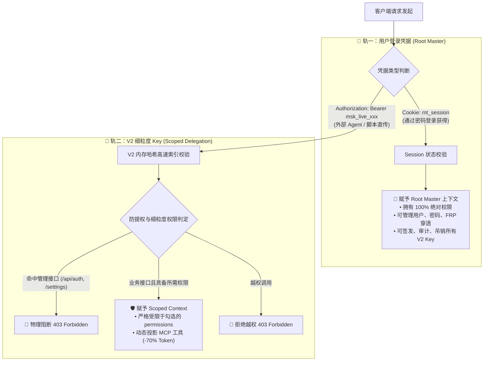
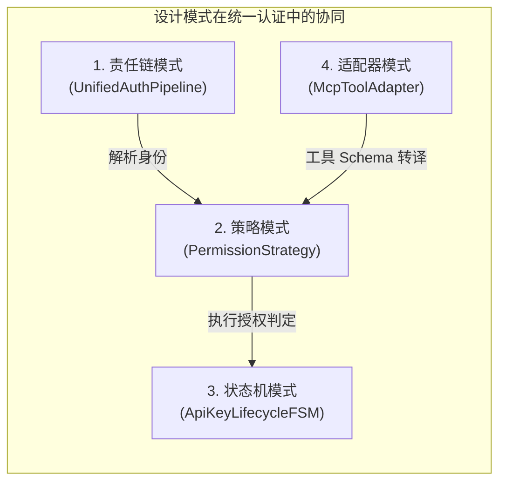
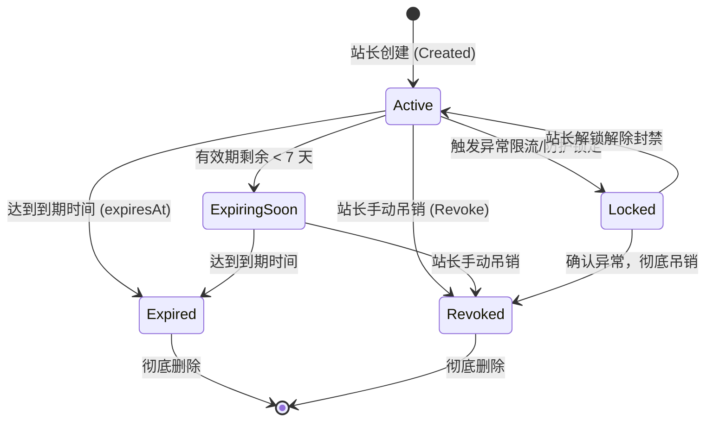
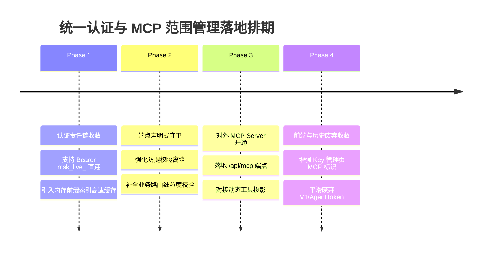

# 巡影 (Mediary Scout) 统一双轨身份认证与 V2 细粒度 Key / MCP 范围管理架构规范

> **文档版本**：v1.0.0  
> **制定时间**：2026-11-01  
> **状态**：架构方案制定 / 待评审  
> **核心目标**：彻底解决认证凭据碎片化问题，统一收敛为「用户登录密钥（全权 Master）」与「V2 细粒度 Key（受限分发）」双轨模型，引入责任链、策略、适配器与状态机等设计模式，消除 Token 交换摩擦，构建高并发内存缓存索引，并为 MCP 服务对外暴露提供动态工具投影与零信任权限隔离。

---

## 目录

- [一、背景与问题定义：认证碎片化痛点](#一背景与问题定义认证碎片化痛点)
- [二、统一双轨认证架构愿景 (Two-Tier Auth Model)](#二统一双轨认证架构愿景-two-tier-auth-model)
  - [2.1 第一轨：用户登录密钥 (Root Master Credential)](#21-第一轨用户登录密钥-root-master-credential)
  - [2.2 第二轨：V2 细粒度 Key (Scoped Delegated Key)](#22-第二轨v2-细粒度-key-scoped-delegated-key)
  - [2.3 存量历史碎片的废弃与收敛映射矩阵](#23-存量历史碎片的废弃与收敛映射矩阵)
- [三、业界主流方案调研与对标 (Industry Benchmark)](#三业界主流方案调研与对标-industry-benchmark)
- [四、现有基础设施与可复用资产审计](#四现有基础设施与可复用资产审计)
- [五、头脑风暴：可行性、逻辑漏洞与性能优化深度审视](#五头脑风暴可行性逻辑漏洞与性能优化深度审视)
  - [5.1 直通 Bearer 鉴权：消除 JWT 交换摩擦](#51-直通-bearer-鉴权消除-jwt-交换摩擦)
  - [5.2 性能攻坚：高频调用下的内存索引缓存 (LRU / TTL Fast-Path)](#52-性能攻坚高频调用下的内存索引缓存-lru--ttl-fast-path)
  - [5.3 逻辑闭环：端点声明式守卫与零信任防提权隔离墙](#53-逻辑闭环端点声明式守卫与零信任防提权隔离墙)
  - [5.4 MCP 动态工具投影：节省 70% Token 与根除大模型幻觉](#54-mcp-动态工具投影节省-70-token-与根除大模型幻觉)
- [六、设计模式深度实战应用](#六设计模式深度实战应用)
  - [6.1 责任链模式：UnifiedAuthPipeline](#61-责任链模式unifiedauthpipeline)
  - [6.2 策略模式：PermissionStrategyEngine](#62-策略模式permissionstrategyengine)
  - [6.3 适配器模式：McpToolDefinitionAdapter & LegacyTokenAdapter](#63-适配器模式mcptooldefinitionadapter--legacytokenadapter)
  - [6.4 状态机模式：ApiKeyLifecycleFSM](#64-状态机模式apikeylifecyclefsm)
- [七、对外开放 MCP 服务端点设计 (`/api/mcp`)](#七对外开放-mcp-服务端点设计-apimcp)
- [八、分阶段实施路线图 (Implementation Roadmap)](#八分阶段实施路线图-implementation-roadmap)

---

## 一、背景与问题定义：认证碎片化痛点

在系统前期的快速演进过程中，为满足不同场景（浏览器交互、自托管免密、CLI 运维、桌面应用、外部脚本）的需求，陆续引入了多种认证与密钥概念：

1. **Web 端用户登录密码**：基于 `scrypt` 强哈希存储在 SQLite `accounts` 表；
2. **签名密钥（Session / JWT Secret）**：用于对会话 Cookie 与临时 JWT 进行 HMAC 签名，存在多级回落机制（环境变量 → SQLite 数据库 → 随机生成）；
3. **V1 传统单枚 API Key**：`MEDIA_TRACK_API_KEY`（或数据库单值设置），权限全有或全无；
4. **V2 细粒度 API Key**：`msk_live_...`，支持树状权限勾选与 SHA-256 哈希校验；
5. **Agent API Token**：`MEDIA_TRACK_AGENT_TOKEN`（或 `agent_api_token`），专供桌面应用和 Skill 使用。

### 存在的核心矛盾与瓶颈：

| 痛点维度 | 具体表现 | 负面影响 |
| :--- | :--- | :--- |
| **认知负担过重** | 5 套密钥概念混杂，用户无法分清何种场景该配何种 Key。 | 自托管用户配置门槛高，FAQ 中频现认证类疑惑。 |
| **协议摩擦严重** | V2 Key 无法直接作为 HTTP Bearer Token 请求业务接口，必须先调用 `/api/auth/token` 换取 12 小时有效期的 JWT。 | 阻碍了与标准 MCP 客户端（Cursor、Antigravity、Claude Desktop）的直接集成。 |
| **权限存在断层** | V2 Key 虽在数据库中存有细粒度 `permissions` 列表，但后端大部分业务 API 仅校验了账号身份，未对单项权限做细粒度门禁阻断。 | 存在潜在的“有只读 Key 却能调写操作”的越权风险。 |
| **性能与并发隐患** | 每次校验 V2 Key 时，需读取 SQLite 的 JSON 字符串并进行全量遍历 SHA-256 计算，无读缓存。 | 无法支撑外部 AI Agent / 自动化工作流的高频高并发调用。 |

---

## 二、统一双轨认证架构愿景 (Two-Tier Auth Model)

为了彻底根除上述杂乱现象，系统全面确立**“双轨统一认证架构”**：



### 2.1 第一轨：用户登录密钥 (Root Master Credential)
- **定位**：系统所有者（站长/管理员）的专属凭据。
- **权限范围**：**100% 全部权限**。涵盖系统配置、存储绑定、网盘离线、密码修改、FRP 穿透控制，以及 V2 Key 的生命周期管理。
- **获取途径**：在 Web 登录页面输入管理员密码。通过原生 `scrypt` 密文哈希验证后，由服务端写入 HttpOnly、Secure、SameSite=Lax 的签名会话 Cookie (`mt_session`)。
- **设计底线**：严禁将 Master 密码作为明文写入 URL、请求体或日志中；禁止外部非交互式脚本直接持有 Master 密码。

### 2.2 第二轨：V2 细粒度 Key (Scoped Delegated Key)
- **定位**：系统所有者面向外部第三方场景签发的**受限代理凭据**。
- **适用场景**：
  - 外部编程 Agent（Antigravity、Cursor、Claude Code、Codex）；
  - 外部 MCP 客户端（连接巡影 MCP 服务的各类宿主）；
  - 第三方下载器与自动化同步脚本；
  - 手机快捷指令 (iOS Shortcuts)。
- **凭据规格**：统一采用标准化可识别前缀 `msk_live_`（Mediary Scout Key - Live），由 24 字节加密级伪随机数经 Base64URL 编码生成。
- **分发与鉴权机制**：
  - **直接直通**：客户端直接在 HTTP 请求头中携带 `Authorization: Bearer msk_live_...`，无需任何二次 Token 交换；
  - **最小权限原则**：仅拥有后台明确勾选的权限范围；
  - **物理级防提权墙**：物理阻断对任何管理端点（`/api/auth/*`、`/api/settings/api-keys/*` 等）的访问；
  - **动态 MCP 投影**：与外部大模型交互时，未被授权的工具 Schema 自动隐形。

### 2.3 存量历史碎片的废弃与收敛映射矩阵

| 历史凭证概念 | 当前现状 | 统一收敛方案 | 兼容过渡期策略 |
| :--- | :--- | :--- | :--- |
| **V1 API Key** (`MEDIA_TRACK_API_KEY`) | 单值全局配置，无权限隔离 | **废弃并自动合并进 V2 体系**。若检测到存在 V1 Key，系统在内部将其虚拟为拥有 `["*"]` 权限的初始 V2 Key，并在设置页提示一键迁移。 | 设置页提示“已弃用”，继续支持通过 Bearer 调用，建议升级为 V2。 |
| **Agent API Token** (`MEDIA_TRACK_AGENT_TOKEN`) | 专供 `/api/agent/*` 使用的 Bearer Token | **废弃，统一并入 V2 细粒度 Key**。新生成的 V2 Key 只要勾选 `media` 和 `workflow` 权限，即可天然操作全部 `/api/agent/*` 端点。 | 内部通过适配器将 Agent Token 映射为内置的虚拟 V2 Key，保证旧版 Desktop 客户端免受冲击。 |
| **JWT Token 交换机制** (`/api/auth/token`) | 客户端先拿 Key 换 12h JWT | **降级为历史兼容通道，推荐 Bearer 直连**。保留端点但不再作为强制手段，客户端直接带 `msk_live_` 访问接口即可。 | 保持现有路由不报错，平滑过渡。 |
| **Session / JWT Secret** | 内部签名私钥 | **纯底层基础设施，对上层完全透明**。继续维持“自动落库 + 零配置自愈”，不再作为暴露给用户的配置概念。 | 无需用户干预，代码层静默管理。 |

---

## 三、业界主流方案调研与对标 (Industry Benchmark)

在进行方案设计前，系统深入调研并对标了业内四大顶尖平台与协议的最佳工程实践：

```
┌────────────────────────────────────────────────────────────────────────────────────────┐
│                                业界顶尖凭据设计演进对标                                   │
├───────────────┬────────────────────────────────────────────────────────────────────────┤
│ GitHub        │ 弃用全权 Personal Access Token (classic)，转向 Fine-grained PATs；      │
│               │ 引入明确前缀 (ghp_, github_pat_)，支持正则表达式秒级扫描泄露。        │
├───────────────┼────────────────────────────────────────────────────────────────────────┤
│ Cloudflare    │ 淘汰 Global API Key，全面推行 Scoped API Tokens；                       │
│               │ 细粒度划分 Zone / Account 级别权限，强制最小特权。                     │
├───────────────┼────────────────────────────────────────────────────────────────────────┤
│ Stripe        │ 严格区分 Secret Key (sk_live_) 与 Restricted Key (rk_live_)；           │
│               │ 前缀自解释，微粒度控制每个端点的 Read / Write / None 权限。             │
├───────────────┼────────────────────────────────────────────────────────────────────────┤
│ Anthropic MCP │ Streamable HTTP / SSE 规范，明确要求客户端通过 HTTP 鉴权接入；          │
│               │ 工具列表受上下文动态约束，严防越权工具污染提示词与产生幻觉。            │
└───────────────┴────────────────────────────────────────────────────────────────────────┘
```

### 综合对标矩阵：

| 对标维度 | GitHub (Fine-grained PAT) | Cloudflare (API Token) | Stripe (Restricted Key) | 巡影 Mediary Scout (目标选型) |
| :--- | :--- | :--- | :--- | :--- |
| **前缀规范** | `github_pat_` (区分经典/细粒度) | 无固定前缀（Base64 随机） | `rk_live_` (受限) / `sk_live_` (主键) | **`msk_live_` (Mediary Scout Key)** |
| **鉴权传输** | `Authorization: Bearer <token>` | `Authorization: Bearer <token>` | HTTP Basic / Bearer | **`Authorization: Bearer msk_live_...` (直传)** |
| **存储安全** | 仅展示一次，服务端存储哈希 | 仅展示一次，存储哈希与盐 | 仅展示一次，加盐哈希索引 | **仅展示一次，SHA-256 哈希安全存储，掩码展示** |
| **防时序攻击** | 内部常量时间比对 | 常量时间比对 | 常量时间比对 | **Node 原生 `crypto.timingSafeEqual`** |
| **权限模型** | 资源库级 + 细粒度权限列表 | 模板策略 + 自定义 Permission Policy | Endpoint 级别 Read/Write 矩阵 | **双层树状权限矩阵 (`Module -> Leaf`) + 快捷策略** |
| **MCP 工具投影**| N/A | N/A | N/A | **原生支持：按 Key 权限动态过滤 MCP `tools/list`** |

---

## 四、现有基础设施与可复用资产审计

系统此前在 `@media-track/shared` 和 `@media-track/workflow` 中已沉淀了坚实的技术底座，**无需引入新的外部重量级依赖**：

1. **核心逻辑与安全加密 (`@media-track/shared/src/auth/api-key-matrix.ts`)**：
   - 树状权限目录字典：`PERMISSION_CATALOG`（各模块叶子能力均已声明 `supportsMcp` 与 `riskLevel`）；
   - 快速策略模式生成器：`ApiKeyPermissionPreset.applyStrategy(type)`（内置 `full`, `readonly`, `safe_automation` 三大安全策略）；
   - 动态 MCP 工具投影算法：`ApiKeyPermissionPreset.projectMcpTools()`（已具备完备单元测试验证）；
   - 防提权路径白名单：`FORBIDDEN_API_KEY_PATHS` 与 `isForbiddenApiKeyPath(pathname)`；
   - 密码学工具函数：`generateApiKeyV2()`、`hashApiKeyV2()`、`verifyApiKeyV2Hash()`（基于 `timingSafeEqual`）。
2. **底层存储与性能优化 (`packages/workflow/src/auth/`)**：
   - `ApiKeyV2Store`：多 Key JSON 存储结构、CRUD 操作与过期判断；
   - `WriteBehindApiKeyTouchBuffer`：已实现的**异步防抖写回缓存**（周期 10s 批量刷盘），彻底消除了高频调用更新 `lastUsedAt` 导致的 SQLite `SQLITE_BUSY: database is locked` 锁库风险。
3. **前端交互与 UI 原语 (`apps/web/features/settings-system/components/`)**：
   - `ApiKeyV2Manager`：卡片式密钥管理视图（前缀掩码展示、有效期计算、一键吊销）；
   - `CreateApiKeyModal`：三态树状复选框级联控制（Checked / Indeterminate / Unchecked）、一次性明文揭示安全弹窗。

---

## 五、头脑风暴：可行性、逻辑漏洞与性能优化深度审视

### 5.1 直通 Bearer 鉴权：消除 JWT 交换摩擦
- **现状痛点**：当前 `apps/web/platform/next-context/auth-chain.ts` 的 `resolveBearerAccountId` 只认 JWT，遇到 `msk_live_...` 会抛异常并拒绝。
- **可行性改造**：
  在 `auth-chain.ts` 内部构建两分支解析：
  ```typescript
  // 伪代码逻辑
  const token = parseBearerToken(authorizationHeader);
  if (token?.startsWith("msk_live_")) {
    // 快速直通路径：V2 内存哈希比对
    return resolveApiKeyV2Context(token);
  } else {
    // 兼容历史路径：JWT 解密
    return resolveJwtAccount(token);
  }
  ```
- **收益**：所有第三方 Agent（Cursor, Claude, Antigravity）直接在 Header 注入 Key 即可无缝调用，且不受 12 小时过期中断的困扰。

### 5.2 性能攻坚：高频调用下的内存索引缓存 (LRU / TTL Fast-Path)
- **现状缺陷**：如果每次 API 调用都要从 SQLite 读取字符串并循环计算 SHA-256，当外部 Agent 进行高频并发探索时，CPU 和磁盘压力显著增加。
- **优化方案**：设计 **带 TTL 的双键内存索引缓存 (Fast-Path In-Memory Token Cache)**。
  - **前缀分桶索引**：`msk_live_` Key 的前 12 位（`keyPrefix`）具备全局唯一性。内存中建立 `Map<keyPrefix, CachedKeyEntity>`。
  - **O(1) 快速定位**：解析传入 Token 的前 12 位，瞬间定位到具体的候选 Key，仅需对该候选 Key 做一次 `timingSafeEqual` 比对即可完成鉴权，避免全量 O(N) 循环哈希。
  - **读写一致性保证**：当在 Web 管理端新增、编辑、吊销 Key 时，直接向缓存触发主动驱逐（Eviction）。

### 5.3 逻辑闭环：端点声明式守卫与零信任防提权隔离墙
- **现状缺陷**：业务 API 缺少基于 Leaf 权限的声明式拦截，存在越权隐患。
- **方案实现**：统一的请求上下文与守卫拦截器：
  ```typescript
  export interface SecurityContext {
    accountId: string;
    isMaster: boolean; // 是否为登录用户
    permissions: Set<string>; // 允许的叶子权限集合
  }
  ```
  在业务路由执行前执行断言：
  ```typescript
  // 例：离线转存端点
  const sec = await requireSecurityContext(request);
  if (!sec.isMaster && !sec.permissions.has("storage:transfer")) {
    return NextResponse.json({ error: "权限不足：缺少 storage:transfer 权限" }, { status: 403 });
  }
  ```
- **防自举提权保障**：系统强制执行 `isForbiddenApiKeyPath(pathname)`。任何带有 `msk_live_` 的凭据请求 `/api/auth/*`、`/api/settings/api-keys/*` 或 `/api/settings/password` 时，中间件无条件直接切断并返回 403。

### 5.4 MCP 动态工具投影：节省 70% Token 与根除大模型幻觉
- **机制与价值**：
  当外部大模型接入 MCP 服务端点时，服务端在响应 `tools/list` 请求的瞬间，执行 `ApiKeyPermissionPreset.projectMcpTools`：
  - 若该 Key 仅勾选了 `media:search`，则暴露给大模型的工具列表**仅包含一个 `searchMedia` 工具**；
  - 存储、删除、配置等敏感工具彻底从 Schema 中物理剔除；
  - 大模型上下文无需承载无关工具的冗长描述（每次对话节省 3000+ Prompt Token），且由于大模型“看不见”未授权工具，从源头根除了调用未授权工具导致的逻辑幻觉。

---

## 六、设计模式深度实战应用

为保证代码库的高内聚、低耦合与易扩展性，方案深度运用了四种经典设计模式：



### 6.1 责任链模式：UnifiedAuthPipeline
将请求的认证判定解耦为若干独立的处理节点，形成清晰的拦截流水线：
1. **`SessionCookieAuthHandler`**：检查是否存在有效签名 Cookie，若验证通过，附带 `isMaster = true` 上下文并直接放行；
2. **`DirectApiKeyV2Handler`**：检查请求头中的 `Bearer msk_live_...`，通过内存索引进行安全哈希比对，附带 `isMaster = false` 与权限集合；
3. **`LegacyJwtBearerHandler`**：解析存量 JWT，映射为对应的历史账号上下文；
4. **`LocalLanFallbackHandler`**：判定是否为局域网且未设密码，保障自托管首启免密平滑体验。

### 6.2 策略模式：PermissionStrategyEngine
负责对不同类型的请求进行动态授权判定：
- **`MasterBypassStrategy`**：拥有者模式，所有权限请求直接返回 `true`；
- **`LeafExactMatchStrategy`**：精确比对叶子权限 ID；
- **`WildcardMatchStrategy`**：若权限包含 `*`，全部通过；
- **`McpDynamicProjectionStrategy`**：负责对 MCP 响应工具列表做动态剪裁过滤。

### 6.3 适配器模式：McpToolDefinitionAdapter & LegacyTokenAdapter
1. **`McpToolDefinitionAdapter`**：
   将内部基于 Zod Schema 定义的业务工具（如 `discoverMedia`, `searchMedia`, `queryStatus`）无损适配为符合 Model Context Protocol (Anthropic 2024-11) 规范的 JSON-RPC 2.0 工具协议契约。
2. **`LegacyTokenAdapter`**：
   将已弃用的 `MEDIA_TRACK_AGENT_TOKEN` 适配为内部只读的虚拟 V2 凭据，使现存使用中的自动化脚本与桌面客户端无需任何改动即可平滑过渡。

### 6.4 状态机模式：ApiKeyLifecycleFSM
规范 V2 API Key 的有限状态机流转与审计治理：



---

## 七、对外开放 MCP 服务端点设计 (`/api/mcp`)

在系统内新建标准 MCP Server 路由（`apps/web/app/api/mcp/route.ts`），全面兼容 Streamable HTTP 协议：

### 1. 通信协议与鉴权头
- **协议**：标准 JSON-RPC 2.0；
- **鉴权头**：`Authorization: Bearer msk_live_...`；
- **前置门禁**：通过 `DirectApiKeyV2Handler` 鉴权，提取该 Key 的 `permissions`。

### 2. 核心方法分发：
```typescript
export async function POST(request: NextRequest) {
  // 1. 统一提取 V2 Key 上下文
  const authContext = await resolveV2ApiKeyFromRequest(request);
  if (!authContext) {
    return NextResponse.json(
      { jsonrpc: "2.0", id: null, error: { code: -32001, message: "Unauthorized: Invalid or revoked API Key" } },
      { status: 401 }
    );
  }

  const rpc = (await request.json()) as McpJsonRpcRequest;

  // 2. 方法分发
  switch (rpc.method) {
    case "initialize":
      return NextResponse.json({
        jsonrpc: "2.0",
        id: rpc.id,
        result: {
          protocolVersion: "2024-11-05",
          serverInfo: { name: "mediary-scout-mcp", version: "1.0.0" },
          capabilities: { tools: {} },
        },
      });

    case "tools/list": {
      // 动态工具投影：按当前 Key 权限裁剪
      const allInternalTools = getMcpRegisteredTools();
      const allowedTools = ApiKeyPermissionPreset.projectMcpTools(
        Array.from(authContext.permissions),
        allInternalTools,
        TOOL_TO_PERMISSION_MAP
      );
      return NextResponse.json({
        jsonrpc: "2.0",
        id: rpc.id,
        result: { tools: allowedTools },
      });
    }

    case "tools/call": {
      const toolName = rpc.params?.name as string;
      const toolArgs = (rpc.params?.arguments as Record<string, unknown>) || {};
      
      // 权限前置校验
      const requiredPerm = TOOL_TO_PERMISSION_MAP[toolName];
      if (requiredPerm && !authContext.permissions.has(requiredPerm)) {
        return NextResponse.json({
          jsonrpc: "2.0",
          id: rpc.id,
          error: { code: -32003, message: `Forbidden: Key lacks permission [${requiredPerm}] for tool [${toolName}]` },
        });
      }

      // 调度执行底层工具
      const executionResult = await dispatchMcpToolCall(toolName, toolArgs, authContext);
      return NextResponse.json({
        jsonrpc: "2.0",
        id: rpc.id,
        result: executionResult,
      });
    }

    default:
      return NextResponse.json({
        jsonrpc: "2.0",
        id: rpc.id,
        error: { code: -32601, message: `Method not found: ${rpc.method}` },
      });
  }
}
```

---

## 八、分阶段实施路线图 (Implementation Roadmap)



### 阶段具体任务说明：

1. **第一阶段：认证链收敛与直通高速通道（Phase 1）**
   - 改造 `auth-chain.ts`，原生支持解析 `Bearer msk_live_...`；
   - 在 `ApiKeyV2Store` 中装配前缀分桶内存只读缓存与自动失效机制；
   - 确保外部客户端无需调 `/api/auth/token` 即可直接携带 Key 访问通用业务端点。
2. **第二阶段：端点细粒度声明式守卫（Phase 2）**
   - 梳理所有核心业务 API（媒体检索、转存、任务调度、文件删除等），统一接入基于 Leaf ID 的权限断言守卫；
   - 固化 `isForbiddenApiKeyPath` 拦截逻辑，杜绝任何提权可能。
3. **第三阶段：对外 MCP Server 协议落地（Phase 3）**
   - 新增 `apps/web/app/api/mcp/route.ts`；
   - 通过 `McpToolDefinitionAdapter` 将现有 `discoverMedia`, `searchMedia`, `queryStatus` 等无缝注册进 MCP 导出列表；
   - 联调 Cursor / Antigravity，验证基于 Key 的动态工具投影与跨端调用。
4. **第四阶段：前端呈现与旧资产收敛（Phase 4）**
   - 在 `CreateApiKeyModal.tsx` 的权限勾选矩阵中，为支持 MCP 的项目增加绿色 `[MCP]` 标识徽章；
   - 在设置页面对旧版 V1 Key 提供一键迁移引导，完成系统级无缝平滑演进。
