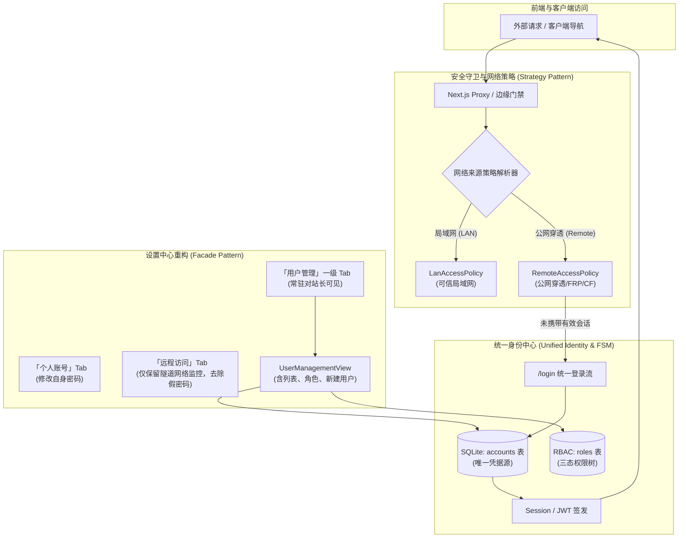

# 统一用户管理与远程访问鉴权收敛架构规范 (Unified User Management & Remote Auth Specification)

> **文档标识**：`ARCH-AUTH-UNIFY-20261101`  
> **创建日期**：2026-11-01  
> **作者**：巡影核心架构组 (Google Deepmind Pair-Programming Assistant)  
> **目标范围**：全量统一用户账号凭据体系、解开单用户模式对用户管理页面的硬屏蔽、彻底消除「远程访问专属密码」的历史认知错位、实现基于策略模式与有限状态机的现代化安全架构。

---

## 1. 头脑风暴与核心问题根因剖析 (Brainstorming & Root Cause Analysis)

### 1.1 问题一：为什么在前端“没有用户管理页面”？

#### 现象与代码考古
在巡影（Mediary Scout）现存代码中，实际上已经实现了一套极其强大的 RBAC 角色与用户管理基础设施：
- [`packages/workflow/src/auth/user-management-service.ts`](file:///e:/WorkProject/Node/_Project/mediary-scout/packages/workflow/src/auth/user-management-service.ts)：具备用户列表查询、上级管下级免疫定理校验、角色赋予与安全版本（`securityVersion`）级联废除机制。
- [`apps/web/features/settings-system/components/user-management-view.tsx`](file:///e:/WorkProject/Node/_Project/mediary-scout/apps/web/features/settings-system/components/user-management-view.tsx)：具备精美的前端用户表格、状态切换、密码重置与角色抽屉。
- [`apps/web/features/settings-system/components/settings/account-management-section.tsx`](file:///e:/WorkProject/Node/_Project/mediary-scout/apps/web/features/settings-system/components/settings/account-management-section.tsx)：账号与用户管理容器组件。

**然而，最终用户在界面上却完全看不到该页面，其根因在于三处“深埋硬拦截”与“静默屏蔽”**：
1. **硬编码环境变量守卫**：
   在 [`AccountManagementSection`](file:///e:/WorkProject/Node/_Project/mediary-scout/apps/web/features/settings-system/components/settings/account-management-section.tsx#L8) 中存在：
   ```typescript
   if (!isMultiUserEnabled()) return null; // 必须配置 MEDIA_TRACK_MULTI_USER=1
   ```
   而在 [`PasswordChangeSection`](file:///e:/WorkProject/Node/_Project/mediary-scout/apps/web/app/settings/page.tsx#L248) 中同样存在：
   ```typescript
   if (!isMultiUserEnabled()) return null;
   ```
2. **设置页 Tab 观察器的 Fail-Closed 机制**：
   在 [`apps/web/features/settings-system/core/settings-tabs-model.ts`](file:///e:/WorkProject/Node/_Project/mediary-scout/apps/web/features/settings-system/core/settings-tabs-model.ts) 中：
   `OBSERVED_SETTINGS_TABS` 包含了 `"account"`。当未开启多用户环境变量时，`account` 插槽内的所有组件全部返回 `null`。客户端 `MutationObserver` 探测到该插槽内容为空，**直接从设置页 Tab 栏中将「账号」Tab 完全抹除**！
3. **缺少顶层显式导航与「新建用户」交互出口**：
   - 即便环境变量被激活，用户管理也被作为「账号」Tab 内部的一个深层锚点（`#accounts`）；
   - 现有的 `UserManagementView` 只有“查看”和“修改现有用户”，**缺乏“新建/添加用户”的操作表单与 API**，无法让站长直接在界面上一键创建成员。

---

### 1.2 问题二：远程访问为什么还有专属密码？能否统一改为用户账号密码？

#### 现象与历史认知错位 (Cognitive Disconnect)
在设置页「远程访问」Tab 中，底端渲染了一个卡片：
- 标题：**“修改远程访问登录密码”**
- 说明：*“这就是打开专属地址时要输的密码（本实例的登录密码）。修改后所有设备需要重新登录。”*
- 表单：调用 [`PasswordChangeForm`](file:///e:/WorkProject/Node/_Project/mediary-scout/apps/web/features/settings-system/components/password-change-form.tsx)。

用户看到此处会产生强烈的疑惑：
> *“难道远程访问有一个独立于用户的专属密码？如果我的系统里有多个用户，远程访问到底用谁的密码？远程访问为什么不能直接用我注册的用户账号登录？”*

#### 底层架构真相审计
通过审计底层代码（[`setSingleUserPassword`](file:///e:/WorkProject/Node/_Project/mediary-scout/apps/web/features/auth/application/account-service.ts#L271)、[`apps/web/proxy.ts`](file:///e:/WorkProject/Node/_Project/mediary-scout/apps/web/proxy.ts)、[`auth-chain.ts`](file:///e:/WorkProject/Node/_Project/mediary-scout/apps/web/platform/next-context/auth-chain.ts)）发现：
1. **所谓“远程访问专属密码”在底层根本不存在独立存储！**
   `setSingleUserPassword` 本质上就是执行：
   ```typescript
   await repo.setAccountPassword(DEFAULT_ACCOUNT_ID, await hashPassword(newPassword));
   ```
   它修改的就是站长默认用户账号（`acct_default`）的登录密码！
2. **远程访问实际上早已由 Session 驱动**：
   当请求通过 Cloudflare Tunnel 或 ProxyByCF FRP 穿透到达时，`proxy.ts` 识别出 `isRemoteRequest(request)`，强制拦截未登录请求并跳转到 `/login`。用户在登录页输入密码验证成功后，服务端下发统一的 `mt_session` Cookie。随后的所有操作完全以该用户的账号 ID（`accountId`）及 RBAC 角色权限运行！
3. **命名与位置的严重漂移**：
   项目早期为纯局域网免密工具，后来为了外网安全临时加了一道密码防护，随口称之为“远程访问密码”。多用户开发完成后，未将该卡片从“远程访问”设置中剔除，造成了严重的架构认知混乱。

---

## 2. 业界主流方案对比与经验借鉴 (Industry Benchmarks)

| 平台 / 系统 | 架构形态 | 远程访问网络凭据与用户鉴权关系 | 用户管理入口设计 |
| :--- | :--- | :--- | :--- |
| **Jellyfin** | 自托管影音服务器 | **彻底解耦**。无论通过局域网还是外网反代（Reverse Proxy），均使用 Jellyfin 用户账号密码登录，不设任何“远程专用密码”。外网仅作为网络路由。 | 仪表盘拥有顶层独立的 **「用户 (Users)」** 管理页面，单用户下展示站长，可随时直接点击「添加用户」。 |
| **Overseerr** | 媒体追更与工单流 | **彻底解耦**。远程穿透地址直接呈现用户登录屏，基于邮箱/用户名与密码换取 Session，完全不存在独立的穿透密码。 | 设置中常驻 **「用户管理 (Users)」**，支持按用户设置独立配额与请求特权。 |
| **Plex** | 媒体流媒体 | **账户中心集成**。远程访问仅配置端口映射（UPnP / NAT），所有访问者严格使用 Plex 统一账号登录。 | 专设「用户与共享 (Users & Sharing)」面板。 |
| **Cloudflare Zero Trust** | 现代安全访问网关 | 隧道（Cloudflare Tunnel）仅负责 L4/L7 流量管道，业务鉴权由 Identity Provider 统一签发，业务层无缝对接用户体系。 | 独立的 Access 控制策略。 |

### 核心设计共识
1. **网络穿透是传输层（Transport Layer），用户身份是应用层（Application Layer）**。传输层绝对不应绑定应用层密码。
2. **渐进式单多用户模型（Progressive Multi-Tenancy）**：单用户只是多用户体系在 `user_count === 1` 时的特例，而非两套相互割裂的物理隔离代码。
3. **用户管理必须常驻对管理员可见**，管理员在单人使用时亦能随时添加家庭成员，无需重启服务或修改环境变量。

---

## 3. 架构重构与设计模式应用 (Design Patterns & Architecture)



### 3.1 策略模式 (Strategy Pattern) · 网络来源安全策略
将鉴权逻辑与网络环境彻底解耦为两组正交策略：
```typescript
interface NetworkSecurityPolicy {
  shouldEnforceAuthentication(request: RequestContext): boolean;
  getLoginRedirect(targetUrl: string): string;
}

class LanAccessPolicy implements NetworkSecurityPolicy {
  shouldEnforceAuthentication(ctx: RequestContext): boolean {
    // 局域网模式下若未设密，提供零摩擦体验；若已设密且用户主动登出，遵循用户安全意志
    return ctx.hasStrictLanAuth && !ctx.hasValidSession;
  }
  getLoginRedirect(targetUrl: string) { return `/login?redirect=${encodeURIComponent(targetUrl)}`; }
}

class RemoteAccessPolicy implements NetworkSecurityPolicy {
  shouldEnforceAuthentication(ctx: RequestContext): boolean {
    // 远程穿透（CF Tunnel / FRP）无条件强制鉴权，零外部匿名放行
    return !ctx.hasValidSession && !ctx.isApiWhiteList;
  }
  getLoginRedirect(targetUrl: string) { return `/login?redirect=${encodeURIComponent(targetUrl)}`; }
}
```

### 3.2 有限状态机模式 (State Machine Pattern) · 实例生命周期
实例的安全状态平滑演进，消除对环境变量物理重启的依赖：
```
 [UNCLAIMED] (未认领/未设密)
      │
      ▼ (设置初始站长密码)
 [SINGLE_USER_SECURED] (单用户安全态)
      │ ── 站长在用户管理页面点击「添加新用户」
      ▼
 [MULTI_USER_ACTIVE] (多用户协作态)
```
- **核心约束**：无论处于哪个状态，`accounts` 表中的 `acct_default` 都是实体账号，密码哈希统一采用 `scrypt`，会话统一使用 `signSession`，API Key 统一绑定 `security_version`。

### 3.3 适配器模式 (Adapter Pattern) · 统一登录凭据适配
- **单用户场景**：前端登录页识别实例仅有单账号且已设密时，自适应呈现极简的「访问密码」输入框，底层无缝适配填入 `username: "default"`；
- **多用户场景**：前端登录页自适应呈现「用户名 + 密码」标准输入框；
- 后端鉴权统一收口于 [`loginAccount(username, password)`](file:///e:/WorkProject/Node/_Project/mediary-scout/apps/web/features/auth/application/account-service.ts#L225)，对调用方屏蔽差异。

### 3.4 门面模式 (Facade Pattern) · 用户管理综合调度
封装 [`UserManagementFacade`](file:///e:/WorkProject/Node/_Project/mediary-scout/packages/workflow/src/auth/user-management-service.ts)：
- `listManagedUsers()`: 返回脱敏的用户信息、关联角色名称与安全版本；
- `createManagedUser(actorId, payload)`: 校验操作者角色等级、用户名唯一性、初始角色赋予合法性，并完成原子化建号；
- `setUserRole(actorId, targetId, roleId)`: 校验越级免疫定理，自增目标用户 `security_version`，促使旧特权 Key 级联失效；
- `setUserActive(actorId, targetId, isActive)`: 冻结会话并封禁账号；
- `resetUserPassword(actorId, targetId, newPassword)`: 重置密码并清空现有 Session。

---

## 4. 详细改造实施规范 (Implementation Plan)

### 4.1 核心改动清单

#### 1. 后端与服务层 (Workflow & API)
- [`packages/workflow/src/auth/user-management-service.ts`](file:///e:/WorkProject/Node/_Project/mediary-scout/packages/workflow/src/auth/user-management-service.ts):
  - 新增 `createManagedUser(actorAccountId, input)` 方法，支持新建用户并校验操作权限。
- [`apps/web/app/api/settings/users/route.ts`](file:///e:/WorkProject/Node/_Project/mediary-scout/apps/web/app/api/settings/users/route.ts):
  - 增加 `POST` 处理函数，接收 `{ username, password, roleId }`，调用 `userSvc.createManagedUser` 并返回 `201 Created`。
- [`packages/workflow/tests/auth/role-and-user-management.test.ts`](file:///e:/WorkProject/Node/_Project/mediary-scout/packages/workflow/tests/auth/role-and-user-management.test.ts):
  - 补充 `createManagedUser` 单元测试（包括普通成员越权创建防御、重复用户名校验、赋予过高权限防御）。

#### 2. 前端设置与导航模型 (Settings Tabs)
- [`apps/web/features/settings-system/core/settings-tabs-model.ts`](file:///e:/WorkProject/Node/_Project/mediary-scout/apps/web/features/settings-system/core/settings-tabs-model.ts):
  - 解开单用户屏蔽：确保站长无论在单用户还是多用户下均能看到 `account` 选项卡，并将标签命名为更加直观的 **「用户与账号」**（或保留 `"账号"` 并保持兼容）。
- [`apps/web/features/settings-system/components/settings/account-management-section.tsx`](file:///e:/WorkProject/Node/_Project/mediary-scout/apps/web/features/settings-system/components/settings/account-management-section.tsx):
  - 移除 `if (!isMultiUserEnabled()) return null;`，改为仅校验 `if (!me?.isOwner) return null;`。站长在任何模式下均可查阅并管理系统用户。
- [`apps/web/app/settings/page.tsx`](file:///e:/WorkProject/Node/_Project/mediary-scout/apps/web/app/settings/page.tsx):
  - 移除 `PasswordChangeSection` 中的 `if (!isMultiUserEnabled()) return null;`，保证用户均能在个人设置中修改密码。

#### 3. 远程访问设置页清理 (Remote Access Section Cleanup)
- [`apps/web/features/settings-system/components/settings/remote-access-section.tsx`](file:///e:/WorkProject/Node/_Project/mediary-scout/apps/web/features/settings-system/components/settings/remote-access-section.tsx):
  - **彻底移除**底部的「修改远程访问登录密码」及重复的 `PasswordChangeForm`；
  - **新增**统一安全指引卡片：明确告知用户「远程穿透已 100% 接入系统用户身份认证体系，公网访问时请使用各自账号登录」，并附带跳转到用户与账号设置的直达按钮。

#### 4. 用户管理交互增强 (UserManagementView UI)
- [`apps/web/features/settings-system/components/user-management-view.tsx`](file:///e:/WorkProject/Node/_Project/mediary-scout/apps/web/features/settings-system/components/user-management-view.tsx):
  - 在头部添加「➕ 添加新用户」操作按钮；
  - 新建用户内联表单/抽屉：输入用户名、初始密码、选择角色（动态关联当前角色列表）；
  - 单用户状态友好引导横幅：当只有 1 个账号时，显示「当前为单用户状态，添加新用户即可邀请家人或朋友共用资源并实现个性化追更与权限隔离」。

---

## 5. 质量门禁与安全验证 (Quality Gates & Verification)

1. **API Parity 门禁**：
   - 验证新增的 `POST /api/settings/users` 被 `UserManagementView` 真实调用，确保 0 孤儿接口。
2. **样式与设计令牌门禁 (`gate:style`)**：
   - 新增表单元素严格使用 `--bg-card`, `--border-color`, `--text`, `--accent` 等全局定义令牌，严禁出现非标内联变量。
3. **架构行数与棘轮门禁 (`gate:limits`, `gate:layout`)**：
   - 控制 `user-management-service.ts` 与 `user-management-view.tsx` 行数增量在阈值内。
4. **内置浏览器真机测试 (`chrome-devtools-mcp`)**：
   - 打开设置页，验证「用户与账号」选项卡正常显示；
   - 查看用户列表，并成功提交「添加新用户」表单；
   - 验证「远程访问」页面已消除专属密码混淆卡片。
