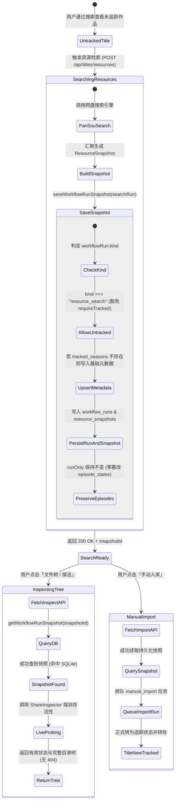

# 未追踪影视作品资源检索快照持久化、目录树探活与手动入库治理架构规范

## 1. 事故背景与现场复现

### 1.1 现场现象
用户在巡影前端通过搜索进入未追踪（未订阅、未入库）的作品详情页：
`http://127.0.0.1:3001/show/1319?from=search&t=tv&q=%E8%91%AB%E8%8A%A6%E5%A8%83`（作品：**《葫芦兄弟 (1986)》**，TMDB ID: `1319`，搜索入参 `q=葫芦娃`）。
在「资源检索」面板中搜索并展示了候选结果（例如 `115 · 2026-08-04`），然而：
1. 候选卡片上的探活状态徽章赫然显示 **「未知」**；
2. 用户点击「文件树」按钮后，展开的文件树区域未能渲染网盘目录层级，直接红字报错：**`snapshot not found`**（按钮变为「收起树」）；
3. 用户点击「链接」按钮同样报错；
4. 用户点击「手动入库」按钮，入库请求被拒，前端弹窗/提示：**`snapshot not found`**。

用户提出了两个核心疑问：
> 1. 为什么 资源查询失败？
> 2. 为什么 查询文件树 和入库提示：`snapshot not found`？

---

## 2. 根因深度剖析（Root Cause Analysis）

经过对持久化层（`SqliteWorkflowRepository` / `InMemoryWorkflowRepository`）、资源检索接口（`POST /api/titles/resources`）、目录树探活接口（`POST /api/titles/resources/inspect`）、链接提取接口（`POST /api/titles/resources/link`）与手动入库接口（`POST /api/titles/import`）的调用链路审计，彻底查明了事故的本质原因：

```
                      ┌─────────────────────────────────────────────────────────────┐
                      │ 1. 用户访问未追踪作品页 (/show/1319?q=葫芦娃)                │
                      │   - TMDB 1319 (葫芦兄弟) 此时未加入订阅 (tracked_seasons 无记录)│
                      └──────────────────────────────┬──────────────────────────────┘
                                                     │
                                                     ▼
                      ┌─────────────────────────────────────────────────────────────┐
                      │ 2. 资源检索触发 (POST /api/titles/resources)                │
                      │   - PanSou 成功搜出候选，生成快照 (snapshot.id)             │
                      │   - 调用 saveWorkflowRunSnapshot 持久化快照供后续交互        │
                      │   - 为防止覆盖集状态，传入 keepCurrentEpisodes: true        │
                      └──────────────────────────────┬──────────────────────────────┘
                                                     │
                                                     ▼ 【缺陷爆发点 1】
                      ┌─────────────────────────────────────────────────────────────┐
                      │ 3. SqliteWorkflowRepository.saveWorkflowRunSnapshot         │
                      │   - reservationRequiresTrackedSeason 判定:                  │
                      │     keepCurrentEpisodes === true ⇒ requireTracked = true    │
                      │   - 检查 SQLite: SELECT 1 FROM tracked_seasons ...          │
                      │   - 判定未追踪: if (tracked === undefined) return;          │
                      │   - 【结果】：快照写库被静默吞没，根本没有落盘！           │
                      └──────────────────────────────┬──────────────────────────────┘
                                                     │
                                                     ▼ 【缺陷爆发点 2】
                      ┌─────────────────────────────────────────────────────────────┐
                      │ 4. 前端收到内存中的 snapshotId，用户点击「文件树」/「手动入库」│
                      │   - 前端发起 POST /api/titles/resources/inspect 或 import   │
                      │   - 后端执行 getWorkflowRunSnapshot(resourceSearchRunId(id))│
                      │   - 数据库中查无此记录，返回 HTTP 404: { error: "snapshot not found" }│
                      │   - 前端 ValidityBadge 跌入 default 分支显示「未知」        │
                      │   - 树组件与手动入库全面崩溃报错: "snapshot not found"      │
                      └─────────────────────────────────────────────────────────────┘
```

### 2.1 缺陷一：集状态保护逻辑过度蔓延，反噬未追踪作品搜索
在历史事故治理中（见 `docs/postmortems/subscription-missing-after-ingest-and-search-snapshot-wipe.md`），为了防止 `resource_search` 的 `episodes: []` 覆盖已入库作品的剧集状态，引入了 `isEpisodePreservingWorkflowKind("resource_search") === true` 以及 `keepCurrentEpisodes: true`。
然而在 `saveWorkflowRunSnapshot` 中，错误地将 `keepCurrentEpisodes` 直接映射为了 `requireTrackedSeason`：
```typescript
// 错误旧代码：
const isAuxiliary = isEpisodePreservingWorkflowKind(snapshot.workflowRun.kind);
const shouldKeepEpisodes = keepCurrentEpisodes === true || isAuxiliary;
const requireTracked = reservationRequiresTrackedSeason({
  ...(requireTrackedSeason === true ? { requireTrackedSeason: true } : {}),
  ...(shouldKeepEpisodes ? { keepCurrentEpisodes: true } : {}),
});
```
`reservationRequiresTrackedSeason` 的初衷是针对后台采集调度器（如定时巡检），当用户已经取消追踪某部剧时，避免正在排队的任务死灰复燃。
但 `resource_search` 并不是后台采集工作流！它是前端用户主动检索并用于交互预览的**只读记录型快照（Ephemeral Record）**。将 `shouldKeepEpisodes` 强绑定到 `requireTrackedSeason`，导致**所有未追踪作品的搜索快照在保存时被 100% 拦截并静默丢弃**！

### 2.2 缺陷二：工作流快照与追踪状态的生命周期耦合
在底层仓储模型中：
- `loadSnapshot` 依赖 `tracked_seasons` 和 `media_titles` 反序列化元数据；
- 而 `scopedRunRows`（用于 `listTrackedSeasonStates` 订阅墙）之前未过滤 `kind === "resource_search"`；
- 之前的开发者担心如果把未追踪作品的快照写入 `tracked_seasons`，会导致用户仅搜索了一下这部片，它就赫然出现在用户的“我的订阅”墙上！
- 这种“为了防止污染订阅墙而选择不落盘快照”的做法是因噎废食，导致了核心交互（嗅探树、取直链、手动入库）的全面瘫痪。

---

## 3. 业界主流方案调研与现有库借鉴

### 3.1 业界主流方案对比（Sonarr / Radarr / Overseerr）
1. **Overseerr / Jellyseerr**：
   - 用户发起探索或手动搜索时，候选结果挂载在独立的 `SearchResultCache` 或 Session Context 中，即使影视作品未被添加到库中（Unmonitored），其文件层级嗅探与手动指定下载（Manual Release Picker）也是一等公民能力。
   - 探活与解析完全基于候选对象本身，在添加前绝不向监控核心表（`seasons`）注入虚假订阅数据。
2. **Sonarr / Radarr**：
   - 交互式搜索（Interactive Search）的结果生命周期为内存/临时数据库（20-30 分钟 TTL）。
   - 用户在“添加作品并立即入库”之前，搜索结果被隔离在搜索领域内；一旦用户点击“Grab（抓取/入库）”，才正式触发原子事务：创建监控实体并排队下载任务。

### 3.2 当前系统基础设施复用可行性确认
- 当前系统已有 `resource_snapshots` 表，具有明确的 `id`、`workflow_run_id` 和 `payload`。
- 当前系统在 `packages/workflow/src/domain/domain.ts` 中已有 `isUserVisibleWorkflowKind`，并已明确定性：
  > `resource_search` is a record, not work... never user-visible (excludes from activity, library, show page).
- 因此，当前系统完全具备将 `resource_search` 与订阅墙物理隔离的基础设施，无需引入新的复杂外挂表，只需在领域模型与仓储层理清生命周期边界。

---

## 4. 架构治理方案

### 4.1 核心原则与契约定义
1. **搜索快照必定落盘契约**：
   无论作品当前是“已追踪”还是“未追踪”，只要 `saveWorkflowRunSnapshot` 接收到 `resource_search`，其快照必须 100% 成功写入 `workflow_runs` 和 `resource_snapshots`，严禁被 `requireTrackedSeason` 静默吞没。
2. **订阅墙与追踪列表防污染契约**：
   `scopedRunRows`（驱动 `listTrackedSeasonStates` / `getTrackedSeasonState`）必须强力过滤 `row.kind !== "resource_search"`。任何搜索行为绝不能使得作品被标记为“追更中”或出现在订阅墙上。
3. **已入库集状态零抹除契约**：
   对于已入库的作品，`resource_search` 依然坚守 `options.runOnly = true`，绝对不触碰 `episode_states` 表，彻底杜绝龙珠超事故回潮。
4. **探活与入库即时承接契约**：
   未追踪作品的快照安全落盘后，`/inspect` 能立刻查到快照并进行网盘目录树探活，`/link` 能立刻提取直链，`/import` 能顺利提取候选并排队 `manual_import`（在入库工作流执行时再将作品正式转为追踪状态）。

### 4.2 状态机流转与执行架构图



---

## 5. 质量门禁与回归防御设计

为杜绝未来任何代码重构或补丁再次破坏未追踪作品的搜索与探活链路，构建专项自动化质量门禁：

1. **门禁脚本**：`tools/gates/check-untracked-title-inspection.mjs`
   - 静态 AST 检查：
     - 校验 `packages/workflow/src/persistence/sqlite.ts` 中 `scopedRunRows` 必须显式排除 `resource_search`。
     - 校验 `packages/workflow/src/persistence/sqlite.ts` 与 `repository.ts` 中 `requireTrackedSeason` 必须排除 `resource_search`。
     - 校验 `replaceWorkflowRunSnapshot` 针对未存在的季能够安全写入基础元数据供快照水合。
   - 动态行为测试：
     - 在完全干净的内存 SQLite 实例中，直接保存未追踪作品的 `resource_search` 快照。
     - 断言 `getWorkflowRunSnapshot` 能够毫秒级查出完整快照，且各候选资源完整。
     - 断言 `listTrackedSeasonStates` 返回长度为 0（绝对未被误加入订阅墙）。
2. **CI 集成**：挂载在 `npm run gate:inspection` 与主门禁流水线中。
