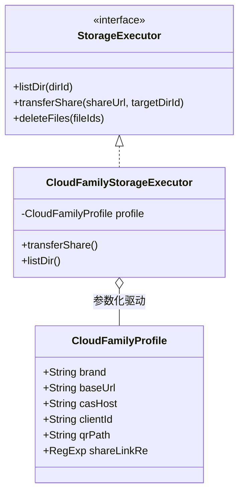
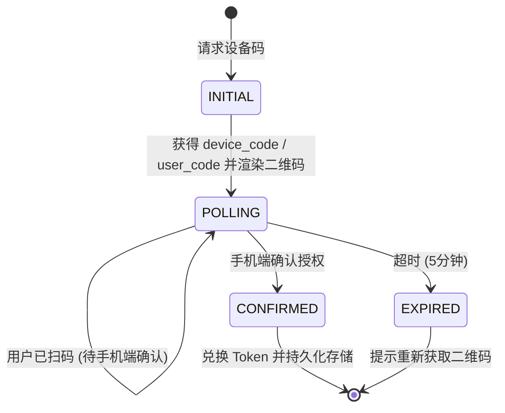

# 上游功能审计与跨仓库复用流程机制规范

## 一、背景与目标

本项目作为独立演进的媒体管理系统，与原上游仓库（`fancydirty/mediary-scout`）已完成彻底解耦。然而，上游社区在**网盘适配**（如 UC 网盘、光鸭云盘 App 扫码）与**资源查询适配**（如海搜 Haisou 官方 API）等前沿领域仍有持续的逆向工程与驱动开发成果。

为了：
1. **高效吸收上游优质资产**（特别是网盘驱动与搜索适配逻辑），避免重复造轮子；
2. **杜绝上游架构冲突污染**（避免将上游强依赖 PostgreSQL、破坏纯 SQLite 单文件架构的代码盲目合并）；
3. **固化自动化审计流程**，确保后续主仓库有更新时，能够**一键扫描、快速评审、人工确定、安全落地**。

特制定本审计规范与复用机制。

---

## 二、业界主流方案调研与对比

### 1. 下游分叉仓库（Downstream Fork）同步方案对比

| 方案模式 | 典型代表 | 机制原理 | 适用场景 | 本项目采用情况 |
| :--- | :--- | :--- | :--- | :--- |
| **全量分支 Rebase/Merge** | 早期简单 Fork | 频繁执行 `git pull/merge upstream` | 仅改了配置或微调 UI 的项目 | ❌ **坚决否定**：直接合并会引入 PostgreSQL、覆盖纯 SQLite 治理、破坏设计令牌与独立会话体系。 |
| **补丁挑选与端口化移植 (Selective Cherry-Pick & Porting)** | Linux Kernel 发行版、Android AOSP 下游 | 识别上游原子提交，基于基准点提取 patch，在下游接口层适配落地 | 核心底层已分歧、但外围驱动通用的系统 | ✅ **采用（核心方法）**：针对网盘驱动与搜索源实施定向收敛移植。 |
| **驱动插件化与适配器分层 (Driver Plugin Architecture)** | Alist、rclone | 核心引擎与外围存储驱动完全解耦，驱动仅实现统一适配器接口 | 支持数十种网盘扩展的云盘系统 | ✅ **采用（架构目标）**：通过 `StorageExecutor` 与 `SearchProvider` 注册表挂接。 |
| **隔离式审计与报告流水线 (Isolated Audit Pipeline)** | Chromium 发行版衍生（Brave 等） | 维护隔离的 upstream 追踪 ref，CLI 自动化分析差异、生成变更分类报告 | 大型工程持续跟踪上游 | ✅ **采用（固化工具）**：通过 `scripts/audit-upstream.mjs` 实现安全拉取与审计。 |

---

## 三、架构设计与设计模式优化

### 1. 适配器与参数化模板模式（网盘驱动层）



- **参数化内核（CloudDriveProfile）**：
  夸克（Quark）与 UC 网盘均属于阿里巴巴云盘技术族，其 CAS 扫码认证流程与分享转存链路高度相似。上游通过抽象 `CloudDriveProfile`（包含 baseUrl、casHost、clientId、qrPath、shareLink 正则等）避免了复制粘贴代码。
- **差异容错策略**：
  UC 网盘存在约 900ms 的最终一致性延迟，且文件同名冲突码为 `23008`。适配器内部需内置重试探测与冲突码映射，对外呈现完全标准的 `StorageExecutor` 契约。

### 2. 有限状态机（FSM）模式（扫码登录生命周期）

光鸭网盘（Guangyapan）采用了设备码流程（Device Code Flow），其状态流转清晰符合有限状态机：



- **生命周期安全（Unmount 防御）**：
  针对既有 115、天翼、123、光鸭等扫码组件，必须引入 `generation` 状态标识与 unmount 清理回调。当组件卸载（用户切换网盘 Tab 或关闭弹窗）时，立即终止 2 秒一次的后台轮询，避免内存泄漏。

### 3. 策略模式（资源搜索扩展层）

```mermaid
flowchart TD
    A[用户或后台发起资源搜索] --> B{搜索调度中心 SearchCoordinator}
    B --> C[PanSou 搜索源 (默认)]
    B --> D[海搜 Haisou 官方 API (可选补充)]
    B --> E[Prowlarr 磁力源 (可选)]
    C --> F[标准 Candidate 候选资源结果集]
    D --> F
    E --> F
    F --> G[去重、画质与健康度优选评分]
```

- **动态源路由**：用户在设置页配置海搜 API Token 后，搜索策略链自动激活 HaisouProvider；若未配置，平滑降级仅使用 PanSou，对上层透明。

---

## 四、上游当前 19 个新增提交审计结论

通过 `npm run upstream:audit` 分析 `d82242c7`（分叉点）至 `upstream/main` 的提交：

| 模块 | 涉及 PR / 提交 | 变更范围 | 风险评估 | 复用建议 |
| :--- | :--- | :--- | :---: | :--- |
| **UC 网盘接入** | PR #331, #332 (`85f2c5eb`, `be16c8d1`) | UC 扫码、分享链接转存、CAS 路由与前端组件 | 🟢 低 | **强烈建议复用**。极大扩展支持网盘，结构高度解耦。 |
| **光鸭云盘 App 扫码** | PR #340 (`98689f78`) | 设备码申请、状态轮询、Token 交换与二维码卡片 | 🟢 低 | **强烈建议复用**。免除用户手动抓包，体验飞跃。 |
| **海搜官方 API 接入** | PR #337, #344 (`77203e3f`, `fa896a7f`) | HaisouProvider 搜索客户端、设置页表单与状态探活 | 🟢 低 | **强烈建议复用**。与 PanSou 形成优质互补。 |
| **扫码组件卸载清理** | PR #335 (`4a09bec6`) | 115/天翼/123 扫码组件 generation 卸载清理与错误包装 | 🟢 低 | **强烈建议复用**。解决既有前端内存泄漏隐患。 |
| **多网盘协作 V2** | PR #346 (`548be0fc` 等 4 个提交) | MultiDriveStorageV2、postgres.ts、episode_copies 表 | 🔴 高 | **暂缓整体合入**。强耦合 PostgreSQL，破坏纯 SQLite 治理成果。 |

---

## 五、固化复用闭环流程（Standard Operating Procedure）

后续主仓库每次有更新，均严格执行以下四步标准化流程：

```
[标准化四步复用流程]

┌────────────────────────────────────────────────────────┐
│ 1. 查看新增适配和功能                                    │
│    执行命令：npm run upstream:fetch-audit               │
│    安全抓取上游更新，无污染生成提交审计分析               │
└──────────────────────────┬─────────────────────────────┘
                           ▼
┌────────────────────────────────────────────────────────┐
│ 2. 编写 docs 新增功能文档                              │
│    自动输出：docs/upstream-sync-reports/YYYY-MM-DD.md    │
│    记录上游提交特征、受影响组件与风险等级                 │
└──────────────────────────┬─────────────────────────────┘
                           ▼
┌────────────────────────────────────────────────────────┐
│ 3. 确定复用哪些功能（人工确定）                          │
│    对比本仓库架构（纯 SQLite、设计令牌、会话隔离），       │
│    由人工决策勾选需要移植的特性，剔除架构冲突项           │
└──────────────────────────┬─────────────────────────────┘
                           ▼
┌────────────────────────────────────────────────────────┐
│ 4. 给出复用功能文档并执行落地                            │
│    编写复用方案文档 docs/upstream-feature-reuse-plan.md │
│    移植代码、补齐单元测试、通过样式令牌与全部门禁       │
└────────────────────────────────────────────────────────┘
```
