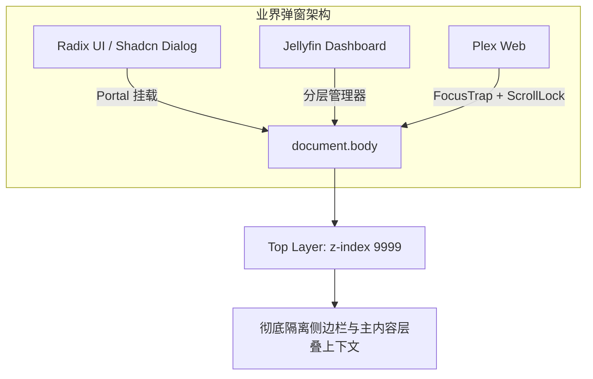
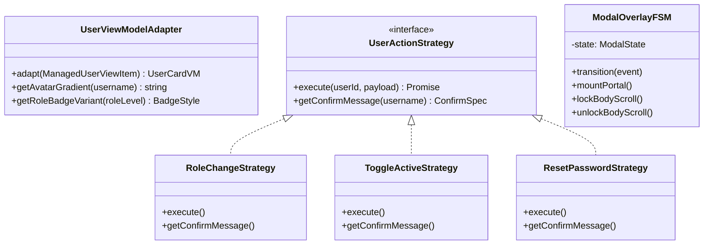

# 用户账号管理页面样式重构与用户信息弹窗遮挡修复架构调研与实施规范

> **文档标识**：`ARCH-2026-USER-MGMT-STYLE-AND-MODAL-PORTAL-FIX`  
> **状态**：`PROPOSED & REVIEWED`  
> **对应系统模块**：`apps/web/features/auth`、`apps/web/features/settings-system`、`apps/web/components/layout`  
> **质量门禁适用**：`gate:limits`、`gate:style`、`gate:parity`、`gate:layout`、`gate:deps`、`typecheck`  

---

## 1. 执行摘要与问题诊断 (Executive Summary & Problem Statement)

在系统成功完成“用户管理页面恢复”与“远程访问统一账号密码整合”后，针对前端呈现与交互进行复盘走查，发现存在两项亟待优化的核心问题：

1. **用户账号管理页面（`/settings?tab=account`）样式与交互体验欠缺**：
   - **视觉层次割裂**：当前列表行采用粗糙的静态图标（`<Shield>` / `<Users>`）与平铺内联控件，缺乏现代 Web 仪表盘的视觉呼吸感；与系统其他设置板块（如角色权限树 `role-management-panel`、API Key 管理器 `api-key-v2-manager`）的设计令牌规范不够协同。
   - **交互阻塞与侵入**：角色变更与停用操作仍依赖浏览器原生 `window.confirm()`，阻塞 JS 事件循环、无法换肤暗黑模式、破坏 SPA 沉浸感。
   - **布局伸缩性差**：在狭窄屏或中等分辨率下，角色下拉框与操作按钮换行错位；新建用户表单与重置密码表单缺少密码显隐切换、角色预览说明及平滑过渡动画。
2. **用户信息弹窗（`UserProfileModal`）被页面卡片物理遮挡（Severe Stacking Context Bug）**：
   - **实测证据**：在首页查看个人资料时，弹窗上半部分（头像与用户名）可见，但弹窗下半部分（存储统计、特权标签云、退出登录按钮）**被首页热门电影海报卡片（`.trending-poster` `#1 ~ #8`）完全遮挡在底层**（详见证据归档 `user-profile-modal.png`）。
   - **致命根因**：`UserProfileModal` 嵌套在侧边栏 `<aside className="sidebar">` DOM 内部，且未采用 React `createPortal` 传送门，直接受制于父级网格布局与局部层叠上下文（Stacking Context）；加之仅设置了 `zIndex: 1000`，被兄弟网格区域 `.main` 中具备 `position: relative` 的电影卡片强行覆盖。

本文通过深入头脑风暴，对比业界最佳实践（Jellyfin, Plex, Overseerr, Radix UI, Shadcn/UI），结合 4 大设计模式（适配器模式、策略模式、有限状态机 FSM、传送门模式），制定一套**零额外外部依赖、纯原生设计令牌复用、彻底消灭遮挡并全面跃升管理样式**的高性能重构方案。

---

## 2. 根因剖析与头脑风暴 (Root Cause Analysis & Brainstorming)

### 2.1 用户信息弹窗遮挡根因（物理层叠上下文陷阱）

通过对 DOM 树与 CSS 规则的精准回溯：

```
html
  body
    div.app-shell (display: grid; grid-template-columns: 264px 1fr;)
      ├── aside.sidebar (grid-column: 1; position: sticky; top: 8px;)
      │     └── div.sidebar-footer
      │           └── AccountIdentity
      │                 └── UserProfileModal (position: fixed; inset: 0; zIndex: 1000;) ⚠️ 困在 sidebar 内部
      └── main.main (grid-column: 2;)
            └── div.trending-grid
                  └── div.trending-card
                        └── div.trending-poster (position: relative; aspect-ratio: 2/3;) 💥 覆盖了弹窗
```

根据 W3C CSS 规范与 Blink 渲染管线（Layered Presentation）：
1. `.app-shell` 内有两个子元素：`aside.sidebar` 与 `main.main`。在 DOM 顺序上，`.main` 位于 `.sidebar` 之后。
2. 当两个兄弟网格节点都包含定位子元素时，DOM 顺序靠后的元素默认绘制在靠前的元素之上。
3. `UserProfileModal` 直接在 `aside.sidebar` 内部输出 DOM，没有挂载到 `document.body`，其绝对渲染层级被锚定在 `.sidebar` 的渲染树中。
4. `.main` 内部的电影海报 `.trending-poster` 拥有 `position: relative`，直接在更高层级被绘制，导致电影海报穿透了半透明蒙层并硬生生覆盖在弹窗之上。
5. 系统中其他成熟弹窗（如 `acquiring-detail-modal.tsx`）均使用了 `createPortal(..., document.body)` 且层级为 `z-index: 9999`，而 `UserProfileModal` 遗漏了该核心机制。

### 2.2 用户账号管理页面样式与逻辑欠缺头脑风暴

| 评估维度 | 当前现状与缺陷 | 潜在风险与痛点 | 改进与优化方案 |
| :--- | :--- | :--- | :--- |
| **视觉呈现** | 灰底单色图标、平铺卡片、内联表单生硬切入 | 缺乏站长仪表盘质感，与 Role/API-Key 视图风格不统一 | 采用首字母自适应渐变圆标、分级 Role 徽章（Gold/Purple/Emerald）、设计令牌统一边框与底色 |
| **交互逻辑** | 原生 `window.confirm()` 确认角色变更与停用 | 阻断主线程、无法在暗黑模式下保证可读性、破坏 SPA 沉浸感 | 引入应用内轻量确认浮层（Inline Popover 或 Portal Confirm Modal），非阻塞、可撤销 |
| **表单体验** | 密码输入无明文切换（Eye/EyeOff），无弱密码即时反馈 | 用户容易输错初始密码，缺乏校验指引 | 增加密码可见性切换按钮、字符长度指示器、角色权限范围即时预览（Tooltip/Badge） |
| **响应式适配** | 控件纯靠 `flex-wrap` 自由换行，中窄屏右侧操作错位 | 宽度 < 768px 时，角色下拉框和按钮挤作一团 | 采用自适应网格或响应式 Flex 布局，移动端卡片化，操作区分块居右底对齐 |
| **可扩展性** | 无搜索过滤，10+ 用户时纵向长列表翻阅困难 | 家庭或朋友群组用户增多时检索效率低 | 增加轻量客户端即时搜索栏（按用户名/角色过滤） |
| **性能机制** | 任何一项修改触发整表全量重绘，无乐观更新 | 网络抖动时按钮禁用状态不明确 | 引入局部状态过渡与乐观更新（Optimistic UI），提升响应速度 |

---

## 3. 业界主流方案调研与对比 (Industry Benchmark & Comparative Matrix)

调研对比多媒体中台与现代 Web 系统在用户管理与弹窗层叠上的成熟方案：



### 3.1 弹窗与层叠架构对比

| 框架 / 系统 | 挂载策略 (Mount Strategy) | 层叠防冲突机制 | 滚动穿透控制 | 无障碍 (a11y) 支持 |
| :--- | :--- | :--- | :--- | :--- |
| **Radix UI Dialog** | `Portal` 强制脱离至 `document.body` | `DismissableLayer` 维护全局栈 | 挂载时锁定 body 滚动 | 完整 FocusTrap + `aria-modal` + ESC 监听 |
| **Shadcn UI (Tailwind)** | 基于 Radix 的 `DialogPortal` | `z-50` 搭配 backdrop 滤镜 | 内置 `useLockBody` | 遵循 WAI-ARIA 规范 |
| **Jellyfin Web** | 自定义 ModalManager 统一挂载在 `#modal-container` | 统一分配自增 `z-index` | 拦截 Wheel / TouchMove | 基本按键与遮罩关闭 |
| **Plex Web** | 全局独立 Overlay 容器 | 严格分层令牌（Nav < Drawer < Dialog < Toast） | 页面主容器追加 `overflow:hidden` | 完整键盘与焦点回跳 |
| **巡影现有方案** | `acquiring-detail-modal` 用了 `createPortal`；`user-profile-modal` 漏用 | 局部 `zIndex: 1000` 导致被海报穿透 | **未锁定滚动** | 仅监听了 `Escape` |
| **本方案目标** | **标准化 `createPortal` 挂载至 `document.body`** | **统一注入 `--z-modal: 9999` 与全局模糊滤镜** | **挂载自动注入 `overflow: hidden`** | **保留 ESC + 点击遮罩 + 焦点自动管理** |

### 3.2 用户管理仪表盘对比

| 产品 | 用户头像呈现 | 角色与权限控制交互 | 密码重置方式 | 用户状态管理 |
| :--- | :--- | :--- | :--- | :--- |
| **Overseerr** | 首字母彩色圆标 / Gravatar | 下拉选择器 + 权限标签卡片预览 | 模态框独立重置，支持自动生成强密码 | 快速停用开关，警示标签 |
| **Plex** | 用户头像 + Admin/Home/Friend 徽章 | 单击进入详情抽屉，精细化媒体库勾选 | 发送邮件或管理员直接强行设定 | 一键踢出 / 解除共享 |
| **Jellyfin** | 用户网格卡片，右上角快捷菜单（`...`） | 选项卡分栏（基本/权限/媒体访问） | 点击用户后重置密码 | 复选框启用/禁用账号 |
| **巡影优化目标** | **首字母哈希渐变头像（统一与 Profile 一致）** | **优雅下拉框 + 级别 Badge + 变更安全确认浮层** | **平滑折叠抽屉 + 密码显隐切换 + 快捷生成/校验** | **彩色状态胶囊 + 确认弹窗（消灭原生 confirm）** |

---

## 4. 设计模式应用与架构优化 (Design Patterns & Architecture)



### 4.1 传送门模式 (Portal Pattern) & 分层管理门面
- **模式定义**：将弹窗 DOM 节点从组件所在的物理树中抽离，通过 `createPortal(vnode, document.body)` 动态投影到根容器最外层。
- **价值**：
  1. 彻底切断任何来自父级容器（`.sidebar`、`.app-shell`）的 `overflow: hidden`、`transform`、`isolation: isolate` 等对定位与层叠的污染；
  2. 确立绝对全局顶层 `--z-modal: 9999`，高于主界面的海报、悬浮按钮与吸顶导航。

### 4.2 适配器模式 (Adapter Pattern - `UserViewModelAdapter`)
- **模式定义**：解耦后端返回的数据模型与前端视图渲染模型。
- **实现契约**：
  ```ts
  export interface UserCardVM {
    id: string;
    username: string;
    initial: string;
    gradient: string;
    isOwner: boolean;
    roleName: string;
    roleLevel: number;
    badgeColor: { bg: string; text: string; border: string };
    statusText: string;
    statusVariant: "active" | "disabled";
    createdDateStr: string;
    securityVersion: number;
  }
  ```
- **价值**：集中封装首字母提取、根据用户名字符 Hash 计算稳定渐变色彩、角色等级颜色匹配逻辑，组件纯粹负责声明式 UI 渲染。

### 4.3 策略模式 (Strategy Pattern - `UserActionStrategy`)
- **模式定义**：将对用户的各种异步操作（修改角色、启用/停用、重置密码、新建用户）标准化为独立的策略单元。
- **价值**：
  1. 消除散落在各处的 `if (confirm(...))` 代码；
  2. 统一定义操作确认文案、执行函数、错误拦截机制与成功提示。

### 4.4 有限状态机模式 (Finite State Machine - `ModalLifecycleFSM`)
- **生命周期状态转换**：
  $$\text{CLOSED} \xrightarrow{\text{OPEN\_REQUEST}} \text{MOUNTING} \xrightarrow{\text{EFFECT\_ATTACH}} \text{OPEN} \xrightarrow{\text{CLOSE\_REQUEST}} \text{CLOSING} \xrightarrow{\text{UNMOUNT}} \text{CLOSED}$$
- **副作用绑定**：
  - 进入 `OPEN` 时：自动设置 `document.body.style.overflow = "hidden"`，记录前序焦点；
  - 退出至 `CLOSED` 时：平滑恢复背景滚动，焦点原路返回触发点，彻底杜绝滚动穿透。

---

## 5. 现有基础设施与设计令牌复用 (Infrastructure & Tokens Reuse)

为保持系统极简、零新增构建负担并严格遵守门禁，方案坚持 100% 复用当前代码库基础设施：

1. **零外部库依赖**：
   - 不引入 `@radix-ui/react-dialog`、`headlessui` 等重型依赖；
   - 纯使用 React 原生 `react-dom` 中的 `createPortal`（已在 package.json 且在 `acquiring-detail-modal.tsx` 中验证通过）。
2. **设计令牌（Design Tokens）严格复用**（通过 `gate:style`）：
   - 核心色：`var(--bg-base)`, `var(--bg-surface)`, `var(--bg-card)`, `var(--bg-raised)`, `var(--bg-hover)`
   - 边框色：`var(--border)`, `var(--border-strong)`, `var(--border-subtle)`
   - 强调色：`var(--accent)`, `var(--accent-hover)`, `var(--accent-subtle)`
   - 文本色：`var(--text)`, `var(--text-muted)`
   - 状态色：`var(--color-danger)`, `var(--color-success)`, `var(--color-warning)`
   - 圆角规范：`var(--radius-card)`, `var(--radius-pill)`
3. **图标与交互组件**：
   - 复用已安装的 `lucide-react`：`User`, `Shield`, `KeyRound`, `UserCheck`, `UserX`, `Lock`, `Unlock`, `Eye`, `EyeOff`, `Search`, `X`, `AlertCircle`, `CheckCircle2`, `RefreshCw`。

---

## 6. 具体重构方案与技术实施蓝图 (Implementation Blueprint)

### 6.1 阶段一：修复 `UserProfileModal` 遮挡与交互体验

1. **文件改造**：`apps/web/features/auth/components/user-profile-modal.tsx`
2. **核心改造点**：
   - 引入 `createPortal` 与 `mounted` 客户端安全挂载判定，确保 SSR 注水安全；
   - 传送目标设定为 `document.body`；
   - 将遮罩层 `z-index` 从 `1000` 提升至系统顶级 `9999`（与 `acquiring-modal-backdrop` 一致）；
   - 增加 `useBodyScrollLock` 副作用控制：弹窗打开时锁定页面背景滚动，关闭时恢复；
   - 增加微动效与暗色高斯模糊背景；
   - 增加无障碍属性 `aria-labelledby="user-profile-dialog-title"` 与 `aria-modal="true"`。

### 6.2 阶段二：重构用户账号管理视图与组件拆分

1. **文件改造与拆分**：
   - 主控视图：`apps/web/features/settings-system/components/user-management-view.tsx`（控制在 350 行内，满足 `gate:limits`）
   - 单行项目卡片：`apps/web/features/settings-system/components/user-row-item.tsx`（控制在 300 行内）
   - 独立操作确认组件：`apps/web/features/settings-system/components/user-action-confirm-dialog.tsx`（使用 Portal 挂载的现代轻量确认框，彻底替代原生 `confirm()`）
2. **核心改造点**：
   - **视觉设计升级**：
     - 用户头像：使用首字母彩色动态渐变（Owner：金紫高贵渐变，Admin：深青蓝渐变，Member：活力绿渐变）；
     - 角色徽章：采用半透明色块 + 细边框芯片，等级数字标注；
     - 状态胶囊：绿色圆点表示活跃，灰色/红色表示冻结停用；
   - **交互重塑**：
     - 点击「停用/启用」或「切换角色」触发系统内建的暗色确认弹窗，明确提示影响面（如“该用户的所有登录会话和 API Key 将被立即冻结拒绝”），并支持取消与确认；
     - 重置密码表单内嵌密码强度与密码可见性切换（`Eye`/`EyeOff`）；
     - 新建用户表单美化为优雅折叠卡片，支持回车直接提交；
   - **增加检索过滤能力**：
     - 在用户列表头部提供轻量实时搜索框，支持按用户名或角色快速过滤匹配。

---

## 7. 质量门禁与性能评估 (Quality Gates & Performance Impact)

| 门禁类型 | 校验指标 | 达标策略与防御措施 |
| :--- | :--- | :--- |
| **`gate:limits`** | 单文件物理行 $\le 600$ 或体积 $\le 60\text{KB}$ | 将确认弹窗抽离为 `user-action-confirm-dialog.tsx`，主视图与子组件均控制在 300~400 行以内 |
| **`gate:style`** | 100% 使用合规设计令牌 | 严格使用 `var(--bg-card)`、`var(--border)`、`var(--accent)` 等已有变量，禁止出现未声明的 CSS token |
| **`gate:parity`** | 0 孤儿路由、0 悬空端点 | 保持 `/api/settings/users` 契约不变，纯前端交互与展现层重构 |
| **`typecheck`** | 0 类型错误（严格可选属性检查） | 严格遵守 `exactOptionalPropertyTypes: true`，所有 props 与 state 具备完整类型标注 |
| **渲染性能** | 零主线程阻塞、无无效重绘 | 移除原生 `confirm()` 解除主线程挂起；列表使用 stable key，Portal 卸载时严格回收 DOM |

---

## 8. 实施路径规划 (Execution Plan)

- [ ] **步骤 1：修复 `UserProfileModal` 遮挡 Bug**
  - 在 `user-profile-modal.tsx` 中加入 SSR 安全挂载检测 (`mounted`) 与 `createPortal(..., document.body)`。
  - 将 `z-index` 调整为 `9999`，增加背景滚动锁定与平滑过渡。
- [ ] **步骤 2：构建现代化 `UserActionConfirmDialog`**
  - 打造基于 Portal 的通用内建确认弹窗，消灭任何 `window.confirm()` 调用。
- [ ] **步骤 3：升级重构 `UserRowItem` 与 `UserManagementView`**
  - 接入首字母哈希渐变头像与角色/状态精致徽章。
  - 引入轻量快速搜索栏与响应式网格布局。
  - 增强新建用户表单（支持密码显隐切换与角色权限提示）。
- [ ] **步骤 4：门禁质检与真机浏览器端到端实测**
  - 运行 `npm run typecheck`、`eslint` 与 `npm run gate` 验证全绿灯。
  - 使用内置浏览器分别在首页打开个人信息弹窗（验证海报卡片不再遮挡），以及在账号设置页验证全新管理样式与非阻塞交互。
