# 巡影 · 网盘视频播放音频无声深层根因调研与跨域自愈架构方案

> **文件路径**：`docs/architecture/video-player-audio-silence-root-cause-and-solution.md`  
> **文档版本**：v1.0.0  
> **状态**：已落地实施 / 门禁闭环  
> **安全红线遵从**：本文档遵循 `AGENTS.md` 凭据治理规范，所有网络拓扑与密钥均使用标准 RFC 5737 占位符（如 `127.0.0.1`、`192.168.1.100`）。

---

## 1. 问题现场与故障表象

### 1.1 故障反馈样本
用户反馈在播放特定国漫视频时出现**视频画面正常流畅渲染，但音频完全无声音（绝对静音）**的问题。
- **目标文件路径**：
  `/根目录/Mediary Scout/Anime/凡人修仙传 (2020) {tmdb-106449}/staging-42218692-9b32-42aa-84c3-3d48736d5802/[GM-Team][国漫][凡人修仙传 星海飞驰][Fan Ren Xiu Xian Zhuan][2023][02][AVC][GB][1080P].mp4`
- **媒体规格**：
  - 视频轨：H.264 / AVC 1080P
  - 音频轨：AAC-LC (`mp4a.40.2`) 立体声，采样率 44.1kHz / 48kHz
  - 投送方式：默认影视库 302 CDN 直连模式（零服务器带宽直取 115 节点）
- **异常现象**：
  - `<video>` 进度条正常推进；
  - 操作系统混音器与浏览器标签页扬声器图标显示“静音/无音频输出”；
  - 即使将播放器音量调至 100% 依然听不到任何声音。

---

## 2. 深度根因剖析（W3C 标准与 Chromium 安全模型）

### 2.1 致命根因：Web Audio API `createMediaElementSource` 跨域静音黑洞 (The CORS Silence Trap)

根据 **W3C Web Audio API 规范（Section 1.13: `MediaElementAudioSourceNode`）** 及 Chromium/WebKit 内核安全规约：
> *"HTMLMediaElement allows the playing of cross-origin resources without CORS. But MediaElementAudioSourceNode allows programmatic inspection and manipulation of the audio PCM data (via AnalyserNode, ScriptProcessorNode, AudioWorklet, etc.). Therefore, if the media element's resource is not CORS-same-origin with the Document that created the AudioContext, the MediaElementAudioSourceNode **MUST output silence**."*

#### 链路时序追踪：

```mermaid
sequenceDiagram
    autonumber
    participant Page as Web 前端 (http://192.168.1.100:3020)
    participant Core as MediaryPlayerCore
    participant Video as HTMLVideoElement (<video>)
    participant Gain as AudioGainPipeline (Web Audio)
    participant CDN as 115 视频直链 CDN

    Page->>Core: 挂载播放器，加载 302 直链
    Video->>CDN: HTTP GET (无 CORS Headers, 无 Access-Control-Allow-Origin)
    CDN-->>Video: HTTP 206 Partial Content (音频流正常包含在 MP4 中)
    
    rect rgb(60, 20, 20)
        Note over Core,Gain: 致命缺陷：初始化阶段无条件强制挂载 Web Audio
        Core->>Gain: pipeline.attach(video)
        Gain->>Video: audioCtx.createMediaElementSource(video)
        Note over Video,Gain: 浏览器的直接硬件声卡通道被永久切断！<br/>音频被拦截重定向到 Web Audio 处理图
        Gain->>Gain: 浏览器安全内核检测到媒体流来自跨域 CDN 且无 CORS 头
        Note over Gain: 触发 W3C 静音防御：强制将所有 AudioBuffer 样本置零 (Silence Output)
    end
    
    Gain-->>Page: 用户听到 100% 绝对静音！
```


#### 两大关键技术事实：
1. **浏览器直通声卡与 Web Audio 劫持的本质区别**：
   - 当 `<video>` **未挂载** Web Audio 节点时，浏览器将音视频数据直接喂给底层的操作系统原生硬件解码通道（Direct Sound / WASAPI / ALSA），**不需要任何 CORS 授权**，AAC/MP3/Opus 等格式均可 100% 完美发声。
   - 一旦在 `<video>` 上调用了 `createMediaElementSource(video)`，原生的硬件声卡通道被**不可逆地切断并劫持**进入 Web Audio 图谱。W3C 规范严正规定：*“Even if the node is disconnected from other nodes, the media element's audio output is NOT restored to its default behavior!”*
2. **115 / Quark 等网盘 CDN 的防盗链特性**：
   - 商业网盘视频直链 CDN（如 `cdnfhnfile.115cdn.net`）的响应头中**绝不会**附带 `Access-Control-Allow-Origin: *`。
   - 结果导致原本可以被原生播放器完美解码的 AAC 音轨，被强制静音过滤！

### 2.2 次级根因：STRM 播放接口忽略 `delivery=proxy` 请求参数
- 在 `apps/web/app/api/strm/play/[taskId]/[fileId]/route.ts` 中，代码仅从 `task.deliveryMode` 读取投送模式，**完全未解析 URL Query 中的 `delivery` 参数**。
- 即便用户在播放器界面点击“切换为代理模式”，或者前端将 `url` 切换为 `proxyUrl`（附带 `&delivery=proxy`），服务端依然执拗地返回 302 Redirect，导致用户无法手动逃逸出跨域静音死局。
- 同时，代理模式的响应头 `buildProxyResponseHeaders` 缺少 `Access-Control-Allow-Origin: *` 及 `Access-Control-Expose-Headers`，且未声明 HTTP `OPTIONS` 预检响应。

---

## 3. 借鉴对比与业界主流方案分析

参考用户指定的先验工程 `E:\WorkProject\Node\_BrowserExtend\【油猴脚本】\视频播放器优化v2`，并对比业界主流媒体服务端设计：

| 维度 | 方案 A：巡影旧实现 (缺陷版) | 方案 B：视频播放器优化v2 | 方案 C：Plex Web / Jellyfin | 方案 D：巡影新架构 (本项目落地) |
| :--- | :--- | :--- | :--- | :--- |
| **Web Audio 挂载时机** | 组件初始化无条件立即挂载 | **按需惰性挂载 (Lazy Attachment)** | 默认原生直通，仅在开启EQ时挂载 | **按需惰性挂载 (Lazy Attachment)** |
| **标准音量 (100%)** | 强行过 Web Audio（跨域全静音） | **原生硬件直通 (0ms延迟，零风险)** | 原生硬件直通 | **原生硬件直通，零 CORS 约束** |
| **增强音量 (>100%~400%)** | 尝试 Web Audio 失败静音 | Web Audio + 软音轨解复用 | 服务端转码为同源流 | **平滑无缝过渡到同源代理流** |
| **削顶失真防御** | 无，直接 Gain 放大易爆音 | 串联 `DynamicsCompressorNode` | 服务端音频标准化 (Loudnorm) | **串联 DynamicsCompressor 动态压限** |
| **代理模式 CORS 头** | 缺失 CORS 头 | 同源宿主脚本上下文注入 | 服务端强制反向代理附带 CORS | **完整 Access-Control-* 标准全头** |

### 3.1 视频播放器优化v2 的核心精髓借鉴
1. **惰性绑定原则 (Lazy Principle)**：
   在 `web-audio-gain.ts` 中，`attachWebAudioGain` 仅保存引用，只有当外界明确请求 `setGain(multiplier)` 且 `multiplier > 1.0`，或者开启夜间对白模式时，才真正初始化 `AudioContext` 与 `createMediaElementSource`。
2. **防爆破音动态压限 (Dynamics Compressor)**：
   超高增益（例如 300% ~ 400%）会瞬间击穿浮点采样幅值（超过 0 dBFS），导致数字削顶劈音（Clipping）。通过预置压限器参数：
   ```ts
   compressor.threshold.setValueAtTime(-24, ctx.currentTime);
   compressor.knee.setValueAtTime(30, ctx.currentTime);
   compressor.ratio.setValueAtTime(12, ctx.currentTime);
   compressor.attack.setValueAtTime(0.003, ctx.currentTime);
   compressor.release.setValueAtTime(0.25, ctx.currentTime);
   ```
   在保护大动态爆炸/背景音不破音的同时，大幅拉升微弱的人声对白。

---

## 4. 架构重构与具体实施细节

### 4.1 模块 1：`AudioGainPipeline` 惰性化与拓扑重构
在 `apps/web/features/player/audio-gain-pipeline.ts` 中重构状态机：
1. **`attach(videoElement)` 保持惰性**：
   - 记录元素引用，若当前增益为默认的 1.0，**绝对不调用 `createMediaElementSource`**。
   - `isPipelineAttached()` 返回 `false`，保持原生硬件通道开启。
2. **`setGain(gain)` 动态阶梯激活**：
   - 当 `gain <= 1.0` 且未挂载时，不做任何 Web Audio 操作。
   - 当 `gain > 1.0` 且未挂载时，自动触发 `ensureAttached()`。
   - 构建 `sourceNode -> compressorNode -> gainNode -> destination` 软增益管线。

### 4.2 模块 2：`MediaryPlayerCore` 跨域与代理无缝自愈过渡
在 `apps/web/features/player/components/mediary-player-core.tsx` 中：
1. 挂载阶段执行 `pipeline.attach(art.video)`，零静音副作用。
2. 当用户在播放器控制菜单中选择 `150% (微弱对白补偿)`、`200% (超强人声增强)` 等项时：
   - 检测当前是否运行在 302 跨域直连模式；
   - 若是，则记录当前 `currentTime`，将播放流无缝热切到 `fallbackUrl` (附带 `&delivery=proxy`)；
   - 切换完成后再激活 Web Audio 增益，既享受到 300% 的人声提亮，又彻底规避了浏览器的 CORS 静音拦截！

### 4.3 模块 3：STRM 播放接口的 CORS 与交付模式覆写
在 `apps/web/app/api/strm/play/[taskId]/[fileId]/route.ts` 中：
1. **显式支持 `delivery` 查询参数**：
   ```ts
   const queryDelivery = request.nextUrl.searchParams.get("delivery");
   const configuredDelivery =
     queryDelivery === "proxy" || queryDelivery === "redirect" || queryDelivery === "auto"
       ? queryDelivery
       : config.deliveryMode;
   ```
2. **补充完整 CORS 响应头**：
   ```ts
   responseHeaders.set("Access-Control-Allow-Origin", "*");
   responseHeaders.set("Access-Control-Allow-Methods", "GET, HEAD, OPTIONS");
   responseHeaders.set("Access-Control-Allow-Headers", "Range, Content-Type, Accept, Origin");
   responseHeaders.set(
     "Access-Control-Expose-Headers",
     "Content-Range, Content-Length, Accept-Ranges, Content-Type, Content-Disposition",
   );
   ```
3. **导出 `OPTIONS` 处理方法**：
   支持 HTTP OPTIONS 预检请求（Preflight），返回 204 No Content 及 CORS 允许策略。

---

## 5. 防回归质量门禁与自动化测试

为确保该跨域静音黑洞永不回归，工程建立以下同类防御门禁与测试套件：

### 5.1 单元与集成测试（Vitest）
- **`apps/web/features/player/audio-gain-pipeline.test.ts`**：
  - 测试用例 1：断言默认增益 1.0 时，严禁调用 `createMediaElementSource`，`isPipelineAttached()` 必须为 `false`。
  - 测试用例 2：断言增益调整至 1.5 时，正确惰性挂载，且拓扑结构严格为 `source -> compressor -> gain -> destination`。
  - 测试用例 3：断言增益回退与 `detach` 生命周期能够完全释放 Web Audio 资源。
- **`apps/web/app/api/strm/strm-api.test.ts`**：
  - 断言 proxy 代理流返回头包含 `Access-Control-Allow-Origin: *`。
  - 断言 `OPTIONS` 请求返回 204 及合规的 CORS 跨域许可。
  - 断言 `?delivery=proxy` 查询参数能够精准覆盖任务默认的 redirect 直连模式。

### 5.2 全量工程门禁校验成果
- `npm run typecheck`：0 error 通过。
- `npm run lint`：0 warning, 0 error 通过（已通过 `--prune-suppressions` 修剪废弃基线）。
- `npm run gate:security`：全仓库凭据与脱敏质检 100% 通过（0 违规）。
- `npm run gate:modals`：所有弹窗层级与 Portal 顶层挂载 100% 符合规范。
- `npm run gate:limits`：文件代码行数与棘轮门禁 100% 通过。
