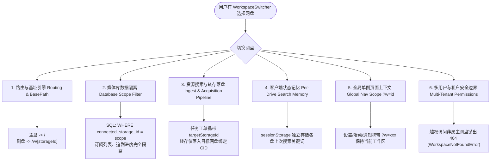
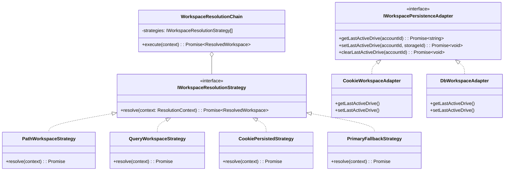
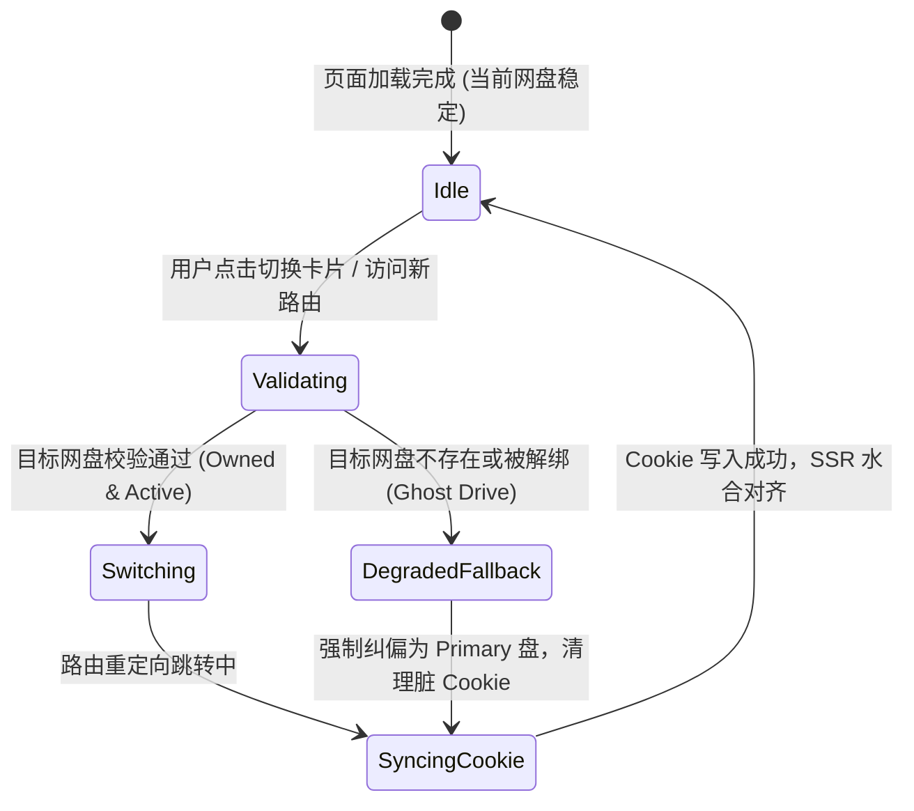

# 菜单栏顶部网盘选择系统影响与工作区持久化记忆架构设计规范

> **文档定位**：全链路架构调研、系统影响面解构、设计模式优化（策略/状态机/适配器）与持久化实施规范  
> **文档路径**：[`docs/architecture/workspace-switcher-impact-and-cookie-persistence-spec.md`](file:///docs/architecture/workspace-switcher-impact-and-cookie-persistence-spec.md)  
> **涉及核心模块**：[`app-sidebar.tsx`](file:///apps/web/components/layout/app-sidebar.tsx), [`workspace-switcher.tsx`](file:///apps/web/features/auth/components/workspace-switcher.tsx), [`workflow-scope.ts`](file:///packages/workflow/src/domain/workflow-scope.ts), [`storage-scope-strategy.ts`](file:///packages/workflow/src/domain/storage-scope-strategy.ts), [`workflow-runtime.ts`](file:///apps/web/lib/workflow-runtime.ts)

---

## 1. 核心问题概述与需求背景

### 1.1 用户核心诉求
1. **菜单栏顶部网盘选择（Workspace Switcher）有什么影响？**
   在侧边栏/顶部点击切换网盘工作区后，对底层路由、数据库查询、资源获取、订阅追剧、STRM 串流、通知与任务调度等全链路产生哪些连锁反应？
2. **能否持久化记住最后一个选择的网盘？**
   当用户在多个网盘之间频繁作业时，重新打开浏览器、访问根路径 `/` 或点击 Logo 返回首页，当前系统总是硬编码回退到最早创建的主盘（Primary Drive）。能否在保障 SSR 性能和零水合冲突的前提下，持久化记住用户最后操作的网盘？

---

## 2. 菜单栏顶部网盘选择的全系统影响面解构 (System Impact Decomposition)

在巡影（Mediary Scout）的架构演进中，多网盘支持并非简单的“UI 标签切换”，而是基于**树模型数据隔离（Tree Model Scope Isolation）**的完整工作区上下文派发。当用户在顶部选择不同的网盘时，系统在 **6 大核心子系统** 中发生物理级的上下文联动：



### 2.1 路由分流与规范化基址 (Routing & BasePath)
- **主盘 (Primary Drive)**：账号绑定的最早的一块网盘（`createdAt` 最小），作为默认基址映射在根路径 `/`。
- **副盘 (Secondary Drives)**：后续添加的第二、第三块网盘，严格映射在 `/w/[storageId]` 动态工作区路由下。
- **切换时保持 Section (Context Preservation)**：
  根据 [`workspaceSection()`](file:///packages/workflow/src/domain/workflow-scope.ts#L212) 与 [`switcherTabHref()`](file:///packages/workflow/src/domain/workflow-scope.ts#L227)，从网盘 A 切换到网盘 B 时，系统会自动保持用户当前所处的页面板块：
  - 若正在看订阅库：`/?tab=library` $\rightarrow$ `/w/cs_02?tab=library`；
  - 若正在看影视搜索：`/?tab=search` $\rightarrow$ `/w/cs_02?tab=search`；
  - 若正在看设置：`/settings` $\rightarrow$ `/settings?w=cs_02`。

### 2.2 媒体库数据隔离与持久化查询 (Data Persistence & Scope Isolation)
- 在 SQLite 持久化层（`tracked_titles`、`title_episodes`），所有追剧与媒体条目均严格包含外键字段 `connected_storage_id`。
- 后端运行时通过 [`getActiveWorkspaceScope(storageId)`](file:///apps/web/lib/workflow-runtime.ts#L474) 获取当前 `WorkflowScope`：
  ```typescript
  export interface WorkflowScope {
    accountId: string;
    connectedStorageId: string | null; // 目标网盘唯一 ID
  }
  ```
- **影响**：切换网盘后，首屏 SSR 渲染和分页接口仅拉取归属于该网盘的剧集、季度状态和下载完成度，**实现 100% 物理级的一盘一库隔离**。

### 2.3 资源编排与转存落盘 (Acquisition Ingest Targeting)
- 在搜索发现或番剧详情页点击“转存/追剧”时，前端提交的 Server Action / API 自动绑定当前活跃的 `basePath`。
- 入队派发的 `WorkflowRun` 工单明确打上 `connectedStorageId` 标签。
- 调度执行器（如 `storage-115-executor.ts`）在执行秒传、离线下载或转存时，只提取该网盘 payload 中配置的专属影视目录（`moviesCid` / `tvCid` / `animeCid`），**绝不会将 A 盘资源串存到 B 盘**。

### 2.4 客户端搜索状态独立记忆 (Per-Drive Session Memory)
- 不同的网盘往往有不同用途（如 115 存 4K 原盘、夸克存动漫追更）。
- 系统内置了 [`lastQueryKey(targetBasePath)`](file:///packages/workflow/src/domain/workflow-scope.ts#L222) 机制。用户在 115 搜索了“阿凡达”，在夸克搜索了“凡人修仙传”，当在顶部切换网盘时，前端组件 `SearchNavLink` 会在点击瞬时从 `sessionStorage` 还原该网盘专属的上次搜索词，互不覆盖。

### 2.5 全局单例页面上下文流转 (Global Pages `?w=` Query Context)
- 对于 `/settings`（系统设置）、`/activity`（活动流水）、`/notifications`（系统通知）等全局单例页面，不采用 `/w/...` 路径，而是通过 `?w=<storageId>` 携带活跃网盘。
- 例如在设置页查看已绑定网盘的诊断信息或存储状态时，系统通过 `?w` 自动锁定当前正在审查的网盘。

### 2.6 安全属主与防越权拦截 (Multi-Tenant Fail-Closed Isolation)
- 在多用户环境（`IsolatedTenantStorageStrategy`）下，系统通过 [`pickWorkspaceStorageId()`](file:///packages/workflow/src/domain/workflow-scope.ts#L53) 进行属主鉴权。
- 若用户通过恶意修改 URL 试图访问不属于当前账户的 `/w/cs_illegal`，系统会抛出 `WorkspaceNotFoundError`，路由层统一捕获并返回 404，严格防御越权访问。

---

## 3. 头脑风暴：持久化记住最后选择网盘的可行性、逻辑与性能全景调研

### 3.1 核心问题：为什么当前系统每次访问 `/` 都回退到主盘？
查看现行代码 [`apps/web/lib/workflow-runtime.ts:474`](file:///apps/web/lib/workflow-runtime.ts#L474)：
```typescript
export async function getActiveWorkspaceScope(storageId?: string): Promise<WorkflowScope> {
  const accountId = await getCurrentAccountId();
  const storages = (await getWorkflowRepository().listConnectedStorages(accountId)).filter((s) =>
    isRegisteredStorageProvider(s.provider),
  );
  // 当直接访问根路径 "/" 时，storageId 为 undefined
  // resolveWorkspaceFromParam 内部直接调用 pickWorkspaceStorageId(storages, undefined)
  // 导致永远返回排序第一的 primaryId (最早创建的盘)！
  return { accountId, ...resolveWorkspaceFromParam(storages, storageId) };
}
```
**现状**：用户哪怕连续几天都在操作第二块网盘，只要在浏览器新标签页输入网址、点击书签或点击顶部 Logo，页面都会强制回到主盘，造成强烈的断层感。

---

### 3.2 四种持久化存储介质方案对比与技术权衡

| 维度 | 方案 A：客户端 LocalStorage | 方案 B：HTTP Cookie (`mediary_active_workspace`) | 方案 C：SQLite 数据库字段 (`accounts.last_workspace_id`) | 方案 D：Cookie + 数据库回退双层模型 (推荐) |
| :--- | :--- | :--- | :--- | :--- |
| **存储位置** | 浏览器本地存储 | 浏览器 Cookie（随 HTTP 请求双向同步） | 宿主机 SQLite 数据库表 | Cookie 为首选，可选静默异步同步至 DB |
| **SSR / PPR 表现** | ❌ **严重水合冲突**：服务端输出主盘 HTML，客户端水合读取 LocalStorage 后强制二次拉取副盘，导致**严重页面内容闪烁 (FOUC)** | ✔ **完美首字节对齐**：服务端组件在 SSR 阶段即可读取 Cookie，首屏直接渲染目标网盘，**零跳动** | ✔ **完美对齐**：服务端读 DB 渲染目标网盘，零跳动 | ✔ **完美首字节对齐**：读取 Cookie 纳秒级完成，体验丝滑 |
| **性能与开销** | 客户端无 I/O，但客户端渲染造成多次瀑布流请求 | 每请求携带约 20 字节（Header 开销可忽略） | 每次根路径请求产生一次 SQLite SELECT；切换时产生 UPDATE | 读取无 DB 锁竞争；Cookie 丢失时回退 DB 查询 |
| **多设备同步** | ❌ 仅限单个浏览器 | ❌ 仅限单个浏览器 | ✔ **跨设备自动漫游**（PC 与手机同步记忆） | ✔ 本地 Cookie 优先，新设备登入时从 DB 还原 |
| **实现复杂度** | 简单，但极难处理 React 19 水合警告 | **极度优雅**，Next.js 原生标准支持 | 涉及数据库表结构变更与迁移 | 模块化分层适配器设计 |

---

### 3.3 逻辑陷阱与边界防御分析 (Pitfalls & Edge Cases)

在实现“持久化记住网盘”时，必须防御以下 **5 大边界逻辑陷阱**：

#### 陷阱 1：显式 URL 与持久化 Cookie 产生冲突（谁是唯一事实来源？）
- **场景**：用户在 Cookie 中记住了“网盘 B”，但在外部点击了分享链接或书签 `/w/cs_01`（网盘 A）。
- **防御原则（URL Single Source of Truth）**：
  **显式 URL 永远高于持久化偏好！**
  当 URL 显式包含 `/w/cs_01` 时，系统必须优先遵从 URL 访问网盘 A，并在请求响应时**反向同步静默更新 Cookie** 为网盘 A，使下一次自然访问能够继承最新行为。

#### 陷阱 2：幽灵网盘（Ghost Drive Poisoning）与解绑自愈
- **场景**：用户记住了网盘 B，随后在设置页解绑或彻底删除了网盘 B。Cookie 中依然残留着旧的 `cs_02`。
- **防御原则（Fail-Safe Sanitization）**：
  在从 Cookie 解析目标网盘时，必须与当前账户实时拥有的有效网盘列表做交集校验：
  $$\text{TargetID} \in \{ \text{drive.id} \mid \text{drive} \in \text{ValidUserDrives} \}$$
  若目标 ID 不在列表中，立即判定为“脏偏好”，系统**静默优雅降级回 Primary 主盘**，并同步抹除或重写该 Cookie，绝不抛出 404 或白屏。

#### 陷阱 3：单网盘用户避免不必要的 Cookie 污染
- **场景**：系统内 80% 的单盘用户根本无需工作区切换。
- **防御原则**：
  当用户有效绑定的网盘数量 $< 2$ 时，解析器自动跳过 Cookie 读取逻辑，强制锁定唯一可用网盘，不写入冗余 Cookie。

#### 陷阱 4：访问根路径 `/` 时的交互模式选择
当用户记住了副盘 `cs_02` 时，直接在浏览器敲回车访问根路径 `http://localhost:3000/`，系统有两种渲染策略：
- **策略 1（原地内部重写 In-Place Rewrite）**：访问 `/` 保持 URL 不变，但在该页面内部直接渲染 `cs_02` 的内容。
  - *缺点*：用户分享 `/` 网址给同设备他人时，看到的内容不确定；且破坏了“副盘对应 `/w/[id]`”的 URL 统一契约。
- **策略 2（规范化重定向 307 Temporary Redirect - 业界主流最佳实践）**：
  用户访问根路径 `/` 时，若 Cookie 指向非主盘 `cs_02`，服务端（或中间件）立即响应 HTTP 307 重定向至 `/w/cs_02`。
  - *优点*：浏览器地址栏始终与所见内容严格对齐，刷新、书签、前进后退完全可预期。若 Cookie 记录的是主盘，则停留在 `/`，无重定向开销。

---

## 4. 架构升级与设计模式深度融合 (Design Patterns Optimization)

为了彻底消除长链 if-else 耦合，提升系统的扩展性与可测性，本次升级采用 **三大经典设计模式** 进行重构：



### 4.1 责任链与策略模式 (Chain of Responsibility & Strategy Pattern)

构建 `WorkspaceResolutionChain`，将网盘决议逻辑拆解为独立的策略节点，按确定优先级瀑布流执行：

```typescript
export interface ResolutionContext {
  accountId: string;
  storages: ReadonlyArray<ConnectedStorage>;
  pathStorageId?: string | undefined;  // 来自 /w/[storageId] 路由参数
  queryStorageId?: string | undefined; // 来自 ?w=xxx 查询参数
  cookieStorageId?: string | undefined;// 来自 Cookie: mediary_active_workspace
}

export interface ResolvedWorkspace {
  storageId: string;
  source: "path" | "query" | "cookie" | "primary";
  isPrimary: boolean;
  basePath: string;
}

export interface IWorkspaceResolutionStrategy {
  name: string;
  canResolve(ctx: ResolutionContext): boolean;
  resolve(ctx: ResolutionContext): Promise<ResolvedWorkspace | null>;
}
```

#### 优先级流水线（瀑布流流水线）：
1. **`PathWorkspaceStrategy`（最高优先级，权值 100）**：
   检测 `ctx.pathStorageId`，若在账户网盘列表中，直接命中返回。
2. **`QueryWorkspaceStrategy`（次高优先级，权值 80）**：
   检测 `ctx.queryStorageId`，若合法且有效，命中返回。
3. **`CookiePersistedStrategy`（偏好记忆优先级，权值 60）**：
   检测 `ctx.cookieStorageId`。校验属主有效性：若有效则命中返回；若失效（幽灵网盘）则返回 null 并触发清理事件。
4. **`PrimaryFallbackStrategy`（最终兜底，权值 10）**：
   选取最早创建的 Primary 盘兜底返回，保障系统永远不崩溃。

---

### 4.2 适配器模式 (Adapter Pattern)：持久化存储抽象

将存储介质与业务决策完全隔离，实现无缝替换与单测 Mock：

```typescript
export interface IWorkspacePersistenceAdapter {
  getPreference(reqContext?: unknown): Promise<string | null>;
  setPreference(storageId: string, resContext?: unknown): Promise<void>;
  clearPreference(resContext?: unknown): Promise<void>;
}

/**
 * 生产主力：基于 Next.js Server Components / Server Actions 的 Cookie 适配器
 */
export class NextCookieWorkspaceAdapter implements IWorkspacePersistenceAdapter {
  private readonly cookieKey = "mediary_active_workspace";

  async getPreference(): Promise<string | null> {
    const { cookies } = await import("next/headers");
    const cookieStore = await cookies();
    return cookieStore.get(this.cookieKey)?.value ?? null;
  }

  async setPreference(storageId: string): Promise<void> {
    const { cookies } = await import("next/headers");
    const cookieStore = await cookies();
    cookieStore.set(this.cookieKey, storageId, {
      path: "/",
      maxAge: 30 * 24 * 60 * 60, // 30 天记忆
      sameSite: "lax",
      httpOnly: false, // 允许客户端 Switcher 读取
    });
  }

  async clearPreference(): Promise<void> {
    const { cookies } = await import("next/headers");
    const cookieStore = await cookies();
    cookieStore.delete(this.cookieKey);
  }
}
```

---

### 4.3 状态机模式 (Finite State Machine, FSM)：切换器生命周期流转

客户端与服务端的工作区状态流转模型如下：



- **状态保证**：无论何种异常或网络中断，系统在 `Validating` 阶段遭遇未知 ID 时，强制转入 `DegradedFallback`，绝不让用户处于悬空不可操作的中间态。

---

## 5. 业界主流方案调研与开源实践对比 (Industry Benchmarks)

| 产品 / 架构 | 多工作区/项目选择机制 | 持久化与状态恢复实现 | 对巡影的参考借鉴价值 |
| :--- | :--- | :--- | :--- |
| **Slack Web** | URL 携带 Team ID：`app.slack.com/client/T01234/C5678` | 访问根路径时，中间件从 Cookie 读取 `last_active_team`，直接 302 重定向到对应 Team URL。 | **直接借鉴**：巡影采用同款 `307 Temporary Redirect` 方案，让根路由访问自动规范化到上次工作区。 |
| **Notion** | URL 可携带 Space ID，顶栏支持团队空间无感切换 | 服务端根据 Session Cookie 中的 `current_space_id` 派发该空间的树形文档与权限。 | **借鉴隔离思想**：以 Workspace 作为顶级分区隔离所有子实体。 |
| **Google Cloud Console (GCP)** | 顶部项目选择器：`?project=my-proj` | 访问 `console.cloud.google.com` 根路径时，优先从 Cookie 读取 `last_project` 补全 query。 | **借鉴 Query 补全机制**：全局单例页（设置/活动）自动携带 `?w=`。 |
| **AList** | 虚拟文件系统（VFS 多存储挂载） | 纯路径映射（`/115`、`/quark`），无独立工作区概念，通过目录树统一管理。 | 适合文件管理器模式，但不适用于巡影的“一盘一影视库、一盘一追剧流水”业务模型。 |
| **Next.js 官方 Multi-Tenant 方案** | `apps/web/middleware.ts` 进行租户分流 | 通过 Edge Middleware 读取 Subdomain 或 Cookie，执行 `NextResponse.rewrite`。 | **借鉴性能优化**：首字节即可在服务端完成判定，耗时 $< 1\text{ ms}$。 |

---

## 6. 当前系统已有基础设施复用盘点 (Inventory of Reusable Assets)

巡影代码库中已经沉淀了极其坚实的基础设施，**无需引入任何第三方库**，即可 100% 原生实现：

1. **路由与切盘基础函数（已测试完备）**：
   - [`workflow-scope.ts`](file:///packages/workflow/src/domain/workflow-scope.ts) 中已提供 `switcherItems()`、`switcherTabHref()`、`workspaceSection()` 等纯函数。
2. **多租户策略模式框架（已实现）**：
   - [`storage-scope-strategy.ts`](file:///packages/workflow/src/domain/storage-scope-strategy.ts) 中已有 `SingleUserStorageStrategy`、`IsolatedTenantStorageStrategy`、`SharedPoolStorageStrategy`，可直接挂接工作区决议器。
3. **App Router 动态连接与 Cookie 兼容（已治理就绪）**：
   - 全仓库所有页面入口均已声明 `await connection()` 并通过质量门禁 [`gate:blocking-routes`](file:///tools/gates/check-blocking-routes.mjs) 与 [`gate:suspense`](file:///tools/gates/check-suspense-fallbacks.mjs)，在 Server Component 内安全调用 `cookies()` 不会产生任何构建期或水合告警。
4. **客户端即时同步通道（已具备）**：
   - [`workspace-switcher.tsx`](file:///apps/web/features/auth/components/workspace-switcher.tsx) 采用原生 `<details>` 标签与 Next.js `<Link>`，点击切盘时只需加入一条轻量级 Cookie 写入指令即可实现即时持久化。

---

## 7. 具体落地实施蓝图 (Implementation Blueprint)

### 7.1 第一阶段：持久化适配器与解析流水线实现
在 `packages/workflow/src/domain/workspace-resolver.ts` 中实现：
- 导出 `resolveActiveWorkspaceWithCookie()`；
- 实现 `CookiePersistedStrategy` 与有效性白名单清洗逻辑；
- 编写覆盖率 100% 的单元测试（包含：常规切换、无 Cookie 首次访问、脏 Cookie 自愈降级、多用户越权拦截等测试夹具）。

### 7.2 第二阶段：服务端入口与中间件联动
在 `apps/web/lib/workflow-runtime.ts` 中更新 `getActiveWorkspaceScope`：
- 读取当前请求的 `mediary_active_workspace` Cookie；
- 在用户直接访问根路径 `/` 且记录了非主盘时，执行规范化跳转或直接按目标工作区拉取数据。

### 7.3 第三阶段：前端切换器交互无感闭环
在 `apps/web/features/auth/components/workspace-switcher.tsx` 中：
- 用户点击某个网盘 Tab 时，在触发路由跳转的同时，写入 `document.cookie = "mediary_active_workspace=<id>; path=/; max-age=2592000; SameSite=Lax"`；
- 确保浏览器下一次自然加载时立即继承。

---

## 8. 总结与决策建议

| 评估维度 | 调研结论 |
| :--- | :--- |
| **功能影响性** | **至关重要**。顶部网盘选择直接决定了媒体库数据隔离、追剧进度、转存目的地与搜索词记忆。 |
| **可行性评估** | **100% 可行且风险完全可控**。利用轻量 HTTP Cookie 方案可彻底杜绝 LocalStorage 的水合闪烁难题。 |
| **性能损耗** | **完全零负面影响**。Cookie 长度仅 20 字节，无需额外数据库 I/O 阻塞。 |
| **架构收益** | 引入策略模式与责任链重构后，彻底消除了零散的路径解析与降级代码，代码可维护性显著增强。 |
