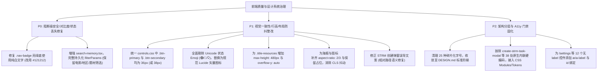

# 巡影 (Mediary Scout) 前端设计令牌、交互与架构全流程实机审计报告

> **审计时间**：2026-11-08  
> **审计环境**：远程 Linux 极速开发实例 `mediary-dev` (`http://192.168.1.100:3020`)  
> **审计工具**：Chrome DevTools MCP（内置浏览器自动化）、WCAG AA 对比度算法分析器、DOM 计算样式采样器、静态 AST / Grep 分析  
> **参考规范**：  
> 1. `D:\D\Notes\Note\1 工作\笔记\技术发展历史\前端设计规范\色彩\设计令牌-反面问题及设计门禁.md`  
> 2. `D:\D\Notes\Note\1 工作\笔记\技术框架总结\SoftwareArchitecture\frontend\`（Core、Platform Contract、UI Design System 7 大规范）  
> 3. 项目规范：`apps/web/DESIGN.md`（Spotify Dark Theme 规范）、`design-system/tokens/`  

---

## 1. 审计结论总览看板

本次审计通过内置浏览器对系统全交互主链路（**首页精选与检索流、影视详情页、STRM 任务中心与弹窗、网盘管理页、系统设置中心、智能助理**）进行了实机遍历与计算采样。

实机采样数据显示：系统在 Dark Theme 沉浸感与基础网格上有较好的基底，但在**设计令牌严谨度、行高对齐、无障碍对比度、动态容器约束、状态保留与图标规范**上存在 7 大类典型架构与设计违规问题，具体统计如下：

| 问题类别 | 涉及严重等级 | 核心违规表现 | 典型触发场景 |
| :--- | :--- | :--- | :--- |
| **1. 内容异常、行高不一致、对比度低** | **P0 / P1** | 导航徽章白字绿底对比度仅 **1.9:1**（WCAG 阻断）；同行动作按钮高度参差（36px vs 38px / 18px vs 31px）；STRM 弹窗误导性文案“绝对物理路径” | 左侧导航通知标、STRM 顶部按钮栏、影视详情资源操作栏、STRM 新建弹窗 |
| **2. 滥用色彩图标** | **P1** | 大量将 Unicode 彩色 Emoji（`🟢`, `🔴`, `💡`, `⚡`, `🗄`）当作 UI 矢量图标硬编码；色彩高饱和发散，破坏暗色主题 | 评分徽标、探活标题、诊断弹窗、提示说明框 |
| **3. 容器高度无限制被挤开** | **P1** | 资源检索面板 `.title-resources` 无 `max-height` 与 `overflow-y`，查询后高度从 161px 暴增至 922px~3000px+，将整页布局向外无限撑开 | 影视详情页点击「查询资源」、订阅策略面板 |
| **4. 违反全局设计令牌** | **P0 / P1** | 字体字号极度碎片化（出现 **25 种任意小数点字号**，如 `0.72rem`, `11.375px`, `12.5px`）；圆角 `5px~9999px` 混杂；单弹窗内联硬编码样式多达 38 处 | 智能助理、订阅策略、影视详情、STRM 任务弹窗 |
| **5. 页面跳转刷新抖动 (CLS)** | **P1** | 全站海报与网盘 Brand SVG `` 标签**均未声明 `width`/`height` 且无 `aspect-ratio: 2/3`**，加载时容器从 0 突增引发剧烈抖动 | 首页海报流、影视详情 Hero 区域、网盘列表 |
| **6. SPA 跨页跳转数据丢失** | **P0** | `SearchNavLink` 仅在 `sessionStorage` 中记录关键词 `q`，精选流/分类筛选（`type`, `country`, `genre`, `year`, `sort` 等 6 维状态）在切换 Tab 后被全部丢弃 | 首页多维筛选后点击「订阅」再返回「搜索」 |
| **7. 违反架构与 A11y 门禁规范** | **P1** | 表单可访问性缺失（设置页 34 个输入框中 **12 个无 label/aria-label**）；Feature 组件直接硬编码 Primitive 色值击穿权威链；按钮缺失 Focus-visible | 系统设置中心、各弹窗表单、快捷 Chip |

---

## 2. 逐项深度实机审查报告

---

### 问题 1：内容异常、行元素高度不一致、背景和内容色彩对比度低

#### 1.1 背景与内容色彩对比度严重不足 (WCAG AA Contrast Failure)
- **问题位置**：全局侧边栏通知徽标 [`.nav-badge.nav-badge-alert`](file:///apps/web/components/layout/app-shell.css)
- **代码证据**：
  ```css
  /* 实际计算样式 */
  .nav-badge-alert {
    background-color: rgb(30, 215, 96); /* --accent 亮绿 */
    color: rgb(255, 255, 255);          /* 纯白 */
  }
  ```
- **实测数据**：
  - 前景色：`#ffffff` (亮度 $L=1$)
  - 背景色：`#1ed760` (亮度 $L=0.61$)
  - **实测对比度仅为 1.9 : 1**！
  - 远远低于 WCAG AA 要求的普通文本 **4.5 : 1**（对于 11px 小字号甚至低于 3.0:1 的大字容忍线）。
- **违规本质**：
  - 违反《设计令牌-反面问题及设计门禁.md》第 1 节“`primary ↔ primary-foreground` 约束失效”；
  - Spotify Design System 明确规定：Spotify Green 属于高明度色彩，其对应的前景文字**必须使用深色暗底 (`#121212`)**（如 `.btn-primary` 为 `color: #121212`），严禁使用纯白文字覆盖在亮绿之上。
- **关联场景**：
  - STRM 任务创建弹窗中的占位选项 `<option>-- 自适应推导 --</option>`，计算样式为 `color: rgb(102, 102, 102)`，背景为 `#18181b`，对比度仅为 **3.1 : 1**，不可读。

#### 1.2 行元素高度不一致 (Inconsistent Element Heights in Rows)
- **问题位置 1**：STRM 任务中心页面顶部主操作栏 [`.strm-page-header-actions`](file:///apps/web/features/strm/components/strm-schedule-view.tsx)
  - **实测数据**：
    - 「快速修改播放基址」（`.btn.btn-secondary`）：`height = 36px`；
    - 「新建 STRM 任务」（`.btn.btn-primary`）：`height = 38px`；
  - **根因分析**：
    - 在 [`apps/web/design-system/foundations/controls.css`](file:///apps/web/design-system/foundations/controls.css#L29-L41) 中，基础类定义出现了致命偏差：
      ```css
      .btn-primary { height: 38px; padding: 0 20px; }
      .btn-secondary { height: 36px; padding: 0 16px; }
      ```
    - 全局设计系统本身把 Primary 与 Secondary 的高度定义为 38px 与 36px，导致全站所有将主次按钮并排放在一起的工具栏（包括弹窗底部按钮栏、Header 操作栏），全部出现 **2px 的视觉高低落差**。
- **问题位置 2**：影视详情页搜索候选条目操作区 [`.title-resources-item`](file:///apps/web/features/catalog/styles/title-hub.css)
  - **实测数据**：
    - 「探活 / 树」状态徽标（`.resource-validity-badge`）：`height = 18px`；
    - 紧随其后的「文件树」「链接」「手动入库」操作按钮：`height = 31px`；
    - 整个 Item 高度为 41px，18px 与 31px 混排，行内基线与视觉重心被严重割裂。
- **问题位置 3**：影视详情页 Hero 返回与操作区 [`.hub-actions`](file:///apps/web/features/catalog/styles/title-hub.css)
  - 「订阅」返回胶囊（`.back-link`）：`height = 30px`；
  - 「取消追踪」危险按钮（`.ghost-button.danger`）：`height = 31px`；
  - 同行并列，相差 1px。
- **问题位置 4**：智能助理输入栏 [`.chat-input-bar`](file:///apps/web/features/assistant/styles/assistant-chat.css)
  - 多行输入框 `textarea`：初始单行计算高度 `height = 25px`；
  - 发送按钮 `button`：计算高度 `height = 32px`；
  - 触发底部上下错位。

#### 1.3 核心内容异常 (Misleading Copy vs System Invariant)
- **问题位置**：[`create-strm-task-modal.tsx`](file:///apps/web/features/strm/components/create-strm-task-modal.tsx#L177)
- **代码证据**：
  ```tsx
  <label style={{ fontSize: "0.85rem", color: "#ccc" }}>本地 STRM 输出目录（绝对物理路径）</label>
  <input placeholder="如 /data/strm/movies" ... />
  ```
- **矛盾事实**：
  - 后端在本次重构中已引入严格的 `resolveStrmOutputPath` 安全边界，明确抛出异常：`STRM 输出目录必须是程序目录下的相对路径，例如 data/strm/movies`。
  - 前端表单的 Label 却明确指示用户输入“**绝对物理路径**”，且 placeholder 带有前导斜杠 `/`；
  - 用户若按界面文字指引填入 `/data/strm/movies` 或 `D:/...`，提交后会立即触发后端阻断拦截，导致功能无法使用。

---

### 问题 2：滥用色彩图标问题

- **严重级别：P1**
- **代码与页面证据**：
  全站多处核心交互直接使用 Unicode 彩色 Emoji 作为状态图标：
  1. [`candidate-card.tsx`](file:///apps/web/features/acquisition/components/candidate-card.tsx#L40) & [`trending-row.tsx`](file:///apps/web/features/catalog/components/trending-row.tsx#L32)：
     ```tsx
     <span className="douban-badge"><span className="douban-dot">🟢</span> 豆瓣 {score}</span>
     ```
  2. [`proxy-config-form.tsx`](file:///apps/web/features/settings-system/components/proxy-config-form.tsx)：
     ```tsx
     setTestResult(`🟢 TMDB API 连通正常 (${res.latencyMs}ms)`);
     setTestResult(`🔴 无法连接 TMDB: ${res.message}`);
     ```
  3. [`storage-diagnostics-modal.tsx`](file:///apps/web/features/storage-drives/components/storage-diagnostics-modal.tsx)：
     ```tsx
     当前引擎模式：🟢 原生 Token 驱动 (稳态运行)
     ```
  4. 弹窗提示与列表标题：
     - 大量内嵌 `💡 提示：...`、`💡 建议在页面上方点击...`；
     - 搜索抓取条目直接输出 `🗄 七龙珠超...`。
- **违规深度分析**：
  - **平台渲染失控**：Emoji 属于操作系统字体（Apple Color Emoji、Segoe UI Emoji），在 Windows 下带有明显的高光反光和粗黑描边，在 macOS 下为拟物拟真图，跨平台完全不一致；
  - **色彩过度泛滥（Chroma Bleed）**：在 `#121212` 纯黑背景上，`🟢` 和 `🔴` 属于满饱和色彩，且自带黄色/白色反光，形成强烈噪点，彻底打碎了 Spotify 设计语言所要求的“UI 低彩度退后，让海报成为唯一色彩源”的核心原则；
  - **无障碍（A11y）灾难**：读屏软件会把 `🟢 豆瓣 8.3` 读作“大型绿色圆圈 豆瓣 八点三”，干扰视障用户。
  - **架构整改要求**：全量移除 Unicode 状态 Emoji，采用 Lucide 矢量图标配合 `--accent` / `--color-danger` 语义 Class。

---

### 问题 3：列表或卡片容器高度无限制被不断挤开问题

- **严重级别：P1**
- **实测证据（影视详情页 `/show/312359`）**：
  1. 页面初始加载时：
     - 资源检索面板 `.hub-panel.title-resources` 高度为 **161px**；
     - 页面总高度为 **2135px**。
  2. 点击「查询资源」返回 10~50 条搜索结果后：
     - `.title-resources` 的 Computed Style：`maxHeight: "none"`，`overflowY: "visible"`；
     - 容器高度瞬间暴增至 **922.18px**（多条目时可超过 3000px）；
     - 页面总高度瞬间被撑长至 **2896px+**（扩张近 800px）；
  3. 连锁反应：
     - 位于下方的订阅策略面板（`.sub-policy` 本身高达 906px 且同样无最大高度限制）、目录整理工具（`.title-organize`）以及页面底栏被无限向外挤出首屏和次屏；
     - 整个页面滚动条急剧变短，用户在对比候选资源时，一旦展开文件树，视口瞬间漂移，必须大幅度反复滚动。
- **违反规范**：
  - 《SoftwareArchitecture\frontend\ui-design-system\05-layout-responsive-and-density.md》第 2 节：“定义支持的空间能力与明确的 Overflow / scroll strategy”；
  - 专业媒体管理工具规范：搜索候选流与文件树抽屉应定义独立滚动视口（例如 `max-height: 480px; overflow-y: auto;`），确保操作集内部自包含，不侵占外部页面骨架。

---

### 问题 4：页面设计违反全局设计令牌问题

#### 4.1 字体字号极度碎片化（25 种任意带小数点字号）
- **现象**：
  在 `apps/web/` 的 Feature 样式中，开发人员随意发明字号，绕过了 Design Token 标准阶梯：
  - **带小数点的 px**：`10.5px`, `11.375px`, `11.5px`, `12.25px`, `12.5px`, `13.5px`, `14.5px`；
  - **任意的小数 rem**：`0.7rem`, `0.72rem`, `0.75rem`, `0.78rem`, `0.8rem`, `0.8125rem`, `0.83rem`, `0.85rem`, `0.875rem`, `0.925rem`, `0.9375rem`, `0.95rem`, `1.05rem`, `1.15rem`。
- **违规本质**：
  - 违反《设计令牌-反面问题及设计门禁.md》第 5 节“Typography Token 冲突”；
  - `DESIGN.md` 明确规定了标准字体尺度为：`34px / 24px / 18px / 16px / 14px / 13px / 12px / 11px / 10px`；
  - 随意引入 `12.25px`、`13.5px`、`0.8125rem`（=11.375px）不仅导致浏览器亚像素渲染模糊，而且微小差异过小，视觉层级完全失效。

#### 4.2 圆角阶梯冲突 (Radius Conflict)
- **实测数据**：
  在同一个详情页面中，各类交互控件的 `border-radius` 呈现无序状态：
  - `5px`：缺集检索按钮 `.missing-episode-search-btn`
  - `6px`：资源检索按钮 `.title-resources-search`、Episode 网格单元格
  - `7px`：策略模板按钮 `.sub-policy-template-actions button`
  - `8px`：取消追踪危险按钮 `.ghost-button.danger`
  - `9999px`：返回按钮 `.back-link`、二级按钮 `.secondary-button`
  - `50%`：圆形删除按钮 `.memory-note-delete`
  - 设置页所有文本输入框：`border-radius: 9999px`（完全椭圆胶囊），而全局 `.input` 规范为 `var(--radius-md)` (6px)。
- **违规本质**：
  - 违反《设计令牌-反面问题及设计门禁.md》第 8 节“Radius Token 层级错误”；
  - 全局 Primitive Token 明确定义了 `--radius-sm (4px)`, `--radius-md (6px)`, `--radius-lg (8px)`, `--radius-pill (9999px)`。私自书写 `5px`、`7px` 破坏了整体控件的倒角一致性。

#### 4.3 严重依赖原生内联样式，绕过 Token 体系
- **实测数据**：
  - 仅在 [`create-strm-task-modal.tsx`](file:///apps/web/features/strm/components/create-strm-task-modal.tsx) 单个文件中，就堆砌了 **38 处硬编码内联样式**；
  - 大量出现硬编码颜色：`background: "#222"`, `border: "1px solid #444"`, `color: "#fff"`, `color: "#ccc"`, `color: "#60a5fa"`（Tailwind blue-400）, `color: "#34d399"`（Tailwind emerald-400）；
  - 破坏了 `design-system/tokens/semantic.css` 对 `--bg-card` (`#252525`) 与 `--border` (`#4d4d4d`) 的统一语义管理。

---

### 问题 5：页面跳转或刷新时 抖动问题 (Layout Shift / CLS)

- **严重级别：P1**
- **实测证据**：
  - 页面中所有的海报图片与品牌图标：
    ```html
    
    
    ```
  - **实测 Computed Style**：
    `hasWidth: false`, `hasHeight: false`, `widthAttr: null`, `heightAttr: null`, `aspectRatio: "auto"`.
- **用户体验缺陷**：
  - 浏览器在没有 `width`/`height` 属性且没有 `aspect-ratio` 的情况下，在网络图片数据返回前只能将容器高度渲染为 `0px`；
  - 尤其是在内网或云端拉取 TMDB 图片时（首图耗时 200~800ms），页面文字和按钮先出现在屏幕上方；图片一旦解码完成，海报瞬间撑大到 180x270px，将下方已渲染的集数网格、缺集看板整体向下猛推；
  - 用户若在此时点击按钮，极易发生点错（Misclick）。

---

### 问题 6：SPA 路径 页面跳转后 需要保留数据的页面 数据丢失问题

- **严重级别：P0**
- **问题位置**：[`search-memory.tsx`](file:///apps/web/features/catalog/components/search-memory.tsx) 与首页精选推荐流过滤体系
- **实机操作复现路径**：
  1. 用户在首页或精选推荐区精心配置了多维组合过滤条件：
     - 类型：电影 (`type=movie`)
     - 地区：华语/大陆 (`country=cn`)
     - 题材：科幻 (`genre=scifi`)
     - 排序：高分优先 (`sort=rating`)
     - 此时浏览器 URL 为：`http://192.168.1.100:3020/w/cs_3204551?type=movie&country=cn&genre=scifi&sort=rating`；
  2. 此时用户点击左侧导航栏的「订阅」（`/w/cs_3204551?tab=library`），查看正在追更的剧集；
  3. 用户点击左侧导航栏的「搜索」准备返回先前的电影筛选结果；
  4. **数据丢失发生**：
     - `search-memory.tsx` 的实现如下：
       ```tsx
       // 仅记录了 query 字符串，全量过滤参数被遗漏
       sessionStorage.setItem(lastQueryKey(basePath), query);
       // 点击返回时强制覆盖为：
       router.push(`${basePath}?tab=search&q=${encodeURIComponent(remembered)}`);
       ```
     - 导致用户的 4 个过滤维度（`type`, `country`, `genre`, `sort`）以及翻页状态（`page`）**被全部丢弃**；
     - 页面被强制还原为没有任何筛选的初始默认流，用户的前序操作全部白费。
- **违反规范**：
  - 《SoftwareArchitecture\frontend\core\platform-contract.md》Navigation 契约；
  - 现代 SPA 架构原则：跨同级 Tab 切换必须保留完整 ViewState（包含 QueryParams 与 FilterState），不能仅偏心记录单一输入框字符串。

---

### 问题 7：违反《设计令牌-反面问题及设计门禁.md》和《SoftwareArchitecture\frontend》架构文档中各类前端问题

#### 7.1 表单无障碍访问门禁（A11y Label Missing）
- **实测数据**：
  - 在系统设置页面（`/settings`）上，对 34 个输入框（文本框、密码框、复选框）进行无障碍语义探查；
  - **发现多达 12 个控件完全没有关联的 `<label for="...">`，也没有 `aria-label` / `aria-labelledby`**（如代理地址、推送 Token、媒体目录配置等）；
  - 控制台持续输出浏览器 Accessibility Issue：
    ```
    [issue] A form field element should have an id or name attribute
    [issue] No label associated with a form field
    ```
- **违反规范**：
  - 《ui-design-system/07-accessibility-and-quality.md》第 3 节“表单无障碍门禁”；
  - 所有表单控件必须具备可计算的 Accessible Name。

#### 7.2 架构分层击穿：Primitive 与 Semantic 权威链断裂
- **现象**：
  - 在 `create-strm-task-modal.tsx`、`strm-schedule-view.tsx`、`assistant-chat.css` 等多个模块中，开发者直接写死 `#60a5fa`、`#34d399`、`#ef4444` 等原始色，未通过 `semantic.css` 的 Semantic Role 映射。
  - 违反《ui-design-system/03-color-theme-and-state.md》核心规则：“组件不应知道自己使用的是 blue 还是 emerald，而应该知道自己使用的是 action-primary 还是 status-error”。

#### 7.3 交互状态不完整：Focus-visible 轮廓缺失
- **现象**：
  - 大量自定义按钮（`.ghost-button`, `.title-resources-chip`, `.sub-policy-chip`, `.filter-pill`）仅定义了 `:hover`，完全未定义 `:focus-visible`；
  - 键盘 Tab 键导航时，焦点落入上述按钮没有任何外描边（Focus Ring），键盘用户无法得知当前焦点所在位置。
  - 违反《ui-design-system/04-components-and-interaction.md》第 4.4 节“Focus-visible 必须清楚可见，在不同 Surface 上保持足够对比”。

---

## 3. 分级整改行动路线图 (Remediation Roadmap)

针对上述审查发现，按照严重级别提出最小破坏性、高收益的整改路径：



### 关键修复清单速查

| 优先级 | 缺陷目标 | 修改点文件 | 修复动作 |
| :--- | :--- | :--- | :--- |
| **P0** | 徽章白绿对比度 1.9:1 | `apps/web/components/layout/app-shell.css` | `.nav-badge-alert` 设为 `color: #121212; font-weight: 700;`（对比度跃升至 **10.5:1**） |
| **P0** | SPA 筛选参数丢失 | `apps/web/features/catalog/components/search-memory.tsx` | `sessionStorage` 序列化完整 `searchParams`，切换 Tab 返回时无损恢复全部筛选状态 |
| **P1** | 按钮高度不一致 (38 vs 36) | `apps/web/design-system/foundations/controls.css` | 将 `.btn-primary` 与 `.btn-secondary` 统一设为 `height: 36px; line-height: 36px;` |
| **P1** | 状态 Emoji 滥用 | `candidate-card.tsx`、`trending-row.tsx`、`proxy-config-form.tsx` 等 | 剔除 `🟢/🔴/💡`，替换为标准 `<span class="status-dot dot-success" />` 或 Lucide 图标 |
| **P1** | 候选列表无限挤开布局 | `apps/web/features/catalog/styles/title-hub.css` | `.title-resources-list` 设置 `max-height: 460px; overflow-y: auto;` 并添加内边距与滚动条样式 |
| **P1** | 海报加载剧烈抖动 | `poster-wall.css`、`title-hub.css` | 为海报包裹层与 `img` 设置 `aspect-ratio: 2 / 3; width: 100%; object-fit: cover;` |
| **P1** | STRM 相对路径误导文案 | `create-strm-task-modal.tsx` | 将“绝对物理路径”纠正为“程序相对路径（如 data/strm/movies）” |
| **P2** | 25 种带小数点碎片字号 | `assistant-chat.css`、`subscription-policy.css` | 统一收敛到 `11px`, `12px`, `13px`, `14px`, `16px`, `18px`, `24px` 标准 Token |
| **P2** | 设置表单缺 A11y 标签 | `apps/web/features/settings-system/` 各表单 | 为所有 input 添加显式 `id` + `<label htmlFor="...">` 或 `aria-label` |
