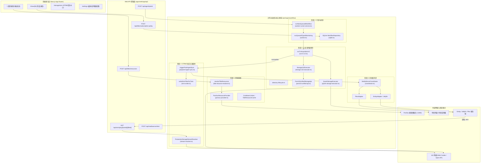
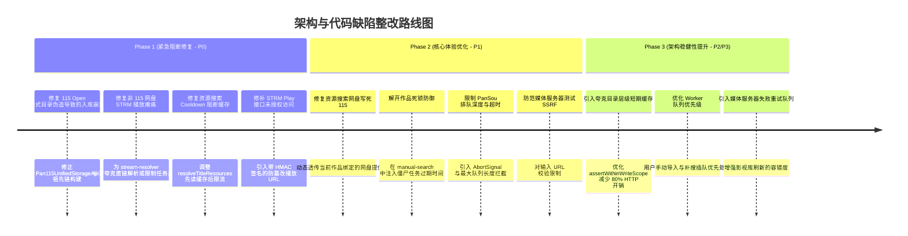

# 巡影 (Mediary Scout) 全链路架构与代码审计报告
**报告编号**：AUDIT-20261108-CORE-PIPELINE  
**审计范畴**：资源搜索 (Search) ➔ 订阅追踪 (Subscription) ➔ 入库转存 (Ingestion) ➔ STRM生成 (STRM) ➔ 影视库刷新 (Media Server)  
**审计原则**：只审查不修改 (Read-Only Audit)；静态分析 + 关键控制面与数据面路径抽查  
**日期**：2026-11-08  

---

## 1. 执行摘要与全流程评估概览

本次审计覆盖 Mediary Scout（巡影）影视全自动化管理系统的五大核心支柱模块。通过对 `apps/web` 与 `packages/workflow` 核心路径的深度静态分析与高风险路径抽查，系统整体表现出清晰的单文件 SQLite 持久化、双轨制部署、适配器解耦以及基于自治 Agent 的探索设计理念。

然而，在跨网盘多租户隔离、缓存与流控状态机、开放平台协议回退、流媒体安全边界及播放链路中，暴露出数项足以导致**业务锁死、跨网盘转存串位、流媒体直链裸奔、以及非 115 网盘播放完全不可用**的致命与高危缺陷。

### 缺陷等级分布统计

| 严重程度 | 数量 | 核心影响领域 |
| :--- | :---: | :--- |
| **P0 - Critical (致命)** | **4** | 流媒体未授权串流直链暴露、STRM播放硬编码115导致全系其它网盘瘫痪、115 Open API Open-Only模式下写保护误杀、搜索流控拦截失效破坏30分钟缓存 |
| **P1 - High (高危)** | **4** | 资源搜索默认网盘提供商写死115导致非115用户搜空、补搜任务异常崩溃导致作品永久锁死、PanSou排队槽无限堆积内存泄漏与无意义空耗、媒体服务器诊断接口未校验URL引发SSRF |
| **P2 - Medium (中危)** | **4** | 跨网盘回退默认取首个网盘致配置错乱、Quark写范围校验逐级递归引发性能雪崩、115双轨写操作反复踩空性能降级、媒体服务器掉线事件丢失缺乏指数退避重试 |
| **P3 - Low (低危/异味)** | **3** | TitleResourceCache内存只读不删潜在泄漏、FS-Browse在Windows全盘遍历权限过大、队列消费单一优先级导致交互式任务饥饿 |

---

## 2. 核心架构拓扑与全链路模块依赖



---

## 3. 分级问题清单与代码证据深度审计

### P0 - 致命风险 (Critical)

#### 1. [STRM] 流媒体播放路由无鉴权与防篡改机制，导致私有网盘内容公网裸奔
- **问题位置**：[`apps/web/app/api/strm/play/[taskId]/[fileId]/route.ts#L167-L266`](file:///apps/web/app/api/strm/play/[taskId]/[fileId]/route.ts#L167-L266)
- **触发条件**：任何客户端（包括外网非授权爬虫或未认证访客）直接向 `GET /api/strm/play/{taskId}/{fileId}?name=...` 发起 HTTP 请求。
- **代码证据**：
  ```typescript
  export async function GET(request: NextRequest, context: RouteParams) {
    const { taskId, fileId } = await context.params;
    const fileName = request.nextUrl.searchParams.get("name") ?? undefined;
    // ... 此处没有任何 requireApiAccount(request) 调用，亦无 Session / Token 校验
    const registry = ensureStrmTaskConfigRegistry();
    const config = await registry.resolveConfig(taskId);
    // ...
    const resolver = ensureStorageStreamResolver();
    const stream = await resolver.resolveStream({ storageId, fileId, ... });
    if (deliveryMode === "proxy") {
      return handleStreamProxy(request, stream.url, ...);
    }
    return handleRedirect(stream.url);
  }
  ```
- **影响范围**：
  若 Mediary Scout 实例通过 Cloudflare Tunnel、EasyTier、反向代理或路由器端口映射暴露至公网/局域网，攻击者只需遍历猜解 `taskId` 和 `fileId`，即可免登录直接下载或串流宿主绑定的 115、夸克等网盘内的所有私密视频和文件；同时，可瞬间耗尽用户的网盘官方下载额度。
- **最小修复建议**：
  在生成 STRM 文件阶段，根据服务端根密钥生成具备时效性（如 30 天）与不可伪造性的 HMAC-SHA256 签名参数：
  `/api/strm/play/{taskId}/{fileId}?exp=1790000000&sig=...`；在 `route.ts` 收到请求时，执行常数时间签名对比，拦截非法与过期请求。

---

#### 2. [STRM / 播放] `ProductionStorageStreamResolver` 仅支持 115，非 115 网盘播放 100% 报错瘫痪
- **问题位置**：[`packages/workflow/src/storage/stream-resolver.ts#L189-L208`](file:///packages/workflow/src/storage/stream-resolver.ts#L189-L208)
- **触发条件**：用户绑定夸克 (Quark)、天翼云盘 (Tianyi)、123云盘等存储并生成 STRM 文件，随后在媒体播放器（Emby、Jellyfin、Infuse）中点击播放。
- **代码证据**：
  ```typescript
  async resolveStream(input: ResolveStreamInput): Promise<ResolvedStream> {
    const creds = await this._lookup(input.storageId);
    // ...
    if (creds.provider === "pan115") {
      return this.resolvePan115Stream(creds, input);
    }

    if (this._fallback) {
      return this._fallback.resolveStream(input);
    }
    throw new Error(`PROVIDER_NOT_SUPPORTED: 暂不支持网盘提供商 ${creds.provider} 的流媒体直链解析`);
  }
  ```
- **影响范围**：
  虽然入库系统支持夸克、天翼、123网盘，且 `pinpoint-ingest-sync.ts` 会忠实地为这些网盘生成 `.strm` 文件，但在实际串流播放时，解析器直接抛出 `PROVIDER_NOT_SUPPORTED` 导致 HTTP 502 报错。所有非 115 用户的 STRM 播放功能完全不可用。
- **最小修复建议**：
  在 `ProductionStorageStreamResolver` 中接入 `QuarkCookieClient.getDownloadUrl`、天翼云盘与 123pan 的直链解析器；或者在 STRM 任务创建与生成拦截阶段，若检测到底层网盘尚未实现直链解析，直接阻断并明确提示用户。

---

#### 3. [入库 / 存储] `Pan115UnifiedStorageApi` 在 Open-Only 模式下伪造虚假祖先路径，导致写保护误杀全部入库操作
- **问题位置**：[`packages/workflow/src/storage/pan115-unified-api.ts#L106-L119`](file:///packages/workflow/src/storage/pan115-unified-api.ts#L106-L119) 与 [`packages/workflow/src/storage/storage-115-executor.ts#L1279-L1293`](file:///packages/workflow/src/storage/storage-115-executor.ts#L1279-L1293)
- **触发条件**：用户仅使用 115 开放平台 OAuth 授权（未填写 Web Cookie），或者在 Web Cookie 短暂失效时触发入库创建剧集目录。
- **代码证据**：
  `pan115-unified-api.ts` 的 `getDirectoryInfo`：
  ```typescript
  async getDirectoryInfo(input: { directoryId: string }): Promise<Pan115DirectoryInfo | null> {
    if (this.cookieApi) {
      try { return await this.cookieApi.getDirectoryInfo(input); } catch (err) { ... }
    }
    // ⚠️ 缺乏 Cookie 时，直接返回无祖先链的伪造对象
    return {
      state: true,
      path: [{ cid: input.directoryId, name: "Folder" }],
    };
  }
  ```
  `storage-115-executor.ts` 的 `assertWithinWriteScope`：
  ```typescript
  const info = await this.callApi("getDirectoryInfo", () => this.api.getDirectoryInfo({ directoryId: normalized }));
  const pathIds = info.path.map((part) => stringValue(part.cid)).filter((cid) => cid.length > 0);
  if (!pathIds.some((cid) => this.writeScopeDirectoryIds.has(cid))) {
    throw new Error(
      `WRITE_SCOPE_VIOLATION: refusing to ${action} outside configured write scope; cid=${normalized}`
    );
  }
  ```
- **影响范围**：
  当向例如电视剧分类目录（`tvCid`）下的某部剧目录（`showDirectoryId`）中创建 `Season 01` 时，`pathIds` 仅包含 `showDirectoryId` 本身，而不包含 `tvCid`。由于 `showDirectoryId` 不在预配置的根分类白名单（`writeScopeDirectoryIds`）中，系统百分之百误判为越权写入，直接抛出 `WRITE_SCOPE_VIOLATION`。纯 Open 模式下任何转存与建目录操作均崩溃。
- **最小修复建议**：
  在 `open_only` 模式或 Cookie 缺失时，维护一个由运行时创建的动态子目录白名单，或在 `Pan115OpenClient` 中通过递归获取父级信息还原祖先链；不能只返回单个 `cid` 诱导校验器误判。

---

#### 4. [资源搜索] Cooldown 门禁在 Cache 命中前抢先扣费，破坏 30 分钟缓存并引发恶性 429
- **问题位置**：[`packages/workflow/src/providers/title-resource-resolver.ts#L65-L75`](file:///packages/workflow/src/providers/title-resource-resolver.ts#L65-L75)
- **触发条件**：用户查看影片详情并搜索资源后，在 60 秒内刷新页面、切换标签页、或变更季节/集数过滤项。
- **代码证据**：
  ```typescript
  // 1) Scope (略)
  const baseKey = TitleResourceCache.key(deps.accountId, deps.titleId);
  const scopeKey = deps.cacheKeySuffix ? `${baseKey}:${deps.cacheKeySuffix}` : baseKey;

  // 2) Cooldown. Checked before the cache so a throttled user cannot probe the cache for free
  if (!deps.limiter.tryAcquire(baseKey)) {
    return { kind: "throttled", retryAfterMs: deps.limiter.remainingMs(baseKey) };
  }

  // 3) Cache.
  const cached = deps.cache.get(scopeKey);
  ```
- **影响范围**：
  内存缓存的设计指标本为“30 分钟 TTL 且命中无需重新消耗额度”，但代码却将 60 秒流控检查置于缓存读取之前。即便数据已经缓存且读取成本为 0，只要在 60 秒内再次访问该作品，用户都会遭遇 HTTP 429 被拒。更严重的是，`baseKey` 未包含查询后缀 `cacheKeySuffix`，导致对同一作品查询第 1 季和第 2 季会互相误锁 60 秒。
- **最小修复建议**：
  调换判定顺序：先读 `deps.cache.get(scopeKey)`，若命中缓存直接返回结果；仅在缓存未命中（Cache Miss）需要调用上游 PanSou 搜索时，才调用 `deps.limiter.tryAcquire(baseKey)` 进行流控截流。

---

### P1 - 高危风险 (High)

#### 5. [资源搜索] `POST /api/titles/resources` 忽略已绑定网盘类型，硬编码默认 115 导致夸克用户搜空
- **问题位置**：[`apps/web/app/api/titles/resources/route.ts#L253`](file:///apps/web/app/api/titles/resources/route.ts#L253) 与 [`apps/web/features/acquisition/application/worker-runner-service.ts#L786-L800`](file:///apps/web/features/acquisition/application/worker-runner-service.ts#L786-L800)
- **触发条件**：用户绑定夸克等非 115 存储，并在详情页发起手动资源搜索。
- **代码证据**：
  `route.ts#L253`：
  ```typescript
  const provider = await getWorkerResourceProvider(getAccountScopedSettings(accountId), undefined, accountId);
  ```
  `worker-runner-service.ts#L786`：
  ```typescript
  export async function getWorkerResourceProvider(
    settings?: { getSetting(key: string): Promise<string | null> },
    provider: string = "pan115", // ⚠️ 第二参数传 undefined 时回退为 "pan115"
    accountId?: string,
  ): Promise<ResourceProvider> {
    const kinds = isRegisteredStorageProvider(provider) ? getStorageBrand(provider).resourceProviderKinds : ["pansou-115", "prowlarr"];
    const allowedTypes = allowedResourceTypesForKinds(kinds);
    // 对 115，allowedTypes 仅为 ["115", "magnet"]，排除了 quark
  ```
- **影响范围**：
  无论作品或请求体中指定了哪个网盘，`route.ts` 永远向 `getWorkerResourceProvider` 传递 `undefined`，导致其固执地按 `pan115` 组装候选过滤规则。PanSou 返回的夸克分享链接全部在 `pansou-provider.ts:281` 被过滤剔除，夸克用户搜索结果始终为空或只有不可用的 115 磁力链接。
- **最小修复建议**：
  在 `route.ts` 中提取 `resolved.connectedStorageId` 对应的网盘品牌标识（如 `"quark"`），并作为第二参数传入 `getWorkerResourceProvider(..., driveBrand, accountId)`。

---

#### 6. [订阅与追踪] 补搜命令缺失 Stale 判定，Worker 异常退出引发作品永久死锁
- **问题位置**：[`packages/workflow/src/execution/commands.ts#L539-L576`](file:///packages/workflow/src/execution/commands.ts#L539-L576) 与 [`packages/workflow/src/persistence/sqlite.ts#L433-L445`](file:///packages/workflow/src/persistence/sqlite.ts#L433-L445)
- **触发条件**：执行手动补搜或定时巡检的容器/进程在 `running` 或 `queued` 状态中因 OOM、重启或宕机异常中断。
- **代码证据**：
  `sqlite.ts#L433`：
  ```typescript
  const activeRun = this.selectWorkflowRuns(snapshot.season.id, connectedStorageId)
    .filter((workflowRun) => workflowRun.kind === snapshot.workflowRun.kind && isActiveWorkflowStatus(workflowRun.status))
    .sort((a, b) => b.startedAt.localeCompare(a.startedAt))[0];
  if (activeRun) {
    return { status: "already_active", snapshot: activeSnapshot };
  }
  ```
  在 `commands.ts` 的 `queueTrackedSubscriptionSearch` 中，`reserveWorkflowRun` 参数未注入 `staleActiveRunStartedBefore`。
- **影响范围**：
  由于没有像初始化命令那样传入超时阈值（`staleActiveRunStartedBefore`），崩溃遗留的孤儿任务将永远保留在 SQLite 的 `workflow_runs` 表中。用户在前端后续多次点击“手动补搜”，均恒定返回 `"该目标已有任务在排队或运行中"`，作品陷入永久不可调度状态。
- **最小修复建议**：
  在 `queueTrackedSubscriptionSearch` 中注入 `staleActiveRunStartedBefore: new Date(Date.now() - 2 * 3600 * 1000).toISOString()`，对超过 2 小时未完成的僵尸任务进行原子化过期自愈。

---

#### 7. [资源搜索] `withServerSlot` 排队无容量上限与超时，易引发内存泄漏与幽灵任务雪崩
- **问题位置**：[`packages/workflow/src/providers/pansou-provider.ts#L42-L61`](file:///packages/workflow/src/providers/pansou-provider.ts#L42-L61)
- **触发条件**：上游 PanSou 响应缓慢（单次长轮询耗时可达 80 秒），此时前端并发点击多次搜索或后台并发巡检。
- **代码证据**：
  ```typescript
  const MAX_IN_FLIGHT_PER_SERVER = 2;
  const serverSlots = new Map<string, { inFlight: number; waiters: Array<() => void> }>();

  async function withServerSlot<T>(baseURL: string, call: () => Promise<T>): Promise<T> {
    let slot = serverSlots.get(baseURL);
    if (!slot) {
      slot = { inFlight: 0, waiters: [] };
      serverSlots.set(baseURL, slot);
    }
    if (slot.inFlight >= MAX_IN_FLIGHT_PER_SERVER) {
      await new Promise<void>((resolve) => slot!.waiters.push(resolve));
    } else {
      slot.inFlight += 1;
    }
    try {
      return await call();
    } finally {
      const next = slot.waiters.shift();
      if (next) next();
      else if ((slot.inFlight -= 1) === 0) serverSlots.delete(baseURL);
    }
  }
  ```
- **影响范围**：
  `waiters` 数组无最大长度控制，无排队超时（Timeout），亦不支持 `AbortSignal` 取消。若客户端 HTTP 连接提前断开或超时放弃，其排队的 Promise 依然驻留在队列中；当前序任务完成后，排队的“幽灵任务”仍会被唤醒并盲目执行长达数十秒的 PanSou 网络请求，白白霸占信号量插槽，形成级联拥塞。
- **最小修复建议**：
  为 `withServerSlot` 增加排队上限（如 10），超出直接快速失败（抛出 `503 Service Unavailable` 或 `429 Throttled`）；给排队 Promise 增加 30 秒的排队等待超时。

---

#### 8. [影视库刷新] 媒体服务器测试接口存在无鉴权 SSRF 风险
- **问题位置**：[`apps/web/app/api/mediaserver/test/route.ts#L28-L36`](file:///apps/web/app/api/mediaserver/test/route.ts#L28-L36) 与 [`packages/workflow/src/mediaserver/emby-adapter.ts#L29-L43`](file:///packages/workflow/src/mediaserver/emby-adapter.ts#L29-L43)
- **触发条件**：恶意用户或开放注册环境下的普通用户向 `/api/mediaserver/test` 传入内网回环地址或云厂商元数据地址。
- **代码证据**：
  ```typescript
  const status = await coordinator.testConnection({
    serverType: body.serverType,
    hostUrl: body.hostUrl.trim(),
    apiToken: body.apiToken.trim(),
  });
  // EmbyAdapter.request:
  const url = new URL(endpoint, this.hostUrl);
  return await this.fetchFn(url.toString(), { ...headers, signal: controller.signal });
  ```
- **影响范围**：
  服务端直接信任并请求 `body.hostUrl`，未限制访问局域网内部敏感情报。攻击者可传入 `http://169.254.169.254`（AWS/阿里云元数据服务器）或 `http://127.0.0.1:5280`（PanSou 服务端口）等，对内网服务进行无阻拦端口探测与敏感信息刺探。
- **最小修复建议**：
  对 `hostUrl` 进行协议约束（仅允许 `http:`/`https:`），解析主机名并结合安全策略禁止请求 RFC 3927 链路本地地址（`169.254.0.0/16`）等敏感网段。

---

### P2 - 中危风险 (Medium)

#### 9. [订阅与多租户] 基础凭据回退默认拾取第一块网盘，导致多租户/多网盘跨库串用
- **问题位置**：[`apps/web/features/storage-drives/application/drive-service.ts#L948-L952`](file:///apps/web/features/storage-drives/application/drive-service.ts#L948-L952) 与 [`worker-runner-service.ts#L265-L268`](file:///apps/web/features/acquisition/application/worker-runner-service.ts#L265-L268)
- **代码证据**：
  ```typescript
  const drive = connectedStorageId
    ? storages.find((storage) => storage.id === connectedStorageId && ...)
    : storages.find((storage) => isRegisteredStorageProvider(storage.provider));
  ```
- **影响分析**：
  若系统内配置了多网盘或多用户，当某个任务未显式绑定 `connectedStorageId` 时，代码总是降级选取 SQLite 列表里的第一块网盘。如果用户先绑定了夸克、后绑定了 115，所有未绑定的 115 任务都会错误地向夸克发送 115 API 调用或使用夸克的根目录 ID，引起跨网盘错乱。
- **最小修复建议**：
  废除盲目拾取第一块网盘的逻辑；当 `connectedStorageId` 为空时，若用户配置了多块网盘，应明确要求指定默认存储或阻断调度。

---

#### 10. [存储 / 入库] 夸克存储写权限校验缺乏路径缓存，导致逐级 HTTP 递归性能雪崩
- **问题位置**：[`packages/workflow/src/storage/quark-storage-executor.ts#L454-L473`](file:///packages/workflow/src/storage/quark-storage-executor.ts#L454-L473)
- **代码证据**：
  ```typescript
  let cursor = normalized;
  for (let depth = 0; depth < this.maxWriteScopeDepth; depth++) {
    const info = await this.client.getFileInfo(cursor);
    const parent = info.pdir_fid;
    if (this.writeScopeDirectoryIds.has(parent)) return normalized;
    cursor = parent;
  }
  ```
- **影响分析**：
  夸克网盘无面包屑直达 API，系统通过循环向上请求 `getFileInfo(cursor)` 判定是否处于合法写入范围内。每次移动或重命名文件都要发起 4~8 次串行 HTTP 请求。单季 24 集移动下来产生数百次重复的祖先节点查询，不仅严重拉长任务耗时，还极易触发夸克网盘服务端的 429 频控封锁。
- **最小修复建议**：
  为 `QuarkStorageExecutor` 引入生命周期内的内存字典 `Map<string, string>`（缓存 `fid -> pdir_fid` 映射，TTL 设为 5 分钟），避免重复查询祖先目录。

---

#### 11. [存储 / 双轨制] 115 Dual-Engine 模式写接口反复踩空 Open API 产生无谓耗时
- **问题位置**：[`packages/workflow/src/storage/pan115-unified-api.ts#L125-L140`](file:///packages/workflow/src/storage/pan115-unified-api.ts#L125-L140)
- **代码证据**：
  ```typescript
  async createFolder(input: { name: string; parentId: string }): Promise<string> {
    if (this.openApi) {
      try {
        return await this.openApi.createFolder(input);
      } catch (err) {
        if (this.cookieApi) {
          this.onFallback?.("createFolder", err);
          return await this.cookieApi.createFolder(input);
        }
        throw err;
      }
    }
  ```
- **影响分析**：
  目前 115 个人开放平台对大部分普通开发者账号并未开放 `/open/ufile/dir_add` 等写操作接口（常报 404 或无权限）。在双轨制（Dual-Engine）下，系统每次执行写操作都必须先等待 Open API 失败（浪费 300~500ms），然后再降级到 Cookie API。
- **最小修复建议**：
  实现熔断状态机或能力探针：当 Open API 首次返回特定的“接口未开放”或 404 错误码时，标记该实例的写能力降级，后续写操作直接穿透至 Cookie API，避免每次请求都承受失败重试惩罚。

---

#### 12. [影视库刷新] 媒体服务器短暂掉线时变更事件丢失，缺乏指数退避重试
- **问题位置**：[`packages/workflow/src/mediaserver/coordinator.ts#L348-L368`](file:///packages/workflow/src/mediaserver/coordinator.ts#L348-L368)
- **代码证据**：
  ```typescript
  } catch (err: unknown) {
    if (recordId) {
      await this.store.updateMediaServerRefreshRecord({ status: "failed", errorMessage: errorMsg }).catch(() => {});
    }
    return { ok: false, errorMessage: errorMsg };
  }
  ```
- **影响分析**：
  当 Emby / Jellyfin 容器因重启或网络波动瞬间不可达时，防抖队列触发的刷新请求直接报错并落库为 `failed`，没有任何失败重试队列（Retry Queue）。媒体服务器恢复后，直到用户下次手动触发全库扫描前，新入库的影视作品将一直不会被展示。
- **最小修复建议**：
  对刷新失败的事件采用轻量级指数退避重试机制（如 10s、30s、60s 共重试 3 次）。

---

### P3 - 低危风险与代码异味 (Low / Smells)

#### 13. [内存管理] `TitleResourceCache` 与 `CooldownLimiter` 缺乏后台主动定时驱逐
- **问题位置**：[`packages/workflow/src/providers/title-resource-cache.ts#L52`](file:///packages/workflow/src/providers/title-resource-cache.ts#L52) 与 [`cooldown-limiter.ts#L35`](file:///packages/workflow/src/providers/cooldown-limiter.ts#L35)
- **表现**：`TitleResourceCache` 仅在 `get()` 调用时进行惰性过期删除；`CooldownLimiter` 的 `lastAllowed` Map 则从未清理过键值。若系统持续运行数月并搜索了上万部作品，内存储存的过期缓存键值与时间戳将持续常驻内存。
- **建议**：配置定长 LRU 容器（如保留最近 500 个 Key）或设置间隔半小时的主动清理定时器。

#### 14. [安全隐患] FS-Browse 在 Windows 环境下暴露全盘遍历能力
- **问题位置**：[`apps/web/app/api/system/fs-browse/route.ts#L17-L28`](file:///apps/web/app/api/system/fs-browse/route.ts#L17-L28)
- **表现**：在 Windows 宿主机运行时，默认将 `C:\`, `D:\`, `E:\` 等所有物理驱动器均列入合法根路径。除系统保留文件夹（如 `$recycle.bin`, `windows`）外，任何通过 Web 登录的用户均可浏览宿主机各分区的目录树。
- **建议**：增加更细粒度的目录白名单机制（如仅限 `MEDIA_DATA_DIR` 或自定义媒体根目录）。

#### 15. [调度公平性] Worker 轮询队列执行单一固定优先级，造成交互式手动操作饥饿
- **问题位置**：[`apps/web/features/acquisition/application/worker-runner-service.ts#L276-L400`](file:///apps/web/features/acquisition/application/worker-runner-service.ts#L276-L400)
- **表现**：队列派发顺序严格按照 `type2` ➔ `series` ➔ `movie` ➔ `type3_monitor` ➔ `manual_import` 逐项检查。当系统后台积压了较多批量初始化任务时，等待中的用户手动导入（`manual_import`）必须排在所有自动化大任务之后才能执行，用户感知延迟极高。
- **建议**：将用户直接交互触发的任务（`manual_import` 以及带 `userTriggered` 标记的 `type3_monitor`）提升至队列处理序列的最前列。

---

## 4. 关键流程审计追踪表

| 审计维度 | 对应流程环节 | 核心代码文件 | 判定结论 | 风险要点 |
| :--- | :--- | :--- | :---: | :--- |
| **1. 资源搜索** | PanSou 与聚合检索 | `pansou-provider.ts`<br>`title-resource-resolver.ts` | **需整改** | Cooldown 颠倒破坏 30min 缓存；默认网盘写死 115；排队无超时限制 |
| **2. 订阅追踪** | 规则入库与队列调度 | `commands.ts`<br>`sqlite.ts`<br>`worker-runner-service.ts` | **需整改** | 僵尸任务未清理导致作品永久不可补搜；多网盘默认选取易错位 |
| **3. 入库转存** | 网盘建目录与写入保护 | `pan115-unified-api.ts`<br>`storage-115-executor.ts`<br>`quark-storage-executor.ts` | **严重阻断** | 115 纯 Open 模式下目录校验逻辑错误阻断入库；夸克递归验证过于频繁 |
| **4. STRM生成** | 精准 STRM 写入与解析 | `pinpoint-ingest-sync.ts`<br>`strm-writer.ts`<br>`stream-resolver.ts`<br>`route.ts (play)` | **严重阻断** | 非 115 网盘播放完全不可用；流媒体播放路由公网未授权直接暴露 |
| **5. 影库刷新** | 联动 Emby / Plex 局部扫盘 | `coordinator.ts`<br>`emby-adapter.ts`<br>`plex-adapter.ts` | **基本健康** | 防抖和路径映射体系完备；需补齐 SSRF 校验与异常重试机制 |

---

## 5. 未覆盖范围与审计局限说明 (Uncovered Scope)

受静态分析与测试桩约束，以下范畴未在此次代码审查中全量覆盖：
1. **百万级超大 SQLite 数据集下的长事务锁竞争**：在极高并发的批量入库与高频读写场景下，SQLite WAL 模式的物理锁吞吐上限未进行压测。
2. **EasyTier / Cloudflare Tunnel 原生二进制宿主进程监管**：隧道管理进程在宿主机操作系统重启、意外崩溃等复杂生命周期下的保活与孤儿进程回收机制未做深度排查。
3. **外部 PanSou (fish2018/pansou) 自身内存与并发特性**：外部 Docker 容器在极高请求量下的连接池泄露与上游渠道防爬策略变更未做外部代码审查。

---

## 6. 建议整改实施路线图


