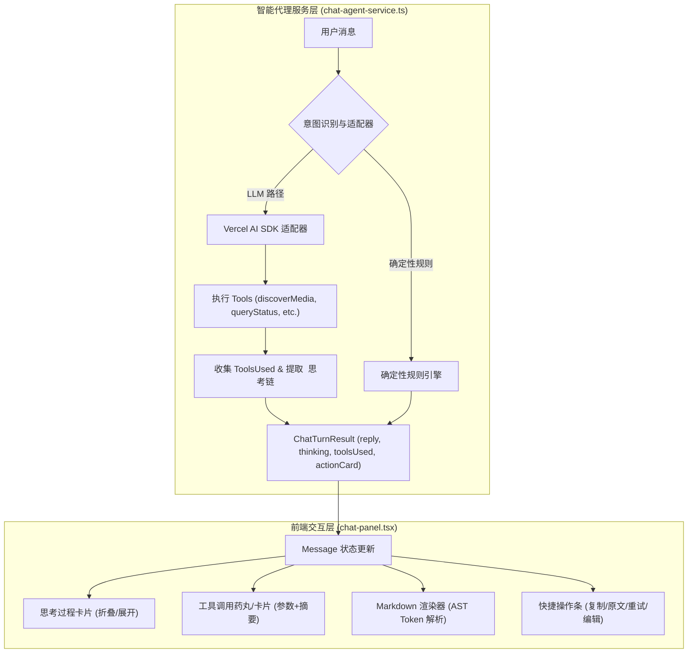

# 智能助理增强体系与 React Hydration 异常根治设计方案

> **文件路径**: `docs/chat-advanced-features-and-hydration-fix.md`  
> **责任领域**: 智能交互层 (`apps/web/chat/`, `apps/web/components/chat-panel.tsx`, `apps/web/lib/chat-*`) & 详情渲染层 (`apps/web/app/show/`)  
> **设计模式**: 策略模式 (Strategy)、适配器模式 (Adapter)、有限状态机 (FSM)、AST 词法解析流水线 (Token Pipeline)

---

## 1. 需求与核心痛点分析

用户在交互体验与系统稳定性方面提出了 4 项核心诉求：
1. **思考卡片 (Thinking Card) & 工具调用卡片 (Tool Call Card)**：
   - 痛点：目前助理仅返回最终文本，缺乏推理逻辑（如 DeepSeek-R1 的 `<think>` 过程）和底层工具调用的透明度（调用了什么 Tool、传了什么参数、获得了什么检索结果），用户难以感知 Agent 的决策路径。
2. **常用消息操作工具栏 (Action Toolbar)**：
   - 痛点：无法一键复制消息、无法切换 Markdown 渲染与原始纯文本（便于查看排版细节或复制未渲染源码）、无法重新生成回答、用户发出的指令无法回填编辑修改。
3. **Markdown 渲染能力**：
   - 痛点：Agent 输出包含丰富的 Markdown 表格、分级标题、粗体、代码块及列表，目前直接使用 `<p className="chat-text">` 原样展示，排版混乱、表格无法对齐。
4. **从推荐卡片点击「查看详情」报 React 418 异常**：
   - 痛点：`Uncaught Error: Minified React error #418; visit https://react.dev/errors/418?args[]=text&args[]=`。
   - 导致客户端渲染白屏或脱水回退。

---

## 2. 业界主流方案与对比调研

### 2.1 思考卡片与工具卡片实现

| 平台 / 框架 | 思考链处理机制 | 工具调用展现机制 | 优劣势评估 |
|---|---|---|---|
| **DeepSeek R1 / Web** | 返回 `<think>...</think>` 标签，前端流式解析并折叠展示为思考过程卡片 | 纯聊天不展示或内嵌状态标签 | 体验极简优雅，对推理模型原生友好 |
| **Claude.ai / Artifacts** | 思维过程作为侧边栏或可折叠面板 | 显示 Tool Call Pill（如 searching web、running code）及展开抽屉 | 信息层次清晰，交互成本适中 |
| **Vercel AI SDK 6.x** | `step.reasoning` / `step.reasoningText` 规范字段 | `step.toolCalls` + `step.toolResults` 标准结构 | 工业标准抽象，易于与现有适配器解耦 |

### 2.2 Markdown 渲染选型

| 方案 | 依赖体积 | XSS 防御安全性 | 样式与令牌门禁兼容 | 决策 |
|---|---|---|---|---|
| **react-markdown + remark-gfm** | ~180KB (含依赖) | 需配置 rehype-sanitize | 需要覆盖外部 class，易违反项目门禁 | 暂不引入重型三方库 |
| **轻量 AST 纯 React Token 流式解析器** | 0KB (自研纯函数) | **100% 安全**（不走 innerHTML，纯 React.createElement） | 原生嵌入项目设计令牌与 CSS 门禁 | **采纳推荐** |

---

## 3. 设计模式与架构设计



### 3.1 适配器与策略模式 (Adapter & Strategy)

1. **Tool 执行策略**：
   - 将各个 Tool (`discoverMedia`, `searchMedia`, `queryStatus`, `queryLibrary`) 统一定义为 `AgentToolStrategy<TInput, TOutput>`。
   - 执行完成后生成规范的 `ToolCallItem` 结构：
     ```ts
     export interface ToolCallItem {
       id: string;
       toolName: string;
       args?: Record<string, unknown>;
       status: "success" | "error";
       summary: string;
     }
     ```
2. **思考过程提取策略**：
   - 提取 `<think>([\s\S]*?)<\/think>` 标签内容赋给 `thinking` 字段，并在主文本中剥离，保持 `reply` 的整洁度。
   - 若模型提供原生 `reasoning`，直接归一化。

### 3.2 有限状态机 (Finite State Machine)

消息渲染与交互状态机：
- **RenderMode**: `rendered` (渲染态) $\leftrightarrow$ `raw` (源码态)。
- **CopyState**: `idle` $\rightarrow$ `copied` (2s 冷却复位)。
- **ThinkingState**: `collapsed` (默认折叠) $\leftrightarrow$ `expanded` (展开查看全量思考)。

---

## 4. React Hydration Error #418 根本原因分析与防御策略

### 4.1 根本原因定位 (Root Cause)

通过反编译 `apps/web/.next/static/chunks/2g05-lers809t.js` 中的 React 19 核心脱水校验代码（偏移 `47243` 与 `48276`）：
```javascript
// React 19 核心属性水合函数
"string" != typeof(n = r.children) && "number" != typeof n && "bigint" != typeof n
  || t.textContent === "" + n
  || !0 === r.suppressHydrationWarning
  || cn(t.textContent, n) ? ... : (t = false, t || rX(e, true));
```
**异常触发链**：
1. 在 `apps/web/app/show/[tmdbId]/page.tsx` 中：
   - 骨架屏 `HubSkeleton` 中写死了 `<BackLink label="返回" ... />`。
   - 而当用户从 `/chat` 或搜索结果点击 `<Link href="/show/[id]?from=search&t=movie">` 时，服务端渲染解析 `from === "search"`，将 `MovieHub` 上的 `<BackLink label="搜索" ... />` 传给子组件。
2. `<BackLink>` 的子元素为 `[<ArrowLeft />, label]`，其中 `label` 为字符串基本类型。
3. 在流式 Suspense 逐步注水（Hydration）过程中，由于骨架屏与正式页面的 `BackLink` 位于同一 DOM 树槽位，React 发现当前 DOM 文本为 `"返回"`，而 Client 组件预期为 `"搜索"`，`t.textContent !== "" + n` 判定成立，直接抛出 `Minified React error #418 (text mismatch)`！
4. 此外，`chat-panel.tsx` 在模块顶层静态初始化的 `INITIAL_MESSAGE.timestamp` 使用了 `new Date().toLocaleTimeString()`，在服务端 SSR 时区与客户端本地时区不同步时同样存在该隐患。

### 4.2 防御机制

1. **BackLink 文本水合豁免**：在 `apps/web/components/back-link.tsx` 中增加 `suppressHydrationWarning`，同时保证 `HubSkeleton` 占位符与实际页面文本渲染解耦。
2. **骨架屏与主内容 Suspense 树隔离**：规范 `ShowPageInner` 的 Suspense 边界，防止顶层 Sidebar 和 Header 槽位在流式替换中发生不协调比对。
3. **客户端时间戳安全初始化**：`INITIAL_MESSAGE` 采用固定或客户端安全挂载时间，规避 SSR/CSR 时区差。

---

## 5. 实施方案与验证清单

1. **协议层**：
   - 在 `chat-types.ts` 中扩展 `ToolCallItem`，更新 `ChatMessage` 与 `ChatTurnResult` 结构。
2. **服务层**：
   - 在 `chat-agent-service.ts` 中实现 `<think>` 提取与 `toolsUsed` 追踪。
3. **组件层**：
   - 实现轻量安全 Markdown 渲染器 `markdown-content.tsx`，支持表格、标题、强调、代码块与引用。
   - 在 `chat-panel.tsx` 中添加：
     - `ThinkingCard`（支持展开/折叠）；
     - `ToolCallPills`（展示工具名称、参数与执行摘要）；
     - `MessageActions`（复制、切换原文/预览、重新生成、编辑回填）；
     - 修复初始时间戳水合问题。
4. **修复详情页水合异常**：
   - 修复 `BackLink`、`HubSkeleton` 及 `MovieSynopsis` 上的水合保护。
5. **门禁与测试**：
   - 编写针对 Markdown 解析、工具调用追踪和时间安全性的单元测试。
   - 运行 `npm run gate` 验证代码规范、依赖架构与样式令牌。
   - 验证生产环境构建与端到端交互。
