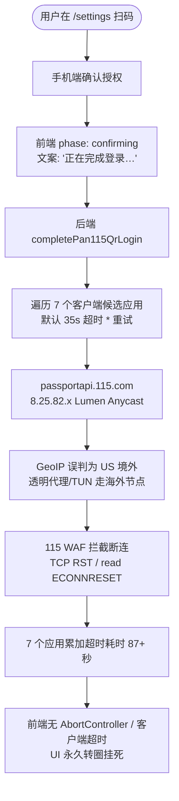

# 网盘授权与外部网络调用可靠性治理调研及防回归门禁规范

> **文档定位**：针对 115 扫码授权过程中出现的 TCP RST（`read ECONNRESET`）与前端「正在完成登录…」无限转圈卡死等系统性问题，进行全系统同类隐患排查、根因剖析、业界主流架构方案对比，并给出自动化防回归门禁与落地执行方案。
> **生效版本**：v2026.10.30.6+
> **对应门禁**：`npm run gate:http-timeout`

---

## 1. 调研背景与问题根因分析

在 115 扫码授权调试中，系统暴露出两类相互耦合的深层次网络与交互缺陷：



### 1.1 核心问题与根因归纳

1. **前端无限转圈挂死（UI Indefinite Spinning）**：
   - 前端进入 `confirming` 状态后，发起 `fetch('/api/.../confirm')`。原生 `fetch()` 默认没有任何客户端超时上限。
   - 若后端因上游网络断连、重试或长轮询超时堆叠（例如 7 个候选端各 35s），在途 Promise 持续数十秒甚至数分钟未决，用户界面一直显示「正在完成登录…」，无取消途径、无超时提示、无降级指引。
2. **多候选应用轮询超时放大（Cascading Timeout Multiplication）**：
   - 换票逻辑为了兼容不同端（如 tv、web、android 等），循环探测 candidate apps。
   - 若探测未设独立超时预算，且在收到权威响应（Authoritative Response，如账号不存在或未扫码）时未及时短路熔断，网络丢包时总超时呈乘法级膨胀。
3. **GeoIP 分流陷阱与长连接池复用缺陷**：
   - 国内网盘的部分 Anycast 节点（如 115 的 `passportapi.115.com` 对应的 `8.25.82.x`）在 MaxMind/GeoIP 库中被划归美国。部署环境的透明代理或 Clash/Surge 规则将其分流出境，触发国内云服务 WAF 的阻断重置（`read ECONNRESET`）。
   - Node.js 的 undici 调度器默认复用 Keep-Alive 空闲 Socket，而网盘边缘节点会主动 RST 超时空闲连接，导致随后的 HTTP 请求在复用已死 Socket 时直接崩裂。

---

## 2. 全系统同类隐患地毯式排查

经对 `apps/web` 与 `packages/workflow` 全量代码进行静态分析，发现了 4 个维度的同类隐患：

| 隐患维度 | 涉及组件/模块 | 隐患现状与危害 | 严重度 |
| :--- | :--- | :--- | :--- |
| **前端无超时卡死** | `cloud-family-qr-connect.tsx`<br/>（夸克网盘、UC网盘） | `confirm`、`start`、`pollLoop` 均使用裸 `fetch`，无 `AbortController`。换票超时时界面永久卡死在「正在完成登录…」。 | 🔴 P0 严重 |
| **前端无超时卡死** | `pan123-qr-connect.tsx`<br/>（123网盘） | `confirm` 无 `AbortController` 超时控制，网络异常时界面永久处于 `confirming` 状态。 | 🔴 P0 严重 |
| **前端无超时卡死** | `tianyi-qr-connect.tsx`<br/>（天翼云盘） | `confirm` 无 `AbortController` 超时控制，换票若因天翼网关抖动挂起，界面永久卡在「正在完成登录…」。 | 🔴 P0 严重 |
| **后端违背超时铁律** | `quark-qrcode-login.ts`<br/>（阿里云盘族 CAS 引擎） | `defaultFetchJson` 与 `defaultRawFetch` 直接调用裸 `fetch()`，**未传任何 `signal` 或超时时间**！违反了本项目的核心架构红线（“HARD project rule: new external HTTP ALWAYS carries a timeout”）。在多跳重定向中若遇网络黑洞将造成 Node 服务端进程连接泄漏与堵塞。且未设置 `Connection: close`。 | 🔴 P0 严重 |
| **代理白名单遗漏** | `http-proxy.ts` | `DEFAULT_DOMESTIC_NO_PROXY` 包含了 `115.com`、`quark.cn`、`189.cn`，但**遗漏了 UC 网盘（`uc.cn`、`*.uc.cn`、`api.open.uc.cn`、`drive.uc.cn`）**，且未包含局域网私有网段（`10.*`, `192.168.*`, `172.16.*`~`172.31.*`），导致自建网盘或 UC 网盘在配置 HTTP_PROXY 时被误分流。 | 🟡 P1 重要 |
| **缺少自动化门禁** | `scripts/` 与 CI 流水线 | 此前仅有 `gate:layout` 与 `gate:style`，无针对外部 HTTP 调用的静态超时校验门禁，导致超时规则全凭口头自觉。 | 🟡 P1 重要 |

---

## 3. 业界主流方案调研与对比

### 3.1 业界代表性开源项目实践

```mermaid
classDiagram
    class AlistGoPattern {
        +ContextWithTimeout(8s)
        +DisableKeepAlives: true
        +DistinctPollAndRedeemBudgets()
        +FallbackManualToken()
    }
    class KyGotNodePattern {
        +timeout: { request: 10000 }
        +retry: 2
        +hooks.beforeError()
    }
    class TanStackReactQuery {
        +AbortSignalPassThrough()
        +mutationFnTimeout()
        +gcTime / staleTime()
    }
```

1. **Alist（Go 语言，GitHub 40k+ Stars，多网盘聚合挂载标杆）**：
   - **两级超时与预算隔离**：轮询接口单次超时 5s，总轮询超时 3~5 分钟；换票操作（Redemption）独立设置 `context.WithTimeout(ctx, 8*time.Second)`。超时立刻向前端归还清晰的超时错误码，严禁后端长时间阻塞。
   - **连接池防护**：针对 115、夸克、天翼等国内服务，在 `http.Transport` 中明确配置 `DisableKeepAlives: true`，禁止将国内网盘的短链接放入长连接池，从根本上杜绝 WAF RST 导致的空闲连接复用失效。
   - **双轨输入降级**：所有扫码授权弹窗底部均紧随提供手动输入 Token/Cookie 的折叠面板，扫码换票失败时自动展开并高亮提示。

2. **Ky / Got / Axios（现代 HTTP Client 库）**：
   - **强制超时规范**：`ky` 与 `got` 默认开启全局超时约束，禁止发起“无限等待”的裸请求；
   - **标准化 AbortSignal 联动**：请求自动绑定调用方传入的 Signal 与自身超时 Signal，任意一方触发即可立刻释放底层 Socket 句柄。

3. **TanStack React Query / SWR（前端异步状态管理）**：
   - **取消契约**：所有的 Mutation（变更）与 Query（查询）在组件卸载或超时时，通过 `AbortController` 广播取消在途网络请求，彻底消除组件状态悬挂与内存泄漏。

---

## 4. 当前系统基础设施与可复用资产

本项目并非从零开始，代码库中已沉淀了优良的基础设施，只需将其推广并强制固化：

1. **`packages/workflow/src/fetch-with-timeout.ts`**：
   - 现已提供 `fetchWithTimeout(url, init, timeoutMs)`，支持双 Signal 合并（`AbortSignal.any([init.signal, timeout])`）。
2. **`AbortSignal.timeout(ms)`**：
   - 运行环境为 Node 22+ 与现代浏览器，已原生支持高内聚的 `AbortSignal.timeout(...)`，无须外部 polyfill。
3. **`apps/web/lib/http-proxy.ts`**：
   - 具备集中式免代理名单生成机制 `DEFAULT_DOMESTIC_NO_PROXY` 与错误展开函数 `formatNetworkError`。
4. **`packages/workflow/src/pan115-qrcode-login.ts` 沉淀的验证经验**：
   - 换票超时收敛至 8s；
   - 国内直连通道优先分流；
   - 瞬态网络异常快速重试（`isTransientPan115NetworkError`）；
   - 请求头显式追加 `Connection: "close"`。

---

## 5. 具体解决方案与架构落地

### 5.1 前端扫码全家族增加统一 25s 客户端超时与优雅降级

在 `cloud-family-qr-connect.tsx`（夸克/UC）、`pan123-qr-connect.tsx`（123网盘）、`tianyi-qr-connect.tsx`（天翼云盘）中统一引入 `AbortController`：

```tsx
async function confirm(...) {
  const controller = new AbortController();
  const timer = setTimeout(() => controller.abort(), 25_000);
  try {
    const res = await fetch(confirmApi, {
      method: "POST",
      headers: { "Content-Type": "application/json" },
      body: JSON.stringify(payload),
      signal: controller.signal,
    });
    ...
  } catch (error) {
    if (generation.current !== myGen) return;
    setPhase("error");
    const isTimeout = error instanceof Error && error.name === "AbortError";
    setMessage(
      isTimeout
        ? "登录确认超时，请重试或改用下方手动绑定方式。"
        : "网络异常，请重试或改用下方手动绑定方式。"
    );
  } finally {
    clearTimeout(timer);
  }
}
```

同时对 `start()`（生成二维码）与 `pollLoop()`（轮询状态）设置单次网络超时（15s 与 8s），杜绝在二维码生成阶段卡死。

### 5.2 后端补齐 `quark-qrcode-login.ts` 的超时与连接关闭约束

1. 为 `defaultFetchJson` 与 `defaultRawFetch` 注入 `AbortSignal.timeout(15_000)`；
2. 在 `headers()` 中加入 `Connection: "close"`，彻底消除阿里与 UC 边缘网关连接池偶发 RST 隐患。

### 5.3 扩充 `http-proxy.ts` 代理白名单

在 `DEFAULT_DOMESTIC_NO_PROXY` 中补齐：
- UC 网盘：`uc.cn`, `*.uc.cn`, `.uc.cn`, `api.open.uc.cn`, `drive.uc.cn`, `su.uc.cn`；
- 阿里云盘/夸克生态辅助域：`alipan.com`, `*.alipan.com`, `aliyundrive.com`, `*.aliyundrive.com`；
- 内网与私有容器地址段：`10.*`, `192.168.*`, `172.16.*` ~ `172.31.*`。

### 5.4 建立自动化同类门禁（`scripts/check-http-timeout.mjs`）

在 `scripts/` 中建立静态扫描脚本，并在 `package.json` 的 `npm run gate` 中注册：
- 扫描 `packages/workflow/src/` 中的所有生产源文件；
- 校验每一个 `fetch(` 调用必须显式配置 `signal`、`timeout`、`timeoutMs`，或经由 `fetchWithTimeout` 发起；
- 若出现无任何超时信号控制的裸 `fetch`，构建直接失败并打印违规文件与行号，从源头杜绝代码回归。

---

## 6. 验证与发布计划

1. **静态代码分析与门禁**：运行 `npm run gate:http-timeout` 验证所有网盘模块 100% 达标。
2. **自动化测试**：运行 Vitest 全量单元测试（涵盖 115、夸克、UC、天翼、123网盘及代理配置）。
3. **版本发布与触发构建**：提交代码并打上版本标签推送至远程仓库，GitHub Actions 自动化流水线构建并发布生产 Docker 镜像。
