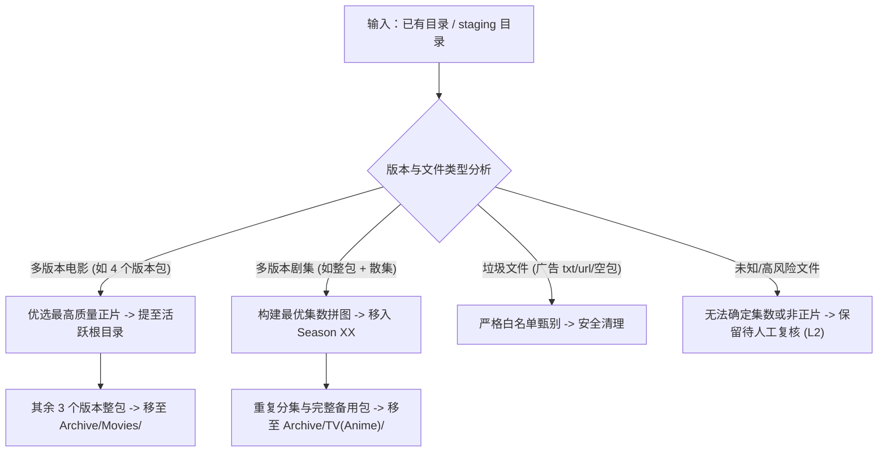
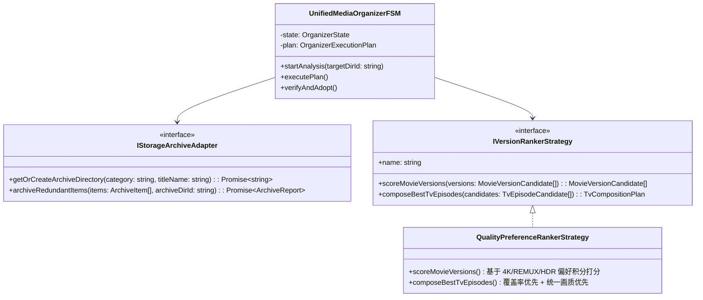
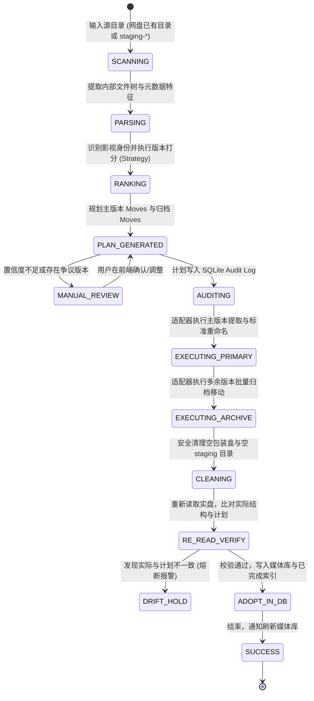

# 巡影 (Mediary Scout) 网盘已有文件与暂存目录智能整理及多版本归档技术白皮书

> **文档定位**：针对用户核心诉求——**“对于网盘已有文件和暂存目录文件，能否支持整理成标准目录格式，并将多余版本自动归档到统一分类的归档目录？”**，进行深度头脑风暴、可行性论证、逻辑与性能缺陷排查，对比业界主流（Sonarr / Radarr / MoviePilot / Emby / Jellyfin）解决方案，运用**适配器模式 (Adapter)**、**策略模式 (Strategy)** 与**有限状态机 (FSM)** 提出工业级落地架构。

---

## 1. 业务背景与问题剖析

### 1.1 真实痛点复盘（结合实机截图）

在日常网盘使用与自动化追剧中，用户的网盘文件通常会因为以下原因变得高度混乱：

1. **痛点一：电影目录下多版本堆叠混杂（如截图 2 所示）**
   - 路径：`Movies/新汉普夏饭店 (1984) {tmdb-11308}/`
   - 目录下同时存在 4 个发版组的嵌套子目录：
     - `The Hotel New Hampshire (1984) [1080p] [BluRay] [YTS.MX]`
     - `The.Hotel.New.Hampshire.1984.1080p.BluRay.H264-RARBG`
     - `The.Hotel.New.Hampshire.1984.1080p.BluRay.X264-AMIABLE`
     - `The.Hotel.New.Hampshire.1984.1080p.BluRay.x264-RARBG`
   - **后果**：
     - Emby / Jellyfin / Plex 扫描时出现多条重复电影或海报墙割裂；
     - 视频深陷在多层包装目录中，STRM 直链解析需要穿透多层路径；
     - 用户既不希望盲目将其他 3 个版本永久删除（万一主版本音轨不对/画质有瑕疵），又不希望它们杂乱陈列在活跃库中。

2. **痛点二：Staging 暂存目录混杂多源与整包（如截图 3 所示）**
   - 路径：`Anime/桃源暗鬼 (2025) {tmdb-253811}/staging-0b62585d-fa41-412b-acd6-c515e383a78e/`
   - 暂存目录下混杂存放：
     - Baha 动画疯源 `01~04.mp4`
     - LoliHouse 压制组 `05~06.mkv`
     - 高清剧集网发布 `【全24集】` 整包合集
   - **后果**：
     - 现有的清理机制（`discardStaging`）通常粗暴地把没用到的整包和备选集当垃圾连根删除，或者由于里面有视频而不敢删除，导致该 `staging-*` 沦为僵尸孤儿目录；
     - 用户极度需要：**“正片最优集规整入库，剩余备用合集与冗余集数归档入库，空 staging 优雅销毁”**。

---

## 2. 业界主流方案调研与经验借鉴

| 维度 | **MoviePilot / NASTool** | **Sonarr / Radarr (Servarr 生态)** | **Emby / Jellyfin / Plex 原生** | **巡影 (Mediary Scout 目标设计)** |
| :--- | :--- | :--- | :--- | :--- |
| **已有与散落文件整理** | 目录监控 + 转移整理；支持自定义目标路径与重命名模板 | **Manual Import**：可视化映射表，手动选择 Move / Copy 并重命名 | 仅依赖外部工具预先整理好，自身不具备主动网盘整理能力 | **多源输入整理引擎**：统一承接网盘已有乱序目录与 `staging-*` 目录 |
| **多余/历史版本处理** | **历史备份目录 (History Directory)**：洗版时旧版移入指定历史目录 | **Recycle Bin Folder**：升级替换时将旧文件原子移至回收站保留相对路径 | 原生支持多版本命名（如 `- [1080p]`），但目录混乱时刮削极易翻车 | **统一分类归档区 (`Archive/`)**：按分类结构完整保存淘汰/冗余版本上下文 |
| **主版本优选算法** | 严格优先级规则（4K > 1080P、HDR、特效字幕、特定压制组评分） | Quality Profiles + Custom Formats 积分制打分体系 | 播放器前端根据客户端解码能力手动下拉切换 | **多维打分策略 (`VersionRanker`)**：画质标签 + 分辨率 + 体积比例 + 字幕完整度 |
| **破坏性防御机制** | 保留历史处理记录；同名覆盖前检查；支持仅增不删 | 覆盖前弹窗报警；回收站保留期自动轮转 | 无修改磁盘能力 | **计划先行 + 审计落盘 + 原子移动 + 读回比对 + 漂移熔断** |

### 核心启示
1. **活跃库（Active Library）与归档库（Archive Library）必须物理隔离**：
   - 活跃库必须遵循业界最高规范（如 Emby/Plex 标准：`片名 (年份) {tmdb-id}/片名 (年份) [质量].ext`），保证 100% 纯净与刮削 0 报错；
   - 归档库（如 `/Mediary Scout/Archive/`）作为“安全网”与“冷数据沉淀池”，妥善收纳所有被淘汰的多版本与备用包，消除用户的误删焦虑。
2. **网盘“零拷贝成本移动”是核心技术红利**：
   - 本地磁盘做归档受限于磁盘容量与跨盘复制耗时，而网盘同账号内的 `file_move` 是秒级元数据修改，不耗流量、不占新配额，实现成本极低。

---

## 3. 头脑风暴：可行性、逻辑漏洞与性能限流评估

### 3.1 可行性评估（Feasibility）
- **可行性评分：100%**。
- **技术基础支撑**：
  - 巡影已有的 [`DriveFileManager`](file:///packages/workflow/src/storage/drive-file-manager.ts) 与 [`StorageExecutor`](file:///packages/workflow/src/domain/ports.js) 原生具备跨目录 `moveFiles` 与 `createDirectory` 能力；
  - 巡影已有的 [`title-parse-chain.ts`](file:///packages/workflow/src/domain/title-parse-chain.ts) 与 [`episode-code.ts`](file:///packages/workflow/src/domain/episode-code.ts) 能够对任何野蛮命名的文件进行高置信度反推；
  - 巡影已有的 [`staging-janitor.ts`](file:///packages/workflow/src/execution/staging-janitor.ts) 原生具备在后台巡检网盘所有 `staging-*` 目录的机制。

---

### 3.2 逻辑盲区与极端边界推演（Potential Gaps & Edge Cases）



#### 边界 1：电影单文件 vs 包装目录的移动形态差异
- **问题**：如果冗余版本是一个目录（如 `The.Hotel...-RARBG/` 包含视频、NFO、Sample、字幕），归档时如果只移走里面的视频，会在原地留下空包装盒。
- **对策**：归档采用 **“整包移动优先 (Folder-level Move First)”** 原则：
  - 主版本：提取内部正片与字幕扁平化到活跃库，随后清理原包装盒；
  - 冗余版本：将整个原始包装盒完整移入 `Archive/Movies/电影名 (年份) {tmdb-id}/` 下，最大化保留原始发布组信息与特典附件。

#### 边界 2：归档目录重名碰撞（Collisions on Multiple Upgrades）
- **问题**：若用户先后两次整理了同一个剧或同一部电影，归档目录下可能已经存在同名文件夹（例如上次已经归档过一次 `The.Hotel...-RARBG`）。
- **对策**：归档移动前进行目标冲突探针，若检测到同名，自动附加时间戳后缀：  
  `The.Hotel...-RARBG (archive-20261110-143022)`，保证移动必定成功且不覆盖历史归档。

#### 边界 3：剧集跨版本“拼图”与合集包归档
- **问题**：如截图 3 中，用户有 Baha 01~04，LoliHouse 05~06，还有一个全 24 集整包。
- **对策**：
  1. 若全 24 集整包画质统一且最高，全 24 集作为主版本解包整理入 `Season 01`，Baha 与 LoliHouse 的零散分集统一打包移入 `Archive/Anime/桃源暗鬼/零散备选集/`；
  2. 若用户偏好 LoliHouse 但 LoliHouse 只有 01~06，系统采用“最优拼图算法”，将 LoliHouse 01~06 + 整包的 07~24 组合成完整季，而整包剩余的 01~06 冗余版本移入归档区。

---

### 3.3 性能与网盘流控限制（Performance & Rate Limiting）

1. **避免单文件遍历与循环调用**：
   - 115 开放平台对单次请求有 QPS 限制（建议 $\le 2\text{次/秒}$）。
   - 若通过循环逐个移动 100 个文件，将耗时 50 秒以上，且极易触发 `429 Too Many Requests`。
2. **优化手段**：
   - **整包原子移动**：对于包含数十个文件的多余版本目录，直接调用 1 次 `moveFiles([folderId], archiveDirId)`，耗时瞬间降至 200ms；
   - **分批合并移动**：对散落分集，利用 115 开放平台支持的逗号分隔批量移动；
   - **安全速率控制器 (Request Pacer)**：整理引擎强制挂载 `drivePacer`，保障任何网盘操作安全稳定。

---

## 4. 架构重构与设计模式设计

为将此功能打造为可扩展、高复用、高鲁棒的子系统，引入三大核心设计模式：



### 4.1 适配器模式：统一归档与存储适配器 (`IStorageArchiveAdapter`)
- **定位**：规范归档目录的层级规范与跨网盘移动能力。
- **目录规划结构**：
  ```
  网盘根目录 /
  ├── Mediary Scout /                 (活跃标准媒体库)
  │   ├── Movies /                    (标准刮削电影)
  │   │   └── 电影名 (年份) {tmdb-id} /
  │   │       ├── 电影名 (年份).mp4
  │   │       └── 电影名 (年份).zh-CN.srt
  │   ├── TV /                        (标准刮削剧集)
  │   │   └── 剧名 (年份) {tmdb-id} /
  │   │       └── Season 01 /
  │   │           └── 剧名 - S01E01 - 第 1 集.mp4
  │   └── Anime /                     (标准刮削动漫)
  └── Mediary Scout / Archive /       (统一分类归档区)
      ├── Movies /
      │   └── 电影名 (年份) {tmdb-id} /
      │       ├── [待选包] The.Hotel...-RARBG /
      │       └── [待选包] The.Hotel...-YTS.MX /
      └── Anime /
          └── 剧名 (年份) {tmdb-id} /
              └── [多余备选] 桃源暗鬼-Baha单集包 /
  ```
- **核心契约**：
  ```typescript
  export interface IStorageArchiveAdapter {
    /** 幂等获取或创建对应的归档子目录 (例如 Archive/Movies/新汉普夏饭店 (1984) {tmdb-11308}) */
    getOrCreateArchiveDirectory(input: {
      category: "Movies" | "TV" | "Anime";
      canonicalFolderName: string;
    }): Promise<string>;

    /** 批量将冗余版本移入归档区，自动处理重名碰撞 */
    archiveRedundantItems(input: {
      targetArchiveDirId: string;
      items: Array<{ id: string; name: string; isFolder: boolean }>;
    }): Promise<{ movedCount: number; archivedPaths: string[] }>;
  }
  ```

---

### 4.2 策略模式：版本评分与拼图优选策略 (`IVersionRankerStrategy`)
针对网盘中扫描出的多个视频或文件夹，解耦打分与版本裁决逻辑：

1. **电影多版本评分函数**：
   $$\text{Score} = S_{\text{resolution}} + S_{\text{source}} + S_{\text{audio}} + S_{\text{size\_sanity}} - P_{\text{penalty}}$$
   - 分辨率权重 $S_{\text{resolution}}$：`2160p/4K` (40分) > `1080p` (25分) > `720p` (10分)；
   - 介质来源 $S_{\text{source}}$：`REMUX` (30分) > `WEB-DL` (20分) > `BluRay Rip` (15分) > `HDTV` (5分)；
   - 音效与 HDR $S_{\text{audio}}$：`DV / HDR10+ / Atmos` 各 +5分；
   - 体积合理性惩罚 $P_{\text{penalty}}$：正片体积 $< 500\text{MB}$（疑似假种子或截断）扣 50分；含有 `ISO / BDMV` 原盘镜像（无法直接流媒体播放）扣 80分；
   - **最高分者晋升为主版本；其余候选标记为 `Redundant` 归入待归档列表**。

2. **剧集拼图优选策略 (`ComposeBestTvEpisodes`)**：
   - 第一优先：**集数覆盖率最大化**（如果某个版本独家包含了第 13~24 集，绝不因为其画质稍低而遗漏）；
   - 第二优先：**同集重复时画质优先**（S01E01 同时存在 4K 与 720p，选 4K 进入 `Season 01`，720p 送入 `Archive/`）；
   - 第三优先：**同画质同字幕组连续性**（尽量保持全季压制风格与字幕样式一致）。

---

### 4.3 状态机模式：整理与归档闭环状态机 (`UnifiedMediaOrganizerFSM`)

整个整理与归档过程被严密组织为不可逆、可中断、强自省的状态流转：



---

## 5. 当前代码库可复用基础设施清单

巡影现有的核心库和模块可直接提供强大支撑：

1. **[`packages/workflow/src/execution/staging-janitor.ts`](file:///packages/workflow/src/execution/staging-janitor.ts)**：
   - 原本仅用于扫描空的 `staging-*` 目录并删除，非空的排队 `staging_recovery`。
   - **增强点**：接入 `UnifiedMediaOrganizerFSM`，当检测到非空 `staging-*` 目录时，直接就地执行标准规整与多余版本归档，无需重启完整的 Agent 轮询。
2. **[`packages/workflow/src/execution/organize-plan.ts`](file:///packages/workflow/src/execution/organize-plan.ts)**：
   - 具备成熟的 `OrganizeMove` 结构、`L1 确定性 / L2 人工复核` 划分，以及 `comparePlannedVsActual` 漂移比对能力。
   - **增强点**：引入 `archiveMoves: Array<{ fileId: string; targetArchiveDirectoryId: string }>`。
3. **[`packages/workflow/src/acquisition-v2/sandbox.ts`](file:///packages/workflow/src/acquisition-v2/sandbox.ts#L1517)**：
   - 内置了 `flattenMovie()`（电影包装盒向上扁平化并清理空壳）。
   - **增强点**：提取为独立的共享服务模块 `MovieFolderFlattener`，同时兼具“主版本提级”与“冗余版本打包归档”。
4. **[`apps/web/features/storage/components/storage-browser.tsx`](file:///apps/web/features/storage/components/storage-browser.tsx)**：
   - 现有的 Web 网盘文件浏览器。
   - **增强点**：在目录项操作菜单中增加 **“规范整理与归档”** 操作按钮。

---

## 6. 核心接口与数据结构落地规范

### 6.1 整理与归档计划模型 (`OrganizeAndArchivePlan`)

```typescript
export interface OrganizeAndArchivePlan {
  kind: "deterministic" | "manual_review";
  tmdbId: number;
  mediaType: "movie" | "tv" | "anime";
  canonicalTitle: string;
  year: number;
  
  /** 主版本移动清单：进入标准媒体库 (Movies / Season XX) */
  primaryMoves: Array<{
    fileId: string;
    sourceName: string;
    targetDirectoryId: string;
    canonicalName: string; // 例如: 新汉普夏饭店 (1984).mp4 或 桃源暗鬼 - S01E01.mp4
    episodeCode?: string;
    seasonNumber?: number;
  }>;

  /** 多余版本归档清单：进入统一分类的 Archive 目录 */
  archiveMoves: Array<{
    itemId: string;
    itemName: string;
    isFolder: boolean;
    targetArchiveDirectoryId: string;
    archiveSubPath: string; // 例如: Archive/Movies/新汉普夏饭店 (1984) {tmdb-11308}/[待选包] RARBG/
    reason: "inferior_quality" | "duplicate_episode" | "alternate_cut" | "unselected_pack";
  }>;

  /** 安全清理清单：空壳包装盒、广告 txt 等垃圾文件 */
  purgeItems: Array<{
    itemId: string;
    itemName: string;
    reason: "empty_wrapper_folder" | "junk_metadata";
  }>;

  /** 存疑项 (人工复核所需) */
  unresolved: Array<{
    fileId: string;
    fileName: string;
    reason: string;
  }>;
}
```

---

## 7. 实施路线图 (Implementation Roadmap)

### 阶段一：底层归档适配器与电影原地扁平归档（优先解决截图 2 痛点）
1. 实现 `StorageArchiveAdapter`，规范 `/Mediary Scout/Archive/` 下的分类目录创建逻辑；
2. 升级 `MovieFolderFlattener`：针对电影目录，利用 `VersionRanker` 选出唯一的最佳正片提到电影根目录并规范命名；将其余 3 个版本包安全整包移入 `Archive/Movies/电影名 (年份) {tmdb-11308}/`。

### 阶段二：Staging 目录智能收拢与冗余合集归档（优先解决截图 3 痛点）
1. 增强 `staging-janitor.ts` 与 `staging-recovery.ts`：
   - 解析 staging 内部的视频；
   - 提取最佳分集/合集正片移入对应 `Season XX`；
   - 将淘汰的重复单集或备选整包移入 `Archive/Anime/剧名 (年份) {tmdb-id}/`；
   - 安全删除空 staging 目录，彻底消除网盘孤儿 staging。

### 阶段三：Web 网盘浏览器与待办交互（人机协同闭环）
1. 在 Web 网盘浏览器（`/storage`）顶部工具栏及目录项右键菜单中，增加 **“一键整理与归档”** 操作；
2. 支持弹出可视化预览抽屉（Drawer）：清晰呈现“将作为正片入库的文件”、“将被移入归档区的文件”以及“将被清理的空目录”，支持一键确认执行。

---

> **结论**：  
> 将网盘已有文件和暂存目录文件整理为标准格式，并将多余版本归档到统一分类目录，在架构上不仅**逻辑闭环、性能安全**，而且能**完美攻克用户截图中的“4个电影包堆叠”与“staging多源混杂”两大真实顽疾**。
