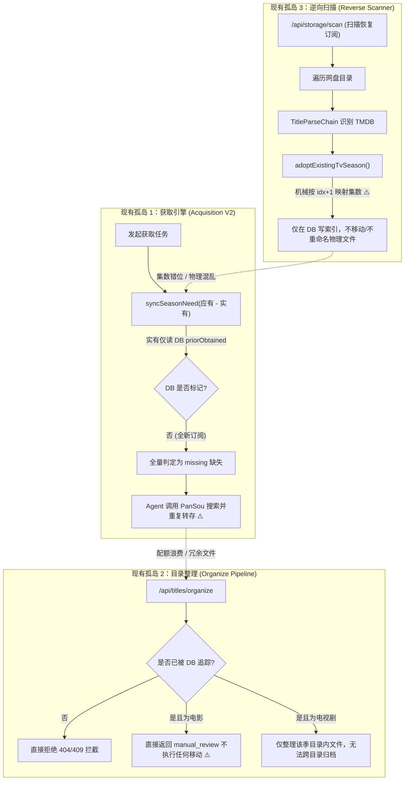
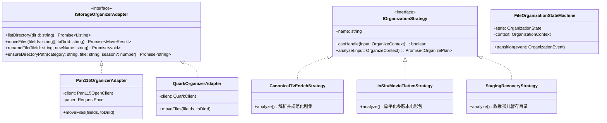
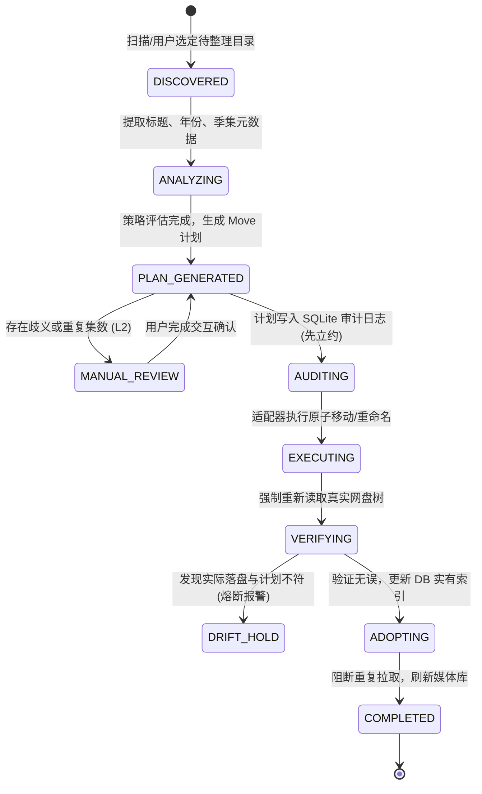
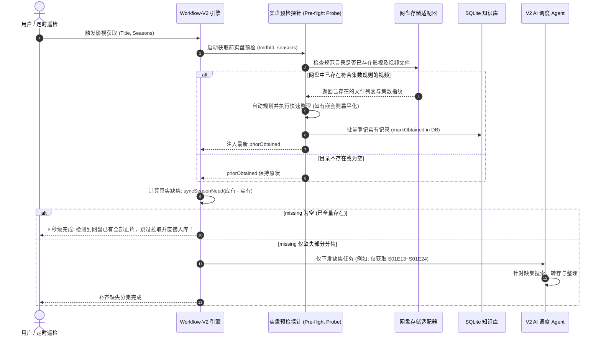

# 巡影 (Mediary Scout) 网盘已有文件智能整理与获取防重复拉取架构调研与实施方案

> **文档定位**：针对用户核心诉求“已有文件支持整理吗？避免重复拉取？”，系统性剖析当前网盘文件组织与拉取调度逻辑的断裂点，结合业界主流方案（Sonarr / Radarr / MoviePilot / NASTool），运用**适配器模式 (Adapter)**、**策略模式 (Strategy)** 与**有限状态机 (FSM)** 进行架构重构，提出“获取前实盘预检阻断 (Pre-flight Ingest Probe)”、“任意目录多策略规范整理 (Multi-Strategy File Organizer)”以及“防破坏性漂移熔断闭环”的完整技术方案。

---

## 1. 核心需求与业务痛点分析

### 1.1 真实业务场景画像

在使用巡影管理 115 网盘、夸克网盘或本地存储时，用户普遍存在以下两类典型场景：

1. **场景 A：先盘后剧（已有海量网盘文件接入巡影）**
   - 用户在接入巡影前，网盘中已存储了大量影视资源（可能是手工转存、离线下载、第三方工具同步，或是历史未刮削目录）。
   - **现状困境**：
     - 文件结构往往混乱（如截图所示：外层套了 4 层 Release 组包装目录 `[1080p][BluRay][YTS.MX]`、`RARBG`，或者视频散落在临时 `staging-*` 目录内）；
     - 分集命名不规范（如 `01.mp4`、`[ANI] 桃源暗鬼 - 01 [Baha][1080P].mp4`）；
     - 用户在巡影点击订阅或发起获取时，**巡影并未识别出网盘中已存在正片**，而是再次向 PanSou / 云盘接口发起全量搜索与转存，**不仅白白消耗每日宝贵的转存配额与离线下载次数，还导致网盘产生多份冗余副本**。

2. **场景 B：中断续跑或部分缺失（补齐缺集而非全量重拉）**
   - 用户某季动漫共 24 集，网盘里之前已存有第 1~12 集，由于某种原因之前没有入库索引，或者任务发生过中断。
   - **现状困境**：
     - 当触发订阅巡检（Patrol）或重新发起任务时，系统把该剧作为全新任务处理，将 1~12 集与 13~24 集一同加入下载任务，重复下载已有分集。

---

### 1.2 当前系统基础设施现状与三大“断裂点”排查

经过对当前代码库的全面探查，巡影其实已经拥有非常扎实的基础构件，但它们目前彼此孤立，形成了**三大断裂点**：



#### 断裂点 1：获取前缺少“实盘探针”（Pre-flight Ingest Missing）
- 在 [`packages/workflow/src/acquisition-v2/workflow-v2.ts`](file:///packages/workflow/src/acquisition-v2/workflow-v2.ts#L189-L197) 中：
  ```ts
  const priorObtained = request.priorObtained ?? [];
  const before = syncSeasonNeed({ seasons: seasonsForSync, obtained: priorObtained });
  ```
  `priorObtained` **完全依赖 SQLite 数据库中已有的标记**。
  如果用户在网盘里已经存好了电影文件或全套剧集，只要 SQLite 里还没记录，`priorObtained` 就是空的！`syncSeasonNeed` 必然得出“全部缺失”，Agent 立即开始消耗额度在公网疯狂转存。

#### 断裂点 2：已有文件纳管不执行物理规范化（Adoption without Physical Normalization）
- 现有的 `POST /api/storage/files/adopt` 和 [`reverse-storage-scanner.ts`](file:///packages/workflow/src/storage/reverse-storage-scanner.ts#L236) 仅在数据库中生成记录，**没有把物理文件从嵌套子目录或散乱目录移动并重命名至标准的 `Movies/片名 (年份)/` 或 `TV/剧名 (年份)/Season 01/` 结构**。
- 且在集数匹配上，直接采用 `videoFiles.map((v, idx) => ({ episodeNumber: idx + 1 }))`，一旦原本文件只存了 `EP05.mp4`, `EP06.mp4`，会被强行篡改为 `E01`, `E02`，引发后续剧集混乱与重复下载。

#### 断裂点 3：自动整理功能门槛过高且忽视电影（Organize Scope Too Rigid）
- [`apps/web/app/api/titles/organize/route.ts`](file:///apps/web/app/api/titles/organize/route.ts#L83-L100) 强制要求该影视必须已被当前账号 Tracked，且该季必须已创建好目录，无法对网盘内任意未归档目录（如 `Downloads/`、`staging-*`、`未分类影视/`）执行一键整理；
- 对电影类型，代码直接写明 `A movie has no episode codes to parse, so it is a review from the start rather than a silent move`，导致电影完全无法自动整理。

---

## 2. 业界主流方案对比与经验借鉴

对比国内外成熟的自媒体管理与自动化追剧套件：

| 维度 | **Sonarr / Radarr (Servarr 生态)** | **MoviePilot / NASTool** | **Alist + Auto-Symlink** | **巡影 (Mediary Scout 目标设计)** |
| :--- | :--- | :--- | :--- | :--- |
| **已有媒体纳管** | **Import Existing Series**（未映射目录扫描匹配元数据） | **媒体库同步**（定时读取 Emby/Plex 媒体库结构反哺） | 挂载后通过本地脚本正则匹配 | **网盘原生轻量逆向扫描 + 本地实盘探针**（零媒体服务器强依赖） |
| **防重复拉取机制** | 集数元数据 `HasFile = true` 阻断 Grab；支持仅监控缺失集数 | 检查下载历史 + 媒体库比对；非洗版模式强行拦截同名下载 | 无下载控制功能（仅做展示映射） | **实盘预检探测 (Pre-flight Ingest Probe)**：拉取前实盘比对，实有直接认领，仅补全缺集 |
| **散落文件整理** | **Manual Import**：可视化映射表，手动选择 Move / Copy | **目录监控 + 转移整理**：支持下载完成回调与目录变更通知 | 定时扫描挂载目录执行重命名软链接 | **三级整理引擎**：L1 确定性自动规整 $\rightarrow$ L2 差异人工复核 $\rightarrow$ L3 残留收拢 |
| **文件操作方式** | 本地文件系统 Hardlink / Symlink / Move | 本地 Hardlink 为主；网盘依赖 Rclone / API 移动 | 纯本地软链接 / STRM 文件 | **网盘 API 原生原子移动 (`file_move`)**，零本地磁盘空间占用 |
| **异常漂移防护** | 覆盖前弹窗确认；未匹配文件进入未决列表 | 记录处理历史；若目的端存在同名则跳过或重命名 | 脚本覆盖写可能损坏旧软链 | **先计划、后审计、分步移动、读回校验、漂移熔断** |

### 核心可借鉴设计点
1. **Sonarr 的 Manual Import 决策表思想**：
   - 将扫描结果分为“高置信度确定性项”（Placeable）与“存疑项”（Unresolved），前者支持一键批处理，后者在前端以预填下拉框方式让用户快速纠偏确认，绝不粗暴盲搬。
2. **MoviePilot 的媒体库前置过滤思想**：
   - 在任何“获取”动作发生的最早时机，优先判定本地/网盘已拥有的集数，生成精确的 `Infill Need`（仅补缺集清单），而非直接整季下发。
3. **网盘无回收站的特殊防线**：
   - 网盘与本地磁盘不同，移动往往不可逆，且缺乏物理硬链接（Hardlink）。必须严格执行“执行前快照审计”与“移动后读回检验”，任何目标不一致立即暂停并报警。

---

## 3. 架构设计与设计模式优化

为彻底解决已有文件整理与防重复拉取问题，系统引入三大经典设计模式与一套闭环状态机：



### 3.1 模式一：适配器模式 (StorageOrganizerAdapter)
- **目标**：抹平 115、Quark、本地存储在文件遍历、移动、重命名及流控上的底层差异。
- **职责**：
  1. 封装网盘原生批量移动能力（如 115 的 `/open/ufile/move` 或批量 `file_move`，Quark 的异步批量移动任务）；
  2. 内置防封禁 Pacer（针对 115 开放平台限制并发，设置移动操作 300ms ~ 500ms 间隔）；
  3. 规范目录创建契约：根据 `(category, title, year, seasonNumber)` 幂等查找或创建标准规范目录（如 `Movies/阿凡达 (2009) {tmdb-19995}` 或 `TV/桃源暗鬼 (2025) {tmdb-253811}/Season 01`）。

### 3.2 模式二：策略模式 (OrganizationStrategy & ConflictStrategy)
将混乱文件的整理决策解耦为多种独立策略，系统依据上下文自动装配或由用户指定：

1. **策略 A：`CanonicalTvEnrichStrategy`（电视剧/动漫标准刮削整理）**
   - 提取文件名中的集数（复用增强后的 `episodeCodeFromFileName`），结合 TMDB 季集元数据，重命名为 `剧名 - SxxExx - 第 X 集.ext` 并移入对应的 `Season XX`。
2. **策略 B：`InSituMovieFlattenStrategy`（电影原地扁平化整理）**
   - 针对电影目录中常见的版本嵌套子目录（如 `YTS.MX`、`RARBG`、`CD1/CD2` 等），直接提取内部最大正片视频及同名外挂字幕至电影主目录，同时清理多余空壳子目录及无用 NFO/TXT 垃圾文件。
3. **策略 C：`StagingRecoveryStrategy`（孤儿临时目录收拢整理）**
   - 专门探测因崩溃、网络中断或历史 Bug 遗留的 `staging-*` 目录，通过其内部视频文件的标题指纹逆向反推其母体影视，将正片提取归档，彻底清理僵尸 staging。
4. **冲突排重策略 (`ConflictResolutionStrategy`)**：
   - 当目标季目录已存在相同集数的视频时：
     - `KeepHighestQuality`（保留大体积/高码率，淘汰低质版）；
     - `SkipExisting`（以已有文件为准，不触碰已有资产）；
     - `PromoteToReview`（进入人工复核队列）。

### 3.3 模式三：有限状态机 (FileOrganizationStateMachine)
整个整理任务被严格建模为确定性状态转移过程，杜绝半吊子脏数据：



---

## 4. “避免重复拉取”的实机防线：获取前实盘预检阻断 (Pre-flight Ingest Probe)

为了让“已有文件”能够百分之百阻止“重复拉取”，必须在 `workflow-v2.ts` 启动时，插入**实盘预检探针 (Pre-flight Ingest Probe)**：



### 关键代码落地逻辑（概念原型）

在 [`packages/workflow/src/acquisition-v2/workflow-v2.ts`](file:///packages/workflow/src/acquisition-v2/workflow-v2.ts) 的 `runAcquisitionV2Workflow` 中：

```typescript
// 1. 获取前实机探针检测
const targetDirs = await resolveMediaTargetDirs(request.storage, request.title, request.seasons);
const liveExistingFiles = await inspectStorageTargetDirectories(request.storage, targetDirs);

// 2. 智能识别已存在视频集数 (使用 episodeCodeFromFileName，拒绝机械 idx+1)
const discoveredObtainedCodes = new Set<string>();
for (const file of liveExistingFiles) {
  const code = episodeCodeFromFileName(file.name, file.seasonNumber ?? 1);
  if (code) discoveredObtainedCodes.add(code);
}

// 3. 融合 DB 历史实有与网盘现场实有
const mergedPriorObtained = Array.from(new Set([
  ...(request.priorObtained ?? []),
  ...discoveredObtainedCodes
]));

// 4. 计算真实缺失量
const need = syncSeasonNeed({
  seasons: seasonsForSync,
  obtained: mergedPriorObtained
});

// 5. 零缺失瞬时短路：完全免搜索、免消耗转存配额
if (need.missing.length === 0 && !request.userRequest) {
  return {
    status: "succeeded",
    text: `⚡ 网盘中已检测到完整正片（共 ${mergedPriorObtained.length} 集/电影），已自动纳管整理，无需重复下载。`,
    coverage: { coverageMet: true, obtained: mergedPriorObtained, missing: [] }
  };
}
```

---

## 5. 当前代码库可直接复用的资产与增强清单

| 资产类型 | 所在文件路径 | 当前现状 | 方案增强要点 |
| :--- | :--- | :--- | :--- |
| **标题与元数据解析** | [`packages/workflow/src/domain/title-parse-chain.ts`](file:///packages/workflow/src/domain/title-parse-chain.ts) | 支持 TMDB 标签、年份、发版组清洗 | 增加对未知目录内部子文件特征采样的投票策略 |
| **集数解析器** | [`packages/workflow/src/domain/episode-code.ts`](file:///packages/workflow/src/domain/episode-code.ts) | 支持 SxxExx、第N集、连字符、中括号 | 核心复用：**彻底替换** `reverse-storage-scanner` 中的 `idx + 1` 机械逻辑 |
| **整理决策与审计** | [`packages/workflow/src/execution/organize-plan.ts`](file:///packages/workflow/src/execution/organize-plan.ts) | 仅支持被追踪的电视剧单季整理 | **扩展支持电影扁平化**；支持任意未追踪源目录输入 |
| **漂移熔断与比对** | [`packages/workflow/src/execution/organize-executor.ts`](file:///packages/workflow/src/execution/organize-executor.ts) | 具备 Planned vs Actual比对 | 复用其安全防线：在网盘物理移动后强制 `re-read` 比对 |
| **逆向入库管理** | [`packages/workflow/src/execution/adopt-existing-media.ts`](file:///packages/workflow/src/execution/adopt-existing-media.ts) | 仅在 SQLite 登记，不移文件 | 增加可选配置 `physicallyOrganize: boolean`，纳管同时触发规范移动 |
| **前端网盘交互** | [`apps/web/features/storage/components/storage-browser.tsx`](file:///apps/web/features/storage/components/storage-browser.tsx) | 仅有“一键反推”和“扫描恢复” | 在网盘文件工具栏增加 **“一键规范整理”** 按钮与弹窗预览 |

---

## 6. 潜在边界、风险评估与性能优化策略

### 6.1 风险与边界防御矩阵

| 潜在风险 / 极端场景 | 发生原因 | 防御与自愈策略 |
| :--- | :--- | :--- |
| **网盘无回收站导致误删** | 整理时过度清理了被误判为垃圾的附件（如外挂多语种字幕、特典、OST） | 1. 严格设定白名单：仅移动 `.mp4`, `.mkv`, `.ts`, `.ass`, `.srt`；<br>2. 仅删除体积 $< 100\text{KB}$ 的非媒体垃圾文件（如 `.nfo`, `.url`, `.txt`）；<br>3. 包含未知视频的目录**绝不自动删除**。 |
| **集数冲突与版本覆盖** | 网盘已存有一份 1080p 视频，用户在下载目录又丢了一份 4K 视频 | 引入 `ConflictResolutionStrategy`，默认比对文件体积：高码率版本晋升，低码率版本重命名为 `.backup` 或保留供用户在 L2 人工复核面板裁决。 |
| **同名文件重名碰撞** | 目标目录已存在完全相同的文件名 | 移动前执行目标路径探针；若碰撞则追加哈希或指纹后缀（如 `片名 - S01E01 (1).mp4`），绝不强行覆写。 |
| **中途网络断连 / API 异常** | 批量移动执行到一半时 115 抛出 504 Gateway Timeout | 依赖 `FileOrganizationStateMachine` 的断点日志：每次移动记录独立的 `AuditEvent`，重试时自动剔除已就位文件，支持幂等重入。 |

### 6.2 性能与并发限流策略 (Pacer Optimization)
- **115 开放平台安全调用阈值**：
  - 避免短时间内并发数百个 `file_move` 请求。采用 **自适应节流队列 (Paced Batch Queue)**：
    $$\Delta t \ge 350\text{ms},\quad \text{并发度} = 1$$
  - 对于同一个目录下的多个分集文件，调用 115 支持的批量移动接口（传递逗号分隔的 `file_ids`），将原本 $N$ 次网络 RTT 骤降为 1 次，大幅减轻网盘负载并缩短用户等待时间。

---

## 7. 分阶段演进与实施路线图 (Roadmap)

```mermaid
timeline
    title 已有文件整理与防重复拉取功能演进计划
    section Phase 1 (核心防线) : 获取前实盘预检阻断 (Pre-flight Ingest) : 修复逆向扫描集数映射 Bug (episodeCode 替换 idx+1)
    section Phase 2 (整理引擎) : 增强 organize-plan 支持电影与任意源目录 : 实现 InSituMovieFlattenStrategy 原地扁平化
    section Phase 3 (交互与协同) : 网盘浏览器“一键规范整理”操作入口 : Sonarr 风格的交互式 Manual Review 待办面板
    section Phase 4 (调度闭环) : 孤儿 staging-* 目录自动归拢定时任务 : 媒体库整体健康巡检与漂移自愈
```

### Phase 1：核心防线与 Bug 纠偏（当前紧急）
1. **获取前实盘预检**：在 [`workflow-v2.ts`](file:///packages/workflow/src/acquisition-v2/workflow-v2.ts) 中增加 `inspectStorageTargetDirectories`，如果网盘中已存在正片，立即补充到 `priorObtained`，全量存在直接 `succeeded` 返回，**彻底避免重复拉取**。
2. **集数精准纠偏**：修正 [`reverse-storage-scanner.ts`](file:///packages/workflow/src/storage/reverse-storage-scanner.ts)，用 `episodeCodeFromFileName` 替换机械的 `idx + 1`。

### Phase 2：多策略物理整理引擎扩展
1. 扩展 [`organize-plan.ts`](file:///packages/workflow/src/execution/organize-plan.ts) 与 [`organize-executor.ts`](file:///packages/workflow/src/execution/organize-executor.ts)，支持传入任意网盘源目录；
2. 落地 `InSituMovieFlattenStrategy`，支持对电影多层包装子目录执行自动扁平化提级；
3. 支持 115 批量文件移动以降低 API 调用开销。

### Phase 3：前端交互与人机协同体验
1. 在网盘文件浏览器中，对识别为“可反推”或处于非标准目录的文件，提供“整理并纳入媒体库”一键操作；
2. 针对存在集数歧义或重复版本的文件，提供直观的 Manual Review 弹窗，支持用户下拉调整季集、画质与操作策略。

---

> **结论与决策建议**：  
> “已有文件支持整理”与“获取前避免重复拉取”不仅**完全可行**，而且当前系统已经拥有 70% 的必要构件。通过上述基于**适配器、策略模式与状态机**的重构设计，可以快速打通各孤岛，在为用户彻底消除转存额度浪费的同时，实现对网盘已有杂乱媒体的优雅规范化归档！
