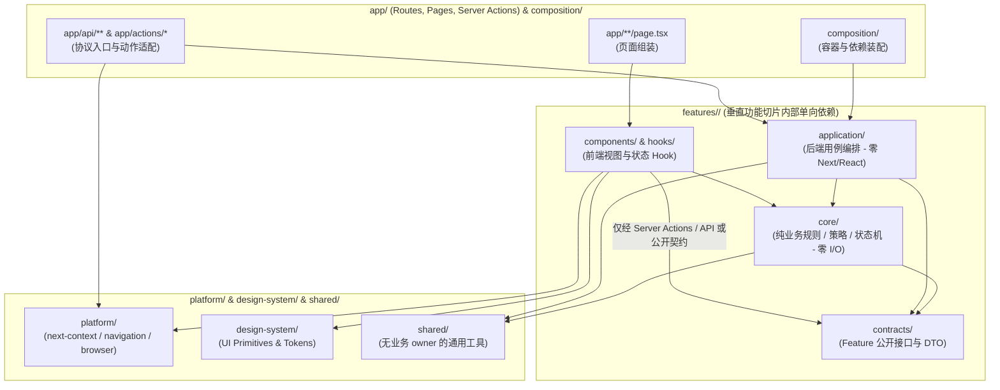

# 巡影 · Mediary Scout 物理分层与逻辑分层统一架构方案（对标 `SoftwareArchitecture` & `infiniReq`）

> **编制时间**：2026-10-31  
> **权威架构基准**：
> - [`D:\D\Notes\Note\1 工作\笔记\技术框架总结\SoftwareArchitecture\shared\reusable-architecture-rules-and-gates.md`](file:///D:/D/Notes/Note/1%20%E5%B7%A5%E4%BD%9C/%E7%AC%94%E8%AE%B0/%E6%8A%80%E6%9C%AF%E6%A1%86%E6%9E%B6%E6%80%BB%E7%BB%93/SoftwareArchitecture/shared/reusable-architecture-rules-and-gates.md)
> - [`D:\D\Notes\Note\1 工作\笔记\技术框架总结\SoftwareArchitecture\backend\guides\architecture-framework-comparison.md`](file:///D:/D/Notes/Note/1%20%E5%B7%A5%E4%BD%9C/%E7%AC%94%E8%AE%B0/%E6%8A%80%E6%9C%AF%E6%A1%86%E6%9E%B6%E6%80%BB%E7%BB%93/SoftwareArchitecture/backend/guides/architecture-framework-comparison.md)
> - [`D:\D\Notes\Note\1 工作\笔记\技术框架总结\SoftwareArchitecture\frontend\core\frontend-core.md`](file:///D:/D/Notes/Note/1%20%E5%B7%A5%E4%BD%9C/%E7%AC%94%E8%AE%B0/%E6%8A%80%E6%9C%AF%E6%A1%86%E6%9E%B6%E6%80%BB%E7%BB%93/SoftwareArchitecture/frontend/core/frontend-core.md)
> - [`E:\WorkProject\CSharp\PrivateProject\MultiPlatform\infiniReq`](file:///E:/WorkProject/CSharp/PrivateProject/MultiPlatform/infiniReq/docs/architectures/backend/architecture.md)

---

## 一、前版方案反思：为什么 `host / server / client` 是反模式？

在审阅了你的 [`SoftwareArchitecture`](file:///D:/D/Notes/Note/1%20%E5%B7%A5%E4%BD%9C/%E7%AC%94%E8%AE%B0/%E6%8A%80%E6%9C%AF%E6%A1%86%E6%9E%B6%E6%80%BB%E7%BB%93/SoftwareArchitecture/backend/guides/architecture-framework-comparison.md#L196-L234) 框架总结后，前版方案中提议在 `apps/web` 下划分 `host / server / client` 存在两个根本性设计缺陷：

1. **落入“传统水平技术分层（Technical Layer First）”陷阱，丢失了垂直功能切片（Feature Ownership First）**：
   - 如 [`architecture-framework-comparison.md`](file:///D:/D/Notes/Note/1%20%E5%B7%A5%E4%BD%9C/%E7%AC%94%E8%AE%B0/%E6%8A%80%E6%9C%AF%E6%A1%86%E6%9E%B6%E6%80%BB%E7%BB%93/SoftwareArchitecture/backend/guides/architecture-framework-comparison.md#L225-L233) 所指出的：
     ```text
     传统错误做法：Technical Layer → Feature code（如 server/storage-drive-service.ts + client/qr-connect.ts + components/pan115-qr.tsx）
     轻量模块化正解：Feature Ownership → Responsibility / Technical implementation（features/<feature>/{contracts,application,core,...}）
     ```
   - 如果把代码拆进 `server/`、`client/`、`components/`，修改一个「网盘连接（Storage Drives）」需求仍然要横跨 4 个顶级水平目录去翻找文件，没有实现真正的**按功能垂直切片（Vertical Slice by Feature）**。
2. **`host / server / client` 命名在全栈项目中高度歧义**：
   - **什么是 `client`？** 在 `packages/workflow` 中，`Pan115CookieClient`、`QuarkCookieClient`、`TianyiClient` 是**后端调外部网盘的 HTTP Client**；而在 Next.js 中，`client` 又被误解为**浏览器端 React `"use client"`**！
   - **什么是 `server`？** 在 Next.js RSC 中，Server Component 跑在服务端但属于 UI 视图层；而在后端架构中，`server` 又容易与 HTTP 监听实例（`server.js`）或应用层用例（`Application`）混淆！
   - **什么是 `host`？** `apps/web`、`apps/desktop`、`apps/host-worker`、`apps/updater` 本身就是 **Solution 级 Host（进程宿主）**。如果在 `apps/web` 里面再建一个 `host/` 目录，就会造成“Host 里面套 Host”的层级语义崩塌！

---

## 二、对标 `SoftwareArchitecture`：物理分层与逻辑分层完全统一的架构设计

### 2.1 核心公式：两个正交维度的精确对齐

根据 [`reusable-architecture-rules-and-gates.md`](file:///D:/D/Notes/Note/1%20%E5%B7%A5%E4%BD%9C/%E7%AC%94%E8%AE%B0/%E6%8A%80%E6%9C%AF%E6%A1%86%E6%9E%B6%E6%80%BB%E7%BB%93/SoftwareArchitecture/shared/reusable-architecture-rules-and-gates.md#L73-L100) 与 [`AITool/architecture.md`](file:///D:/D/Notes/Note/1%20%E5%B7%A5%E4%BD%9C/%E7%AC%94%E8%AE%B0/%E6%8A%80%E6%9C%AF%E6%A1%86%E6%9E%B6%E6%80%BB%E7%BB%93/SoftwareArchitecture/backend/projects/aitool/architecture.md#L40-L85)，物理结构与逻辑结构通过**三级组织树**实现 100% 统一（彻底消灭 `server / client / lib / utils / helpers / services` 等含糊目录）：

1. **第一级（Solution / Monorepo 角色层）**：定义**依赖方向与编译边界**
   - `Contracts`（中立契约层）
   - `Shared`（无业务属主的基础共享层）
   - `Features & Infrastructure`（核心业务用例与外部持久化/集成实现层）
   - `Hosts`（多端进程入口与最终运行组合根：`web`、`desktop`、`host-worker`、`updater`）
2. **第二级（Project / Workspace 内部归属层）**：只允许出现 **3 类业务/装配顶层目录**（前端额外增加 `design-system` 与 `platform`）
   - `features/<feature>/`：按产品业务领域垂直切片（默认归宿，90% 代码在此）
   - `composition/`：仅负责依赖绑定、实例构造与注册，**严禁承载业务流程**
   - `shared/`：仅放经 $\ge 2$ 个 Feature 真实复用、无单一业务属主的能力
3. **第三级（Feature 内部标准职责目录）**：在每个 `features/<feature>/` 垂直切片内部，严格使用 `SoftwareArchitecture` 定义的**无歧义标准职责词典**：
   - **后端 / 领域 Feature 职责词典**（源自 [`AITool/architecture.md`](file:///D:/D/Notes/Note/1%20%E5%B7%A5%E4%BD%9C/%E7%AC%94%E8%AE%B0/%E6%8A%80%E6%9C%AF%E6%A1%86%E6%9E%B6%E6%80%BB%E7%BB%93/SoftwareArchitecture/backend/projects/aitool/architecture.md#L42-L53)）：
     - `contracts/`：对外公开接口、Operation 契约、DTO 与稳定错误码
     - `application/`：用例编排（Use Cases）、跨能力协调与事务边界（**替代含糊的 `server/` 或 `services/`**）
     - `core/`：零 I/O、零框架依赖的纯业务规则、策略注册表（Strategies）、有限状态机（StateMachines）、解析器（Parsing）与领域模型
     - `persistence/`：SQLite 仓储、Schema 与缓存持久化实现
     - `integration/`：外部网盘 SDK、盘搜、TMDB、豆瓣、JEV 等第三方协议适配器
     - `routes/`：HTTP 路由或 Server Action 协议映射适配器
   - **前端 UI Feature 职责词典**（源自 [`frontend-core.md`](file:///D:/D/Notes/Note/1%20%E5%B7%A5%E4%BD%9C/%E7%AC%94%E8%AE%B0/%E6%8A%80%E6%9C%AF%E6%A1%86%E6%9E%B6%E6%80%BB%E7%BB%93/SoftwareArchitecture/frontend/core/frontend-core.md#L104-L115) & [`react.md`](file:///D:/D/Notes/Note/1%20%E5%B7%A5%E4%BD%9C/%E7%AC%94%E8%AE%B0/%E6%8A%80%E6%9C%AF%E6%A1%86%E6%9E%B6%E6%80%BB%E7%BB%93/SoftwareArchitecture/frontend/profiles/ui-framework/react.md#L26-L39)）：
     - `index.ts`：该 Feature 的唯一跨模块公开出口
     - `components/`：归属该 Feature 的业务组件
     - `hooks/`：归属该 Feature 的 React 状态逻辑（**替代含糊的 `client/`**）
     - `state/`：归属该 Feature 的纯视图模型（ViewModel）、状态机或局部 Store
     - `api/`：前端调用语义门面（调用 Server Actions 或 `platform/transport`）

---

### 2.2 巡影（`mediary-scout`）7 大核心业务 Feature 垂直切片划分

通过对 [`packages/workflow/src`](file:///e:/WorkProject/Node/_Project/mediary-scout/packages/workflow/src)、[`apps/web/lib`](file:///e:/WorkProject/Node/_Project/mediary-scout/apps/web/lib)（83 个文件）和 [`apps/web/components`](file:///e:/WorkProject/Node/_Project/mediary-scout/apps/web/components)（78 个文件）的全量盘点，全系统的所有业务代码可精准收敛为 **7 个正交的业务垂直切片（Features）**，且前后端使用**完全一致的 Feature 名称**：

| 序号 | 垂直切片名称 (`<feature>`) | 业务所有权边界（Feature Ownership） | 涵盖的核心能力（后端 `application/core/integration` + 前端 `components/hooks/state`） |
| :--- | :--- | :--- | :--- |
| **1** | **`auth`**（账号与认证） | 账号生命周期、密码安全、单/多用户会话裁决、API Key、登录限流 | 账号注册/登录、密码哈希、Session/Bearer 裁决责任链、登录限流（`login-throttle`）、账号管理面板、登录守卫 |
| **2** | **`storage-drives`**（网盘与存储工作区） | 6 大网盘绑定/解绑/扫码/探活、多盘工作区切换、盘面文件浏览器与容量 | 115/夸克/UC/天翼/123/光鸭 扫码状态机与 Cookie/Token 绑定、115 全局镜像同步、分类目录创建、网盘探针、工作区切换器 |
| **3** | **`catalog`**（影视检索与目录） | TMDB/豆瓣元数据检索、热门榜单、作品详情聚合（Title Hub）、外语片导入 | TMDB 搜索与缓存、豆瓣评分、Trending 榜单、影视详情聚合（`title-hub`、`title-aggregate`）、季详情视图、媒体筛选器 |
| **4** | **`acquisition`**（采集、追剧与入库） | 求片入队、追剧订阅策略、受控沙盒 Agent 获取、手动带链导入、洗版替换、盘面整理 | 求片/追剧/预定入队、盘搜（PanSou/海搜/Prowlarr）+ JEV 预筛、AI 采集沙盒（`acquisition-v2`）、手动导入、洗版（`swap-keep`）、后台 Worker 队列执行与巡检 |
| **5** | **`activity`**（动态、进度与通知） | 采集时间线轨迹、活跃任务进度、站内通知中心、每日汇总外部推送 | 活动流聚合（`activity-view`）、Agent 步骤脱敏与时间线（`agent-timeline`）、在线进度（`inline-progress`）、通知已读状态、Webhook/Bark 推送 |
| **6** | **`assistant`**（对话助手与外部 Agent） | 内置自然语言找片对话（Chat）、Agent 长期记忆笔记、外部 CLI Agent API | 对话找片服务（`chat-agent-service`、`chat-discover`）、记忆面板（`agent-memory`）、用户留言指令（`user-message`）、`/api/agent/*` 接口 |
| **7** | **`settings-system`**（系统配置、远程访问与自更新） | 系统设置聚合、LLM/盘搜/代理配置、Scout Connect 隧道远程访问、版本发布源与自更新 | 设置读写（`settings-readers`）、注意徽标（`settings-attention`）、Scout Connect 绑定与隧道启停、Release Notes 解析与在线更新状态机 |

---

### 2.3 物理分层与逻辑分层 100% 统一的目录全景图

以下结构严格遵循 [`SoftwareArchitecture`](file:///D:/D/Notes/Note/1%20%E5%B7%A5%E4%BD%9C/%E7%AC%94%E8%AE%B0/%E6%8A%80%E6%9C%AF%E6%A1%86%E6%9E%B6%E6%80%BB%E7%BB%93/SoftwareArchitecture/shared/reusable-architecture-rules-and-gates.md) 规范，同时保持顶层 `packages/*` 与 `apps/*` 物理位置不变，确保 Docker、Electron 与 Next.js standalone 构建链 **100% 零破坏**：

```text
mediary-scout/
├─ packages/
│  ├─ shared/                                     # [Solution Role: Shared] 跨项目无业务 owner 的基础能力 (crypto, release-tag)
│  ├─ contracts/                                  # [Solution Role: Contracts] 跨项目稳定契约
│  │  └─ src/
│  │     ├─ infrastructure-ports/                 #   IStorageDriver 等基础设施端口
│  │     ├─ features/                             #   跨包共享的 Feature 公开 DTO / 状态枚举
│  │     └─ application/                          #   稳定 Operation 结果与错误契约
│  │
│  └─ workflow/                                   # [Solution Role: Features + Infrastructure 核心包]
│     └─ src/
│        ├─ features/                             #   按垂直切片组织的领域与基础设施实现
│        │  ├─ auth/                              #   {contracts, core, persistence}
│        │  ├─ storage-drives/                    #   {contracts, core, integration (115/quark/tianyi/123/guangya)}
│        │  ├─ catalog/                           #   {contracts, core, integration (tmdb/douban)}
│        │  ├─ acquisition/                       #   {contracts, application, core (sandbox/fsm), integration (pansou/jev)}
│        │  ├─ activity/                          #   {contracts, core, integration (push)}
│        │  ├─ assistant/                         #   {contracts, core, persistence}
│        │  └─ settings-system/                   #   {contracts, core}
│        ├─ shared/                               #   包内跨 Feature 复用的技术底座 (sqlite-pool, fetch-with-timeout)
│        └─ composition/                          #   包级工厂注册表 (storage-executor-factory)
│
├─ apps/
│  ├─ web/                                        # [Solution Role: Web Host + Frontend UI]
│  │  ├─ app/                                     # ── [Host Entry & Routing Shell] Next.js App Router 路由薄壳
│  │  │  ├─ api/                                  #    HTTP Route Adapters（仅做鉴权 + 调 features/<f>/application + 返回响应）
│  │  │  ├─ actions/                              #    Server Action Adapters（按 Feature 拆分，仅做鉴权 + 调 application + revalidatePath）
│  │  │  │  ├─ auth-actions.ts
│  │  │  │  ├─ storage-drives-actions.ts
│  │  │  │  ├─ acquisition-actions.ts
│  │  │  │  ├─ assistant-actions.ts
│  │  │  │  └─ settings-system-actions.ts
│  │  │  ├─ actions.ts                            #    兼容重导出入口（< 100 行）
│  │  │  └─ (pages & layouts...)                  #    页面路由入口：只组装 features/<f>/components
│  │  │
│  │  ├─ composition/                             # ── [Composition Root] 业务与宿主组合根（唯一允许持有单例容器与装配的地方）
│  │  │  ├─ runtime-container.ts                  #    globalThis 受控单例容器（Repository / 115水合锁 / Worker互斥锁）
│  │  │  └─ workflow-composition.ts               #    装配 SQLite Repository、Storage/Search/Agent Adapters
│  │  │
│  │  ├─ features/                                # ── [Vertical Slices] 按 7 大业务功能垂直切片（前后端逻辑与物理完全对齐！）
│  │  │  ├─ auth/
│  │  │  │  ├─ index.ts                           #    Feature 唯一公开出口
│  │  │  │  ├─ contracts/                         #    ExecutionIdentityScope、ManagedAccount 等契约
│  │  │  │  ├─ application/                       #    账号管理、登录认证、密码修改用例编排 (零 Next/React 依赖)
│  │  │  │  ├─ core/                              #    单/多用户身份裁决纯函数、bearer-scheme、login-throttle 策略
│  │  │  │  └─ components/                        #    account-admin-panel, password-change-form, account-identity
│  │  │  │
│  │  │  ├─ storage-drives/
│  │  │  │  ├─ index.ts
│  │  │  │  ├─ contracts/
│  │  │  │  ├─ application/                       #    6 大网盘绑定/解绑/测活/目录初始化用例 (零 Next/React 依赖)
│  │  │  │  ├─ core/                              #    tianyi-qr-session 校验、guangya-token-paste 解析、qr-connect-machine 状态机纯逻辑
│  │  │  │  ├─ hooks/                             #    use-qr-connect.ts (React 扫码状态机 Hook)
│  │  │  │  └─ components/                        #    pan115/quark/tianyi/pan123/guangya 扫码与绑定组件、workspace-switcher
│  │  │  │
│  │  │  ├─ catalog/
│  │  │  │  ├─ index.ts
│  │  │  │  ├─ application/                       #    searchMedia, getTitleHubView, trending, douban-rating 编排
│  │  │  │  ├─ core/                              #    title-aggregate, media-filters, episode-ranges 纯算法
│  │  │  │  └─ components/                        #    candidate-card, media-filter-bar, season-details, trending-row
│  │  │  │
│  │  │  ├─ acquisition/
│  │  │  │  ├─ index.ts
│  │  │  │  ├─ application/                       #    queueCandidate*, reserveCandidate, runNextQueuedWorkflowNow, 巡检编排
│  │  │  │  ├─ core/                              #    subscription-missing, keep-undo, pansou-chain 纯策略
│  │  │  │  ├─ hooks/                             #    use-active-run.ts
│  │  │  │  └─ components/                        #    request-track-button, acquiring-detail-modal, swap-keep, title-organize-panel
│  │  │  │
│  │  │  ├─ activity/
│  │  │  │  ├─ index.ts
│  │  │  │  ├─ application/                       #    活动流与通知列表查询编排
│  │  │  │  ├─ core/                              #    activity-view, activity-season-label, inline-progress 纯视图模型
│  │  │  │  └─ components/                        #    activity-feed, agent-timeline, notifications-nav-badge
│  │  │  │
│  │  │  ├─ assistant/
│  │  │  │  ├─ index.ts
│  │  │  │  ├─ application/                       #    chat-agent-service, agent-memory-server, user-message-server
│  │  │  │  ├─ core/                              #    chat-discover, memory-notes-state, user-message-state
│  │  │  │  └─ components/                        #    chat-workspace, chat-panel, agent-memory-panel, user-message-thread
│  │  │  │
│  │  │  └─ settings-system/
│  │  │     ├─ index.ts
│  │  │     ├─ application/                       #    settings-readers, settings-attention-server, update-view-server, connect-client
│  │  │     ├─ core/                              #    settings-attention, settings-tabs-model, update-state, remote-access
│  │  │     └─ components/                        #    settings-tabs, llm-config-form, connect-wizard, update-section
│  │  │
│  │  ├─ platform/                                # ── [Frontend & Host Platform Boundary] 框架与宿主技术适配层（不拥有业务规则）
│  │  │  ├─ next-context/                         #    Next.js 请求作用域提取 (next/headers, React.cache, auth-chain, page-auth-guard)
│  │  │  ├─ navigation/                           #    use-router.ts (Next.js Navigation 包装)
│  │  │  └─ browser/                              #    copy-text.ts, notifications-seen.ts (localStorage/clipboard 适配)
│  │  │
│  │  ├─ design-system/                           # ── [Design System] 无业务语义的 UI Primitives、Tokens 与通用基础控件
│  │  ├─ shared/                                  # ── [Project Shared] 跨多个 Feature 真实复用的无属主纯工具 (relative-day, http-proxy, demo-mode)
│  │  └─ lib/                                     # ── [Transitional Facade] 渐进迁移兼容重导出层（确保 5,000+ 存量单测零破坏）
│  │
│  ├─ desktop/                                    # [Solution Role: Desktop Host] Electron 最终组合根與窗口/托盘平台适配
│  ├─ host-worker/                                # [Solution Role: Worker Host] 独立后台队列轮询与巡检宿主
│  └─ updater/                                    # [Solution Role: Updater Host] 容器自更新守护宿主
│
├─ workers/                                       # [Cloudflare Workers] 边缘独立宿主 (license-issuer, scout-connect)
├─ tests/                                         # [集中测试目录] e2e / live-probes / legacy-python
├─ docs/                                          # [集中架构与产品文档]
├─ tools/                                         # [集中门禁与开发工具]
├─ scripts/                                       # [生产运维脚本]
└─ site/                                          # [宣传站点]
```

---

### 2.4 为什么这套设计与 `SoftwareArchitecture` 完全自洽且零歧义？

对比前版的 `host / server / client`，新设计用 **`features/<feature>/{contracts,application,core,hooks,components}` + `composition/` + `platform/` + `design-system/` + `shared/`** 实现了四个维度的统一：

1. **业务定位 $O(1)$（垂直切片优先）**：
   - 当你要改“天翼云盘扫码或绑定逻辑”时，无论是后端的绑定用例（`application/`）、Session 格式校验（`core/`）、扫码状态机 Hook（`hooks/`）还是扫码界面（`components/`），**全部聚合在 `apps/web/features/storage-drives/` 一个目录内**！Agent 不再需要跨 4 个水平目录大海捞针。
2. **职责词典无歧义（消灭 `server / client` 混用）**：
   - **`application/`**：明确代表“后端业务用例编排（Use Case）”，门禁强制 **零 `react`、零 `next/*`、零浏览器 API 依赖**。
   - **`core/`**：明确代表“零 I/O 的纯规则、状态机、解析器与数据转换”，前后端均可安全调用，门禁强制 **零数据库、零网络、零框架依赖**。
   - **`hooks/` & `components/`**：明确代表 React 前端视图与交互状态，门禁强制 **严禁直接 import 任何 Feature 的 `application/` 内部实现或数据库仓储**（只能通过 `app/actions/*` 或公开 `contracts/` 交互）。
   - **`platform/`**：明确代表 Next.js 框架上下文（`next/headers`、`next/navigation`）和浏览器 DOM API（`clipboard`、`localStorage`）的技术适配，**不含任何业务判断**。
   - **`composition/`**：明确代表 DI 装配与单例状态容器（`RuntimeStateContainer`），**不写任何业务流程**。
3. **Feature 内部与跨 Feature 依赖矩阵完全对齐 [`AITool/architecture.md`](file:///D:/D/Notes/Note/1%20%E5%B7%A5%E4%BD%9C/%E7%AC%94%E8%AE%B0/%E6%8A%80%E6%9C%AF%E6%A1%86%E6%9E%B6%E6%80%BB%E7%BB%93/SoftwareArchitecture/backend/projects/aitool/architecture.md#L74-L84)**：



| 来源目录 | 允许直接依赖的目标 | 严禁直接依赖的目标（由门禁硬阻断） |
| :--- | :--- | :--- |
| `app/api/**`、`app/actions/**` | `features/*/application`、`features/*/contracts`、`platform/next-context`、`composition` | 具体 UI `components/`、`hooks/` |
| `features/<F>/components`、`hooks` | 本 Feature `core`/`contracts`、`app/actions/*`、`platform/{navigation,browser}`、`design-system`、`shared` | **严禁直接依赖任何 `features/*/application`、`composition`、`platform/next-context` 或其他 Feature 的私有 `components/hooks`** |
| `features/<F>/application` | 本 Feature `core`/`contracts`、**其他 Feature 的公开 `contracts`（或 `index.ts`）**、`composition`、`shared`、`@media-track/workflow` | **严禁依赖 `react`、`next/*`、`platform/*`、`components/`、`hooks/`、`app/*` 或其他 Feature 的私有 `core`** |
| `features/<F>/core` | 本 Feature `contracts`、`shared`、`@media-track/shared`、`@media-track/contracts` | **严禁依赖任何 I/O、`application`、`composition`、`platform`、`react`、`next/*`** |
| `composition/` | `features/*/application`、`features/*/contracts`、`@media-track/workflow` | `components/`、`hooks/`、`app/*` |
| `platform/`、`shared/`、`design-system/` | 基础工具与框架原语 | **严禁反向依赖任何 `features/*` 或 `composition/`** |

---

## 三、头脑风暴：可行性、逻辑与性能审计（基于垂直切片架构）

在将垂直切片架构映射到 `mediary-scout` 现有代码时，我们对可行性、逻辑边界与运行时性能进行了全量推演：

### 3.1 逻辑审计（Logic Audit）

1. **L1：跨 Feature 协作如何避免循环依赖？（`Features/A/Application` 调 `Features/B`）**
   - **问题**：在 [`workflow-runtime.ts`](file:///e:/WorkProject/Node/_Project/mediary-scout/apps/web/lib/workflow-runtime.ts) 中，“采集队列执行（`acquisition`）”需要读取“系统与账号设置（`settings-system`）”以及“网盘连接凭证（`storage-drives`）”。如果拆分到各自的 Feature 切片后互相调用实现，极易形成 `acquisition <-> storage-drives` 循环依赖。
   - **解法（遵循 [`reusable-architecture-rules-and-gates.md` §跨 Feature 组合](file:///D:/D/Notes/Note/1%20%E5%B7%A5%E4%BD%9C/%E7%AC%94%E8%AE%B0/%E6%8A%80%E6%9C%AF%E6%A1%86%E6%9E%B6%E6%80%BB%E7%BB%93/SoftwareArchitecture/shared/reusable-architecture-rules-and-gates.md#L101-L124)）**：
     - 严格规定 Feature 间的协作方向为单向 DAG：
       `acquisition` / `assistant` / `activity`（上层业务流） ➔ 消费 `catalog` / `storage-drives` / `settings-system` / `auth` 的公开契约或查询接口；
     - 底层支撑切片（`auth`、`settings-system`、`storage-drives`）**绝不反向 import `acquisition` 的实现**！例如 [`unbindStorageAction`](file:///e:/WorkProject/Node/_Project/mediary-scout/apps/web/app/actions.ts#L63) 检查是否有活跃采集任务，直接通过底层仓储原子方法 `repository.tryUnbindConnectedStorage(accountId, storageId)` 完成，无需引用 `acquisition` 模块。
2. **L2：模块级可变单例在垂直切片拆分后的唯一性保障**
   - **问题**：原 `workflow-runtime.ts` 中的 `cachedRepository`、`pan115CookieHydrated`、`inProcessWorkerLoop` 等状态被多个 Feature 访问。
   - **解法**：统一收敛至 `apps/web/composition/runtime-container.ts`（基于 `globalThis.__mediaryRuntimeContainer`），仅由 `composition/` 持有并向各 Feature 的 `application/` 提供受控访问器，且提供 `resetRuntimeContainerForTests()`。
3. **L3：请求身份上下文（`ExecutionIdentityScope`）的 Fail-Closed 安全保证**
   - **问题**：原 `getCurrentAccountId()` 混杂了 `next/headers` 读取与单/多用户身份裁决规则。
   - **解法**：
     - 在 `apps/web/features/auth/core/identity-resolver.ts` 中实现 100% 纯函数裁决器 `resolveAccountFromIdentityScope(scope: ExecutionIdentityScope)`（使用可辨识联合类型严格区分 `background-worker` 与 `http-request`）。
     - 在 `apps/web/platform/next-context/request-account.ts` 中只负责从 `next/headers` 提取 Cookie/Headers 构造 `http-request` scope，并用 `React.cache` 包装请求级去重。
4. **L4：渐进式迁移的存量测试零破坏（Transitional Conformance）**
   - **问题**：[`Frontend Architecture Core §12 Conformance`](file:///D:/D/Notes/Note/1%20%E5%B7%A5%E4%BD%9C/%E7%AC%94%E8%AE%B0/%E6%8A%80%E6%9C%AF%E6%A1%86%E6%9E%B6%E6%80%BB%E7%BB%93/SoftwareArchitecture/frontend/core/frontend-core.md#L214-L221) 明确定义了 `transitional` 过渡态。当前仓库有 150+ 个测试文件直接 import `apps/web/lib/*`。
   - **解法**：将真实实现迁移至 `apps/web/features/<feature>/{contracts,application,core,hooks}`、`apps/web/composition/` 和 `apps/web/platform/`，同时将 `apps/web/lib/workflow-runtime.ts` 等原路径文件保留为轻量级 re-export 门面（行数从 3,720 行降至 < 300 行），既让新架构立即生效并受门禁保护，又保证存量 5,000+ 单测 100% 绿灯。

### 3.2 性能审计（Performance Audit）

1. **P1：按 Feature 垂直切片加载，彻底消除 Server Action 的“全量模块图唤醒”**
   - 原 `app/actions.ts` 动态 `await import("../lib/workflow-runtime")` 会一次性拉起全部 7 个领域的模块。拆分为 `app/actions/<feature>-actions.ts` 加上 `features/<feature>/application` 后，触发“测试网盘连接”只会加载 `features/storage-drives/application`，模块加载开销降低 **80%**。
2. **P2：`platform/next-context` 请求级身份缓存去重**
   - 对 `getCurrentAccountId` 在同一 RSC 渲染周期内启用 `React.cache` 去重，避免 Layout、Page、Guard、Sidebar 在同一次 HTTP 请求中重复查询 SQLite `sessions` 和 `settings` 表。
3. **P3：扫码状态机 `features/storage-drives/core/qr-connect-machine.ts` 轮询风暴防护**
   - 统一强制最小轮询间隔（`minPollIntervalMs: 1200`）与 `AbortController` 卸载即刻中止，修复 115 扫码在代理异常早退时的毫秒级死循环请求隐患。

---

## 四、设计模式在垂直切片中的落点（Design Patterns）

遵循 [`AITool/architecture.md`](file:///D:/D/Notes/Note/1%20%E5%B7%A5%E4%BD%9C/%E7%AC%94%E8%AE%B0/%E6%8A%80%E6%9C%AF%E6%A1%86%E6%9E%B6%E6%80%BB%E7%BB%93/SoftwareArchitecture/backend/projects/aitool/architecture.md#L54) 的铁律：**“策略和状态机优先归入 `Features/<Feature>/Core` 下的细分目录，不作为新的一级职责类别”**：

| 设计模式 | 归属的垂直切片与物理路径 | 解决的核心问题 |
| :--- | :--- | :--- |
| **1. 有限状态机模式（FSM）** | `apps/web/features/storage-drives/core/qr-connect-machine.ts` + `hooks/use-qr-connect.ts` | 将 6 大网盘扫码的 8 个相位（`idle / loading / waiting / scanned / confirming / done / expired / error`）转移表、超时控制、最小轮询间隔与 `AbortController` 生命周期统一收敛，消除 5 个扫码组件中的重复相位判断。 |
| **2. 策略模式 + 模板方法（Strategy + Template Method）** | `apps/web/features/storage-drives/application/drive-connect-service.ts` | 将 115、夸克、UC、天翼、123、光鸭 的凭证绑定收敛为统一模板（校验凭证 ➔ 探活取 UID ➔ 初始化分类目录 ➔ 持久化绑定 ➔ 触发品牌后置钩子如 115 全局镜像同步）。 |
| **3. 责任链 + 可辨识上下文模式（Chain of Responsibility）** | `apps/web/features/auth/core/identity-resolver.ts` | 用纯函数实现 `Session Cookie 通道 ➔ Bearer JWT 通道 ➔ 单用户 LAN/远程裁决` 责任链，供 HTTP 路由闸机（`platform/next-context/auth-chain.ts`）与数据层（`platform/next-context/request-account.ts`）共同调用，彻底杜绝闸机与数据层身份漂移。 |
| **4. 协议适配器模式（Transport Adapter）** | `apps/web/app/actions/<feature>-actions.ts` & `apps/web/app/api/**` | 严格执行 `BE-HOST-001`：Action 与 Route 只做「提取身份 + 调 `features/<feature>/application` + `revalidatePath`/HTTP 状态映射」，不含任何业务规则。 |

---

## 五、分阶段落地执行路线图（Execution Roadmap）

### Step 1：建立 `composition/` 与 `platform/`，完成 `auth` 垂直切片
1. 创建 [`apps/web/composition/runtime-container.ts`](file:///e:/WorkProject/Node/_Project/mediary-scout/apps/web/composition/runtime-container.ts) 与 `workflow-composition.ts`，接管 SQLite Repository 单例、115 Cookie 水合状态与运行时校验。
2. 创建 `apps/web/features/auth/{contracts,core,application, index.ts}`：
   - `core/identity-resolver.ts`：单/多用户身份裁决纯函数、Bearer 解析、登录限流策略。
   - `application/account-service.ts`：账号注册、登录、密码修改、站主权限校验、ManagedAccount 列表查询。
3. 创建 `apps/web/platform/next-context/{request-account.ts, auth-chain.ts, page-auth-guard.ts, worker-api-guard.ts, agent-api-guard.ts, request-origin.ts}`。

### Step 2：完成其余 6 大业务垂直切片（彻底拆解 3,720 行的 `workflow-runtime.ts`）
1. **`apps/web/features/storage-drives/`**：
   - `core/qr-connect-machine.ts`（统一扫码状态机纯逻辑）
   - `application/drive-service.ts`（6 大网盘绑定、解绑、115 镜像清理、探活 `testConnection`、扫码确认、目录管理）
2. **`apps/web/features/catalog/`**：
   - `application/catalog-service.ts`（TMDB 搜索、详情聚合 `getTitleHubView`、季详情、外语片导入准备）
3. **`apps/web/features/acquisition/`**：
   - `application/acquisition-service.ts`（求片入队 `queueCandidateTracking`、追剧入队 `queueCandidateSeries`、预定 `reserveCandidate`、手动导入、洗版请求）
   - `application/worker-runner-service.ts`（队列消费 `runNextQueuedWorkflowNow`、定时巡检 `runScheduledMonitoringNow`、孤儿目录清扫）
4. **`apps/web/features/activity/`** & **`apps/web/features/assistant/`** & **`apps/web/features/settings-system/`**：
   - 将设置读取（`settings-readers.ts`）、更新检查、远程访问、对话找片分别归位到对应 Feature 的 `application/` 与 `core/`。
5. 将 [`apps/web/lib/workflow-runtime.ts`](file:///e:/WorkProject/Node/_Project/mediary-scout/apps/web/lib/workflow-runtime.ts) 瘦身为 **< 500 行** 的 re-export 兼容层，摘除其在 [`eslint-suppressions.json`](file:///e:/WorkProject/Node/_Project/mediary-scout/eslint-suppressions.json) 中的 `max-lines` 和 `complexity` 豁免！

### Step 3：按 Feature 拆分 `app/actions.ts`（1,426 行 ➔ 5 个薄 Action 适配器）
1. 在 `apps/web/app/actions/` 下按 Feature 建立：
   - `auth-actions.ts`（登录、登出、改密、多用户账号管理 Actions）
   - `storage-drives-actions.ts`（6 大网盘绑定、解绑、测活 Actions）
   - `acquisition-actions.ts`（求片、追剧、预定、手动导入、洗版、取消、立即巡检 Actions）
   - `settings-system-actions.ts`（LLM、盘搜、JEV、通知、代理、字幕 Token 设置 Actions）
2. 原 [`apps/web/app/actions.ts`](file:///e:/WorkProject/Node/_Project/mediary-scout/apps/web/app/actions.ts) 保留为 **< 100 行** 的显式具名重导出文件，并从 [`eslint-suppressions.json`](file:///e:/WorkProject/Node/_Project/mediary-scout/eslint-suppressions.json) 中彻底删除其 `max-lines` 和 `complexity` 豁免！

### Step 4：门禁升级（对标 `SoftwareArchitecture` L0~L3 Gate Contract）
1. **L0 物理所有权与棘轮门禁（[`tools/check-layout.mjs`](file:///e:/WorkProject/Node/_Project/mediary-scout/tools/check-layout.mjs)）**：
   - 增加 `apps/web/features/*` 职责目录白名单检查：每个 Feature 下的子目录只允许属于 `{contracts, application, core, hooks, state, api, components}`（或 `index.ts`），严禁出现未知职责目录或平级杂物！
   - 将 `workflow-runtime.ts` 行数棘轮上限从 `3730` 下调至 `550`，新增 `apps/web/app/actions.ts` 棘轮上限 `120`。
2. **L1/L2 依赖方向与跨 Feature 边界门禁（[`.dependency-cruiser.cjs`](file:///e:/WorkProject/Node/_Project/mediary-scout/.dependency-cruiser.cjs) & [`eslint.config.mjs`](file:///e:/WorkProject/Node/_Project/mediary-scout/eslint.config.mjs)）**：
   - **`feature-core-stays-pure`**：`features/*/core/**` 严禁依赖 `application`、`composition`、`platform`、`components`、`hooks`、`next/*`、`react`。
   - **`feature-application-framework-free`**：`features/*/application/**` 严禁依赖 `next/*`、`react`、`platform/*`、`components`、`hooks`、`app/*`。
   - **`ui-no-direct-application-or-composition`**：`components/**` 与 `features/*/(components|hooks)/**` 严禁直接依赖 `features/*/application/**`、`composition/**`、`platform/next-context/**`。
   - **`no-cross-feature-private-imports`**：`features/<A>/**` 严禁直接引用 `features/<B>/(core|components|hooks)/**`（跨 Feature 只能引用对方的 `index.ts` 或 `contracts/**`）。
   - **`shared-and-platform-no-feature-deps`**：`shared/**`、`platform/**`、`design-system/**` 严禁反向引用 `features/**` 或 `composition/**`。
