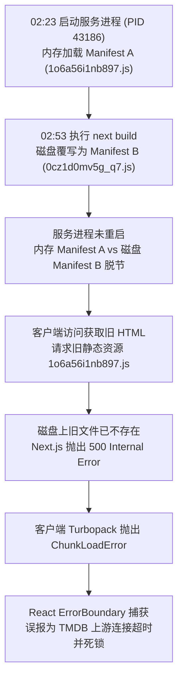
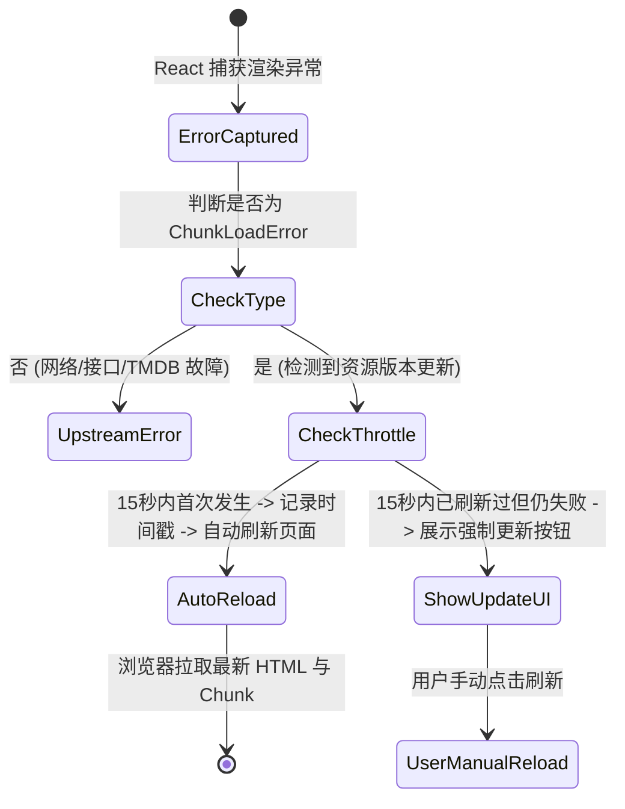

# Next.js 静态分块 500 / ChunkLoadError 根因调研与零停机韧性方案

## 1. 现象与故障复盘

### 1.1 故障日志与表现
用户在浏览器访问 `http://10.126.126.151:3001/?type=anime&trending=anime` 时遭遇页面崩溃：
```text
http://10.126.126.151:3001/_next/static/chunks/1ec0v_j65pn01.css net::ERR_ABORTED 500 (Internal Server Error)
?type=anime&trending=anime:1  GET http://10.126.126.151:3001/_next/static/chunks/1o6a56i1nb897.js net::ERR_ABORTED 500 (Internal Server Error)
?type=anime&trending=anime:1  GET http://10.126.126.151:3001/_next/static/chunks/3opdiwih8me-4.js net::ERR_ABORTED 500 (Internal Server Error)

2g05-lers809t.js:1 ChunkLoadError: Failed to load chunk /_next/static/chunks/1o6a56i1nb897.js from module 964893
    at turbopack-1yo_52cvie9u3.js:1:6130

页面渲染失败多半是部署环境连不上某个上游服务（TMDB／资源搜索）——国内网络未配置代理时常见。 检查部署主机（或容器）的网络后重试。重试
```

### 1.2 时间线与系统调用取证
通过现场 `/proc` 进程状态与日志取证，还原故障发生的物理过程：
1. **02:23:23**：启动端口 3001 的常驻 Next.js 进程（PID 43186，父进程 PID 43185）。
   该进程从当时的 `.next` 目录加载并缓存了构建 Manifest，其中包含静态分块：
   - CSS 分块：`1ec0v_j65pn01.css`
   - JS 分块：`1o6a56i1nb897.js`、`3opdiwih8me-4.js`
2. **02:53:11**：在同一个工作区就地执行了 `npm run build:web`（`next build apps/web`）。
   Turbopack 重新编译，清空并重新写入了 `apps/web/.next/static/chunks/`：
   - 产生的新 CSS 分块：`0_cj_okdt4b5t.css`
   - 产生的新 JS 分块：`0cz1d0mv5g_q7.js`、`1jexzsn2qdw84.js`、`39_gc3wksej5m.js` 等
   - **旧分块 `1ec0v_j65pn01.css`、`1o6a56i1nb897.js`、`3opdiwih8me-4.js` 在物理磁盘上彻底被删除**。
3. **02:54~03:10**：常驻进程 PID 43186 未被杀死或重启（运行时间已达 50 分钟）：
   - 当用户请求 `/?type=anime&trending=anime` 时，PID 43186 仍然吐出内存中旧版本的 HTML，其中 `<link>` 和 `<script>` 标签固化了旧的 hash 链接；
   - 客户端浏览器收到 HTML 后，发起向服务端的 `GET /_next/static/chunks/1o6a56i1nb897.js` 等静态请求；
   - 服务端静态文件处理路由发现该文件物理不存在，但在路由上下文或 manifest 中存在，返回 **HTTP 500**；
   - 客户端 Webpack/Turbopack runtime 抛出 `ChunkLoadError`；
   - React 根错误边界（`apps/web/app/error.tsx`）捕获了该异常，但因缺乏对 `ChunkLoadError` 的细分识别，直接呈现了通用的「连不上上游 TMDB」的误导性提示文案。用户点击「重试」只触发 React 组件的重新渲染，而由于旧 chunk 依然无法加载，直接陷入死循环。

---

## 2. 根因剖析 (Root Cause Analysis)



本质上存在三大层面的断层：
1. **运行态与构建产物原子隔离缺失（Server In-Place Mutation）**：
   直接在运行中的单体目录执行覆写式构建，打破了部署的不变性原则（Immutable Deployments）。
2. **生命周期治理脱节（Process Lifecycle Desync）**：
   构建流水线与常驻服务进程未联动，缺乏热更或退出自检守卫。
3. **客户端版本漂移自愈能力缺失（Client Self-Healing Gap）**：
   现代 Web 应用普遍存在新旧版本交接时的资源漂移，前端未对 `ChunkLoadError` 做版本漂移自愈（Auto-Reload with Version Guard），而是将其当作业务错误吞没。

---

## 3. 业界主流解决方案与参考对比

| 方案类别 | 业界方案 (Vercel / AWS / Docker) | 本地及私有化部署方案 (Mediary Scout) |
| :--- | :--- | :--- |
| **产物不变性** | 内容寻址存储（CAS）与 CDN 永存多版本静态资源 | 1. Docker 单镜像多阶段构建（隔离构建与运行）<br>2. 本地部署目录版本化或构建前备份多版本 chunks |
| **进程切换** | 蓝绿部署 / 滚动升级（Rolling Update），新 Pod 健康探针通过后路由流量 | 部署脚本执行前终止老进程，启动新进程并等待健康检查验证静态资源可达性 |
| **客户端韧性** | `vite-plugin-chunk-reload` / Next.js 生产自愈模式（SessionStorage 防抖刷新） | 在根全局 `error.tsx` 中智能识别 `ChunkLoadError`，自动触发无感 `window.location.reload()` |
| **门禁检测** | CI 构建后静态资产校验（Asset Integrity Check） | 新增 `check-build-assets.mjs` 门禁，验证 HTML 与 Manifest 中的静态分块 100% 物理存在 |

---

## 4. 四重防御架构与具体落地方案

### 4.1 防御层一：客户端智能识别与自愈状态机 (Self-Healing Client)
在 `apps/web/app/error.tsx` 中集成 `ChunkLoadError` 判定与限频自愈：


### 4.2 防御层二：精准错误提示隔离
- **网络/上游故障**：保留原有的「检查上游服务（TMDB/资源搜索）代理配置」提示；
- **资源版本漂移**：明确提示「检测到系统已发布新版本，正在为您自动刷新页面同步最新资源...」，彻底杜绝误导用户。

### 4.3 防御层三：静态资产完整性门禁 (`scripts/check-build-assets.mjs`)
在打包构建完成后，自动读取 `apps/web/.next` 中预渲染的 HTML 及 Manifests，遍历所有引用的 `/_next/static/...`，严格验证：
1. 文件在物理磁盘上真实存在；
2. 文件大小 $> 0$；
3. 不存在悬空或断链分块。

### 4.4 防御层四：安全重启与本地服务守卫脚本
更新部署启动脚本，在启动前利用 PID/端口探针安全退出旧进程，并添加就绪探测（Readiness Probe）：
1. 校验端口 3001 已释放；
2. 启动服务进程；
3. 对 `http://localhost:3001/` 发起探针，验证 HTML 返回 200 且首屏引用的静态 CSS/JS 分块均返回 HTTP 200。
