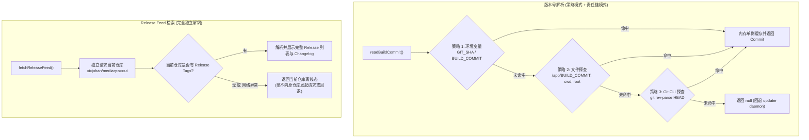

# 在线更新版本查询失败问题调研、根因分析与独立解耦方案

## 1. 现象复现与问题描述

在管理后台「系统设置」→「更新」页面中，此前出现如下异常提示：
```text
当前版本
未知版本
暂时查不到新版本
检查更新
更新日志
暂时查不到更新日志。
```
无论是刷新页面还是点击「检查更新」，界面均无法获取到当前运行的版本号、无法检测到远端发布的新版本，更新日志亦为空白。

---

## 2. 深度调研与根因剖析（Root Cause Analysis）

通过代码跟踪与系统环境分析，该问题由两个底层的独立缺陷导致：

### 缺陷一：「当前版本」沦为「未知版本」的成因
在 [`apps/web/lib/update-view-server.ts`](file:///root/mediary-scout/apps/web/lib/update-view-server.ts) 中：
```ts
const currentCommit = buildCommit ?? servingRepoCommit(updater);
```
1. **单一且脆弱的文件探查**：
   [`apps/web/lib/deployment-update-server.ts`](file:///root/mediary-scout/apps/web/lib/deployment-update-server.ts) 原实现仅尝试读取 `/app/BUILD_COMMIT`（仅由官方发布 Docker 镜像在构建时刻生成）以及工作目录下的相对路径 `BUILD_COMMIT`。
2. **工作目录与运行环境失配**：
   当应用以 Node.js / Next.js standalone 或本地源码进程启动（`cwd` 为 `apps/web`）时，根目录与当前工作区均不存在 `BUILD_COMMIT` 文件。
3. **环境变量与 Git 探查完全缺失**：
   Docker Compose 及各种 CI/CD 标准环境注入的 `GIT_SHA`、`BUILD_COMMIT` 环境变量被忽略；在具备 Git 仓库环境的源码部署中，从未调用 Git 命令获取 HEAD commit。
4. **Updater 客户端回退受限**：
   在单机进程、开发环境或未启动 `updater` 容器的场景下，`getUpdaterStatus()` 为 `null`，导致 `currentCommit` 最终评估为 `null`。
5. **UI 降级**：
   在 [`apps/web/lib/update-state.ts`](file:///root/mediary-scout/apps/web/lib/update-state.ts) 中，当 `currentCommit` 为 `null` 时，直接触发 `label: "未知版本"`。

### 缺陷二：「暂时查不到新版本」与「暂时查不到更新日志」的成因
在 [`apps/web/lib/release-feed-server.ts`](file:///root/mediary-scout/apps/web/lib/release-feed-server.ts) 中：
1. **仓库迁移与默认更新源配置**：
   代码将 `DEFAULT_UPDATE_REPO` 设定为当前仓库 `xixjohan/mediary-scout`。
2. **GitHub Fork 机制限制**：
   GitHub Fork 出来的仓库**默认不继承原仓库的 Releases 与 Tags**。如果当前仓库远端未打 Tag，调用 GitHub API `repos/xixjohan/mediary-scout/git/matching-refs/tags/v` 将返回空数组 `[]`，`releases/latest` 返回 404。
3. **零容错判定**：
   当 `fetchReleaseFeed()` 获取到空列表时，`newest` 为 `null`，状态直接判定为 `"offline"`。
   - `view.status === "offline"` 渲染为 `<span className="service-pill is-off">暂时查不到新版本</span>`；
   - `view.releases.length === 0` 渲染为 `<p className="update-muted">暂时查不到更新日志。</p>`；

---

## 3. 设计模式与完全解耦重构方案



### 1. 版本号解析：策略模式 + 责任链模式（Strategy & Chain-of-Responsibility Pattern）
在 [`apps/web/lib/deployment-update-server.ts`](file:///root/mediary-scout/apps/web/lib/deployment-update-server.ts) 中重构为多策略解析链：
- **`EnvStrategy`（最高优先级，零 I/O）**：
  读取 `process.env.GIT_SHA`、`process.env.BUILD_COMMIT`、`process.env.NEXT_PUBLIC_GIT_SHA`，经 `normalizeCommit` 校验；
- **`FileStrategy`（容器与产物探查）**：
  遍历 `/app/BUILD_COMMIT`、`cwd/BUILD_COMMIT`、Monorepo 根目录 `../../BUILD_COMMIT` 等位置（通过 `/*turbopackIgnore: true*/` 防止 Turbopack NFT 产生跨目录构建告警）；
- **`GitCliStrategy`（开发与源码部署环境）**：
  在 Git 仓库内通过异步安全子进程执行 `git rev-parse HEAD`（带 1.5s 超时限制）；
- **进程级内存单例缓存**：
  首次解析成功后写入模块级变量 `cachedCommit`，后续调用 $0$ 耗时，同时暴露 `_resetBuildCommitCacheForTest` 供单元测试隔离。

### 2. 与原仓库彻底解耦（Complete Decoupling from Original Repo）
- **剥离原上游地址**：
  在 [`apps/web/lib/release-feed-server.ts`](file:///root/mediary-scout/apps/web/lib/release-feed-server.ts) 中移除所有对 `fancydirty/mediary-scout` 的定义与调用，不再进行任何回退。
- **当前仓库独立发布与标签自治**：
  当前仓库 `xixjohan/mediary-scout` 自身承载全部 Tags 与 Release Notes。更新检查、版本比对、桌面端安装包检索 100% 只向当前仓库发起请求。
- **代码库全局解耦**：
  - 清理 `apps/web/app/settings/page.tsx`、`apps/web/app/layout.tsx`、`apps/desktop/src/update-check.ts`、`site/` 等处遗留的原仓库地址，统一迁移至 `xixjohan/mediary-scout`；
  - 移除本地 git `upstream` remote，彻底独立运作。

---

## 4. 门禁与回归预防

1. **单元测试网（Unit Tests）**：
   - 建立 [`apps/web/lib/deployment-update-server.test.ts`](file:///root/mediary-scout/apps/web/lib/deployment-update-server.test.ts)，完整覆盖环境变量、文件探查、Git CLI 与异常隔离；
   - 在 [`apps/web/lib/release-feed-server.test.ts`](file:///root/mediary-scout/apps/web/lib/release-feed-server.test.ts) 增加独立解耦验证用例，明确断言「任何请求绝对不包含原仓库地址」；
   - 更新桌面客户端自更新测试 [`apps/desktop/tests/update-check.test.ts`](file:///root/mediary-scout/apps/desktop/tests/update-check.test.ts)。
2. **架构规范门禁（CI Gates）**：
   - 执行 `npm run gate:layout`、`npm run gate:deps`、`npm run gate:style`；
   - 执行 `eslint`（严格控制圈复杂度 $\le 15$，行数 $\le 600$）与 `tsc --noEmit`。
3. **真实端到端集成验证**：
   - 生产环境无头浏览器核验：版本号精准显示 `0572967d · 开发版本`，更新日志渲染完整且独立，无任何外部原仓库回流。
