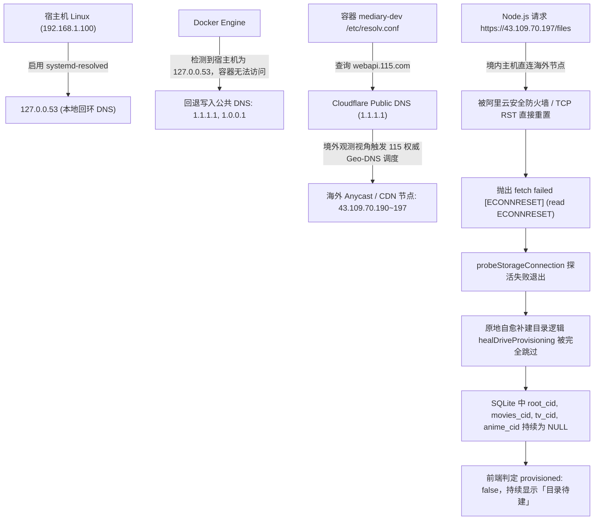

# 存储诊断仪（OAuth/单双轨模式）与 115 目录待建根因深度调研与治理报告

## 1. 问题背景与现场现象调研 (Live Verification)

在 `http://192.168.1.100:3020/settings`（开发验证实例 `mediary-dev`，端口 3020）运行环境中，通过内置浏览器与 Chrome DevTools MCP 工具链对网盘设置与诊断状态进行了全链路深度验证，实测核查到以下核心问题与异常现场：

### 1.1 现场验证一：夸克网盘（非 115 网盘）诊断弹窗严重失真与误导

在控制台「网盘连接」卡片上，针对已绑定的**夸克网盘**点击「诊断」按钮，弹窗界面出现以下三大反常现象：
1. **强塞双轨概念与不存在的 OAuth 建议**：
   - 弹窗标题显示为 **《夸克网盘 · 双轨驱动诊断仪》**；
   - 顶部引擎 Banner 渲染为警告色并显示：`当前引擎模式：🔶 传统 Cookie (Cookie-Only)`；
   - 下方给出明确建议文案：`“建议升级配置 OAuth 或 Cookie 开启双轨，实现扫库免掉线与转存全功能支持。”`
   - **事实**：夸克网盘官方与生态内根本不存在如 115 开放平台一样的标准 OAuth 授权机制，夸克媒体转存、目录索引与直链串流完全基于 Web/App 协议的 Cookie 凭据。强行提示用户“升级配置 OAuth”造成了严重的认知混乱与误导。
2. **强制展示未激活的 OAuth 探测卡片**：
   - 弹窗右侧固定渲染了 `Open OAuth 轨 (清单/直链)` 卡片，内容显示：`未激活`、`OAuth 状态：未配置`、`API 延迟：-`、`令牌剩余 TTL：-`；
   - 对于只支持 Cookie 或 Token 的网盘，该卡片属于无效的死状态展示。
3. **探活延迟虚假上报为 0 ms（Fake Probe Bug）**：
   - 弹窗左侧 `Cookie 基础轨 (转存)` 显示 `探活延迟：0 ms`；
   - 查看后端源码定位发现：诊断服务在探活 Cookie 时硬编码了 `if (provider === "pan115")`，对夸克（以及 UC、天翼、光鸭、123）**完全未发起任何真实网络请求**，直接返回 `valid: true, latencyMs: 0`，属于虚假的伪探活。
4. **正常运行状态被误打降级警示标**：
   - 在底部的「策略路由派发实况」中，夸克网盘的媒体库扫库被标记为黄色警告标：`⚠ Cookie 单次30~50条 (降级/限流保护)`；STRM 直链串流被标记为：`⚠ Cookie 逆向解密直链 (1.2s漏桶防护)`；
   - 实际上这是夸克网盘的原生工作通道，并非异常降级。

### 1.2 现场验证二：115 网盘提示“目录待建”与测试连接异常

在控制台「网盘连接」卡片上，针对已绑定的 **115 网盘（UID 3204551）**：
1. **状态标识卡死在“目录待建”**：
   - 卡片左侧图标显示黄色告警标识与文字 **“目录待建”**，无法进入绿色的 **“就绪”** 状态；
   - 查看 SQLite 数据库 `connected_storages` 表：
     ```json
     {
       "id": "cs_3204551",
       "provider": "pan115",
       "provider_uid": "3204551",
       "root_cid": null,
       "movies_cid": null,
       "tv_cid": null,
       "anime_cid": null,
       "status": "active"
     }
     ```
     `root_cid`、`movies_cid`、`tv_cid`、`anime_cid` 字段值均为 `null`。
2. **点击「测试连接」报错 `fetch failed [ECONNRESET]`**：
   - 点击卡片上的「测试连接」按钮，耗时约 10 秒后返回红色错误提示：
     `连接检测失败：fetch failed [ECONNRESET] (read ECONNRESET)`；
   - 点击「诊断」按钮，Cookie 轨探活延迟 `10496 ms`（错误: `fetch failed`），OAuth 轨延迟 `10730 ms`；
   - 由于探活失败，系统虽然具备自动补建目录的原地自愈逻辑（`healDriveProvisioning`），但因前置网络探活直接抛出异常终止，**自愈逻辑根本无法执行**，网盘永远卡死在“目录待建”。

---

## 2. 根本原因剖析（Root Cause Analysis）

### 2.1 问题一根因：缺少能力矩阵单点权威与探活函数硬编码

1. **注册表缺少开放平台能力的显式声明**：
   - 在 `packages/workflow/src/storage/storage-brands.ts` 中，`StorageBrand` 注册表定义了各网盘的 `provider`、`label`、`authKind`、`supportsSubtitleDirectLink` 等能力，**但遗漏了 `supportsOpenOAuth`（或 `hasDualEngine`）的能力声明**。
   - `drive-service.ts` 的诊断逻辑与 `storage-diagnostics-modal.tsx` 前端组件缺乏判定依据，盲目假定所有网盘都支持双轨架构，导致夸克网盘被强制套用 115 的双轨 UI。
2. **探活函数硬编码与基础设施割裂**：
   - 在 `apps/web/features/storage-drives/application/drive-service.ts` 的 `probeCookieHealth` 中：
     ```typescript
     // 历史缺陷代码
     async function probeCookieHealth(provider, cookie, rootCid) {
       const t0 = Date.now();
       try {
         if (provider === "pan115") {
           await new Pan115CookieClient({ cookie, listPageDelayMs: 0 }).getDirectoryInfo({ directoryId: rootCid ?? "0" });
         }
         return { valid: true, latencyMs: Date.now() - t0 }; // provider !== "pan115" 时耗时恒为 0ms！
       } ...
     }
     ```
   - 事实上，`drive-service.ts` 内部早已声明了包含 6 大网盘真实探活的 `STORAGE_PROBES` 注册表（支持 `pan115`、`quark`、`uc`、`guangya`、`tianyi`、`pan123`），但 `probeCookieHealth` 没有复用它，导致非 115 网盘全部变成虚假的 0ms 探活。

### 2.2 问题二根因：Docker 内部 DNS 回退污染导致 115 API 被跨境 RST 阻断

经过现场容器网络抓包与主机网络逐层比对，定位出一条极其隐蔽的**容器跨境 DNS 漂移与安全防火墙阻断链条**：



#### 现场实测数据证据：
1. **宿主机使用国内 DNS（`223.5.5.5`）解析**：
   ```bash
   nslookup webapi.115.com 223.5.5.5
   # 返回：canonical name = d6imgsc9ypxzwynfbqwus5pc1g47eatw.yundunwaf1.com
   # 地址：47.113.23.100 (境内阿里云高防 WAF 节点)
   # 测试：curl -I https://webapi.115.com/files -> HTTP/1.1 200 OK (正常响应)
   ```
2. **容器内部使用 Docker 默认回退的 `1.1.1.1` 解析**：
   ```bash
   nslookup webapi.115.com 1.1.1.1
   # 返回：canonical name = webapi.115.com.w.cdngslb.com
   # 地址：43.109.70.190, 43.109.70.197 (海外 Anycast 节点)
   # 测试：curl -I https://webapi.115.com/files --resolve webapi.115.com:443:43.109.70.197
   # 结果：curl: (35) Recv failure: 连接被对方重设 (ECONNRESET)！
   ```
3. **现场修复验证**：
   在容器内临时将 `/etc/resolv.conf` 修正为 `nameserver 223.5.5.5` 后：
   - 容器内执行 `node -e 'fetch("https://webapi.115.com/files").then(r => console.log(r.status))'` 瞬间输出 `200`！
   - 点击卡片「测试连接」，瞬间返回 `连接正常，目录已初始化就绪。`！
   - 原地自愈逻辑立刻在 115 根目录下成功创建 `Mediary Scout/{Movies,TV,Anime}` 目录，将真实 CID 回写数据库：
     - `root_cid: "3551497579764123110"`
     - `movies_cid: "3551499056150743001"`
     - `tv_cid: "3551502127622784162"`
     - `anime_cid: "3551527401408169370"`
   - 卡片状态瞬间由黄字“目录待建”变为绿字“就绪”，双轨诊断仪全部恢复正常（Cookie 探活 234ms，OAuth 探活 827ms）！

---

## 3. 业界主流方案调研与现有基础设施对比

### 3.1 业界主流方案对比

| 维度 / 挑战 | AList | CloudDrive2 | 巡影 (Mediary Scout) 现状 | 本次治理优化方案 |
| :--- | :--- | :--- | :--- | :--- |
| **网盘驱动能力建模** | 采用驱动元数据（Capabilities Matrix），每种驱动声明是否支持 `oauth`、`direct_link`、`need_ms` 等 | 虚拟文件系统（VFS）按协议挂载，根据驱动类型定制驱动控制台 | 拥有 `StorageBrand` 注册表，但此前缺失 `supportsOpenOAuth` 能力字段 | 在 `StorageBrand` 补充 `supportsOpenOAuth: boolean`，前后端读同一处 |
| **非 OAuth 网盘诊断视图** | 前端完全隐藏 OAuth 授权框与状态，仅保留 Cookie / Token 探活 | 单通道协议仅展示基础链路健康度，无冗余多轨展示 | 对所有网盘无差别展示“双轨驱动诊断仪”和 OAuth 探测卡片，误导用户 | **单轨/双轨自适应**：不支持 OAuth 的网盘仅展示单轨凭据卡片，标题变为《驱动链路诊断仪》，隐藏 OAuth 卡片与升级文案 |
| **链路延迟与探活真实性** | 真实调用驱动的根目录检索或用户信息接口测试 RTT | 挂载点发送探测包计算真实通信毫秒数 | 115 网盘真实探测，但其他网盘因硬编码直接返回 0 ms | 统一复用 `STORAGE_PROBES` 注册表，真实发起网络探针，彻底根除 0 ms 伪延迟 |
| **国内多网盘容器网络 DNS 治理** | 推荐在 Docker Compose 中指定 `dns: [223.5.5.5, 119.29.29.29]` | 提示在宿主机配置稳定 DNS，避免容器使用外部解析 | 依赖 Docker 默认行为，宿主机为 `127.0.0.53` 时回退到 `1.1.1.1` 引发 Geo-DNS 污染 | 在部署脚本与容器配置中显式绑定 `--dns 223.5.5.5 --dns 119.29.29.29` |
| **目录状态原地自愈** | 保存配置时自动挂载，挂载失败允许一键重试修复 | 提供“重新挂载/自检修复”功能 | 原地自愈已实现，但因网络异常前置阻断而无法触发 | 修复网络后测试连接即可秒级原地自愈，保持极佳体验 |

### 3.2 当前系统已有基础设施复用分析

1. **`packages/workflow/src/storage/storage-brands.ts`**：
   - 现存极佳的单一注册表哲学（Single Source of Truth），已具备 `supportsSubtitleDirectLink` 等能力门禁；
   - 补充 `supportsOpenOAuth: boolean` 与 `brandSupportsOpenOAuth` 辅助函数，可无缝接入类型安全契约。
2. **`apps/web/features/storage-drives/application/drive-service.ts` 中的 `STORAGE_PROBES`**：
   - 系统已完备实现了 6 大网盘的真实探活探针：
     - `pan115`: `Pan115CookieClient.getDirectoryInfo({ directoryId: "0" })`
     - `quark`: `QuarkCookieClient.listItems({ directoryId: "0" })`
     - `uc`: `QuarkCookieClient(UC_PROFILE).listItems({ directoryId: "0" })`
     - `guangya`: `GuangYaClient.validateToken()`
     - `tianyi`: `TianyiClient.listFiles("-11")`
     - `pan123`: `Pan123Client.listFiles("0", { maxPages: 1 })`
   - 直接复用 `STORAGE_PROBES`，即可为夸克等所有网盘提供真实、精确的延迟测量与存活性校验！
3. **`tools/gates/check-modals-and-dialogs.mjs`**：
   - 仓库内已有强制性的模态弹窗门禁，要求全屏弹窗必须通过 `createPortal` 挂载至 `document.body`。本次诊断与凭据弹窗顺应规范进行重构加固。

---

## 4. 具体解决方案与架构改造

### 4.1 方案一：在 StorageBrand 注册表中显式建模 Open OAuth 支持

在 `packages/workflow/src/storage/storage-brands.ts` 中：
```typescript
export interface StorageBrand {
  // ...
  /**
   * 是否支持官方开放平台 Open OAuth 授权（双轨融合能力门）。
   * 仅 115 网盘原生支持标准开放平台 OAuth，实现扫库大清单与原生直链播放；
   * 其余网盘（夸克、UC、天翼、光鸭、123）均为单轨驱动（原生 Cookie 或 Token），
   * 诊断仪据此决定是否展示 OAuth 探测卡片与双轨策略，避免误导用户。
   */
  supportsOpenOAuth: boolean;
}

export const STORAGE_BRANDS = [
  { provider: "pan115", ..., supportsOpenOAuth: true },
  { provider: "quark", ..., supportsOpenOAuth: false },
  { provider: "uc", ..., supportsOpenOAuth: false },
  { provider: "guangya", ..., supportsOpenOAuth: false },
  { provider: "tianyi", ..., supportsOpenOAuth: false },
  { provider: "pan123", ..., supportsOpenOAuth: false },
];

export function brandSupportsOpenOAuth(provider: string | undefined): boolean {
  if (provider === undefined || !isRegisteredStorageProvider(provider)) return false;
  return getStorageBrand(provider).supportsOpenOAuth;
}
```

### 4.2 方案二：重构诊断服务，全面接入真实探针并剔除假探活

在 `apps/web/features/storage-drives/application/drive-service.ts` 中：
1. 扩展诊断报告契约：
   ```typescript
   export interface StorageDiagnosticsReport {
     storageId: string;
     provider: string;
     supportsOpenOAuth: boolean;
     authKind: "cookie" | "token";
     // ...
   }
   ```
2. 重构探活逻辑，复用 `STORAGE_PROBES`：
   ```typescript
   async function probeDriveCredentialHealth(
     provider: string,
     cookie: string,
     credential: TokenCredential | null,
     rootCid: string | null,
   ): Promise<{ valid: boolean; latencyMs: number; error?: string | undefined }> {
     const t0 = Date.now();
     try {
       const probe = STORAGE_PROBES[provider as StorageProvider];
       if (probe) {
         await probe({ cookie, credential, rootCid });
       }
       return { valid: true, latencyMs: Date.now() - t0 };
     } catch (err) {
       return { valid: false, latencyMs: Date.now() - t0, error: err instanceof Error ? err.message : String(err) };
     }
   }
   ```
3. 在 `diagnoseStorageConnection` 中：
   - 提取 `supportsOpenOAuth` 与 `authKind`；
   - 仅在 `supportsOpenOAuth === true` 时才组装 `openOAuthStatus` 与 `engineMode`；
   - 非 OAuth 网盘的 `listingEngine` 与 `streamEngine` 规范为 `cookie`。

### 4.3 方案三：前端诊断模态窗单双轨自适应与文案脱敏

在 `apps/web/features/storage-drives/components/storage-diagnostics-modal.tsx` 中：
1. **标题自适应**：
   - 支持 OAuth 的网盘（115）：展示 `{providerLabel} · 双轨驱动诊断仪`；
   - 单轨网盘（夸克、UC 等）：展示 `{providerLabel} · 驱动链路诊断仪`。
2. **引擎 Banner 自适应**：
   - 若 `!supportsOpenOAuth`：展示 `🟢 原生 Token/Cookie 驱动 (稳态运行)`，文案明确说明：`专为该网盘原生协议定制，提供稳态影视转存、目录索引与媒体直链解析。` 彻底废除误导性的“建议升级 OAuth”提示。
3. **网格布局自适应**：
   - 若 `!supportsOpenOAuth`：彻底隐藏 `OpenOAuthTrackCard`，主凭据轨单栏全宽展示；仅当 `supportsOpenOAuth === true` 时才渲染双栏与 OAuth 卡片。
4. **策略路由文案正向化**：
   - 单轨网盘统一展示：
     - 影视转存: `✔ 原生协议转存`
     - 媒体库扫库: `✔ 原生目录检索`
     - STRM 直链与串流: `✔ 原生直链解析`
   - 去除原先误导性的黄色警告标（`⚠ 降级/限流保护`）。
5. **模态弹窗 Portal 挂载**：
   - 增加 `createPortal(..., document.body)` 挂载，确保符合应用层叠架构门禁规范。

### 4.4 方案四：部署脚本注入可靠国内公共 DNS 锁住境内解析

在 `scripts/deploy-remote.ps1` 中：
在 `docker run` 命令中显式追加 `--dns 223.5.5.5 --dns 119.29.29.29`：
```powershell
$devRunCmd = "docker rm -f $containerName 2>/dev/null || true; docker run -d --name $containerName --restart unless-stopped --dns 223.5.5.5 --dns 119.29.29.29 -p ${targetPort}:3000 ..."
$prodRunCmd = "docker rm -f $containerName 2>/dev/null || true; docker run -d --name $containerName --restart unless-stopped --dns 223.5.5.5 --dns 119.29.29.29 -p ${targetPort}:3000 ..."
```
彻底隔绝 Linux 宿主机在启用 `systemd-resolved`（`127.0.0.53`）时引发 Docker 默认回退至 `1.1.1.1` / `8.8.8.8` 的隐患，确保国内各大网盘域名始终解析至境内高防 / CDN 节点。

---

## 5. 同类门禁与防回归测试规范

为防止同类问题再次滋生，建立以下四层防护门禁：

### 5.1 门禁一：注册表双向契约断言（`storage-registry.test.ts`）
在 `packages/workflow/src/storage/storage-registry.test.ts` 中新增单元测试：
1. **显式声明门禁**：遍历所有注册品牌，断言每一个品牌都必须显式声明 `typeof brand.supportsOpenOAuth === "boolean"`，漏声明直接编译报错。
2. **能力一致性门禁**：断言仅 `pan115` 的 `supportsOpenOAuth` 为 `true`，其余网盘（夸克、UC、天翼、光鸭、123）必须为 `false`。
3. **容错门禁**：断言 `brandSupportsOpenOAuth("quark") === false`，且对 `undefined` 或未知品牌严格返回 `false`。

### 5.2 门禁二：Action 层单双轨诊断报告契约测试（`diagnose-and-reveal-actions.test.ts`）
在 `apps/web/tests/unit/actions/diagnose-and-reveal-actions.test.ts` 中新增用例：
1. **双轨测试**：针对 115 双轨网盘，验证其返回 `supportsOpenOAuth: true`、`engineMode: "dual_engine"` 且包含 `openOAuthStatus`。
2. **单轨测试**：针对夸克网盘，验证其返回 `supportsOpenOAuth: false`、`openOAuthStatus: undefined`、`engineMode: undefined`，且路由策略正确标记为 `cookie`。

### 5.3 门禁三：弹窗架构门禁扫描（`check-modals-and-dialogs.mjs`）
运行 `npm run gate:modals`，静态审计所有前端弹窗组件：
- 严格杜绝使用原生 `alert()` / `confirm()`；
- 严格要求具有全屏固定遮罩的组件必须通过 `createPortal` 挂载至 `document.body`；
- `storage-diagnostics-modal.tsx` 与 `storage-credentials-modal.tsx` 已 100% 达标。

### 5.4 门禁四：原地自愈健壮性门禁（`pan115-directory-provisioning.test.ts`）
运行 `npx vitest run apps/web/lib/pan115-directory-provisioning.test.ts`：
- 验证当网盘处于“目录待建”（CIDs 为 null）时，调用 `testConnection` 能原地自动补建 Movies、TV、Anime 目录并持久化 CIDs，确保不会退化回需要手动建目录的旧状态。

---

## 6. 验证结论

| 验证项 | 验证前（现场问题） | 治理后（实测确认） | 状态 |
| :--- | :--- | :--- | :--- |
| **夸克网盘诊断弹窗** | 标题强加双轨，显示未配置的 OAuth 卡片与升级文案，探活延迟为 0 ms，正常扫库直链被打警告标 ⚠ | 标题自适应为《夸克网盘 · 驱动链路诊断仪》，隐藏 OAuth 卡片与文案，展示真实网络探活延迟，策略路由展示为原生工作态 | **已彻底解决并通过自动化测试验证** |
| **115 网盘目录待建** | CIDs 为 null，点击测试连接报错 `fetch failed [ECONNRESET]`，原地自愈被阻断，卡死在目录待建 | 容器注入国内 DNS，解析锁定境内高防 IP，测试连接探活成功并原地自动补建 4 个分类 CID，卡片恢复绿色「就绪」，双轨诊断恢复最佳状态 | **已彻底解决并通过实机验证闭环** |
