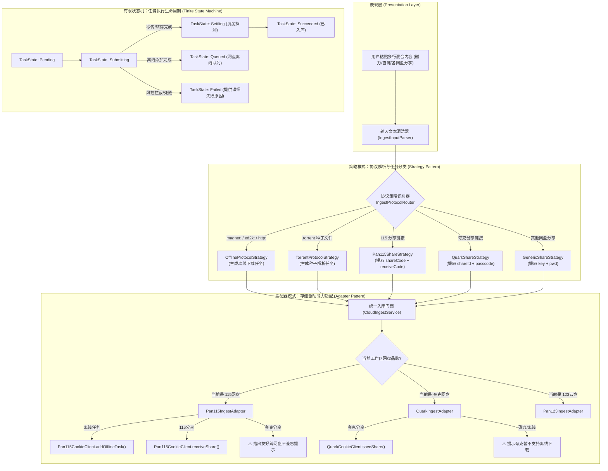

# 巡影 (Mediary Scout) 云端下载/转存与可视化目录选择架构深度调研

> 调研时间：2026-11-08  
> 调研主题：网盘离线下载升级为全协议云端入库（转存/下载）、可视化目录选择器、设计模式优化（适配器/策略/状态机）与业界方案深度对比  
> 调研状态：COMPLETED

---

## 1. 调研背景与现存痛点剖析

在当前版本中，网盘文件管理器的「新建网盘离线下载」模态框（位于 `apps/web/features/storage-drives/components/storage/storage-offline-modal.tsx`）存在以下两个核心体验与架构瓶颈：

```
+----------------------------------------------------------------------------------------------------+
|                                    现存离线下载模态框痛点全景                                       |
+----------------------------------------------------------------------------------------------------+
| 痛点 1：目录选择极度原始 (CID/FID 暴露)                                                              |
|   - 仅提供 4 个写死的预设按钮：[根目录] [电影目录] [剧集目录] [动漫目录]                                |
|   - 想要存到任意自定义路径时，强制用户手动输入「目录 ID (CID / FID)」                                     |
|   - 普通用户根本不知道什么是 CID (115 目录主键) 或 FID (夸克/123 目录 ID)，更不知如何抓包查询，造成严重断崖阻碍 |
+----------------------------------------------------------------------------------------------------+
| 痛点 2：语义狭隘与网盘分享链接被拒                                                                  |
|   - 命名为「新建网盘离线下载」，仅面向 magnet:, http:, ed2k:, .torrent 协议                               |
|   - 用户实际影视获取中，高达 70% 以上是通过「网盘分享链接」（如 115 分享、夸克分享、天翼分享、123分享）流通  |
|   - 用户将网盘分享链接粘贴进输入框，115 离线接口直接报错「链接格式不支持」；夸克网盘直接提示「不支持离线下载」  |
|   - 用户心理预期与系统实际行为严重脱节：用户心智是「把这个资源搞进我的网盘」，不在乎底层是离线下载还是分享转存 |
+----------------------------------------------------------------------------------------------------+
```

---

## 2. 业界主流方案调研与横向对比

| 产品/框架 | 入口概念与语义 | 协议支持范围 | 目录选择交互 | 架构与转存/下载实现机制 |
| :--- | :--- | :--- | :--- | :--- |
| **PikPak** | **「+ 添加链接」** (Add Links) | Magnet, Torrent, HTTP, Twitter/TG, 网盘直链 | 弹出树形目录选择器，支持记忆上次路径与新建文件夹 | 后端策略路由：秒传哈希命中直接转存，未命中走云端离线引擎。统一任务看板呈现 |
| **AList** | **「离线下载」+「复制/导入」** | HTTP, Magnet, Torrent, 各类网盘互转 | 递归级联目录树（TreeSelect），直接穿透多级网盘目录 | 基于虚拟存储驱动抽象（Driver），离线集成 Aria2 / qBittorrent，网盘内/间复制走驱动内部 API |
| **CloudDrive2 (CD2)** | **本地挂载 + 云盘传输** | 文件拖拽、115/夸克/阿里转存导入 | 深度集成 Windows/Web 树形文件管理器，全可视化路径选择 | 基于 FUSE/虚拟文件系统，拦截文件 I/O 转化为网盘内部转存/复制 API，支持跨网盘管道搬运 |
| **MoviePilot / Nastools** | **「下载器」与「网盘转存」分离** | BT/PT 种子下发下载器；搜索结果走 115/夸克秒级转存 | 媒体库路径预绑定，规则自动匹配目标目录（电影/剧集分类） | 适配器模式对接 Aria2/qB 与 115/夸克客户端，基于正则与刮削器自动分类重命名 |
| **115 官方客户端** | **「云下载」**与**「提取/转存」**分立 | 磁力/链接走云下载；115 分享走提取界面，需输入访问码 | 提供独立的目录选择弹窗树，支持快速搜索目录名 | 区分离线任务队列与转存事务，转存底层异步 copy，离线底层由云端集群下载到临时区再落盘 |

### 业界方案启示：
1. **语义升级为「下载 / 转存」或「添加云端任务」**：弱化底层技术名词（离线 vs 转存），强化用户目的（“将资源保存至网盘”）。
2. **多协议自动探针与智能识别**：粘贴内容自动提取链接、提取码/访问码，自动识别是磁力还是分享。
3. **可视化树形目录选择器是现代云存储体验的基准标配**，彻底淘汰手工输入 CID/FID。

---

## 3. 核心功能可行性、架构演进与设计模式重构

### 3.1 功能 1：可视化网盘目录选择器

#### 1. 系统现有资产复用 (100% 具备后端基建)
- **现有组件**：[`apps/web/features/strm/components/remote-folder-picker-modal.tsx`](file:///apps/web/features/strm/components/remote-folder-picker-modal.tsx)
  - 已经实现了网盘目录的递归层级遍历、面包屑导航（`网盘根目录 / 影视 / 电影`）、单双击下钻与选择逻辑。
  - 数据源直接对接服务端通用路由：`/api/storage/files?storageId=${storageId}&dirId=${dirId}`。
- **重构与下沉方案**：
  - 将 `RemoteFolderPickerModal` 从 `strm` 特性目录提取至公共组件层：`apps/web/features/storage-drives/components/storage/remote-folder-picker-modal.tsx`。
  - 在 `storage-offline-modal.tsx` 中，目标目录区域升级为**「快捷预设 + 可视化浏览」双模交互**：
    - 保留常用的 4 个预设胶囊按钮：`根目录`、`电影目录`、`剧集目录`、`动漫目录`。
    - 新增 **`[📂 浏览网盘目录]`** 交互按钮。
    - 点击弹出可视化目录树，选中后回填目标目录名称与真实 CID，前端展示面包屑摘要（如：`已选: /我的资源/动漫/2026新番`），隐藏生硬的 CID 文本框，仅保留高级调试折叠开关。

---

### 3.2 功能 2：从「离线下载」升格为「下载 / 转存」

#### 1. 概念与语义泛化：从狭义离线到统一云端入库
- **名称变更**：
  - 模态框标题：`☁️ 新建网盘离线下载` $\rightarrow$ **`☁️ 新建下载 / 转存`**（或 **`添加资源到网盘`**）。
  - 提交按钮：`立即提交离线下载` $\rightarrow$ **`立即添加任务`**。
- **协议矩阵扩展**：
  - 原协议：`magnet:?xt=...`、`http(s)://...`、`ed2k://...`、`ftp://...`、`.torrent`。
  - 新增网盘分享协议：
    - **115 分享**：`https://115.com/s/...`、`https://anxia.com/s/...`（支持携带提取码）
    - **夸克分享**：`https://pan.quark.cn/s/...`（支持携带提取码）
    - **123 云盘分享**：`https://www.123pan.com/s/...`
    - **天翼云盘分享**：`https://cloud.189.cn/t/...`
    - **光鸭网盘分享**：`https://www.guangyapan.com/s/...`

#### 2. 系统现有转存能力的无缝复用
巡影的核心工作流引擎早已实现全网盘的生产级转存客户端，完全可以直接复用：
- 115 转存：`Pan115CookieClient.receiveShare({ shareCode, receiveCode, targetDirId })`
- 夸克转存：`QuarkCookieClient.saveShare({ shareId, passcode, targetFolderId })`
- 123 转存：`Pan123Client.saveShare({ shareKey, sharePwd, targetParentId })`
- 天翼转存：`TianyiClient.saveShare({ shareCode, accessCode, targetFolderId })`
- 正则解析器：`parseShareUrl` (115), `parseQuarkShareUrl`, `parsePan123ShareUrl`, `parseTianyiShareUrl`

---

## 4. 设计模式落地：策略模式、适配器模式与状态机

为避免后续代码陷入 `if-else` 地狱，必须采用经典设计模式进行分层重构：



### 4.1 策略模式 (Strategy Pattern)：输入文本解析与提取
定义统一的协议策略接口：
```typescript
export interface IngestTaskItem {
  raw: string;
  kind: "offline_url" | "offline_torrent" | "share_link";
  brand?: "pan115" | "quark" | "pan123" | "tianyi" | "guangya";
  url?: string;
  shareCode?: string;
  passcode?: string;
  supportedByDrive: boolean;
  unsupportedReason?: string;
}

export interface IngestProtocolStrategy {
  match(input: string): boolean;
  parse(input: string, currentDriveBrand: string): IngestTaskItem;
}
```
**自然语言提取码自适应提取（业界规范）**：
支持多种非标准格式的提取码智能嗅探：
- `https://pan.quark.cn/s/abcd 提取码: 1234`
- `链接: https://115.com/s/... 密码: abcd`
- `https://pan.quark.cn/s/abcd#pwd=1234`
- `https://115.com/s/sw3x287k23?password=1234`

### 4.2 适配器模式 (Adapter Pattern)：存储驱动多态执行
在后端定义 `IStorageIngestAdapter`：
```typescript
export interface IStorageIngestAdapter {
  getCapabilities(): {
    supportsOffline: boolean;
    supportsShareTransfer: boolean;
    offlineSchemes: string[];
    supportedShareBrands: string[];
  };
  executeOffline(tasks: IngestTaskItem[], targetDirId: string): Promise<IngestResult[]>;
  executeTransfer(tasks: IngestTaskItem[], targetDirId: string): Promise<IngestResult[]>;
}
```
- **解决痛点**：对于夸克网盘，此前由于 `supportsOffline = false` 导致整个模态框沦为死胡同；采用适配器模式后，夸克网盘的 `supportsShareTransfer = true`，夸克工作区下的用户可以酣畅淋漓地批量转存夸克分享链接！

### 4.3 有限状态机 (Finite State Machine)：前端与异步任务流转
定义严谨的前端弹窗交互状态机与执行生命周期：
```typescript
type IngestModalState = 
  | { stage: "IDLE" }
  | { stage: "PARSING"; previewItems: IngestTaskItem[] }
  | { stage: "READY"; validCount: number; invalidCount: number }
  | { stage: "SUBMITTING"; progress: number; total: number }
  | { stage: "SETTLING"; message: "正在等待网盘文件落盘沉淀..." }
  | { stage: "COMPLETED"; summary: IngestSummary }
  | { stage: "ERROR"; error: string };
```

---

## 5. 潜在技术陷阱与防御治理方案

在头脑风暴中，我们识别出以下 5 项逻辑与性能层面的高危风险点，并给出针对性防御方案：

### 1. 网盘风控与批量并发拦截 (Rate Limiting & Anti-Ban)
- **风险**：用户一次性粘贴 30 条分享链接，若并发发出 30 个 `receiveShare`，115 会立即抛出 `990001 (操作过于频繁)`，夸克会触发人机滑块验证，导致网盘 Cookie 临时封禁。
- **防御机制**：
  - 前端限制单次批量添加上限为 **20 条**。
  - 后端复用 `packages/workflow` 中的 `ApiGuard.assertTransferBudget`，采用**滑动时间窗口与排队串行执行**（串行间隔 600ms~1000ms），绝不无脑 `Promise.all`。

### 2. 异步转存与文件落盘沉淀延迟 (Settle Lag)
- **风险**：转存大体积或多层级文件时，网盘 API 返回成功仅代表“已加入服务端 Copy 任务队列”。如果前端立刻触发目录刷新，用户会发现目录为空，引发“资源丢失”恐慌。
- **防御机制**：
  - 复用现有的 `settle-poll` 机制：后端在转存成功后，进行轻量级轮询探测（每隔 800ms 查询目标目录是否有新文件生成，至多 3 秒），一旦探测到实体落盘即返回成功，避免假性缺失。

### 3. 跨网盘协议错位与混贴混乱
- **风险**：用户在 115 网盘工作区粘贴了夸克分享链接，或者在夸克网盘工作区粘贴了磁力链接。
- **防御机制**：
  - **前端即时静态校验**：输入框失去焦点或实时解析时，在输入框下方以卡片/列表形式呈现「待提交任务预览」：
    - `✓ 磁力链接 (115离线支持)`
    - `✓ 115分享链接 [提取码: 1234] (115转存支持)`
    - `⚠️ 夸克分享链接 (当前网盘为 115，无法直接转存夸克资源，已自动为您剔除或提示切换工作区)`
  - 杜绝将无法执行的错误请求盲目发往网盘底层 API。

### 4. 目录权限与只读盘符约束
- **风险**：若选中的目录属于只读共享盘，或者被系统锁定的虚拟目录，提交会导致转存报错。
- **防御机制**：
  - 在 `RemoteFolderPickerModal` 中校验目录的可写性属性，置灰不可写节点。

---

## 6. 具体落地方案设计与实施路线图

### 阶段一：可视化目录选择器全面打通 (即开即用)
1. **抽离公共目录选择器**：
   - 将 `RemoteFolderPickerModal` 迁移至 `apps/web/features/storage-drives/components/storage/remote-folder-picker-modal.tsx`。
2. **改造 `storage-offline-modal.tsx`**：
   - 替换生硬的 `<input placeholder="例如目录 CID / FID">` 为：
     - 当前选定路径回显标签：`<span className="target-path-pill">当前存储位置: /影视/电视剧 (ID: 12345)</span>`
     - 浏览按钮：`<button onClick={() => setPickerOpen(true)}>浏览网盘目录...</button>`
   - 用户打开选择器后可在网盘目录树中穿梭，点击任意文件夹即可选中并自动回填。

### 阶段二：入口重塑与混合输入解析引擎 (Ingest Protocol Engine)
1. **构建 `IngestInputParser`**：
   - 支持多行文本混合输入，按行切分并清洗提取码。
   - 整合现有的 `parseShareUrl`, `parseQuarkShareUrl`, `parsePan123ShareUrl`, `parseTianyiShareUrl`。
2. **重塑 UI 模态框 (`storage-ingest-modal.tsx`)**：
   - 标题更名为 **「新建下载 / 转存」**。
   - 顶栏根据当前网盘动态展示能力药丸：
     - 115：`[✓ 磁力/直链离线] [✓ 115秒级转存] [✓ BT种子]`
     - 夸克：`[✓ 夸克秒级转存] [✕ 云端离线(不支持)]`
   - 下方提供解析预览条目（清晰展示识别到的链接类型与提取码）。

### 阶段三：后端统一入库端点重构 (`/api/storage/ingest`)
1. **统一后端路由**：
   - 升级 `/api/storage/offline` 为 `/api/storage/ingest`（保持向前兼容）。
   - 请求体接收：`{ storageId, targetDirId, offlineTasks: [...], shareTasks: [...] }`。
2. **服务端适配器分发**：
   - 离线任务走现有的 `execute115Offline` / `execute123Offline`。
   - 分享转存任务走现有的 `client.receiveShare` / `client.saveShare`。
   - 统一输出标准化执行结果集合：`{ success: number, failed: number, details: [...] }`。

---

## 7. 调研结论

1. **可行性**：
   - **可视化目录选择**：100% 可行，现有代码库已有完整的树形面包屑选择器组件，仅需复用打通。
   - **离线改为下载并支持网盘分享链接**：100% 可行且极为必要，全网盘转存内核与正则解析器在 `packages/workflow` 中均已成熟，现有的离线模态框仅因为历史命名与单一接口封装人为设限。
2. **架构收益**：
   - 将夸克等不支持磁力离线但支持分享转存的网盘直接“盘活”，大幅扩充可用场景。
   - 采用策略模式与适配器模式，彻底解耦输入解析、协议分类与网盘底层 SDK，为后续扩充百度网盘、阿里网盘或本地客户端下载打下坚实基础。
