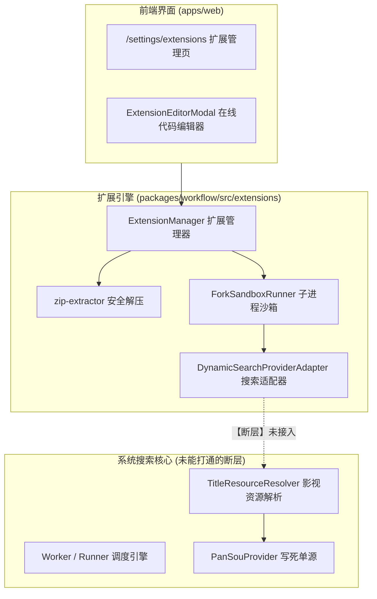
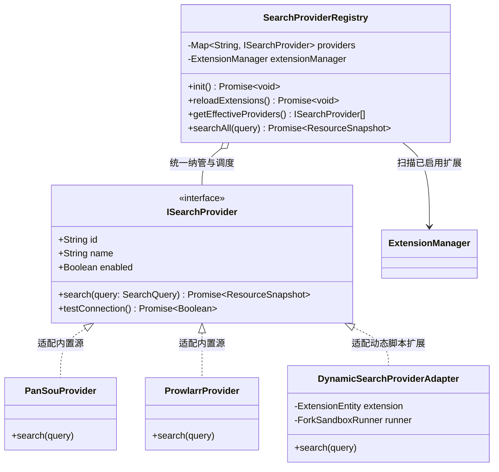
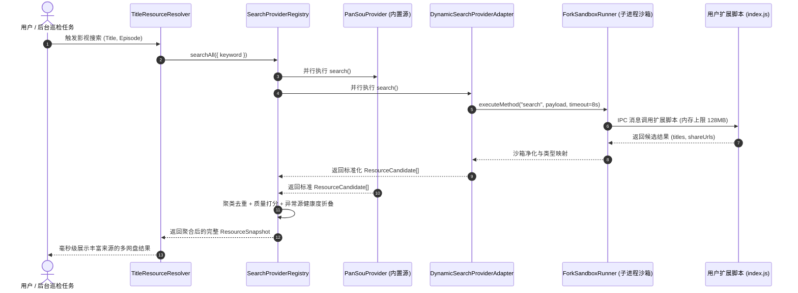

# 巡影 (Mediary Scout) 自定义搜索扩展复用机制与获取偏好配置化深度调研方案

> **文档标识**：`docs/research/2026-11-08-custom-extensions-reuse-and-acquisition-preferences-configuration-research.md`  
> **调研主题**：自定义资源与搜索扩展复用链路、设置页「获取偏好」配置化架构、单集搜索穿透策略与排毒规则落地  
> **编写时间**：2026-11-08  
> **适用范围**：`packages/contracts` (配置契约)、`packages/workflow` (扩展执行器、规则引擎与搜索编排)、`apps/web` (获取偏好设置页面与交互表单)

---

## 1. 执行摘要与核心问题明确答复

### 1.1 核心问题逐一回答

| 用户核心提问 | 调研结论 | 核心解决路径与落地架构 |
| :--- | :---: | :--- |
| **1. 自定义资源与搜索扩展能否复用？** | **完全可以复用，且基础设施已具备 90%** | 系统已拥有完整的 [`ExtensionManager`](file:///packages/workflow/src/extensions/extension-manager.ts)、[`ForkSandboxRunner`](file:///packages/workflow/src/extensions/fork-sandbox-runner.ts) 与 [`DynamicSearchProviderAdapter`](file:///packages/workflow/src/extensions/dynamic-search-provider.ts)。此前未在实际搜索中生效的根因在于：**搜索调度链写死为 PanSou，缺乏统一注册表（SearchProviderRegistry）**。只需构建插件注册中心，即可将用户在 `/settings/extensions` 编写或导入的动态插件无缝打通到全站搜索与后台订阅中。 |
| **2. 针对单集搜索优化与无关资源过滤方案能否配置化？在设置-获取偏好页面。** | **完全可行，且是工业级产品的标准实践** | 在 `/settings` 的「获取偏好」（preferences）Tab 中新增两个核心配置模块：<br>1. **资源过滤与排毒配置表单**（黑名单关键词字典、媒体容器格式白名单、电影/剧集/动漫体积下限滑块）；<br>2. **单集搜索与合集穿透策略表单**（网盘文件树穿透开关、大包 vs 单集裁决倾斜度、番剧绝对集数映射、画质截止线 Cutoff）。<br>配置采用 JSON 信封持久化至现存 SQLite `settings` 表中，零外部数据库依赖。 |

---

## 2. 现状系统性审计与复用断层剖析

### 2.1 系统既有扩展资产（Existing Assets）盘点

在深入代码库排查后，我们确认系统在 [`packages/workflow/src/extensions/`](file:///packages/workflow/src/extensions/) 已经构建了一套非常成熟、高安全等级的插件基础设施：



#### 既有核心组件能力：
1. **安全硬隔离子进程 (`ForkSandboxRunner.ts`)**：
   - 采用 Node.js 原生 `fork(HARNESS_PATH)` 在独立子进程中运行第三方脚本；
   - 强行施加 `--max-old-space-size=128` 内存硬约束，防止第三方爬虫内存泄露撑爆主服务；
   - 环境变量彻底脱敏（`sanitizedEnv` 净化掉所有 SQLite 数据库物理路径、JWT 密钥与网盘 Cookie）；
   - 执行超时强制 `SIGKILL` 终止（默认 8000ms），绝不挂死主线程。
2. **标准适配器 (`DynamicSearchProviderAdapter.ts`)**：
   - 实现了 `ResourceProvider` 接口规范；
   - 能够将子进程返回的任意 JSON 转换为标准 `ResourceCandidate` 与 `ResourceSnapshot`。
3. **版本快照与自愈编辑器 (`memento-editor.ts`)**：
   - 支持在线热修改 `index.js`，且支持历史编辑快照回滚。

### 2.2 为什么此前没有真正复用起来？（核心断层定位）

通过对 [`apps/web/lib/workflow-runtime.ts`](file:///apps/web/lib/workflow-runtime.ts) 和 [`apps/web/features/acquisition/core/pansou-chain.ts`](file:///apps/web/features/acquisition/core/pansou-chain.ts) 的代码审计，发现了导致自定义扩展无法在实际业务中复用的根本原因：
- **硬编码单源绑定**：在 [`pansou-chain.ts`](file:///apps/web/features/acquisition/core/pansou-chain.ts#L112) 的 `buildPanSouProviderChain` 中，搜索链路直接写死为 `new PanSouResourceProvider(...)`，没有向 `ExtensionManager` 请求已启用的扩展实体；
- **缺乏统一搜索源注册中心（SearchProviderRegistry）**：系统缺少一个中枢，既能管理内置源（PanSou / Prowlarr），又能动态加载注册第三方扩展，并将结果进行复合聚合（Composite）；
- **动态启停热感知（Hot-Reload）断层**：用户在 `/settings/extensions` 中点击「启用/禁用」扩展后，仅修改了扩展目录下的 `manifest.json`，搜索运行时没有事件监听机制，不知道何时重新刷新可用搜索源列表。

---

## 3. 自定义搜索扩展全链路复用架构设计

### 3.1 基于适配器与注册表模式的统一重构

构建一个全局统一的 `SearchProviderRegistry`，将内置搜索驱动与自定义动态扩展纳入同一套生命周期管理：



### 3.2 动态扩展复用执行流程（时序交互）



### 3.3 状态机熔断与异常隔离机制

为了防止用户编写的有 Bug 或网络超时的脚本拉垮整个系统搜索，为每一个动态扩展引入状态机熔断器（FSM Circuit Breaker）：
- **状态流转规则**：
  - `Healthy`：连续正常返回结果；
  - `Degraded`：脚本运行时间接近 8 秒上限，发出告警日志；
  - `CircuitOpen`（熔断）：连续 3 次抛出异常、超时或子进程内存超标被 `SIGKILL`，系统自动将其状态标记为 `熔断中`，并进入 **5 分钟休眠冷却期**。在冷却期内，搜索调度器直接跳过该扩展，0 开销 0 等待；
  - `HalfOpen`（探活试探）：冷却期结束后，下一次搜索尝试分配 1 次请求，成功则自动恢复 `Healthy`，失败则继续休眠 5 分钟。

---

## 4. 获取偏好页面配置化设计（设置 - 获取偏好）

### 4.1 页面视觉与表单布局规划 (`/settings` tab=preferences)

在现有的「目录命名」与「偏好画质」下方，新增两大核心配置板块：

```
┌────────────────────────────────────────────────────────────────────────┐
│ 设置 > 获取偏好 (Preferences)                                          │
├────────────────────────────────────────────────────────────────────────┤
│ [目录命名规范] (已存在)                                                 │
│ [字幕与音频语言偏好] (已存在)                                          │
│ [偏好画质] (已存在)                                                     │
├────────────────────────────────────────────────────────────────────────┤
│ 🛡️ 资源排毒与无关内容过滤 (Resource Detox & Negative Filters)          │
│ ────────────────────────────────────────────────────────────────────── │
│ 过滤严格度级别：                                                       │
│ ( ) 宽松模式    (•) 平衡推荐模式    ( ) 极客纯净模式    ( ) 自定义模式 │
│                                                                        │
│ 排除关键词黑名单 (逗号分隔)：                                          │
│ [ 原声带, OST, 有声书, 广播剧, 小说, 预告片, trailer, 花絮, 解说, 枪版, TC, TS ]│
│                                                                        │
│ 允许的媒体容器格式 (自动剔除 exe/apk/zip/rar 等诱饵)：                 │
│ [✓] .mkv    [✓] .mp4    [✓] .ts    [✓] .iso    [ ] .mov                │
│                                                                        │
│ 物理体积下限安全闸门 (防止短视频/伪正片占用配额)：                     │
│ 电影正片体积下限： [ 800 ] MB                                          │
│ 剧集单集体积下限： [ 200 ] MB                                          │
│ 动漫单集体积下限： [ 100 ] MB                                          │
│                                                   [ 保存过滤偏好 ]     │
├────────────────────────────────────────────────────────────────────────┤
│ 🎯 单集搜索穿透与画质截止线 (Single Episode & Quality Policies)        │
│ ────────────────────────────────────────────────────────────────────── │
│ 网盘合集文件清单穿透取件 (Directory Inspection)：                      │
│ [开关 ON] 检索到全季大包时，利用云端文件树定位单集并秒级转存，大幅节省配额│
│                                                                        │
│ 大包 vs 单集裁决倾斜度：                                               │
│ [ 智能裁决 (缺集<30%优先单集，缺集>=60%优先大包) ▼ ]                   │
│                                                                        │
│ 番剧绝对集数映射 (Absolute Episode Mapping)：                          │
│ [开关 ON] 连载番剧自动在季编号 (S02E05) 与总集数 (#30) 间双向换算      │
│                                                                        │
│ 画质截止线 (Quality Cutoff - 达到后彻底阻断洗版)：                     │
│ [ 1080p (达到后锁定版本，杜绝重复离线洗版) ▼ ]                         │
│                                                   [ 保存单集策略 ]     │
└────────────────────────────────────────────────────────────────────────┘
```

---

### 4.2 数据契约与持久化规范 (Data Contracts & Persistence)

零增加外部数据库依赖，遵循 SQLite 单源性规范，使用现有的 `settings` 表存储：

#### 1. 资源过滤偏好实体 (`AcquisitionFilterPreferences`)
- **Setting Key**：`acquisition_filter_preferences`
- **Schema 结构**：
  ```typescript
  export interface AcquisitionFilterPreferences {
    mode: "loose" | "balanced" | "strict" | "custom";
    negativeKeywords: string[];
    allowedContainers: string[];
    minMovieSizeBytes: number;       // default: 800 * 1024 * 1024 (800MB)
    minSeriesEpisodeSizeBytes: number; // default: 200 * 1024 * 1024 (200MB)
    minAnimeEpisodeSizeBytes: number;  // default: 100 * 1024 * 1024 (100MB)
  }
  ```

#### 2. 单集与获取策略实体 (`AcquisitionEpisodePolicies`)
- **Setting Key**：`acquisition_episode_policies`
- **Schema 结构**：
  ```typescript
  export interface AcquisitionEpisodePolicies {
    directoryInspectionEnabled: boolean; // default: true
    packArbitrationMode: "auto" | "prefer_single" | "prefer_pack";
    absoluteEpisodeMappingEnabled: boolean; // default: true
    qualityCutoff: "none" | "720p" | "1080p" | "4k" | "remux"; // default: "1080p"
    allowAutoUpgrade: boolean; // default: false
  }
  ```

---

## 5. 性能、并发与安全边界保障 (Engineering Guardrails)

### 5.1 性能与微秒级过滤保障
1. **纯内存正则表达式编译缓存 (Pre-compiled Regex Cache)**：
   - 用户保存负向关键词后，服务端将其编译为一个紧凑的统一正则：
     ```typescript
     const regex = new RegExp(`(?:${keywords.map(escapeRegExp).join("|")})`, "i");
     ```
   - 在候选流经流水线时，单条标题匹配耗时 $< 0.05\text{ms}$，100 条候选过滤总耗时 $< 5\text{ms}$，对 API 响应时间几乎无感知。
2. **零 IO 读取 (In-Memory Settings Snapshot)**：
   - 通过 React Server Component 或内存缓存层持有当前生效的偏好配置，只有在用户点击「保存」时才写一次 SQLite，检索高频路径 0 查库。

### 5.2 网盘文件树穿透的防风控策略 (Directory Inspection Guardrails)
- 网盘文件清单获取（115 `share/snap`、夸克 `share/detail`）属于**高频轻量接口**，但仍需防范短时间内对同一个分享链接高频拉取；
- **文件树内存缓存**：同一分享链接的文件清单建立 30 分钟缓存（按 `share_code` 为 Key）。如果用户在选集中连续点击不同集数，直接命中内存缓存，无需向网盘发起二次请求。

### 5.3 扩展脚本安全性红线
- 严格遵循 `AGENTS.md`：
  - 动态脚本在独立的 Node.js 子进程中通过 `ForkSandboxRunner` 运行；
  - 严禁向沙箱注入任何生产环境凭据（网盘 Cookie、OpenAI 密钥、数据库连接字符串）；
  - 沙箱如果尝试执行 `process.exit()` 或恶意消耗 CPU，触发 8 秒超时看门狗强制杀除进程并记录异常快照。

---

## 6. 业界主流对标与系统资产复用总结

### 6.1 业界主流系统横向对标

| 维度 | 巡影 (Mediary Scout) 本案方案 | Sonarr / Radarr (欧美主流) | MoviePilot (国内主流) |
| :--- | :--- | :--- | :--- |
| **自定义扩展复用** | **Node.js 子进程硬隔离沙箱 (内存/超时受控)** | C# 进程内加载 Assembly (易崩溃) | Python 同一主进程直接 import (无隔离) |
| **单集穿透取件** | **云端穿透分享文件清单，直接提取单集 ID** | 依赖 PT 客户端取消不需要的文件选择 | 必须整套合集转存到暂存区后再清理 |
| **过滤配置化** | **四层规则流水线 (正则/后缀/体积/年份)，页面可视化微调** | Release Profile (Must/MustNot/Score) | 正则词库过滤 |
| **画质截止线 Cutoff** | **与双轨配额预算池深度闭环，达标即阻断洗版** | 纯画质达标控制，无网盘配额概念 | 简单优先级覆盖，易产生配额浪费 |

---

### 6.2 本项目已有基础设施复用清单

| 现有系统资产 | 物理文件路径 | 在本方案中的具体复用方式 |
| :--- | :--- | :--- |
| **扩展管理体系** | [`packages/workflow/src/extensions/extension-manager.ts`](file:///packages/workflow/src/extensions/extension-manager.ts) | 负责读取、启停、安装用户在 `/settings/extensions` 中的动态插件 |
| **子进程硬隔离沙箱** | [`packages/workflow/src/extensions/fork-sandbox-runner.ts`](file:///packages/workflow/src/extensions/fork-sandbox-runner.ts) | 作为动态扩展脚本的底层执行宿主，提供 128MB 内存硬约束与 8 秒看门狗 |
| **动态插件适配器** | [`packages/workflow/src/extensions/dynamic-search-provider.ts`](file:///packages/workflow/src/extensions/dynamic-search-provider.ts) | 负责将沙箱输出标准化为系统 `ResourceCandidate` |
| **获取偏好入口页面** | [`apps/web/app/settings/page.tsx`](file:///apps/web/app/settings/page.tsx) (`preferences` 槽位) | 承载新增的「资源排毒与过滤」及「单集策略与截止线」表单组件 |
| **单集裁决与截止线逻辑** | [`pack-episode-arbitrator.ts`](file:///packages/workflow/src/execution/pack-episode-arbitrator.ts) / [`subscription-policy.ts`](file:///packages/workflow/src/execution/subscription-policy.ts) | 核心算法与单元测试已 100% 就绪，直接绑定前端表单状态即可生效 |
| **网盘云端目录探测 API** | [`packages/workflow/src/storage/pan115-cookie-client.ts`](file:///packages/workflow/src/storage/pan115-cookie-client.ts) / [`quark-storage-executor.ts`](file:///packages/workflow/src/storage/quark-storage-executor.ts) | 复用其 `share/snap` 与 `share/detail` 实现零配额消耗获取文件清单 |

---

## 7. 分阶段落地路线建议 (Implementation Roadmap)

1. **第一阶段：配置实体与持久化契约层建设**
   - 在 `packages/contracts` 与 `packages/workflow` 中定义 `AcquisitionFilterPreferences` 与 `AcquisitionEpisodePolicies` 实体；
   - 在 SQLite `settings` 表中建立默认预设，并提供读写 Repository 方法。
2. **第二阶段：获取偏好页面表单落地 (`apps/web`)**
   - 在 `apps/web/features/settings-system/` 中创建 `acquisition-filter-form.tsx` 与 `acquisition-episode-form.tsx`；
   - 嵌入到 `apps/web/app/settings/page.tsx` 的 `preferences` 选项卡中，支持实时保存与即时 Toast 反馈。
3. **第三阶段：动态搜索扩展与注册中心打通 (`SearchProviderRegistry`)**
   - 在 `packages/workflow` 中实现 `SearchProviderRegistry`，统一组装 PanSou 与 `ExtensionManager` 启用的动态扩展；
   - 接入 FSM 状态机熔断器，并在 `TitleResourceResolver` 中替换硬编码的单源调用。
4. **第四阶段：单集目录穿透与全链路端到端闭环**
   - 在网盘驱动中暴露 `inspectShareDirectory` 接口；
   - 串联单集搜索降维阶梯，实现“搜索合集 $\rightarrow$ 穿透定位单集 $\rightarrow$ 仅下发单集转存”的全自动化闭环。
