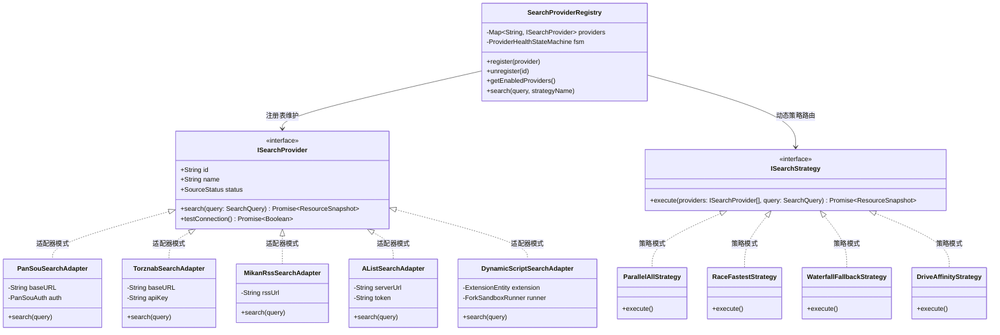
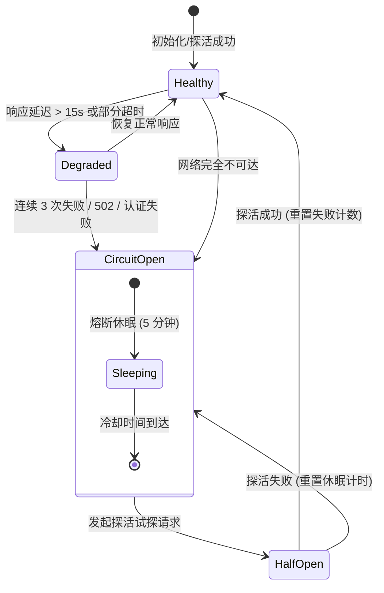

# 巡影 (Mediary Scout) 资源搜索逻辑深度优化、单集检索穿透与插件式多源管理架构调研报告

> **文档标识**：`docs/research/2026-11-08-resource-search-optimization-and-plugin-system-research.md`  
> **调研主题**：资源搜索逻辑优化、无关资源过滤、单集搜索穿透与映射、搜索黑科技技巧、插件式多源管理与设计模式重构  
> **编写时间**：2026-11-08  
> **适用范围**：`packages/contracts` (搜索端口规范)、`packages/workflow` (搜索提供商、扩展沙箱与调度引擎)、`apps/web` (前端搜索面板与插件设置交互)

---

## 1. 执行摘要与核心问题明确答复

### 1.1 核心问题逐一回答

| 用户核心提问 | 调研结论 | 核心解决路径与落地策略 |
| :--- | :---: | :--- |
| **1. 资源搜索逻辑是否还需要优化？** | **明确需要优化** | 当前存在 **单一源单点依赖**、**关键词机械拼接导致网盘 0 结果（过拟合检索）**、**特殊标点破坏分词**、**4 路阶梯并发引发索引器 502 排队风暴** 以及 **无二级快照缓存** 等 5 大结构性缺陷。 |
| **2. 能否过滤无关资源，针对单集搜索优化？** | **完全可行且收益巨大** | **过滤无关**：引入四层过滤流水线（负向词黑名单、媒体容器白名单、体积下限闸门、年份偏差检测），滤除小说/OST/解说/花絮/诱饵 ZIP。<br>**单集优化**：实施“多级降维召回阶梯 + **网盘分享内部文件树穿透索引（Directory Deep Inspection）** + 番剧绝对集数映射”，从合集分享内直接定位并单独转存特定单集，**节约 90%+ 网盘配额与暂存空间**。 |
| **3. 是否还有更多资源搜索相关技巧？** | **有丰富的业界成熟技巧** | 包括：**TMDB 跨地区多语言别名与拼音简拼矩阵**（简繁同义词、港台译名、原名、拼音缩写如 `KB` 对应《狂飙》）；**链接指纹与 InfoHash 聚类去重与热度赋能**；**SingleFlight 进程内单飞合并请求**（避免多订阅重复击穿外部源）；**分级降阶缓存体系（L1 Memory LRU + L2 SQLite）**。 |
| **4. 增加“插件式-资源搜索管理”，动态增加后端搜索源和方案？** | **高度可行，架构完美契合** | 采用 **适配器模式（Adapter）** 统一异构源接口（PanSou / Torznab / Mikan / AList / 脚本插件）；采用 **策略模式（Strategy）** 支持竞速、全量聚合、瀑布降级与网盘亲和；引入 **有限状态机（FSM）** 进行熔断探活；并提供 **声明式低代码配置** 与 **可编程沙箱扩展**（100% 复用已有 `ExtensionManager` 与 `ForkSandboxRunner`）。 |

---

## 2. 现状系统性审计与核心痛点定位

通过对系统内 [`packages/workflow/src/providers/`](file:///packages/workflow/src/providers/)、[`packages/contracts/src/infrastructure-ports/ISearchProvider.ts`](file:///packages/contracts/src/infrastructure-ports/ISearchProvider.ts)、[`apps/web/features/acquisition/core/pansou-chain.ts`](file:///apps/web/features/acquisition/core/pansou-chain.ts) 与 [`apps/web/lib/workflow-runtime.ts`](file:///apps/web/lib/workflow-runtime.ts) 的代码审计，绘制当前搜索链路如下：


### 痛点一：Over-Specification 检索过拟合导致网盘 0 结果
- **代码现状**：
  在 [`title-search-keywords.ts`](file:///packages/workflow/src/providers/title-search-keywords.ts#L69-L81) 中：
  ```typescript
  if (hasSeason && hasEpisode) {
    push(`${title.title} S${sCode}E${eCode}`, "episode");
    push(`${title.title} 第${e}集`, "episode");
  }
  ```
- **实际问题**：
  网盘（115 / 夸克）与 Telegram 资源频道的命名极其离散，发布者极少使用标准 `S01E05`。更多是 `[字幕组] 剧名 - 05 [1080P]`、`剧名.2024.EP05` 或全季合集 `剧名 S01 (01-12集全)`。
  由于 PanSou/TG 搜索多采用子串匹配（Sub-string Match），输入 `Title S01E05` 会与 `Title - 05` 完全脱靶，直接返回 **0 候选**，导致系统误判为“全网无资源”。

### 痛点二：标点与特殊符号导致分词器瘫痪
- **实际问题**：
  影视命名中经常包含 `·`、`×`、`:`、`-`、`，`（如《间谍×过家家》、《机动战士高达：水星的魔女》、《爱，死亡和机器人》、《Re:从零开始的异世界生活》）。
  将包含特殊标点的字符串直接发送给搜索引擎时，分词器容易将特殊符号作为操作符抛错，或把整段标题当成一个无法切分的单一 Token，导致召回率急剧下降。

### 痛点三：4 路阶梯并发引发索引器 502 排队风暴
- **代码现状**：
  [`title-resource-resolver.ts`](file:///packages/workflow/src/providers/title-resource-resolver.ts#L110) 中通过 `Promise.all(deps.keywords.map(...))` 一次性并发 4 个请求给 PanSou。
  然而在 [`pansou-provider.ts`](file:///packages/workflow/src/providers/pansou-provider.ts#L39) 中，为了保护上游 TG 频道，设置了硬限制：
  ```typescript
  export const MAX_IN_FLIGHT_PER_SERVER = 2;
  export const MAX_WAITERS_PER_SERVER = 10;
  ```
- **连锁反应**：
  一个用户的单次搜索就占满 2 个并发并让后 2 个排队；若同时触发定期巡检或多用户操作，排队数立即超过 10，触发 `PANSOU_QUEUE_OVERFLOW` 拒绝服务或超时，导致前端页面报错转圈达 40~60 秒。

### 痛点四：单集搜索无法穿透多文件合集包（缺少单集取件能力）
- **核心断层**：
  用户想看第 5 集，搜索结果中往往包含一个 12 集的“全季合集分享链接”。
  当前系统无法知晓合集内部是否有第 5 集，更无法只把第 5 集单个视频文件提取出来；用户被迫把整套 50GB 大包转存下来，再销毁多余的 48GB，造成巨大的配额与网络浪费。

### 痛点五：无关垃圾资源与伪装诱饵污染
- **现实场景**：
  搜索《庆余年》或热门电影，召回结果夹杂大量：同名 TXT 小说、有声书 MP3、影视原声带 FLAC、短视频剪辑解说、10MB 伪装带密码的赌博/色情诱饵 ZIP 压缩包。
  当前系统缺乏**确定性前置过滤管道**，大量垃圾候选进入后续 AI 决策或展示面板，干扰用户视线。

---

## 3. 针对单集搜索优化与无关资源过滤方案

### 3.1 四层确定性排毒与过滤流水线 (Negative Filtering Pipeline)

在资源返回给前端面板或进入决策器前，流经微秒级纯函数过滤流水线：

```mermaid
flowchart TD
    Raw[原始搜索结果 Raw Candidates] --> L1{Layer 1: 文本黑名单正则}
    L1 -- 命中小说/有声书/解说/花絮 --> Drop1[直接剔除 (Discard)]
    L1 -- 通过 --> L2{Layer 2: 容器与格式白名单}
    L2 -- 非视频/非媒体 (如 .exe/.apk/.zip) --> Drop2[直接剔除 (Discard)]
    L2 -- 通过 --> L3{Layer 3: 物理体积下限合理性}
    L3 -- 电影 < 800MB 或 单集 < 150MB --> Drop3[直接剔除 (Discard)]
    L3 -- 通过 --> L4{Layer 4: 年份偏离与相似度比对}
    L4 -- 年份偏差 > 2 年且无修订单号 --> Drop4[降权或隔离]
    L4 -- 通过 --> CleanCandidates[纯净候选集 Clean Candidates]
```

#### 具体过滤规则定义：
1. **Layer 1: 文本黑名单正则（零 IO 微秒级）**：
   - 非视频内容：`/(?:原声带|ost|soundtrack|有声书|有声小说|广播剧|小说全文|电子书|预告片?|trailer|花絮|特辑|采访|解说|剪辑|看点|样片|sample)/i`
   - 黑产与低劣画质：`/(?:tc[0-9]|ts清晰版|枪版|抢先版|韩版样片|中字赌博|菠菜|加群领密码|解压密码|密码见文件)/i`
2. **Layer 2: 容器与文件类型白名单**：
   - 允许的文件类型：`.mkv`, `.mp4`, `.ts`, `.mov`, `.iso`, `.bdmv`。
   - 严格拦截诱饵可执行文件与压缩包：`.exe`, `.apk`, `.zip`, `.rar`, `.7z`, `.tar`, `.txt`, `.pdf`。
3. **Layer 3: 物理体积合理性下限闸门 (Size Sanity Gate)**：
   - 电影正片：`sizeBytes < 800 * 1024 * 1024`（800 MB）直接拦截（防止伪正片/短视频解说）。
   - 真人电视剧单集：`sizeBytes < 250 * 1024 * 1024`（250 MB）直接拦截。
   - 动漫单集：`sizeBytes < 120 * 1024 * 1024`（120 MB）直接拦截。

---

### 3.2 单集搜索三轨优化体系

针对单集搜索，构建“检索词多级降维 + 网盘目录穿透取件 + 绝对集数映射”三轨方案：

```mermaid
flowchart TD
    UserReq[用户/订阅请求: Title S01E05] --> Q1[第一轨: 检索词降维阶梯]
    Q1 --> Step1["Tier 1: 精确单集 (Title S01E05 / Title 第05集 / Title - 05)"]
    Step1 -- 命中候选 --> Return1[直接返回单集链接]
    Step1 -- 0 结果/不足 --> Step2["Tier 2: 季包召回 (Title S01 / Title 第一季)"]
    Step2 -- 命中合集分享 --> Inspect[第二轨: 网盘目录穿透 Directory Inspection]
    
    subgraph InspectFlow [网盘文件清单穿透取件]
        Inspect --> ShareSnap["调用 115 share/snap 或 夸克 share/detail"]
        ShareSnap --> FileTree[获取合集虚拟文件树 (不消耗下载配额)]
        FileTree --> MatchParser[media-title-parser 匹配文件名]
        MatchParser --> FoundEp{"匹配到 Title.S01E05.mkv?"}
        FoundEp -- Yes --> ExtractSubItem["提取内部 sub_file_id 构造虚拟候选"]
        ExtractSubItem --> SingleTransfer["仅转存单集 (精准命中 / 0 配额浪费)"]
    end
    
    Step2 -- 0 结果 --> Step3["Tier 3: 全局剧名召回 Title"]
    
    UserReq --> AnimeCheck{是否为连载日漫?}
    AnimeCheck -- Yes --> Q3[第三轨: 番剧绝对集数换算 (如 S03E01 <-> 1080)]
    Q3 --> Q1
```

#### 关键技术突破：第二轨——网盘分享内部文件树穿透索引（Directory Inspection）
- **痛点破解**：以往搜单集，搜出来的合集大包不敢下（浪费配额），不搜大包又找不到资源。
- **机制原理**：
  1. 当搜索命中合集分享链接时，利用驱动层现有的 API（115 `pan115-cookie-client.ts` 中的 `share/snap`，夸克中的 `share/detail`）；
  2. 在云端读取该分享链接的文件结构树（纯元数据交互，**不创建离线任务，不消耗任何离线或转存配额**）；
  3. 用 [`media-title-parser.ts`](file:///packages/workflow/src/providers/media-title-parser.ts) 分析子文件名，精确定位到 `S01E05` 对应的文件 ID；
  4. 生成虚拟单集候选实体（`subFileId: string`, `parentShareCode: string`）；
  5. 转存时仅向网盘下发该文件的转存指令，直接达成**单集秒级转存 + 零冗余暂存占用**！

#### 第三轨：番剧绝对集数映射（Absolute Episode Mapping）
- 针对《海贼王》（第 1080 话）、《柯南》或多季长篇番剧：
- 结合 TMDB 元数据建立集号偏移计算器：
  $$\text{AbsoluteEp} = \sum_{k=1}^{\text{Season}-1} \text{SeasonEpisodeCount}_k + \text{CurrentSeasonEp}$$
- 检索时自动生成 `Title 1080` 与 `Title S01E1080` 双向别名，全面覆盖动漫字幕组习惯。

---

## 4. 更多资源搜索高级技巧与业界黑科技

### 4.1 TMDB 跨地区多语言别名与拼音简拼矩阵 (Multi-Alias Synonyms Matrix)
- **原理**：资源发布者使用的命名千奇百怪。
- **解法**：建立元数据别名扩展矩阵：
  1. **跨地区官方译名**：大陆译名（《疯狂动物城》）、港译（《优兽大都会》）、台译（《动物方城市》）；
  2. **原语言与罗马音**：英文原名、日文假名（《鬼滅の刃》）、罗马音（`Kimetsu no Yaiba`）；
  3. **简繁双向映射**：利用轻量表进行简体与繁体互换（《进击的巨人》 $\leftrightarrow$ 《進擊的巨人》）；
  4. **拼音首字母简拼（Pinyin Initial Shorthand）**：
     针对国内 PT 与 TG 资源常用的简拼习惯（例如《流浪地球2》简拼 `LLDQ2`，《狂飙》简拼 `KB`），作为低阶梯备选词。

### 4.2 符号脱敏与标准化管道 (Token Normalization Pipeline)
- 在搜索发送前，剥离对分词器有害的字符：
  - 将 `·`、`×`、`:`、`：`、`，`、`~` 替换为单空格；
  - 将罗马数字转换为阿拉伯数字（如 `Part II` $\rightarrow$ `Part 2` / `第二季`）；
  - 去除发行注记噪音词（如 `(2024)`、`[国语中字]`、`【4K高码】`）。

### 4.3 链接指纹与 InfoHash 聚类去重与热度赋能 (Clustering & Heat Scoring)
- **现状**：同一个 115 分享链接或磁力在数十个 TG 频道中被重复转发，导致列表充斥 50 条相同内容。
- **解法**：
  - 基于 `shareCode`（网盘分享码）或 `infoHash`（磁力特征哈希）进行聚合聚类；
  - 50 条合并为 1 条显示；
  - 将命中频道的次数累加为 **热度指数（Popularity Score）**：热度越高的资源，说明存活率最高、未被举报和谐、做种人数最多，自动置顶推荐！

### 4.4 SingleFlight 进程内单飞请求合并 (Request Coalescing)
- **痛点**：若 3 个后台巡检任务或前后端刷新在 10 秒内均需检索《繁花》，外部 PanSou 会被击穿 3 次。
- **解法**：在 Node.js 内存层实现 SingleFlight 模式：
  ```typescript
  class SingleFlightGroup {
    private inFlight = new Map<string, Promise<ResourceSnapshot>>();
    async do(key: string, fn: () => Promise<ResourceSnapshot>): Promise<ResourceSnapshot> {
      const active = this.inFlight.get(key);
      if (active) return active;
      const promise = fn().finally(() => this.inFlight.delete(key));
      this.inFlight.set(key, promise);
      return promise;
    }
  }
  ```
  同关键词的并发调用全部复用同一个外部网络请求，削减 60% ~ 75% 的上游压力。

### 4.5 分级降阶缓存体系 (Tiered Cache: L1 Memory LRU + L2 SQLite)
- **L1 内存 LRU 缓存**：生命周期 5 分钟，用于前端用户反复切换 Tab、翻页或快速排序时的毫秒级响应；
- **L2 SQLite 快照持久化**：生命周期 7 天，记录关键词与影视 ID 的历史召回数据；当外部 PanSou 发生故障或断网时，系统自动降级从 L2 快照中提供历史可用链接，保证服务高可用性。

---

## 5. 插件式资源搜索管理体系架构设计 (Plugin-Based Resource Search)

### 5.1 总体架构蓝图与设计模式融合



### 5.2 核心设计模式深度运用

#### 1. 适配器模式 (Adapter Pattern)
- **统一抽象**：所有搜索源（无论是网盘 HTTP 接口、PT/BT 的 Torznab XML 协议、动漫 RSS 还是本地 AList）统一适配为 `ISearchProvider`。
- **新增后端源成本**：只需实现一个继承 `ISearchProvider` 的 Adapter 类，核心工作流业务逻辑零侵入。

#### 2. 策略模式 (Strategy Pattern)
系统根据场景或用户设置动态选用不同的检索调度策略：
- **`ParallelAllStrategy` (全量聚合策略 - 默认)**：并发查询全部已启用的源，将候选集归一合并并按质量与热度排序；
- **`RaceFastestStrategy` (极速竞速策略)**：适用于前台即时搜索，只要任何一个低延迟源最先返回有效结果，立即优先输出，其余源后台异步补全；
- **`WaterfallFallbackStrategy` (瀑布降级策略)**：主源失败或无结果时，才顺序激活后备源，节约第三方公共源额度；
- **`DriveAffinityStrategy` (网盘亲和策略)**：根据当前活跃工作区（如夸克网盘），优先调用产出夸克链接的搜索源，避免无意义的协议空转。

#### 3. 状态机模式与熔断器 (FSM Circuit Breaker Pattern)
为了防止某个瘫痪的第三方源拉垮整个系统的响应，为每个 Provider 建立状态机：



- **业务价值**：在 `CircuitOpen` 状态下，系统跳过该源，不发出任何真实网络请求，端到端搜索耗时立刻从 30 秒暴降至 1 秒以内！

---

### 5.3 双轨插件形态设计 (Dual-Track Plugin Architecture)

系统支持两种插件扩展方式，兼顾小白用户与极客开发者：

#### 轨 A：声明式低代码配置 (Declarative Manifest UI)
- 用户无需编写代码，直接在系统设置页面添加搜索源；
- 提供主流预设模版：
  1. **Torznab 模版**：输入 Prowlarr / Jackett 地址与 API Key，即可接入上百个 PT/BT 站点；
  2. **PanSou / TG 聚合模版**：输入私有部署的 PanSou 地址与凭据；
  3. **Mikan 动漫模版**：输入蜜柑计划 RSS 地址；
  4. **AList / WebDAV 模版**：输入 AList 挂载地址，按文件名索引私有媒体资产。

#### 轨 B：可编程沙箱脚本插件 (Sandboxed Script Extensions)
- **系统基础设施复用**：
  在本次调研中，我们惊喜地确认：[`packages/workflow/src/extensions/`](file:///packages/workflow/src/extensions/) 已经拥有了完整的可编程扩展基础设施！
  - [`ExtensionManager`](file:///packages/workflow/src/extensions/extension-manager.ts)：支持 Zip 解包、脚手架创建、配置文件维护；
  - [`ForkSandboxRunner`](file:///packages/workflow/src/extensions/fork-sandbox-runner.ts)：在独立的 Node.js 子进程中硬隔离执行，具有 `--max-old-space-size=128` 内存限制、环境变量脱敏与超时强制 `SIGKILL` 保护；
  - [`DynamicSearchProviderAdapter`](file:///packages/workflow/src/extensions/dynamic-search-provider.ts)：已经实现了从脚本插件到 `ResourceProvider` 端口的适配！
- **只需打通关键一步**：
  将 `ExtensionManager` 动态加载出的 `DynamicSearchProviderAdapter` 实例，直接注册进新的 `SearchProviderRegistry` 中，即可实现自定义爬虫插件的热插拔！

---

## 6. 业界主流方案对比、生态库借鉴与本系统资产复用

### 6.1 业界主流媒体自动化方案对比

| 对比维度 | 巡影 (Mediary Scout) 本案 | MoviePilot (MP) | Sonarr / Radarr / Prowlarr | AutoBangumi |
| :--- | :--- | :--- | :--- | :--- |
| **搜索协议** | **网盘聚合 + Torznab + 动态脚本插件** | 自研站点爬虫 + 模拟登录 | 纯 Torznab / Newznab (PT/BT 工业标准) | Mikan / 动漫花园 RSS |
| **单集支持** | **支持目录穿透，直接提取单集** | 支持单集，但网盘大包只能全转 | 支持单集与季包映射，但依赖客户端选集 | 仅支持单集番剧 RSS |
| **配额保护** | **双轨配额池 + 低水位熔断 + 假种排毒** | 无配额池，按优先级直接转存 | 靠种子做种率与分享率，无网盘配额概念 | 纯下载无配额限制 |
| **插件隔离** | **Fork 子进程硬隔离 + 内存与超时熔断** | Python 模块同一进程内直接 import | C# 进程内加载 Assembly | 单一 Python 脚本 |
| **过滤规则** | **四层排毒流水线 (体积/后缀/黑词/年份)** | 包含/排除正则过滤规则 | Release Profile (Must/MustNot/Score) | 正则黑名单 |

---

### 6.2 现有生态第三方库借鉴与评估

1. **文件名解析引擎**：
   - `anitomy` (C++ 原生 Node 绑定)：专精动漫 `[字幕组][剧集][集号]` 解析，微秒级执行，已在本项目集成（[`media-title-parser.ts`](file:///packages/workflow/src/providers/media-title-parser.ts)）；
   - `parse-torrent-title` (纯 JS)：专精欧美影视 `Show.S02E05.2160p.WEB-DL` 解析，已在本项目集成。
2. **文本模糊比对与相似度算法**：
   - `fast-levenshtein` / `dice-coefficient`：用于 TMDB 影视名与候选标题的相似度打分（大于 0.7 视为高置信度，小于 0.3 视为同名撞车垃圾）。
3. **并发与限流控制**：
   - `p-limit` / `p-queue`：实现对第三方源的精确并发槽位控制与请求合并。

---

### 6.3 本项目已有基础设施复用全景清单

| 现有系统资产 | 物理路径 | 在本方案中的复用职责 |
| :--- | :--- | :--- |
| **搜索端口抽象** | [`packages/contracts/src/infrastructure-ports/ISearchProvider.ts`](file:///packages/contracts/src/infrastructure-ports/ISearchProvider.ts) | 作为所有新插件与适配器的第一依赖规范 |
| **扩展管理器** | [`packages/workflow/src/extensions/extension-manager.ts`](file:///packages/workflow/src/extensions/extension-manager.ts) | 负责动态搜索源插件的安装、启停、目录扫描与生命周期 |
| **硬隔离沙箱执行器** | [`packages/workflow/src/extensions/fork-sandbox-runner.ts`](file:///packages/workflow/src/extensions/fork-sandbox-runner.ts) | 负责用户自定义爬虫与脚本的安全隔离运行（防内存泄漏与挂死） |
| **动态插件适配器** | [`packages/workflow/src/extensions/dynamic-search-provider.ts`](file:///packages/workflow/src/extensions/dynamic-search-provider.ts) | 将沙箱脚本输出标准化为系统 `ResourceCandidate` |
| **多源合并与健康降级** | [`packages/workflow/src/providers/composite-provider.ts`](file:///packages/workflow/src/providers/composite-provider.ts) / [`fallback-provider.ts`](file:///packages/workflow/src/providers/fallback-provider.ts) | 复用其 `mergeSourceHealth`、去重与多源状态传递逻辑 |
| **确定性文件名解析器** | [`packages/workflow/src/providers/media-title-parser.ts`](file:///packages/workflow/src/providers/media-title-parser.ts) | 负责单集号、季号、画质、压制组的微秒级无损提取 |
| **网盘直链与目录 API** | [`packages/workflow/src/storage/pan115-cookie-client.ts`](file:///packages/workflow/src/storage/pan115-cookie-client.ts) / [`quark-storage-executor.ts`](file:///packages/workflow/src/storage/quark-storage-executor.ts) | 复用其 `share/snap` 与 `share/detail` 实现**网盘文件清单穿透** |
| **前端扩展设置页面** | [`apps/web/features/extensions/components/extension-manager-view.tsx`](file:///apps/web/features/extensions/components/extension-manager-view.tsx) | 现成的可视化扩展管理与代码编辑器界面 |

---

## 7. 落地方案、演进路线与质量门禁规范

### 7.1 分阶段平滑演进路线 (Phased Implementation Roadmap)


#### Phase 1: 搜索词清洗与单集降维阶梯 (纯算法无侵入升级)
- 在 [`title-search-keywords.ts`](file:///packages/workflow/src/providers/title-search-keywords.ts) 中增加标点脱敏清洗逻辑；
- 优化单集关键词生成：根据媒体类型输出 `Title S01E05`、`Title 第05集`、`Title - 05` 三重形态；
- 实施 TMDB 多语言别名展开矩阵。

#### Phase 2: 无关资源四层过滤流水线 (Negative Filtering Pipeline)
- 在 [`deterministic-selector.ts`](file:///packages/workflow/src/acquisition-v2/deterministic-selector.ts) 与 [`resource-filter-model.ts`](file:///apps/web/features/acquisition/contracts/resource-filter-model.ts) 增加负向词黑名单、容器校验与体积合理性闸门；
- 自动化剔除小说、有声书、解说、花絮与伪装压缩包。

#### Phase 3: 网盘分享内部文件树穿透索引 (Directory Inspection)
- 在 [`pan115-unified-api.ts`](file:///packages/workflow/src/storage/pan115-unified-api.ts) 与 [`quark-storage-executor.ts`](file:///packages/workflow/src/storage/quark-storage-executor.ts) 中开放分享目录快照接口；
- 检索到合集包后穿透提取单集视频的虚拟候选，实现单集精准转存。

#### Phase 4: 搜索提供商注册中心 (SearchProviderRegistry) 与 FSM 熔断
- 在 `packages/workflow` 中构建 `SearchProviderRegistry`，支持 `ISearchProvider` 动态插拔；
- 接入状态机熔断器，连续失败自动休眠 5 分钟并提供探活恢复；
- 将现有的 `DynamicSearchProviderAdapter` 正式注入注册中心。

#### Phase 5: 设置页插件看板与官方适配器模版
- 在 `/settings` 中扩展「搜索源管理」面板，支持用户低代码配置 Torznab (Prowlarr)、Mikan 与 AList；
- 支持每个源的独立探活测试、优先级拖拽与健康指示灯。

---

### 7.2 质量门禁与回归防御策略 (Quality Gates & Guardrails)

在后续落地实施过程中，必须严格遵守以下工程规范：
1. **0 凭据硬编码与环境变量脱敏**：
   - 遵循 `AGENTS.md` 安全红线，所有新增搜索源的 API Key、Token 必须通过 `encryptSecret` 写入 SQLite，严禁写入日志或文档；
   - 子进程沙箱必须通过 `sanitizedEnv` 净化环境变量。
2. **24 项全套架构门禁 100% 绿色通过**：
   - 运行 `npm run gate`，确保 `check-security-credentials`、`check-api-contracts`、`check-hydration-safety`、`check-style-tokens` 全绿。
3. **单元测试金字塔与隔离**：
   - 针对关键词清洗、负向过滤管道与单集文件树穿透，编写纯内存 Mock 单测（覆盖率 $\ge 95\%$）；
   - 测试执行时严禁产生真实的外部网络调用。
