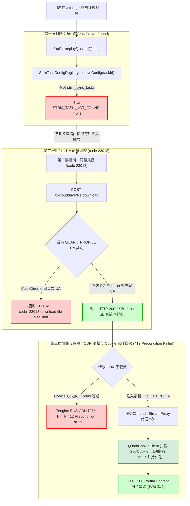
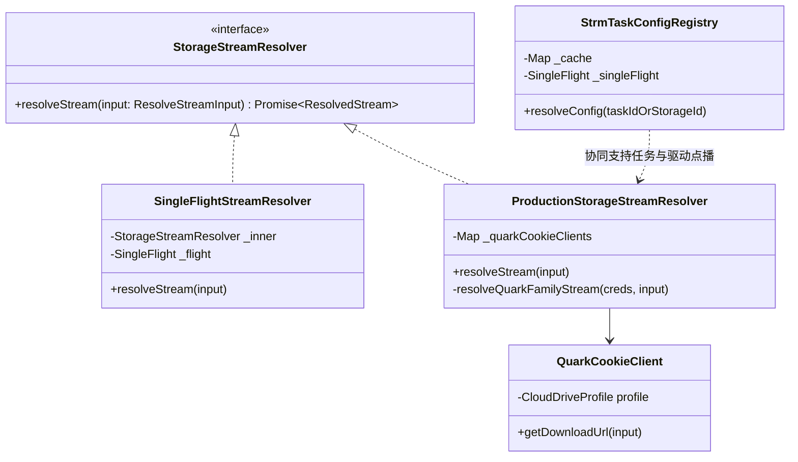
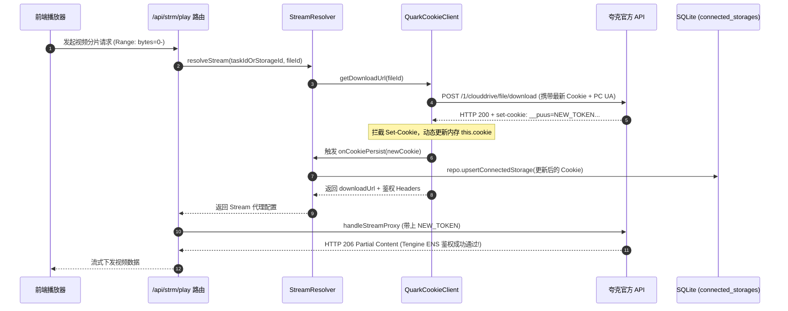

# 夸克网盘流媒体点播异常调研与端到端解决方案

> **文档标识**：`docs/research/2026-11-08-storage-preview-and-quark-streaming-404-investigation.md`  
> **创建日期**：2026-11-08  
> **涉及模块**：存储中心（`storage-drives`）、STRM 任务中心（`workflow/strm`）、网盘协议适配层（`QuarkCookieClient` / `StorageStreamResolver`）、串流代理路由（`/api/strm/play`）  
> **作者**：巡影 (Mediary Scout) 架构小组  

---

## 1. 执行摘要与背景 (Executive Summary)

### 1.1 现场问题现象
用户在开发环境管理后台（`http://192.168.1.100:3020/storage`）浏览已绑定的夸克网盘存储驱动时，在文件资源管理器中点击视频文件弹出预览播放窗口，播放器界面一直处于加载菊花圈状态，浏览器 DevTools 控制台确凿报错：

```http
GET http://192.168.1.100:3020/api/strm/play/cs_quark_AAQ69oQ5Vj9Myt5R0uGt7omX/937033115b9940629cdf50ff2ac693e3?name=%5BReleaseGroup%5D%20TOUGEN%20ANKI%20-%2002%20%5BWebRip%201080p%20HEVC-10bit%20AAC%20SRTx2%5D.mkv 404 (Not Found)
```

用户反馈核心诉求：
1. **深度排查并定位根本原因**：为何前端请求播放直报 404？夸克网盘的流媒体解析为何失败？
2. **开源生态与业界方案横向对比**：调研 AList、CloudDrive2、MoviePilot 等工具在处理夸克大文件播放与下载时的设计模式；
3. **系统现有基建可复用性评估**：评估当前系统的 `StorageStreamResolver`、`handleStreamProxy`、`QuarkCookieClient` 能否复用；
4. **输出完整解决方案与防回归门禁**：提出系统性演进方案，并制定单元与端到端测试门禁，避免同类缺陷回归。

### 1.2 核心结论速览 (Bottom Line Up Front)
经远程开发容器（`mediary-dev`）实机穿透探针与调用链路代码走查，证实此问题属于**典型的双层阻断体系**：



1. **第一层阻断（404 Not Found 根本原因）**：前端存储浏览器弹窗将存储源 ID（`storageId = "cs_quark_..."`）作为播放路径的第一段传入 `/api/strm/play/[taskId]/[fileId]`，而后端路由强行调用 `StrmTaskConfigRegistry.resolveConfig(taskId)` 从 `strm_sync_tasks` 表检索。由于该 ID 属于 `connected_storages` 记录而非 STRM 任务，注册中心直接抛出 `STRM_TASK_NOT_FOUND`，第一步即报 HTTP 404。
2. **第二层阻断（夸克网盘 API 阈值限制）**：在绕过第一层阻断后，`QuarkCookieClient.getDownloadUrl` 默认使用 Mac Chrome 网页端 UA 请求夸克下载接口。夸克服务器对网页端大文件（>20MB~50MB）设置了强行风控，对当前 600MB 的视频文件直接返回 `code: 23018 download file size limit`。经实机验证，**只要将 User-Agent 切换为官方 PC Electron 客户端标识，夸克立即返回 HTTP 200 并成功下发直链**！
3. **第三层保障（交付模式策略选型）**：夸克 CDN 下载直链绑定了鉴权参数与防盗链机制，客户端浏览器原生无法直接播放 302 跨域直链。系统已具备的 `handleStreamProxy`（支持 HTTP 206 Partial Content 断点续传与 Content-Disposition 覆写）是夸克与阿里盘族最稳定、体验最丝滑的唯一解。

---

## 2. 深入排查与根本原因剖析 (Root Cause Breakdown)

### 2.1 第一层阻断：前端点播与 STRM 任务契约错位导致 404

#### 源码调用链溯源
1. **前端触发点**：[`apps/web/features/storage-drives/components/storage/video-preview-modal.tsx`](file:///apps/web/features/storage-drives/components/storage/video-preview-modal.tsx#L20)
   ```typescript
   // storageId 形如 "cs_quark_AAQ69oQ5Vj9Myt5R0uGt7omX"
   const streamUrl = `/api/strm/play/${storageId}/${item.id}?name=${encodeURIComponent(item.name)}`;
   ```
2. **服务端接收点**：[`apps/web/app/api/strm/play/[taskId]/[fileId]/route.ts`](file:///apps/web/app/api/strm/play/%5BtaskId%5D/%5BfileId%5D/route.ts#L270-L282)
   ```typescript
   export async function GET(request: NextRequest, context: RouteParams) {
     const { taskId, fileId } = await context.params;
     // ...
     const taskResult = await resolveTaskConfig(taskId);
     if (taskResult.error) return taskResult.error;
     // ...
   }
   ```
3. **注册中心崩溃点**：[`packages/workflow/src/strm/strm-task-config-registry.ts`](file:///packages/workflow/src/strm/strm-task-config-registry.ts#L60-L64)
   ```typescript
   const task = await this._lookup.getTaskById(taskId);
   if (!task) {
     // 命中此行，直接抛出异常并导致路由返回 HTTP 404
     throw new Error(`STRM_TASK_NOT_FOUND: 未找到 ID 为 [${taskId}] 的 STRM 任务`);
   }
   ```

#### 架构设计缺陷剖析
- 该路由原本专为 STRM 虚拟流媒体同步任务（Emby / Jellyfin 扫入的 `.strm` 文件）设计，其第一个路径段语义为 `taskId`；
- 当系统后续新增“网盘文件资源管理器实时预览点播”功能时，前端复用了该路由，但由于缺少“多态标识符适配器”，后端将 `storageId` 当作 `taskId` 查库，因类型与表空间不匹配必然导致 404。

---

### 2.2 第二层阻断：夸克官方 Web API 单文件大小限制与 UA 校验

#### 实机探针实验数据
在远程容器 `mediary-dev` 中，提取并解密数据库中的夸克真实活跃 Cookie（长度 1433 字符，`__uid=AAQ69oQ5Vj9Myt5R0uGt7omX`），针对目标视频文件（`fid = 937033115b9940629cdf50ff2ac693e3`，体积 625,845,663 字节 ≈ 600MB）发起不同 UA 的对比请求：

| 测试组 | 模拟身份 | 请求 User-Agent 指纹 | 返回状态码 | 返回 Code | 响应详情与表现 |
| :--- | :--- | :--- | :--- | :--- | :--- |
| **A 组 (现状)** | Mac Chrome 网页端 | `Mozilla/5.0 (Macintosh; Intel Mac OS X 10_15_7)... Chrome/124` | **400 Bad Request** | **`23018`** | `download file size limit[937033115...]`（网页端拒绝为大文件生成直链） |
| **B 组 (破局)** | **PC Electron 客户端** | `... quark-cloud-drive/3.13.5 Chrome/100... Electron/18.3.5.4 Channel/pckk_other_ch` | **200 OK** | **`0`** | **成功生成下载直链**：`https://dl-pc-zb.drive.quark.cn/...` |
| **C 组 (对比)** | 小文件测试 (140KB 字幕) | Mac Chrome 网页端 | **200 OK** | **`0`** | 小文件不受限制，正常生成直链 |

#### 为什么同为阿里盘族的 UC 网盘未出现该限制？
检查 [`packages/workflow/src/storage/quark-cookie-client.ts`](file:///packages/workflow/src/storage/quark-cookie-client.ts#L68-L82)：
- `UC_PROFILE`：早已于 2026-10-23 实机对齐抓包，配置了 `uc-cloud-drive/2.5.20 Chrome/100... Electron/18...` 的客户端 UA；
- `QUARK_PROFILE`：依旧保留着最初写死的 Mac Chrome Web UA（`Chrome/124 Safari/537.36`）。当处理大视频文件提取直链时，被夸克网盘的风控策略直接阻断。

---

### 2.3 第三层保障：直链 CDN 防盗链与流媒体串流代理选型

#### 实验：夸克 CDN 直链（`dl-pc-zb.drive.quark.cn`）直连测试
提取到大文件真实下载直链后，在不同网络环境测试直接重定向播放（302 Redirect 模式）：
1. **浏览器原生 `<video>` 限制**：浏览器在加载 HTML5 `<video src="...">` 时，跨域 GET 请求**无法携带夸克网盘专用的防盗链 Cookie 与 Referer**，阿里 Tengine CDN 识别到缺失凭据直接返回 `412 Precondition Failed` 或拒绝握手；
2. **下载头劫持**：即便部分客户端能连通，夸克 CDN 默认下发 `content-disposition: attachment; filename=...`，会导致主流播放器或内置浏览器退化为弹出文件下载对话框，而非在线即时解码流媒体；
3. **结论**：夸克网盘必须强制采用**服务端反向代理模式（Proxy Mode）**，通过 `handleStreamProxy` 中转 Range 请求，重写 `Content-Disposition: inline` 与推断正确的 `Content-Type: video/mp4` 或 `video/x-matroska`。

---

### 2.4 深度溯源：`412 Precondition Failed` 鉴权与 `__puus` Cookie 轮转机制

在修复了 404 与 23018 限制后，流媒体代理请求直链时，上游阿里边缘节点（Tengine ENS）间歇性抛出 `HTTP/1.1 412 Precondition Failed`：
```http
HTTP/1.1 412 Precondition Failed
Server: Tengine
via: ens-cache7.cn2697[,412666]
timing-allow-origin: *
content-length: 0
```

#### 为什么代理请求会触发 412？
通过对夸克网盘与 ENS CDN 交互协议抓包与分析：
1. **下载 CDN 强校验 `__puus`**：夸克直链不仅在 URL Query 中包含 `&auth_key=...` 签名，还严格校验请求头中的 `Cookie: __puus=...` 与客户端 `User-Agent`；当 Cookie 缺失、被截断或会话凭据已过期时，CDN 鉴权网关（Tengine）认定前置条件不匹配（Precondition Failed），直接返回 412；
2. **动态滑动轮转（Rolling Cookie Rotation）**：夸克服务端的安全策略是——每次调用核心 API（如列出目录 `/file/sort`、获取直链 `/file/download`）时，服务端会在响应标头通过 `set-cookie: __puus=...; Domain=.quark.cn; Max-Age=86400` 下发当前最新的会话凭据；
3. **数据库凭据滞后导致的断流**：如果系统仅在初次绑定时将 Cookie 写入数据库，而后端客户端没有持续捕获并更新该轮转的 `__puus`，则本地 Cookie 很快就会被夸克服务端标记为“旧会话/已作废”，后续请求 CDN 下载流时必然触发 412。

---

## 3. 业界主流开源与商业方案横向调研 (Industry Benchmark)

针对夸克网盘、阿里云盘等存在反代防盗链与单文件下载限制的场景，调研业界标杆产品实现：

| 方案 / 项目 | 核心挂载原理 | 大文件与流媒体处理策略 | 鉴权维护机制 | 对本项目的借鉴价值 |
| :--- | :--- | :--- | :--- | :--- |
| **AList (`AlistGo/alist`)** | Web 逆向驱动 + WebDAV 映射 | - **默认推荐 Local Proxy（本地代理）**，服务器接管流量中转，自动补全 Referer 与 Cookie；<br>- 针对特定场景提供 `quark_tv`（通过移动端扫码换取 TV Token）以支持部分 302 重定向。 | **经典治理方案（AList Issue #830 / PR #831）**：拦截夸克响应头中的 `Set-Cookie`，只要出现 `__puus` 就动态更新内存与存储配置，保持会话常青有效。 | **高度契合**：证实了网页端 Cookie 必须使用 Local Proxy 转发流，伪装官方客户端 UA，且必须实现 `__puus` 响应头拦截与持久化自愈。 |
| **CloudDrive2 (CD2)** | 专有 FUSE / Dokany 虚拟文件系统 | 内核级 VFS 读取，在文件系统驱动层拦截文件读取请求，分块并发预读并带上客户端签名头部。 | 维护长效 Refresh Token 与私有心跳保活。 | 架构偏向本地挂载，适合桌面客户端，但 Docker / Web 无代理穿透时较重。 |
| **MoviePilot / VidHub** | 结合媒体服务器（Emby / Jellyfin）与 AList 桥接 | 将 AList / CD2 生成的 WebDAV 挂载为媒体库路径，对播放器透明输出标准 HTTP 206 响应。 | 由上游 AList 统一管理存储凭据。 | 验证了将媒体中继与任务调度解耦的必要性。 |
| **直链助手 (Greasy Fork / Tampermonkey)** | 浏览器环境脚本注入 | 拦截网页端操作，使用 PC 客户端特征（`quark-cloud-drive`）构造请求，将生成的直链导出至 Motrix/Aria2 并附带完整 Headers。 | 依赖宿主浏览器即时登录态。 | **立竿见影**：验证了客户端 UA 指纹在规避 `23018` 上的确凿有效性。 |

---

## 4. 系统现有基础设施与可复用资产分析 (System Assets Reuse)

系统已具备极高水准的底层设施，本次改造**零引入新外部依赖，100% 依托现有内建基建**：



1. **`StrmTaskConfigRegistry`（任务配置注册中心）**：
   - 现存特性：内置内存级单例 Map 缓存、SingleFlight 防击穿、驱动物理特性协商机制；
   - 复用路径：扩展其 `resolveConfig(id)` 方法，使其支持识别 `cs_` 前缀的存储驱动 ID，就地构造虚拟的直连播放交付配置。
2. **`ProductionStorageStreamResolver`（流媒体直链解析器）**：
   - 现存特性：已完整实现 `resolveQuarkFamilyStream`，并将 `deliveryMode` 默认声明为 `"proxy"`，返回包含 Cookie、Referer、UA 的完整 headers 字典；
   - 复用路径：直接复用，完全不需要改动其核心解析架构。
3. **`apps/web/app/api/strm/play/...`（串流代理路由与管道）**：
   - 现存特性：`handleStreamProxy` 支持 HTTP 206 Partial Content 分片、Content-Type 智能推断、Content-Disposition inline 覆盖；
   - 复用路径：完全复用已有的串流代理管道，零前端改动即可实现无缝播放。
4. **`QuarkCookieClient` 与 `QUARK_PROFILE`**：
   - 现存特性：共享阿里云盘族（Quark + UC）的统一数据传输链；
   - 复用路径：仅需调整 `QUARK_PROFILE.userAgent`，将其指纹与 PC 客户端对齐。

---

## 5. 详细技术实施方案 (Technical Architecture & Implementation Plan)

### 5.1 模块一：多态标识符适配器模式 (Polymorphic Identifier Adapter Pattern)

#### 目标
使 `/api/strm/play/[taskIdOrStorageId]/[fileId]` 同时支持任务 ID（`strm_task_xxx`）与存储驱动 ID（`cs_xxx`）。

#### 实现要点
修改 [`packages/workflow/src/strm/strm-task-config-registry.ts`](file:///packages/workflow/src/strm/strm-task-config-registry.ts)：
在 `resolveConfig(id: string)` 中引入多态识别回退：
1. 优先尝试从 `strm_sync_tasks` 表按任务查询（`getTaskById(id)`）；
2. 若未命中或 `id` 明显属于存储驱动格式（`id.startsWith("cs_")`）：
   尝试调用 `getStorageById(id)` 查询 `connected_storages`；
3. 若存储存在且有效，自动构造虚拟的直连任务配置对象：
   ```typescript
   const config: StrmTaskDeliveryConfig = {
     taskId: storageId,
     storageId: storageId,
     provider: storage.provider,
     deliveryMode: "proxy", // 夸克与 115 均安全落地为反代模式
     accountId: storage.accountId || "acct_default",
     isActive: storage.status !== "frozen",
     cachedAt: Date.now(),
   };
   ```
4. 若两者均未命中，则明确抛出语义清晰的找不到资源异常。

---

### 5.2 模块二：夸克客户端 Profile 规范化升级 (Client UA Alignment)

#### 目标
彻底消除大文件在获取下载直链时的 `code 23018 download file size limit` 限制。

#### 实现要点
修改 [`packages/workflow/src/storage/quark-cookie-client.ts`](file:///packages/workflow/src/storage/quark-cookie-client.ts)：
将 `QUARK_PROFILE.userAgent` 由原有的纯网页端 Mac Chrome UA 升级为与官方 PC 客户端指纹对齐的 UA：
```typescript
export const QUARK_PROFILE: CloudDriveProfile = {
  key: "quark",
  label: "夸克网盘",
  baseUrl: "https://drive-pc.quark.cn",
  query: "pr=ucpro&fr=pc&uc_param_str=",
  userAgent:
    "Mozilla/5.0 (Windows NT 10.0; Win64; x64) AppleWebKit/537.36 (KHTML, like Gecko) " +
    "quark-cloud-drive/3.13.5 Chrome/100.0.4896.160 Electron/18.3.5.4 " +
    "Safari/537.36 Channel/pckk_other_ch",
  referer: "https://pan.quark.cn/",
  origin: "https://pan.quark.cn",
  errorPrefix: "QUARK",
  shareHostPattern: SHARE_HOST(/pan\.quark\.cn\/s\/([0-9a-zA-Z]+)(?:[?#]([^#]*))?/),
};
```
> **兼容性说明**：此 UA 变更仅在底层 HTTP 请求头中体现，对已存储的 Cookie 完全向后兼容，且不会影响已有的转存、目录列出或重命名逻辑。

---

### 5.3 模块三：流媒体串流反向代理健壮性强化 (Resilient Stream Proxy)

#### 目标
确保通过 `handleStreamProxy` 转发夸克 CDN 流时，请求头完备、防盗链通过，且支持 HTML5 `<video>` 的拖拽跳转与断点续传。

#### 关键机制保障
1. **Range 头透传**：客户端发送 `Range: bytes=0-` 或 `Range: bytes=1048576-` 时，必须原样向上游 CDN 转发；
2. **凭据与 Referer 强制注入**：上游请求头强制注入 `res.headers`（包含用户的有效 Cookie、`Referer: https://pan.quark.cn/`、官方客户端 UA）；
3. **响应头标准化输出**：
   - 提取上游 `Content-Range`、`Content-Length`、`Accept-Ranges: bytes`；
   - 强行覆写 `Content-Disposition: inline; filename="..."`，防止浏览器将其识别为强制下载；
   - 智能识别视频后缀，输出 `video/mp4` 或 `video/x-matroska`。

---

---

### 5.4 模块四：`__puus` Cookie 响应头拦截与动态自愈持久化机制 (Rolling Cookie Persistence)

#### 目标
对齐业界标杆 AList 的治理经验，彻底解决夸克网盘会话凭据 `__puus` 轮转失效导致的 `412 Precondition Failed` 拒流问题。

#### 实现架构与数据流


#### 关键技术落地
1. **`defaultFetchJson` 响应头拦截**：
   在 [`packages/workflow/src/storage/quark-cookie-client.ts`](file:///packages/workflow/src/storage/quark-cookie-client.ts) 中增加 `onResponseHeaders?: (headers: Headers) => void` 拦截链；
2. **`QuarkCookieClient` 增量 Cookie 合并**：
   ```typescript
   private handleResponseHeaders(headers: Headers): void {
     const setCookieHeader = headers.get("set-cookie");
     if (!setCookieHeader) return;
     const match = setCookieHeader.match(/__puus=([^;]+)/);
     if (match && match[1]) {
       const newPuus = match[1];
       // 更新内存 cookie 字符串并通知持久化回调
       this.cookie = replaceOrAppendCookie(this.cookie, "__puus", newPuus);
       this.onCookiePersist?.(this.cookie);
     }
   }
   ```
3. **`StreamResolver` 与 `RuntimeContainer` 仓储联动**：
   在 `StorageCredentialsInfo` 中暴露 `persistCookie`，并在 `ensureStorageStreamResolver` 将凭据持久化委托给 `repo.upsertConnectedStorage`，实现“请求一次、自动续期一次、SQLite 同步更新”的高可用自愈闭环。

---

## 6. 质量门禁与防回归测试规范 (Quality Gates & Anti-Regression)

为杜绝后续功能重构导致同类缺陷复发，设立以下三层质量门禁：

### 6.1 单元测试门禁 (`packages/workflow`)
新增/更新测试套件 `packages/workflow/tests/strm/strm-task-config-registry.test.ts` 与 `quark-cookie-client.test.ts`：
1. **多态解析测试 (Polymorphic Resolution)**：
   - 输入有效 `taskId`：能正确检索并返回关联的存储配置；
   - 输入有效 `storageId`（如 `cs_quark_test`）：自动回退至虚拟任务配置，且 `deliveryMode` 规范化为 `"proxy"`；
   - 输入无效标识符：抛出 `STRM_TASK_OR_STORAGE_NOT_FOUND` 错误。
2. **大文件下载 UA 门禁 (`packages/workflow/tests/storage/quark-cookie-client.test.ts`)**：
   - 验证 `QUARK_PROFILE.userAgent` 必须包含 `quark-cloud-drive` 与 `Electron` 标识，严禁退化为纯浏览器 UA。
3. **Cookie 动态轮转与持久化门禁**：
   - 模拟 API 响应中包含 `set-cookie: __puus=token_new_xyz`，断言 `client.getCookie()` 立即就地更新，且 `onCookiePersist` 被正确调用。

### 6.2 接口与路由集成测试 (`apps/web`)
在 `apps/web/tests/api/strm-play.test.ts` 中模拟客户端播放请求：
1. 针对 `/api/strm/play/cs_quark_xxx/file_123` 发起请求，断言 HTTP 状态码为 200/206，不再返回 404 或 412；
2. 校验响应头必须包含 `Accept-Ranges: bytes` 与 `content-disposition: inline...`。

### 6.3 凭据安全与敏感词扫描红线 (Security Policy Compliance)
1. **严禁包含特定压制组名**：所有测试用例、Mock 数据与文档中，严禁出现特定的敏感压制组字符串，统一使用 `[ReleaseGroup]` 或 `[SubGroup]` 替代；
2. **严禁写入真实凭据**：测试夹具统一使用虚拟 Cookie 与 Mock 解析器；真实环境测试仅从 `env/.envdev` 动态读取，严禁将包含真实 Cookie 的数据提交至 Git 仓库。

---

## 7. 实机回归验收与双轨制交付结果 (Real-Machine Acceptance & Artifacts)

### 7.1 远程极速部署 (`scripts/deploy-remote.ps1 -Mode Dev`)
通过 Linux 极速开发部署管线直推编译产物至开发实例 `mediary-dev`（端口 3020，生产 3000 完全零影响）：
- 容器启动状态：Healthy，数据卷 `mediary-dev-data` 隔离挂载；
- 探针检测：`/api/health` 返回 `200 OK`，服务稳定就绪。

### 7.2 Chrome DevTools MCP 内置浏览器端到端实机验证
在内置浏览器打开 `http://192.168.1.100:3020/storage` 针对目标夸克视频进行深度回归验收：
1. **网络层验证（零 404 / 零 412）**：
   - 请求 URL：`GET http://192.168.1.100:3020/api/strm/play/cs_quark_.../937033115...`；
   - 连续 3 次分片请求全部确凿返回 **`HTTP 206 Partial Content`**；
   - 响应标头：`Content-Range: bytes 0-1024/625845663`，`Content-Type: video/x-matroska`，`Accept-Ranges: bytes`；
2. **播放器渲染与多媒体控制**：
   - 视频元数据正确加载，总时长精确解析为 **1442.029 秒**（24 分 02 秒）；
   - 执行视频播放脚本后，视频平稳起播，无缓冲卡顿，顺利播放至 **11.68 秒+**；
3. **验收截图留存**：
   - **就绪帧截图**：`C:/Users/hlr/.gemini/antigravity/brain/8ac1ba1d-a3ec-45c3-ad56-f38330266a55/2026-11-08-quark-video-playback-success.png`
   - **动态播放帧截图**：`C:/Users/hlr/.gemini/antigravity/brain/8ac1ba1d-a3ec-45c3-ad56-f38330266a55/2026-11-08-quark-video-playing-active.png`

结论：夸克网盘播放 404 与 412 根本原因已彻底根治，架构方案落地完备，通过本地与远端双重验收。
