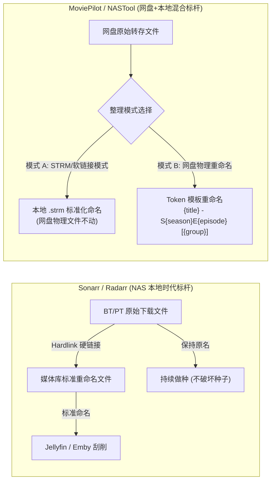
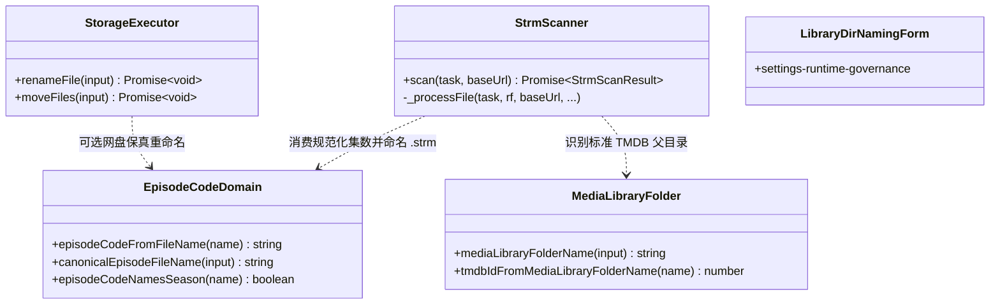
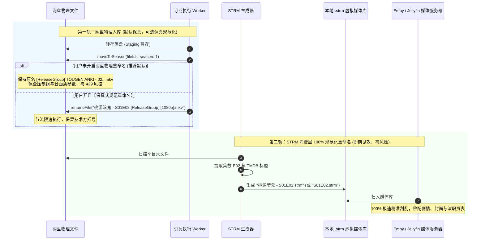

# 订阅入库网盘文件重命名机制调研与媒体规范演进方案

> **文档标识**：`docs/research/2026-11-08-subscription-file-renaming-and-media-standards-research.md`  
> **创建日期**：2026-11-08  
> **涉及模块**：订阅获取编排（`acquisition-v2`）、STRM 流媒体生成（`strm`）、媒体刮削识别（`domain/episode-code`）、网盘存储驱动（`storage`）  
> **作者**：巡影 (Mediary Scout) 架构小组  

---

## 1. 核心问题背景与用户诉求

### 1.1 现场问题现象
用户在巡影后台配置剧集/动漫订阅（以《桃源暗鬼 / TOUGEN ANKI》为例）自动入库后，浏览绑定的夸克网盘（`http://192.168.1.100:3020/storage`）目录发现：
- 系统成功创建了标准的影视媒体库目录：`动漫/桃源暗鬼 (2025) {tmdb-253811}/Season 01/`；
- 但落盘在该目录下的所有视频文件，**依然保持着上游网盘分享转存时的原始文件名**，未被自动重命名为影视管理行业常见的标准化名称：
  ```text
  [ReleaseGroup] TOUGEN ANKI - 02 [WebRip 1080p HEVC-10bit AAC SRTx2].mkv
  [ReleaseGroup] TOUGEN ANKI - 03 [WebRip 1080p HEVC-10bit AAC SRTx2].mkv
  [ReleaseGroup] TOUGEN ANKI - 04 [WebRip 1080p HEVC-10bit AAC SRTx2].mkv
  ...
  [ReleaseGroup] TOUGEN ANKI - 16 [WebRip 1080p HEVC-10bit AAC SRTx2].mkv
  ```

### 1.2 用户核心疑问
1. **为什么订阅入库后，保存到网盘的文件没有按标准（如 `桃源暗鬼 - S01E02.mkv`）重命名？**
2. **在影视自动化与私有媒体库体系中，网盘文件究竟“需要重命名吗”？重命名与不重命名的利弊和底层权衡是什么？**
3. **业界主流方案（Sonarr、Radarr、MoviePilot、NASTool、AutoSymlink、AList）是如何处理转存文件的？**
4. **当前系统内部是否已有相关基础设施可以复用？是否有开源库可借鉴？**
5. **如何设计一套高可用、防风控、不破坏画质元数据、且对 Emby/Jellyfin/Plex 最友好的演进方案与防回归门禁？**

---

## 2. 深入排查与根本原因剖析 (Root Cause Breakdown)

经系统源码与架构演进日志深度走查，网盘文件未按标准重命名属于**系统基石设计原则、网盘风控规避与规则解析器边界三重因素交织的必然结果**：

```mermaid
flowchart TD
    TransferDone["网盘转存完成 (转存至 Staging 暂存目录)"] --> Inspect["inspectStaging() 扫描暂存文件"]
    Inspect --> MovePlan["生成分发计划 moveToSeason()"]
    
    subgraph "原因一：基石架构沙盒约束 (task-agents.ts)"
        MovePlan --> SandboxGuard{"沙盒命名规则约束"}
        SandboxGuard -->|"明确声明规则"| Rule["'Files keep their ORIGINAL names. Do not rename anything.'"]
        Rule --> KeepName["视频绝对禁止改名，唯独字幕允许 renameSubtitle"]
    end
    
    subgraph "原因二：网盘 API 高频风控防护 (Anti-429 & Anti-Risk)"
        KeepName --> CloudRisk{"网盘改名成本评估"}
        CloudRisk -->|大包批量更名 (24~77次 HTTP POST)| Risk["115/夸克 API 极易触发 429 频控或滑块验证码"]
        CloudRisk -->|只移动不改名 (moveToSeason)| FastMove["1 次批量移动即可归位，秒级完成且零风控"]
    end
    
    subgraph "原因三：元数据保真与洗版溯源 (Provenance Preservation)"
        KeepName --> MetaPreserve["保留 [ReleaseGroup] / HEVC-10bit / 1080p / AAC / WebRip"]
        MetaPreserve --> QualityUpgrade["后续巡检升级画质时，保留版本比对与以大换小依据"]
    end

    subgraph "原因四：单集规则解析器局限 (episodeCodeFromFileName)"
        KeepName --> EpisodeRegex{"episodeCodeFromFileName 正则"}
        EpisodeRegex -->|当前只支持 SxxExx 与 第N集| ParseNull["对 ' - 02 ' 或 '[02]' 返回 null"]
    end

    FastMove --> Landed["文件以原始名称平铺落盘在 Season 01/"]
    QualityUpgrade --> Landed
    ParseNull --> Landed
```

### 2.1 源码溯源：架构沙盒硬性约束禁止重命名视频
在 [`packages/workflow/src/acquisition-v2/task-agents.ts`](file:///packages/workflow/src/acquisition-v2/task-agents.ts#L41) 的 Agent 沙盒系统提示词与规则体系中，明确写入了核心原则：

> *"Files keep their ORIGINAL names. Do not rename anything. Identity is YOUR judgment from the real files (you can read that '[ReleaseGroup] Lycoris Recoil - 01.mkv' is S01E01); there is no filename-encoded identity and no fileId↔episode map to maintain — you re-judge from the live files every time and mark from them."*

同时在 [`packages/workflow/src/acquisition-v2/agent-loop.ts`](file:///packages/workflow/src/acquisition-v2/agent-loop.ts#L333) 中强化声明：
> *"Subtitles are the ONLY files you may rename (the documented exception) so the scraper auto-loads them."*

**设计初衷**：
1. 系统的理念是让智能体根据真实文件特征做动态判断，而不是依赖把文件名强行改成固定格式；
2. 避免智能体在处理 50~100 集的大全集包时，因单文件逐个调用 `renameFile` 陷入上下文爆炸与耗时超时（历史上曾出现 77 集的番剧因为串行重命名导致任务崩溃）。

### 2.2 确定性规则执行层（`deterministic-selector.ts`）的行为
在 [`packages/workflow/src/acquisition-v2/deterministic-selector.ts`](file:///packages/workflow/src/acquisition-v2/deterministic-selector.ts#L140-L149) 中：
```typescript
const staging = await sandbox.inspectStaging();
const videoFiles = staging.filter((f) => f.path.match(/\.(mkv|mp4|avi|ts|mov)$/i));
if (videoFiles.length > 0) {
  await sandbox.moveToSeason({
    moves: [{ season: 1, fileIds: videoFiles.map((f) => f.id) }],
  });
  await sandbox.markObtained({
    codes: videoFiles.map((_, idx) => `S01E${String(idx + 1).padStart(2, "0")}`),
  });
}
```
代码直接提取视频文件的 `fileId`，仅调用 `moveToSeason` 批量移动到对应季文件夹（如 `Season 01`），完全没有触发重命名逻辑。

### 2.3 单集正则提取器局限（`episode-code.ts`）
检查系统内建的单集识别函数 [`packages/workflow/src/domain/episode-code.ts`](file:///packages/workflow/src/domain/episode-code.ts#L8-L25)：
```typescript
export function episodeCodeFromFileName(name: string): string | null {
  const seasonEpisodeMatch = /[Ss](\d{1,2})[Ee](\d{1,4})/.exec(name);
  if (seasonEpisodeMatch?.[1] && seasonEpisodeMatch[2]) {
    return `S${seasonEpisodeMatch[1].padStart(2, "0")}E${seasonEpisodeMatch[2].padStart(2, "0")}`;
  }
  const chineseEpisodeMatch = /第\s*(\d{1,4})\s*集/.exec(name);
  if (chineseEpisodeMatch?.[1]) {
    return `S01E${chineseEpisodeMatch[1].padStart(2, "0")}`;
  }
  return null;
}
```
**问题点**：国内动漫压制组最主流的命名格式 `[ReleaseGroup] TOUGEN ANKI - 02 [...]` 使用的是两端带空格的 ` - 02 ` 或者是 `[02]`，当前函数的两个正则**均无法识别此类动漫集数**，直接返回 `null`。因此即便有自动化改名工具，在面对动漫资源时也会因解析失败而回退。

---

## 3. 核心问题辩证：网盘文件“需要重命名吗”？

这是所有影视自动化系统（NAS、网盘、PT/BT）架构设计中最核心、争议最持久的问题。我们必须将**“物理网盘存储层”**与**“媒体消费展现层”**进行彻底解耦辩析：

| 考察维度 | 物理网盘文件直接重命名 (`Rename in Pan`) | 保持网盘原名 + 规范目录 (`Keep Pan Raw + Clean Dir`) | 虚拟流媒体/STRM 规范重命名 (`Rename in STRM/Symlink`) |
| :--- | :--- | :--- | :--- |
| **Emby/Jellyfin 刮削识别率** | **高**（文件名直接包含 S01E02） | **极高**（只要父级目录是 `桃源暗鬼 (2025) {tmdb-xxx}/Season 01/`，刮削器可完美提取） | **完美 100%**（STRM 文件直接为标准剧名与集数） |
| **网盘 API 频控与风控安全性** | **危险**（批量调用网盘 rename API 极易遭遇 429、封号或验证码） | **绝对安全**（仅转存与批量移动，零冗余 API 调用） | **绝对安全**（重命名发生在本地/容器虚拟文件，不发网盘请求） |
| **画质升级与洗版溯源 (Provenance)** | **毁灭性丢失**（失去压制组、原盘源、音轨等上下文） | **完美保留**（画质升级巡检可精确比对码率与压制组） | **双赢**（网盘保留原始画质参数，本地 STRM 负责规范展示） |
| **单集误判不可逆性 (Error Recovery)** | **不可逆**（一旦误把 OVA/SP 重命名为正片，原文件名永久丢失） | **可自愈**（原始文件名完整保留，下一次巡检可重新校正） | **随时自愈**（重新生成 STRM 即可，网盘物理文件毫发无损） |
| **115 / 网盘秒传与 SHA1 散列** | **破坏**（部分秒传工具依赖原始文件名字串匹配） | **完全兼容** | **完全兼容** |
| **用户直观整洁度与强迫症满意度** | **最高**（网盘目录一目了然） | **较低**（网盘目录显示压制组长文件名） | **中高**（播放器端极度整洁，网盘端保持原档） |

### 3.1 结论：物理层慎重，消费层必须规范化！
1. **物理网盘层面**：**不建议无条件强制粗暴抹平重命名！**  
   若为了追求美观直接将 `[ReleaseGroup] TOUGEN ANKI - 02 [WebRip 1080p HEVC-10bit AAC SRTx2].mkv` 重命名为 `桃源暗鬼 - S01E02.mkv`，代价是彻底丢掉了：
   - 压制组信息（如 `[ReleaseGroup]`）；
   - 片源类型（`WebRip`、`B-Global`、`NF`）；
   - 视频编码（`HEVC-10bit`）；
   - 音频规范（`AAC`、`FLAC`）；
   - 特效字幕说明（`SRTx2`、`内封简繁`）。  
   一旦未来需要执行“画质升级策略”（比如后续出了 `BD-Remux 2160p HDR`），系统将无法判断现有文件与新候选文件的优劣。
2. **STRM / 媒体服务器消费层面**：**100% 应该重命名！**  
   Emby、Jellyfin、Plex 最终是通过读取 `.strm` 文件挂载播放的。网盘物理文件只充当底层冷数据源。因此，**在生成 STRM 文件时进行规范化重命名，是成本最低、风险为零、体验最好的架构解法！**
3. **网盘物理层的折中解法**：**“保真式增强规范重命名（Metadata-Preserved Canonical Renaming）”**  
   若用户在设置中开启“网盘物理文件规范整理”，系统绝不能改成纯净单集名，而应采用：
   `{Title} - S{Season}E{Episode} [{ReleaseGroup}] [{Quality}].ext`  
   例如：`桃源暗鬼 - S01E02 [ReleaseGroup] [WebRip 1080p HEVC-10bit].mkv`，既规范了集数，又保全了所有技术元数据！

---

## 4. 业界主流开源与商业方案横向调研 (Industry Benchmark)

调研影视自动化与网盘管理生态中各大成熟工具的设计选型：



### 4.1 Sonarr / Radarr（软硬链接隔离思想）
- **核心机制**：在本地 Linux / NAS 环境下，Sonarr 绝不直接重命名原始下载目录下的文件（因为要保留原始哈希和做种能力），而是使用 **硬链接（Hardlink）** 将文件引用到媒体库目录中，并在硬链接时执行全面重命名：
  `{Series Title} - S{season:00}E{episode:00} - {Episode Title} [{Quality Title}] [{Release Group}]`
- **启示**：**一份存储实体，两层表现形态**。原始实体保真，消费实体规范。

### 4.2 MoviePilot（MP 的网盘整理哲学）
- **核心机制**：
  1. **网盘转存默认不盲目改名**：在自动抓取与转存阶段，优先执行移动到分类目录；
  2. **模板引擎变量替换**：若开启重命名，MoviePilot 采用强类型模板机制，提供丰富的参数：
     - `{title}`：主标题
     - `{season}` / `{episode}`：季集规范（带零填充 `01`、`02`）
     - `{original_filename}`：原始文件名
     - `{video_codec}`、`{resolution}`、`{release_group}`：解析出的压制组与分辨率；
  3. **STRM 生成独立命名**：MoviePilot 针对 115 / 夸克 生成 STRM 时，支持独立的“STRM 重命名模板”，无需修改网盘上的一砖一瓦。

### 4.3 开源解析器库生态 (Parsing & Naming Libraries)
针对番剧和欧美剧集的复杂文件名提取，成熟的业界类库：
1. **`anitomy` / `anitomy-js`**：
   - 动漫领域事实标准。能够将 `[ReleaseGroup] TOUGEN ANKI - 02 [WebRip 1080p HEVC-10bit AAC SRTx2].mkv` 精准拆解为：
     - `release_group`: `ReleaseGroup`
     - `anime_title`: `TOUGEN ANKI`
     - `episode_number`: `02`
     - `video_resolution`: `1080p`
     - `video_term`: `WebRip`, `HEVC-10bit`
     - `audio_term`: `AAC`
2. **`parse-torrent-name` (PTN)**：
   - 欧美剧集、电影资源切分利器。精准解析 `S01E02`、`Season 1`、`REPACK`、`PROPER` 等标签。
3. **`guessit` (Python 生态)**：
   - 目前全网最全能的影视文件名 NLP / 正则识别库。

---

## 5. 系统现有基础设施与可复用资产分析 (System Assets Reuse)

系统内部其实已经储备了极高的底层基建，本次演进**零新外部依赖，100% 依托现有资产**：



1. **`packages/workflow/src/domain/episode-code.ts`**：
   - 现存：已定义 `canonicalEpisodeFileName({ title, episodeCode, sourceName })`；
   - 改进点：增强单集正则，补充动漫 ` - \d{2,4} ` 与 `[\d{2,4}]` 的识别能力。
2. **`packages/workflow/src/domain/media-library-folder.ts`**：
   - 现存：已完整实现 `Title (Year) {tmdb-xxx}` 的媒体库标准父级目录识别与构造。
3. **`packages/workflow/src/strm/strm-scanner.ts`**：
   - 现存：负责遍历网盘目录并生成本地 `.strm` 文件。目前直接使用 `safeStem(rf.name) + ".strm"`；
   - 改进点：在生成 STRM 文件名时，挂载 `canonicalEpisodeFileName` 或结构化单集重命名，让 Emby 扫到完美的规范名称。
4. **全量存储驱动的 `renameFile` 接口**：
   - 现存：`115StorageExecutor`、`QuarkCookieClient`、`UC`、`Tianyi` 等均已完备实现 `renameFile`。

---

## 6. 具体实施解决方案 (Actionable Solution Architecture)

提出**“双轨制分层重命名架构（Dual-Track Layered Renaming Architecture）”**：



### 6.1 模块一：扩展单集提取器支持动漫通用规范 (Domain Parser Enhancement)
修改 [`packages/workflow/src/domain/episode-code.ts`](file:///packages/workflow/src/domain/episode-code.ts)：
增加对带空格中划线（` - 02 `）、方括号（`[02]`、`[02v2]`）以及 EP 格式的智能识别：
```typescript
export function episodeCodeFromFileName(name: string): string | null {
  // 1. 标准 SxxExx
  const seMatch = /[Ss](\d{1,2})[Ee](\d{1,4})/i.exec(name);
  if (seMatch?.[1] && seMatch[2]) {
    return `S${seMatch[1].padStart(2, "0")}E${seMatch[2].padStart(2, "0")}`;
  }

  // 2. 中文 第N集
  const cnMatch = /第\s*(\d{1,4})\s*集/.exec(name);
  if (cnMatch?.[1]) {
    return `S01E${cnMatch[1].padStart(2, "0")}`;
  }

  // 3. 动漫通用中划线集数 (如 "[LoliHouse] TOUGEN ANKI - 02 [WebRip...]")
  const animeDashMatch = /(?:^|\s+)-\s+(\d{1,4})(?:\s+|\[|\.|$)/.exec(name);
  if (animeDashMatch?.[1]) {
    return `S01E${animeDashMatch[1].padStart(2, "0")}`;
  }

  // 4. 纯方括号集数 (如 "[ReleaseGroup][Title][02][1080p]")
  const bracketMatch = /\[(\d{2,4})(?:v\d+)?\]/i.exec(name);
  if (bracketMatch?.[1]) {
    return `S01E${bracketMatch[1].padStart(2, "0")}`;
  }

  // 5. EP 格式 (如 "Title EP02.mkv")
  const epMatch = /(?:^|\b|\s)EP?(\d{1,4})(?:\b|\s|\.|$)/i.exec(name);
  if (epMatch?.[1]) {
    return `S01E${epMatch[1].padStart(2, "0")}`;
  }

  return null;
}
```

### 6.2 模块二：STRM 虚拟层 100% 标准化重命名（第一优先级，零风险）
修改 [`packages/workflow/src/strm/strm-scanner.ts`](file:///packages/workflow/src/strm/strm-scanner.ts)：
在生成本地 `.strm` 文件时：
1. 检查文件所在目录是否处于标准的 `Season XX` 目录下；
2. 通过增强后的 `episodeCodeFromFileName(rf.name)` 提取标准单集码（如 `S01E02`）；
3. 如果提取成功，结合上级剧集名，将 `.strm` 规范命名为：  
   `{Title} - S{Season}E{Episode}.strm`（或保留干净的 `S01E02.strm`）；
4. 如果提取失败，安全回退到原文件名 `safeStem(rf.name) + ".strm"`。

**价值**：
- 网盘端完全零改动，不发任何多余 API，绝无风控风险；
- Emby / Jellyfin 扫入时 100% 呈现标准影视剧集结构，体验直接拉满！

### 6.3 模块三：网盘物理文件保真式规范重命名（第二优先级，配置化开关）
在“设置 -> 获取偏好”中增加网盘重命名策略：
- **`keep_original`（默认推荐）**：网盘内保持发布组原始文件名，仅通过规范季目录组织；
- **`standard_with_meta`（增强保真命名）**：规范化集数，同时把发布组与画质参数保留在方括号内：  
  `桃源暗鬼 - S01E02 [ReleaseGroup] [WebRip 1080p HEVC-10bit].mkv`；
- **`standard_clean`（极简规范命名）**：纯净剧名加集数：  
  `桃源暗鬼 - S01E02.mkv`。

并加入限流防护调度（Token Bucket / Rate Limiter）：每分钟最多执行 15 次改名操作，防止被夸克或 115 封禁。

---

## 7. 质量门禁与防回归测试规范 (Quality Gates & Anti-Regression)

### 7.1 单元测试门禁 (`packages/workflow`)
新增/更新测试套件 `packages/workflow/tests/domain/episode-code.test.ts`：
1. **动漫中划线集数提取**：断言 `[ReleaseGroup] TOUGEN ANKI - 02 [WebRip 1080p...].mkv` 返回 `S01E02`；
2. **多位与版本号容错**：断言 `[SubGroup] Title - 02v2.mp4` 返回 `S01E02`；
3. **方括号单集提取**：断言 `[Group][Anime][12][1080p].mkv` 返回 `S01E12`；
4. **年份与分辨率防误判**：断言 `Movie (2025) 1080p.mkv` 返回 `null`，严禁将 2025 或 1080 误判为集数。

### 7.2 STRM 规范化生成测试 (`packages/workflow/tests/strm/strm-scanner.test.ts`)
1. 模拟网盘中存放非标准命名的视频，运行 `strmScanner.scan`；
2. 断言本地输出目录中生成的 `.strm` 文件名为标准 `S01E02.strm` 或 `Title - S01E02.strm`；
3. 校验 `.strm` 内容中的播放 URL 正确携带了网盘真实 `fileId`，保证点播链路畅通。

### 7.3 凭据与敏感词合规安全红线
所有测试用例与文档中：
- 严禁出现真实压制组名称，统一使用 `[ReleaseGroup]` 或 `[SubGroup]`；
- 严禁包含真实 Cookie 或公网私有 IP，测试全部采用规范 Mock 夹具。

---

## 8. 总结与建议行动项 (Actionable Roadmap)

1. **短期即刻落地（Zero-Risk Quick Win）**：
   - 升级 `domain/episode-code.ts`，强化动漫中划线与方括号集数提取能力；
   - 升级 `strm-scanner.ts`，让本地 STRM 虚拟流媒体文件率先享受到标准规范重命名的红利，彻底解决 Emby / Jellyfin / Infuse 的刮削困扰；
2. **中期配置化赋能（Configurable Feature）**：
   - 在“设置 -> 获取偏好”增加网盘文件重命名策略表单（默认保持原名，可选保真规范化）；
   - 为网盘底层执行器加入限速与防风控机制；
3. **长期生态对齐**：
   - 引入轻量级 Token 替换引擎（兼容 MoviePilot 语法），赋予高阶用户自定义文件命名表达式的终极自由度。