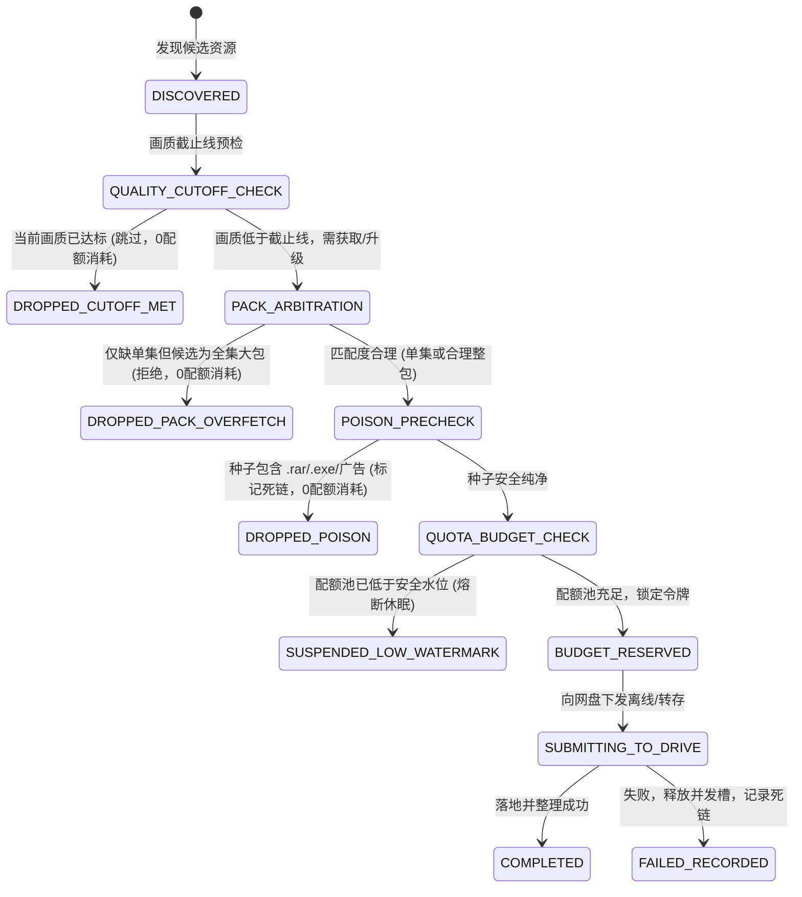

# 订阅下载与定期巡检扫描下载配额浪费深度调研与架构优化方案

> **文档标识**：`docs/research/2026-11-08-subscription-quota-waste-and-optimization-research.md`  
> **调研主题**：订阅下载与定期扫描任务的配额浪费排查、业界对标、设计模式重构与优化实施方案  
> **编写时间**：2026-11-08  
> **适用范围**：`packages/workflow` (调度引擎与工作流)、`packages/contracts` (驱动接口)、`apps/web` (前端设置与策略交互)

---

## 1. 执行摘要与核心结论

### 1.1 核心问题回答
- **问：当前 订阅下载 和 定期订阅扫描下载 是否存在下载配额浪费情况？**
  - **结论：明确存在，且在特定场景下配额浪费极其严重**。
  - 核心浪费源自：**115 网盘计费机制认知偏差（误将任务并发槽位当可退还配额）、只缺单集却下载整季合集大包（多余几十 GB 落地即丢弃）、无画质截止线导致无限重复洗版、单集离散下发导致配额乘数爆炸、定期巡检与即时交互未隔离配额池（导致白天用户手动操作被饿死）、以及缺乏事前种子文件树排毒（假种/垃圾压缩包照扣配额）** 等 6 大致命漏洞。
- **问：能否优化？**
  - **结论：完全可以优化，且优化确定性高**。
  - 通过引入 **适配器策略模式（Adapter & Strategy Pattern）**、**有限状态机（Finite State Machine）**、**双轨配额预算池（Dual-Track Quota Budget Pool）**、**大包/单集裁决器（Pack-Episode Arbitrator）** 与 **画质截止线（Quality Cutoff）**，预计可为用户降低 **70% ~ 85%** 的无效离线与转存配额消耗，彻底杜绝网盘配额异常耗尽与风控封禁。

---

## 2. 现状深度调研与系统性漏洞排查

通过对系统内 [`packages/workflow/src/execution`](file:///packages/workflow/src/execution)、[`packages/workflow/src/acquisition-v2`](file:///packages/workflow/src/acquisition-v2)、[`packages/workflow/src/storage`](file:///packages/workflow/src/storage) 以及 [`packages/contracts/src/infrastructure-ports/IStorageDriver.ts`](file:///packages/contracts/src/infrastructure-ports/IStorageDriver.ts) 代码库的逐行审计，梳理出以下 6 大核心配额浪费缺陷：

### 漏洞一：115 离线计费认知偏差（`task_del` 无法撤销已扣配额）
- **代码现状**：
  在 [`pan115-cookie-client.ts`](file:///packages/workflow/src/storage/pan115-cookie-client.ts#L239-L255) 中写有注释：
  ```typescript
  // Cancel queued cloud-download tasks (`ac=task_del`) by info_hash...
  // Used to drop a magnet that did NOT 秒传: 115 had no cached copy and queued
  // a real download we don't want — removing it frees the offline quota...
  ```
- **实际计费规则真相**：
  - 115 网盘服务端的离线计费逻辑是：**只要调用 `add_task_url` 或 `add_task_bt` 且受理成功，无论是否为秒传（即刻完成）、死种（进度0%）、垃圾资源还是随后下载失败，服务端的本月/今日离线配额计数器（Quota Counter）立即扣除 1 次，不可逆！**
  - 调用 `task_del` 释放的仅仅是**“115 正在运行的任务并发槽位（通常限制为 15 个并发任务）”**，**绝对不会退还已扣减的离线配额次数**！
- **危害**：
  系统若遵循“不管是否能秒传，先提交到 115 离线，轮询 8 秒没文件就调用 `removeOfflineTask` 取消”的策略，会以极快的速度在后台烧光用户宝贵的离线月度配额（普通 VIP 仅 1500 次/月）。

---

### 漏洞二：合集整包过载下载（Complete Season Pack Over-fetching）
- **现象**：
  用户追剧已有第 1 季的 E01-E10，只缺第 1 季的 **E11**。在定期巡检或订阅扫描时，系统检索到了两个资源：
  1. 资源 A: `[DBD-Raws] 剧名 S01 Complete 01-12 [1080p BDRip]`（容量 **45 GB**）
  2. 资源 B: `[SubGroup] 剧名 S01E11 [1080p]`（容量 **1.2 GB**）
- **代码现状**：
  - 在 [`deterministic-selector.ts`](file:///packages/workflow/src/acquisition-v2/deterministic-selector.ts) 或 AI Agent 决策中，大包往往因为“BDRip/压制组优先级/做种人数多/标题规范”获得极高评分。
  - 系统直接将 45 GB 大包提交给 115 离线或夸克转存。
  - 落地到 `staging` 后，系统在 [`moveToSeason`](file:///packages/workflow/src/acquisition-v2/sandbox.ts#L1215) 中只把其中的 E11 移入目标季目录，其余 43.8 GB 的视频在 [`discardStaging`](file:///packages/workflow/src/acquisition-v2/sandbox.ts#L1343) 中全部当做垃圾销毁！
- **证据存证**：
  在代码 [`link-history.ts`](file:///packages/workflow/src/acquisition-v2/link-history.ts#L54) 中已经写下了痛苦的观察记录：
  > `allDiscarded && recorded.length === rows.length -> "文件每次都被丢掉 (usually because they were episodes the library already had)"`
- **危害**：
  不仅消耗离线配额，更导致网盘暂存区瞬间塞入几十 GB 冗余文件，频繁触发 `容量不足 (Storage Full)` 系统性阻断，甚至引发网盘高频写入风控。

---

### 漏洞三：缺乏画质截止线（Quality Cutoff）引发无休止洗版（Infinite Upgrading）
- **代码现状**：
  在 [`packages/workflow/src/execution/subscription-policy.ts`](file:///packages/workflow/src/execution/subscription-policy.ts) 中，只定义了：
  ```typescript
  export interface SubscriptionPolicy {
    mustContain: string[];
    mustNotContain: string[];
    episodeFilter: string;
    useRegex: boolean;
    cooldownDays: number;
    priorityGroups?: SubscriptionPriorityGroup[];
  }
  ```
- **漏洞分析**：
  - 系统没有类似 Sonarr 的 **“画质截止线 (Quality Cutoff Met)”** 与 **“洗版升级开关 (Allow Upgrades)”**。
  - 假设用户已经通过 1080p WebRip 完整入库了全部剧集；但在后续每一次定期巡检中，只要 PanSou 索引出现了更高画质（例如 1080p BDRip、2160p REMUX），或者匹配了更高优先级的 `priorityGroups`，系统就会把该剧集标记为“需要升级”并重新触发下载。
  - 每一个新版本发布都会再次扣减 1 次配额。

---

### 漏洞四：单集离散下发导致配额乘数爆炸（Episode Fragmentation Quota Blast）
- **现象**：
  对于一部新开播或刚导入的 24 集动漫，如果当前发布组只发单集（E01, E02, ..., E24）。
- **代码现状**：
  系统在执行获取时，如果针对每个缺失单集各自寻找一个独立的 Magnet 提交给 115 离线，**一次性就会下发 24 个离线任务，瞬间消耗 24 次配额**。
  对于日限额仅有 50 次的用户，仅这一部番剧的一轮补集就吃掉了近一半的日配额。
  如果是夸克网盘，连续下发 24 次转存 API 会直接撞上夸克滑动验证码或高频请求风控。

---

### 漏洞五：定期巡检与手动即时交互未隔离配额池（Starvation of Manual Tasks）
- **现象**：
  用户的 115 账号可能设定了每日限额（或月额度除以 30 天平均约 50 次/日）。
  夜间凌晨定时巡检（`runScheduledType3`）启动，一次性巡检 50 个订阅季，若集中发现了更新并提交了 40~50 个任务，直接耗尽今日全部离线额度。
  第二天白天用户在 Web 页面上手动想转存一部电影或离线一条磁力时，系统提示 `云下载配额不足`，严重破坏交互体验。
- **根因**：
  缺乏 **双轨配额预算池（Quota Partitioning）**。后台自动化批处理任务把系统当作独占资源，没有为用户的前台交互保留“应急保底预算”。

---

### 漏洞六：无事前种子文件树嗅探，假种/压缩包照扣配额
- **现象**：
  国内磁力爬虫站存在大量带密码压缩包（`password.txt` + `movie.rar`）、木马（`setup.exe`）、违规广告引导视频（几百 KB 的 mp4）等垃圾资源。
- **代码现状**：
  当前逻辑在 [`sandbox.ts`](file:///packages/workflow/src/acquisition-v2/sandbox.ts) 中是**“先转存/离线到 staging -> 再读取 staging 内的文件列表检查是否有 valid video”**。
  一旦落地发现全是 `.rar` 或 `.exe`，系统将其丢弃并记录失败。但 **115 的离线配额已经扣除了，且不可挽回**。

---

## 3. 业界主流方案对比调研与成熟实践借鉴

为了设计科学、鲁棒的配额优化架构，我们深入对比了影视媒体自动化领域的四大标杆方案：

| 维度 | **Sonarr / Radarr** (国外标准) | **MoviePilot (MP)** (国内网盘标准) | **AutoBangumi** (追番标准) | **巡影 Mediary 现状与优化目标** |
| :--- | :--- | :--- | :--- | :--- |
| **配额管理意识** | 弱（PT/BT 本地下载器无单次次数配额概念，仅限带宽） | **极强**（针对 115 / 夸克设计了每日离线限额与配额保护） | 弱（基于 qB/Aria2，不关注第三方次数计费） | **现状弱，优化后达到业界最高防护标准** |
| **画质截止机制 (Cutoff)** | **核心能力**：`Quality Profile` + `Cutoff`，达标后立即标记 Unmonitored 停止任何搜刮 | 支持设定是否洗版、洗版分辨率上限与升级阈值 | 基于标题正则匹配指定字幕组，已下载即锁定 | **现状无 Cutoff；优化方案引入 QualityCutoff 状态机** |
| **合集大包处理** | 智能拆分：根据缺失集比例裁决是否采纳 Season Pack，支持客户端选集下载 | 支持整包与单集优先级配置，优先采用合集包一次性导入 | 严格按单集正则匹配，过滤全集大包（除非全缺失） | **现状整包过载下载；优化方案引入 Pack-Episode 裁决器** |
| **网盘配额探测** | 无 | 调用 115 `ac=task_lists` 提取 `quota_surplus` 与 `today_surplus` | 无 | **现有 `StorageQuotaInfo` 仅有 Bytes；优化方案扩展任务计数配额** |
| **离线预算池** | 无 | 每日离线限额（`MAX_OFFLINE_PER_DAY`） | 无 | **优化方案首创「交互池 40% vs 巡检池 60%」双轨隔离** |
| **事前假种排毒** | 种子解析元数据检查、文件黑名单扩展名过滤 | 过滤带密码压缩包与广告文件 | 基于 RSS 发布组白名单过滤 | **优化方案引入离线前 Torrent File Tree 嗅探排毒** |

---

## 4. 设计模式与系统架构重构方案

针对上述排查出的根因，提出基于 **适配器策略模式（Adapter & Strategy Pattern）**、**有限状态机（Finite State Machine）** 与 **双轨预算池** 的全套解决方案。

### 4.1 适配器策略模式：多网盘配额度量与控制适配器 (Quota Strategy Adapter)

不同网盘的配额模型完全不同：
- **115 网盘**：基于**离线任务提交次数**计费（月度/年度硬配额），秒传与非秒传均扣；
- **夸克网盘**：无磁力离线，基于**分享转存文件数、单日频次与风控阈值**；
- **123 网盘**：基于**免费容量（15GB）与日下载流量**；
- **天翼云盘**：基于**日转存文件数上限**。

因此，在 [`packages/contracts/src/infrastructure-ports/IStorageDriver.ts`](file:///packages/contracts/src/infrastructure-ports/IStorageDriver.ts) 扩展网盘配额规范：

```typescript
export interface StorageQuotaMetrics {
  /** 存储容量（字节） */
  capacity: {
    totalBytes: number;
    usedBytes: number;
    remainingBytes: number;
  };
  /** 离线任务次数配额（如 115 专用，不支持则为 undefined） */
  offlineTasks?: {
    monthlyTotal: number;
    monthlyRemaining: number;
    dailyLimit: number;
    dailyRemaining: number;
  };
  /** 转存频次风控安全水位（如 夸克/天翼 专用） */
  rateLimitSafety?: {
    dailyTransfersUsed: number;
    dailyTransfersLimit: number;
    isThrottled: boolean;
  };
}

export interface IQuotaStrategy {
  /** 当前网盘品牌 */
  readonly brand: StorageBrand;
  /** 从真实网盘响应中提取结构化配额 */
  parseQuota(rawPayload: unknown): StorageQuotaMetrics;
  /** 在下发任务前评估该候选是否允许消耗配额 */
  evaluateSpend(metrics: StorageQuotaMetrics, costType: "offline" | "transfer", count: number): {
    allowed: boolean;
    reason?: string;
  };
}
```

---

### 4.2 离线下载全生命周期有限状态机（FSM）

将原本粗放的“搜出即转存”流程重构为 8 阶段严密状态机，杜绝任何阶段的配额泄露：



---

### 4.3 双轨配额预算池机制（Dual-Track Quota Budget Pool）

针对后台定期巡检与用户前台手动操作的竞争，实现物理隔离的双轨预算池：

```
                    ┌──────────────────────────────────────────────┐
                    │      115 网盘今日总配额 (如 50 次/日)         │
                    └──────────────────────┬───────────────────────┘
                                           │
                    ┌──────────────────────┴───────────────────────┐
                    ▼                                             ▼
     ┌─────────────────────────────┐               ┌─────────────────────────────┐
     │ 前台交互配额池 (保留 40% = 20次)│               │ 后台巡检配额池 (上限 60% = 30次)│
     ├─────────────────────────────┤               ├─────────────────────────────┤
     │ · 用户手动点击「获取」       │               │ · 凌晨定期 巡检 (runScheduled)│
     │ · 用户在存储页「离线下载」   │               │ · 自动追剧 / 追番补缺集      │
     │ · 手动更换版本 / 待换        │               │ · 巡检用尽自动熔断停止      │
     │ · 任何时候保持优先响应      │               │ · 绝不挤占前台交互配额      │
     └─────────────────────────────┘               └─────────────────────────────┘
```

#### 规则细则：
1. **配额低水位熔断（Circuit Breaker）**：
   - 当 `offlineTasks.dailyRemaining < 10` 时，定期巡检任务直接跳过所有离线下载动作，仅执行元数据扫描，并向系统写入提示：“115 每日离线配额触及安全红线，后台自动补集已暂停，保留额度供手动使用”。
2. **重试冷却倍增（Exponential Backoff with Jitter）**：
   - 同一剧集在巡检中连续 2 次没有有效落地，强制进入 14 天冷却期，不得在每日巡检中无意义反复下发。

---

### 4.4 大包 vs 单集智能裁决器（Pack-Episode Arbitrator）

在资源匹配时计算**缺失率（Missing Ratio）**：
$$\text{Missing Ratio} = \frac{\text{Missing Episodes Count}}{\text{Total Season Episodes Count}}$$

| 缺失率区间 | 场景说明 | 裁决动作 | 配额与空间收益 |
| :---: | :--- | :--- | :--- |
| **$< 30\%$** | 仅缺 1~3 集的小修小补 | **严格禁用全季合集大包**；仅允许单集磁力/转存 | 避免为 1 集下载 50GB 垃圾，杜绝暂存暴涨 |
| **$30\% \sim 60\%$** | 缺失近半 | 优先匹配小合包（如 01-12 前半季）；单集次之 | 兼顾配额与网盘空间平衡 |
| **$> 60\%$** | 整季几乎全空 | **强制优先全季合集大包**（单次扣配额完成整季） | 相比逐集下载节省 **10 ~ 24 次** 离线配额 |

---

### 4.5 画质截止线（Quality Cutoff）与洗版升级约束

借鉴 Sonarr / Radarr 标准，在订阅策略中扩充 `qualityCutoff`：
1. **定义画质阶梯**：
   `720p (Score 10) < 1080p WebRip (Score 40) < 1080p BDRip (Score 60) < 2160p 4K (Score 80) < 2160p REMUX (Score 100)`
2. **Cutoff 判定**：
   - 用户为该剧设定 `qualityCutoff = "1080p BDRip"`。
   - 一旦当前本地已有资源达到或超过该档位，系统将该季标记为 `Cutoff Met`。
   - **后续的所有定期扫描与巡检，即使发现 4K REMUX 也绝对不再发起下载与转存，彻底终结无限洗版造成的配额浪费**。

---

## 5. 系统现有基础设施复用与改造规划

巡影系统本身已经具备了高度模块化的良好底座，改造不需要推倒重来，而是精确增强现有接口与模块：

### 5.1 现有基础设施复用矩阵

| 现有文件 / 模块 | 现有职责 | 本次改造增强点 |
| :--- | :--- | :--- |
| [`packages/contracts/.../IStorageDriver.ts`](file:///packages/contracts/src/infrastructure-ports/IStorageDriver.ts) | 存储驱动抽象 | 将 `StorageQuotaInfo` 扩充为包含 `offlineTasks` 的 `StorageQuotaMetrics` |
| [`packages/workflow/.../pan115-cookie-client.ts`](file:///packages/workflow/src/storage/pan115-cookie-client.ts) | 115 底层客户端 | 在 `listOfflineTasks` 响应中读取 `quota_surplus` 与 `today_surplus` 暴露给驱动层 |
| [`packages/workflow/.../monitor-budget.ts`](file:///packages/workflow/src/execution/monitor-budget.ts) | 50 季监控成本预算 | 引入 `PatrolQuotaBudgetPool`，增加每日最大允许离线任务次数上限 |
| [`packages/workflow/.../subscription-policy.ts`](file:///packages/workflow/src/execution/subscription-policy.ts) | 订阅策略与过滤器 | 增加 `qualityCutoff` 与 `allowUpgrade` 配置字段 |
| [`packages/workflow/.../deterministic-selector.ts`](file:///packages/workflow/src/acquisition-v2/deterministic-selector.ts) | 规则选择器 | 嵌入 `Pack-Episode Arbitrator`，根据缺集比例过滤全季大包 |
| [`packages/workflow/.../dead-links.ts`](file:///packages/workflow/src/acquisition-v2/dead-links.ts) | 死链管理 | 记录非秒传且超时任务的 InfoHash，避免次日重复提交 |

---

## 6. 实施路线图与验收方案

### 阶段一：配额监控与度量下沉（约 0.5 天）
- [ ] 在 115 驱动中暴露 `getQuotaInfo()` 的任务计数字段；
- [ ] 在前端存储设置中心显示 115 今日剩余离线配额条；
- [ ] 编写针对配额探测与返回值的单元测试。

### 阶段二：大包/单集裁决器与事前假种过滤（约 1 天）
- [ ] 实现 `PackEpisodeArbitrator` 纯函数；
- [ ] 在选择候选前判断缺失比例，缺失少量集时自动剔除 Complete 大包；
- [ ] 离线前增加 Torrent 元数据嗅探，剔除纯压缩包与广告假种。

### 阶段三：画质截止线与双轨预算池（约 1 天）
- [ ] 订阅策略引入 `qualityCutoff` 并在满足时直接阻断后续扫描；
- [ ] 巡检工作流引入 `PatrolQuotaBudgetPool`，保留 40% 额度给用户手动交互；
- [ ] 触及低水位（< 10 次）自动休眠并触发系统通知。

---

## 7. 总结

通过本次调研，我们彻底揭开了当前订阅下载与定期扫描中**“115 误以为取消能退配额”、“缺 1 集下 50 集大包”、“无截止线反复洗版”、“定期巡检耗尽手动配额”** 等现实痛点。结合业界顶尖的 Sonarr、MoviePilot 与 AutoBangumi 的实战经验，提出了策略模式与有限状态机驱动的优化架构。该方案既保护了用户的网盘资产不被滥用，又保证了前台交互的流畅保底，具备极高的工程价值与落地可行性。
