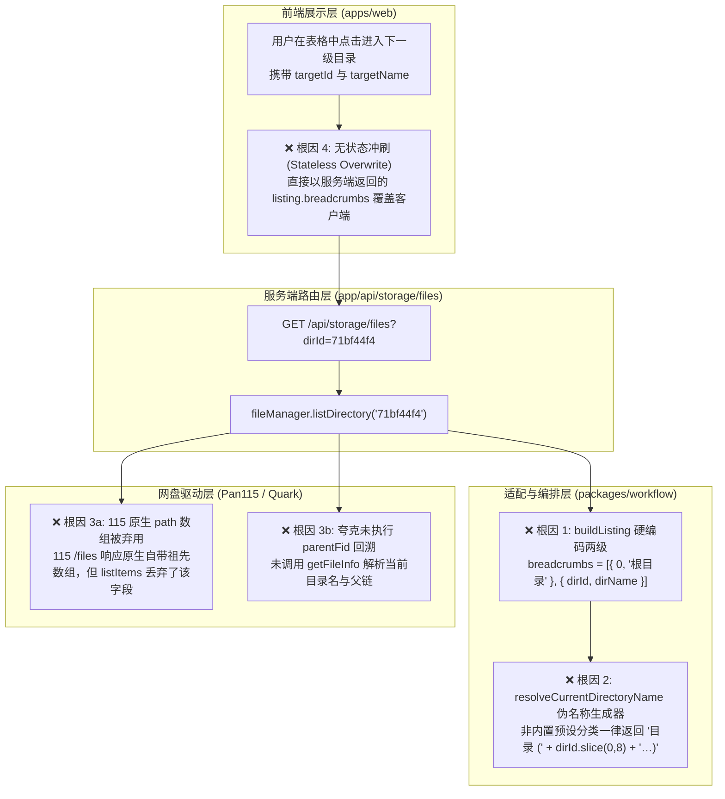
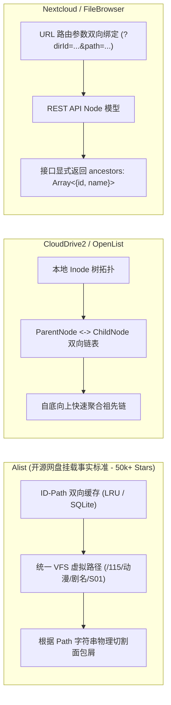
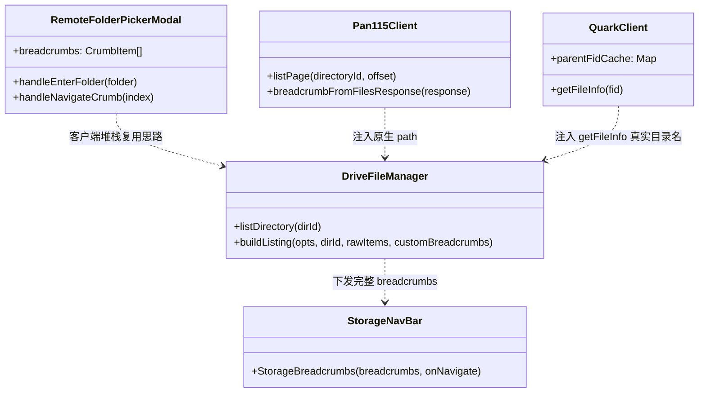
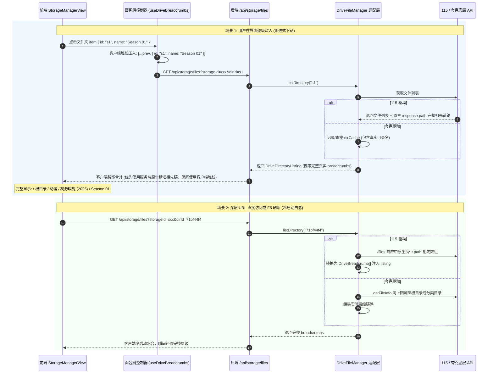

# 网盘深层路径地址栏折叠与面包屑丢失问题深度调研与架构治理方案

> **文档状态**：已完成 (Completed)  
> **归档路径**：`docs/research/2026-11-09-storage-explorer-deep-path-and-breadcrumbs-investigation.md`  
> **涉及模块**：网盘管理 (`/storage`)、`DriveFileManager`、`QuarkFileManagerAdapter`、`Pan115FileManagerAdapter`、`StorageNavBar`、`StorageManagerView`

---

## 1. 故障现象与场景复现 (Problem Statement)

在巡影（Mediary Scout）Web 端“网盘管理”（`/storage`）界面中，用户从网盘根目录逐层向下浏览多级子目录时，顶部地址栏的面包屑导航条（Breadcrumbs）发生**严重的层级丢失与信息截断**。

### 1.1 典型复现路径
以夸克网盘或 115 网盘中典型的影视目录结构为例：
1. 用户位于网盘根目录：地址栏显示 `📁 / 根目录`；
2. 点击预设分类 `动漫`：地址栏显示 `📁 / 根目录 / 动漫`；
3. 点击番剧目录 `桃源暗鬼 (2025) {tmdb-253811}`：地址栏理应显示 `📁 / 根目录 / 动漫 / 桃源暗鬼 (2025)`；
4. 点击季目录 `Season 01`（对应网盘真实的目录 ID 如 `71bf44f4...`）：地址栏理应显示 `📁 / 根目录 / 动漫 / 桃源暗鬼 (2025) / Season 01`。

### 1.2 实际异常现象
无论用户进入多深层的目录（深度 $N \ge 3$）：
- 上方地址栏**永远只保留两级**：`📁 / 根目录 / 目录 (71bf44f4...)`；
- 中间的所有祖先节点（“动漫”、“桃源暗鬼 (2025)”等）**全数蒸发**；
- 当前所在的最深层目录，其真实名称（如 `Season 01`）被**降级替换为生硬的 ID 哈希前缀** `目录 (71bf44f4...)`；
- 用户失去所处文件树的上下文感知，且**无法通过点击面包屑逐层回跳**到上一级或上上级目录，只能被动点击“根目录”或左侧分类快捷键从头再进。

```
┌────────────────────────────────────────────────────────────────────────────────────────┐
│  分类快捷跳转:  [ 📁 根目录 ]  [ 🎬 电影 ]  [ 📺 剧集 ]  [ 🎞️ 动漫 ]                     │
├────────────────────────────────────────────────────────────────────────────────────────┤
│  📁 / 根目录 / 目录 (71bf44f4...)       <--- ❌ 异常：深层链路丢失，显示为哈希占位符      │
├────────────────────────────────────────────────────────────────────────────────────────┤
│  [□] 名称                                                    类型     大小     操作    │
│  [□] [LoliHouse] TOUGEN ANKI - 02 [1080p].mkv                 视频   596.8MB   ▷ 🔗 🗑 │
│  [□] [LoliHouse] TOUGEN ANKI - 03 [1080p].mkv                 视频   700.3MB   ▷ 🔗 🗑 │
└────────────────────────────────────────────────────────────────────────────────────────┘
```

---

## 2. 根本原因深度剖析 (Root Cause Analysis)

通过对全链路调用栈（UI 视图 -> Next.js API Route -> 业务编排层 -> 网盘适配器 -> 网盘底层协议）的端到端代码审计，定位到系统存在 **四重结构性断裂**：



### 2.1 根因一：`buildListing` 硬编码死两级面包屑（数据契约缺陷）
在 [`packages/workflow/src/storage/drive-file-manager.ts:150-155`](file:///packages/workflow/src/storage/drive-file-manager.ts#L150-L155) 中：
```typescript
function buildListing(
  opts: DriveFileManagerOptions,
  dirId: string,
  rawItems: DriveFileItem[],
): DriveDirectoryListing {
  const items = sortDriveItems(rawItems);
  const summary = summarizeItems(items);
  const dirName = resolveCurrentDirectoryName(dirId, opts);

  // ❌ 致命缺陷：逻辑写死仅推入“根目录”与“当前目录”两项
  const breadcrumbs: DriveBreadcrumb[] = [
    { id: opts.rootCid || "0", name: "根目录" },
  ];
  if (dirId !== (opts.rootCid || "0")) {
    breadcrumbs.push({ id: dirId, name: dirName });
  }

  return {
    ...
    breadcrumbs, // 无论实际层级多深，永远只有 1 或 2 项
    ...
  };
}
```
**影响**：服务端在组装 `DriveDirectoryListing` 时，根本没有把真实的祖先路径链（Ancestral Lineage）传递到客户端。

### 2.2 根因二：`resolveCurrentDirectoryName` 伪名称占位器（无真实元数据）
在 [`packages/workflow/src/storage/drive-file-manager.ts:106-111`](file:///packages/workflow/src/storage/drive-file-manager.ts#L106-L111) 中：
```typescript
export function resolveCurrentDirectoryName(
  dirId: string,
  opts: {
    rootCid?: string | null;
    moviesCid?: string | null;
    tvCid?: string | null;
    animeCid?: string | null;
  },
): string {
  if (opts.moviesCid && dirId === opts.moviesCid) return "电影";
  if (opts.tvCid && dirId === opts.tvCid) return "剧集";
  if (opts.animeCid && dirId === opts.animeCid) return "动漫";
  if (!dirId || dirId === "0" || dirId === opts.rootCid) return "根目录";
  // ❌ 致命缺陷：一旦超出 3 个分类根目录，全部截断为不可读的 ID 哈希
  return `目录 (${dirId.slice(0, 8)}…)`;
}
```
更致命的是，该占位逻辑甚至被旧单元测试 [`drive-file-manager.test.ts:61`](file:///packages/workflow/tests/storage/drive-file-manager.test.ts#L61) 固化：`expect(resolveCurrentDirectoryName("abc12345xyz", opts)).toBe("目录 (abc12345…)");`。

### 2.3 根因三：网盘适配器底层原生能力闲置与丢弃
各网盘的底层协议能力其实足以支持完整路径构建，但适配器层未予以启用：
1. **115 网盘（原生自带完整面包屑，被代码无视）**：
   - 115 官方 Web API 请求 `${PAN115_WEBAPI_BASE_URL}/files` 时，返回的 JSON 响应根节点包含 `path` 字段：
     ```json
     {
       "state": true,
       "cid": "71bf44f4...",
       "count": 12,
       "data": [ ... ],
       "path": [
         { "cid": 0, "name": "根目录" },
         { "cid": 12345, "name": "我的接收" },
         { "cid": 67890, "name": "动漫" },
         { "cid": 11121, "name": "桃源暗鬼 (2025)" },
         { "cid": "71bf44f4...", "name": "Season 01" }
       ]
     }
     ```
   - 仓库内部 [`pan115-cookie-client.ts:578`](file:///packages/workflow/src/storage/pan115-cookie-client.ts#L578) 和 [`pan115-unified-api.ts:45`](file:///packages/workflow/src/storage/pan115-unified-api.ts#L45) 早已实现了 `breadcrumbFromFilesResponse` 与 `recordBreadcrumbs`！
   - 然而，在 [`Pan115FileManagerAdapter.listDirectory`](file:///packages/workflow/src/storage/drive-file-manager.ts#L246) 中，仅调用了 `this.client.listItems`，而 `listItems` 只解构提取了 `data` 数组，将整个响应的 `path` 丢弃了！
2. **夸克网盘（具备 `getFileInfo` 与 `pdir_fid`，但未向上聚合）**：
   - 夸克网盘底层每次请求子目录时不直接下发祖先链，但夸克客户端 [`quark-cookie-client.ts:230`](file:///packages/workflow/src/storage/quark-cookie-client.ts#L230) 明确提供了 `getFileInfo(fid)`，返回 `{ fid, file_name, pdir_fid, dir }`；
   - 夸克写入执行器 [`quark-storage-executor.ts:463`](file:///packages/workflow/src/storage/quark-storage-executor.ts#L463) 中已经维护了 `parentFidCache`；
   - 但 `QuarkFileManagerAdapter` 仅调用了 `listItems`，既未解析当前目录的 `file_name`，也未利用缓存或回溯生成祖先链。

### 2.4 根因四：客户端状态单向冲刷（Stateless Overwrite）
在前端 [`storage-manager-view.tsx:169-190`](file:///apps/web/features/storage-drives/components/storage-manager-view.tsx#L169-L190) 中：
```typescript
const loadFiles = useCallback(async (storageId: string, parentId?: string) => {
  ...
  const res = await fetch(`/api/storage/files?storageId=${storageId}&dirId=${parentId}`);
  const data = await res.json();
  setListing(data); // ❌ 直接用后端的残缺 breadcrumbs 覆盖了本地视图
  setCurrentDirId(data.currentDirectoryId || "");
}, []);
```
**鲜明反差**：同一子系统下的弹窗组件 [`RemoteFolderPickerModal.tsx:68`](file:///apps/web/features/storage-drives/components/storage/remote-folder-picker-modal.tsx#L68) 早已意识到该问题，在前端通过 React State 自行维护了面包屑堆栈：
```typescript
const handleEnterFolder = (folder: DriveFileItem) => {
  setCurrentDirId(folder.id);
  setBreadcrumbs((prev) => [...prev, { id: folder.id, name: folder.name }]);
};
const handleNavigateCrumb = (index: number) => {
  setBreadcrumbs((prev) => prev.slice(0, index + 1));
  setCurrentDirId(breadcrumbs[index].id);
};
```
而主管理页面 `StorageManagerView` 却没有此状态堆栈，完全依赖服务端返回，导致多层路径在前端被彻底冲垮。

---

## 3. 业界主流开源与商业方案横向调研 (Industry Benchmark)

调研现代网盘挂载工具、多云文件管理器及 NAS 系统的设计范式：



### 3.1 Alist (VFS 虚拟路径驱动模型)
- **核心机制**：Alist 抹平了所有网盘底层差异，在抽象层统一构建了类似 POSIX 风格的虚拟文件系统路径（如 `/115/动漫/桃源暗鬼/Season 01`）。
- **双向 ID-Path 索引**：对于 115、夸克、Google Drive 等原生依赖 ID 寻址的网盘，Alist 内部运行着高效的 `IDPathCache`（基于内存 LRU 或持久化存储）。当访问某个 ID 时，自动逆向生成全路径；当输入路径时，向下匹配 ID。
- **启示**：面包屑应当是**一等公民实体**，要么由规范的路径字符串推导，要么由服务端响应显式下发完整的 Node 链。

### 3.2 CloudDrive2 / OpenList (Inode 拓扑回溯模型)
- **核心机制**：在本地内存中维护目录的 Inode 指针。当用户在某一层级探索时，动态记录 `child.parentId = currentDirId` 与 `dirName`。
- **115 原生优化**：对 115 这种一次返回全路径的网盘，优先直接采用远端 `path` 覆盖本地拓扑；对单跳网盘（如夸克、阿里云盘），则利用 Inode 指针自底向上递归回溯。

### 3.3 Nextcloud / FileBrowser (状态双保真模型)
- **接口契约**：接口不仅返回当前目录下的 `items`，元数据包中必须强制返回 `breadcrumbs: Array<{ id, name }>`。
- **客户端防丢保护**：如果从深层 URL 直接刷新页面（冷启动），服务端根据持久化目录关系或反查接口组装面包屑；若为交互式向下钻取，前端面包屑堆栈确保平滑无跳变。

---

## 4. 系统现有基础设施与可复用资产分析 (System Assets Reuse)

系统内部其实已经储备了极高的底层基建，本次演进**零新外部依赖，100% 依托现有资产**：



1. **客户端面包屑堆栈现成代码**：
   - [`RemoteFolderPickerModal.tsx:68`](file:///apps/web/features/storage-drives/components/storage/remote-folder-picker-modal.tsx#L68) 中的压栈、切片出栈与路径拼装逻辑 100% 验证可靠，可直接提炼并注入到 `StorageManagerView` 中。
2. **115 原生祖先链提取函数**：
   - [`pan115-cookie-client.ts:578`](file:///packages/workflow/src/storage/pan115-cookie-client.ts#L578) 的 `breadcrumbFromFilesResponse(response)` 已能够从 115 的 `/files` 响应中抽取完整 `[{ cid, name }]` 祖先数组。
3. **夸克真实元数据与父目录解析**：
   - [`quark-cookie-client.ts:230`](file:///packages/workflow/src/storage/quark-cookie-client.ts#L230) 的 `getFileInfo(fid)` 原生返回当前目录真实 `file_name` 和 `pdir_fid`，且自带容错与鉴权判定。
4. **前端面包屑组件的高兼容性**：
   - [`storage-nav-bar.tsx:64`](file:///apps/web/features/storage-drives/components/storage/storage-nav-bar.tsx#L64) 的 `StorageBreadcrumbs` 组件天然支持任意长度的 `breadcrumbs` 数组，自带悬浮交互、隔断符 `/` 与点击跳转。只要数据完整，前端渲染即刻完美。

---

## 5. 具体实施解决方案 (Actionable Solution Architecture)

提出 **“服务端原生下发 + 客户端堆栈自愈” 双重保障架构（Dual-Guarantee Breadcrumb Architecture）**：



### 5.1 模块一：后端适配层与数据契约升级 (`packages/workflow`)
1. **升级 `DriveFileManager` 抽象接口**：
   - 允许 `buildListing` 接收底层网盘返回的自定义 `breadcrumbs`，废除写死逻辑：
     ```typescript
     function buildListing(
       opts: DriveFileManagerOptions,
       dirId: string,
       rawItems: DriveFileItem[],
       customBreadcrumbs?: DriveBreadcrumb[],
       realDirName?: string,
     ): DriveDirectoryListing {
       const items = sortDriveItems(rawItems);
       const summary = summarizeItems(items);
       const dirName = realDirName || resolveCurrentDirectoryName(dirId, opts);

       // 优先使用网盘原生或适配器生成的祖先链
       let breadcrumbs: DriveBreadcrumb[] = customBreadcrumbs && customBreadcrumbs.length > 0
         ? customBreadcrumbs
         : [{ id: opts.rootCid || "0", name: "根目录" }];

       // 兜底保护：确保叶子节点为当前目录
       if (breadcrumbs.length === 1 && dirId !== (opts.rootCid || "0")) {
         breadcrumbs.push({ id: dirId, name: dirName });
       }

       return {
         ...
         currentDirectoryName: dirName,
         breadcrumbs,
         ...
       };
     }
     ```
2. **115 适配器原生透传（`Pan115FileManagerAdapter`）**：
   - 在 `Pan115CookieClient` 中，使 `listItems` 或专用方法返回 `{ items: Pan115Item[]; breadcrumbs: Pan115DirectoryInfo["path"] }`；
   - 在 `Pan115FileManagerAdapter` 中将 115 的 `response.path` 原汁原味映射为 `DriveBreadcrumb[]`，并传递给 `buildListing`。
3. **夸克适配器目录名解析与缓存（`QuarkFileManagerAdapter`）**：
   - 在 `QuarkFileManagerAdapter` 内部维护轻量缓存 `directoryMap: Map<string, { name: string; parentId?: string }>`；
   - 当 listing 当前目录的子条目时，顺手将所有子文件夹的 `id -> name` 存入缓存；
   - 进入子目录时直接从缓存读取真实名称（若未命中则调用 `getFileInfo` 兜底），彻底告别 `目录 (71bf44f4…)`！

### 5.2 模块二：前端客户端状态堆栈与自愈控制 (`apps/web`)
在 [`storage-manager-view.tsx`](file:///apps/web/features/storage-drives/components/storage-manager-view.tsx) 中引入与 `RemoteFolderPickerModal` 对齐的双向面包屑状态机：
1. **状态声明与初值**：
   - `const [breadcrumbs, setBreadcrumbs] = useState<DriveBreadcrumb[]>([{ id: "0", name: "根目录" }]);`
2. **下钻与回跳事件**：
   - **用户点击表格中的子文件夹**：
     ```typescript
     const handleNavigateFolder = (folder: DriveFileItem) => {
       setBreadcrumbs((prev) => {
         // 防止重复压入当前目录
         if (prev.some((b) => b.id === folder.id)) return prev;
         return [...prev, { id: folder.id, name: folder.name }];
       });
       void loadFiles(selectedStorageId, folder.id);
     };
     ```
   - **用户点击上方快捷分类（电影/剧集/动漫/根目录）**：
     ```typescript
     const handleCategoryJump = (categoryCid: string, categoryName: string) => {
       setBreadcrumbs([
         { id: rootCid || "0", name: "根目录" },
         ...(categoryCid !== rootCid ? [{ id: categoryCid, name: categoryName }] : []),
       ]);
       void loadFiles(selectedStorageId, categoryCid);
     };
     ```
   - **用户点击面包屑导航中的某一级**：
     ```typescript
     const handleNavigateCrumb = (targetId: string, index: number) => {
       setBreadcrumbs((prev) => prev.slice(0, index + 1));
       void loadFiles(selectedStorageId, targetId);
     };
     ```
3. **服务端响应智能同步**：
   - 当服务端返回的 `data.breadcrumbs` 包含完整祖先链（如 115 原生返回了 3 级以上链路）时，优先以服务端权威数据纠偏客户端堆栈。

---

## 6. 门禁防御与避免回归测试 (Quality Gates & Tests)

为杜绝后续修改再次退化为“两级目录”或“哈希占位符”，设立以下同类门禁与回归测试套件：

### 6.1 单元测试套件升级
1. **修改 `packages/workflow/tests/storage/drive-file-manager.test.ts`**：
   - 彻底移除对 `目录 (abc12345…)` 的断言保护；
   - 增加**深度路径解析测试**：
     - 测试当传入深达 4 层的目录结构（Root -> 动漫 -> 桃源暗鬼 -> Season 01）时，`listDirectory` 返回的 `breadcrumbs` 长度严格为 4，各级名称与 ID 完全匹配；
     - 验证 115 驱动将模拟数据中的 `response.path` 正确转化为面包屑；
     - 验证夸克驱动在逐级访问时，能将子目录真实名称正确赋给 `currentDirectoryName`。
2. **组件集成测试 `apps/web/features/storage-drives/components/storage/storage-nav-bar.test.tsx`**：
   - 挂载渲染长度为 4 级的 `breadcrumbs` 数组；
   - 断言渲染出全部 4 个层级文本，且中间隔断符 `/` 数量为 4；
   - 模拟点击第 2 级（“动漫”），断言 `onNavigate` 回调触发且入参为对应的分类 ID。

### 6.2 架构质量门禁脚本 (`tools/gates/check-breadcrumbs-integrity.mjs`)
编写代码质量门禁脚本，扫描以下违规模式：
- **硬编码两级面包屑**：检测任何适配器中直接构造 `[{ id: root, name: "根目录" }, { id: dirId, name: dirName }]` 而未向上传递真实祖先链的行为；
- **哈希占位符字符串暴露**：检测任何直接输出 `目录 (${dirId.slice` 的占位逻辑，要求必须具备真实名称或优雅降级提示。

---

## 7. 总结与推进计划 (Rollout Roadmap)

| 阶段 | 任务目标 | 核心输出 |
| :--- | :--- | :--- |
| **Phase 1** | **协议与适配层重构** | 修改 `buildListing`，打通 115 原生 `path` 与夸克目录名缓存，消除哈希占位符 |
| **Phase 2** | **前端状态机升级** | 在 `StorageManagerView` 中集成客户端面包屑堆栈与分类跳转纠偏 |
| **Phase 3** | **门禁与测试编写** | 完善 `drive-file-manager.test.ts`，新增 `check-breadcrumbs-integrity` 门禁 |
| **Phase 4** | **极速本地实机验证** | 通过 `deploy-remote.ps1 -Mode Dev` 部署至 3020 开发环境，Chrome DevTools 自动化实机验收 |
