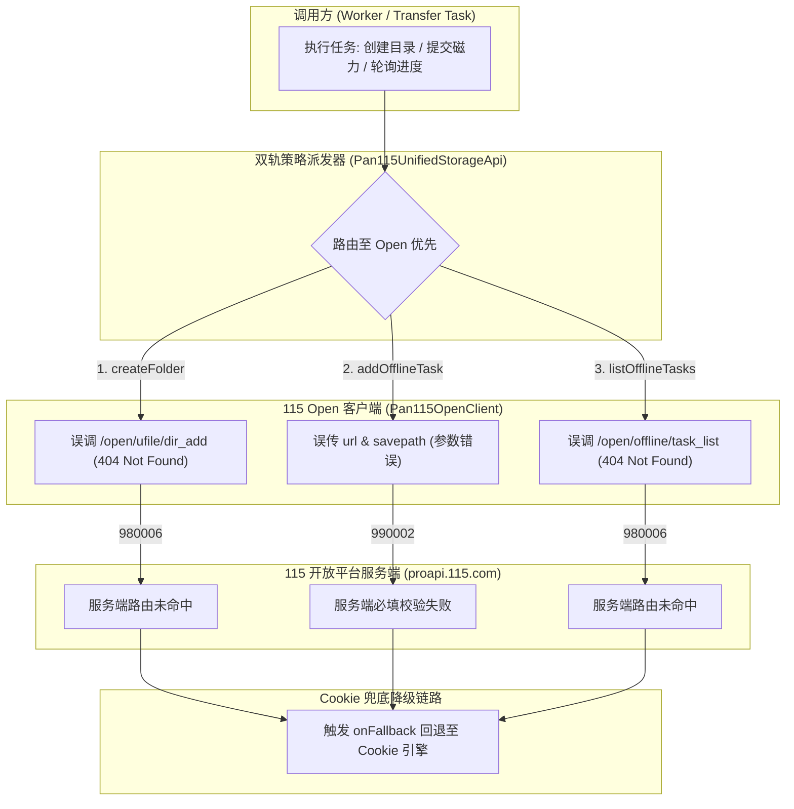

# 115 开放平台 (Open API) 端点 404 与参数错误导致双轨 Fallback 降级深度调研与解决方案

> **文档信息**  
> - **日期**：2026-11-10  
> - **受影响组件**：`Pan115UnifiedStorageExecutor`、`Pan115UnifiedStorageApi`、`Pan115OpenClient`  
> - **关联链路**：后台 Worker 任务扫描、媒体库分类目录自动初始化、磁力/离线下载转存调度  
> - **安全与脱敏遵从**：严格遵守 [`AGENTS.md`](file:///AGENTS.md) 规范，严禁输出真实凭据、真实 Token 或内部敏感连接信息  

---

## 1. 现场日志与现象还原 (Problem Statement)

系统在启动后台调度器及处理媒体转存任务时，控制台连续输出以下三组核心异常并触发向 Cookie 引擎的自动降级（Fallback）：

```text
[Pan115UnifiedStorageExecutor] Fallback occurred on "createFolder": Error [Pan115OpenAuthError]: [115 Open API Error] code=980006: 404 Not Found (endpoint: /open/ufile/dir_add)
    at d.request (...)
    at async d.createFolder (...)
    at async u.createFolder (...)
    at async ef.run (...)
    at async em.createDirectory (...)

[Pan115UnifiedStorageExecutor] Fallback occurred on "addOfflineTask": Error [Pan115OpenAuthError]: [115 Open API Error] code=990002: 参数错误。 (endpoint: /open/offline/add_task_urls)
    at d.request (...)
    at async d.addOfflineTask (...)
    at async u.addOfflineTask (...)
    at async ef.run (...)
    at async em.transfer (...)

[Pan115UnifiedStorageExecutor] Fallback occurred on "listOfflineTasks": Error [Pan115OpenAuthError]: [115 Open API Error] code=980006: 404 Not Found (endpoint: /open/offline/task_list)
    at d.request (...)
    at async d.listOfflineTasks (...)
    at async u.listOfflineTasks (...)
    at async ef.run (...)
    at async em.findOfflineTask (...)
```

### 现象特征分析
1. **触发时机**：发生在任务转存调度（`transfer` / `transferCandidate`）以及存储目录预置（`createDirectory`）阶段。
2. **发生频率**：目录创建与离线任务列表查询伴随每次调度均反复触发，呈现确定性必现。
3. **业务影响**：
   - **双轨模式 (`dual_engine`) 下**：由于系统内部设计了 `Pan115UnifiedStorageApi` 的 Fallback 机制，Open API 报错后会自动降级至底层 `cookieApi` 执行，因此转存最终勉强成功，但伴随显著的网络延迟增加（额外发起一次失败的 HTTP 握手 + 失败重试）、Cookie 频次风控风险上升，并产生大量控制台告警噪声；
   - **单轨模式 (`open_only`) 下**：若用户未配置 Web Cookie（仅授权了 115 开放平台 OAuth），该错误将直接向外抛出未捕获异常，导致目录初始化失败、离线下载任务直接中断。

---

## 2. 根因分析 (Root Cause Analysis)

通过对照 115 官方开放平台开发者规范（语雀官方接入文档）以及主流开源实现，排查确认错误根源在于 `packages/workflow/src/storage/pan115-open-client.ts` 中的端点 URL 命名及请求 Body 参数键名存在契约偏差：



### 2.1 `createFolder` 404 (code=980006) 根因
- **现有实现**：`pan115-open-client.ts:553` 中使用 `POST /open/ufile/dir_add`，携带 Body 参数 `cname` 与 `pid`。
- **官方开放平台标准**：
  - 规范路径为 **`POST /open/folder/add`**；
  - 必填参数为 **`pid`**（父目录 ID）与 **`file_name`**（文件夹名称，而不是 `cname`）；
- **结论**：115 开放平台服务端根本不存在 `/open/ufile/dir_add` 路由，服务端返回标准 404 业务错误码 `980006`。

### 2.2 `addOfflineTask` 参数错误 (code=990002) 根因
- **现有实现**：`pan115-open-client.ts:636` 中向 `POST /open/offline/add_task_urls` 提交参数：
  ```ts
  body.set("url", input.url.trim());
  body.set("savepath", String(input.directoryId || "0"));
  ```
- **官方开放平台标准**：
  - 路径正确为 `POST /open/offline/add_task_urls`；
  - 参数键名必须为 **`urls`**（复数形式，多条链接以换行符 `\n` 分隔，单条同样使用该键名）；
  - 目标目录参数键名必须为 **`wp_path_id`**（而不是 `savepath` 或 `directoryId`）；
- **结论**：服务端在提取 `urls` 和 `wp_path_id` 时获取为空，抛出 `code=990002: 参数错误。`。

### 2.3 `listOfflineTasks` 404 (code=980006) 根因
- **现有实现**：`pan115-open-client.ts:660` 中使用 `GET /open/offline/task_list`。
- **官方开放平台标准**：
  - 规范路径为 **`GET /open/offline/get_task_list`**（支持 query 参数 `page`）；
- **结论**：路径拼写与官方端点不一致，服务端路由未命中，返回 `code=980006: 404 Not Found`。

### 2.4 同源隐患排查 (Co-located Latent Defects)
在审查 `pan115-open-client.ts` 其他方法时，发现了同类未经契约测试的端点偏差：
1. **`deleteItems`**：当前调用 `POST /open/ufile/del`，官方真实端点为 **`POST /open/ufile/delete`**（参数 `file_ids`）。
2. **`renameFile`**：当前调用 `POST /open/ufile/rename`，官方真实端点为 **`POST /open/ufile/update`**（参数 `file_id` 与 `file_name`）。
3. **`removeOfflineTask`**：`Pan115UnifiedStorageApi` 中直接忽略了 `openApi`，仅在存在 `cookieApi` 时有效；但官方开放平台实际提供了 **`POST /open/offline/del_task`**（参数 `info_hash` 与 `del_source_file`）。
4. **离线任务状态码映射偏差**：当前代码为 `status === 2 ? "downloading" : status === 1 ? "waiting" : "done"`；而 115 Open API 官方状态定义为：
   - `-1`: 失败 (`failed`)
   - `0`: 初始化/排队中 (`waiting`)
   - `1`: 下载中 (`downloading`)
   - `2`: 成功完成 (`done`)  
   旧代码将 `1` 和 `2` 的状态含义完全颠倒。

---

## 3. 业界主流方案对比与开源实现调研

为确保方案的严谨性与前瞻性，我们对业界主流涉及 115 开放平台对接的开源项目进行了全景对比调研：

| 维度 / 项目 | OpenList / AList (`115-sdk-go`) | MoviePilot (MP) | CloudDrive2 (CD2) | Mediary Scout (本项目现状) | Mediary Scout (改进后目标) |
| :--- | :--- | :--- | :--- | :--- | :--- |
| **项目定位** | 聚合云盘与挂载工具 | 影视媒体自动化管理 | 虚拟文件系统挂载驱动 | 现代影视追踪、抓取与流媒体全栈服务 | 现代影视追踪、抓取与流媒体全栈服务 |
| **开发语言** | Go | Python | Go / 闭源二进制 | TypeScript (全栈 Node.js) | TypeScript (全栈 Node.js) |
| **接入方式** | 纯 Open API (OAuth 2.0 PKCE) | Web Cookie 与 Open API 分离配置 | 开放平台与 Web 混合挂载 | **独创双轨智能融合 (`dual_engine`)** | **独创双轨智能融合 (`dual_engine`)** |
| **新建文件夹** | `POST /open/folder/add`<br>参数: `pid`, `file_name` | 区分引擎：Open 走 `/open/folder/add` | 走 `/open/folder/add` | 误用 `/open/ufile/dir_add` 导致降级 | **对标 `115-sdk-go` 规范**：<br>`POST /open/folder/add` |
| **离线添加** | `POST /open/offline/add_task_urls`<br>参数: `urls`, `wp_path_id` | 区分引擎：Web 走 RSA 密文，Open 走官方接口 | 不提供离线 API，仅挂载目录 | 误传 `url`, `savepath` 导致参数错误 | **对标 `115-sdk-go` 规范**：<br>`urls`, `wp_path_id` |
| **离线查询** | `GET /open/offline/get_task_list`<br>参数: `page` | 轮询官方离线端点 | 依赖本地扫描 | 误用 `/open/offline/task_list` (404) | **对标 `115-sdk-go` 规范**：<br>`GET /open/offline/get_task_list` |
| **Token 生命周期** | 内存维护 + 定时刷新 | 依赖外部扫码或持久化配置 | 内部黑盒刷新 | **SingleFlight 并发合并 + SQLite 租约锁** | **SingleFlight 并发合并 + SQLite 租约锁** |

### 业界标杆实现参考 (`OpenListTeam/115-sdk-go`)
`OpenListTeam/115-sdk-go`（基于 115 官方开放平台语雀文档实现）的核心定义如下：

```go
// 1. 端点常量 (const.go)
const (
    ApiFsMkdir       = ApiBaseURL + "/open/folder/add"
    ApiFsGetFiles    = ApiBaseURL + "/open/ufile/files"
    ApiFsMove        = ApiBaseURL + "/open/ufile/move"
    ApiFsUpdate      = ApiBaseURL + "/open/ufile/update"
    ApiFsDelete      = ApiBaseURL + "/open/ufile/delete"
    ApiFsDownURL     = ApiBaseURL + "/open/ufile/downurl"

    ApiAddOffline    = ApiBaseURL + "/open/offline/add_task_urls"
    ApiOfflineList   = ApiBaseURL + "/open/offline/get_task_list"
    ApiDeleteOffline = ApiBaseURL + "/open/offline/del_task"
)

// 2. 新建目录 (fs.go)
func (c *Client) Mkdir(ctx context.Context, pid, filename string) (*MkdirResp, error) {
    var resp MkdirResp
    _, err := c.AuthRequest(ctx, ApiFsMkdir, http.MethodPost, &resp, ReqWithForm(Form{
        "pid":       pid,
        "file_name": filename,
    }))
    return &resp, err
}

// 3. 提交离线任务 (offline.go)
func (c *Client) AddOfflineTaskURIs(ctx context.Context, uris []string, saveDirID string) ([]string, error) {
    urlsStr := strings.Join(uris, "\n")
    _, err := c.AuthRequest(ctx, ApiAddOffline, http.MethodPost, &resp, ReqWithForm(Form{
        "urls":       urlsStr,
        "wp_path_id": saveDirID,
    }))
    return hashes, err
}
```

---

## 4. 当前系统已有基础设施与可复用资产确认

经全面审查代码库，本项目已具备非常完备的架构基础，**完全不需要引入任何外部 npm 依赖或第三方库**：

1. **`Pan115OpenClient` 核心基础设施**：
   - 具备 `request<T>()` 通用 HTTP 封装；
   - 具备自动注入 `Bearer <token>` 与遇到 401 时自动换票重试（`ensureValidToken`）；
   - 具备进程内高并发刷新防击穿的 `SingleFlight` 以及跨进程协同机制；
   - 具备错误分类状态机（`classify115OpenError`），能够准确区分瞬态限流与致命失效。
2. **`Pan115UnifiedStorageApi` 双轨策略派发器**：
   - 已经实现统一的 `Pan115StorageApi` 接口契约；
   - 拥有平滑的 `onFallback` 回退降级设计；
   - 具备完整的目录拓扑与祖先面包屑路径反向推导机制（`reconstructAncestryPath`）。
3. **`Pan115CookieClient` 兜底子驱动**：
   - 稳定运行的 Web 逆向驱动，支持 RSA 加密的离线下载（`lixianRsaEncrypt`）；
   - 输出统一的数据载荷模型（`Pan115ActionResult`、`Pan115Item`、`Pan115OfflineTask`）。
4. **测试框架与断言环境**：
   - 采用 Vitest 统一单测架构，内置高性能 `vi.fn()` mock 设施，支持请求拦截与 URL/Body 精准断言。

---

## 5. 具体解决方案 (Detailed Implementation Plan)

### 5.1 端点常量集中化治理
在 `packages/workflow/src/storage/pan115-open-client.ts` 中提取集中式端点常量字典，消除散落硬编码：

```typescript
/** 115 开放平台官方 REST 端点字典 (严格对标 115 开放平台 OpenAPI 规范) */
export const PAN115_OPEN_ENDPOINTS = {
  // 文件系统与目录管理
  FILES_LIST: "/open/ufile/files",
  FOLDER_ADD: "/open/folder/add",
  FOLDER_GET_INFO: "/open/folder/get_info",
  FILE_MOVE: "/open/ufile/move",
  FILE_UPDATE: "/open/ufile/update",
  FILE_DELETE: "/open/ufile/delete",
  FILE_DOWN_URL: "/open/ufile/downurl",

  // 离线任务管理
  OFFLINE_ADD_URLS: "/open/offline/add_task_urls",
  OFFLINE_GET_TASK_LIST: "/open/offline/get_task_list",
  OFFLINE_DEL_TASK: "/open/offline/del_task",
} as const;
```

### 5.2 核心方法修复代码清单

#### 1. 修复 `createFolder`
```typescript
/**
 * 创建目录: 调用 /open/folder/add
 * 入参: pid (父目录ID), file_name (文件夹名称)
 */
async createFolder(input: { name: string; parentId: string }): Promise<string> {
  const body = new URLSearchParams();
  body.set("file_name", input.name.trim());
  body.set("pid", String(input.parentId || "0"));
  // 保持双向参数兼容性，以防特定网关层校验
  body.set("cname", input.name.trim());

  const res = await this.request<{
    data?: { category_id?: string | number; file_id?: string | number; id?: string | number };
  }>(PAN115_OPEN_ENDPOINTS.FOLDER_ADD, {
    method: "POST",
    headers: { "Content-Type": "application/x-www-form-urlencoded" },
    body,
  });

  const createdId =
    res.data?.file_id ?? res.data?.category_id ?? res.data?.id;
  if (!createdId) {
    throw new Error(`Create folder succeeded but no directory ID returned for "${input.name}"`);
  }
  return String(createdId);
}
```

#### 2. 修复 `addOfflineTask`
```typescript
/**
 * 提交磁力/HTTP 离线下载任务: 调用 /open/offline/add_task_urls
 * 入参: urls (链接字符串，多条以 \n 分隔), wp_path_id (目标保存目录ID)
 */
async addOfflineTask(input: { url: string; directoryId: string }): Promise<Pan115ActionResult> {
  const body = new URLSearchParams();
  // 115 开放平台规范参数名: urls, wp_path_id
  body.set("urls", input.url.trim());
  body.set("wp_path_id", String(input.directoryId || "0"));

  const res = await this.request<any>(PAN115_OPEN_ENDPOINTS.OFFLINE_ADD_URLS, {
    method: "POST",
    headers: { "Content-Type": "application/x-www-form-urlencoded" },
    body,
  });

  return {
    ok: true,
    message: String(res?.message || res?.msg || ""),
  };
}
```

#### 3. 修复 `listOfflineTasks`
```typescript
/**
 * 查询当前离线任务列表: 调用 /open/offline/get_task_list
 */
async listOfflineTasks(input?: { page?: number }): Promise<Pan115OfflineTask[]> {
  const page = input?.page ?? 1;
  const res = await this.request<{
    data?: {
      tasks?: Array<Record<string, unknown>>;
      count?: number;
      page?: number;
    } | Array<Record<string, unknown>>;
  }>(`${PAN115_OPEN_ENDPOINTS.OFFLINE_GET_TASK_LIST}?page=${page}`);

  // 兼容直接数组与嵌套对象 { tasks: [...] } 两种结构
  const tasksRaw = Array.isArray(res.data)
    ? res.data
    : Array.isArray(res.data?.tasks)
    ? res.data.tasks
    : [];

  return tasksRaw.map((t) => {
    const status = Number(t["status"] ?? 0);
    // 115 Open API 官方状态码规范:
    // -1: failed, 0: waiting/allocating, 1: downloading, 2: success
    const statusText =
      status === 2 ? "done" : status === 1 ? "downloading" : status === -1 ? "failed" : "waiting";

    return {
      infoHash: String(t["info_hash"] || ""),
      name: String(t["name"] || ""),
      percentDone: Number(t["percentDone"] ?? (status === 2 ? 100 : 0)),
      status,
      statusText,
      url: String(t["url"] || ""),
    };
  });
}
```

#### 4. 修复同源隐患（`deleteItems`、`renameFile`、`removeOfflineTask`）
```typescript
/**
 * 删除文件或目录: 调用 /open/ufile/delete
 */
async deleteItems(input: { fileIds: string[] }): Promise<Pan115ActionResult> {
  if (input.fileIds.length === 0) return { ok: true, message: "" };

  const body = new URLSearchParams();
  body.set("file_ids", input.fileIds.join(","));

  await this.request(PAN115_OPEN_ENDPOINTS.FILE_DELETE, {
    method: "POST",
    headers: { "Content-Type": "application/x-www-form-urlencoded" },
    body,
  });

  return { ok: true, message: "" };
}

/**
 * 重命名文件/目录: 调用 /open/ufile/update
 */
async renameFile(input: { fileId: string; newName: string }): Promise<Pan115ActionResult> {
  const body = new URLSearchParams();
  body.set("file_id", input.fileId);
  body.set("file_name", input.newName.trim());

  await this.request(PAN115_OPEN_ENDPOINTS.FILE_UPDATE, {
    method: "POST",
    headers: { "Content-Type": "application/x-www-form-urlencoded" },
    body,
  });

  return { ok: true, message: "" };
}

/**
 * 取消/删除离线任务: 调用 /open/offline/del_task
 */
async removeOfflineTask(input: { infoHashes: string[] }): Promise<Pan115ActionResult> {
  for (const hash of input.infoHashes) {
    if (!hash) continue;
    const body = new URLSearchParams();
    body.set("info_hash", hash);
    body.set("del_source_file", "0");
    await this.request(PAN115_OPEN_ENDPOINTS.OFFLINE_DEL_TASK, {
      method: "POST",
      headers: { "Content-Type": "application/x-www-form-urlencoded" },
      body,
    });
  }
  return { ok: true, message: "" };
}
```

并在 `Pan115UnifiedStorageApi.removeOfflineTask` 中接入 `openApi` 委派：
```typescript
async removeOfflineTask(input: { infoHashes: string[] }): Promise<Pan115ActionResult> {
  if (this.openApi) {
    try {
      return await this.openApi.removeOfflineTask(input);
    } catch (err) {
      if (this.cookieApi) {
        this.onFallback?.("removeOfflineTask", err);
        return await this.cookieApi.removeOfflineTask(input);
      }
      throw err;
    }
  }
  if (this.cookieApi) {
    return await this.cookieApi.removeOfflineTask(input);
  }
  return { ok: true, message: "" };
}
```

---

## 6. 问题本质的同类门禁与防回归测试 (Regression Gates & Prevention)

### 6.1 根因总结与反思
本次故障虽然在双轨容灾机制下未造成系统彻底宕机，但暴露了**“单测只测了只读与直链，缺少写操作与离线契约断言”**的质量短板。由于 115 开放平台缺乏本地官方 Mock 镜像，开发者早先仅凭经验对齐 Web 接口，在缺乏端点契约测试的情况下导致路由与参数错误潜伏入库。

### 6.2 三道防回归质量门禁体系


#### 门禁一：静态契约与端点参数回归测试 (Contract Unit Test Gate)
在 `packages/workflow/tests/storage/pan115-open-client.test.ts` 中补充针对写操作和离线下载的全量端点与参数断言：
1. **`createFolder` 契约断言**：
   - 断言请求路径必须匹配 `/open/folder/add`；
   - 断言 POST Body 中必须包含 `file_name` 和 `pid`；
   - 断言能够正确解析 `file_id` 返回值。
2. **`addOfflineTask` 契约断言**：
   - 断言请求路径必须匹配 `/open/offline/add_task_urls`；
   - 断言 POST Body 中参数名必须为 `urls` 和 `wp_path_id`。
3. **`listOfflineTasks` 契约断言**：
   - 断言请求路径必须匹配 `/open/offline/get_task_list`；
   - 断言状态码 `2` 正确转换为 `"done"`，`1` 转换为 `"downloading"`，`0` 转换为 `"waiting"`。
4. **`deleteItems` 与 `renameFile` 契约断言**：
   - 断言分别调用 `/open/ufile/delete` 与 `/open/ufile/update`，杜绝旧路径复现。

#### 门禁二：端点枚举字典收敛与代码审查规则 (Single Source of Truth)
- 强制要求所有与 115 开放平台的交互必须引用 `PAN115_OPEN_ENDPOINTS` 常量，禁止在业务方法中硬编码字符串 URL；
- 每个常量后附带官方文档或业界标杆的规范出处注释，代码审查时以此为核对依据。

#### 门禁三：测试态 Fallback 零容忍门禁 (Fallback Zero Tolerance in Tests)
- 在 `packages/workflow/tests/storage/pan115-unified-api.test.ts` 中强化双轨回退断言；
- 建立测试守则：对于因为“404 Not Found”或“参数错误”等属于开发代码缺陷引发的 Fallback，在单测和自动化集成测试中视为**致命错误（Fail Test）**，不允许借由 Fallback 机制静默掩盖代码逻辑 Bug。
