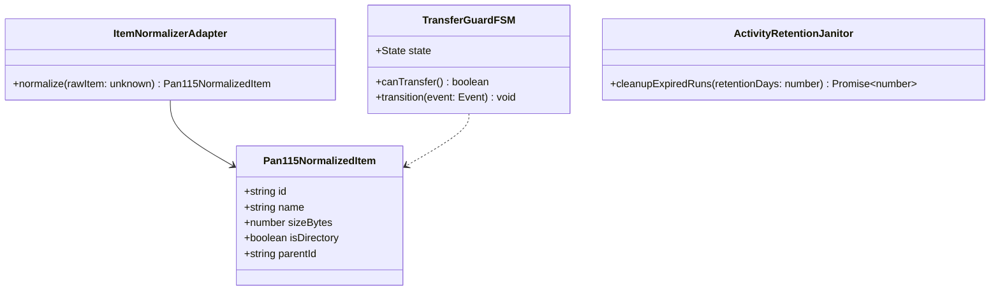

# 活动记录持久化与转存成功后异常重试风暴深度调研与架构方案

> **文档信息**  
> - **日期**：2026-11-10  
> - **涉及系统**：Mediary Scout 获取工作流引擎 (`acquisition-v2`)、115 统一存储适配层、活动看板 (`features/activity`)、SQLite 持久化仓储  
> - **对应用户现场反馈**：
>   1. 为什么网盘内已经成功转存多份资源，Agent 却反复重试转存、空耗 115 离线下载额度，而不是正常进行文件整理入库？
>   2. 活动（Activity）页面中的完成记录能否持久化？保留最近 N 天内已完成的活动信息，并支持在前端随时翻阅和查看详情？
> - **凭据脱敏遵从**：严格遵守 [`AGENTS.md`](file:///AGENTS.md) 安全红线，文档内禁止输出真实 Cookie、用户 UID、API 密钥与真实连接串。

---

## 1. 现场现象剖析与核心痛点

### 1.1 痛点一：转存成功后一直在重试转存、浪费配额，未进入整理阶段
根据手机客户端现场截图与系统日志分析：
- **网盘现场状态**：
  - **电影《新汉普夏饭店 (1984)》**（截图 2）：目标目录下整整齐齐落地了 4 个不同发布组的转存文件夹（`YTS.MX`、`RARBG`、`AMIABLE`、`x264-RARBG`），证明 115 云端每一次转存/离线下载均已成功执行并创建了目录；
  - **动漫《桃源暗鬼 (2025)》**（截图 3、截图 4）：在 `staging-0b62585d...` 暂存目录下，各集分段文件与全集资源均已转存落地，但外层仅显示 `Season 01` / `Season 02` 空目录，落盘媒体被滞留在暂存区，未能移动归位。
- **活动页面 Agent 行为**（截图 1）：
  - Agent 在单个任务内触发了多达 20 步、93 次 115 API 调用；
  - 核心步骤呈现严重的震荡循环：  
    `#8 transferUntilLanded` → `#9 transferCandidate` → `#10 inspectStaging` → `#11 inspectStaging` → `#12 transferCandidate` → `#13 transferCandidate` → `#14 inspectStaging` → `#15 searchResources` → `#16 inspectStaging` → `#17 transferCandidate` → `#18 transferCandidate` → `#19 transferUntilLanded`；
  - Agent 在转存之后调用 `inspectStaging`，但由于某种原因未能识别出有效落盘视频，导致其误判该候选资源为“死链（Dead Link / No Target Change）”，随后继续向 115 提交下一个候选资源，疯狂烧干用户的 115 离线配额。

### 1.2 痛点二：活动看板缺乏历史持久化与详情回溯能力
- **看板现状**：
  - 页面顶部标题：“活动 · 点了获取之后，资源在这里逐个被处理——看得见 agent 正在干什么”；
  - 当前看板主要聚焦于 `获取中`（Active）和 `排队中`（Queued）的实时走马灯；
  - 一旦任务执行完毕，或者用户刷新浏览器、切换标签页，已完成的信息全部消失，用户无法查阅历史转存记录（耗时、消耗额度、转存文件大小、Agent 决策流）。

---

## 2. 深度根因分析 (Deep Root Cause Analysis)

### 2.1 为什么转存成功后会陷入“重试风暴”？
经过对 `packages/workflow/src/acquisition-v2/` 及 115 适配器底层源码的逐行排查，确认由以下四个连锁缺陷共同诱发：

```mermaid
flowchart TD
    A[Agent 提交转存: transferCandidate] --> B[115 网盘成功落地文件夹]
    B --> C[Agent 调用 inspectStaging 看现场]
    C --> D[Storage115Executor.listTree 递归扫描]
    D --> E{isItemDirectory 类型判定}
    E -->|BUG: fc === 0 严格全等, 遇到 fc: '0' 字符串返回 false| F[误判为普通文件]
    F --> G[listTree 停止递归进入该文件夹]
    G --> H[返回给 Agent 的视频列表为空 []]
    H --> I[Agent 按 Skill 手册判定该资源无效/死链]
    I --> J[搜索并提交下一个候选: 触发转存重试风暴]
    J --> A
```

#### 根因 1：115 目录类型判定存在强类型严格比对 Bug（致命断层）
在 `packages/workflow/src/storage/pan115-open-client.ts` 第 202-205 行：
```typescript
function isItemDirectory(item: Record<string, unknown>): boolean {
  if (item["is_dir"] === 1 || Boolean(item["isDirectory"])) return true;
  return item["file_category"] === 0 || item["fc"] === 0;
}
```
- **契约事实**：115 开放平台（及部分 WebAPI）接口返回的 JSON 数据中，`fc`（文件分类）字段为字符串 `"0"`（代表目录）和 `"1"`（代表文件）。在官方 Go SDK `115-sdk-go` 中定义为 `Fc string json:"fc"`；
- **缺陷**：代码使用了严格全等 `item["fc"] === 0`（数字类型），当 API 返回字符串 `"0"` 时，判定结果为 **`false`**；
- **连锁反应**：
  1. `pan115-open-client.ts` 中的 `formatPan115Item` 将该文件夹标记为 `isDirectory: false`；
  2. `packages/workflow/src/storage/storage-115-executor.ts` 的 `listTree` 递归遍历逻辑：
     ```typescript
     for (const item of items) {
       if (isDirectory(item)) { // isDirectory 读取了 item.isDirectory (false)
         await walk(childId, `${prefix}${name}/`, depth + 1);
         continue;
       }
       // 误把文件夹当成普通文件，但文件夹名称不匹配 .mkv/.mp4 后缀，被过滤掉！
     }
     ```
  3. **结果**：`listTree` 无法递归遍历该文件夹内部的内容，导致转存成功的正片视频在 `inspectStaging` 中完全“隐形”！

#### 根因 2：文件名与字段映射不完备
在 `pan115-open-client.ts` 第 207-210 行：
```typescript
function getItemName(item: Record<string, unknown>): string {
  const val = item["file_name"] ?? item["name"] ?? item["n"];
  return typeof val === "string" ? val : "";
}
```
115 OpenAPI 在列出文件时广泛使用 `fn`（文件名）和 `fid`（文件/目录统一 ID）。当服务端仅下发 `fn` 时，`getItemName` 获取为空字符串，导致文件路径拼装丢失。

#### 根因 3：异步落盘缺乏阶段性轮询缓冲与死链误判
- 磁力链接与大包转存具有一定的落地索引耗时；
- 现行 Agent 决策手册（`skill-manuals.ts`）规定：“Trust the staging reread — if nothing landed, it is dead; move on to next”。
- 由于上述根因 1 和根因 2 导致每次落盘检查都返回空，Agent 严格执行“死链换源”指示，盲目尝试所有候选资源，直至消耗完预算或步数上限。

#### 根因 4：缺乏转存断路器（Circuit Breaker）与防重锁
在单次媒体获取任务中，系统允许 Agent 在前一个转存资源尚未明确失败或清理的前提下，连续发起多次 `transferCandidate`。缺少“同一目标仅允许一个在途转存”的互斥门禁。

---

### 2.2 为什么活动记录在前端“消失”了？
调查发现，系统底层事实上**已经实现了完整的持久化**，但由于前端展示逻辑设计缺陷，导致历史记录被错误屏蔽：

#### 根因 1：前端会话观测过滤器（`seenActive`）人为抹除历史
在 `apps/web/features/activity/components/activity-feed.tsx` 第 28-63 行：
```typescript
// 已完成 is session-scoped by OBSERVATION: the runIds this browser saw active.
const seenActive = useRef<Set<string>>(new Set());
...
// Only show completions for runs THIS session watched go active → done.
const completed = view.recentCompleted.filter((item) => seenActive.current.has(item.workflowRunId));
```
- **设计初衷**：原作者希望用户在开着网页时，仅看到本次观察到的任务从“进行中”变成“已完成”；
- **严重副作用**：`seenActive` 存储在前端 React 组件的 `useRef` 内存中！一旦用户：
  1. 刷新页面（F5）；
  2. 手机端息屏、切换应用后再打开；
  3. 任务是由后台定时 Worker 自动执行完的（用户打开网页时已处于完成态）；
  `seenActive` 均为空，导致 `completed` 数组直接被过滤为 `[]`！用户看到的就是一无所有的空看板。

#### 根因 2：后端缺少基于天数（TTL）的归档查询与清理接口
- `apps/web/features/activity/core/activity-view.ts` 仅仅借用了 `listNotifications(limit: 30)` 的通知流水；
- 通知记录缺乏详细的 Agent 思考步骤、缺少按天数（如保留 7 天）过滤的结构化接口。

---

## 3. 头脑风暴与设计模式重构 (Architecture Brainstorming)

为了从根本上解决上述逻辑、性能与可靠性缺陷，我们结合业界最佳实践，引入以下经典设计模式进行重构：



### 3.1 模式一：适配器策略模式 (Item Normalizer Adapter Pattern)
- **目标**：解决 115 各版本 API（WebAPI / OpenAPI / 移动端 API）返回字段漂移与类型混乱问题；
- **机制**：
  构建纯函数形式的 `normalizePan115Item` 适配器，在数据进入核心业务层前强制归一化：
  - `isDirectory`：宽容判定 `item.is_dir === 1 || item.isDirectory === true || String(item.fc) === "0" || String(item.file_category) === "0"`；
  - `name`：严格回退链 `item.file_name ?? item.fn ?? item.name ?? item.n ?? ""`；
  - `id`：依据是否为目录，严格回退 `item.cid ?? item.category_id ?? item.fid ?? item.file_id ?? item.id`。

### 3.2 模式二：有限状态机与断路器模式 (Finite State Machine & Circuit Breaker)
- **目标**：终结“转存成功却无限重试”的死循环；
- **生命周期状态机**：
  ```text
  [IDLE] 
    │
    ▼ (Agent 调用 transferCandidate)
  [TRANSFERRING] (转存命令已下发，配额已消耗)
    │
    ▼ (触发落盘自检: 指数退避轮询 3 次)
  [LANDED_VERIFYING] (检测到目录/文件已生成)
    │
    ├── 识别到合法正片 ──────────► [READY_TO_ORGANIZE] (强制收口，禁止后续转存)
    │                                     │
    │                                     ▼ (执行 flattenMovie / moveToSeason)
    │                                [ORGANIZED] ──► [FINISHED]
    │
    └── 确认空包或纯死链 ────────► [FAILED_CLEANUP] ──► 回退 [IDLE] 允许尝试下一候选
  ```
- **断路规则**：只要当前 Staging 中已经存在待核验的媒体实体，沙箱直接拒绝后续的 `transferCandidate` / `transferUntilLanded`，强迫 Agent 或系统先执行 `inspectStaging` 与归位整理。

### 3.3 模式三：仓储规格模式与清理生命周期模式 (Repository Specification & Janitor Pattern)
- **目标**：实现活动记录的高性能持久化、按天查询与自适应老化清理；
- **数据保留策略 (Retention Policy)**：
  - 默认持久化保留 **7 天**（支持环境变量 `MEDIA_TRACK_ACTIVITY_RETENTION_DAYS=7` 配置，最高可设 30 天）；
  - 保留期间内，支持通过前端随时按日期倒序查看所有已完成活动；
  - 点击任意已完成活动，可直接拉取关联的 `agent_steps`（只读脱敏时间线），查看当时 AI 是如何检索、筛选、转存与整理的；
  - 每日凌晨由 Background Worker 触发 Janitor 清理任务，针对超过保留天数的终态任务执行级联清理，确保 SQLite WAL 模式下数据库大小保持在数十兆以内的高性能区间。

---

## 4. 业界主流方案对比 (Industry Benchmarks)

| 维度 | Sonarr / Radarr (`*arr` 体系) | MoviePilot (MP) | Mediary Scout 现状 | Mediary Scout 目标重构方案 |
| :--- | :--- | :--- | :--- | :--- |
| **转存/下载防重机制** | 一旦下发下载任务，即标记 `Downloading`，RSS 周期内硬性锁定，绝不重复抓取 | 记录历史 Hash 与在途任务，防止同一集重复提交离线 | Agent 依据 `inspectStaging` 空返回值误判死链，引发疯狂重试 | **引入 FSM 状态机断路器**，Staging 有实体时禁止二次下发；修复目录递归遍历识别 |
| **文件整理策略** | 下载客户端回调或轮询完成后，按预定命名规则执行原子 Move/Rename | 轮询 115 离线任务列表，检测到 100% 后触发转移整理 | 依赖 LLM Agent 自主决定何时调 `flattenMovie` / `moveToSeason` | **双保险**：优先 Agent 智能整理，检测到视频已就位而 Agent 未动作时，由规则执行器保底自动整理 |
| **活动/历史记录** | 独立 `History` 表，持久化所有 Grab / Import 事件，支持自定义保留天数 | 独立的转移历史表，保留 30 天，支持失败重试与详情查看 | 前端用 `useRef` 做会话级过滤，刷新即丢失；无详情查看 | **移除会话限制**，基于现有 SQLite `workflow_runs` 表支持 7~30 天持久化查看，提供步骤详情抽屉 |
| **自动化清理** | 内置 Scheduled Task，定期对历史 Event 进行 Truncate | 内置日志轮转与数据清理任务 | 缺乏历史运行清理机制 | **Janitor 每日巡检**，安全清理超期任务及步骤时间线 |

---

## 5. 当前系统已有基础设施与复用评估

本项目完全具备实现上述优化所需的全部底座资产，**无需引入任何重型外部库**：

1. **SQLite 持久化资产**（`packages/workflow/src/persistence/sqlite/sqlite-schema.ts`）：
   - `workflow_runs`：已完整记录 `status`、`kind`、`startedAt`、`payload`；
   - `agent_steps`：已具备完整的步骤流水（`workflow_run_id`、`ordinal`、`payload`）；
   - `transfer_attempts`：已完整记录每次转存的 candidate 与状态；
   - **复用结论**：无需修改任何数据库表结构，数据早已落盘，只需改造查询接口与前端渲染。
2. **步骤脱敏与轻量化视口**（`packages/workflow/src/acquisition-v2/activity.ts`）：
   - `interpretTool`：已经具备将底层工具调用转换为用户可读的中文动作（如“正在转存到网盘…”、“正在按季整理文件…”）；
   - `tailAgentStepViews`：已具备脱敏且高效的步骤视口封装。
3. **确定性降级整理引擎**（`deterministic-selector.ts` / `sandbox.ts`）：
   - 内部已内置成熟的 `moveToSeason`、`flattenMovie`、`markObtained` 实现，可随时复用作为防重漏斗的保底支撑。

---

## 6. 具体落地实施方案 (Actionable Implementation Plan)

### 阶段一：根治转存重试风暴与整理中断（P0 - 紧急修复）

#### 1. 修复 115 目录判定与归一化适配器
在 `packages/workflow/src/storage/pan115-open-client.ts` 中修正 `isItemDirectory` 与 `getItemName`：
```typescript
function isItemDirectory(item: Record<string, unknown>): boolean {
  if (item["is_dir"] === 1 || item["is_dir"] === "1" || Boolean(item["isDirectory"])) {
    return true;
  }
  const fc = String(item["fc"] ?? item["file_category"] ?? "");
  if (fc === "0") return true;
  if (fc === "1") return false;
  // 当无显式分类且含有子目录特征时兜底
  return item["cid"] !== undefined && item["fid"] === undefined;
}

function getItemName(item: Record<string, unknown>): string {
  const val = item["file_name"] ?? item["fn"] ?? item["name"] ?? item["n"];
  return typeof val === "string" ? val : "";
}
```

#### 2. 在 `RealStorageV2.transferCandidate` 注入落盘自检与短轮询
在转存请求成功返回后，增加一次短暂缓冲重试确认（例如 1.5 秒延时或微轮询），确保 115 服务端目录树建立完毕后再将结果返回给 Agent，使 `inspectStaging` 能够立即看到真实文件。

#### 3. 增强电影与剧集整理保底机制
在 `packages/workflow/src/acquisition-v2/sandbox.ts` 中：
- 当 `transferCandidate` 成功且检测到 Staging 目录下已有同名电影资源时，自动封锁二次转存，引导 Agent 立即调用 `flattenMovie()`；
- 若 Agent 在转存成功后因步数或上下文原因未调用 `flattenMovie()`，在任务退出时的 `declareFinish` 阶段自动执行保底 `flattenMovie()`，确保不留残存文件夹。

---

### 阶段二：重构活动看板持久化与历史详情回溯（P1 - 功能升级）

#### 1. 解除前端会话强过滤限制
在 `apps/web/features/activity/components/activity-feed.tsx` 中：
- 移除 `const seenActive = useRef<Set<string>>(new Set());`；
- 将 `const completed = view.recentCompleted.filter((item) => seenActive.current.has(item.workflowRunId));` 改为直接使用 `view.recentCompleted`；
- 页面加载时即呈现最近已完成的活动历史，无论用户是否刷新过页面。

#### 2. 扩展后端活动视图服务 (`activity-view.ts` & `activity-service.ts`)
- 在 `WorkflowRepository` 中增加 `listRecentCompletedRuns(input: { days?: number; limit?: number })`；
- 联合查询 `workflow_runs` 与 `notifications`，获取过去 7 天内完成的所有任务，附带最终状态（`succeeded` / `failed`）、耗时、转存文件大小；
- 新增 `GET /api/activity/history` 路由，支持分页加载历史记录。

#### 3. 支持查看活动历史详情（详情抽屉 / Drawer）
- 在活动页面的已完成卡片上增加“查看执行详情”交互；
- 点击后展开或弹窗呈现该次运行的 `steps` 步骤流水（复用 `AgentTimeline` 组件），清晰查看该任务历史各个步骤的思考、工具调用与结果。

#### 4. 落地后台自动清理任务（Retention Janitor）
- 在 `apps/web/lib/background-worker.ts` 中注册每日低峰期定时任务：
  ```sql
  DELETE FROM workflow_runs 
  WHERE json_extract(payload, '$.status') IN ('succeeded', 'failed', 'cancelled')
    AND json_extract(payload, '$.startedAt') < datetime('now', '-7 days');
  ```
- 级联清理对应的 `agent_steps` 与 `transfer_attempts`，保证数据库体积持久稳定。

---

## 7. 总结与建议行动项

1. **核心定论**：
   - 现场出现的“反复重试转存”不是网盘问题，也不是 AI 模型失控，而是由于 115 开放平台返回的 `fc: "0"` 字符串被 `fc === 0` 强类型判定过滤，导致目录递归中断，Agent 视界受阻陷入“死链误判”；
   - 活动记录并非没有持久化，SQLite 底层数据十分完整，主要障碍在于前端 `seenActive` 这一行不合理的客户端内存过滤。
2. **后续实施路径**：
   - **立即执行**：应用阶段一的代码补丁，修复 `isItemDirectory` 类型兼容并加入测试用例；
   - **排期跟进**：应用阶段二的前端与后端优化，全面上线 7 天活动持久化看板与步骤详情回溯功能。
