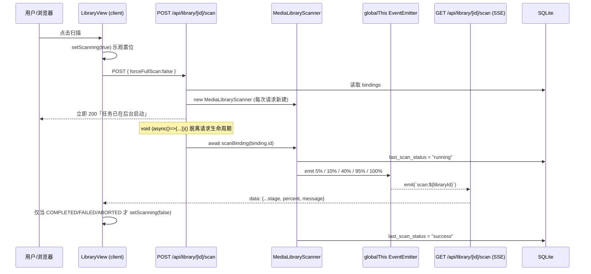
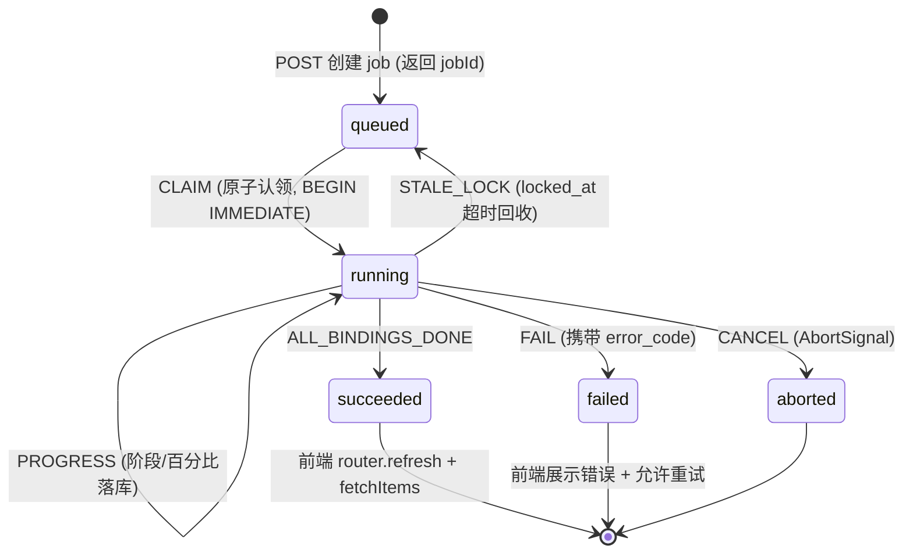

# 影视库扫描闭环与播放器交互/性能四项问题调研与可行性方案

(Library Scan Lifecycle & Player UX/Performance: Root-Cause Research and Design Proposal)

- **日期**：2026-11-13
- **状态**：调研结论 + 待评审实施方案 (Research Done / Proposed)
- **触发**：用户提交两张实机截图（影视库扫描停在 10%、播放器左下角提示与快捷键），提出 4 个问题
- **范围**：`/library` 扫描生命周期、`features/player` 交互层、STRM 播放与直链解析链路
- **方法论**：源码级只读审计（含 `node_modules/artplayer` 运行时源码）+ 项目内既有架构资产盘点 + 业界主流方案横向对比 + 可行性/性能/设计模式批判性评估
- **凭据规范**：本文所有外部接口示例一律使用占位符（`<API_KEY>` / `<ADMIN_PASSWORD>` / `example.com`），不含任何真实密钥

---

## 0. 结论速览 (TL;DR)

| # | 用户问题 | 结论（能否 / 为什么） | 根因层级 | 可行性 | 推荐方案 | 成本 |
| :-- | :-- | :-- | :-- | :-- | :-- | :-- |
| 1 | 扫描完成后不自动刷新库、不结束扫描 | **能修，且必须修**。不是"忘了写刷新"，而是**任务状态机根本没有持久化终态**，UI 只靠一条易丢的内存 SSE 消息判定结束 | 架构级：进程内 `void` 后台任务 + `globalThis` EventEmitter + 无 DB 状态 | 高（项目内已有完整范式可抄） | DB-backed Job + 状态机 + 轮询兜底 + 终态显式 `router.refresh()` | 中 |
| 2 | 左下角操作提示能否隐藏 | **能，纯前端，零风险**。当前会 3.5s 渐隐但**无法被用户永久关闭**，`pointerEvents: none` 不可点击 | UI 层：无开关、无持久化偏好 | 极高 | 三档偏好（常显 / 自动渐隐 / 隐藏）+ `account_settings` 白名单键 | 低 |
| 3 | 快捷键为什么无效 | **能修**。空格/左右键实际"有时有效"，取决于 ArtPlayer 的 `art.isFocus`；`F` 全屏**从未被绑定** | 集成层：依赖隐式焦点 + 键位覆盖不全 + Escape 双重处理 | 极高 | 零新增依赖，用 `art.hotkey.add` + 统一 Command 层 + 显式焦点策略 | 低 |
| 4 | 播放速度慢，能否优化 | **能，但要分清是"起播/拖动慢"还是"倍速"**。服务端 Range/206/流式转发已做对，瓶颈在**直链解析串行多跳 + 品牌限速 + 连接不复用 + 无预取** | 链路级：首字节延迟，非解码性能 | 中高（需埋点量化后分级） | P0 零成本配置 + P1 缓存/预解析 + P2 连接复用与预取 | 中 |

**一句话判断**：这 4 个问题表面上分散，本质是同一个架构缺陷的四个投影——**缺少一个"权威的、持久化的、可观测的状态"**。扫描任务没有权威状态机，播放器没有权威快捷键映射与偏好状态，播放链路没有权威的耗时指标。因此本文统一用「单一事实源 (SSOT) + 显式状态机 + 策略/适配器隔离」来收敛，而不是打四个补丁。

---

## 1. 现状事实与代码地图

### 1.1 库扫描链路时序（实测源码）



关键文件：

| 职责 | 路径 | 关键行 |
| :-- | :-- | :-- |
| RSC 页面（只渲染一次） | `apps/web/app/library/page.tsx` | L47 `connection()`、L62 `listLibraries`、L82 传 `initialLibraries` |
| 主控 client 组件 | `apps/web/features/library/components/library-view.tsx` | L54 `useState(initialLibraries)`、L131 `fetchItems`、L147-172 SSE、L174-193 触发扫描 |
| SSE 订阅与完成判定 | 同上 | L156-161 |
| 扫描 API（POST/GET） | `apps/web/app/api/library/[id]/scan/route.ts` | L78-101（void 后台任务）、L104-140（SSE） |
| 内存事件总线 | `apps/web/features/library/library-scan-events.ts` | L19-29 `globalThis.__mediaryLibraryScanEmitter` |
| 扫描器 | `packages/workflow/src/library/library-scanner.ts` | L55-70 锁与 running、L72-96 emit、L430-450 终态 |
| 进度契约 | `packages/contracts/src/media-library.ts` | L143-164 `LibraryScanProgressEvent` |
| 持久化 | `packages/workflow/src/persistence/sqlite/sqlite-schema.ts` | L464-481 `library_path_bindings.last_scan_status` / `last_scan_at` |

### 1.2 问题一的四个失效点（逐条证据）

1. **终态消息可能永不发出**：`scan/route.ts:92-94` 的 `catch (err) { console.error(...) }` 只打日志，**不 emit `FAILED`**；而 `scanBinding` 在 `try` 之前就可能抛错（`library-scanner.ts:55-67`：重复扫描、`BINDING_NOT_FOUND`、`LIBRARY_NOT_FOUND`）。这两类异常下前端永远收不到终态，`scanning` 卡死。
2. **SSE 断线直接放弃**：`library-view.tsx:164-166` 写成 `es.onerror = () => { es?.close(); }`。按 MDN 规范，SSE 默认会自动重连，且支持 `id` / `Last-Event-ID` 事件重放与 `retry` 重连间隔；显式 `close()` 等于永久终止。网络抖动、Next.js dev HMR、容器重启都会导致进度条停在半途。
3. **事件总线是进程内存单例**：`library-scan-events.ts:23-29` 用 `globalThis` 保存 `EventEmitter`。POST 后台任务与 GET SSE 若落在不同 Node 进程/副本（多实例、Serverless、Next.js Worker 隔离），事件完全收不到。进度值也**不落库**，断线后无法回放。
4. **即便收到 COMPLETED 也不会刷新库**：`library-view.tsx:158` 只调用 `fetchItems()`（拉条目列表）。全链路**没有** `router.refresh()` / `revalidatePath` / `revalidateTag` / `fetchLibraries()` / `fetchBindings()`。`page.tsx` 是 RSC，`initialLibraries` 被 `useState` 只吃一次初值，所以库列表、库级统计、绑定路径统计永远是打开页面那一刻的快照。

附带缺陷：
- **防重复锁形同虚设**：`runningBindings`（`library-scanner.ts:39,55,69,449`）是实例内存 `Set`，而 `getOrCreateLibraryScanner` 在 `route.ts:22` **每次 POST 都 `new`**，跨请求锁完全失效；唯一防线只是按钮 `disabled={scanning}`（换个标签页就绕过）。
- **DB 状态无超时复位**：`last_scan_status` 只有 `running/success/failed`，进程崩溃后永远停在 `running`，没有任何 stale-lock 回收。
- **进度与 UI 状态绑在同一条消息上**：`scanning` 由 SSE `onmessage` 隐式驱动，没有独立的权威状态查询接口，属于典型的「事件即状态」反模式。
- **多 binding 语义错误**：`route.ts:83-95` 循环扫描所有绑定，每个 binding 都会 emit 一次 `COMPLETED`；前端收到第一条就 `setScanning(false)` 并刷新，后续 binding 仍在跑。
- **`bindingId` 被前端忽略**：`library-binding-card.tsx:130-142` 的「立即扫描」最终走到 `library-view.tsx:452-454`，仍触发全库扫描。

### 1.3 播放器提示条（问题二）

`apps/web/features/player/components/mediary-player-modal.tsx:279-312` 是一段 React 渲染的绝对定位 overlay，**不是** ArtPlayer 的 `layer` / `notice` / `controls`：

- 文案写死在 L302（`Web Audio 400% 人声增强`）与 L305（`按空格播放/暂停，左右快进退，F全屏`）。
- 可见性只受 `controlsVisible` 控制（L31、L34-42）：mount 后 3500ms 渐隐，`onMouseMove` 时重新出现；**键盘事件不触发 `resetHideTimer`**。
- L297 `pointerEvents: "none"` → 不可点击、不可关闭。
- `features/player` 目录内 `localStorage` / `sessionStorage` 零命中 → 无用户偏好记忆。
- 与既有设计文档冲突：`docs/architecture/media-library-and-enhanced-player-design.md:590` 明确要求「快捷键说明收纳于右键或设置菜单，杜绝冗余元素干扰观影」。

### 1.4 快捷键（问题三）

项目自己的键盘监听只有 `mediary-player-modal.tsx:48-58` 的 `window.addEventListener("keydown")`，且**只处理 Escape**。空格、左右、F 全部"寄希望于" ArtPlayer 内置 hotkey，而 core 的 `new Artplayer({...})`（`mediary-player-core.tsx:52-156`）**没有写 `hotkey` 选项**，走默认值 `true`（`node_modules/artplayer/dist/artplayer.mjs:4887`）。

审计 `artplayer@5.4.0` 运行时源码后的确定事实：

| 事实 | 源码位置 | 后果 |
| :-- | :-- | :-- |
| 内置键仅 `Escape / Space / ArrowLeft / ArrowUp / ArrowRight / ArrowDown` 六个 | `artplayer.mjs:2005-2023` | **F 全屏从未绑定**，提示条却写着 `F全屏` |
| keydown 走 `document:keydown` 代理 | `artplayer.mjs:2027, 1856` | 绑在 document，不是 window / 容器 |
| 有 `if (this.art.isFocus)` 硬门槛 | `artplayer.mjs:2028` | 焦点不满足时所有热键静默丢弃 |
| `isFocus` 初始 `false`，只在点击命中 `$player` 内部时置 `true`，点击其它任何地方置回 `false` | `artplayer.mjs:4807, 1695-1704` | 播放器刚打开、或点过顶部悬浮按钮后，快捷键全部失效 |
| 内层容器 `onClick={(e) => e.stopPropagation()}` | `mediary-player-modal.tsx:106` | 影响 document 级 click 代理更新 `isFocus` 的路径 |
| 顶部控制层 / 底部提示条是 `$player` 的兄弟 DOM（zIndex 9999） | `mediary-player-modal.tsx:109-312` | 点「切为代理模式」「复制链接」会立刻把 `isFocus` 打回 false |
| ArtPlayer 的 Escape 用于退出 `fullscreenWeb`，modal 的 Escape 用于 `onClose` | `artplayer.mjs:2006-2010` vs `modal:49-51` | **Escape 双重处理，且 modal 未 `preventDefault`**，一次按键同时关弹窗 |
| `art.on("keydown")` 事件存在，可拿到原始 `KeyboardEvent` | 官方文档 / 事件表 | 提供了不依赖 `isFocus` 的兜底挂点 |

另外 `mediary-player-core.tsx:200` 的 effect 依赖数组不含 `gainLevel` / `subtitles` / `isUsingFallback`，`settings` 数组在实例化时一次性构造，`onSelect` 闭包捕获首次渲染值 → 菜单选中态、降级判断、错误自愈判断都会用到过期状态（`L106-128`、`L175-184`）。这是快捷键之外的隐性状态缺陷，应与本次一并收敛。

### 1.5 播放链路（问题四）

**先澄清歧义**：截图显示 `00:03 / 23:42`、`302 CDN 直连`，用户所说"播放速度较慢"最可能指**起播慢 / 拖动进度卡顿 / 缓冲久**；若指"倍速播放"，`playbackRate: true`（core L67）已开启，倍速只能从设置菜单鼠标选择、无键盘映射。下文按**加载性能**分析，并在 §5.6 处理倍速。

**已经做对的部分（不要重复造轮子）**：`apps/web/app/api/strm/play/[taskId]/[fileId]/route.ts` 的服务端代理实现质量其实不错——`buildUpstreamHeaders` 透传 `Range`（L86-88）、`handleStreamProxy` 直接 pipe `upstreamResp.body` 无全量缓冲（L170-173）、透传 206 / `Content-Range` / `Accept-Ranges` / `ETag`（L92-140）、完整 CORS（L131-137）、`signal: request.signal` 在客户端拖动时中止上游（L158）、HEAD/OPTIONS 支持、`strm-api.test.ts:334` 有 206 分片转发测试。按 MDN Range 规范，这正是视频随机访问所需的正确形态。

**真实瓶颈（按首字节路径排序）**：

| 环节 | 代码证据 | 影响 |
| :-- | :-- | :-- |
| 直链解析串行多跳 | `stream-resolver.ts:225-250`；115 Open API 失败降级 Cookie（`pan115-cookie-client.ts:377-412`），无 pickCode 时额外 `getFileInfo`，再降级 Web API | 缓存未命中时首播必须等完整解析链 |
| 品牌限速强制等待 | `brand-pacing.ts:1-8`（115 漏桶 1.2s/发、夸克令牌桶 3/s burst 5）、`stream-resolver.ts:158-163` 每次 client 调用前 `await pacer.wait()` | 多跳解析被限速放大成秒级延迟 |
| 连接不复用 | `pan115-cookie-client.ts:439-447` 固定 `"Connection": "close"` | 每次解析重建 TCP/TLS |
| 缓存按 UA 分桶 | `strm-delivery.ts:111-118`：proxy 共享键，redirect 按 UA 分类 | 同文件不同客户端不共享，命中率下降 |
| 无预取 / 无下一集预解析 | `features/` 下 `preload|nextEpisode|自动连播` 零命中；三个调用方均未传 `onEnded` | 每集都重新付解析成本 |
| `preload` 默认 `metadata` | ArtPlayer 默认（`artplayer.mjs:4930`），core 未覆盖 | 起播缓冲保守 |
| 增益 >100% 触发整流重载 | `core:109-124` 同时 `setCurrentUrl`（触发 effect 重建实例）与对旧实例 `switchUrl`，随后 `currentTime` 回填 | 一次用户操作带来两次流加载 |
| 字幕独立代理请求 | `library/play/[episodeId]/route.ts:40` 字幕走独立 `delivery=proxy` | 额外一次解析/请求 |
| 代理单请求单上游流 | `route.ts:142-181` 每次 Range 都重新 `fetch` 上游，无连接池/预取 | 拖动时重复握手 |

---

## 2. 问题一：扫描闭环

### 2.1 批判性可行性评估

| 维度 | 当前欠缺 | 后果 |
| :-- | :-- | :-- |
| 逻辑 | 状态由易丢事件隐式推导，无终态兜底 | 任一异常即卡死在 `running` |
| 一致性 | 进度只存在内存，DB 仅存 `last_scan_status` | 刷新页面 / 换设备 / 多实例看不到进度 |
| 并发 | 实例内存锁 + 每次 new scanner | 重复扫描、重复入库风险 |
| 可靠性 | `void` 后台闭包脱离请求生命周期，无崩溃恢复 | 进程重启任务静默消失 |
| 性能 | 每个库常驻一条 SSE 长连接 | HTTP/1.1 下每域名 6 连接上限，多标签页会耗尽（MDN 明确警告）；HTTP/2 才缓解 |
| 可观测 | 无 job id、无阶段耗时、无错误原因落库 | 排障只能翻容器日志 |

### 2.2 三种方案对比

| 方案 | 做法 | 优点 | 缺点 | 结论 |
| :-- | :-- | :-- | :-- | :-- |
| A. 最小修补 SSE | 补 `FAILED` emit、`onerror` 不 close、加心跳与 `id`/`retry`、完成时 `router.refresh()` | 改动最小，1 个文件级别 | 仍受多实例/进程隔离影响；断线期间进度不可回放；并发锁与崩溃恢复未解决 | 仅作为 Phase 0 止血 |
| B. DB-backed Job + 轮询 | 新增 `library_scan_jobs` 表（或复用 `sys_queue_jobs`），POST 返回 `jobId`，GET 查 job 状态，前端定时轮询 | 终态权威、可回放、可跨实例、天然支持刷新页面恢复 | 有秒级延迟（可配 1-1.5s） | **推荐主干** |
| C. B + SSE 推送 | DB 为 SSOT，SSE 只做低延迟推送，前端以 DB 查询为最终裁判 | 低延迟 + 强一致 | 两套通道需处理乱序与去重 | 进阶，Phase 2 |

**项目内已有 B 的完整可抄范式**：`apps/web/app/api/storage/scan/route.ts` + `reverse_scan_jobs` 表 + `features/storage-drives/components/storage/reverse-scan-modal.tsx:370-386`（1500ms `setTimeout` 轮询、`status === "completed"` 时 `onScanComplete()`、用 `notifiedJobIdRef` 防重复通知）。这是同仓库、同技术栈、已上线的正确答案，直接对齐即可，无需引入任何新库。

### 2.3 推荐状态机（复用 `xstate`）

项目已装 `xstate@^5.33.3`（`packages/workflow/package.json`），并在 `packages/workflow/src/acquisition-v2/run-state-machine.ts` 用 `setup()` + `createActor` 实现了显式状态机 + Saga 补偿，且明确写了「状态机只管状态迁移，副作用由 façade 执行」的分工原则。库扫描应对齐这一约定：



关键约束：
- **终态写入与通知解耦**：`finally` 里无条件写 `succeeded/failed/aborted`，即使异常也要落库；SSE 只是"加速通知"，不是"唯一真相"。
- **所有 binding 完成才置 `succeeded`**：修复当前"首个 binding 完成即结束"的语义错误。
- **stale-lock 回收**：直接复用 `SqliteJobQueue.DEFAULT_STALE_LOCK_MS`（`packages/workflow/src/persistence/sqlite/sqlite-queue.ts:25`，10 分钟）与 `recover()` 思路，该文件注释已明确写「没有这条就是静默故障」。
- **原子认领防重复**：复用 `sqlite-queue.ts:27-45` 的 `sys_queue_jobs` 表与 `UPDATE ... WHERE id = (SELECT ... LIMIT 1) RETURNING *` 模式，替代 `runningBindings` 内存 Set。
- **进度落库字段**：`stage / percent / message / total / processed / current_title / error_code / started_at / updated_at / finished_at`，SSE 与 GET 都读它，天然支持 `Last-Event-ID` 回放。

### 2.4 具体改动清单

| 文件 | 改动 |
| :-- | :-- |
| `packages/contracts/src/media-library.ts` | 新增 `LibraryScanJob` / `LibraryScanJobStatus` 契约（含终态与错误码） |
| `packages/workflow/src/library/library-scan-state-machine.ts`（新） | xstate 状态机，对齐 `run-state-machine.ts` 风格；纯状态迁移，无副作用 |
| `packages/workflow/src/persistence/sqlite/sqlite-schema.ts` | 新增 `library_scan_jobs` 表 + 索引；或复用 `sys_queue_jobs` 并加进度列 |
| `apps/web/app/api/library/[id]/scan/route.ts` | POST 创建/认领 job 并返回 `jobId`，去掉 `void` 裸后台；`try/catch/finally` 保证终态落库；`AbortSignal` 传给 `scanBinding`；GET 改为读 DB（保留 SSE 兼容） |
| `apps/web/app/api/library/[id]/scan/[jobId]/route.ts`（新，或 GET query） | 权威状态查询端点 |
| `apps/web/features/library/components/library-view.tsx` | 轮询 + 终态统一处理：显式 `fetchLibraries()` / `fetchBindings()` / `fetchItems()` + `router.refresh()`；`onerror` 不再 `close()`；加超时与手动取消 |
| `apps/web/app/library/page.tsx` | 可选：把库列表改成 client 侧可失效查询，或接受 `router.refresh()` 重渲染 RSC |
| `apps/web/features/library/components/library-binding-card.tsx` | 透传 `bindingId`，修复"单绑定扫描"退化成全库扫描 |
| 测试 | job 状态迁移单测、异常必落终态、并发重复 POST 只认领一次、stale-lock 回收、断线后重连仍能拿到终态 |

---

## 3. 问题二：提示条隐藏

**可行性：极高，零后端风险，不涉及播放链路。** 需要决策的只是"隐藏粒度"。

| 方案 | 说明 | 评价 |
| :-- | :-- | :-- |
| 直接删掉 | 最省事 | 丢失新用户引导，且与"快捷键可用性"改进冲突（用户更不知道有快捷键） |
| 首播引导自动消失 | 播放开始后渐隐，仅首次展示（本地记忆） | 体验较好，但用户无法再调出说明 |
| **三档偏好 + 设置项**（推荐） | `常显 / 自动渐隐(默认) / 隐藏`；同时在设置菜单提供「快捷键说明」面板（对齐设计文档 L590） | 兼顾引导与零干扰，可测试、可回归 |

复用基础设施：`app_settings` / `account_settings` 表（`sqlite-schema.ts:108-117`）与 `features/settings-system/` 已有读写范式。**务必注意** `settings-attention-server.ts` 里的既有约定：用户设置键必须走白名单，避免任意键写入 `account_settings`（该项目踩过坑并在注释里写明）。建议新增受控键 `player.hint_visibility`，服务端显式校验枚举值，前端用 `localStorage` 做即时生效的乐观缓存、再异步持久化。

附带修正：提示条文案应**由快捷键注册表自动生成**，而不是写死 `F全屏`（当前 `F` 根本没绑定，属于误导）。这也顺带把问题二和问题三收敛到同一个 SSOT。

---

## 4. 问题三：快捷键

### 4.1 可行性判断

极高。无需引入任何新依赖即可彻底解决：`art.hotkey.add(key, handler)` 与 `art.on("keydown", ...)` 都是 ArtPlayer 已有 API。真正的难点不是"绑键"，而是**确立一份权威键位表并统一焦点语义**。

### 4.2 现有库 / 可借鉴库对比

| 候选 | 体积/依赖 | 优势 | 劣势 | 是否建议 |
| :-- | :-- | :-- | :-- | :-- |
| **ArtPlayer 内置 `art.hotkey.add`**（已装 5.4.0） | 0 新增 | 与播放器生命周期一致，`destroy()` 自动解绑；有 `preventDefault`、input/textarea/contenteditable 与修饰键过滤 | 受 `isFocus` 门槛约束；默认不带 `F` | **首选** |
| `art.on("keydown")` | 0 新增 | 拿原始事件，不受 `isFocus` 限制 | 需自己实现过滤与冲突处理 | 作为补 `F` 与全局键的挂点 |
| `react-hotkeys-hook` | 新增依赖 | `useHotkeys` Hook、`enableOnFormTags`、scope 支持好、React 友好 | 增加 bundle 与 `gate:deps` 负担；与 ArtPlayer 生命周期需手动对齐 | 备选，非必要 |
| `hotkeys-js` | 约 3KB | scope / 组合键 / 序列键成熟，文档丰富 | 命令式 API，需手动 unbind；与 React 生命周期易错配 | 备选 |
| `mousetrap` | 小 | 老牌 | 维护活跃度下降，React 集成一般 | 不建议 |
| 自研 `use-player-shortcuts.ts` | 0 新增 | 完全可控，设计文档 L139 原本就规划了这个文件 | 需自己写全过滤/解绑/测试 | **推荐**：内部用 ArtPlayer API 实现，文件承载键位注册表 |

**结论：零新增依赖。** 引入第三方快捷键库的收益（复杂组合键、序列键）在播放器场景用不上，反而引入生命周期与焦点两套语义，正是当前 bug 的成因。

### 4.3 设计模式收敛

```
PlayerCommand (命令模式 / 键位注册表 = SSOT)
  ├─ 每条: { code, label, when ( guard ), run(art) }
  ├─ 提示条文案、设置面板、快捷键帮助 (? 键) 全部由它生成
  └─ 适配器层: ArtPlayerHotkeyAdapter 把 Command 映射到 art.hotkey.add / art.on('keydown')
       └─ 策略模式: FocusPolicy = 'global' | 'player-focused'（可配置、可测试）
```

**焦点策略建议选 `global`**（对齐 YouTube / Bilibili：焦点在 body 即响应），理由：本播放器是 `createPortal` 到 body 的全屏沉浸式弹窗，页面其它交互元素都应被禁用；`isFocus` 的"点过顶部按钮就失焦"在这个形态下是纯粹的负资产。实现方式二选一：
- 在 modal mount 且播放器就绪后显式 `art.isFocus = true`，并在 `document:click` 之后复位（较脆弱，依赖内部字段）；
- **更稳**：`hotkey: false` 关闭内置，统一走 `art.on("keydown")` 自建分派器，自己实现可编辑元素过滤、`preventDefault`、防重复触发（推荐）。

统一处理 Escape：单一归属（modal 负责关闭，且仅在非 `fullscreenWeb` 时生效），消除双重处理。

建议键位表（参考 YouTube / Bilibili 共识）：

| 键 | 命令 | 备注 |
| :-- | :-- | :-- |
| `Space` / `K` | 播放/暂停 | 保留用户认知 |
| `ArrowLeft` / `ArrowRight` | ±5s / ±10s（可配） | 对齐 ArtPlayer `SEEK_STEP` |
| `J` / `L` | ±10s | 主流补充 |
| `ArrowUp` / `ArrowDown` | 音量 ± | 已有内置 |
| `F` | 全屏切换 | **本次新增，修复提示条虚假宣称** |
| `M` | 静音 | 新增 |
| `0-9` | 跳到百分比进度 | 新增 |
| `[` / `]` | 倍速 -/+ | 同时解决"倍速只能鼠标点" |
| `?` | 显示/隐藏快捷键帮助面板 | 替代常驻提示条，对齐设计文档 |
| `Escape` | 退出网页全屏，其次关闭弹窗 | 单一归属 |

### 4.4 附带修复（同一改动内）

- `mediary-player-core.tsx:200` 依赖数组补齐，或用 `useRef` 存最新 `gainLevel` / `isUsingFallback` / `fallbackUrl`，消除 settings 与 error handler 的过期闭包。
- `L109-124` 的增益切换改为**单一路径**：要么 `switchUrl`，要么 `setCurrentUrl` 重建实例，不要两者同时做。
- `modal:30` 的 `useState(deliveryMode)` 增加 props 同步（`useEffect` 或受控化），避免父级模式变化后 UI 显示旧值。

---

## 5. 问题四：播放性能

### 5.1 先建立可观测性（前置条件）

当前没有任何首帧/解析耗时埋点，任何"优化"都无法证伪。建议先在播放链路打 4 个时间点（仅本地内存聚合 + 可选 `console` 调试开关，参考项目已有的 `MEDIA_TRACK_AGENT_LOG` opt-in 约定，默认不打日志）：

| 指标 | 定义 |
| :-- | :-- |
| `T_resolve` | 进入 play 路由 → 拿到可用直链（区分 cache hit / miss、用了几跳、被限速等待多久） |
| `T_first_byte` | 客户端发起媒体请求 → 收到首个字节（区分 redirect / proxy） |
| `T_first_frame` | `video` 的 `loadeddata` / `playing` 事件时间 |
| `T_seek` | 拖动后 → 恢复播放的耗时；以及 `waiting` 事件次数 |
| `rebuffer_ratio` | 缓冲总时长 / 播放总时长 |

### 5.2 分级优化清单

**P0 — 零风险、几乎零成本（建议立即做）**
1. `moreVideoAttr: { preload: "auto" }`（或 `metadata` 与 `auto` 按文件大小/类型策略化），只影响起播缓冲策略。
2. 修掉 `core:109-124` 增益切换的**双重流加载**（一次操作变两次请求），这是最确定的纯浪费。
3. 顶部 `302 CDN 直连` 标签语义澄清：直连虽零服务器带宽，但受网盘 CDN 与客户端网络影响；提供一键切代理并**记住用户选择**（写入 `account_settings` 白名单键），避免每次都从慢的那条路开始。
4. 首次播放时把 `?` 快捷键帮助 / 提示条与首帧并行，不阻塞媒体请求。

**P1 — 收益最大，复用既有资产**
1. **缓存 TTL 对齐签名过期时间**：业界 AList/OpenList 的做法是从直链参数里解析过期时间戳（115 的 `t=`、天翼 `Expires=`、阿里的 `x-oss-expires=`）精确设置缓存有效期。项目已有 `strm_link_cache.expires_at` 与 `pruneExpiredStrmLinkCache`（`sqlite-strm.ts:279-318`），只需确保写入时按签名真实 TTL 计算并留安全余量，而不是保守固定值。
2. **缓存键去 UA 分桶**：`strm-delivery.ts:111-118` 的 redirect 按 UA 分类导致同文件不同客户端不共享。可改为「共享基础键 + 仅对确实绑定 UA 的驱动（115）单独分桶」，直接提升命中率。历史文档 `docs/strm-plex-302-potplayer-playback-analysis.md:36,54,59` 已讨论过缓存键缺 UA 维度的问题，改动需带上对应回归测试。
3. **下一集预解析 / 预连接**：三个播放器调用方都没传 `onEnded`，导致无连播。可在当前集播放到 80% 时，后台（低优先级、受 `brand-pacing` 限速约束）预解析下一集直链写入缓存，并对 CDN 域发 `<link rel="preconnect">`。这是把 `T_resolve` 从关键路径移走的最有效手段。
4. **字幕按需加载**：把字幕请求延后到 `loadedmetadata` 之后，或合并到同一次解析批次，避免与首帧争抢限速令牌。

**P2 — 需压测评估**
1. **`Connection: close` → keep-alive**：`pan115-cookie-client.ts:445` 固定关闭连接。改为复用需先验证网盘服务端是否支持、以及是否会触发风控，属于有外部风险项，必须灰度。
2. **代理侧 Range 预取与连接池**：`route.ts:142-181` 每次 Range 都重新 `fetch` 上游。可引入按 `fileId` 的上游流复用 + 小窗口预取，但会显著增加服务端内存与复杂度，且代理模式本身就是兼容性兜底，收益面窄。
3. **CDN 域名优选 / 多线路探测**：直链由 `ProductionStorageStreamResolver` 返回的 `resolved.url` 决定，若上游给多候选可加健康检查。需上游支持，当前不具备。

### 5.3 明确"不建议"的方向

| 想法 | 为什么不划算 |
| :-- | :-- |
| 引入 `hls.js` / `mpegts.js` / `dashjs` | 网盘给的是 MP4/MKV 原始文件的 HTTP 直链，浏览器原生 `<video>` 已能播；这些库解决的是 HLS/DASH/FLV 封装与 MSE 解封装，与当前瓶颈（解析延迟）无关，只增加 bundle 与 `gate:deps` 负担。项目已确认三方库零安装 |
| 服务端转码 / 切片 | 需要 CPU、存储、转码队列，与项目「零转码直链播放」定位冲突，AGENTS.md 也明确强调免转码 |
| 全量改用代理模式 | 会打满服务器出口带宽，且现有 `strm-delivery.ts` 的策略（能直连就直连、115/夸克/UC 物理限制才强制代理）是正确决策 |
| 为刷新引入 `swr` / `@tanstack/react-query` | 项目未安装，仅为一处失效刷新引入整套数据层，性价比低；`router.refresh()` 与现有 `fetch` 足够 |

### 5.4 若"播放速度"指倍速

`playbackRate: true`（core L67）已开启但只支持鼠标在设置菜单选择，且无键盘映射、无持久化。建议把倍速纳入 §4.3 的 Command 表（`[` / `]` 或 `Shift+,` / `Shift+.`），并把用户上次倍速写入偏好设置。纯前端，可行性极高。

---

## 6. 设计模式总览：四题一解

用户点名的「适配器 / 策略 / 状态机」在本项目**不是新概念**，而是已有成熟范式。最重要的发现是：

> `docs/architecture/strm-delivery-mode-registry-strategy-and-state-machine-spec.md` 已经用「适配器封装驱动物理差异 + 策略封装交付行为 + xstate 治理生命周期」完整设计过 STRM 交付链路，并在 §3.3 明确写了 `DeliveryLifecycleMachine` / `ConfigRegistryFSM`，§3.4 注明 `xstate@^5.33.3` 已声明可直接驱动。

因此本次改造的正确姿势是**沿用既有架构语汇**，而不是另起一套：

| 问题 | 模式 | 具体落点 | 已有资产 |
| :-- | :-- | :-- | :-- |
| 1 扫描闭环 | **状态机**（xstate）+ **观察者**（DB 为 SSOT，SSE 为通知）+ **策略**（进度通道：sse / poll / hybrid） | `library-scan-state-machine.ts`、`ProgressChannelStrategy` | `run-state-machine.ts`、`SqliteJobQueue`、`reverse_scan_jobs` 范式 |
| 1 刷新 | 显式失效命令（`InvalidateLibraryViewCommand`） | 终态后统一执行 `router.refresh` + 三个 fetch | 项目内 `dismiss-attention-button.tsx:33`、`acquiring-poller.tsx:20`、`acquisition-actions.ts` 已有 `router.refresh` / `revalidatePath` 用例 |
| 2 提示条 | **策略**（`HintVisibilityPolicy`: always / auto / hidden）+ **适配器**（偏好存储适配 localStorage / account_settings） | 白名单设置键 | `settings-system/` 设置读写范式 |
| 3 快捷键 | **命令模式**（`PlayerCommand` 注册表 = SSOT）+ **适配器**（`ArtPlayerHotkeyAdapter`）+ **策略**（`FocusPolicy`） | `use-player-shortcuts.ts`（设计文档 L139 已规划但未实现） | `artplayer@5.4.0` 内置 hotkey API |
| 4 播放性能 | **策略**（`DeliveryModeStrategy` 已存在）+ **适配器**（各网盘 resolver 已存在）+ **责任链/缓存**（SingleFlight + `strm_link_cache`） | 只在缓存 TTL、预取、连接复用上加策略 | `strm-delivery.ts`、`single-flight.ts`、`stream-resolver.ts`、`brand-pacing.ts` |
| 4 指标 | **观察者**（`PlaybackMetricsObserver`，opt-in） | 埋点不改业务逻辑 | 项目 `MEDIA_TRACK_AGENT_LOG` opt-in 日志约定 |

**过度设计警示**：问题 2 与问题 3 的键位表只需一个纯 TS 常量数组，不必引入状态机；问题 4 的 P0 只需改几行配置。**只有问题 1 值得引入 xstate**——因为它有真实的并发、崩溃恢复、多 binding 聚合与终态补偿需求。把状态机套到所有问题上，会重蹈「为模式而模式」的覆辙。

---

## 7. 现有基础设施 / 第三方库盘点

### 7.1 可直接复用（零新增依赖）

| 资产 | 路径 | 用途 |
| :-- | :-- | :-- |
| `SqliteJobQueue` / `sys_queue_jobs` | `packages/workflow/src/persistence/sqlite/sqlite-queue.ts` | 原子认领、指数退避、`DEFAULT_STALE_LOCK_MS` 停滞回收 |
| `IJobQueue` 契约 | `packages/contracts/src/infrastructure-ports/IJobQueue.ts` | `Job` / `JobStatus` 端口定义 |
| xstate 状态机范式 | `packages/workflow/src/acquisition-v2/run-state-machine.ts` | `setup()` + `createActor` + Saga 补偿分层 |
| 反向扫描 job 轮询范式 | `apps/web/features/storage-drives/components/storage/reverse-scan-modal.tsx:370-386` | 1500ms 轮询 + 终态回调 + 防重复通知 |
| `router.refresh()` / `revalidatePath` | 项目内多处已用 | RSC 数据失效（Next.js 16 原生） |
| SSE 端点 | `apps/web/app/api/library/[id]/scan/route.ts:104-140` | 可作为低延迟加速通道保留 |
| `strm_link_cache` + `SingleFlight` | `sqlite-strm.ts:279-318`、`packages/workflow/src/strm/single-flight.ts` | 直链缓存与并发合并 |
| 传输策略 / 适配器 | `packages/workflow/src/strm/strm-delivery.ts`、`src/storage/stream-resolver.ts` | 302 / proxy 决策与网盘驱动适配 |
| Web Audio 封装 | `apps/web/features/player/audio-gain-pipeline.ts` | 惰性 GainNode，已有单测 |
| 设置持久化 | `app_settings` / `account_settings` + `features/settings-system/` | 提示条偏好、倍速、默认交付模式 |
| ArtPlayer 5.4.0 | 根 `package.json` | `hotkey.add` / `on('keydown')` / `switchUrl` / `destroy` |

### 7.2 明确缺失（本次需新建，但都是小文件）

`library_scan_jobs` 表与 job 读写、`library-scan-state-machine.ts`、`use-player-shortcuts.ts`（含 `PlayerCommand` 注册表）、提示条偏好策略、`PlaybackMetricsObserver`。

### 7.3 评估后不引入

`react-hotkeys-hook` / `hotkeys-js` / `mousetrap`（ArtPlayer 内置已够）、`swr` / `@tanstack/react-query`（刷新场景过重）、`hls.js` / `flv.js` / `mpegts.js` / `dashjs`（无对应封装格式）、`artplayer-plugin-*`（无匹配插件）、`bullmq` / Redis / pg-boss（项目铁律：纯 SQLite 单引擎，零外部队列容器）。

---

## 8. 业界主流方案横向对比

### 8.1 媒体库扫描与"扫描完自动刷新"

| 方案 | 进度通道 | 状态存储 | 完成通知 | 对巡影的启示 |
| :-- | :-- | :-- | :-- | :-- |
| **Jellyfin** | WebSocket（`/embywebsocket`，推送 `LibraryChanged` / `ScheduledTasksInfo` / 刷新进度） | ScheduledTask 有 State/Progress 持久化 | 客户端收到事件后 invalidate 查询缓存并重拉 Items | **进度持久化 + 显式失效**；且社区 issue #8778「扫描卡在 35.2%」正说明"进度不落库、状态不可恢复"是行业通病 |
| **Emby** | WebSocket + `POST /Items/{Id}/Refresh` | 服务端任务状态 | 事件驱动刷新 | 与 Jellyfin 同源，提供显式刷新 API 供外部联动 |
| **Plex** | 文件系统 inotify 实时监控 + `PUT /library/sections/{id}/refresh` | 库扫描状态持久化 | 前端通知通道 | 增量扫描 + 权威状态查询端点 |
| **Sonarr / Radarr** | 下载完成 → Connect/Webhook 通知下游 | DB 任务记录 | 主动调用 Jellyfin/Emby 刷新 API | 长任务完成后**主动失效下游**，而非等 UI 自己猜 |
| **巡影（现状）** | 进程内 EventEmitter → SSE | 仅 `last_scan_status` | 依赖单条 SSE `COMPLETED` | 唯一缺失者：无持久化进度、无失效命令、无崩溃恢复 |
| **巡影（推荐）** | DB 轮询为 SSOT + SSE 加速 | `library_scan_jobs` | 终态后统一 `InvalidateLibraryViewCommand` | 对齐上述全部主流方案，且复用项目内 `reverse_scan_jobs` 已验证范式 |

补充规范依据：MDN 明确「SSE 连接关闭时默认自动重连，`close()` 才终止」，并支持 `id` / `Last-Event-ID` 回放与 `retry` 间隔；当前 `onerror => close()` 直接违背该机制。Next.js 官方 `revalidatePath` 文档也说明 Route Handler 中调用只是"标记路径下次访问时重验证"，**在当前已打开的页面要立即刷新，仍需客户端 `router.refresh()`** —— 这正是问题 1 需要两者配合的原因。

### 8.2 播放器快捷键

| 方案 | 焦点模型 | 键位 | 说明入口 |
| :-- | :-- | :-- | :-- |
| YouTube / Bilibili | 全局（body 聚焦即生效），对输入框显式过滤 | Space/K、←→/JL、F、M、↑↓、0-9 | `?` 快捷键面板，非常驻 |
| Plyr | 可配置 `keyboard: { focused, global }`，默认仅在 focus 时 | 类似 | 无遮挡式说明 |
| Video.js + `videojs-hotkeys` | 绑 player 或 document 可选 | 插件扩展 | 由插件自行决定 |
| ArtPlayer 5.4.0 | `isFocus` 门槛，点击 `$player` 才激活 | 仅 6 键，无 F | 文档与社区示例 |
| **巡影（现状）** | 继承 ArtPlayer `isFocus`，但被自定义 overlay 持续破坏 | 无 F，Escape 双绑 | 常驻渐隐胶囊，且文案与实际不符 |
| **巡影（推荐）** | 沉浸式弹窗采用 `global` 策略 + 自建可编辑元素过滤 | 完整键位表由 SSOT 生成 | `?` 面板 + 三档偏好 |

### 8.3 网盘直链 / STRM 播放加速

| 方案 | 核心手段 | 对巡影的启示 |
| :-- | :-- | :-- |
| AList / OpenList | 302 重定向 + **按签名时间戳精确缓存**（115 `t=`、天翼 `Expires=`、阿里 `x-oss-expires=`） | 缓存 TTL 应对齐真实签名有效期，项目 `strm_link_cache.expires_at` 已有字段可直接落地 |
| OpenList 302 驱动 | 模拟浏览器拿播放直链，零服务器带宽 | 印证"能直连就直连"的策略正确性 |
| CloudDrive2 / SmartStrm / MoviePilot / MediaLinker | STRM 虚拟文件 + 本地元数据 + 302 中继，避免服务器转发 | 与巡影 STRM 体系同构；差异在缓存与预热策略 |
| 巡影（现状） | 302 / proxy 双模 + SingleFlight + SQLite 缓存，Range/206 完整 | 传输层已达标，差距在**解析预热与缓存命中率** |

社区对在线播放慢的通用排查路径（编码 moov 位置 / GOP、CDN 缓存命中与 HTTP/2/3、播放器 preload 与起播档位）中，**巡影不能控制源文件编码**（网盘原盘），因此可控项只有：直链解析耗时、缓存命中、预连接/预取、preload 策略。这也是 §5.2 分级的依据。

---

## 9. 分阶段落地路线与验收

| 阶段 | 内容 | 交付物 | 验收标准 |
| :-- | :-- | :-- | :-- |
| **Phase 0（止血，优先）** | 修 `onerror` 不再 `close()`；catch 必 emit `FAILED`；终态补 `router.refresh()` + `fetchLibraries/Bindings`；提示条加隐藏开关；补 `F` 与自建 keydown 分派；Escape 单一归属；修增益双重加载 | 6 处小改动 + 单测 | 扫描异常/断线后 3 秒内状态归位；刷新后库统计更新；所有快捷键在弹窗打开即生效 |
| **Phase 1（架构收敛）** | `library_scan_jobs` + xstate 状态机 + 原子认领/stale-lock；`PlayerCommand` 注册表与偏好持久化；播放埋点 5 项指标 | 新建 4-5 文件 + 迁移 + 测试 | 多实例并发只认领一次；进程重启后状态可恢复；`npm run gate` 全绿 |
| **Phase 2（性能）** | 签名 TTL 对齐、缓存键治理、下一集预解析、preconnect、preload 策略、可选 keep-alive 灰度 | 配置 + 灰度开关 | 用埋点对比 `T_resolve` / `T_first_byte` / `T_first_frame` / `rebuffer_ratio`，命中率与首帧时间有可量化改善 |

**质量红线（对齐 `AGENTS.md` §5）**：
- 页面无未捕获 `pageerror`、无 SSR 水合崩溃；扫描期间不得出现循环刷新（`router.refresh` 必须由终态一次性触发，禁止放进轮询体）。
- 核心巡检页面 `/`、`/?tab=library`、`/storage/strm`、`/settings` 用内置浏览器回归；播放器需补一条"打开即按 Space / F 生效"的 E2E。
- 提交前跑 `npm run lint`、`npm run typecheck`、`npm run gate`（含 `gate:hydration`、`gate:suspense`、`gate:modals`、`gate:db-parity`、`gate:deps`）。新增 DB 表必须过 `gate:db-parity`。
- 新增设置键必须走白名单校验，禁止任意键写入 `account_settings`。
- 所有测试夹具使用 Mock 凭据；真实凭据仅可从 `env/.envdev` 动态读取，文档与测试不得出现真实密钥。

---

## 10. 风险与边界

1. **多实例一致性**：`globalThis` EventEmitter 在单容器 `inprocess` 模式下恰好能工作，这解释了为什么问题"时好时坏"。改为 DB SSOT 后才能真正支持 `external` worker / 多副本，但会新增一张表与一次迁移，需评估 `mediaray-data` 卷的兼容性。
2. **不要破坏 SSE 的实时手感**：Phase 1 若改成纯轮询，用户会感觉进度更新变慢。建议保留 SSE 作为"加速通道"，以 DB 查询为最终裁判，并处理乱序（用 `job.version` / 单调递增 `updated_at` 丢弃旧事件）。
3. **快捷键全局监听的副作用**：沉浸式弹窗内 `global` 策略合理，但必须严格过滤 `INPUT/TEXTAREA/contenteditable` 与组合修饰键，避免影响搜索框；弹窗卸载时必须完整解绑。
4. **缓存键去 UA 分桶有外部风险**：115 的 CDN 直链与 UA 强绑定（历史排障文档已记录），改动只能在"非 115 驱动"上放开，并保留强制 proxy 的驱动级策略。
5. **性能优化不可凭感觉**：`brand-pacing` 的限速是防封控措施，预解析必须复用它且设低优先级，禁止为提速绕过限速。
6. **范围控制**：本文是调研与方案，不包含代码实现；落地时按 Phase 拆分 PR，每阶段单独过门禁。

---

## 11. 参考来源

### 项目内
- `AGENTS.md` §5 内置浏览器验收规范、§7 凭据安全红线
- `docs/architecture/architecture.md` Monorepo 分层与单向依赖铁律
- `docs/architecture/strm-delivery-mode-registry-strategy-and-state-machine-spec.md` 适配器/策略/状态机既有范式（§3.3、§3.4）
- `docs/architecture/media-library-and-enhanced-player-design.md` 播放器原始设计（§2.3、§9.1、L139、L590）
- `docs/architecture/video-player-audio-silence-root-cause-and-solution.md` CORS 静音陷阱与代理降级
- `docs/architecture/strm-playback-and-stream-resolver-spec.md`、`docs/postmortems/strm-playback-failure-115-user-agent-and-media-proxy-governance.md` Range/206/UA 治理
- `docs/strm-plex-302-potplayer-playback-analysis.md` 缓存键 UA 维度分析
- `docs/research/2026-11-08-storage-preview-and-quark-streaming-404-investigation.md` 夸克必须强制代理
- `apps/web/app/api/strm/strm-api.test.ts:334` 206 分片转发测试；`tools/runner/verify-strm-live.mjs:152` Range Seeking 实测

### 外部
- MDN, *Using server-sent events* — 自动重连、`close()` 语义、`id`/`retry`/`Last-Event-ID`、HTTP/1.1 六连接上限：<https://developer.mozilla.org/en-US/docs/Web/API/Server-sent_events/Using_server-sent_events>
- MDN, *HTTP range requests* — `Accept-Ranges` / `206` / `Content-Range` / `If-Range`：<https://developer.mozilla.org/en-US/docs/Web/HTTP/Range_requests>
- Next.js 16, *revalidatePath* — Route Handler 中仅标记下次访问失效，与 `router.refresh()` 的分工：<https://nextjs.org/docs/app/api-reference/functions/revalidatePath>
- ArtPlayer 5.4.0 运行时源码 `node_modules/artplayer/dist/artplayer.mjs`（Hotkey / `isFocus` / 默认 option / `destroyEvents`）与官方文档事件表
- Jellyfin Kotlin SDK *Getting started* — WebSocket 推送库变更与活动事件：<http://kotlin-sdk.jellyfin.org/guide/getting-started.html>
- Jellyfin issue #8778 *Library scan stuck* — 扫描进度卡死的行业共性问题：<https://github.com/jellyfin/jellyfin/issues/8778>
- AList 网盘 302 直链签名缓存优化思路（按 `t=` / `Expires=` / `x-oss-expires=` 计算 TTL）：<https://blog.csdn.net/gitblog_00378/article/details/151465344>
- 在线视频播放慢的全链路排查（编码 moov/GOP、CDN 命中与 HTTP/2/3、preload 与起播档位）：<https://blog.csdn.net/weixin_28695161/article/details/170105709>
- `react-hotkeys-hook` / `hotkeys-js` / `mousetrap` 快捷键库能力对比（scope、输入框过滤、体积）：<https://github.com/jaywcjlove/hotkeys-js>、<https://react-hotkeys-hook.vercel.app/>

---

## 附录：四个问题的"能不能"最终答复

1. **能。** 扫描不结束是因为终态没有任何持久化保障、SSE 断线即被 `close()`、且异常路径不 emit；不刷新是因为完成回调只拉了条目列表，RSC 的 `initialLibraries` 从未失效。修法：DB-backed Job + xstate 状态机 + 终态统一失效命令，直接抄项目内 `reverse_scan_jobs` 已上线范式。
2. **能。** 提示条是自定义 React overlay，3.5s 自动渐隐但无法永久关闭；加一个三档偏好（白名单设置键）+ `?` 帮助面板即可，纯前端。
3. **能。** 根因是 ArtPlayer 的 `isFocus` 门槛被自定义 overlay 破坏，且 `F` 从未绑定、Escape 双重处理。零新增依赖，用 `art.on("keydown")` 自建分派 + `PlayerCommand` 注册表即可彻底解决。
4. **能，但先埋点。** 服务端 Range/206/流式转发已经做对，慢在直链解析的串行多跳、品牌限速、连接不复用、缓存命中率与零预取。P0 修掉重复的流重载即可拿到确定性收益；P1 的签名 TTL 对齐与下一集预解析是最大杠杆；不需要引入 hls.js 之类的解码库，也不该绕过限速。
