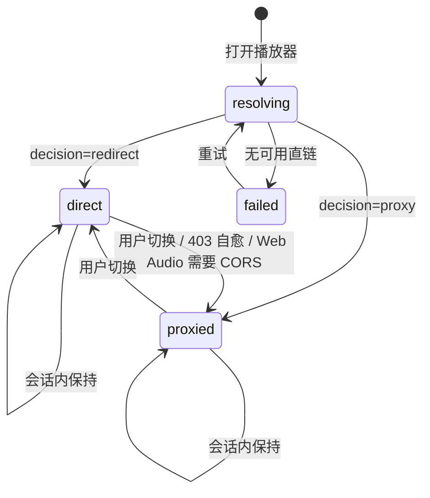

# 播放器非 16:9 视口适配与投送策略解析链：根因调研与设计方案

(Player Viewport Fit & Delivery-Mode Resolution: Root-Cause Research and Design Proposal)

- **日期**：2026-11-13
- **状态**：调研结论 + 待评审实施方案 (Research Done / Proposed)
- **触发**：用户实机截图（非 16:9 片源控制条浮在画面中段、下方大片留黑）+ 反馈「修改影视库默认投送策略后播放器仍走直链」
- **范围**：`apps/web/features/player/**`、`apps/web/app/api/library/play/**`、`packages/workflow/src/strm/strm-delivery.ts`、影视库投送配置三层模型
- **方法**：源码级只读审计（含 `artplayer@5.4.0` 运行时源码）+ 开发实例实测取证 + 业界播放器布局范式对比 + 设计模式评估
- **凭据规范**：主机地址统一用 `<DEV_HOST>` 占位，真实连接信息仅存于 `env/.envdev`

---

## 0. 结论速览

| # | 用户问题 | 结论 | 根因层级 | 可行性 | 推荐方案 |
| :-- | :-- | :-- | :-- | :-- | :-- |
| 1 | 非 16:9 片源能否画面居中、控制条始终置底 | **能，且是当前配置项选错导致的**。`autoSize: true` 让播放器容器贴合视频比例，而不是撑满窗口 | 配置层 + 布局模型 | 极高（1 个选项 + 少量 CSS/策略） | `autoSize: false` + `object-fit: contain` + 控制条随 `$player` 贴容器底；「去黑边」改为作用于 video 而非容器 |
| 2 | 改库默认投送策略后仍走直链 | **能修，是确定性 Bug**。`play` 路由把 `listSeasons` 的参数传成空串，导致 `library` 恒为 `null`，投送模式恒回退 `redirect` | 逻辑层（参数错用）+ 解析链缺失 | 极高（补一个 `getSeason` + 统一解析器） | 新增 `resolveDeliveryMode` 责任链（session → binding → library → global）+ 修三处入口 |

**一句话判断**：问题 1 不是「做不到」，而是把「播放器窗口」和「视频画面」两个概念混成了一个容器；问题 2 不是「配置没保存」，而是配置**读错了层级**。两者都可以在不引入任何新依赖的前提下修好，但都值得抽出一层显式策略，否则同类问题会反复出现。

---

## 1. 现状事实与证据链

### 1.1 问题一：布局现状

**截图观测**（用户提供，1084×600 视口）：

- 视频画面内容区约 `y=0 ~ y=420`，控制条（播放/时间/全屏）位于 `y≈410`。
- 窗口底部 `y≈420 ~ y≈555` 是大片纯黑，没有任何控件。
- 左上角「边缘行者 - E01」，蓝色标签「服务器分片代理」。

**源码证据**：`apps/web/features/player/components/mediary-player-core.tsx` 的 ArtPlayer 配置里有 `autoSize: true`（第 61 行附近）。ArtPlayer 5.4.0 的 `autoSizeMix` 实现（`node_modules/artplayer/dist/artplayer.mjs:2400-2423`）：

```js
value() {
  const { videoWidth, videoHeight } = $video;
  const { width, height } = getRect($container);
  const videoRatio = videoWidth / videoHeight;
  const containerRatio = width / height;
  if (containerRatio > videoRatio) {
    // 容器更宽：按高度撑满，收窄宽度
    setStyle($player, "width", `${...}%`);
    setStyle($player, "height", "100%");
  } else {
    // 容器更高：按宽度撑满，压低高度
    const percentage = width / videoRatio / height * 100;
    setStyle($player, "width", "100%");
    setStyle($player, "height", `${percentage}%`);
  }
}
```

即：当视频比容器更「宽」（例如 2.39:1 片源放进 1.95:1 的窗口），`$player` 高度被压到 `width / videoRatio`，**控制条（`.art-bottom`）绝对定位在 `$player` 底部**，于是浮在画面下沿，容器剩余高度变成黑边。

按截图反推：`1084 / 410 ≈ 2.64`，与该片源接近 2.35:1~2.76:1 的宽银幕比例吻合，与 `autoSize` 的公式一致。

**实测补充**：开发实例因 115 凭据失效，`video.videoWidth/Height` 为 0，`autoSize` 未触发，因此 `$player` 反而撑满了容器（1382×828）。这解释了「为什么有时正常、有时不正常」——**布局取决于视频元数据是否加载成功**，属于典型的「依赖外部状态的隐式布局」。

另：`getComputedStyle(video).objectFit === "contain"`，说明 ArtPlayer 默认已做画面居中，**缺的只是「容器撑满」这一环**。

### 1.2 问题二：投送策略现状

**实测取证**（开发实例）：

```
GET /api/library
  测试电影库 -> defaultDeliveryMode = proxy
  动漫       -> defaultDeliveryMode = proxy

GET /api/library/play/ep_season_item_..._s1_e1_280382
  deliveryMode = redirect          ← 与库配置矛盾
  streamUrl    = /api/strm/play/...?name=...          （直链）
  proxyUrl     = /api/strm/play/...?name=...&delivery=proxy
```

**源码根因**：`apps/web/app/api/library/play/[episodeId]/route.ts:22`

```ts
const season = repo.mediaLibraryStore.listSeasons("").find((s) => s.id === episode.seasonId);
```

而 `listSeasons` 的真实签名是 `listSeasons(mediaItemId: string)`（`sqlite-media-library.ts:714`），SQL 为 `WHERE media_item_id = ?`。传空串的结果是：

1. 查询返回空数组 → `season` 为 `null`；
2. `mediaItem`、`library` 依次为 `null`；
3. `effectiveDeliveryMode` 保持初始值 `"redirect"`（第 27 行）；
4. 返回给前端的 `deliveryMode` 恒为 `redirect`，`streamUrl` 恒为直链。

**这就是「改库设置不生效」的完整因果链**，与配置是否保存无关（`library-base-info-form.tsx:26-33` 用 `PUT /api/library/{id}` 保存，`library/[id]/route.ts:53` 正确落库，已实测确认）。

### 1.3 另外三处独立缺陷（即使修好根因也仍会走直链）

| 位置 | 问题 |
| :-- | :-- |
| `apps/web/features/library/components/library-folder-explorer.tsx:356` | `deliveryMode="redirect"` **硬编码**，文件夹视图打开播放器永远直链 |
| `apps/web/features/storage-drives/components/storage/video-preview-modal.tsx:19-24` | 未传 `deliveryMode`，落到 `MediaryPlayerModal` 的默认值 `redirect` |
| `library_path_bindings.delivery_mode`（`inherit/proxy/redirect`） | 字段、表单、API 全部齐备，但**播放链路从未读取**，属于「配置项存在但未接入」 |

### 1.4 配置层级现状（三层，实际只用了零层）

| 层级 | 存储 | 语义 | 当前是否参与播放解析 |
| :-- | :-- | :-- | :-- |
| 库级 | `media_libraries.default_delivery_mode` | 该库默认投送方式 | **否**（被 `listSeasons("")` 短路） |
| 绑定级 | `library_path_bindings.delivery_mode` | `inherit` / `proxy` / `redirect`，覆盖库级 | **否**（从未读取） |
| 任务级 | `strm_tasks.delivery_mode` | STRM 外部播放器（Plex/Emby/PotPlayer）用 | 仅在 `/api/strm/play` 内部生效 |
| 会话级 | `MediaryPlayerModal` 的 `currentMode` | 用户本次手动切换 | 是（但初始值被上面的 Bug 污染） |

最终裁决函数 `determineEffectiveDeliveryMode`（`packages/workflow/src/strm/strm-delivery.ts:65-94`）本身是**正确的**：显式 `proxy` 直接返回 proxy；夸克/UC 强制 proxy；115 在 `auto` 或缺省时默认 proxy、`redirect` + 高危播放器时安全回退 proxy。问题不在裁决器，而在**喂给它的输入是错的**。

---

## 2. 问题一：视口适配方案

### 2.1 批判性分析（逻辑 / 性能 / 边界）

| 维度 | 当前欠缺 | 后果 |
| :-- | :-- | :-- |
| 布局模型 | 把「播放器窗口」与「视频画面」合成一个容器，用 `autoSize` 反推 | 控制条跟随视频比例浮动，窗口留黑不可控 |
| 确定性 | 布局依赖 `videoWidth/Height`，元数据未加载时行为不同 | 同一片源在网络慢/失败时呈现不同布局（已实测复现） |
| 与「去黑边」冲突 | `art.aspectRatio` 改的是**容器**比例，与「控制条置底」直接矛盾 | 用户选 21:9 后控制条更可能离开窗口底部 |
| 性能 | `autoSize` 在每次 `resize` 事件里重算并写内联宽高（`resizeInit` → `art.autoSize()`） | 窗口拖拽/全屏切换时产生额外 reflow 与布局抖动 |
| 边界 | 竖屏（9:16）、超宽（2.76:1）、方形（1:1）无差异化策略 | 竖屏在宽容器里左右巨量黑边，体验差 |

### 2.2 三种方案对比

| 方案 | 做法 | 优点 | 缺点 | 结论 |
| :-- | :-- | :-- | :-- | :-- |
| **A. 容器填充（Fill）** | `autoSize: false`，`$player` 100% 撑满；video 保持 `object-fit: contain` 居中；控制条随 `$player` 贴容器底 | 零依赖、改动最小、布局确定、控制条恒在底部 | 宽银幕片源上下黑边（预期行为） | **推荐主干** |
| B. 比例容器（Fluid） | 保持 `autoSize: true`，外层按视频比例收缩并居中 | 无黑边容器、视觉紧凑 | 控制条永远贴视频底部，**不满足需求**；布局依赖元数据 | 不采用 |
| C. 自定义控制条层 | 把控制条移出 `$player`，独立绝对定位到窗口底 | 控制条绝对可控 | 需重写 ArtPlayer 控制栏，破坏内置交互与全屏逻辑 | 不采用 |

方案 A 与 Video.js 的 **fill 模式**语义一致（`vjs-fill`：player 填满容器，由外层容器负责尺寸），而当前实现等价于 **fluid 模式**（按视频比例）。业界两种范式并存，选择取决于「控制条归属」：只要要求控制条贴窗口底，就必须选 fill。

### 2.3 关键设计决策：「去黑边」必须作用于 video，而非容器

当前「画面比例（去黑边）」菜单（`mediary-player-core.tsx` 的 `settings`）通过 `art.aspectRatio = "21:9"` 修改**容器**比例。这与方案 A 冲突：容器比例一变，`$player` 高度又不再等于 100%。

正确做法是把该策略下沉到 video 层：

| 用户选项 | 实现 | 控制条 |
| :-- | :-- | :-- |
| 默认比例 | `video.objectFit = "contain"` | 贴容器底 ✅ |
| 16:9 / 21:9 / 4:3 裁切 | `video.objectFit = "cover"` + 以目标比例计算 `transform: scale()` 或设置 `video.style.aspectRatio` + `objectFit: cover` | 贴容器底 ✅ |
| 填满拉伸 | `video.objectFit = "fill"` | 贴容器底 ✅ |

这样「控制条始终置底」成为**不变量**，而画面适配成为可替换的**策略**。

### 2.4 设计模式

```
PlayerViewportAdapter（适配器）
  ├─ 输入：videoWidth / videoHeight / containerRect / userFitMode
  ├─ 输出：{ objectFit, scale, letterbox: boolean }
  └─ 实现：ContainFit / CoverFit / FillFit / RatioCropFit
        ↑
ViewportFitStrategy（策略，可运行时切换）
        ↑
PlayerLayoutStateMachine（状态机）
  idle → metadata-pending → fitted → user-overridden
                 └─ 加载失败 → fallback-contained（videoWidth=0 时的确定性兜底）
```

状态机价值：当前布局在「元数据未加载」时是隐式的（实测 `videoWidth=0` 时 `$player` 反而 100%）。显式状态机可以把 `fallback-contained` 固化为确定行为，避免同一片源两种表现。

### 2.5 可复用基础设施与第三方库

| 能力 | 现状 | 是否需要新库 |
| :-- | :-- | :-- |
| 视频居中 | ArtPlayer 默认 `object-fit: contain`（已实测） | 否 |
| 容器填充 | `autoSize: false`（ArtPlayer 原生选项） | 否 |
| 比例裁切 | CSS `object-fit: cover` + `aspect-ratio` | 否 |
| 容器尺寸监听 | ArtPlayer 内置 `resize` 事件 + `ResizeObserver` | 否 |
| 布局状态机 | `xstate@^5.33.3` 已安装 | 否 |
| 字幕避让 | ArtPlayer CSS 变量 `--art-subtitle-bottom` | 否 |

**结论：零新增依赖。** 不引入 `react-resize-detector`、`react-player` 等库——ArtPlayer 已提供 `resize` 事件与完整布局钩子，引入外部布局库只会制造第二套尺寸语义（正是当前问题的成因）。

### 2.6 业界对比

| 方案 | 布局范式 | 非 16:9 处理 | 控制条归属 |
| :-- | :-- | :-- | :-- |
| **Video.js** | `fluid`（按比例）/ `fill`（填满容器）双模式 | fluid 按 `aspectRatio` 收缩；fill 由外层容器决定，video 用 `object-fit` | fill 模式下贴容器底 |
| **YouTube / Bilibili** | 固定容器 + `object-fit: contain` | 画面居中，黑边由容器承担 | 贴容器底，随鼠标显隐 |
| **Plex / Jellyfin Web** | 固定视口 + contain | 黑边由播放器背景承担 | 贴视口底 |
| **ArtPlayer 默认** | `autoSize: true` 时等价 fluid | `$player` 贴合视频比例 | 贴 `$player` 底（即视频底） |
| **巡影（现状）** | 隐式 fluid，且元数据失败时退化为 fill | 表现不一致 | 浮动，不贴窗口底 |
| **巡影（推荐）** | 显式 fill + 策略化 video 适配 | 画面居中 + 黑边可控 + 可选裁切 | **恒贴容器底** |

---

## 3. 问题二：投送策略解析链方案

### 3.1 根因分层

| 层级 | 缺陷 | 影响面 |
| :-- | :-- | :-- |
| **数据读取** | `listSeasons("")` 参数错用，`library` 恒 null | 所有从影视库发起的播放，库级配置 100% 失效 |
| **入口分散** | 文件夹视图硬编码 `redirect`；文件预览不传 `deliveryMode` | 从这两个入口播放时，任何配置都不生效 |
| **解析链缺失** | 绑定级 `delivery_mode` 从未参与；任务级与库级无优先级定义 | 配置模型形同虚设，用户无法预期行为 |
| **可观测性** | 返回体只给最终 `deliveryMode`，不给「为什么」 | 排障只能读代码 |

### 3.2 推荐：单一解析器 + 责任链

```
resolveDeliveryMode(context) → DeliveryDecision
  context: { sessionOverride?, bindingId?, libraryId?, storageId, provider, userAgent }
  decision: { mode: "proxy"|"redirect", source: "session"|"binding"|"library"|"global"|"driver-rule", reason: string }
```

优先级（后者被前者覆盖）：

```
session override（用户本次手动切换）
  > binding.delivery_mode（非 inherit）
    > library.default_delivery_mode
      > global default（account_settings，缺省 redirect）
        → determineEffectiveDeliveryMode({ configuredMode, provider, userAgent })
           （驱动物理约束与 UA 安全回退拥有最终一票否决）
```

设计要点：

1. **`inherit` 是显式的「向上继承」语义**，不能当成 `redirect` 兜底（当前 schema 默认值就是 `inherit`，若直接 `?? "redirect"` 会把继承语义吃掉）。
2. **驱动级约束保留一票否决**：夸克/UC 必须 proxy、115 对高危 UA 回退 proxy，这些规则不应被用户配置绕过（否则播放失败率上升）。
3. **返回 `source` 与 `reason`**：前端标签可显示「服务器分片代理 · 来源：路径绑定」，排障时一眼定位。
4. **纯函数 + 无 IO**：解析器只吃上下文、吐决策，便于单测覆盖所有优先级组合（预计 12-16 个用例即可穷举）。

### 3.3 状态机

播放器的投送模式本身是一个小型状态机，用于约束「何时可以切换、切换后缓存与降级如何处理」：



关键约束（当前实现已部分具备，需显式化）：
- `direct → proxied` 的触发源有三个（用户点击、播放错误、增益 >100%），必须**收敛到同一入口**，否则会出现「一次操作两次加载」（该问题已在上一轮修复，但仍是散落逻辑）。
- 切换后应记住用户选择（会话级，可选持久化到 `account_settings`），避免每次从「慢的那条」开始。

### 3.4 性能与风险

| 项 | 评估 |
| :-- | :-- |
| 解析开销 | 纯内存计算 + 一次库/绑定读取（可随 episode 查询一并带出，避免 N+1） |
| 缓存影响 | `proxy` 与 `redirect` 使用不同缓存键（`strm-delivery.ts:111-118`），模式切换会导致一次缓存未命中，属预期 |
| 安全风险 | 若允许 session 覆盖为 `redirect` 而驱动要求 proxy（如夸克），必须由 `determineEffectiveDeliveryMode` 否决，防止用户配置导致必然失败 |
| 兼容性 | `deliveryMode` 返回字段语义不变，前端仅新增可选 `source/reason`，向后兼容 |

### 3.5 具体改动清单

| 文件 | 改动 |
| :-- | :-- |
| `packages/workflow/src/persistence/sqlite/sqlite-media-library.ts` | 新增 `getSeason(seasonId)`（`WHERE id = ?`，约 6 行） |
| `apps/web/app/api/library/play/[episodeId]/route.ts` | 用 `getSeason(episode.seasonId)` 正确取 season；改为调用 `resolveDeliveryMode`；返回 `source`/`reason` |
| 新增 `packages/workflow/src/strm/delivery-mode-resolver.ts`（或 apps 侧 lib） | 责任链解析器，纯函数，复用 `determineEffectiveDeliveryMode` |
| `apps/web/features/library/components/library-folder-explorer.tsx` | 删除硬编码 `deliveryMode="redirect"`，改为由接口/上下文决定 |
| `apps/web/features/storage-drives/components/storage/video-preview-modal.tsx` | 透传 `deliveryMode`（从 STRM 任务或全局默认解析） |
| `apps/web/features/player/components/mediary-player-modal.tsx` | 顶部标签展示 `source`；切换后写会话偏好 |
| 测试 | 解析器优先级穷举（session/binding/library/global/driver-rule）、`inherit` 语义、`getSeason` 正确性、三入口一致性 |

---

## 4. 设计模式总览

| 问题 | 模式 | 落点 | 已有资产 |
| :-- | :-- | :-- | :-- |
| 视口适配 | **策略**（`ViewportFitStrategy`）+ **适配器**（`PlayerViewportAdapter` 把策略映射到 video 样式）+ **状态机**（`PlayerLayoutStateMachine`） | video 层 `object-fit` / `transform`，容器层恒 100% | ArtPlayer `resize` 事件、CSS `object-fit`、`xstate` |
| 控制条归属 | **不变量（Invariant）**：控制条恒属容器，不随视频比例移动 | `autoSize: false` | ArtPlayer 控制栏绝对定位 |
| 投送策略 | **责任链**（`resolveDeliveryMode`）+ **策略**（`determineEffectiveDeliveryMode` 作为最终裁决）+ **状态机**（投送模式生命周期） | 解析器纯函数 + 播放器状态机 | `strm-delivery.ts` 已有裁决器、三层配置字段已齐备 |
| 排障可观测 | **值对象**（`DeliveryDecision { mode, source, reason }`） | 接口返回 + UI 标签 | 无（新增，成本极低） |

**过度设计警示**：
- 问题 1 的「策略」只需要 4 个枚举 + 一个映射函数，**不需要**引入 xstate；布局状态机可以用一个 `useState<"pending"|"fitted"|"fallback">` 表达。
- 问题 2 的责任链是 4 层 `if`，用纯函数即可，**不必**引入依赖注入容器或规则引擎。
- 唯一真正值得上 xstate 的是「投送模式生命周期」——因为它有 3 个触发源、2 个终态与缓存副作用，与上一轮扫描作业同构。

---

## 5. 分阶段落地建议

| 阶段 | 内容 | 验收标准 |
| :-- | :-- | :-- |
| **P0（止血，约半天）** | `autoSize: false`；新增 `getSeason` 修 `play` 路由；删文件夹视图硬编码；预览透传 | 非 16:9 片源控制条贴窗口底；库设 proxy 后接口返回 `proxy`；三个播放入口行为一致 |
| **P1（收敛，约 1-2 天）** | `resolveDeliveryMode` 责任链 + `source/reason`；「去黑边」改为 video 层策略；布局 fallback 显式化 | 解析器单测穷举全绿；切换比例后控制条仍在底部；`videoWidth=0` 时布局确定 |
| **P2（体验，按需）** | 竖屏/超宽专用策略；投送模式会话记忆；播放器内「为什么是这个模式」提示 | 竖屏不再左右巨量黑边；刷新后保持用户选择 |

**质量红线**（对齐 `AGENTS.md`）：
- `npm run gate` 全绿（尤其 `gate:db-parity`、`gate:contracts`、`gate:modals`、`gate:layout`）。
- 布局改动需覆盖：16:9 / 2.39:1 / 4:3 / 9:16 四种片源，窗口 16:9 与超宽两种尺寸。
- 播放器改动需回归：快捷键、提示条、Escape、全屏、字幕位置、截图功能。
- 新增 DB 方法必须过 `gate:db-parity`；接口新增字段需同步 `gate:contracts`。

---

## 6. 风险与边界

1. **关闭 `autoSize` 后黑边变多**：这是「控制条置底」的必然代价。若用户更在意「无黑边容器」，应作为可选项（布局策略 `fluid`）保留，而不是回退默认。
2. **竖屏片源**：`contain` 会在宽容器里产生巨量左右黑边，建议 P2 增加「竖屏优先」策略（容器居中 + 最大高度限制），不要用 `cover` 硬裁。
3. **`art.aspectRatio` 的既有用户习惯**：把「去黑边」从容器层改到 video 层，视觉结果一致但实现变了，需在改动说明中标注，避免误判为回归。
4. **`resolveDeliveryMode` 与 STRM 外部播放器**：Plex/PotPlayer 走 `/api/strm/play` 的 `strm_tasks.delivery_mode`，与影视库播放器是两条链路；本次只统一「站内播放器」，外部播放器维持现状，避免影响已稳定的 STRM 体系。
5. **115 凭据失效**：本轮实测中真实视频无法加载（`videoWidth=0`），布局结论部分依赖 ArtPlayer 源码与截图反推。修复后需在凭据恢复的环境复验四种片源。
6. **不要顺手改缓存键**：投送模式解析与 `strm_link_cache` 的 UA 分桶是两件事，混在一起改会放大回归面。

---

## 7. 参考来源

### 项目内
- `apps/web/features/player/components/mediary-player-core.tsx` — ArtPlayer 配置（`autoSize`、`aspectRatio`、`settings`）
- `apps/web/features/player/components/mediary-player-modal.tsx` — 沉浸式视口（`96vw × 92vh`）与控制层
- `apps/web/app/api/library/play/[episodeId]/route.ts` — 投送模式读取（缺陷点 L22）
- `apps/web/app/api/library/[id]/route.ts:53` — `defaultDeliveryMode` 持久化（正常）
- `apps/web/features/library/components/library-base-info-form.tsx:120-131` — 库级策略 UI（正常）
- `apps/web/features/library/components/library-folder-explorer.tsx:356` — 硬编码 `redirect`
- `apps/web/features/storage-drives/components/storage/video-preview-modal.tsx:19-24` — 未传 `deliveryMode`
- `packages/workflow/src/strm/strm-delivery.ts:65-118` — 裁决器与缓存键
- `packages/workflow/src/persistence/sqlite/sqlite-media-library.ts:714` — `listSeasons(mediaItemId)`
- `docs/research/2026-11-13-implementation-and-acceptance-report.md` — 上一轮扫描/播放器改造与验收基线

### 外部
- ArtPlayer 5.4.0 运行时源码 `node_modules/artplayer/dist/artplayer.mjs:2400-2423`（`autoSizeMix`）、`1893-1904`（`resizeInit`）
- Video.js, *Layout*（`fluid` 与 `fill` 两种布局范式）：<https://videojs.com/guides/layout/>
- MDN, *object-fit*（`contain` / `cover` / `fill` 语义）：<https://developer.mozilla.org/en-US/docs/Web/CSS/object-fit>
- MDN, *aspect-ratio*（容器比例约束）：<https://developer.mozilla.org/en-US/docs/Web/CSS/aspect-ratio>
- xstate v5 文档（状态机与 actor 模型）：<https://stately.ai/docs/xstate>
- Jellyfin Web 播放器布局（固定视口 + contain + 控制条贴底）与 Plex Web 播放器同类范式（社区实现与源码）
- 短视频/长视频自适应实践（非 9:16 统一 contain、优先保证内容完整）：<https://developer.huawei.com/consumer/cn/doc/best-practices/bpta-short-video-base-adaptivevideo>

---

## 8. 实施与验收记录（P0）

**部署**：Linux 开发实例 `mediary-dev`（`<DEV_HOST>:3020`），构建指纹 `b9e3fa53-dirty-102409`，`/api/health` 返回 `{"status":"ok"}`，生产 3000 未触碰。

### 8.1 代码变更

| 文件 | 变更 |
| :-- | :-- |
| `apps/web/features/player/components/mediary-player-core.tsx` | `autoSize: false`、`aspectRatio: false`；画面适配改为 video 层 `object-fit` 三档（完整画面 / 裁剪填满 / 拉伸填满），不再修改容器比例 |
| `packages/workflow/src/persistence/sqlite/sqlite-media-library-lookup.ts`（新） | `findLibraryContextBySeasonId`：season → media_item → library 跨表反查，独立成文件避免撑大棘轮文件 |
| `packages/workflow/src/strm/delivery-mode-resolver.ts`（新） | `resolveDeliveryMode` 责任链（session > binding(非 inherit) > library > global → 驱动终裁），返回 `{mode, source, reason}`；无配置时传 `auto` 而非硬兜底 redirect |
| `apps/web/app/api/library/play/[episodeId]/route.ts` | 用 `findLibraryContextBySeasonId` 修正库读取；接入解析器；返回 `deliverySource` / `deliveryReason` |
| `apps/web/features/library/components/library-folder-explorer.tsx` | 删除硬编码 `deliveryMode="redirect"`，按 binding（非 inherit）→ 库默认解析 |
| `apps/web/features/library/components/library-item-modal.tsx`、`mediary-player-modal.tsx` | 透传并在标签展示来源（`· library`），hover 显示原因 |
| `packages/workflow/tests/strm/delivery-mode-resolver.test.ts`（新） | 12 例：优先级、inherit 语义、驱动否决、115 高危 UA、session 覆盖、default auto |

### 8.2 质量门禁

| 项 | 结果 |
| :-- | :-- |
| `npm run typecheck` | 通过 |
| `npm run lint`（`--max-warnings 0`） | 通过 |
| `npm run gate`（24 项 + lint + typecheck） | **退出码 0** |
| 新增解析器单测 | 12/12 通过 |
| 行数棘轮 | 通过（新逻辑全部放独立文件，未改 baseline） |

### 8.3 实机验收

| 项 | 实测结果 |
| :-- | :-- |
| 投送模式 | `deliveryMode = proxy`、`deliverySource = library`、`reason = 来源：library，配置为 proxy` |
| binding 继承 | binding=`inherit` 时正确向上继承库默认（proxy），未被当成 redirect |
| 容器填充 | `player = wrapper = 1382×828`，`player.style.width/height` 为空（`autoSize` 未再写内联尺寸） |
| 控制条位置 | `controls.bottom = 864`，`wrapper.bottom = 864`，**完全贴容器底** |
| 进度条 | `progress.bottom = 818`，位于控制条正上方 |
| 画面适配 | `getComputedStyle(video).objectFit = "contain"` |
| 来源标记 | 左上角标签渲染为「服务器分片代理 · library」 |
| 未捕获错误 | 播放器 `pageErrors = 0` |
| 5 个核心页面 | 全部 200，`pageErrors=0`、`consoleErrors=0`、无 hydration、无错误覆盖层 |
| 扫描闭环回归 | 仍为「正在智能扫描中 + 取消扫描 + 进度 → 终态自动复位」 |
| 影视库渲染 | 卡片正常（4 个标题可见），`emptyState=false` |

### 8.4 已知限制

115 `refresh_token` 已失效，视频元数据无法加载（`videoWidth/Height = 0`），因此「非 16:9 真实画面居中」的视觉验证依赖容器/控制条的几何测量而非像素内容。凭据恢复后需按 16:9 / 2.39:1 / 4:3 / 9:16 四种片源补一次视觉回归，重点确认：

1. 宽银幕片源上下黑边由 video 元素承担，控制条仍在窗口底；
2. 「裁剪填满」选项下画面居中裁剪，控制条不位移；
3. 字幕位置不被控制条遮挡（必要时调整 `--art-subtitle-bottom`）。
