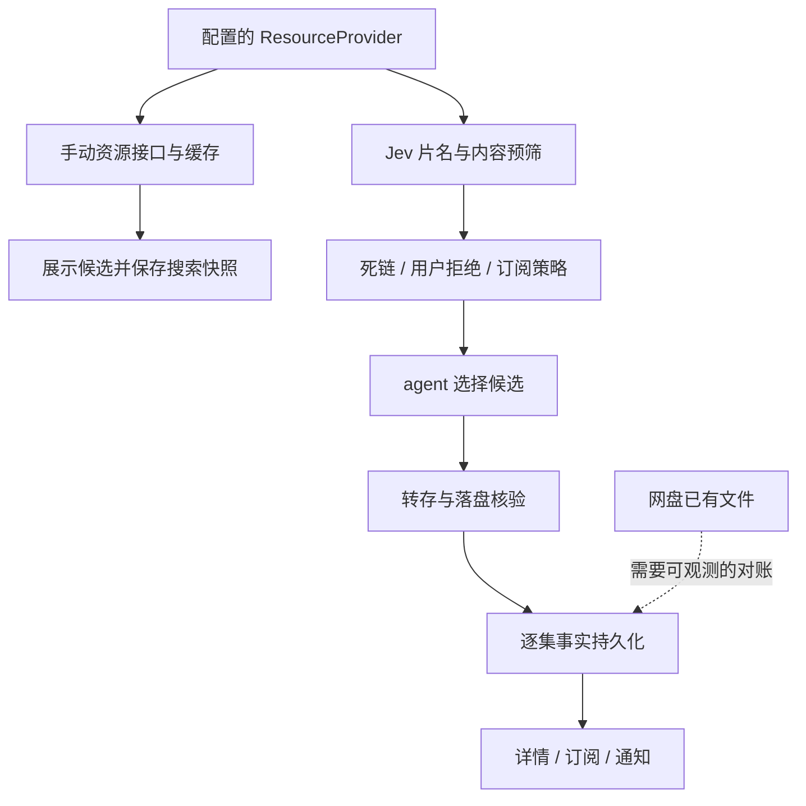

# 自动订阅搜不到资源与入库后全缺集：实机调研、复用方案与回归门禁

日期：2026-11-14（Asia/Hong_Kong）。本地研究基线：`91132338`。

## 1. 结论与证据边界

本次完成源码、既有测试、用户指定实例及上游官方资料核查；只新增本文档，没有修改业务代码、订阅规则或网盘文件，没有触发转存、整理、补搜任务、部署或 Git 写操作。在线执行了一次手动资源查询：会消耗检索预算并按既有接口保存搜索快照；这不属于媒体入库。访问通知页可能按应用原有逻辑更新已读标记。

**两个现象都成立，但不能合并解释成“真的没有资源”。**

1. 手动资源搜索与自动采集并非相同候选视图。自动采集额外经过 Jev 预筛、死链、用户拒绝、策略过滤，再交给 agent 决策。线上自动任务确实执行了搜索，随后报告候选被全部预筛剔除，没有尝试转存；不能归因为调度没有运行。
2. 《凡人修仙传》网盘已有 198 集，E01–E199 中确实只缺 **S01E197**；当前详情页却显示 `0/199/210`，按订阅 E190 起范围过滤后仍显示缺 10 集。**物理文件与集状态投影脱节已实证**，并非用户误看或仅仅分页问题。
3. 当前代码存在采集终态失败写空集状态、扫描异常静默忽略、缺集需求未统一应用订阅范围等具体风险；历史“搜索快照清集状态”在当前源码已有保护，不能照搬旧复盘作为本次唯一根因。
4. 当前浏览器可读的任务轨迹没有各层原始候选、每个淘汰原因和目录读取结果，也没有部署提交指纹。因此 **Jev 具体误判、worker 目录读错、双引擎读取差异、部署版本落后尚不能定案**。应补齐证据后修复责任层，不能仅调低阈值或全盘重抓。

## 2. 在线核验记录

环境使用用户提供的实例。本文不记录真实地址、密码、网盘 UID、目录 ID 或资源链接；重放入口统一表示为 `http://127.0.0.1:3000`。实际凭据只用于本次登录，不写入文档或测试。

### 2.1 已存在文件与页面状态的矛盾

通过已登录会话，逐层读取 `/api/storage/files` 的分类目录、作品目录和 `Season 01`：

| 项目 | 实测结果 |
| --- | --- |
| 作品 | 《凡人修仙传》(2020)，TMDB TV 106449 |
| 目录形态 | Anime → `凡人修仙传 (2020) {tmdb-106449}` → `Season 01` |
| 返回总数 / 视频文件数 | `totalCount=198`，`fileCount=198`，返回 198 项，季目录无子文件夹 |
| 可识别集号去重数 | 198 |
| 未识别集号 / 零字节文件 | 0 / 0 |
| E01–E199 差集 | 仅 E197 |
| 订阅范围 E190–E199 实有 | E190、191、192、193、194、195、196、198、199，共 9 集 |
| 详情页 | `0/199/210`；缺集总览 E190–E199 全红，共 10 集 |

计算依据是逐文件名称的 `S01E数字` 或 `第数字话/集`，不是用“文件数接近集数”估算。例：`凡人修仙传 - S01E190.mp4`、`[Doomdos] - 凡人修仙传 - 第192话 - [1080p BILIBILI COM WEB-DL].mp4`。未进行播放或媒体完整性验证，因此这里证明的是“存在非零大小、可映射的视频文件”，不等于保证每一文件可播放。

作品目录还存在与早前失败任务对应的 staging 目录。本次没有删除或整理它；季目录 198 集的结论不依赖 staging。

### 2.2 手动资源查询确实有结果

调用现有 `POST /api/titles/resources`，指定 TMDB 106449、`type=anime`、裸关键词“凡人修仙传”和当前网盘：

- HTTP 200，`cached=false`，返回 844 条候选，`sourceHealth.status=healthy`。
- 812 条候选标题包含简体作品名。
- 用当前规则中的大小写不敏感 `1080p` 包含条件及三个排除字串做标题级复核，398 条通过。这个数字不是全自动准入数：没有重放历史策略快照、Jev、死链及用户拒绝记录。
- 其中包含 `凡人修仙传 - 197.1080p.HD国语中字无水印.mkv` 等 E197 magnet 候选。

**有候选不等于可转存成功**。本次未验证 E197 链接的有效性、115 离线可用性、字幕真实性或实际落盘；844 也不是 844 个独立可用版本。

### 2.3 自动任务确实搜索过

从现有 `GET /api/activity` 获取已完成任务轨迹，关键时间为香港时间：

| 作品 / 任务 | 时间 | 观察结果 |
| --- | --- | --- |
| 凡人，任务 `2037cc55…` | 11-14 08:48 | `no_coverage`；14 次 `searchResources` 工具调用；执行过 `inspectTargetDir`；没有转存调用 |
| 凡人，任务 `b6a08967…` | 11-14 08:44 | `no_coverage`；11 次搜索工具调用；报告预筛全剔除、季目录为空 |
| 凡人，任务 `bd51c6d5…` | 11-14 06:45 | 最终 `failed`；轨迹有 12 次转存、2 次移动、1 次 `markObtained` 和 `finish` 调用 |
| 用心棒，任务 `93bc1904…` | 11-14 09:11 | 多个中英文别名搜索，最终报告候选为空或被预筛剔除；没有转存调用 |
| 修罗雪姬，任务 `c6089730…` | 11-14 09:13 | 多个中日英文别名搜索，最终报告预筛全剔除；没有转存调用 |

`bd51c6d5…` 的 `markObtained` 参数包含 E192、193、194、195、196、198。**工具被调用不代表调用成功，更不代表事务成功持久化**；浏览器轨迹只提供脱敏参数，不足以确定最终异常。

自动任务的“预筛全剔除”“目录为空”是 agent 上报的理由，不能替代底层返回值。今天下午的手动查询与早上任务也不是同一时间、同一候选快照，不能把两次数量直接相减得出误判率。两部电影本次只核验任务轨迹，尚未逐一重放其手动查询与原始预筛结果。

### 2.4 当前策略

只读 `GET /api/titles/subscription-policy?tmdbId=106449&mediaType=tv`：

- `mustContain=["1080p"]`；`mustNotContain=["CAM/枪版", "预告片", "真人"]`。
- `episodeFilter=""`；`useRegex=false`；`cooldownDays=0`；无优先级组或自定义关键词。
- `seasonEpisodeRanges=[{seasonNumber:1,startEpisode:190,endEpisode:null}]`。

`CAM/枪版` 在非正则模式下是一个字面子串，**不是 CAM 或 枪版 两个排除词**。这是规则表达的附带风险，不能据此解释全部候选消失；后续可在规则界面提示按行拆分。

## 3. 当前源码的数据链路与问题本质

### 3.1 手动候选可见与自动准入不是同一事实



具体位置：

- `apps/web/app/api/titles/resources/route.ts:352` 起：通过 `getWorkerResourceProvider` 查询；不在此处显式套入 `JevPrefilterProvider` 或 `loadSubscriptionPolicyFilter`。有 30 分钟 TTL 和 60 秒频控，也可能聚合多个关键词。
- `packages/workflow/src/acquisition-v2/orchestrator.ts:266` 起：自动路径按配置套 Jev，再构造 `RealResourceProviderV2`。
- `packages/workflow/src/acquisition-v2/real-provider-adapter.ts:89` 起：依次排除死链、用户拒绝和策略不满足候选；只把保留下来的候选交给 agent。
- `packages/workflow/src/execution/subscription-policy-filter.ts`：任务优先使用**入队时策略快照**，不是无条件采用当前设置。预览与历史执行对比必须使用同一版本。
- 自动适配器只有日志级 `policyDropped` 等计数；对外 `prefilterDropped` 主要反映 Jev，不能完整代表所有层的淘汰。保存的候选集合也以经过过滤后观察到的候选为主，无法重建完整的原始漏斗。

**已确认的设计缺口是候选视图与淘汰证据不完整；本次尚未确认哪个具体候选被哪个规则错误拒绝。**

Jev 当前实现有关键反证：`jev-prefilter-provider.ts` 会保留标题含作品名或别名的低相关度候选，仅标记存疑；NSFW 判断另行优先。今天的候选大量含作品名，因此不能仅凭“Jev 很严格”就宣称这批资源全部被正确剔除。需要核查历史输入、NSFW 分数、后置策略、实际运行版本和模型工具结果是否被误读。

### 3.2 网盘实有与数据库 obtained 脱节

当前 UI 依据 `EpisodeState.obtained`，并不每次直接读取网盘：

- `apps/web/features/acquisition/core/subscription-missing.ts`：`aired && !obtained`。
- `apps/web/lib/title-hub.ts:107` 起：元数据骨架缺行时 `healEpisodeCells` 补成 `obtained:false`。这是显示兜底，**不能恢复真实文件关联**；源码并未在这里读取网盘。
- `packages/workflow/src/acquisition-v2/workflow-v2.ts:189` 起：`before` 用 priorObtained；`after` 用 priorObtained 与本轮 agent coverage 的并集。注释部分仍称“重新读取真实 storage”，实际终态缺集计算不做这样的最终扫描。
- `workflow-v2-bridge.ts:157` 起：从集合重新生成季集状态；已有元数据骨架的获得项不在此补齐实际 `verifiedFileIds`。

所以，文件已经移动成功后，只要后续模型、整理、预算或持久化失败，没有形成可恢复的逐集提交，页面仍会报告缺集。网盘操作与 SQLite 事务无法自然成为同一个原子事务。

### 3.3 已确认的失败路径缺陷：任务失败可以清空集状态

`packages/workflow/src/execution/workflow-failure-handler.ts:149–162`：

```typescript
const keepEpisodes = willRetry || claimed.workflowRun.kind === "replace_request";
// 保存失败结果时：
episodes: keepEpisodes ? claimed.episodes : [],
// keepCurrentEpisodes 只额外保护 staging_recovery 或手动 type3 等路径
```

对于不再重试的普通采集或定时 type3，存在写入 `episodes:[]` 且没有保留标记的分支。`sqlite.ts` 在非 `runOnly` 写入中会先删除季集记录再插入；采集 kind 不享受辅助任务的自动保留保护。因此此路径**具有清空已有 obtained 的能力**，即使失败前或任务之外文件已经存在。

这是源码确认的缺陷，不代表已经从运行数据库证明本例恰好由该分支清空。`bd51c6d5…` 的最终失败和已有文件构成强相关线索，仍需它的错误、写入前后 episode 行及运行版本补齐因果证据。

### 3.4 已有扫描补偿为何仍可能失效

`packages/workflow/src/acquisition-v2/run-tv-v2.ts:92–153` 已存在前置整理及 Season 扫描，**不能说系统完全没有扫描基础设施**。但存在局限：

1. 前置整段异常被 `catch {}` 忽略。目录读取失败会退回仅使用数据库，不向本轮结果明确表达“库存未知”。
2. 入口先做目录发现、可能整理 staging，再扫描季目录；前序调用已可能占用预算或失败。
3. 它只认直接子目录 `Season 数字`；目录绑定、分类根、双引擎列取与实际落点仍需比对。
4. `ensureMediaLibraryDirectory` 使用首选和旧版精确名称；另一个已有的 `findExistingMediaFolder` 还支持 tmdb 标签匹配，两处发现策略并未完全统一。
5. 即使扫描发现 198 集，目前发现结果主要保存在本轮内存集合中；后续失败仍需要独立提交/恢复机制，不能依赖最后一次整包保存。

本例最新任务说“季目录为空”，与当前文件管理 API 返回 198 集明显冲突。该 API 使用 DriveFileManager，采集通过 StorageExecutor；**两条读取链必须用同一账号、同一 storage、同一 directory ID 比较**，目前不能推断它们结果一定相同。

### 3.5 范围过滤只在部分层生效

`missing-episodes-model.ts` 的 `filterMissingByEpisodeRanges` 修正了详情页“显示哪些缺集”，但 `syncSeasonNeed` 仍生成 E01..latestAired 全范围需求；`workflow-v2.ts` 接口未携带逐季订阅范围参与差集。

于是本例出现：详情页仅列 E190–E199，通知仍称缺 E01–E199，agent 又可能以 199 集为目标消耗预算。范围不是文件缺失的原因，却会放大错误与无效采集。

## 4. 主流方案与可用库

以下为本次查阅的一手资料；动态源码为查阅日分支内容，不应视为永久固定接口。

| 方案 | 已核查的机制 | 本项目借鉴方式 / 边界 |
| --- | --- | --- |
| Sonarr | [Episode](https://github.com/Sonarr/Sonarr/blob/develop/src/NzbDrone.Core/Tv/Episode.cs) 区分 Monitored、EpisodeFileId、绝对集号及场景集号；[DiskScanService](https://github.com/Sonarr/Sonarr/blob/develop/src/NzbDrone.Core/MediaFiles/DiskScanService.cs) 扫描文件、做导入决策并发布扫描事件；根不可用有跳过分支 | 把订阅意图、文件关联、任务结果分开；扫描不可用应可辨识；不直接照搬本地磁盘删除语义到网盘 |
| Sonarr 检索 | [官方 FAQ](https://wiki.servarr.com/sonarr/faq) 与[设置文档](https://wiki.servarr.com/sonarr/settings) 解释检索模式、自动搜索开关及规则拒绝 | 展示自动拒绝理由；手动可见不代表符合自动规则；用同一候选重放准入才有可比性 |
| MoviePilot | [订阅链源码](https://github.com/jxxghp/MoviePilot/blob/v2/app/chain/subscribe.py) 分离按集事实、进度刷新和完成判定，复用 SearchChain、DownloadChain、媒体链；[订阅说明](https://wiki.movie-pilot.org/subscribe) 有过滤及洗版策略 | 借鉴分层写入职责、按集进度推导，避免一个 failed 工作流覆盖媒体事实；不是将整个 Python 应用引入 Node 服务 |
| GuessIt | [属性文档](https://guessit-io.github.io/guessit/properties/) 支持标准集号、绝对集号及多种媒体属性 | 可作为离线解析对照；增加 Python 服务不能解决当前写入与库存不一致，不建议为本次修复引入 |
| Anitomy TypeScript | [当前 npm 包对应上游](https://github.com/yjl9903/anitomy)；原始算法见 [erengy/anitomy](https://github.com/erengy/anitomy) | 项目已安装，适合字幕组名和动漫编号；不能单独判定同名真人/动画身份或跨季度编号映射 |
| parse-torrent-title JavaScript | [当前 npm 包对应上游](https://github.com/clement-escolano/parse-torrent-title) | 项目已安装，用于发行名结构提取；不要与 Python 同名项目混为同一依赖 |
| XState | [官方状态机文档](https://stately.ai/docs/xstate/v5/machines) | 已安装且已有运行状态机；补充“落盘成功但状态待提交”等恢复边界即可，无需引入第二状态机库 |

库版本来自本机实际安装元数据：`anitomy 0.0.35`、`parse-torrent-title 3.0.1`、`xstate 5.33.3`，三者包元数据均为 MIT。这里只核对已安装版本与用途，不宣称它们是市场最新版本，也没有执行依赖升级。

### 4.1 仓库现成能力清单

| 已有能力 | 位置 | 建议复用 |
| --- | --- | --- |
| 多层文件名解析 | `providers/media-title-parser.ts`：Anitomy → PTN / 中文规则；`domain/episode-code.ts` | 收敛为一个季集解析入口，保留现有标准名和中文高集号测试 |
| 已验证文件点亮集状态 | `domain/domain.ts` 的 `reconcileVerifiedFiles` | 为已存在文件建立 file ID 关联；调用前验证 storage/season、非零视频与扫描完整性；该函数自身不是完整扫描删除算法 |
| 目录发现与预检 | `storage/storage-preflight-inspector.ts`、`domain/media-library-folder.ts` | 统一 tmdb 标签、旧名、季目录绑定；改造吞错语义，禁止“失败等于空” |
| 网盘端口 | `StorageExecutor`、`DriveFileManager`、`RealStorageV2` | 保留适配边界，增加同目录读取一致性检查；不另造 115 SDK |
| 订阅策略 | `subscription-policy.ts`、`subscription-policy-filter.ts` | 复用 matcher、预览、拒绝枚举及入队快照版本 |
| 搜索关键词与去重 | `title-search-keywords.ts`、`planning-search-gate.ts` | 统一裸名、别名和单集搜索，避免无意义重复消费预算 |
| 来源健康 / 转存故障归类 | `search-source-fault.ts`、`transfer-block.ts` | 扩展“策略全拒绝 / 预筛待复核 / 库存未知 / 部分已落盘”等结果，避免统一暂无资源 |
| 运行状态与恢复 | `run-state-machine.ts`、`directory-lifecycle.ts`、`staging-janitor.ts` | 挂接逐集提交及失败恢复；已入季事实不能随 staging 清理一起丢失 |
| 持久化保护 | `isEpisodePreservingWorkflowKind`、`mergeEpisodeStatesPreservingObtained`、SQLite 事务 | 将“失败记录只改运行状态”提升为仓储契约；保留内存/SQLite 行为一致 |
| 测试与门禁 | Vitest、Playwright、`gate:episodes`、`gate:acquisition` | 扩展现有行为测试；静态字符串门禁只辅助定位，不当作数据安全证明 |

## 5. 具体解决方案与执行顺序

### P0：保护事实与恢复本例

1. **先补证，不重新整季抓取。** 获取线上实际 build commit、Web/worker 配置指纹、任务策略快照和失败原因。只保存脱敏指纹、版本和统计，禁止打印 API Key、Cookie 或完整资源链接。
2. **独立库存对账。** 只读核对目标 storage 的作品/季目录绑定；分别通过 DriveFileManager 与采集 StorageExecutor 对同一个季目录列取，记录目录 ID 的内部关联、引擎、完整性、页数、文件数、错误码、解析失败数。失败或不完整返回 `unknown/incomplete`，不可转成 `[]` 当作空目录。
3. **预览修复差异后，批量 upsert 本例 198 集事实**：复用 `episodeCodeFromFileName` / `reconcileVerifiedFiles`，写入实际 provider file ID、storage ID、season ID、核验时间。此次调研没有执行此步骤。
4. **期望状态**：库存 E01–E199 中 198 obtained，唯一已播缺口 E197；若以订阅 E190–E199 统计，则 9/10、只缺 E197；元数据全季 210 独立保留，E200–E210 依各集播出状态决定，不因存在于元数据就报告为缺集。
5. 修复 `workflow-failure-handler`：终态失败记录默认只更新任务、通知和诊断；不替换季集集合。仅返回 `claimed.episodes` 仍不够，因为它可能早于并发整理/本轮落盘；应保留数据库当前事实，随后通过独立对账补入新文件。

### P1：把成功落盘与最终任务成败解耦

- 在确认 move/rename 后核验文件所在季，再幂等提交对应的逐集关联。推荐以 `(accountId, storageId, seasonId, episodeCode, providerFileId)` 确认事实；同一文件重复回调不能重复计数。
- 保持既有任务框架，在最后持久化或模型调用失败时保留已提交集状态，并留下可恢复的 `pending_reconcile` 任务/事件。可先用现有 SQLite 事务和恢复队列落地，不要求新增消息中间件。
- 获得标记只在“文件已核验”时增长；降低 obtained 必须有同目录完整扫描确认文件消失或用户明确删除。超时、429、权限失败、分页不完整都不能降级。
- 对账独立于新文件的质量偏好。已有合法视频即使名称没有 `1080p`，仍是“存在”；是否达到升级标准应单独计算，不能把已拥有视频当成缺集。
- `runTvAcquisitionV2` 的扫描异常进入审计与结果状态；移除静默失败当空的语义。避免在详情 GET 中隐式执行移动、重命名或大范围扫描；由显式后台对账负责修复，页面显示最近核验时间及待核验状态。

### P1：建立可解释、可重放的候选漏斗

为每轮查询保存精简且脱敏的诊断：`runId`、`snapshotId`、query、来源配置指纹、类型范围、策略快照版本、预筛模型版本，以及各层 `in/kept/rejected/unknown`。每个拒绝保留 candidate ID、stage 和 reason code；身份低分与 NSFW、死链、用户拒绝、策略不符分别记录。

同一个不可变源快照可以派生手动展示与自动准入结果，避免两边各搜一次后无法比较。不要求 UI 隐藏被自动拒绝候选；应能说明“可见，但因何不自动采用”。

建议终态映射：

| 证据 | 结果 |
| --- | --- |
| 来源正常且原始候选为 0 | 无候选，等待后续索引 |
| 原始候选非空，策略全拒绝 | 规则未命中，显示具体条件 |
| Jev 全拒绝 / 低置信证据冲突 | 候选待复核；有限量二次识别，不能直接宣称片源不存在 |
| 来源故障 | 检索失败，可重试 |
| 资源存在但转存失败 | 转存失败或等待落盘，显示对应原因 |
| 库存读取失败 / 读取链冲突 | 库存待核验；保护已有事实 |
| 旧文件已存在，本轮未新增 | 已有库存 + 本轮未补齐；不得表现为全季从未入库 |

不要全面关闭身份/NSFW/死链保护。针对全剔除，先用含明确目标身份的非成人候选做受限复核；真人与动画同名应结合媒介类型、年份、别名、季集覆盖，必要时检查包内容。不能只因同名保底就自动采集错误作品。

### P1：统一订阅范围与缺集计算

形成同一个纯函数/结果投影：

`待补 =（确认已播集合 ∩ 订阅范围）− 已核验实有集合`

详情页、订阅待办、通知和 agent 需求必须消费它；全库库存进度与订阅目标进度要明确标注。复用现有逐集 `airStatus`、范围 matcher 和 sync 模块，避免再增加第三套计数。高集号、provider-ahead、unknown、特别篇和多季范围需保留语义。

## 6. 同类问题门禁与回归测试设计

以下是**待补充的行为用例**，不是本次已经新增的测试。先构造能在当前缺陷上失败的最小用例，再改实现；仓储用例必须同时跑 InMemory 与 SQLite，关键链路至少一个测试使用真实存储适配器协议 Mock，而不是所有层都返回手填 obtained。

| 门禁 | 最小场景与验收断言 |
| --- | --- |
| G1 库存实证 | DB 为 0；季目录 E01–E199 除 E197 有 198 个非零视频。对账后 obtained=198，缺集仅 E197，重复运行结果不变，保留 file ID |
| G2 范围一致 | 范围 S1 E190 起，已播至 199。UI、通知、API、agent 都只有 E197 待补；E01–E189 不进入采集需求 |
| G3 终态失败保留 | 先已有 obtained，再注入定时 type3 / type2 的不可重试异常及重试耗尽；最终任务可 failed，但 obtained 与文件关联不能减少；覆盖手动 type3、replace、recovery |
| G4 成功部分独立提交 | 移动 E192–E196、E198 成功，随后模型/持久化/预算失败；恢复后这六集仍 acquired，不重复转存，未成功移动的不标记 |
| G5 读失败非空盘 | list 401、429、超时、半页、读取根错误。结果为 unknown/incomplete，不得清集、不得宣称全缺或新建重复作品目录 |
| G6 双读取链一致 | 同一 storage/dir 在 FileManager 与 Executor 下返回相同视频集合；字段 `fid/cid`、文件夹标志、分页和双引擎归一化用协议夹具覆盖 |
| G7 搜索解释守恒 | 每层 in = kept + rejected（unknown 明确定义）；844 原始候选不能无原因变成“源返回 0”；每个候选最终有 stage/reason |
| G8 预筛召回 | 动画/真人同名、1973 原作/续作/翻拍、繁简别名、正常限制级电影与成人噪声；真实正例不得静默消失，保留需复核标记；Jev 超时维持现有 fail-open |
| G9 策略两阶段 | 合集标题缺分辨率/集号时不凭未知字段假装已满足要求；明确策略如何延后到包内核验；S01E01–E199 含 E190 起应允许按文件筛选；不得整包错误拒绝或整包越界采集 |
| G10 纯记录非破坏 | 搜索、规则预览、整理记录、预约、失败通知前后，既有季集不变；覆盖无 keepCurrentEpisodes 参数误用与 SQLite/内存一致性 |
| G11 解析与元数据 | S01E198、中文第192话、[197]、裸 197、季目录 fallback、重复版本、零字节、年份与 1080p 不误认集号；物理文件数不覆写总集数210 |
| G12 并发与幂等 | 旧巡检结果不得覆盖较新的整理/补录；用户取消追踪后旧任务不得复活季；重复回调无重复计数，跨网盘不串状态 |
| G13 预算收尾 | 达到转存预算时停止新增转存，保留对账/提交预算；staging 未入季与已入季分开记录；无数据丢失或假成功 |

推荐落点：扩展 `episode-preservation.test.ts`、`handle-workflow-failure.test.ts`、`v2-run-tv.test.ts`、`v2-runner-persist.test.ts`、`v2-sync-need.test.ts`、`jev-prefilter-provider.test.ts` 与范围投影测试。现有 `gate:episodes` 多为静态符号/标记检查，不能代替 G1/G3/G4 的仓储行为断言。

实机最终验收在隔离开发实例进行：先只读对账预览，再应用修复，再浏览器刷新；期望仅 E197 缺失、其余文件未移动或重复下载，控制台无未捕获异常、网络请求有超时保护。向真实网盘转存 E197 属于后续修复验收步骤，本次未执行。

## 7. 本次实际验证与交付限制

已运行：

```powershell
npx vitest run packages/workflow/tests/providers/jev-prefilter-provider.test.ts packages/workflow/tests/acquisition-v2/v2-sync-need.test.ts packages/workflow/tests/acquisition-v2/v2-bridge.test.ts packages/workflow/tests/acquisition-v2/v2-run-tv.test.ts packages/workflow/tests/persistence/episode-preservation.test.ts packages/workflow/tests/execution/handle-workflow-failure.test.ts apps/web/features/acquisition/contracts/missing-episodes-ranges.test.ts
```

结果：**7 个测试文件、108 项测试全部通过**。这是当前源码基线通过，不是本文方案已实现或线上问题已修复。没有运行完整构建、全量测试或部署；此次只新增文档，完整构建不能弥补缺失的运行证据。

后续优先补齐：线上 build commit、`bd51c6d5…` 最终异常及事务记录、两条 storage 读取链的同目录结果、早上搜索的源快照与分层拒绝证据。没有这些证据，不应将某一模型、115 限流或旧搜索清空事故写成唯一确定根因。

历史资料对照：[搜索快照清集状态事故](../postmortems/subscription-missing-after-ingest-and-search-snapshot-wipe.md)、[反向扫描旧问题与方案](../reverse-scan-episode-missing-root-cause-and-self-healing-architecture.md)。这些文档描述的是此前工况；本文以当前源码和本次在线核验为准。
