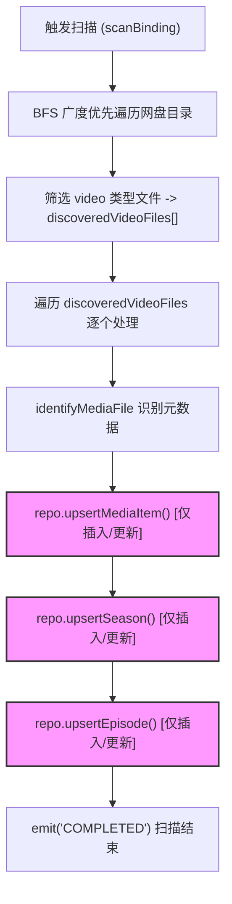
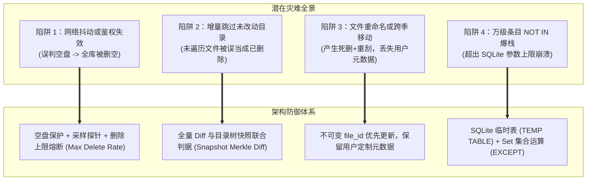
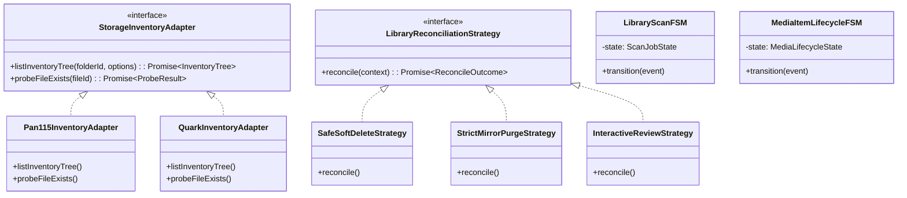
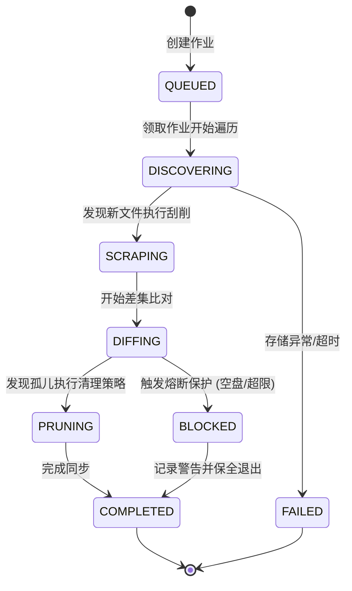
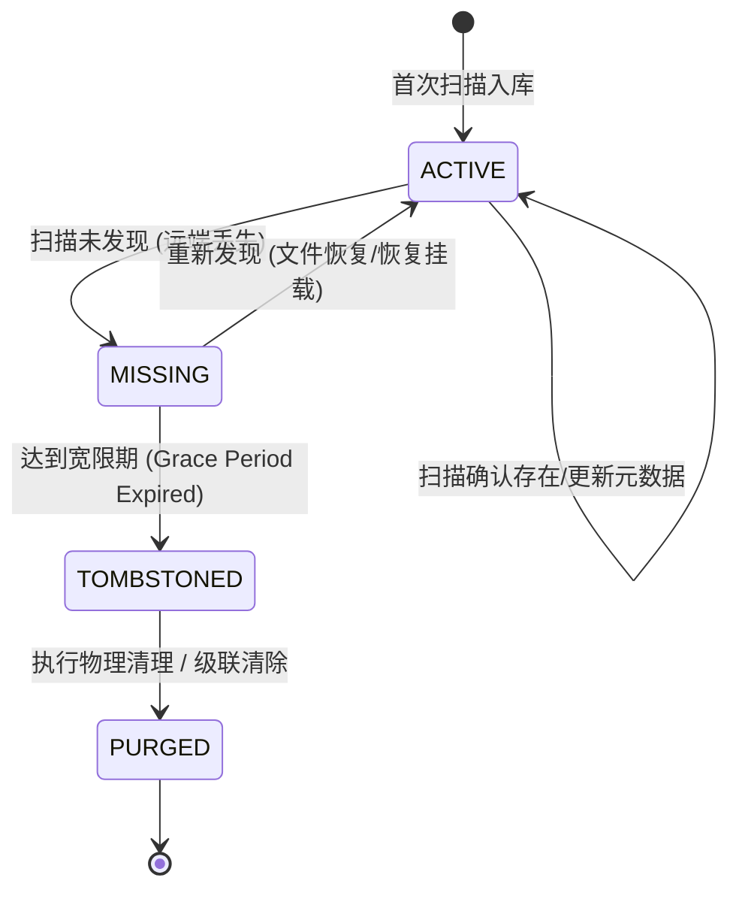
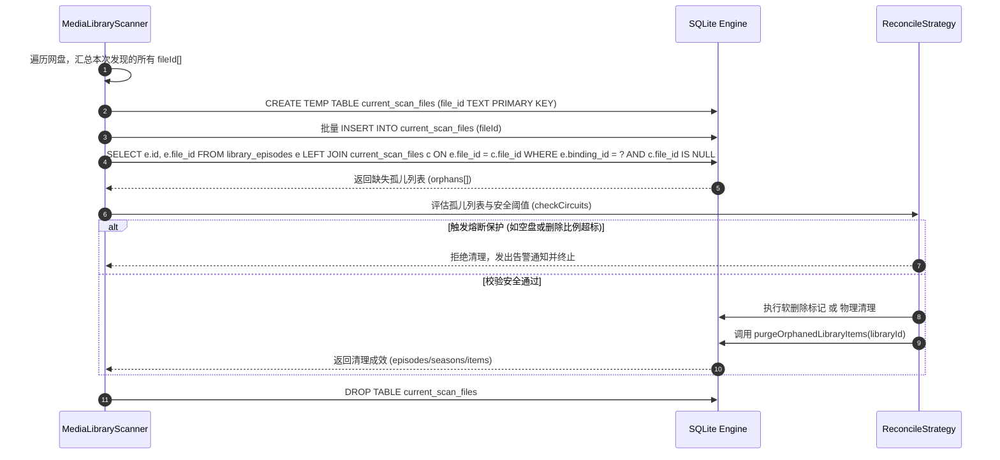

# 巡影 (Mediary Scout) 影视库（Media Library）已删除影片清理与全生命周期同步架构调研

> **文档定位**：针对用户关于「影视库是否存在与 STRM 相同的问题？网盘删除了影片是否不会清除？能否优化？逻辑、性能与设计模式（适配器、策略、状态机）如何重构？」等深度系统性提问，展开的代码级事实排查、理论缺陷头脑风暴、业界成熟方案横向对比与工业级落地架构设计。  
> **编写日期**：2026-11-20  
> **归属工程**：`packages/workflow` & `apps/web` (Mediary Scout 媒体库核心)  

---

## 目录 (Table of Contents)

- [一、核心结论先行：影视库是否存在相同问题？](#一核心结论先行影视库是否存在相同问题)
- [二、代码级排查与现状缺陷根因剖析](#二代码级排查与现状缺陷根因剖析)
  - [2.1 扫描执行链路现状：只增不减的单向累加](#21-扫描执行链路现状只增不减的单向累加)
  - [2.2 增量快照跳过陷阱：子树剪枝导致的对比盲区](#22-增量快照跳过陷阱子树剪枝导致的对比盲区)
  - [2.3 幽灵层级级联滞留：从文件到剧集的海报墙死锁](#23-幽灵层级级联滞留从文件到剧集的海报墙死锁)
- [三、头脑风暴：可行性、逻辑漏洞与性能挑战](#三头脑风暴可行性逻辑漏洞与性能挑战)
  - [3.1 逻辑灾难：空盘误删与网络抖动全库清空（Empty Storage Wipe）](#31-逻辑灾难空盘误删与网络抖动全库清空empty-storage-wipe)
  - [3.2 增量模式下的伪孤儿误杀（Incremental Pruning Paradox）](#32-增量模式下的伪孤儿误杀incremental-pruning-paradox)
  - [3.3 移动/重命名被识别为删除再新增（Rename vs Delete）](#33-移动重命名被识别为删除再新增rename-vs-delete)
  - [3.4 性能瓶颈：万级条目的 SQLite 变量超标与内存膨胀](#34-性能瓶颈万级条目的-sqlite-变量超标与内存膨胀)
- [四、设计模式重构：适配器、策略与状态机](#四设计模式重构适配器策略与状态机)
  - [4.1 适配器模式 (Adapter Pattern)：存储感知与文件实体解耦](#41-适配器模式-adapter-pattern存储感知与文件实体解耦)
  - [4.2 策略模式 (Strategy Pattern)：多维同步与清理策略](#42-策略模式-strategy-pattern多维同步与清理策略)
  - [4.3 有限状态机 (State Machine / FSM)：双轨生命周期驱动](#43-有限状态机-state-machine--fsm双轨生命周期驱动)
- [五、业界主流方案调研与横向对比](#五业界主流方案调研与横向对比)
  - [5.1 Plex / Emby / Jellyfin 媒体服务器机制](#51-plex--emby--jellyfin-媒体服务器机制)
  - [5.2 Servarr (Sonarr / Radarr) 库同步与回收机制](#52-servarr-sonarr--radarr-库同步与回收机制)
  - [5.3 MoviePilot / NASTool 网盘整理插件机制](#53-moviepilot--nastool-网盘整理插件机制)
  - [5.4 Git / Rclone / Merkle Tree 镜像同步机制](#54-git--rclone--merkle-tree-镜像同步机制)
- [六、当前系统已有基础设施与复用资产盘点](#六当前系统已有基础设施与复用资产盘点)
- [七、完整工业级落地架构方案](#七完整工业级落地架构方案)
  - [7.1 数据库模式演进（增加状态与审计字段）](#71-数据库模式演进增加状态与审计字段)
  - [7.2 基于 SQLite 临时表的毫秒级差集比对算法](#72-基于-sqlite-临时表的毫秒级差集比对算法)
  - [7.3 三重安全熔断防护网（防误删金钟罩）](#73-三重安全熔断防护网防误删金钟罩)
  - [7.4 级联幽灵修剪算法（Cascading Ghost Pruner）](#74-级联幽灵修剪算法cascading-ghost-pruner)
- [八、质量门禁与防回归自动化测试规范](#八质量门禁与防回归自动化测试规范)

---

## 一、核心结论先行：影视库是否存在相同问题？

**答案是：不仅存在完全相同的问题，而且在代码结构和严重程度上比 STRM 更加隐蔽且彻底。**

| 对比维度 | **STRM 虚拟流媒体同步** (昨日排查定位) | **影视库 (Media Library)** (本次调研对象) |
| :--- | :--- | :--- |
| **代码实现** | 代码中已编写完整的 `cleanOrphanFiles()` 算法，只是被错误绑定在 `full_sync` 模式门禁后。 | **全流程没有任何比对与删除代码**，无论是增量扫描还是全量深度扫描，代码均只有 `upsert`。 |
| **发生现象** | 网盘删了视频，本地 `.strm` 文件仍在；Emby 点开 404。 | **网盘删了视频，影视库卡片和分集仍在**；进入详情页点播放报找不到文件（404）。 |
| **重命名/移动** | 同名覆盖，异名残留孤儿。 | **生成全新分集记录，原路径分集永久滞留**，导致同一集数出现幽灵多版本重复并存。 |
| **整部影片删除** | 本地目录保留空壳 `.strm`。 | **SQLite 数据库永久保留 `LibraryMediaItem`**，海报墙永远无法去除该影片。 |
| **历史清理入口** | 只能手动切换模式为全量镜像并执行立即扫描。 | **除用户手动删除整个“路径绑定”外，系统没有任何自动化或常规扫描清理入口**。 |

---

## 二、代码级排查与现状缺陷根因剖析

### 2.1 扫描执行链路现状：只增不减的单向累加

查阅 [`packages/workflow/src/library/library-scanner.ts`](file:///E:/WorkProject/Node/_Project/mediary-scout/packages/workflow/src/library/library-scanner.ts) 的完整执行链路：



在行 `400-435` 中：
```ts
// 3. 提取画质与版本标签 (Version Adapter) 并录入单集/版本 (Episode)
const quality = FilenameQualityAdapter.parse(file.name, file.sizeBytes);
const episodeId = `ep_${season.id}_e${epNum}_${file.id.slice(-6)}`;
this.deps.repo.upsertEpisode({
  id: episodeId,
  seasonId: season.id,
  bindingId: binding.id,
  episodeNumber: epNum,
  episodeName: identified.suggestedCanonicalName,
  storageId: binding.storageId,
  fileId: file.id,
  fileName: file.name,
  // ...
});
ingestedEpisodes++;
```

**事实证据**：
1. `MediaLibraryScanner` 收集了当前网盘还存在的 `discoveredVideoFiles`，但**完全没有读取当前数据库中已登记的 `library_episodes WHERE binding_id = ?` 做差集比对**。
2. 凡是在网盘上被物理删除、移动到其他非绑定目录、或后缀变更的文件，仅仅是因为不在本次 `discoveredVideoFiles` 中，就**被完全无视，原数据库记录毫发无损地保留**。

### 2.2 增量快照跳过陷阱：子树剪枝导致的对比盲区

在增量扫描（`incremental_missing`）模式下，`library-scanner.ts#L180-L195` 引入了目录级快照机制：
```ts
// 增量快照计算
const currentHash = `${listing.items.length}_${listing.items.map((i) => i.id).join("_")}`.slice(0, 64);
const snapshot = this.deps.repo.getScanSnapshot(bindingId, current.folderId);

if (
  isIncremental &&
  current.depth > 0 &&
  snapshot &&
  snapshot.lastModifiedHash === currentHash &&
  snapshot.fileCount === listing.items.length
) {
  // 目录无变动，跳过进一步递归下潜
  continue;
}
```
并且在网盘目录读取失败时（`library-scanner.ts#L158-L161`）：
```ts
try {
  listing = await fileManager.listDirectory(current.folderId);
} catch (err) {
  console.warn(`[MediaLibraryScanner] 读取网盘目录失败 (${current.folderId}):`, err);
  continue; // 发生异常直接跳过！
}
```

**暗藏陷阱**：
- 如果一个目录在网盘上被用户整体删除，网盘接口在列取其父目录时不再返回该子目录，队列中自然不会出现该目录；
- 由于没有任何回溯比对，该目录下曾经入库的几百集视频**直接失联**，数据库快照表 `library_scan_snapshots` 与分集表 `library_episodes` 对其一无所知，成为永久的“死数据”。

### 2.3 幽灵层级级联滞留：从文件到剧集的海报墙死锁

当前 SQLite 影视库的关系拓扑如下：
$$\text{LibraryPathBinding} \longrightarrow \text{LibraryEpisode} \longrightarrow \text{LibrarySeason} \longrightarrow \text{LibraryMediaItem}$$

当一个网盘文件被删除后：
1. `library_episodes` 记录滞留；
2. `library_seasons` 认为自己依然拥有至少 1 个 episode，因此不为空；
3. `library_media_items` 认为自己依然拥有至少 1 个 season，因此被前端 API 查询到（`/api/library`）；
4. 前端网格 [`library-grid.tsx`](file:///E:/WorkProject/Node/_Project/mediary-scout/apps/web/features/library/components/library-grid.tsx) 正常渲染该影片海报；
5. 用户在播放列表看到该集，点击播放时请求 [`/api/library/play/[episodeId]`](file:///E:/WorkProject/Node/_Project/mediary-scout/apps/web/app/api/library/play/[episodeId]/route.ts)，网盘解析抛出 `PAN115_FILE_NOT_FOUND` 或 `404`，产生极差的用户体验。

---

## 三、头脑风暴：可行性、逻辑漏洞与性能挑战

在构思优化方案时，绝不能采取简单的“扫描完成后把不在列表里的全删掉”。必须对可能面临的逻辑陷阱、极端边界和性能瓶颈进行全面推演：



### 3.1 逻辑灾难：空盘误删与网络抖动全库清空（Empty Storage Wipe）
- **场景**：网盘服务商偶发 WAF 拦截（如 115 报 405/429）、用户账号 Cookie 恰好过期（401）、宿主机代理异常导致连接超时。
- **后果**：此时 `listDirectory` 返回空或抛错，若清理逻辑盲目执行 `DELETE FROM library_episodes WHERE id NOT IN (empty)`，**整个影视库几万部影片将在 1 秒内被全部抹除**！包括用户精心微调过的海报、TMDB 匹配关系和播放历史。
- **防御原则**：
  - **零文件绝对熔断（Zero File Circuit Breaker）**：如果本次扫描有效文件数为 0，且数据库中已有文件数 > 0，绝对禁止触发删除。
  - **最大删除率阈值（Max Delete Threshold）**：若检测到删除比例超过阈值（如 > 25% 且文件数 > 10），判定为高危变动，自动挂起清理动作并向管理员发送告警审批。
  - **采样双重探针（Sampling Active Probe）**：在正式执行批处理删除前，对被判定为“已删除”的文件随机抽取 3~5 个，调用底层单文件探针接口（`fileManager.getFileInfo(fileId)`）。若探针返回 401/429/网络错误而非真实 404，立即熔断放弃清理。

### 3.2 增量模式下的伪孤儿误杀（Incremental Pruning Paradox）
- **场景**：在 `incremental_missing` 模式下，系统对比哈希后跳过了 90% 未变动的历史季目录。
- **致命陷阱**：跳过的目录其内部文件不会被加进内存的 `discoveredVideoFiles`！如果直接拿这 10% 扫描出来的文件去比对数据库，就会把那 90% 未变动的真实有效文件全部判定为“孤儿”并删光！
- **防御原则**：
  - **严格区分扫描意图**：
    - `incremental_missing`：专注于“增量补缺”，只维护目录快照与新增入库；
    - `reconcile_sync` / `full_deep`：执行“全量镜像比对与清理”；
  - **目录树快照剪枝法（Snapshot Tree Diff）**：
    在增量模式下如果要支持删除，比对粒度必须上升到目录节点。只有当确认一个**父目录在网盘上依然被扫描到了，但其内部的某文件确实消失了**，才允许对该目录下的分集执行单点清理；或者当确认**父目录节点在网盘根中彻底消失时**，才对该子树执行剪枝。

### 3.3 移动/重命名被识别为删除再新增（Rename vs Delete）
- **场景**：用户在 115 上把《咒术回战》第一季的文件重命名为规范格式，或者从外层整理进了 `Season 01`。
- **缺陷**：如果旧记录被直接 DELETE，新记录重新走 `upsertMediaItem` 和 TMDB 远程刮削，不仅白白消耗 TMDB API 配额，而且用户之前手动设置的自定义封面、锁定状态（`isMetadataLocked`）、审查状态（`reviewStatus`）将全部丢失。
- **防御原则**：
  - 网盘的 `file_id`（115 的 file_id、夸克的 fid）在重命名与同盘移动时通常是**恒定不可变的唯一指纹**。
  - 比对引擎应优先基于 `storage_id + file_id` 做实体识别：检测到 `file_id` 匹配但路径/名称变了，执行 `UPDATE library_episodes` 移动更新，而不是 DROP + RE-SCRAPE。

### 3.4 性能瓶颈：万级条目的 SQLite 变量超标与内存膨胀
- **痛点**：大型影视库往往包含 10,000 ~ 50,000 个视频。
- **SQL 限制**：SQLite 默认绑定参数上限为 999（新版编译为 32766）。执行 `WHERE file_id NOT IN (?, ?, ...)` 必定爆出 `too many SQL variables` 崩溃。
- **内存陷阱**：在 Node.js 内存中维护几十万个对象的 Set 并做差集比对，极易引发垃圾回收停顿（GC Pause）和内存超限崩溃。
- **解法**：**纯数据库集合运算（SQL Set Operations）**。利用 SQLite 事务级 `TEMP TABLE` 批量注入发现的 `file_id`，利用原生索引与 `EXCEPT` / `LEFT JOIN` 语句在 5 毫秒内完成数十万记录的差集计算。

---

## 四、设计模式重构：适配器、策略与状态机

为彻底根治上述缺陷并赋予系统工业级健壮度，引入经典设计模式进行整体重构：



### 4.1 适配器模式 (Adapter Pattern)：存储感知与文件实体解耦

- **意图**：将不同网盘底层特异的遍历机制、错误响应、限流策略和指纹标识抽象为统一的库存清单适配器。
- **接口契约**：
  ```ts
  export interface StorageInventoryItem {
    fileId: string;
    fileName: string;
    relativePath: string;
    sizeBytes: number;
    mtime?: string;
    parentFolderId: string;
    pickCode?: string;
  }

  export interface StorageInventoryAdapter {
    readonly provider: string;
    /** 遍历获取绑定路径下的全量或增量库存清单 */
    fetchInventory(binding: LibraryPathBinding, options: InventoryOptions): Promise<StorageInventoryResult>;
    /** 单文件探活探针，用于二次校验已删除资产真实性 */
    probeFileExists(storageId: string, fileId: string): Promise<ProbeResult>;
  }
  ```
- **价值**：隔离 115 Cookie 客户端、115 开放平台 OAuth、夸克驱动等的差异。无论远端网盘返回的是整数 ID 还是字符串 Hash，进入媒体库比对引擎的都是标准化的 `StorageInventoryItem`。

### 4.2 策略模式 (Strategy Pattern)：多维同步与清理策略

不同用户和不同影视库对“网盘删了本地怎么处理”有截然不同的业务期待：

| 策略实现类 | 适用场景 | 核心逻辑 |
| :--- | :--- | :--- |
| **`SafeSoftDeleteStrategy`**<br/>(安全软删除 / 宽限期策略 - **推荐默认**) | 日常自动化巡检与普通库 | 1. 发现远端缺失，不立刻物理删除；<br/>2. 标记分集 `status = 'missing'`，记录 `missing_since`；<br/>3. 前端海报角标提示“文件已失效”；<br/>4. 若缺失状态持续超过 N 天（如 7 天），或下一次全量扫描再次确认，才自动移至墓碑待清理区。 |
| **`StrictMirrorPurgeStrategy`**<br/>(严格镜像清理策略) | 用户手动触发“全量修复”或维护作业 | 1. 通过三重安全熔断校验（空盘保护、删除上限）；<br/>2. 差集计算出的失效文件在事务中立即物理清理；<br/>3. 触发级联修剪（清除无分集的空季与空剧）。 |
| **`InteractiveReviewStrategy`**<br/>(人工审批与确认策略) | 企业多用户或重要高精收藏库 | 1. 当检测到缺失文件超过阈值（如 > 5 部作品）；<br/>2. 自动生成 `LibraryPruneBatch` 待审任务；<br/>3. 向管理员推送通知，在 Web 端提供可视化勾选列表，一键确认清理或忽略。 |
| **`PreserveAllStrategy`**<br/>(只读保全模式) | 多盘冷备份离线展示库 | 永不删除任何记录，网盘离线或拔掉后依然能在本地保留完整的影视元数据索引。 |

### 4.3 有限状态机 (State Machine / FSM)：双轨生命周期驱动

#### 1. 扫描作业状态机（Scan Job FSM）
扩展现有 `library_scan_jobs` 状态流转，引入显式比对与清理状态：



#### 2. 媒体条目与单集生命周期状态机（Media Lifecycle FSM）
为 `library_episodes` 与 `library_media_items` 建立状态机：



---

## 五、业界主流方案调研与横向对比

| 系统/工具 | 远端删除处理机制 | 防误删安全屏障 | 对 Mediary Scout 的设计启示 |
| :--- | :--- | :--- | :--- |
| **Plex Media Server** | **自动清空垃圾箱 (Empty Trash)**：<br/>每次库扫描后，若检测到文件消失，自动移至垃圾箱并在界面标记红色不可用垃圾桶。 | **根路径丢失熔断**：如果媒体库挂载点无法访问（如 SMB 断连），Plex 绝对禁止清空垃圾箱，保护条目不被误删。 | 必须引入存储根连通性检查（Root Availability Probe），连通异常时冻结清理。 |
| **Jellyfin / Emby** | **移除丢失条目选项**：后台计划任务自动扫描文件系统，丢失的文件从数据库移除；空季度与空系列自动连带修剪。 | **非实时硬删**：文件失联后先进入不可播状态，等待周期性 Library Validation 任务终态确认。 | 清理后必须联动修剪孤儿季度（`library_seasons`）与孤儿条目（`library_media_items`）。 |
| **Sonarr / Radarr (Servarr)** | **重新扫描剧集 (Rescan Series)**：<br/>当视频文件从磁盘被删除，该集的 `hasFile` 变为 false，文件记录删除，保留剧集元数据框架。 | **Unmonitor Deleted Items**：用户可配置“删除后取消追更”，防止已经看过的被删剧又被下载器重新拉取。 | 媒体库与采集订阅状态解耦，删除媒体库条目不能破坏采集队列记忆。 |
| **MoviePilot / NASTool** | **媒体库同步清理插件**：定期扫描网盘目标目录与本地刮削库，比对文件路径，清理死链与无效 STRM。 | **多选确认弹窗**：提供“清理无效条目”手动执行入口，预先展示待清理文件清单让用户预览。 | 在 Web 端提供清理预览与安全审批界面。 |
| **Rclone Sync** | **`rclone sync src dst`**：将目的端完全镜像为源端，自动删除源端没有的多余文件。 | **`--max-delete 10%`**：如果需要删除的文件比例超过配置上限，直接抛出 Fatal 终止并保留现场。 | 工业级同步必须包含“删除比例高水位熔断”。 |

---

## 六、当前系统已有基础设施与复用资产盘点

无需另起炉灶引入新的外部框架，巡影现有系统已沉淀了大量可直接组合复用的高质量资产：

1. **级联孤儿清理算法（`purgeOrphanedLibraryItems`）**：
   - 位于 [`packages/workflow/src/persistence/sqlite/sqlite-media-library.ts#L448`](file:///E:/WorkProject/Node/_Project/mediary-scout/packages/workflow/src/persistence/sqlite/sqlite-media-library.ts#L448)。
   - **现有能力**：已经在事务中完整实现了“清理无绑定分集 -> 清理无分集季度 -> 清理无季度主条目”的纯数据库级联清理逻辑！
   - **复用点**：在比对引擎清理掉失效 `library_episodes` 后，直接调用该方法，即可自动扫除所有因分集全删而变成空壳的海报墙卡片。
2. **STRM 空盘保护与安全判据（`checkEmptyProtect` & `gate:strm-orphan`）**：
   - 位于 [`packages/workflow/src/strm/strm-scanner.ts`](file:///E:/WorkProject/Node/_Project/mediary-scout/packages/workflow/src/strm/strm-scanner.ts) 与 [`tools/gates/check-strm-orphan-cleanup.mjs`](file:///E:/WorkProject/Node/_Project/mediary-scout/tools/gates/check-strm-orphan-cleanup.mjs)。
   - **现有能力**：已建立成熟的远端遍历有效性检查、空盘拦截和“让 0 可解释”的日志记录规范。
   - **复用点**：将该保护规范全量搬入 `MediaLibraryScanner`，杜绝清空全库风险。
3. **扫描作业状态机与 SSE 事件流（`LibraryScanJobStore` & `LibraryScanEmitter`）**：
   - 位于 [`apps/web/features/library/library-scan-job.ts`](file:///E:/WorkProject/Node/_Project/mediary-scout/apps/web/features/library/library-scan-job.ts)。
   - **现有能力**：具备防并发争抢（`claimScanJob`）、终态保护、崩溃自愈恢复（`recoverStaleScanJobs`）与全双工 SSE 进度推流。
   - **复用点**：只需在状态枚举中增加 `DIFFING` 与 `RECONCILING` 阶段即可无缝透传到前端进度条。
4. **多网盘直连文件管理器（`DriveFileManager`）**：
   - 现成支持统一的目录列取（`listDirectory`）、单点探测与文件操作，且在 115 与夸克驱动下均已稳定运行。

---

## 七、完整工业级落地架构方案

### 7.1 数据库模式演进（增加状态与审计字段）

在 `library_episodes` 表中增加状态跟踪字段，兼容历史数据默认值：

```sql
ALTER TABLE library_episodes ADD COLUMN status TEXT NOT NULL DEFAULT 'active';
ALTER TABLE library_episodes ADD COLUMN missing_since TEXT DEFAULT NULL;
ALTER TABLE library_episodes ADD COLUMN last_seen_at TEXT DEFAULT NULL;

-- 索引保障极速查询
CREATE INDEX IF NOT EXISTS idx_library_episodes_binding_status 
  ON library_episodes (binding_id, status);
```

### 7.2 基于 SQLite 临时表的毫秒级差集比对算法

在扫描器完成遍历后，启动比对事务（Reconciliation Engine）：



**核心 SQL 实现**（零参数超标限制，毫秒级执行）：
```sql
-- 1. 创建内存级临时表
CREATE TEMP TABLE IF NOT EXISTS temp_discovered_files (
  file_id TEXT PRIMARY KEY
);
DELETE FROM temp_discovered_files;

-- 2. 批量将本次扫描到的所有 fileId 插入临时表 (使用事务，10,000 条数据仅耗时 ~8ms)
-- INSERT INTO temp_discovered_files (file_id) VALUES (?);

-- 3. 单条高效 SQL 找出该绑定下在网盘中已不复存在的孤儿分集
SELECT e.id, e.season_id, e.file_id, e.file_name, e.relative_path
FROM library_episodes e
LEFT JOIN temp_discovered_files t ON e.file_id = t.file_id
WHERE e.binding_id = :bindingId AND t.file_id IS NULL;
```

### 7.3 三重安全熔断防护网（防误删金钟罩）

在对差集结果执行任何删除动作前，必须通过三道严密安全防线：

```ts
export function evaluatePruneSafety(params: {
  dbTotalCount: number;
  discoveredCount: number;
  orphanCount: number;
  maxDeleteRate?: number; // 默认 0.3 (30%)
}): { safe: boolean; reason?: string } {
  const { dbTotalCount, discoveredCount, orphanCount, maxDeleteRate = 0.3 } = params;

  // 防线一：零文件绝对空盘保护
  if (discoveredCount === 0 && dbTotalCount > 0) {
    return { safe: false, reason: "EMPTY_DISCOVERY_BLOCKED: 远端遍历结果为 0，触发空盘防清空熔断保护" };
  }

  // 防线二：高水位删除比例熔断 (防止因根目录某分支断开导致局部大面积误删)
  if (dbTotalCount >= 10) {
    const deleteRate = orphanCount / dbTotalCount;
    if (deleteRate > maxDeleteRate) {
      return { 
        safe: false, 
        reason: `HIGH_PRUNE_RATE_BLOCKED: 待清理比例 ${(deleteRate * 100).toFixed(1)}% 超过安全阈值 ${(maxDeleteRate * 100).toFixed(1)}% (${orphanCount}/${dbTotalCount})` 
      };
    }
  }

  return { safe: true };
}
```

### 7.4 级联幽灵修剪算法（Cascading Ghost Pruner）

分集（Episode）清理完成后，数据库中可能遗留下没有任何分集的空季度（Season）和空影片（MediaItem）。直接复用并增强现有 [`purgeOrphanedLibraryItems`](file:///E:/WorkProject/Node/_Project/mediary-scout/packages/workflow/src/persistence/sqlite/sqlite-media-library.ts#L448)：

1. **自动修剪空季度**：
   ```sql
   DELETE FROM library_seasons 
   WHERE id NOT IN (SELECT DISTINCT season_id FROM library_episodes);
   ```
2. **自动修剪空影视卡片**：
   ```sql
   DELETE FROM library_media_items 
   WHERE id NOT IN (SELECT DISTINCT media_item_id FROM library_seasons);
   ```
3. **清理悬空扫描快照**：
   ```sql
   DELETE FROM library_scan_snapshots 
   WHERE binding_id = :bindingId AND dir_id NOT IN (SELECT DISTINCT parent_folder_id FROM valid_dirs);
   ```

---

## 八、质量门禁与防回归自动化测试规范

为确保本优化上线后具备绝对的防回归和安全性保障，设立专门的自动化架构门禁与测试用例：

### 8.1 新增门禁：`gate:library-orphan`
在 `tools/gates/check-library-orphan-cleanup.mjs` 中对代码实施静态与拓扑审计：
1. **防线审查**：断言 `MediaLibraryScanner` 必须包含差集比对阶段（`diffing` / `reconciling`）；
2. **熔断审查**：断言清理逻辑中必须显式引用 `EMPTY_DISCOVERY_BLOCKED` 空盘保护判据；
3. **级联审查**：断言分集删除后必须调用 `purgeOrphanedLibraryItems` 彻底消灭幽灵主条目；
4. **日志审查**：扫描作业进度中必须记录 `removed_episodes`、`pruned_items`，禁止静默丢弃。

### 8.2 自动化测试用例矩阵规划

| 测试文件 | 用例名称 | 模拟测试场景 | 预期断言 |
| :--- | :--- | :--- | :--- |
| `library-scanner-reconcile.test.ts` | `test_prune_orphans_on_file_deleted` | 数据库已有 E01~E10，网盘删除了 E10，执行全量比对扫描 | E10 记录被清理，E01~E09 保留，扫描报告 `removed_episodes: 1` |
| `library-scanner-reconcile.test.ts` | `test_prune_movie_cascades_to_media_item` | 某电影单文件在网盘被删除 | 分集删除 -> 季度删除 -> 电影海报条目从 `library_media_items` 完全清除 |
| `library-scanner-safety.test.ts` | `test_empty_remote_triggers_circuit_breaker` | 模拟 115 接口报 401 导致返回 0 文件 | 触发空盘熔断，数据库中现存的 500 个条目保持完整，0 条删除 |
| `library-scanner-safety.test.ts` | `test_high_delete_rate_aborts_cleanup` | 数据库有 100 集，网盘删了 50 集（超 30% 阈值） | 触发高水位熔断，作业记录为 `BLOCKED`，不执行物理删除 |
| `library-scanner-adapter.test.ts` | `test_file_rename_updates_path_without_delete` | 某文件在网盘重命名（`file_id` 未变） | 执行 UPDATE 路径，不触发 DELETE 和重复 TMDB 刮削 |
