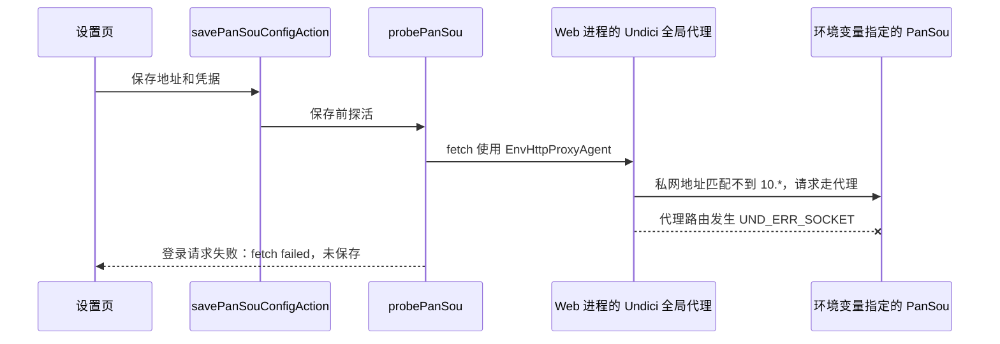

# PanSou 环境变量自定义实例连接失败调研

> 调研日期：2026-11-05
>
> 状态：根因已在 Linux 极速开发容器复现；CIDR 代理路由、探活分类和环境来源交互已实现并部署至 `mediary-dev`。聚焦测试、类型检查和定向 ESLint 已通过，部署后健康接口返回 HTTP 200。设置页访问按预期跳转至登录页，未使用凭据登录验证受保护表单。

## 摘要

设置页显示「登录请求失败：`fetch failed`，未保存」时，不能据此判断 PanSou 用户名或密码错误。当前实现是在 Web 服务端调用 PanSou 的 `POST /api/auth/login`；`fetch failed` 表示没有收到 HTTP 响应，而代码又只展示了 `error.message`，丢弃 Undici 的底层错误码。

本次在当前 `mediary-dev` 容器内对环境变量指定的 PanSou 地址做了只读验证：目标是私网 IPv4 的 HTTP `5280` 端口，容器启用了出站代理。通过同一 `undici` `EnvHttpProxyAgent` 分别使用现有 `10.*` 规则和精确主机绕过代理访问公开的 `/api/health`：

| 路由方式 | 结果 |
| --- | --- |
| `NO_PROXY=10.*` | `fetch failed`，底层码 `UND_ERR_SOCKET` |
| `NO_PROXY=<目标主机的精确值>` | `HTTP 200` |

探测输出没有打印真实主机地址，也没有发送登录凭据。该对照确认：**私网 PanSou 地址应直连，但当前 `NO_PROXY` 私网段写法没有被 Undici 识别为网段通配，导致请求仍交给出站代理；代理链路随后断开 socket。** 当前容器里的“登录请求失败”是网络路由失败被显示成登录错误，不是已证实的凭据错误。

## 问题本质与调用链

这里有三个边界需要分开看：

1. **配置边界**：运行时 PanSou 地址按「数据库设置 > `PANSOU_BASE_URL` 环境变量 > 公共默认源」解析。Linux 极速部署通过 `docker run -e PANSOU_BASE_URL=...` 把该地址注入 Web 容器；本次运行时诊断确认地址指向私网主机的 `5280` 端口。
2. **网络边界**：保存按钮触发 Server Action，探测发生在 Web 容器，不发生在用户浏览器，也不发生在宿主机。宿主机能打开的地址不等于容器能直连；容器请求还会经过 Web 进程的代理 Dispatcher。
3. **错误边界**：HTTP 401/403 才是收到 PanSou 的认证拒绝；`UND_ERR_SOCKET` 是 HTTP 响应之前的传输失败。当前登录分支把两者都装进 `auth_failed`，且错误文案只保留 `fetch failed`，因此状态分类会误导用户。

## 源码与运行时证据

| 证据 | 结论 |
| --- | --- |
| [`savePanSouConfigAction`](../../apps/web/app/actions/settings-pansou-actions.ts) 在写数据库前调用 `probePanSou` | 连接失败时地址和凭据都不会保存，符合页面上的「未保存」。 |
| [`probePanSou`](../../apps/web/lib/pansou-probe.ts) | 当前使用轻量 `GET /api/health`；认证开启时再调用 login 或 verify，不触发搜索 fan-out。 |
| 探活网络错误分类 | 传输错误归 `unreachable`，并仅显示安全的稳定错误码（如 `UND_ERR_SOCKET`）；HTTP 401/403 才归认证失败。 |
| [`instrumentation-node.ts`](../../apps/web/instrumentation-node.ts#L19) 启动时安装代理；[`http-proxy.ts`](../../apps/web/features/settings-system/core/http-proxy.ts#L61) 使用 `EnvHttpProxyAgent` | `HTTP_PROXY` / `HTTPS_PROXY` / `NO_PROXY` 会影响设置探测和后续 PanSou 搜索。当前项目已有可复用代理设施，无需再装代理库。 |
| [`formatNetworkError`](../../apps/web/features/settings-system/core/http-proxy.ts#L199) 已提取 `error.cause` 和底层码 | 可作为诊断格式化基础，但应对外仅暴露稳定码/安全摘要，避免把带凭据的 URL 或代理认证信息写到 UI/日志。 |
| [`DEFAULT_DOMESTIC_NO_PROXY`](../../apps/web/features/settings-system/core/http-proxy.ts) | 默认项改为标准 RFC1918 CIDR，并由 CIDR-aware dispatcher 路由，不再依赖不受支持的 IP glob。 |
| [`http-proxy.test.ts`](../../apps/web/lib/http-proxy.test.ts) | 现在验证 IPv4/IPv6 CIDR 命中、未命中和直连/代理 dispatcher 选择。 |
| [`docker-compose.yml`](../../docker-compose.yml#L72) 给 Compose 内置源配置 `http://pansou`；[`deploy-remote.ps1`](../../scripts/deploy-remote.ps1#L128) 的极速开发部署使用环境地址或宿主机 `5280` 地址 | Compose 服务名和单独 `docker run` 的网络拓扑不同，不能把两个地址场景混为一谈。 |
| 设置页地址来源 | 表单现在显示数据库、环境变量或公共默认来源；保存认证时由服务端解析当前地址，不会将环境地址写成数据库覆盖。 |

### 不同代理客户端的网段语法

NO_PROXY 没有跨客户端一致的网段语法。项目锁定 undici@7.28.0，并通过其 EnvHttpProxyAgent 管理 Node fetch：

- curl 从 7.86.0 起支持 192.168.0.0/16 形式的 CIDR；Go httpproxy 也把 IP prefix/CIDR 列为 NO_PROXY 格式。
- Node.js v22.23 的内置 HTTP 代理支持文档列出 192.168.1.1-192.168.1.100 连字符范围，但没有列出 CIDR。
- Undici EnvHttpProxyAgent 只解析主机精确值、主机后缀和可选端口；10.*、CIDR 和 Node 连字符范围均不应假定能在此实现上工作。
- *.example.com / .example.com 是域名后缀规则，不是 IP 网段规则。

因此本项目现在在现有 Undici Dispatcher 外加一层 CidrAwareProxyDispatcher：已有 EnvHttpProxyAgent 继续处理主机名、精确 IP 和域名后缀；目标 URL 是 IP 字面量且命中 CIDR 时，改由直连 Agent 发送。CIDR 在请求时被匹配，不展开成地址清单，也不对域名做 DNS 查询。默认私网项使用 127.0.0.0/8、10.0.0.0/8、172.16.0.0/12、192.168.0.0/16，并包含 IPv6 loopback、ULA 和 link-local 网段。

本次根因也有实际对照证据：同一容器、同一 URL、同一 Undici 代理库，旧 10.* 规则失败而精确主机绕过代理返回 200。新实现用代理调度测试验证 CIDR 命中走直连、未命中继续走代理。

## 根因分级

### 已确认的主因

**用不受 Undici 支持的 IP 通配符表达 RFC1918 网段，私网 PanSou 目标未绕过代理。** 当 `PANSOU_BASE_URL` 指向 `10.x.x.x:5280`，Web 容器启用 HTTP 代理时，请求仍被代理接管；使用具体目标 IP 作为 `NO_PROXY` 项后，同一健康接口成功返回 200。

### 已确认的次因：诊断信息误导

修复前登录网络异常曾被归为 `auth_failed`，并只展示 `fetch failed`。用户无法区分：

- DNS 不可解析：通常 `ENOTFOUND`；
- 连接被拒绝：通常 `ECONNREFUSED`；
- 路由不可达或代理连接失败：常见 `EHOSTUNREACH` / `UND_ERR_SOCKET`；
- 连接超时：`TimeoutError`；
- 真正的 PanSou 凭据拒绝：收到 HTTP 401/403。

本次确认了 `UND_ERR_SOCKET`，但没有从代理服务器日志继续判明该 socket 是代理自身关闭，还是代理到目标的连接关闭；这不影响「目标被错误地送入代理」这一已证实根因。

### 次要 UX 问题：环境变量值不显示在地址输入框

修复前页面胶囊可显示「自定义实例 · 来自环境变量」，但表单只读取数据库覆盖值；用户看到空输入框时，实际搜索仍从环境变量取地址。现已标明生效来源，并拆分地址覆盖、仅保存认证和恢复环境/默认三种操作。

## 现有基础设施与方案比较

| 方案 | 适用场景 | 优点 | 限制/结论 |
| --- | --- | --- | --- |
| Docker Compose 服务发现：同一 Compose 网络内使用服务名 `http://pansou` | `web` 与内置 `pansou` 服务 | Docker Compose 为同网络服务提供稳定 DNS 名称；容器 IP 可变化但服务名稳定 | 适合 Compose 默认配置；单独 `docker run` 的开发容器不自动加入 Compose 网络，不能直接复用该服务名。 |
| Undici EnvHttpProxyAgent + CidrAwareProxyDispatcher | 全进程 fetch 代理及 IP CIDR 例外 | 复用当前代理配置和连接池；CIDR 命中改走直连 Agent；不展开大网段、不解析目标域名、不新增依赖 | CIDR 只对 URL 中的 IP 字面量生效；域名继续使用精确主机或 .example.com 后缀规则。 |
| Node 原生 `NODE_USE_ENV_PROXY=1` / `--use-env-proxy` | Node.js 22.21+ 的环境代理 | 官方 Node 已提供环境代理开关 | 当前运行时为 Node 22.23，但项目已有 Undici Dispatcher。迁移代理栈并不能自动修正错误的 `NO_PROXY` 表达式，本问题没有迁移必要。 |
| ipaddr.js / CIDR 第三方解析库 | IP 地址解析与网段比较 | 成熟库可缩短自定义 IPv6 位运算代码 | 当前依赖树没有直接的 CIDR/IP matcher；需求范围可由 Node 内置 node:net 地址校验与轻量 CIDR 匹配满足，故不增加运行时依赖。 |
| 浏览器直接探测 PanSou | 仅适用于浏览器能直达的公开服务 | 浏览器侧能验证用户网络 | 不适合此设置：Linux 容器内的服务名/私网路由与浏览器网络不同，也会让服务端认证配置转移到客户端。继续在服务端从实际运行容器探测是正确边界。 |

PanSou 上游公开了 `GET /api/health`、`POST /api/auth/login`、`POST /api/auth/verify` 和搜索接口。健康响应含 `status` 与 `auth_enabled`；认证开启时登录返回 JWT，verify 可校验 Bearer Token。保存路径已采用健康检查加按需认证校验；实际搜索仍由正常工作流触发。

## 已执行的具体解决方案

### CIDR 与代理路由

1. 项目代理设置的自定义 NO_PROXY 接受标准 IPv4/IPv6 CIDR，例如 10.0.0.0/8,172.16.0.0/12,192.168.0.0/16,fc00::/7。
2. CIDR 项只匹配 HTTP URL 中的 IP 字面量；目标是域名时应填写完整主机名或域名后缀，例如 pansou.example.com,.example.com。不会对域名做隐式 DNS 查询，避免额外延迟、DNS 结果变化和请求路由漂移。
3. 默认 RFC1918 CIDR 已自动合并；用户不需要把 10.* 伪通配继续写进配置。域名精确匹配和后缀规则仍由现有 Undici agent 处理。

### PanSou 探测与来源操作

1. 保存时只调用轻量 GET /api/health；认证开启时只追加 login 或 verify，不再触发 /api/search fan-out。
2. 网络异常归 unreachable，并只向界面显示稳定错误码；HTTP 401/403 和无效令牌归认证失败。错误内容不回显代理认证、URL 查询字段或凭据。
3. 设置页显示地址当前来自数据库、环境变量还是公共默认。操作拆为「保存地址覆盖」「仅验证并保存认证」「恢复环境 / 默认」；清除数据库覆盖时同步清除旧源认证，避免凭据之后被发往另一台生效服务。
4. 认证保存由服务端按当前 DB > env > public default 解析目标，浏览器不需要接收或渲染可能含秘密的完整环境 URL。

### 性能与安全边界

- CIDR 比较只针对 IP 字面量；域名不触发 DNS 查询。CIDR 列表按 NO_PROXY 配置值缓存，配置变化时重建缓存；匹配成本随 CIDR 条目线性增长，不随网段大小增长。
- 设置保存只做轻量、短超时的健康/认证请求，不调用完整 PanSou 搜索，减少一次性频道/插件 fan-out 和上游负载。
- 地址仍需限制为 `http://` / `https://`，并对重定向目标、DNS 解析后地址和凭据发送边界建立规则。允许管理员访问自建私网 PanSou 是产品需求，不能简单通过全面禁用 RFC1918 地址来“修复 SSRF”；应将允许访问的范围约束在配置权限与目标策略内。
- 同一 Web 进程的 `NO_PROXY` 是全局设置，避免为一个用户的 URL 无边界地改变所有租户的全局路由。多用户部署优先使用每请求/每目标 Dispatcher 或明确的实例级网络策略。

## 防回归门禁与测试建议

| 测试/门禁 | 应验证的行为 | 当前缺口 |
| --- | --- | --- |
| CIDR 匹配和调度测试 | IPv4/IPv6 前缀命中时选直连 Dispatcher；超出网段或无效 CIDR 时保留代理路径；默认配置中不再出现私网 * 伪通配 | `http-proxy.test.ts` 已覆盖 IPv4/IPv6、命中边界和 dispatcher 分流。 |
| 探活与认证分类测试 | 健康接口格式、登录/verify 成功、401/403、网络异常 cause 码、超时与不执行搜索 | `pansou-probe.test.ts` 和 `pansou-auth-settings.test.ts` 已覆盖保存路径。 |
| 环境来源与保存流程测试 | DB > env > 公共默认的来源判断；仅保存认证不写入 DB 地址；清除覆盖和凭据是显式动作 | 页面和 action 已拆分来源与保存模式；开发环境 `/settings` 可访问并按未登录策略跳转 `/login`，受保护表单未用凭据登录实测。 |
| Compose 网络烟测 | Compose 中 Web 容器通过服务名访问 PanSou 的 `/api/health`；极速 `docker run` 路径单独验证宿主机目标与代理绕过 | 两种部署网络隔离，不能只测 Compose 后假设极速部署也可达。 |
| 代理策略静态门禁 | 禁止把不受 Undici 支持的 IP 网段伪通配符当作已生效规则；优先行为测试，避免只依赖源码字符串检查 | 聚焦测试已验证 CIDR 行为，并确认默认项不再使用 `10.*` 等伪通配。 |

上述测试使用本地 Mock 服务和随机/占位凭据，不访问真实账号、公共 PanSou 或外部私网目标。CI 不应依赖开发机 `.envdev`。

### 部署验收记录

- 极速开发部署已重建 `mediary-dev`；部署脚本内自动烟测及后续独立健康探测均得到 `/api/health` HTTP 200。
- 首轮部署就绪探针在 40 秒内未观察到 200，随后同一部署脚本的自动烟测通过，独立复查也返回 200。当前实例健康；首轮探针超时作为启动就绪时序观察项保留。
- 浏览器访问设置页会重定向到登录页，登录表单正常渲染；未登录状态下 `/api/auth/me` 返回 401 属于预期认证门禁。未用真实管理员凭据执行表单操作。
- 容器日志包含 Next.js 关于 `output: standalone` 与 `next start` 的提示；当前实例仍正常启动且健康接口返回 200。该启动命令提示与本次代理/CIDR 改动无关，后续可单独评估开发镜像启动方式。

## 文件索引

| 文件 | 作用 |
| --- | --- |
| `apps/web/lib/pansou-probe.ts` | 设置保存时 PanSou 格式与认证探活 |
| `apps/web/app/actions/settings-system-actions.ts` | 系统设置与凭据保存操作 |
| `apps/web/app/actions/settings-pansou-actions.ts` | 地址覆盖、只保存认证和清除覆盖的服务端操作 |
| `apps/web/features/settings-system/core/http-proxy.ts` | Undici 全局代理及 NO_PROXY 合并 |
| `apps/web/instrumentation-node.ts` | Web Node 启动时安装代理 Dispatcher |
| `apps/web/lib/http-proxy.test.ts` | 代理配置、CIDR 匹配和调度行为回归测试 |
| `apps/web/features/acquisition/core/pansou-chain.ts` | PanSou 地址优先级、认证和公共源 fallback |
| `apps/web/app/settings/page.tsx` | 资源提供商设置页的数据库/环境来源装配 |
| `apps/web/features/settings-system/components/pansou-config-form.tsx` | 地址与认证表单交互 |
| `scripts/deploy-remote.ps1` | 极速部署注入 PanSou 地址和代理环境变量 |

## 外部参考

- [PanSou 官方 README：认证接口、公开健康检查、搜索 API](https://github.com/fish2018/pansou/blob/main/README.md)
- [PanSou 官方路由：认证和健康检查端点](https://github.com/fish2018/pansou/blob/main/api/router.go)
- [Undici `EnvHttpProxyAgent`：代理与 `NO_PROXY` 配置语义](https://github.com/nodejs/undici/blob/v7.28.0/docs/docs/api/EnvHttpProxyAgent.md)
- [Undici v7.28.0 `EnvHttpProxyAgent` 实现：主机匹配与解析方式](https://github.com/nodejs/undici/blob/v7.28.0/lib/dispatcher/env-http-proxy-agent.js)
- [curl 官方 man page：`--noproxy` CIDR（7.86.0 起）](https://curl.se/docs/manpage.html)
- [Go `httpproxy` 官方文档：NO_PROXY 支持 IP prefix/CIDR](https://pkg.go.dev/golang.org/x/net/http/httpproxy)
- [Node.js v22.23.0 HTTP 官方文档：内置代理的 NO_PROXY 格式与 IP 连字符范围](https://nodejs.org/download/release/v22.23.0/docs/api/http.html#no_proxy-format)
- [Docker Compose 网络：服务名 DNS 与容器间寻址](https://docs.docker.com/compose/how-tos/networking/)
- [Node.js v22.23.0 CLI：`NODE_USE_ENV_PROXY`（22.21.0 起）](https://nodejs.org/download/release/v22.23.0/docs/api/cli.html#node_use_env_proxy1)
