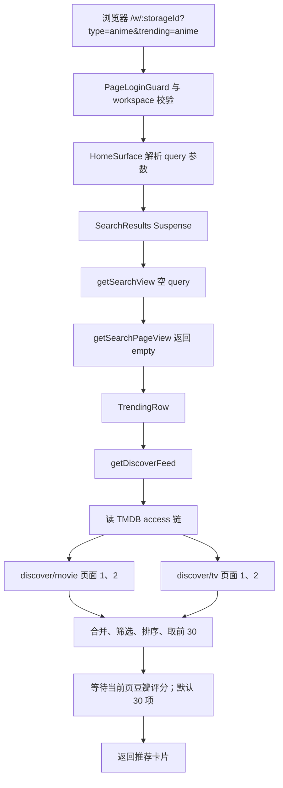
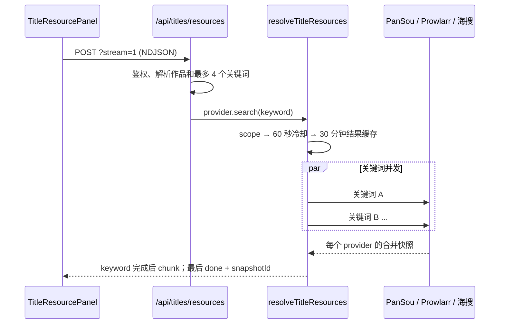

# 搜索页与资源查询加载速度调研

> 日期：2026-11-05
> 范围：`/w/:storageId?type=anime&trending=anime`、文本片名搜索，以及详情页手动资源搜索。
> 性质：只读代码和请求流程审计；本次未修改运行逻辑，也未运行测试或部署。

## 1. 结论

用户提供的 URL 没有 `q` 查询词，因此它首先是**动漫发现/推荐页**，不是 PanSou 资源搜索页。这个页面主要请求 TMDB `discover` 数据，并在卡片前等待豆瓣评分；详情页手动搜索资源才会访问 PanSou、Prowlarr 或海搜。

发现页存在值得优先验证的加载优化空间：

1. **豆瓣评分处于推荐卡片的串行渲染门槛之后，且超时没有覆盖完整响应体**：页面等 TMDB 卡片全部取回后，再对目标链接默认的 30 个条目并发查分，并等全部查分完成后才返回卡片。页面允许把每页大小调整到 50。代码设置了 2.5 秒定时器，但在 `fetch()` 收到响应头后、`response.json()` 读完响应体前就清掉定时器；响应体若停滞，不能保证 2.5 秒内结束。只有查到评分才写缓存，空结果下次会重新访问。默认冷缓存会产生 30 个上游请求突发；50 项页的突发更大。
2. **动漫页默认要取 4 个 TMDB 页面**：电影和剧集各取两个 API 页以填满默认 30 张卡片。4 个请求并发，但每个请求内部可能依次尝试用户密钥、环境密钥和代理；发生超时时，访问链会再完整尝试一次。发现流没有传入已有的失败访问记忆集合。
3. **当前定时预热与链接查询条件不一致**：Worker 只预热一个近期日语电视动画查询；链接页会查电影和剧集，并接受日语、中文、韩语动画。精确 KV 键不同，因此该链接不能命中这条动漫预热数据。Worker 对 miss 仍有按请求缓存和故障时返回旧数据的能力，但首个未缓存查询仍要回源。
4. **运行时数据缺少阶段耗时和缓存命中观测**：`fetchTmdbList` 返回解析后的 JSON，不向页面数据流传递 Worker 的 `X-Cache` 状态。当前无法仅靠页面结果区分“豆瓣冷查慢”“直连地址超时后回退”或“代理边缘缓存 miss”。

建议先解耦评分，再补齐可观测性，并统一发现查询与预热的 query key。无需先安装 React Query、SWR 或并发控制库；项目已有 Next.js Cache Components、SQLite JSON 缓存、Cloudflare Worker KV、TMDB 失败访问记忆、资源搜索缓存和 NDJSON 流。

## 2. 现场限制与证据范围

使用 Playwright 打开脱敏后的目标路由时，页面被访问密码门禁重定向到登录页；`/api/auth/me` 返回 401，`/api/auth/bootstrap` 返回 200。未使用真实登录凭据，因此本次**没有取得动漫推荐页的浏览器 waterfall 或真实 TTFB**。后续结论来自当前工作区的调用链、超时、缓存和流式实现；具体收益仍需登录后的冷/热缓存测量确认。

页面搜索骨架位于 `apps/web/app/page.tsx`。工作区入口先校验 storage scope，再复用 `HomeView`；这些入口在 `apps/web/app/w/[storageId]/page.tsx`。链接中的 `type=anime` 优先于 `trending=anime` 解析成类型筛选；未带 `q` 时进入发现流。

## 3. 当前查询与请求流程

### 3.1 链接对应的动漫发现页

关键代码路径：

- `apps/web/app/page.tsx:135-181`：解析账户、workspace 和 URL 参数；`:215-223` 在 `Suspense` 中加载搜索结果；`:383` 起是 `SearchResults`。
- `apps/web/lib/search-page.ts:39-73`：组装搜索 provider 与配置；即使 `q` 为空，也会先取得搜索 provider / TMDB access 配置。
- `packages/workflow/src/domain/search-view.ts:417-433`：规范化后发现 query 为空，直接返回 `empty`，不会调用 TMDB 文本搜索 provider。
- `apps/web/app/page.tsx` 的 `SearchResults` 在 `empty` 分支转入 `TrendingRow`；`apps/web/features/catalog/components/trending-row.tsx:139-174` 取发现卡片后等待豆瓣评分。
- `apps/web/features/catalog/application/trending-service.ts:303-333`：每种媒体类型按 TMDB 页大小 20 计算 API 页窗口并并发取页；`:379-391` 对动漫同时调用 movie 与 tv；`:438-452` 合并和本地筛选排序。

在默认 `pageSize=30`、`page=1` 下，每个媒体类型跨两个 TMDB 页，电影与剧集两类合计最多 4 个 `discover` 请求。它们通过 `Promise.all` 并发，所以不是 4 个页面按序相加；但每个请求的 access fallback 链自身是顺序尝试。

### 3.2 有输入词的作品搜索

`q` 有值时，`getSearchPageView` 先按 `query/page/pageSize` 查询 `getDurableJsonCache()`；命中后不再请求 TMDB。未命中时走 TMDB provider，失败后可回退 Douban search。搜索候选池缓存 TTL 为 6 小时，描述式查询另有 1 小时解释缓存。候选转换和作品状态读取完成后，页面仍会等待当前页的豆瓣评分（默认 30 条，最大 50 条）。

这一层已具备持久化查询缓存和 provider fallback。继续优化时应关注 cache miss 的请求合并（同一 key 同时 miss 是否重复请求）以及评分是否阻塞首批卡片，而非再造整套 query cache。

### 3.3 详情页手动资源搜索

该链路已有适配器、复合 provider、去重、冷却、正结果缓存及 NDJSON 增量 UI：

- `apps/web/features/acquisition/components/title-resource-panel.tsx:321-349` 发起 NDJSON 请求并逐行消费事件；状态映射在同文件 `mapResourceStreamEvent`。
- `apps/web/app/api/titles/resources/route.ts:239-273` 生成关键词、装配 provider 并启用 stream。
- `packages/workflow/src/providers/title-search-keywords.ts:23,90-111` 限制关键词最多 4 个。
- `packages/workflow/src/providers/title-resource-resolver.ts:67-165` 执行权限、冷却、缓存、关键词并发、去重和最终快照保存。
- `packages/workflow/src/providers/composite-provider.ts:18-63` 对配置的多个 provider 使用 `Promise.allSettled` 汇总；这提高故障容忍度，但单个 keyword 的完成时间仍受最慢 provider 影响，所以 keyword 级 NDJSON 不一定能越过慢源提前显示候选。

因此，用户给的动漫首页链接自身不触发 PanSou 搜索。若感知的是点击作品后的“搜资源”等待，优化重点应改为 provider 内部慢源与超时；若感知的是打开链接的首屏，则应先解决发现页查询和豆瓣评分渲染门槛。

## 4. 主要性能风险与欠缺

| 优先级 | 发现 | 代码证据 | 影响与判断 |
| --- | --- | --- | --- |
| P1 | 豆瓣评分阻塞卡片返回，响应体阶段没有有效超时，且空结果不缓存 | `features/catalog/core/douban-rating.ts:23-24,68-82,124-169`；`trending-row.tsx:172-174` | `clearTimeout` 在 `response.json()` 前执行；目标链接默认 30 个 lookup 并发（页面大小最大 50）。只有正评分写 7 天 SQLite 缓存，`null` 会重查。慢响应体可能让推荐区域一直等，并可触发上游突发。 |
| P1 | 用户链接的动漫筛选不命中 Worker 预热 feed | `features/catalog/application/trending-service.ts:379-391` 对 movie + tv 查询；`workers/tmdb-proxy/src/handler.ts:103-117` 仅预热三类 canonical feed | 预热动漫 query 只有近期日语电视动画；页面 query 是 movie + tv，原语言 `ja|zh|ko`，没有相同的近期日期/投票条件。查询语义不同，不应为缓存命中而静默缩窄内容。 |
| P1 | 发现流访问链没有传递 `deadAccesses` | `tmdb-provider.ts:76-151,452-458`；同文件 `:315,:428` 的 provider 类则会传失败集合 | 页面发现流的每个列表请求都独立调用 `fetchViaAccessChain`，而文本 provider 有共享的失败地址记忆。直连地址持续超时且配置了多个 access 时，可能重复付直连等待成本；超时场景还会完整再试一次。 |
| P2 | 每次空 query 页面仍装配文本搜索 provider | `lib/search-page.ts:39-73`；`search-view.ts:417-433` | 空 query 不会发 TMDB 文本搜索，但 provider 及 access 配置在 `getSearchPageView` 检查空 query 前已组装。是可测的局部 DB/配置开销，优先级低于外网等待。 |
| P2 | 缓存命中状态与阶段耗时未贯通页面 | `tmdb-provider.ts:452-458` 返回 `unknown` JSON；Worker `handler.ts:189-190,214-265` 产生 `X-Cache` | 无法直接用页面数据判定 HIT/MISS、哪个 access 成功及单阶段耗时，难以把用户反馈转成可回归指标。 |
| P2 | 资源复合搜索的 chunk 粒度在 keyword 而不是 provider | `title-resource-resolver.ts:110-129`；`composite-provider.ts:24-64` | 多 source 同时启用时，快的 PanSou 仍要等同 keyword 下较慢的 Prowlarr/海搜 settle，才产生该 keyword 的 chunk。流式协议存在，但还不是 source 级 first-result streaming。 |
| P3 | 动漫首页本地处理成本可能有余量，但未证明是主瓶颈 | `trending-service.ts:438-452` | 4 个页面合并、最多约 80 条过滤排序，通常远小于上游请求和豆瓣等待；不建议先引入虚拟列表或复杂状态管理。 |

## 5. 当前可复用基础设施与库评估

| 方案/库 | 当前状态 | 适合解决什么 | 本项目结论 |
| --- | --- | --- | --- |
| Next.js Cache Components (`use cache` / `cacheLife`) | `apps/web/next.config.ts:40-42` 已启用 `cacheComponents`；Next.js 16 官方 API 支持函数级缓存、TTL 与标签失效 | 在保留 Server Component/SSR 的同时缓存规范化的公共发现结果 | **首选候选**。只缓存不含账户私有状态的公共 TMDB 数据；请求 cookie、账户配置和 scope 留在缓存函数外。自托管默认运行时缓存有进程/内存边界；多副本或重启持久化要评估 handler。 |
| Cloudflare Worker KV | 已用于 TMDB 代理；支持 query 规范化、HIT/MISS/STALE、故障时旧值回退和定时预热 | 共享上游响应缓存、跨实例复用 | 已存在且非常适合保留。先让页面 query 与 canonical feed 策略对齐，并让应用可观测 cache status。KV 当前的预热不覆盖链接上的全部动漫变体。 |
| `SqliteJsonCache` | 已持久化缓存作品文本搜索和豆瓣正结果 | 单机服务的跨请求/重启缓存；已有 JSON key 和 TTL API | 可复用；发现页缓存应使用明确命名空间、canonical 参数及新鲜/过期语义，避免和搜索 query、评分 key 碰撞。 |
| TanStack Query | 未见为项目直接依赖或当前搜索页使用 | 客户端 query 去重、缓存、失效、后台刷新；SSR hydration | **不是首要修复**。此页面数据主要在服务端 Server Component 取回；客户端库不能自动消掉服务端 TMDB/Douban 请求。若后续把页面改为 client fetch，必须设定 `staleTime`/hydrate，防止首屏后立即重复查询。 |
| SWR | 未见为项目直接依赖或当前搜索页使用 | 客户端同 key 去重和后台 revalidation | 和 TanStack Query 一样，是可选的客户端状态库，不是后端访问链优化工具。只为这条服务端页面引入会扩大依赖和状态边界。 |
| `p-limit` / `p-map` / LRU 库 | 未发现直接依赖；依赖锁文件中的传递依赖不应被业务代码直接引用 | 控制动态规模的并发或进程内缓存 | 当前动漫发现默认最多 4 个请求，原生 `Promise.all` 足够。评分 API 是逐条请求，默认 30 项、最大 50 项；先在现有缓存层加单飞和明确并发上限，不需要先装库。 |
| Prowlarr API / Composite provider | 项目已有 Prowlarr Adapter、PanSou Adapter、Haisou Adapter 和 `CompositeResourceProvider` | 多个索引器并行搜索、统一结果模型和部分失败处理 | 继续复用当前 Adapter + Composite。考虑增加“每 source 完成事件”或有界搜索协调层前，先保留最终快照完整性和 `snapshotId` 导入校验。 |

### 主流模式对照

1. **Next.js Server Components + `Suspense`**：保持服务器取数与 UI chunk streaming；官方建议把慢数据放入靠近数据读取处的 `Suspense`，而不是让整段结果共同等待。当前结果整体位于一个 `SearchResults` 边界，评分也被 `TrendingRow` 的 await 合并在其内。
2. **Next.js `use cache` + `cacheLife`**：适合函数/组件级服务器数据缓存；项目已启用 Cache Components。与 URL 驱动的 server query 对齐成本低于引入 client query 状态库。
3. **SWR / TanStack Query stale-while-revalidate**：适合客户端重复访问同 key 数据、后台刷新和 UI 状态同步。前提是数据由客户端 fetch/hydration 管理；不应同时保留服务端必取和客户端 mount 立即重取。
4. **Prowlarr / Servarr**：成熟方案把多站点索引查询交给统一 API/聚合层。项目已经有对应 Adapter 和并行聚合，不缺“多源设计模式”；缺口是超时/部分结果的呈现粒度和可观测性。
5. **Edge KV cache 与 prewarm**：适合全球/跨实例共享公开元数据。本项目已实现；关键是 producer 与 consumer 使用同一个 canonical query builder，而不是多维护一套长得相似但不相等的动漫筛选。

## 6. 推荐方案与性能取舍

### 阶段 A：先拿到可靠基线

给 `getDiscoverFeed` 和搜索服务的关键阶段记录 `Server-Timing` 或结构化指标：`workspace/db`、`tmdb-access-resolution`、每个 TMDB hop 的耗时与结果类型、Worker `X-Cache`、Douban cache hit/miss、豆瓣批次耗时、结果数和总 SSR 时间。日志不写 token、账户密钥、原始 query 或完整 URL；可对 query 仅记录受控枚举、长度或不可逆短 hash。

采样目标至少覆盖登录后的目标 URL、TMDB edge 冷/热缓存、Douban 冷/热缓存、配置 direct key 与 proxy-only 两类，并记录 TTFB、推荐卡片首次可见、完整评分完成的 p50/p95。先测后定数字门槛，不沿用旧方案里未经测量的 `<800ms` 承诺。

### 阶段 B：解除评分关键路径

- 推荐卡片先用 TMDB 数据返回，豆瓣徽章显示占位或稍后补齐；可用嵌套 `Suspense` streaming，或独立评分批量 endpoint/client enrichment。
- 将评分 fetch 超时覆盖到完整 `response.json()` body 消费；可用 `AbortSignal.timeout` 或把 timer 清理移动到整个 fetch + parse 的 `finally`，并验证 header 到达后 body 卡住时仍会退出。
- 为同一个 `doubanCacheKey` 增加进程内 in-flight promise 合并，避免并发页面重复查同一标题。
- 仅正结果维持较长 TTL；把 `null`/无匹配/明确反爬结果用短 TTL sentinel 缓存（建议先评估 1-6 小时），并对整批设置并发上限，降低 30 请求 burst。
- 缓存未命中和上游失败都应 graceful degrade；不能让评分是否可用阻塞标题及海报。

### 阶段 C：统一发现 feed 查询合同并缓存

首选保留当前“动漫含电影与剧集，原语言 ja/zh/ko”的页面语义；不建议为了命中既有 Cron 而直接把内容缩成“仅近期日语电视动画”。

- 抽出单一纯函数生成 canonical discovery query；应用页和 Worker scheduled warm 共同复用同一 query spec/fixture，避免 anime filter 漂移。
- 为公共 feed 加应用层短 TTL cache（可先评估 15-60 分钟）并加同 key single-flight；key 包含 media type、country、genre、year、sort、page/window、pageSize、语言、schema 版本，不含账号私有数据和原始 token。
- 对最常见的默认 anime 组合预热 movie/tv 的必要页；任意国家/题材/年份参数仍按缓存 miss 懒加载。不要无界地为所有 filter 组合预热。
- 过期但已有结果时优先 stale-while-revalidate/serve-stale-on-error，避免缓存更新故障退化为空页面。可选 Next `use cache` 或 SQLite envelope；选一个作为应用侧 source of truth，Worker KV 作为上游共享层，不叠加多个含糊 TTL。
- 对 30 项页面可先保留现有 4 请求并行。减少到每类单页会提升首次响应但可能不足 30 条或改变跨页排序；应在产品确认分页/补齐行为后再改。

### 阶段 D：TMDB 失败访问记忆和资源搜索首批结果

- 让 discovery `fetchTmdbList` 复用与 `TmdbSearchProvider` 相同的失败 access 记忆或等效 circuit breaker；缓存键要区分 baseURL 与密钥身份但不能把密钥写日志。只短暂记住网络故障/超时，401/配置修复要能快速恢复，所有 endpoint 死亡后仍允许定期探活。
- 资源查询保留现有 keyword cap、每作品冷却、缓存和最终合并快照。若实测慢源拖住首批结果，再引入 SearchCoordinator 在 provider 子任务结束时发安全 preview chunk，最终统一生成/校验 snapshot；通过 AbortSignal 和总 deadline 取消超时工作，避免用户离开后浪费请求。
- 让 UI 状态机显式处理 `idle → loading → streaming → ready/partial`、`throttled`、`error`、`cancelled`，以 requestId 隔离过期事件。FSM 有助于竞态与错误恢复，但本身不会缩短网络时间；推荐页简单 GET 无须引入 FSM。

## 7. 设计模式建议

| 模式 | 当前状况 | 建议边界 |
| --- | --- | --- |
| Adapter | 已有 TMDB access、PanSou、Prowlarr、Douban 适配层 | 继续统一 request/result/error/timeout；不用再包一层泛化 adapter framework。 |
| Strategy | 类型筛选通过 `fetchTypedFeedCards` 分支，排序/过滤有纯函数 | 仅当 feed 语义或排序来源快速增加时，把 query plan 拆成命名策略；当前函数级纯逻辑可测试、够简单。 |
| Composite / Coordinator | 资源 provider 用 `CompositeResourceProvider` `Promise.allSettled`；TMDB movie+tv 用并发合并 | 应用层可加一个职责清楚的 SearchCoordinator 负责并发上限、期限、取消、部分结果和最终合并；避免同时再引入多层工厂/总线。 |
| FSM | 资源面板已有 `PanelState` 联合状态与 stream event mapper | 需要加取消、source partial、超时和重新搜索时才显式集中转移表。类型联合/mapper 已提供基础，不要把状态机应用到静态发现请求上。 |
| Cache-aside + stale refresh | 已有 SQLite TTL、Worker KV stale fallback | 对公开 feed 明确 freshness、负缓存和同 key 单飞；缓存 key 合同比再引入缓存库更重要。 |

## 8. 回归门禁与验证建议

实现阶段新增并运行以下聚焦门禁：

1. **请求矩阵测试**：`q` 为空时不得调用 TMDB 文本搜索；动漫发现默认 30 条时验证预期 movie/tv query、页窗口和并发数。
2. **预热合同测试**：应用实际产生的 canonical query key 与 Worker Cron 预热 key 一致；测试年份滚动边界、language、genre、country、page 和 pageSize，避免“看似同源但缓存永不命中”。
3. **豆瓣非阻塞测试**：上游延迟/超时不能延迟主卡片；响应头及时返回但 body 不结束时仍能超时退出；多相同 key 并发只发一次请求；空结果短缓存；批量并发不超过设定上限；评分故障仍渲染卡片。
4. **TMDB fallback 测试**：首 access 超时后回退一次；后续发现请求不重复已知死亡 hop；恢复探测能清除死标；`X-Cache` 与每阶段耗时可观测且不泄露 token/query。
5. **资源流测试**：多个 provider 延迟不应让快源 preview 永远等慢源；chunk 与最终快照 ID 一致；慢源超时产生 partial health；取消后忽略迟到 chunk；缓存、60 秒 cooldown 和 import scope 规则保持一致。
6. **页面级指标门禁**：登录态 E2E 记录目标 URL 的 TTFB、首卡片可见时间、评分完成时间、调用数量和冷/热缓存差异；使用实际环境采样建立阈值，而非凭感觉设置毫秒目标。

## 12. 实施记录（2026-11-05）

- `TrendingRow` 将评分查询移入嵌套 `Suspense`；TMDB 卡片先行渲染，Douban 请求完成后再替换评分徽章，超时或失败不会挡住卡片。
- Douban 超时计时器覆盖响应体 JSON 读取；增加 3 小时无结果缓存、同 key 单飞和每批最多 6 个并发请求。
- Worker Cron 除保留热门流外，新增页面动漫筛选默认首屏所需的 movie/tv 第 1、2 页预热，query 参数与 `buildDiscoverQuery` 一致；多页发现请求复用本次请求内的 TMDB dead-access set。
- 已增加豆瓣超时、负缓存、单飞、并发上限，Worker 预热 query 与 TMDB dead-access 记忆回归用例。
- 浏览器验收受登录态限制：此前访问目标页被重定向到 `/login`，当前不能在没有登录态的情况下测出实际首卡片/评分耗时或资源搜索分块耗时。资源多源首批结果仅在测量证实慢源阻塞后再改造；登录后应按第 8 节指标补做冷/热缓存页面验收。
- 开发环境部署最终完成，`mediary-dev` 为 running，独立复查 `/api/health` 返回 200，镜像构建指纹为本次 dirty workspace。首轮构建遇到镜像 registry `ECONNRESET`，同流程重试后依赖安装、Next.js 构建及 Worker 构建通过；部署脚本首轮 40 秒探针窗口未捕获就绪，但后续冒烟与独立探针均返回 200。

## 9. 相关已有文档

- [详情页资源搜索加速与豆瓣评分架构方案](../architecture/resource-search-speed-multi-tag-douban-and-ai-resilience.md)：早期方案已提出 NDJSON 渐进式搜索；当前代码已经有 keyword 级 streaming，需要按本次现状审计更新，而不是重复实现该功能。
- [资源搜索冷却倒计时与自愈方案](../architecture/resource-search-cooldown-countdown-and-auto-recovery-spec.md)：已有资源面板 FSM、冷却状态和 UI 行为设计。
- [资源搜索与获取全流程审计](../architecture/full-pipeline-audit-and-design-pattern-architecture.md)：记录 provider/cache/cooldown 的历史问题，可结合本次 source-level streaming 观察复核。

## 10. 外部参考

- [Next.js 16：`use cache`](https://nextjs.org/docs/app/api-reference/directives/use-cache) — 函数/组件缓存键、`cacheLife`、自托管内存边界与 remote handler。
- [Next.js：Fetching Data 与 Streaming](https://nextjs.org/docs/app/getting-started/fetching-data) — Server Component、Suspense streaming、请求并行与 uncached 数据行为。
- [Next.js：Revalidating](https://nextjs.org/docs/app/getting-started/revalidating) — Cache Components 的 freshness profile 与按 tag/path 失效。
- [SWR：Performance](https://swr.vercel.app/docs/advanced/performance) — key-based request deduplication 与减少重复请求。
- [TanStack Query：SSR](https://tanstack.com/query/latest/docs/framework/react/guides/ssr) — server hydration、`staleTime` 和缓存生命周期注意事项。
- [Prowlarr API 文档](https://prowlarr.com/docs/api/) — 公开 search API，用作成熟索引聚合入口参考。
- [Cloudflare Workers KV：How KV works](https://developers.cloudflare.com/kv/concepts/how-kv-works/) — Workers KV 面向读多写少并提供边缘读取性能，但具有 eventual consistency；适合 TMDB 这类公开 feed，不适合要求强一致的状态。
- [Cloudflare Workers KV 缓存外部 API 示例](https://developers.cloudflare.com/kv/examples/cache-data-with-workers-kv/) — 与项目现有公共 API 响应缓存的用途相符。
- [Cloudflare Workers Cache API](https://developers.cloudflare.com/workers/runtime-apis/cache/) — Cache API 与 KV 是不同层；项目现有 Worker KV stale 语义应看源码和 KV 设计，不应误套 Cache API 行为。
- [Cloudflare Cache Revalidation](https://developers.cloudflare.com/cache/concepts/revalidation/) — `stale-while-revalidate` 和 stale 数据更新行为。

## 11. 文件索引

| 文件 | 本次审计关注点 |
| --- | --- |
| `apps/web/app/page.tsx` | 搜索页参数解析、Suspense、推荐/文本搜索分支 |
| `apps/web/lib/search-page.ts` | TMDB 文本搜索 provider、durable cache 与 access 配置 |
| `apps/web/features/catalog/application/trending-service.ts` | TMDB Discover query、分页、电影/剧集动漫组合 |
| `apps/web/features/catalog/components/trending-row.tsx` | 推荐数据和评分的 await 边界 |
| `apps/web/features/catalog/core/douban-rating.ts` | 豆瓣超时、并发、正缓存/负缓存行为 |
| `packages/workflow/src/providers/tmdb-provider.ts` | access fallback、dead access memory、每 hop timeout |
| `workers/tmdb-proxy/src/handler.ts` | Worker cache key、prewarm feeds、KV stale fallback |
| `apps/web/app/api/titles/resources/route.ts` | 手动资源搜索 API 和 NDJSON 输出 |
| `packages/workflow/src/providers/title-resource-resolver.ts` | keyword 并发、冷却、缓存及 progress chunk |
| `packages/workflow/src/providers/composite-provider.ts` | 多 provider 并发与完整 snapshot 合并 |
