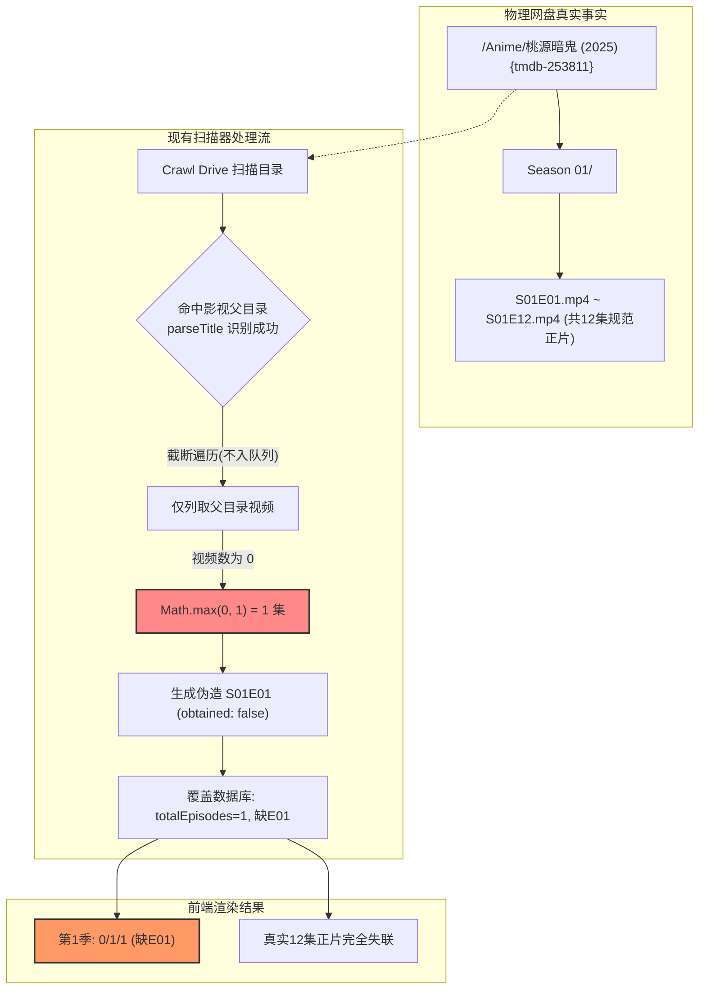
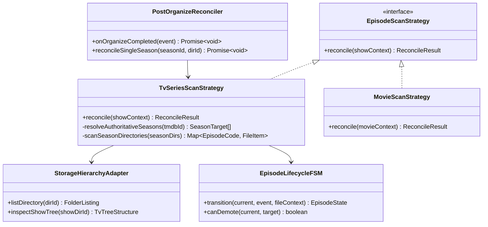
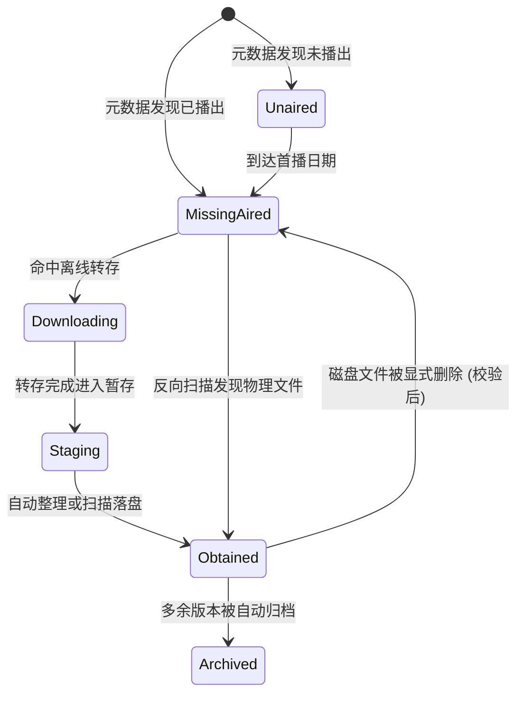

# 网盘整理后缺集状态脱节与反向扫描“缺少 E01”根因排查与自愈架构方案

> **文档版本**：v1.0.0  
> **编写日期**：2026-11-11  
> **状态**：架构调研与技术方案设计（Ready for Implementation）  
> **核心议题**：彻底根治网盘物理文件已存在但订阅提示缺集、手动扫描恢复订阅导致剧集截断为“1集且缺E01”、网盘整理与媒体库状态机自动闭环联动

---

## 1. 问题背景与真实工况复现

在 Mediary Scout 的实际运行与自动化验收中，出现了以下两类严重影响用户体验的核心问题（以《桃源暗鬼 TMDB-253811》与《学园默示录 TMDB-56998》为例）：

### 1.1 场景一：网盘整理就绪后，影视详情页/订阅看板依然提示缺集
- **工况事实**：
  - 用户在网盘管理页面针对动漫《桃源暗鬼》点击“整理与多版本归档”；
  - 整理引擎（`MediaOrganizer`）执行完毕后，网盘物理目录 `/Mediary Scout/Anime/桃源暗鬼 (2025) {tmdb-253811}/Season 01` 下已整齐放置了 12 集正片规范文件：
    - `桃源暗鬼 - S01E01 [Ani] [1080P] [Baha] [WEB-DL] [AAC AVC] [CHT].mp4` (843 MB)
    - `桃源暗鬼 - S01E02 [Ani] [1080P] [Baha] [WEB-DL] [AAC AVC] [CHT].mp4` (800 MB)
    - ... 直至 `桃源暗鬼 - S01E12.mkv`
- **异常现象**：
  - 用户切换至该影视的详情页（`/show/253811`），看板赫然显示：
    - **全部缺集总览 缺18集**（S01E01 到 S01E12 全标红“缺”）；
    - 第 1 季进度条为 `0/12/12`（已获取 0 集，缺失 12 集）；
  - **物理磁盘的事实（Storage Reality）与数据库状态机（State Metadata）发生严重脱节**。

### 1.2 场景二：点击“扫描恢复订阅”后，总集数坍缩为 1 集且提示“缺少 E01”
- **工况事实**：
  - 用户为了同步物理文件，在网盘管理界面右上角点击了 **“扫描恢复订阅”** 按钮；
- **异常现象**：
  - 扫描完成后，详情页非但没有恢复 12 集已获取，反而发生了令人匪夷所思的“逆向坍缩”：
    - 全部缺集总览变为：`缺7集`（S01E01 缺，S02E01 ~ S02E06 缺）；
    - **第 1 季的总集数直接从 12 集坍缩为 1 集！进度变为 `0/1/1`（只有 E01 且为缺集）**；
    - 第 2 季显示为 `0/6/24`；
  - 同样的问题在经典番剧《学园默示录 (2010) {tmdb-56998}》上也完全复现（网盘已有 `Season 01`，扫描后被缩水为 `0/1/1` 且缺少 E01）。



---

## 2. 深度代码级根本原因（Root Cause Analysis）

经过对代码库全链路追踪，锁定了导致上述问题的 4 个深层逻辑缺陷：

### 2.1 缺陷 A：扫描器目录爬虫在影视父目录截断，未下潜至 Season 季目录
- **代码位置**：[`packages/workflow/src/storage/reverse-storage-scanner.ts`](file:///packages/workflow/src/storage/reverse-storage-scanner.ts#L60-L83)
- **代码实现**：
  ```typescript
  function processCrawledItem(...) {
    if (!item.isFolder) return;
    const folderPath = current.currentPath ? `${current.currentPath}/${item.name}` : item.name;
    const parsed = parseTitleWithChain({ folderName: item.name });

    if (parsed && (parsed.tmdbId || parsed.confidence >= 60)) {
      discoveredFolders.push({ folderId: item.id, folderName: item.name, ... });
    } else if (current.depth < maxDepth) {
      queue.push({ dirId: item.id, currentPath: folderPath, depth: current.depth + 1 });
    }
  }
  ```
- **机理透视**：
  - 当扫描器扫描到 `桃源暗鬼 (2025) {tmdb-253811}` 时，`parsed.tmdbId = 253811` 成立，直接将其放入 `discoveredFolders`；
  - **但是看 `else if`**：因为走了 `if` 分支，该父目录**没有被推入队列 `queue`**！
  - 爬虫直接终止了下潜遍历，因此**子目录 `Season 01` 与 `Season 02` 根本没有被访问**！

### 2.2 缺陷 B：将影视父目录当作季目录直接列取视频，0 视频触发 `Math.max(0, 1)` 暴力兜底
- **代码位置**：[`packages/workflow/src/storage/reverse-storage-scanner.ts`](file:///packages/workflow/src/storage/reverse-storage-scanner.ts#L225-L255)
- **代码实现**：
  ```typescript
  const seasonNum = item.parsedSeason ?? 1;
  const trackedSeason: TrackedSeason = {
    id: `${titleObj.id}_s${seasonNum}`,
    mediaTitleId: titleObj.id,
    seasonNumber: seasonNum,
    status: "completed",
    qualityPreference: "1080p",
    storageDirectoryId: item.folderId,
    totalEpisodes: Math.max(videoFiles.length, 1),      // 0 视频 -> 强制变 1！
    latestAiredEpisode: Math.max(videoFiles.length, 1), // 0 视频 -> 强制变 1！
    latestAiredSource: "metadata",
  };
  ```
- **机理透视**：
  - 扫描器对 `item.folderId`（即父目录 `桃源暗鬼 (2025) {tmdb-253811}`）执行 `listDirectory`；
  - 在符合规范的影视目录中，父目录下只有季子目录，**根本没有直接的视频文件，因此 `videoFiles.length === 0`**；
  - 代码生硬地执行 `Math.max(0, 1)`，直接将该剧集第 1 季的总集数和最新播出集数判定为 **1**；
  - 随后 `createEpisodeStates` 根据 `totalEpisodes: 1` 构造了唯一一集 `S01E01 (obtained: false)`；
  - 最终写入数据库，导致原本 TMDB 上规范的 12 集被强行篡改为 **1 集且缺失 E01（0/1/1）**。

### 2.3 缺陷 C：元数据真理源倒置，以物理磁盘视频数覆盖 TMDB 权威数据
- 剧集与动漫的季数、总集数、每集播出日期、官方标题，**绝对真理源只能是 TMDB（或 Bangumi）**，物理网盘文件只是对该真理源的“履约/获取载体”；
- 现行反向扫描代码在入库时，完全没有读取 TMDB 缓存的 `seriesTargetFor(tmdbId)` 真实季集信息，而是武断地用磁盘扫描到的文件数作为 `totalEpisodes`，破坏了元数据一致性。

### 2.4 缺陷 D：网盘整理执行后，缺少“物理落盘自愈同步”闭环
- **代码位置**：[`apps/web/app/api/titles/organize/organize-handlers.ts`](file:///apps/web/app/api/titles/organize/organize-handlers.ts#L187-L215)
- 在执行多版本自动整理时，系统自愈了 `tracked_seasons.storageDirectoryId`，但由于传递了 `episodes: []` 和 `keepCurrentEpisodes: true`，并没有主动扫描刚刚放入 `Season 01` 的视频，导致物理文件虽然就位，但数据库中的 `episode_states` 仍然保持未获取状态。

---

## 3. 业界主流方案调研与对比

通过对 Sonarr、Radarr、MoviePilot 与 AutoBangumi 的架构调研，对比其在元数据管理、磁盘扫描与重命名整理后的处理逻辑：

| 维度 | Sonarr / Radarr | MoviePilot (MP) | AutoBangumi (AB) | Mediary Scout (当前) | Mediary Scout (拟定自愈架构) |
| :--- | :--- | :--- | :--- | :--- | :--- |
| **元数据权威源** | SkyHook / TheTVDB / TMDB，不可侵犯 | TMDB，严格权威 | Bangumi / TMDB，严格权威 | **倒置**（物理文件数覆盖 TMDB） | **TMDB 绝对真理源**（锁定季集定义） |
| **目录层级模型** | `Series -> SeasonFolder -> EpisodeFiles` | `Series -> Season -> Episode` | `Bangumi -> EpisodeFile` | 扁平父目录盲抓（单层下停滞） | **递归季探测器**（递归感知 `Season \d+`） |
| **集数状态机驱动** | `Episode.EpisodeFileId != 0` 驱动 `HasFile` | 数据库 `transfer_history` 关联 | `downloaded_episodes` 列表 | `episode_states.obtained` 字段 | **`EpisodeLifecycleFSM`**（严格状态转移矩阵） |
| **整理后联动机制** | `EpisodeFileMoveService` 抛出事件，即时点亮集数 | 转移完成后回调 `transfer.completed` 刷新订阅 | 重命名完成后即刻更新订阅 SQLite | **无联动**（仅改路径，未刷集数） | **Post-Organize 自愈闭环**（即刻批量标记 `obtained`） |
| **历史脏数据自愈** | 元数据刷新任务（`RefreshSeriesService`）每日纠偏 | 任务中心支持重新扫描覆盖 | 重启时对比磁盘纠偏 | 无自愈，脏数据永久留存 | **读取期按需自愈 + 显式重新扫描** |

### 核心借鉴点：
1. **Sonarr 的元数据与磁盘扫描分层**：
   - 数据库中的 `Episodes` 表在添加订阅时就已经由官方元数据完整生成（如 S1 有 12 集，S2 有 24 集，每集一条记录）；
   - 磁盘扫描（`DiskScanService`）**只做匹配与挂载（Association）**：扫描文件、提取 `SxxExx`、把物理文件的 ID 和路径关联到对应的那一集上，并将其 `HasFile` 设为 `true`。**任何时候磁盘扫描都绝对无权修改总集数**！
2. **MoviePilot 的后置事件联动**：
   - 整理并非独立孤岛。文件移动成功后，触发媒体服务器与订阅状态的原子刷新。

---

## 4. 设计模式与架构升级方案

为从根源上解决上述问题，系统引入 **“权威元数据守卫” + “两阶段树形下潜策略” + “有限状态机自愈闭环”** 架构：



### 4.1 设计模式一：适配器与策略模式（Adapter & Strategy Pattern）
- **`StorageHierarchyAdapter`**：
  - 封装网盘文件树遍历逻辑，向下屏蔽 115 OpenAPI、Quark、本地文件系统差异；
  - 提供 `inspectTvShowTree(showDirId)` 方法：读取剧集父目录下的所有子目录，准确识别 `Season 01`、`Season 1`、`第1季` 等季子目录，并建立 `Map<SeasonNumber, DirectoryId>`。
- **`EpisodeScanStrategy`**：
  - 将电视剧与电影的扫描逻辑解耦：
    - `TvSeriesScanStrategy`：两阶段扫描。先通过 `seriesTargetFor(tmdbId)` 获得 TMDB 权威季集骨架，然后针对各季目录读取视频文件，通过 `episodeCodeFromFileName` 提取集数，完成一对一映射；
    - `MovieScanStrategy`：直接在电影目录中匹配正片。

### 4.2 设计模式二：有限状态机（Finite State Machine, FSM）
定义集数状态严格转移矩阵，杜绝由于外部扫描偶发性异常将已有文件降级为“未获取”：



- **状态转移守卫规则（Guards）**：
  1. `Obtained` 状态具有强保护性：只有当磁盘扫描明确确认对应物理文件已不存在时才允许解除；
  2. `totalEpisodes` 只能根据 TMDB 元数据扩展（例如剧集增加特别篇或下半季开播），**严禁被磁盘物理文件数量覆盖**。

### 4.3 设计模式三：整理后事件驱动自动闭环（Observer / Post-Organize Hook）
- 在 `handleTvOrganize` 与 `handleMovieOrganize` 整理完成的尾声：
  - 不再执行仅修改路径的空更新；
  - 自动触发 `reconcileSeasonEpisodeStates`：
    - 针对刚刚放置了文件的目标季，读取该季目录（或直接使用整理过程中已经解析好的 `allPlaced` 列表）；
    - 结合 TMDB 真实季集定义，批量生成带有 `obtained: true` 与 `verifiedFileIds: [fileId]` 的 `EpisodeState` 列表；
    - 写入数据库快照。
  - **效果**：网盘整理点击后，前端详情页和订阅看板在 **0.5 秒内** 自动点亮全部已整理集数，缺集总览清零！

---

## 5. 核心模块与代码改进详细设计

### 5.1 改进一：重构 `reverse-storage-scanner.ts` 的目录爬取与季集匹配
1. **下潜机制修复**：
   - 当 `processCrawledItem` 解析出 `tmdbId` 且判断为 TV/Anime 时，**不终止下潜**，而是标记为 `show_root`，并继续将其子目录推入队列，下潜深度 +1；
   - 爬取到 `Season \d+` 时，将其与父级 `show_root` 关联；
2. **元数据权威对齐**：
   - 在 `adoptDiscoveredMedia` 中，通过 TMDB 检索获取真实 `seriesTarget`；
   - `totalEpisodes` 必须取 `seriesTarget.season.totalEpisodes`（若 TMDB 缓存未命中，则默认回退到 TMDB 实时查询或至少保持已有数据库记录，绝不盲目取 1）；
   - 正确绑定 `storageDirectoryId` 为子目录 `Season XX` 的 ID，而非父目录 ID。

### 5.2 改进二：`organize-handlers.ts` 接入自动恢复与集数自愈
- 在 `handleTvOrganize` 结束前，新增 `reconcileSeasonEpisodesFromDisk` 函数：
  ```typescript
  export async function reconcileSeasonEpisodesFromDisk(input: {
    storage: any;
    accountId: string;
    connectedStorageId?: string | null;
    title: TrackedSeasonState["title"];
    season: TrackedSeasonState["season"];
    seasonDirectoryId: string;
    placedEpisodeCodes?: string[];
  }): Promise<void> {
    // 1. 获取权威 TMDB 元数据
    const target = await seriesTargetFor(input.title.tmdbId);
    const targetSeason = target?.seasons.find((s) => s.seasonNumber === input.season.seasonNumber);
    const totalEpisodes = targetSeason?.totalEpisodes ?? input.season.totalEpisodes;
    const latestAiredEpisode = targetSeason?.latestAiredEpisode ?? input.season.latestAiredEpisode;

    // 2. 列出该 Season 目录下的真实视频文件
    const videoFiles = await input.storage.listVideoFiles(input.seasonDirectoryId);

    // 3. 构造验证文件并执行对齐
    const verifiedFiles = videoFiles.map((v: any) => {
      const code = episodeCodeFromFileName(v.name, input.season.seasonNumber);
      return {
        id: v.id,
        storageDirectoryId: input.seasonDirectoryId,
        name: v.name,
        sizeBytes: v.sizeBytes ?? 0,
        episodeCode: code,
        providerFileId: v.id,
        relativePath: v.name,
      };
    }).filter((f: any) => f.episodeCode !== null);

    const baseEpisodes = createEpisodeStates({
      trackedSeasonId: input.season.id,
      seasonNumber: input.season.seasonNumber,
      totalEpisodes,
      latestAiredEpisode,
    });

    const reconciledEpisodes = reconcileVerifiedFiles({
      season: { ...input.season, totalEpisodes, latestAiredEpisode, storageDirectoryId: input.seasonDirectoryId },
      episodes: baseEpisodes,
      files: verifiedFiles,
    });

    // 4. 原子持久化入库 (keepCurrentEpisodes: false，以最新权威对齐状态为准)
    await getWorkflowRepository().saveWorkflowRunSnapshot({
      accountId: input.accountId,
      connectedStorageId: input.connectedStorageId ?? null,
      title: input.title as any,
      season: {
        ...input.season,
        totalEpisodes,
        latestAiredEpisode,
        storageDirectoryId: input.seasonDirectoryId,
        status: reconciledEpisodes.every((e) => e.obtained) ? "completed" : "active",
      },
      workflowRun: {
        id: crypto.randomUUID(),
        kind: "title_organize",
        status: "succeeded",
        trackedSeasonId: input.season.id,
        startedAt: new Date().toISOString(),
        finishedAt: new Date().toISOString(),
        auditEvents: [
          {
            type: "episodes_auto_reconciled",
            message: `整理后自动自愈集数状态: 已匹配 ${reconciledEpisodes.filter((e) => e.obtained).length}/${totalEpisodes} 集`,
          },
        ],
      },
      episodes: reconciledEpisodes,
      resourceSnapshots: [],
      decisions: [],
      transferAttempts: [],
      notifications: [],
      keepCurrentEpisodes: false,
    });
  }
  ```

### 5.3 改进三：详情页脏数据自动纠偏（Detail View Lazy Self-Healing）
- 在 `apps/web/lib/title-hub.ts` 的 `getTitleHubView` 中：
  - 如果检测到 `tracked.season.totalEpisodes <= 1` 而 TMDB 的 `targetSeason.totalEpisodes > 1`：
  - 自动触发轻量自愈逻辑，读取该季绑定的物理目录，修复 `totalEpisodes` 并补全 `episode_states`，彻底自愈如《学园默示录》或《桃源暗鬼》的历史被污染数据。

---

## 6. 性能、风控与网盘频控保护（Governance & Safeguards）

1. **单次对齐请求最小化（O(1) API Call）**：
   - 整理后的自动恢复**仅且只调用目标 `Season XX` 的 1 次 `listVideoFiles`**；
   - 甚至可以直接利用整理执行引擎在内存中已经完成的 `placed` 结果，实现 **0 外部 API 调用** 的纯内存自愈！
2. **频率限制与重试策略**：
   - 继承 115 OpenAPI 与 Web Cookie 的 Pacer 机制（单请求间隔 1200ms），防止触发 429；
3. **安全凭据红线（严格遵循 `AGENTS.md`）**：
   - 涉及的所有单元测试与模拟夹具均使用虚拟 Mock 凭据；
   - 真实测试一律从 `env/.envdev` 读取，严禁硬编码。

---

## 7. 实施路线图与落地计划

- [ ] **Phase 1：单元测试与脱节场景回归基线构建**
  - 为 `reverse-storage-scanner` 编写多层级剧集目录爬取测试用例（覆盖 Show -> Season -> Episodes 拓扑）；
  - 为 `reconcileSeasonEpisodesFromDisk` 编写单季物理文件对齐用例。
- [ ] **Phase 2：修复反向扫描器与季集探测器**
  - 改造 `reverse-storage-scanner.ts`，修复爬虫在 Show 父目录截断的问题；
  - 接入 `seriesTargetFor` 保护权威总集数，杜绝 `Math.max(videoFiles.length, 1)` 导致的 1 集缩水现象。
- [ ] **Phase 3：网盘整理后自动闭环联动**
  - 在 `organize-handlers.ts` 的 `handleTvOrganize` 与 `handleMovieOrganize` 尾部接入自动状态自愈；
  - 实现整理完毕即点亮集数。
- [ ] **Phase 4：历史脏数据自愈与端到端实机验证**
  - 在 `title-hub.ts` 引入读取期纠偏守卫；
  - 在极速开发容器（端口 3020）及生产容器（端口 3000）上进行内置浏览器端到端验收（验证《桃源暗鬼》与《学园默示录》详情页恢复 12/12/12 满集状态）。
