# STRM 播放基址解析为 127.0.0.1 异常与批量替换失效根因调研及解决方案规范

> **文档状态**：调研与解决方案已就绪  
> **涉及模块**：`apps/web/features/strm/`、`packages/workflow/src/strm/`、`apps/web/lib/background-worker.ts`、`apps/web/app/api/strm/`  
> **关键词**：STRM 虚拟流媒体、播放基址 (Base URL)、127.0.0.1 回退陷阱、极速批量修改、后台周期覆写、SSOT 状态持久化  

---

## 一、 问题现象与用户困惑剖析

用户在使用 **巡影 (Mediary Scout)** 的 STRM 任务中心时遇到以下核心矛盾与困惑：

```
为什么生成的 strm 文件 url 是 127.0.0.1？配置中明明正常，并且点击「开始批量替换」也没有用？
```

### 1. 现象 1：生成的 .strm 文件内容开头总是 `http://127.0.0.1:3000/...`
- **直接后果**：当用户的 Apple TV、智能电视、手机或外部 Emby/Jellyfin 客户端读取该 `.strm` 文件并发起播放请求时，播放器实际上向**客户端自己的本地回环地址（127.0.0.1）**发起了请求，导致网络连接被拒（`ECONNREFUSED`），影视完全无法播放。

### 2. 现象 2：用户感知中“配置明明是正常的”
用户之所以认为“配置中正常”，源于系统交互与界面反馈带来的**强烈心智错觉**：
1. **浏览器访问与系统运行完全正常**：用户是通过局域网 IP（如 `http://192.168.1.100:3000`）正常打开、登录并使用 Mediary Scout 的，界面各项监控与状态均正常。
2. **弹窗输入框默认回填正常**：用户打开「极速批量修改播放基址」弹窗时，前端代码通过 `window.location.origin` 自动捕获了当前浏览器的访问地址（例如 `http://192.168.1.100:3000`），并清晰回填在「新播放基址」输入框中，下方标注 *“当前页面访问基址已默认回填，可直接使用”*。用户误以为该地址已经是系统的生效配置。
3. **设置中心缺少自身基址配置**：用户在 `/settings` 查验，发现 PanSou、LLM、TMDB 等配置全部正常且连通。但系统中**根本没有提供一个叫“本服务对外播放基址 / STRM Base URL”的配置项**，让用户误以为系统会自动按访问基址处理。

### 3. 现象 3：用户点击弹窗中的「开始批量替换」后感觉“完全没有用”
即使在弹窗中点击了「开始批量替换」，用户很快发现问题依旧，体感上“毫无效果”。

---

## 二、 深度技术根因溯源（Code-Level Root Cause）

经过对代码调用链、Docker 容器隔离层、进程生命周期以及文件写入机制的逐行代码审计，查明该问题是由**四大核心设计缺陷**叠加造成的系统性问题：

```mermaid
sequenceDiagram
    autonumber
    actor User as 用户 (浏览器 192.168.1.100:3000)
    participant UI as STRM 弹窗 (strm-schedule-view)
    participant API as /api/strm/replace-base-url
    participant Disk as 本地磁盘 /app/data/strm/*.strm
    participant Worker as 后台常驻定时扫描 (background-worker)
    participant Scanner as StrmScanner (strm-runner-service)

    User->>UI: 点击「极速批量修改播放基址」
    UI->>API: POST { newBaseUrl: "http://192.168.1.100:3000" }<br/>(注意：未携带 directoryPaths)
    API->>Disk: 仅执行内存正则重写 .strm 文件前缀<br/>(未持久化到数据库，未写环境变量！)
    API-->>UI: 200 OK (updated: 42)
    Note over Disk: 此时磁盘文件已变为 192.168.1.100:3000
    
    rect rgb(60, 20, 20)
    Note over Worker,Scanner: 【致命覆盖陷阱】后台轮询周期到达 (如 360 分钟或入库自动化)
    Worker->>Scanner: runDueStrmTasks() -> executeStrmTaskScan()<br/>(未传 baseUrl 参数！)
    Scanner->>Scanner: 尝试读取 process.env.APP_BASE_URL (未配置)<br/>-> 强制回退为 http://127.0.0.1:3000
    Scanner->>Disk: incremental_update 比对：磁盘内容 != playUrl (127.0.0.1)
    Scanner->>Disk: 【无情覆写】重新将全部 .strm 文件写回 127.0.0.1:3000！
    end

    User->>Disk: 再次打开文件或在播放器中播放
    Note over User,Disk: 惊愕地发现文件又变成了 127.0.0.1！用户判定：点击替换没用！
```



### 1. 根因一：后台调度上下文“失忆”与 127.0.0.1 强制兜底
在 `apps/web/features/strm/application/strm-runner-service.ts` 的第 123-127 行中：
```typescript
const baseUrl =
  options?.baseUrl ||
  process.env.APP_BASE_URL ||
  process.env.MEDIARY_URL ||
  `http://127.0.0.1:${process.env.PORT || "3001"}`;
```
在后台周期的 `runDueStrmTasks`（第 198-204 行）及入库自动化 `worker-runner-service.ts`（第 216 行）触发时：
1. **无 HTTP 请求上下文**：后台定时 Worker 是纯宿主/进程内循环，没有前端的 Request 对象，无法获取 `request.nextUrl.origin`，导致 `options?.baseUrl` 为 `undefined`。
2. **容器环境变量缺失**：在 `Dockerfile.dev`、`deploy-remote.ps1` 和 `docker-compose.yml` 中，**从未向容器注入过 `APP_BASE_URL` 或 `MEDIARY_URL` 环境变量**。
3. **死锁于 127.0.0.1**：容器内部环境变量仅有 `PORT=3000`，因此必然回退为 `http://127.0.0.1:3000`。任何自动生成的 STRM 链接全部为 `127.0.0.1`。

### 2. 根因二：批量替换仅修改静态磁盘，未修改 SSOT（Single Source of Truth）
- 查看 `apps/web/app/api/strm/replace-base-url/route.ts` 和 `packages/workflow/src/strm/base-url-replacer.ts`：
  - 该功能设计初衷是“毫秒级原地文本正则重写”，它遍历磁盘上的 `.strm` 文件，替换首行 URL 前缀。
  - **致命疏漏**：它**没有将用户指定的 `newBaseUrl` 持久化到数据库（`app_settings` 表或 `strm_tasks` 表）**。
- 这造成了**状态分裂（State Divergence）**：磁盘上的状态被改为了 `192.168.1.100:3000`，但系统核心数据库与任务引擎中依然认为基址是“未配置”。

### 3. 根因三：增量更新机制（Incremental Update）的无情“反向自愈”
在 `packages/workflow/src/strm/strm-scanner.ts` 的第 196-207 行：
```typescript
} else if (task.scanMode === "incremental_update" || task.scanMode === "full_sync") {
  try {
    const currentContent = fs.readFileSync(targetFullPath, "utf8").trim();
    if (currentContent !== playUrl.trim()) {
      await writeStrmFile({ targetFilePath: targetFullPath, playUrl });
      result.updatedCount++;
      result.generatedPaths.push(targetFullPath);
    }
  } catch {
    // non-blocking
  }
}
```
- 当用户刚刚通过批量替换把磁盘上的文件改写为 `http://192.168.1.100:3000` 后；
- 下一次后台定时扫描（`runDueStrmTasks`）或入库联动触发；
- 由于系统仍然读不到配置，计算出的预期 `playUrl` 依然是 `http://127.0.0.1:3000/...`；
- Scanner 比较 `currentContent`（`192.168.1.100`）与 `playUrl`（`127.0.0.1`），判定两者不一致，**于是立即执行自动覆盖，把所有文件重新刷回 127.0.0.1**！
- 用户再次查看文件，看到的依然是 127.0.0.1，误以为之前的替换操作“根本没生效”。

### 4. 根因四：前端 Payload 缺漏导致多用户/租户任务目录汇聚脱节
在前端 `apps/web/features/strm/components/strm-schedule-view.tsx` 的第 100-111 行：
```typescript
const payload: { newBaseUrl: string; directoryPath?: string } = {
  newBaseUrl: newBaseUrl.trim(),
};
if (useCustomDir && customDirectory.trim()) {
  payload.directoryPath = customDirectory.trim();
}
```
- 前端弹窗中已经通过 `tasks` 汇总出了具体的任务输出目录（例如 `data/strm/kk_anime` 和 `data/strm/anime`）。
- 但在默认未勾选“自定义特定目录”提交时，**前端并没有把这组目录通过 `directoryPaths` 发送给后端**！
- 后端 `/api/strm/replace-base-url` 走入 `else` 分支，依赖后端当前会话的 `accountId` 执行 `repo.listStrmTasks(accountId)`。如果当前处于单机混淆账户、Demo 模式或跨租户上下文，导致后端查出的目录集与前端看到的产生偏差甚至返回空，替换动作便会落空。

---

## 三、 业界主流方案调研与对比 (Industry Benchmark)

针对媒体聚合与 STRM 虚拟流管理系统，调研业界知名项目的解决范式：

| 项目 / 方案 | 播放基址决策机制 | 批量修改基址处理策略 | 评价与适用性 |
| :--- | :--- | :--- | :--- |
| **LitePan (轻盘)** | 核心配置项 `ServerURL / BaseURL`，存入 SQLite 配置表。<br/>扫描与生成 STRM 时以该配置为**绝对第一优先级**。 | 提供“重写播放基址”功能，执行时**同时修改磁盘文件并同步更新数据库全局 BaseURL**。 | **本项目直接参考标杆**。架构清晰，彻底杜绝后台覆盖反弹。 |
| **AList** | 在“站点配置”提供 `Site URL (WebDav/播放基址)`。<br/>若未配，取首个管理登录请求的 Host 建议填入。 | 虚拟文件系统实时 302 重定向，无需频繁落盘修改实体文件。 | 适合直链挂载网盘，不适合纯 STRM 离线文件方案。 |
| **MoviePilot / Nastool** | STRM 插件显式要求填写：<br/>1. 挂载路径映射<br/>2. 串流播放地址（必须包含外部 IP/域名）。 | 任务与全局双层配置。修改时触发全量同步并更新数据库。 | 配置项完备，但配置门槛高，缺乏自动化推断。 |
| **Mediary Scout (当前状态)** | 依赖内存/环境变量兜底（`127.0.0.1`），无数据库持久化。 | 仅进行纯磁盘正则文本改写，未修改持久化配置。 | **存在配置断层与覆写漏洞，亟需标准化改造**。 |

---

## 四、 当前系统已有基础设施复用评估 (Reusability Audit)

系统已有成熟的底层机制，**完全无需引入额外的第三方重型依赖**：

1. **配置持久化底座（可直接复用）**：
   - 路径：`packages/workflow/src/persistence/sqlite.ts` 与 `repository.ts`
   - 能力：具备 `app_settings` 单表 Key-Value 引擎，提供 `repo.getSetting(key)` 与 `repo.setSetting(key, value)`，以及多租户 `getAccountSetting / setAccountSetting`。
   - 现成参考：`pansou_base_url`、`llm_base_url`、`api_key` 均已在该机制上稳定运行。
2. **高效正则文本替换引擎（可直接复用）**：
   - 路径：`packages/workflow/src/strm/base-url-replacer.ts`
   - 能力：`replaceBaseUrlInFiles` 与 `replaceBaseUrlInDirectories` 经过完整单测，具备秒级扫描、去重、换行符清洗能力。
3. **安全路径沙箱（可直接复用）**：
   - 路径：`packages/workflow/src/strm/output-path.ts`
   - 能力：`resolveStrmOutputPath` 已具备相对路径校验与 `data/` 目录防符号链接逃逸保护。
4. **前端弹窗与交互（可直接复用）**：
   - 路径：`apps/web/features/strm/components/strm-schedule-view.tsx`
   - 能力：`StrmReplaceBaseUrlModal` 具备完整的 Portal 弹窗、自动提取 `window.location.origin` 的能力。

---

## 五、 具体架构级解决方案 (Implementation Blueprint)

为根治该问题，推行**“持久化双写、全局基址 SSOT、上下文注入自愈”**三位一体的解决方案：

### 阶段 1：设立持久化配置键与统一获取逻辑 (SSOT)
1. **定义全局配置键**：
   在 `packages/workflow/src/strm/strm-types.ts`（或 `packages/shared`）中声明常量：
   ```typescript
   export const STRM_BASE_URL_SETTING_KEY = "strm_base_url";
   ```
2. **实现统一的基址解析函数 (`resolveStrmBaseUrl`)**：
   解析优先级遵循：
   $$\text{显式参数} \succ \text{数据库设置 (strm\_base\_url)} \succ \text{环境变量 (APP\_BASE\_URL / MEDIARY\_URL)} \succ \text{自适应外网/内网IP} \succ \text{兜底警告}$$
   
   ```typescript
   export async function resolveEffectiveStrmBaseUrl(
     repo: WorkflowRepository,
     explicitUrl?: string,
   ): Promise<string> {
     if (explicitUrl?.trim()) {
       return normalizeBaseUrl(explicitUrl.trim());
     }
     const dbValue = await repo.getSetting(STRM_BASE_URL_SETTING_KEY);
     if (dbValue?.trim()) {
       return normalizeBaseUrl(dbValue.trim());
     }
     const envValue = process.env.APP_BASE_URL || process.env.MEDIARY_URL;
     if (envValue?.trim()) {
       return normalizeBaseUrl(envValue.trim());
     }
     // 严禁默默回退为 127.0.0.1，必须在日志中输出警告，并返回内网/宿主建议地址
     console.warn("[STRM] Warning: No strm_base_url configured in DB or ENV. Falling back to local port, which will be unplayable on external devices!");
     return `http://127.0.0.1:${process.env.PORT || "3000"}`;
   }
   ```

### 阶段 2：改造「极速批量修改播放基址」API 为双写模式 (Dual-Write)
修改 `apps/web/app/api/strm/replace-base-url/route.ts`：
1. **磁盘文件改写**：调用 `replaceBaseUrlInDirectories` 批量更新现存 `.strm` 文件；
2. **配置持久化同步**：将本次用户提交的 `newBaseUrl` 写入数据库：
   ```typescript
   await repo.setSetting(STRM_BASE_URL_SETTING_KEY, body.newBaseUrl.trim());
   ```
3. **前端 Payload 修复**：
   在 `strm-schedule-view.tsx` 中，默认提交时显式携带前端已汇聚的 `directoryPaths: taskDirs`，实现端到端所见即所得。

### 阶段 3：后台任务与 Worker 自动化链路接入 SSOT
1. **后台周期扫描 (`runDueStrmTasks`)**：
   调用前先从 `repo` 读取有效 Base URL，作为 `baseUrl` 传入 `executeStrmTaskScan`。
2. **入库自动联动 (`worker-runner-service.ts` / `triggerPostIngestSync`)**：
   读取全局持久化的 `STRM_BASE_URL_SETTING_KEY`，确保入库生成的影视 STRM 与用户设置保持一致。

### 阶段 4：系统设置中心暴露「播放基址」全局控制
在 `/settings`（`apps/web/app/settings/page.tsx`）的系统设置区域，新增「STRM 播放对外基址」设置卡片：
- 允许用户查看当前生效值（来源于 DB 或 ENV）；
- 允许用户主动修改并保存；
- 提供“一键同步至本地全部已存 .strm 文件”快捷联动按钮。

---

## 六、 质量门禁设计与防回归测试规范 (Quality Gates & Guardrails)

为确保同类“动态上下文丢失”与“离线定时任务覆写”问题不再发生，建立三道防回归测试与质量门禁：

### 1. 静态代码扫描门禁 (Static Linter Gate)
在 `tools/gates/` 新增 `check-strm-base-url-safety.mjs`，并挂载至 `npm run gate`：
- **检查规则**：严禁在 `strm` 或 `worker` 核心执行链中使用没有兜底防御的硬编码 `http://127.0.0.1`。
- **违规阻断**：若在生成或扫描流程中直接使用字符串字面量 `"http://127.0.0.1"` 作为无条件 fallback，门禁直接报错中断构建。

### 2. 单元与集成测试用例 (Unit / Integration Tests)
在 `packages/workflow/src/strm/base-url-replacer.test.ts` 与 `apps/web/features/strm/application/strm-runner-service.test.ts` 中新增以下关键断言：

```typescript
describe("STRM Base URL Persistence and Anti-Revert Protection", () => {
  it("批量修改基址后必须持久化至数据库，且后续定时任务不得回退覆写", async () => {
    // 1. 初始化生成初始 strm 文件 (旧地址)
    // 2. 调用 replaceBaseUrlInDirectories 并持久化设置至 repo
    // 3. 模拟后台定时扫描 runDueStrmTasks() 再次触发
    // 4. 断言：磁盘上的 .strm 文件内容依然保持为新地址，绝不退回 127.0.0.1！
  });

  it("当未配置环境变量时，必须优先命中数据库中的 STRM_BASE_URL_SETTING_KEY", async () => {
    // 断言数据库配置的绝对优先级
  });
});
```

### 3. 端到端实机验收门禁 (MCP / Playwright Smoke)
参照 [AGENTS.md](file:///AGENTS.md) 第 5 节规范：
- 通过 Chrome DevTools MCP 打开 `/storage/strm`；
- 打开批量替换弹窗，将地址修改为 `http://192.168.1.100:3000` 并提交；
- 触发任务手动全量镜像扫描，并通过穿透探针检查容器内文件首行；
- 确认全流程无未捕获异常，且文件首行严格匹配目标前缀。

---

## 七、 总结

| 核心维度 | 现状诊断 | 改造后规范 |
| :--- | :--- | :--- |
| **为什么是 127.0.0.1** | 后台任务脱离 HTTP 上下文，无 ENV 注入，代码死锁回退至 `127.0.0.1:3000`。 | 引入 `strm_base_url` 数据库持久化，离线 Worker 严格按全局配置执行。 |
| **为什么配置正常** | 浏览器访问正常且弹窗自动回填当前 URL，造成“已生效”的心智错觉。 | 弹窗中明确标注“当前数据库配置”与“本次替换将同步保存至系统设置”。 |
| **为什么点击替换没用** | 只改磁盘文件未改数据库；后台定时扫描比对不一致，又反向强行改回 127.0.0.1。 | 批量替换升级为“改文件 + 写 DB 配置”原子双写，后台扫描直接对齐新配置。 |
| **防回归保障** | 缺乏针对离线定时覆盖的断言。 | 建立静态代码门禁与定时覆写防反弹集成测试。 |
