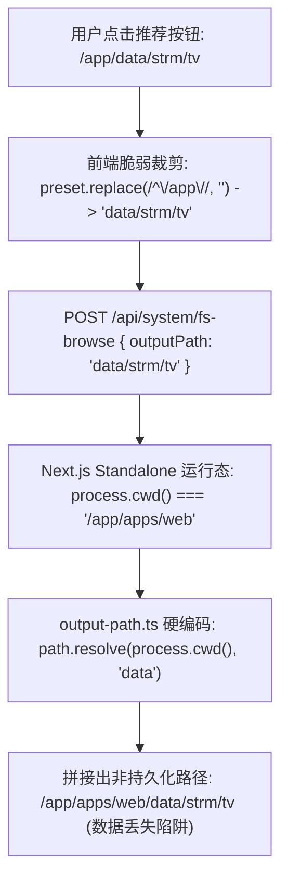

# STRM 本地存储路径 Monorepo CWD 漂移根因分析与绝对路径单源治理方案

> **核心议题**：彻底根治 STRM 路径选择弹窗点击推荐路径 `(/app/data/strm/tv)` 后错误创建为非持久化目录 `/app/apps/web/data/strm/tv` 的 CWD 漂移漏洞，建立基于 Docker 卷与应用根目录的单源权威解析机制（SSOT Data Root）。

---

## 1. 问题现象与严重性

### 1.1 问题复现现象
在“可视化选择本地 STRM 存储目录”弹窗中：
- 顶部预设推荐按钮标明：
  - 电影：`/app/data/strm/movies`
  - 剧集：`/app/data/strm/tv`
  - 动漫：`/app/data/strm/anime`
- 用户点击“剧集 (`/app/data/strm/tv`)”按钮后，弹窗下方显示的“当前位置”与服务端创建的真实目录却变成了：
  ```text
  当前位置: /app/apps/web/data/strm/tv
  ```

### 1.2 严重后果与安全隐患
1. **数据卷逃逸与文件丢失**：
   - 宿主机的数据卷挂载点为 `/var/docker/mediary-data` $\rightarrow$ 容器内 `/app/data`；
   - `/app/apps/web/data` 位于容器内部镜像临时可写层（OverlayFS），**完全没有被持久化挂载**；
   - 一旦升级镜像或执行 `docker rm -f mediary` 重建容器，写入 `/app/apps/web/data/strm/` 下的所有 STRM 虚拟流媒体文件将**全部物理灭失**！
2. **前端交互违和**：
   - 界面上向用户承诺的是 `/app/data/strm/tv`，结果界面却跳出多了一级 `apps/web` 的怪异路径，破坏了系统的专业性与可信度。

---

## 2. 深入技术根因剖析（Root Cause Analysis）

问题由以下三层技术错位叠加产生：



### 2.1 根因一：Next.js Standalone 架构导致的 CWD 漂移（Monorepo Workspace Drift）
- 在 `Dockerfile` 中，容器启动命令为 `CMD ["node", "apps/web/server.js"]`；
- Next.js Standalone 机制在 `apps/web/server.js` 启动的第一行会自动执行：
  ```javascript
  process.chdir(__dirname); // 强制将工作目录切换到 apps/web
  ```
- 结果导致在整个生产运行时中，`process.cwd()` 返回的**永远不是应用根目录 `/app`，而是 `/app/apps/web`**！

### 2.2 根因二：`output-path.ts` 硬编码 `process.cwd()` 并禁止绝对路径
- 在 `packages/workflow/src/strm/output-path.ts` 中：
  ```typescript
  const PROGRAM_ROOT = path.resolve(process.cwd());
  const DATA_ROOT = path.join(PROGRAM_ROOT, "data");
  ```
  模块在顶层求值，直接将 `DATA_ROOT` 绑定到了 `/app/apps/web/data`。
- 更严重的是，该模块用正则**强制禁止了一切绝对路径**：
  ```typescript
  if (!value || path.isAbsolute(value) || /^[A-Za-z]:\//.test(value)) {
    throw new Error("STRM 输出目录必须是程序目录下的相对路径，例如 data/strm/movies");
  }
  ```
  这是一种典型的反模式过度防御：容器和 NAS 环境中最常用、最可靠的正是绝对路径，强行禁止绝对路径导致调用方只能传相对路径。

### 2.3 根因三：前端弹窗的“截断适配”削足适履
- 在 `apps/web/features/strm/components/local-folder-picker-modal.tsx` 中：
  ```typescript
  body: JSON.stringify({ mode: "ensure-output", outputPath: preset.replace(/^\/app\//, "") })
  ```
  前端为了通过后端的相对路径校验，自作聪明地用正则截掉了 `/app/`，从而送入了错误的相对路径 `"data/strm/tv"`，最终落入 `process.cwd()` 拼接的陷阱。

---

## 3. 业界主流方案对比与借鉴

| 维度 | 方案 A：盲目信任 `process.cwd()` (当前缺陷实现) | 方案 B：Monorepo 祖先目录自愈探测 | 方案 C：SSOT 数据根目录权威解析 (业界推荐最优解) |
| :--- | :--- | :--- | :--- |
| **代表产品** | 玩具级 Node 脚本 | Turborepo / Nx (`find-up`) | Jellyfin (`JELLYFIN_DATA_DIR`)、Radarr/Sonarr、Plex |
| **路径定位** | `path.join(process.cwd(), "data")` | 向上遍历 `package.json` | 环境变量 `MEDIA_TRACK_DATA_DIR` $\rightarrow$ `/app/data` $\rightarrow$ 开发态自愈 |
| **绝对路径支持** | ❌ 抛出异常拒绝 | ⚠️ 仅部分支持 | ✅ 原生支持标准绝对路径与容器卷挂载 |
| **容器卷持久性** | ❌ 漂移至未挂载的镜像层，重启即丢 | ⚠️ 依赖目录探测，易受软链接干扰 | ✅ 100% 精准落在挂载卷 `/app/data`，永不丢数据 |
| **维护负担** | 极高，不同运行时行为各异 | 中等 | 极低，全局单源权威 |

---

## 4. 具体技术实施方案

### 4.1 核心一：建立 `resolveDataRoot()` 单源权威基址函数
在 `packages/workflow/src/strm/output-path.ts` 中重构数据根目录解析：
1. **优先级 1**：若存在环境变量 `MEDIA_TRACK_DATA_DIR`，直接采用（权威外部注入）；
2. **优先级 2**：若系统处于 Linux/Docker 环境且存在物理目录 `/app/data`，强制锁定为 `/app/data`；
3. **优先级 3**：若处于 Monorepo 开发环境（`process.cwd()` 包含 `apps/web` 或 `packages/`），向上追溯到真实 Repo 根目录下的 `data/`；
4. **优先级 4**：兜底当前工作目录下的 `data/`。

### 4.2 核心二：`resolveStrmOutputPath` 全面拥抱绝对路径与防逃逸
允许用户传入两种合法格式：
- **格式 1（标准容器绝对路径）**：`/app/data/strm/tv`（只要真实物理路径位于 `DATA_ROOT` 之内即可）；
- **格式 2（规范相对路径）**：`data/strm/tv` 或 `strm/tv`，统一由系统以 `DATA_ROOT` 为基准解析为绝对路径。
- **安全防逃逸**：使用 `fs.realpathSync` 严格检查最终目录与各级父目录，严禁通过 `../` 或软链接逃逸出真实数据卷。

### 4.3 核心三：前端预设与文件系统浏览无缝对齐
- `local-folder-picker-modal.tsx` 不再执行 `.replace(/^\/app\//, "")` 截断，直接向后端传递标准路径 `/app/data/strm/tv`；
- `/api/system/fs-browse` 中的 `getAvailableRoots()` 增加真实的 `/app/data` 挂载点，并在返回时准确回显真实绝对路径。

### 4.4 核心四：自动化质量门禁防回归
建立专用门禁检查脚本 `tools/gates/check-strm-data-path.mjs`，并在 `npm run gate` 中注册：
- 扫描全代码库，严禁使用 `path.join(process.cwd(), "data")` 作为数据根目录；
- 严禁对 STRM 路径进行单纯字符串裁剪；
- 保证 STRM 任务保存与执行链路中的输出路径 100% 经由 SSOT 解析器。
